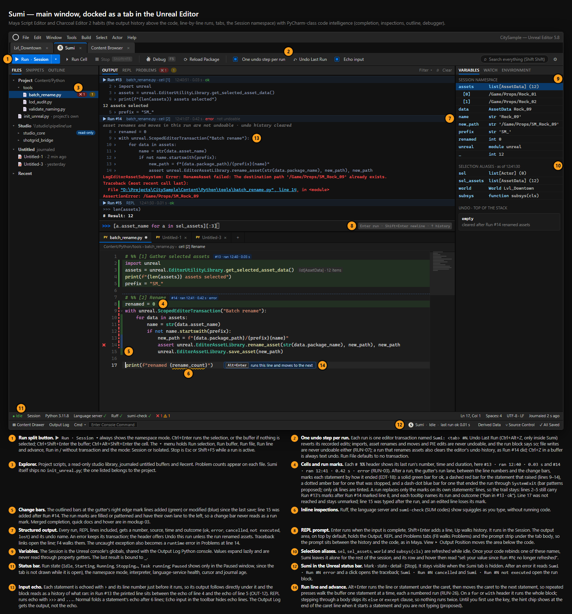
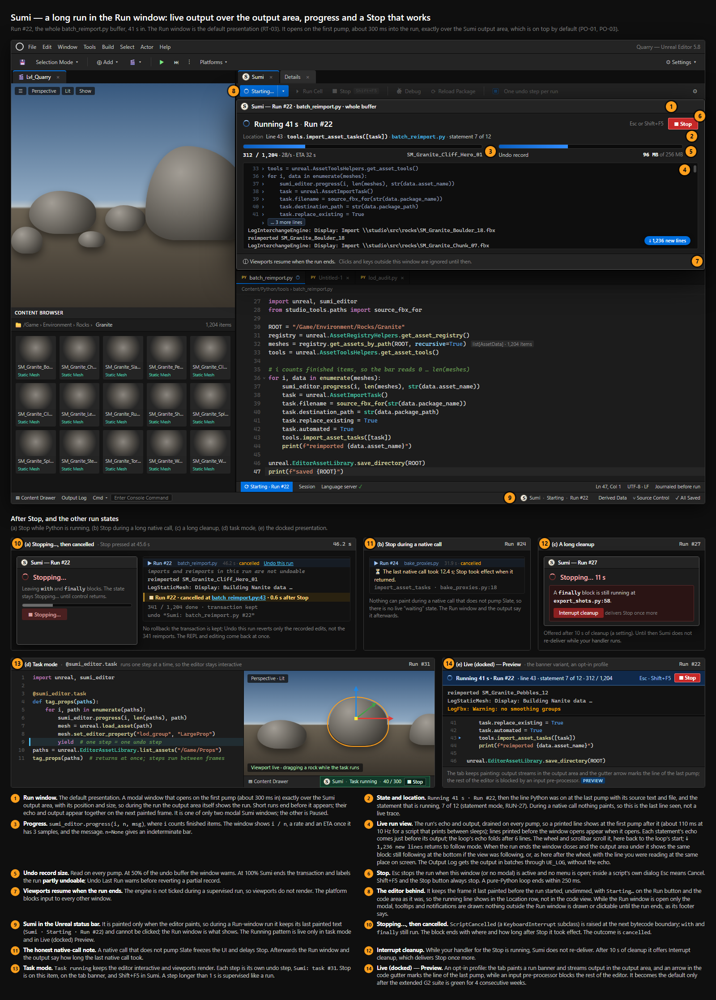
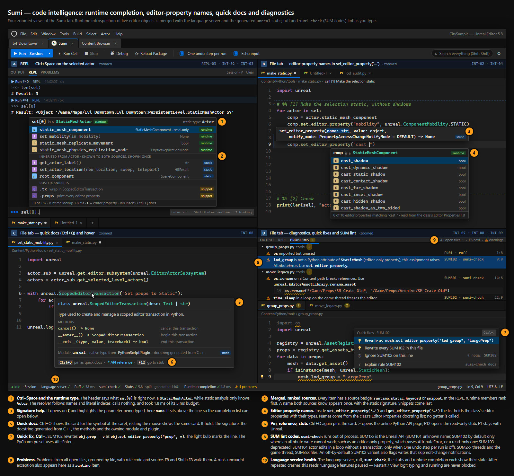
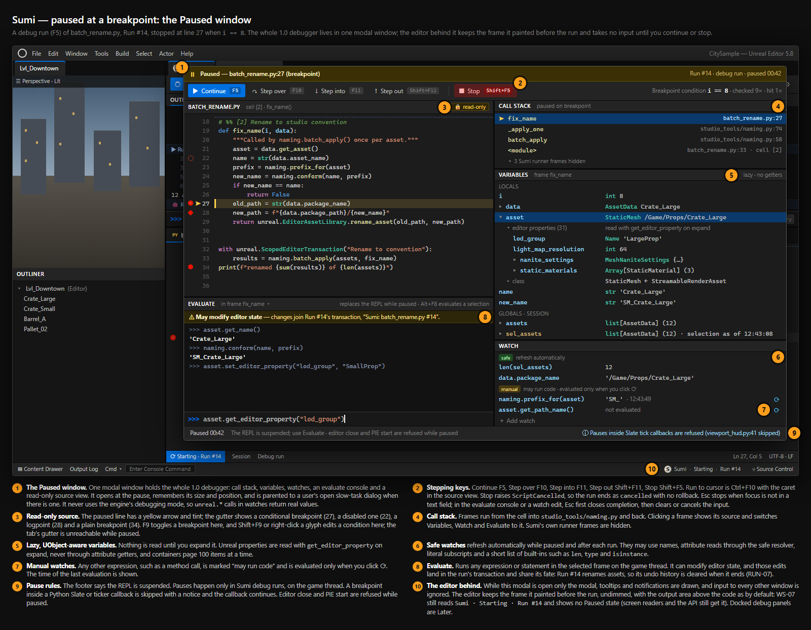
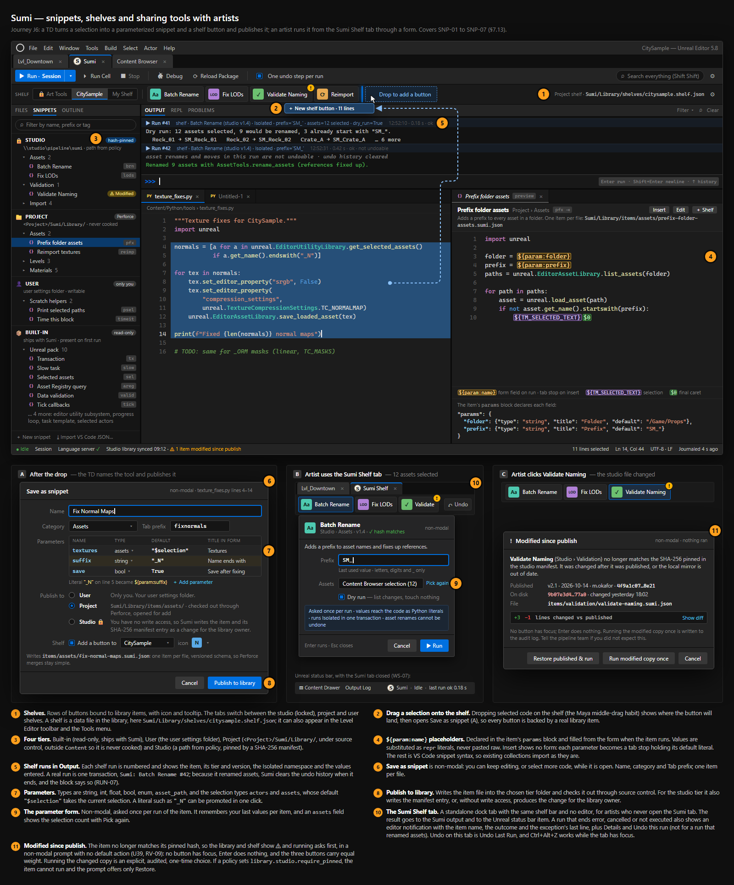
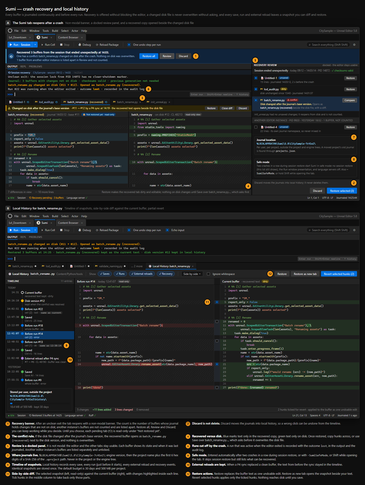
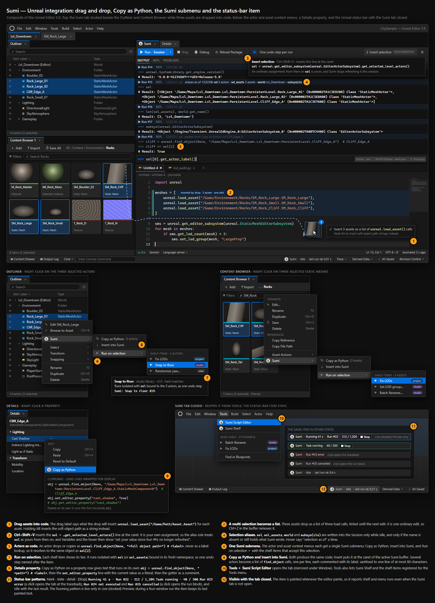
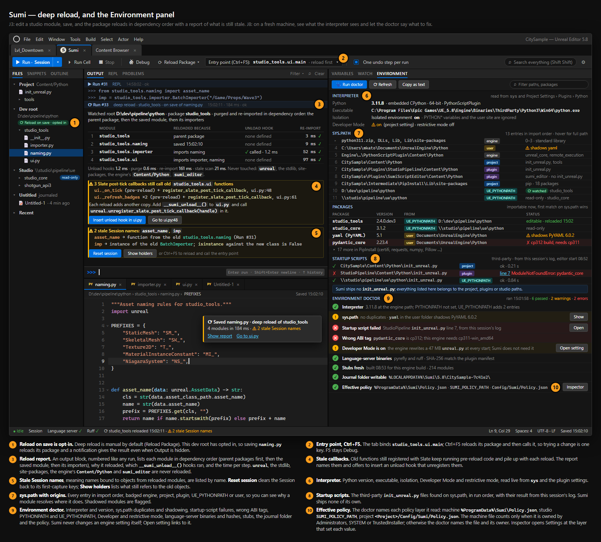
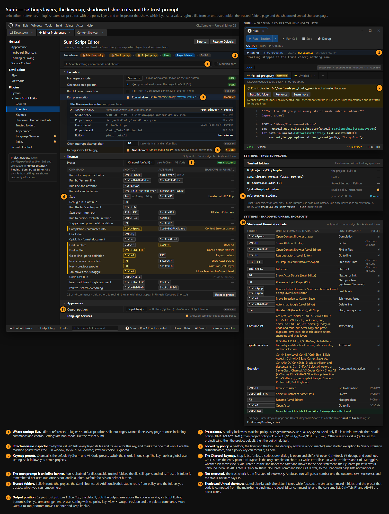
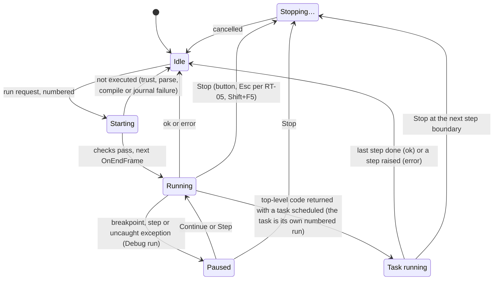

# Dream Python Editor for Unreal Engine 5.8: Product Requirements Specification

| | |
|---|---|
| **Document** | SPEC.md, the product requirements (the *what* and *why*) |
| **Companion** | [TDD.md](TDD.md), the technical design and test plan (the *how*) |
| **Version** | 1.2 |
| **Date** | 2026-10-29 |
| **Status** | Accepted for build; gated items are marked. v1.1 applies the v1.0 review ([research 13](research/13-v1-review.md), rulings RV-01–RV-24) and every issue confirmed by five verification rounds of v1.1 ([research 14](research/14-v11-verification.md)); the changes are listed in Appendix D.3. v1.2 applies the owner rulings PO-01–PO-03 ([08 §10](research/08-decision-log.md#10-owner-rulings-after-v11-po-01--po-03)) and every issue confirmed by two verification rounds of that patch ([research 15](research/15-v12-verification.md)), listed in Appendix D.4 |
| **Product** | **Dream Python Editor**, short form **Dream** (D13, U1; renamed from Sumi by owner ruling PO-06 phase 3). Plugin `DreamPythonEditor`; modules `DreamCore` (C++, no UE dependency), `DreamEditor`, `DreamMCP` (1.1, optional); Python package `dream_editor` (internals in `dream_editor._impl`); native module `_dream`; TCommands context `DreamEditor`; style set `DreamEditorStyle`; tab ID `DreamEditor.Main` |
| **Target** | Unreal Engine 5.8 editor, embedded CPython 3.11.8. 1.0: Win64 supported, Linux Preview |
| **Decisions** | [research/08-decision-log.md](research/08-decision-log.md): [§10](research/08-decision-log.md#10-owner-rulings-after-v11-po-01--po-03) owner rulings PO-01–PO-03 after v1.1, [§9](research/08-decision-log.md#9-amendments-after-the-v10-review-rv-01--rv-24) amendments RV-01–RV-24 after the v1.0 review, ADRs D1–D30, [§7](research/08-decision-log.md#7-amendments-after-the-red-team-review-rt-01--rt-20) amendments RT-01..RT-20 with the cut list, [§8](research/08-decision-log.md#8-ux-rulings-from-the-mockup-review-u1u41) UX rulings U1–U41. Where they differ, §10 wins over §9, §9 over §7, §7 over §8, and §8 over the ADR text |
| **Evidence** | [research/](research/): research reports R01–R06, engine-source verification 07a–07e, the decision log (08), the red-team review (09), the mockup reviews (10–12) and the v1.0 review (13) |

Each requirement has an ID, a **Lands** value (§6) and a testable acceptance criterion. "(gate Gn)" marks a requirement whose behaviour depends on gate Gn ([08 §3](research/08-decision-log.md#3-gates), amended by §7.2, §9 and §10). Citations: decisions as D8, RT-06, U19, RV-07, PO-02; research as R05 §2.2; engine source as `Engine/<path>:<line>`.

---

## 1. Summary

Python is the scripting language of the Unreal Editor, but Unreal has nowhere good to write it. The Output Log console is a one-line box. Running a script freezes the editor, and a runaway loop can only be stopped by killing it. Autocomplete needs a 20–50 MB generated stub that breaks Pylance and PyCharm. There is no debugger without VS Code and remote execution. Iterating on a studio package usually means restarting the editor ([R06 §3](research/06-user-voice-and-landscape.md)).

**Dream** is a **dockable, in-process Python script editor for the Unreal Editor**. It takes the muscle memory of **Maya's Script Editor and the Charcoal Editor 2 plug-in** (CE2, a paid third-party Maya plug-in by Chris Zurbrigg, not an Autodesk product, and the benchmark TDs use for an in-DCC editor, [R01](research/01-maya-charcoal-and-autodesk.md)) and adds the **code intelligence and safety nets of PyCharm**:

- **Maya and CE2 workflow.** Tabs that are never lost, the output above the code as in Maya's Script Editor, Ctrl+Enter to run the selection, Alt+Enter to run a line and move to the next, each run echoed into the output statement by statement, code never cleared on execute, a shared Session namespace, shelves and snippets.
- **PyCharm-class intelligence.** Completion that merges static analysis with *runtime* introspection of live editor objects, signature help, hover docs, diagnostics as you type, go-to-definition, local history and a debugger.
- **Unreal-native robustness.** Every run is one undo step. A long run shows a Run window over the output area with progress and live output, and Stop works on pure-Python code. The UI is Slate: no Qt, no browser runtime.

**Differentiation.** No existing Unreal option has an execution model that never strands the user (Stop that works, progress, streaming output, one undo step per run), and none offers runtime completion with no stub setup. These are the two biggest gaps in the market ([R06 §9](research/06-user-voice-and-landscape.md)).

---

## 2. Problem statement

### 2.1 Ranked pain points (evidence: [R06 §3](research/06-user-voice-and-landscape.md), [R01](research/01-maya-charcoal-and-autodesk.md), [R02](research/02-other-dcc-and-engine-editors.md))

| # | Pain | Severity | Dream's answer |
|---|---|---|---|
| 1 | The editor freezes during long scripts. You can't stop `while True:`, and output appears only at the end. 5.6 tightened the game-thread rules. | Critical | RunSupervisor and Run window, Stop on pure Python, streaming output, task mode (§7.4–§7.6) |
| 2 | No real in-editor editor; the Output Log is a weak one-line REPL with Python mixed into engine noise. | High | Docked multi-tab editor, multi-line REPL, dedicated output, a Session-sharing Output Log executor (§7.1–§7.7) |
| 3 | Autocomplete setup is painful: Developer Mode's 21–53 MB `unreal.py` exceeds Pylance, Pyright, Jedi and PyCharm limits. | High | Runtime completion with zero setup from M1; a split `.pyi` package from M2 (§7.8) |
| 4 | Module reload is unreliable, so people restart the editor. | High | Dependency-ordered deep reload, opt-in reload-on-save, entry point, stale-reference report (§7.11) |
| 5 | No debugger without VS Code, remote execution and debugpy. | High | debugpy attach (M2) and an in-editor debugger (M3) (§7.10) |
| 6 | Python and Qt version lag (5.8 is on 3.11; VFX Reference Platform 2026 asks for 3.13) and PySide regressions. | Med–High | Slate only, no PySide, a rebuild per Python version with a 3.13 canary from M2, an Environment doctor (§7.16, NFR-COMPAT) |
| 7 | Third-party package friction: wheels only, strict hashes. | Medium | Environment panel with ABI checks and a doctor; an installer is Later (§7.16) |
| 8 | Remote-execution flakiness for IDE users (UDP multicast blocked). | Medium | 1.0: debugpy, Export stubs, Open in external editor, reload on external change; 1.1: an authenticated bridge (§7.17) |
| 9 | API discoverability. | Medium | Hover docs from reflection, inspector, Copy as Python, selection aliases (§7.8, §7.12, §7.15) |
| 10 | Output appears only when the script ends, and tracebacks get lost in engine spam. The cause is that **Slate does not tick during a script**, not stream buffering ([07a Q4](research/07a-verify-python-runtime.md)). | Medium | Live output through the pump, shown in the Run window over the output area; each statement echoed with its output; per-run blocks, clickable tracebacks, runtime errors in Problems (§7.5, §7.6) |
| 11 | Not every operation is undoable, and `os.rename` breaks asset references. | Medium | One undo step per run, Undo Last Run, honest "partly undoable" labels, SUM lint codes (§7.4, §7.8) |
| 12 | Sharing tools with artists who don't code. | Medium | Shelves, the Dream Shelf tab, parameter forms, project and studio libraries (§7.13) |
| 13 | Lost Script Editor tabs after a crash (Maya's #1 complaint). | Critical | A write-ahead journal of every buffer, a snapshot before every run, recovery that never overwrites disk (§7.14) |

### 2.2 The market today

| Option | Gap |
|---|---|
| Epic Output Log Python console | One line, no completion, no tabs, blocks the UI ([R06 §2](research/06-user-voice-and-landscape.md)) |
| Minimal Effort Tech's Slate script editor on Fab ($8–10) | A deliberate scratchpad: no debugger, reload, linting or go-to-definition; runs block the UI |
| `unrealScriptEditor` (free, Qt) | Requires PySide; open bugs; Qt-in-Unreal problems |
| TAPython (AGPL) | A shelf and inspector, not a code editor; AGPL blocks many studios |
| VS Code + Nils Söderman's extension (now on Codeberg, E11) | The professional workflow today, but external: stub-based completion, remote execution, no live namespace |
| Epic 5.8 Unreal MCP / AI Assistant | AI-shaped, Experimental and NoRedist; MCP tool calls run one at a time on the game thread |

---

## 3. Product principles

These rank above any feature. When requirements conflict, the higher principle wins.

1. **Never lose work.** Every buffer, untitled ones included, is journaled continuously and before every run. A crash costs at most about two seconds of typing (G6).
2. **Never strand the user.** A running script always shows its state and offers Stop. When Stop cannot take effect, for example inside a native call, Dream says so as soon as it can paint and in the run report, and never promises what it cannot do.
3. **Muscle memory first.** The defaults match Maya's Script Editor and the Charcoal Editor 2 plug-in: Ctrl+Enter, code never cleared, a shared Session, the output above the input. PyCharm and VS Code keymaps are one setting away.
4. **Intelligence without setup.** Completion, hover and signatures work when the tab first gets focus, on any project, with no Developer Mode or stub configuration.
5. **Native and boring underneath.** Slate and public engine APIs only; no Qt, browser runtime, engine modifications, or Experimental or NoRedist plugin dependency in 1.0.
6. **Safe by default, powerful on demand.** One undo step per run, restricted mode for untrusted folders, no listening sockets in 1.0 apart from the user-started debugpy socket. Studios tighten policy; users opt into power. Dream is not a sandbox and says so.
7. **Honest and observable.** Every run is numbered, timed and logged. Language services, the interpreter and the journal show their health.

---

## 4. Goals, non-goals and success metrics

### 4.1 Goals

Goals are numbered GL-n so they cannot be confused with gates G1–G7.

- GL-1. Replace the Output Log console as the place where Unreal Python is written, explored and run.
- GL-2. Make the in-editor experience good enough that TDs open an external IDE only for large refactors.
- GL-3. Remove the top four pain points: freezes, no editor, autocomplete setup and reload.
- GL-4. Be deployable in studios: source-controlled configuration, policy controls, offline operation, no copyleft dependencies.

### 4.2 Non-goals for 1.0

- A general IDE for C++, Verse or Blueprints; a Git or Perforce client UI (checkout-on-save only).
- Running Unreal API code off the game thread: no worker lane and no `call_on_game_thread` (D24). Task mode is the supported way to keep the editor ticking.
- Rollback or dry-run: `cancel()` is never presented as rollback, and errors never roll back (D8, U9).
- A sandbox: user code runs with full editor privileges (D20).
- UEFN (third-party plugins cannot load there); replacing Epic's remote execution (the 1.1 bridge is separate, D10); a web-based editor surface (no CEF, D1); notebooks (`# %%` cells cover the need).

### 4.3 Success metrics

Measured in pilot studios through **opt-in** telemetry (D26; never on by default) and surveys.

| Metric | Target at 1.0 |
|---|---|
| Work lost to editor crashes | 0 reported incidents of lost buffers |
| Runs longer than 2 s where the user saw progress or output during the run | ≥ 95% |
| Stop requests that end a **pure-Python loop that does not swallow the exception** within 250 ms (G2(1)) | ≥ 99% |
| Fresh machine to working `unreal.` completion | ≤ 5 s after the tab first gets focus, no setup |
| Pilot TDs who no longer use the Output Log console for Python | ≥ 80% |
| Editor restarts to pick up Python changes (self-reported, weekly) | Down ≥ 70% from baseline |
| Added editor startup | ≤ 30 ms (D22) |

---

## 5. Users

### 5.1 Personas (from [R06 §6](research/06-user-voice-and-landscape.md))

| Persona | Uses it for | Must-haves |
|---|---|---|
| **P1 Pipeline TD** (film, animation, VP) | ShotGrid/USD/farm integration, studio packages, batch jobs | Deep reload, debugger, environment control, long jobs without freezes, config in source control |
| **P2 Technical Artist** (games) | Batch asset fixes, validation, editor tools, API exploration | Fast REPL, runtime completion, hover docs, snippets, Ctrl+Enter, undo |
| **P3 Artist who runs scripts** | Running TD tools on a selection | Shelf buttons, parameter forms, progress, Stop, undo, friendly errors |
| **P4 Virtual production operator** | Stage scripts under time pressure | One-click reliability, no freezes, per-run logs |
| **P5 Tools / engine programmer** | Exposing C++ to Python, editor tests | Completion of project C++ types, reflection metadata, running tests (Later, TST-01) |
| **P6 Learner / AI-assisted creator** | Learning the API, running AI-generated scripts | Discoverable docs, safe runs (undo, lint), plain errors |

### 5.2 Journeys the product must handle well

Each journey has an end-to-end test ([TDD §14.5](TDD.md#145-end-to-end-acceptance-tests-j1j8)). All eight are 1.0 journeys.

| ID | Journey | Persona | Key requirements |
|---|---|---|---|
| J1 | **Explore an API.** Select actors and type `sel[0].` in the REPL for runtime completion (the `sel` alias already holds the selection, U19); read docs with hover or Ctrl+Q, call `set_editor_property(...)` in the REPL, then Undo Last Run. **Ctrl+Shift+V** inserts the explicit `sel = unreal.get_editor_subsystem(unreal.EditorActorSubsystem).get_selected_level_actors()` line when the script must stand alone (U20) | P2, P6 | UEI-09, UEI-03, INT-01..05, REPL-01..03, RUN-07, RUN-22 |
| J2 | **Batch-process selected assets.** Run a library snippet, fill its form (the `assets` parameter defaults to the selection), watch the Run window, Stop if needed, then Undo this run or keep (property edits undo; a run that renamed or moved assets cannot be undone and clears the undo history, RUN-07), and add it to a shelf | P2 → P3 | SNP-02, SNP-04, SNP-05, LRS-01, LRS-02, LRS-04, RUN-07, RUN-22, OUT-02 |
| J3 | **Iterate on a studio module.** Save `studio_tools/importer.py`; reload-on-save (opted in for the root) reloads in dependency order; **Ctrl+F5** reloads and runs the entry point; click a traceback frame | P1, P5 | RLD-01, RLD-02, RLD-04, RUN-13, BUF-04, OUT-05 |
| J4 | **Debug a failing script.** Set a breakpoint, press **F5**; the Paused window shows stack, variables and watches; evaluate (Alt+F8), step, continue. In M2 the journey runs through Debug in VS Code | P1, P2 | DBG-01..05, DBG-07, DBG-08, VAR-04 |
| J5 | **Run a long job without freezing.** A 20-minute reimport written as a `@dream_editor.task` generator yields per asset; the editor stays interactive and viewports render; progress shows on the status-bar item and banner; Stop acts at the next item; each step runs in its own transaction `Dream: task #N`, so property edits in a step can be undone; the reimports themselves are never undoable (RUN-07), and the run block says so; a run log is saved (U10) | P1, P4 | LRS-05, LRS-04, WS-07, OUT-08, RUN-07, RUN-22 |
| J6 | **Share a tool.** Save the selection as a snippet with `${param:name}` placeholders, Publish it to the project library (studio tier per the cut list), and artists run it from the Dream Shelf tab with a form (U34) | P1, P2 → P3 | SNP-01, SNP-03, SNP-04, SNP-05, SNP-07, SNP-09, SNP-10 |
| J7 | **Run pasted or AI-generated code safely.** Paste into a scratch tab; `dream-check` flags unknown `unreal.*` names (SUM101) and foot-guns; the run is one undo step; Undo Last Run reverts it; a downloaded file opens restricted | P6, P4 | INT-07, INT-08, RUN-07, RUN-22, SEC-01 |
| J8 | **Set up a fresh machine.** Runtime completion works on first focus; the Environment panel and doctor show the interpreter, `sys.path`, packages and fixes | P1, P5 | INT-01, ENV-01, ENV-04, ENV-06 |

---

## 6. Scope and release phasing

Phasing follows [D9](research/08-decision-log.md) as amended by RT-10, RT-12, RT-13, RT-20, RV-11 to RV-14, and PO-01 and PO-02 (WS-03 moves to M1; RUN-26, RUN-27 and OUT-12 land in M1, EDT-18 in M2); the milestone plan is [TDD §15](TDD.md#15-delivery-plan). Every §7 requirement has one **Lands** value:

| Lands | Meaning | Ships as |
|---|---|---|
| **Phase 0** | Spikes, harnesses and CI (6–8 weeks); exits on G1 green or its fallback invoked, G2 green in the Run window (RV-13), the G5/G7 harness prototypes and CI tiers 1–3 (RT-10) | Internal |
| **M1** | MVP, "never loses work, never freezes"; Win64, UE 5.8; **no third-party executables ship** (the G3 harness uses CI-pinned servers internally, RV-11) | Public 0.x preview |
| **M2** | Intelligence: type server, ruff, stubs, navigation, the local-history timeline, debugpy with its policy key (RV-04) | 0.x preview |
| **M3** | Debug and iterate: in-editor debugger, reload, variables, task mode | 0.x preview |
| **M4** | Studio: snippets and shelves, trust and policy, full settings, Environment, presets, Linux Preview | 1.0 GA |
| **1.0.x** | The next engine version within 6 weeks (RT-20); cut-list items 2 and 6 if cut | Patch |
| **1.1** | Linux supported; bridge; MCP tiers 1–2; debugger GA if Preview; cut-list items 1, 3, 4, 5, 7 if cut | Minor |
| **1.2** | macOS; MCP tier 3; headless run mode | Minor |
| **Later** | Not scheduled; needs demand data or a spike | — |

**1.0 = M1 + M2 + M3 + M4**: an M2 requirement is in 1.0 and available from M2. "M1 (x); M2 (y)" splits a requirement by part. Items D9 does not name are assigned to their area's milestone (Appendix D).

**The 1.0 cut list** ([08 §7.1](research/08-decision-log.md#71-the-10-cut-list)): if the schedule slips, cut in this order; each cut moves one item and nothing else moves.

| Order | Item | Moves to | Requirements |
|---|---|---|---|
| 1 | Linux Preview build | 1.1 | COMPAT-01 |
| 2 | PyCharm and VS Code keymap presets (Charcoal stays) | 1.0.x | CFG-02 |
| 3 | Live (docked) Preview presentation (the Run window stays) | 1.1 | LRS-09 |
| 4 | Studio-tier libraries with hash-pinned manifests (user and project stay) | 1.1 | SNP-01, SNP-07, SNP-09 |
| 5 | Revert module state (deep reload stays) | 1.1 | RLD-03 |
| 6 | Diagnostics bundle UI (crash breadcrumbs stay) | 1.0.x | TEL-05 |
| 7 | In-editor debugger GA (G4 makes it a Preview; debugpy stays) | 1.1 | DBG-01..05, DBG-08 |

**Never cut:** Stop and the RunSupervisor; the journal and crash recovery; one undo step per run with Undo Last Run; clickable tracebacks; runtime completion; the consume list and G5; the trust model's restricted mode.

**Platforms** (D9; D15 as amended by RT-20): 1.0 supports **UE 5.8 only**. **Win64** is supported from M1; a **Linux Preview** ships at 1.0 (CI-built, suites green, CJK commit-only, no SLA); **Linux is supported in 1.1 and macOS in 1.2**. Every platform compiles in CI from day one. The next engine version ships in 1.0.x.

---

## 7. Functional requirements

Format: ID, requirement, **Lands**, acceptance criteria. Each requirement maps to at least one automated test in [TDD §14](TDD.md#14-test-strategy-and-traceability), listed per ID in [TDD §14.7](TDD.md#147-traceability-spec-requirement--tests). IDs are never renumbered; a requirement that no longer applies stays as **Withdrawn** with its reason; new requirements take the next free number in their area. Terms (Appendix B): a **run** is one execution of user code through the single entry path (D14), numbered `#N` per editor session (U8); the **Session** is UE's console globals dict (D8); the **RunSupervisor** keeps Stop and output alive during a run (D2); the **Run window** is its default presentation (RT-03).

### 7.1 Workspace and window (WS)

| ID | Requirement | Lands | Acceptance criteria |
|---|---|---|---|
| WS-01 | Dream opens as a dockable nomad tab (ID `DreamEditor.Main`, label **Dream**) from **Tools ▸ Dream Python Editor** (mirrored under **Window**, U1), a toolbar button and a rebindable shortcut. Its layout persists with the editor layout. The tab and buffers restore from C++ at layout restore and paint at once; Python work waits for the deferred start (ENV-06). | M1 | The tab spawns from all three entry points, returns to its dock location after a restart, and paints before `dream_editor` is imported. |
| WS-02 | Layout (U25, PO-01), top to bottom: toolbar; shelf bar (M4); **output area (above the code area by default, WS-03): Output, REPL, Problems**; a horizontal splitter; tabbed code area. Left side bar: Files, Snippets, Outline; **right side bar: Variables, Watch, Environment**; both span the full height beside the output and code areas. **One REPL prompt strip** sits below the output area's tab body (RV-18), so by default it lies between the output and the code, like Maya's input under its history: it shows for the Output and REPL tabs and hides for Problems, and the palette command **Focus REPL** reveals it. Default split (proposed): the output area takes 40% of the centre column's height, and each area keeps at least 120 px. Output shows every run as numbered blocks, REPL runs included; the REPL tab is a filtered view of the output store (route = REPL) plus the history list. The debugger lives in the Paused window (DBG-03). Panel visibility and sizes persist. | M1 (code, Output, REPL, Problems, Files); other tabs land with their features | Visibility and sizes survive a restart. No side-bar tab exists before its feature lands. The prompt strip shows under Output and REPL, hides under Problems, and Focus REPL reveals it; a REPL run appears as a numbered block in Output and in the REPL tab. |
| WS-03 | Output area position: top (default; Maya's history-above-input layout) or bottom (`layout.output_position`). `bottom` is the v1.1 arrangement (PyCharm style). It is a user setting only, with no policy key. **View ▸ Output Position ▸ Top / Bottom** and the palette commands **Move Output to Top** / **Move Output to Bottom** move the area at once, keep its size and persist (PO-01). | M1 | A fresh profile shows the output area above the code area; switching to bottom moves it below, keeps its height, and survives a restart. |
| WS-04 | Split editor groups by dragging a tab to an edge. | Later | Two groups survive a restart. |
| WS-05 | Status bar: run state with the U2 names (`Idle`, `Starting`, `Running 41 s`, `Stopping…`, `Paused`, `Task running`); namespace mode; language-service health; problem counts; cursor; indentation; encoding; line endings; journal age; "Debug server listening on 127.0.0.1:<port>" while open (U15). "In native call" is never a live state (U2). | M1 (state, namespace, cursor, journal age); M2 (rest) | Each field updates within 250 ms whenever the editor paints. No UI string uses "Cancelling" or "In native call" as a state. |
| WS-06 | Command palette (**Ctrl+Shift+P**) listing every Dream command with its chord. **Search Everywhere** (double Shift, timed inside SCodeView because it is not an `FInputChord`, 07e Q2) finds files, symbols, snippets and commands. | M2 | The palette runs any registered command. Search returns a symbol from an open file within 200 ms (proposed, as v0.9). |
| WS-07 | **Unreal status-bar item** (U14) on `LevelEditor.StatusBar.ToolBar` (`Engine/Source/Editor/LevelEditor/Private/SLevelEditor.cpp:2313`): Dream mark · state · detail · [Stop], for example `Dream · Idle · last run ok 0.4 s`, `Dream · Running 41 s · Run #22 · 312 / 1,204 [Stop]`, `Dream · Task running · 40 / 300 [Stop]`, `Dream · Run #23 error` (a click opens the traceback), `Dream · Run #24 not executed` and `Dream · Run #25 cancelled` (a click opens the run block; RV-16). It paints only when the editor paints. While the Run window or the Paused window is open, only the modal is drawn (`Engine/Source/Runtime/Slate/Private/Framework/Application/SlateApplication.cpp:1476-1497`), so the item keeps its last painted text (normally `Starting`, or Running in Live (docked) Preview) and cannot be clicked. The Running pattern is live only in task mode and in Live (docked) Preview. The item has no Paused text; `Paused` stays in the status snapshot for screen readers and the API (RV-16). | M1; M3 (task state) | With the tab closed, `Dream.RunFile <path>` shows the Run window, then the Idle text; a failing file's item opens its traceback; a file with a syntax error shows `not executed`, and a click opens its run block. During a task, the item's Stop ends it at the next step. |

### 7.2 Buffers, tabs and files (BUF)

| ID | Requirement | Lands | Acceptance criteria |
|---|---|---|---|
| BUF-01 | **Scratch** tabs are untitled (shown as `Untitled-N`), journaled and kept until closed. **File** tabs are backed by a path. Save As promotes a scratch tab. | M1 | A scratch tab survives a restart and a kill -9. |
| BUF-02 | Tabs show a language badge, dirty marker (●), path tooltip, read-only lock, **restricted** badge (SEC-01) and **recovered** marker (PER-03). Middle-click closes; tabs reorder and pin. | M1 (language, dirty, lock and recovered badges; close); M2 (pin, reorder); M4 (restricted badge, with SEC-01) | Visual states match mockups 01, 06 and 10. |
| BUF-03 | New (**Ctrl+T**), Open, Save (**Ctrl+S**, consumed), Save As, Save All, Revert, Rename on disk, Close (**Ctrl+W**, consumed), Close Others, Reopen Closed (**Ctrl+Shift+T**), switch (**Ctrl+PageUp/PageDown**), Recent Files. Ctrl+Tab stays with Unreal (U23). | M1 (new, open, save, save as, close, reopen, switch, recent); M2 (rest) | Each command works on file and scratch tabs. G5: Ctrl+S and Ctrl+W never save the level or close the major tab. |
| BUF-04 | External changes are detected through DirectoryWatcher. A clean buffer reloads as one undoable edit with a local-history entry; a dirty buffer gets a Compare / Keep Mine / Reload bar; a deleted file offers Save. Watcher actions defer while a run is active (RT-01). | M1 (detect, clean reload, deferral); M2 (conflict bar) | An external edit to a clean file appears within 2 s and Ctrl+Z restores the old text. A change during a run applies after it. |
| BUF-05 | A read-only file offers **Check Out** (async, through the source control provider), Make Writable, or Save As. | M1 (Make Writable, Save As); M4 (async checkout) | With Perforce connected, saving a read-only file checks it out without blocking the game thread. |
| BUF-06 | Encodings (D23): UTF-8 default; BOM and CRLF/LF preserved; PEP 263 cookies honoured; invalid UTF-8 opens read-only with "Reopen with encoding"; a NUL byte in the first 8 KB (without a UTF-16 BOM) means binary, refused; characters the file's encoding cannot represent block the save, with an offer to save as UTF-8. New-file defaults (UTF-8, LF, 4 spaces) are studio-configurable. | M1 | A CRLF file with a BOM round-trips byte-identical. A binary file is refused with a message. A CJK character typed into a Latin-1 file blocks the save and offers UTF-8. |
| BUF-07 | Caret, selection, scroll, folds and breakpoints are remembered per file across sessions (`UDreamPerProjectUserSettings`). | M2 | Reopening restores the caret line and scroll within ±1 line. |
| BUF-08 | Open routes: the Files side bar (project `Content/Python`, configured roots, libraries), **Open in Dream** on `ContentBrowser.ItemContextMenu.PythonData` (D30), traceback links, `dream_editor.open(path, line)`. | M1; M2 (Content Browser) | Each route opens or focuses the tab at the right line. |
| BUF-09 | Large files (D23): above 10 MB open and highlight progressively; above 50 MB read-only; Plain mode only below 1 MB; generated stubs always read-only. **Language services** (proposed): above 5 MB the type server and ruff never get the buffer, and `dream-check` gets only a skip notice and reports SUM902; a buffer that grows past 5 MB is closed in those servers, and one that drops below is reopened. Plain-mode buffers are served like any other. | M1 | A 10 MB file paints in ≤ 1 s (PERF-10). A 60 MB file opens read-only. A 6 MB file shows SUM902 and is never sent to the type server or ruff. |

### 7.3 Editing (EDT)

| ID | Requirement | Lands | Acceptance criteria |
|---|---|---|---|
| EDT-01 | Incremental highlighting by `dream::PyLexer` (line-state, Python 3.11 grammar), themeable (CFG-04). | M1 (gate G1) | The golden tokenizer corpus passes; G1(4) differential fuzzing over 10M edits matches a full retokenize. |
| EDT-02 | Line numbers, current line, indent guides, whitespace, bracket matching, matching-word highlight, change markers. | M1 (numbers, current line, brackets); M2 (rest) | Paint tests against the mockups, within PERF-04. |
| EDT-03 | Smart indent: indent after `:`, dedent on `return`/`pass`/`break`, Tab / Shift+Tab on selections, Backspace to the tab stop, per-language tabs/spaces, convert indentation. | M1 | `def f():⏎` indents 4 spaces; Shift+Tab dedents a 10-line selection. |
| EDT-04 | Toggle comment (**Ctrl+/**); duplicate line (**Ctrl+D**, consumed, never an actor duplicate); move, delete, join, case, sort lines. | M1 (comment, duplicate); M2 (rest) | A second toggle restores a mixed selection. G5: Ctrl+D never duplicates an actor. |
| EDT-05 | Auto-close brackets and quotes; type-over; wrap a selection. | M1 (pairing); M2 (type-over, wrap) | `(` with a selection wraps it. |
| EDT-06 | Multi-caret (`dream::CaretSet`): Alt+Click, add next occurrence (Charcoal **Alt+J**, proposed: bound only in level viewports in UE; VS Code preset Ctrl+D), column selection (Alt+Shift+drag). | M2 | Ten carets edit in sync and undo in one step. |
| EDT-07 | Folding (`dream::FoldModel`) by indentation and `# region` / `# endregion`; fold and unfold all. | M2 | A 200-line function folds to one line; folds persist. |
| EDT-08 | Per-buffer undo (`dream::UndoTree`) that survives save, unlimited in count but bounded in memory (proposed: max(32 MB, 4 × text size) per buffer and 256 MB per process, always keeping the newest 1,000 groups; trimming shows in the status bar). Undo history does not persist across editor restarts in 1.0; after crash recovery one undo step returns to the disk version; typing bursts grouped; programmatic edits are single steps. **Ctrl+Z in a Dream widget is always text undo and always consumed** (D8). | M1 | 1,000 edits undo in order. G5: Ctrl+Z in a buffer never undoes a level edit. |
| EDT-09 | Find (**Ctrl+F**) and replace (**Ctrl+H**) by `dream::SearchEngine`: case, whole word, regex, in-selection, preserve case, live count. | M1 (find, replace, case, regex); M2 (rest) | Regex replace with groups works; the count updates as you type. |
| EDT-10 | Font zoom per tab: Ctrl+wheel, Ctrl+= / Ctrl+-, from 50% to 300% in 10% steps; Ctrl+0 resets (D23; range proposed). | M1 | Zoom persists per tab and stops at 50% and 300%. |
| EDT-11 | Trim trailing whitespace and ensure a final newline on save (configurable). | M2 | Saving leaves no trailing spaces and one final LF. |
| EDT-12 | Snippet expansion (Tab after a prefix) by `dream::SnippetEngine`, syntax per SNP-02. | M4 | `trans⇥` expands to a `ScopedEditorTransaction` block. |
| EDT-13 | Minimap (off by default). | Later | Clicking it scrolls there. |
| EDT-14 | IME by platform (D23): Windows inline TSF/IMM; Linux commit-only through OnKeyChar (an engine limit, `Engine/Source/Runtime/ApplicationCore/Public/GenericPlatform/GenericApplication.h:550`); macOS inline, deactivated during runs. | M1 Windows (gate G1); M4 Linux Preview (commit-only), supported in 1.1; 1.2 macOS | G1(3): a 30-minute scripted session with MS-IME Japanese, Microsoft Pinyin and Korean has zero desyncs, and the manual checklist passes. |
| EDT-15 | **Plain mode** (D1): per buffer, the stock `SMultiLineEditableText` with live syntax update off, for files below 1 MB; the fallback if G1's IME criterion fails. | M1 | Switching modes keeps text, caret and undo history. |
| EDT-16 | Column math uses measured glyph advances, because CJK fallback glyphs are not on the monospace grid (D1, D23). | M1 | The CJK column-alignment golden test passes. |
| EDT-17 | **Hidden characters are visible** (proposed): bidirectional controls (U+202A–202E, U+2066–2069, U+200E, U+200F, U+061C), zero-width characters and C0 controls are drawn as visible labels with a warning squiggle, so pasted forum or AI code cannot hide text (J7). | M1 | A Trojan-Source sample shows every control as a label with a squiggle; copying keeps the original characters. |
| EDT-18 | **Ran-line markers** (PO-02). After a statement-mode run of a buffer (RUN-27), the gutter marks the lines of each statement that **completed** (a thin bar in the ok colour, with a light line tint, as in mockup 01), the statement that **raised** (error colour; OUT-11 still adds its `runtime` Problems item at the raising line), the statement that was running when Stop took effect (cancel colour), and the statement that ended the run through `SystemExit` (exited, with its own bar pattern). Only ok lines are tinted. Statements not reached stay unmarked. Colour is never the only signal (A11Y-05): the bar has a tooltip "Ran in #22 · ok", "Raised in #22", "Stopped in #22" or "Exited in #22 (code 0)". **The marks keep the line-by-line trail:** a run replaces only the marks on the lines of the statements in its range, so marks on other lines stay, each naming its own run; a whole-buffer run therefore replaces all marks, and a Run File of the buffer clears them. An edited line loses its mark, and lines map through edits with `dream::TextBuffer::MapLine` (TDD §4). The View menu has a toggle that hides them and **Clear Ran-Line Marks**. `_dream.run_statement` (RUN-27) records which statements started and returned; at run end the outcome says how the last started statement ended. | M2 | After a five-statement buffer run that raises in statement 4, statements 1–3 show the ok mark, statement 4 the error mark, statement 5 none; editing line 2 removes its mark. Five Alt+Enter presses leave five ok marks, each naming its own run. |

### 7.4 Execution (RUN)

Every route that executes user code goes through `FDreamRunService` (queue, records, numbering) and one entry call (D14), one run at a time. Runs start from a one-shot `FCoreDelegates::OnEndFrame` handler (RT-01).

| ID | Requirement | Lands | Acceptance criteria |
|---|---|---|---|
| RUN-01 | **Run selection or buffer**: **Ctrl+Enter**; **Numpad Enter** on Win64 only, by extended-key detection, never main Enter (gate G7). A selection that starts mid-line is extended to its line start (RT-14). | M1 | Unselected code does not run. G7: keypad Enter is told from main Enter in 100% of synthetic cases, including over Remote Desktop, or the binding is removed. |
| RUN-02 | **Run whole buffer** (**Ctrl+Shift+Enter**). **Run current line or statement** (**Ctrl+Alt+Enter**), compiled by the RUN-06 rule. **Statement extent** (PO-02): a line that opens a compound statement (its first token is `if`, `while`, `for`, `try`, `with`, `def`, `class` or `async`, or its last token, ignoring a comment, is `:`, so a one-line header such as `try: import json` counts) runs the whole compound statement, including its indented body and its continuation clauses (`elif`, `else`, `except`, `finally`, `case`); a line inside an open bracket, an open triple-quoted string or after a trailing backslash extends to the end of that logical line; a decorator line extends through the decorated definition, and a `def` or `class` line takes its decorators with it. Otherwise the single line runs (an indented line through the RT-14 wrapper). Run line and advance (RUN-26) uses the same extent. | M1 | An indented line runs without `IndentationError` and reports its real line number. With the caret on a `for` header, the whole loop runs; on the first line of a call whose arguments span three lines, the whole call runs; on a decorator line, or on the `def` line below it, the decorated function is defined; on `try: import json` above `except ImportError: json = None`, both lines run from either caret. |
| RUN-03 | **Run cell**: `# %%` cells (a header is a line matching `^[ \t]*#[ \t]*%%` whose `#` starts a comment outside any string; text before the first header is an implicit cell); Run Cell (**Ctrl+Alt+Shift+Enter**), Run Cell and Advance (**Alt+Shift+Enter**). Cell headers show the last run number, time and duration. | M2 | Only cell 2 of three runs; its header shows "#14 · ran hh:mm · 0.4 s". |
| RUN-04 | **Code is never cleared on execute** (D8). Only the REPL line moves, into history. | M1 | After every run command the buffer is byte-identical. |
| RUN-05 | **Journal snapshot before every run** (D8, D17; §4 correction), taken in `Starting`. Only Run File saves to disk first. "Save on execute" (CE2 parity) is opt-in, off by default. | M1 | Ctrl+Enter on a dirty file leaves the disk file unchanged and the buffer in the latest journal generation. |
| RUN-06 | **Correct line numbers** (D8, RT-14). Untitled buffers compile as `<dream:Untitled-3#a41f>` (the id is the first 4 hex digits of the buffer FGuid, extended until it is unique among known buffers), registered in `linecache` with `mtime=None`; dirty saved files register their buffer text under the real path. A selection starting at column 0 compiles with `ast.increment_lineno(start - 1)`; otherwise the runner parses `"if True:\n" + text`, takes `body[0].body` and calls `increment_lineno(start - 2)`, keeping indentation so 3.11 carets stay exact and triple-quoted strings compile. | M1 | Lines 40–45 raising on 43 report `line 43` with correct carets and a link to line 43. An indented selection with a triple-quoted string compiles. |
| RUN-07 | **One undo step per run** (D8, RT-08, U3, U9). **On** for selection, line, cell, buffer, REPL, console, shelf and snippet runs; **off** for Run File and headless runs, with **Run in transaction**. Entry-point runs: on; reload, reload-on-save and revert runs: off, because imports are never undoable. Title `Dream: <tab> #N` (the item name for shelf runs; `Dream: task #N` for task steps). `FDreamTransactions` pairs Begin/End on every exit path. **Errors and cancels keep the transaction; no rollback.** **Size watch:** each pump compares the open transaction's `FTransaction::DataSize()` (`Engine/Source/Editor/UnrealEd/Classes/Editor/TransBuffer.h:106`) with `UndoBufferSize`: 50% warns; 100% stops recording and marks the run **partly undoable**. A purged or user-cancelled transaction is reported. Imports and reimports, asset renames and moves (packages, redirector and registry are not transacted; a run in a transaction that renamed assets clears the editor's undo history, TDD §5.9.2), and PIE edits are never undoable, and the block says so (TDD §5.9.2); file writes, package saves included, are never undoable either, and Dream does not detect them. | M1 | 500 moved actors undo with one Ctrl+Z. A raising run keeps its edits and offers Undo this run. A 10,000-object Run File in a transaction warns at 50% and is partly undoable at 100%. |
| RUN-08 | **Auto-print** (D8) for Session runs: `dream_editor._impl.autoprint` rewrites the last top-level expression to print `# Result: <repr>` (truncated at 10,000 characters with an expander) and bind `_` in the Session; `None` is suppressed; off for Run File and Isolated runs. Only the last top-level expression prints (proposed: no "each expression" option in 1.0, PO-02); in statement mode (RUN-27) the rewritten statement runs last, so its `# Result:` line follows its echo (OUT-12). | M1 | `len(assets)` prints `# Result: 12` and sets `_`. A file ending in an expression prints nothing. |
| RUN-09 | **Withdrawn** — dry-run needed rollback; Dream never presents `cancel()` as rollback (D8, U9). A snippet may declare a `dry_run` parameter (SNP-05). | — | — |
| RUN-10 | **Namespaces** (D8). **Session** (default for selection, line, cell, buffer, REPL and console runs) is UE's console globals dict, captured by an entry command passing `globals()` and re-captured after a Python restart; it is shared with the Output Log console and Public-scope `init_unreal.py` names (E4). **Isolated** (a fresh dict, `__name__ == '__main__'`, real `__file__`) is the default for Run File and shelf and snippet items and an opt-in per tab; it is kept as the **last-run namespace** until the next run. **Reset Session** restores the first-capture keys, keeps the dict object and never touches `dream_editor` (RT-15). No per-tab namespaces in 1.0 (RUN-23). | M1 | A name from tab A is visible in tab B and the Output Log console, not in Run File. After Reset Session the dict `id()` is unchanged. |
| RUN-11 | **Dunders and paths** (D8). `__name__ == '__main__'` for every buffer run. Saved files get the real `__file__` for the run, and the old value is restored even if the key was deleted mid-run (E4); untitled buffers get none. Run File prepends its directory to `sys.path` and afterwards removes only that entry, if still present. No whole-`sys.path` restore and no `os.chdir`; permanent paths go in UE's AdditionalPaths (deep link). | M1 | `__main__` blocks run. After Run File its directory is gone from `sys.path`, an entry the script added stays, and the cwd is unchanged. |
| RUN-12 | **Run records** (`FDreamRunService`): number `#N` (per session from 1, U8), route, source and range, start, duration, **outcome** (`ok`, `error`, `cancelled`, `not executed`, `lost`; U2), output range, transaction title and flags, native time, and the journal generation that ran. `lost` is recorded on recovery (PER-03). History is a filterable run index in Output with re-run. | M1 (records); M2 (browse, re-run) | History keeps the last 500 runs. Re-run executes the recorded snapshot. A run killed by kill -9 shows as `lost` next session. |
| RUN-13 | **Entry point per tab** (D18): bind `module.function` to **Ctrl+F5** (U21), optionally after a deep reload of its package. | M3 | Ctrl+F5 reloads `studio_tools` then calls `main()`, as one numbered run. |
| RUN-14 | **Run with arguments**: `sys.argv` for Run File, saved per file. | Later | `sys.argv[1:]` matches during the run and is restored after. |
| RUN-15 | **Console passthrough**: `!stat fps` in the REPL runs a console command. | Later | `!stat unit` toggles the display. |
| RUN-16 | **Parse before run.** A syntax error runs nothing; the caret goes to CPython's reported position (for "'(' was never closed", the opening bracket); the run ends `not executed` with its number (U7). | M1 | An unclosed `(` reports at the bracket, nothing executes, and the block reads "Run #32 · not executed". |
| RUN-17 | **Withdrawn** — "run in context" bindings are replaced by the selection aliases (UEI-03, U19) and the `actors` / `assets` parameters (SNP-05, U32). | — | — |
| RUN-18 | **`SystemExit` is never silent.** The footer reads "exited (code n)" for every code; 0 or `None` gives `ok`, anything else `error`. (The engine path swallows `SystemExit(0)`, R04 §1.5.) The editor never quits. | M1 | `sys.exit(0)` → `ok`, "exited (code 0)"; `sys.exit(3)` → `error`; the editor keeps running. |
| RUN-19 | **Single entry path** (D14, RT-01, RT-15). From the `OnEndFrame` handler (`IsTicking()` false, no pointer capture), `IPythonScriptPlugin::ExecPythonCommandEx` runs `__import__('dream_editor')._run(<id>)` in EvaluateStatement mode with **Flags None (attended)**, which sets `GIsRunningUserScript`. `dream_editor._impl.runner` compiles under the real or pseudo filename and catches every `BaseException`, so reinstancing is always processed (E9) and tracebacks are Dream's. Other run commands are disabled while a run or task is active; Dream's helpers never execute user code. | M1 | `import x  # see foo.py` runs as code. A static check finds no path to Python except `_run`. A failed run still processes reinstancing. Rebinding `dream_editor` in the Session does not break the next run. |
| RUN-20 | **`Starting`** (U7): after the request gets its number, run the trust check (SEC-01), parse check, journal snapshot, and (Run File) save. Any failure ends the run `not executed`, with an output block. Aliases refresh just before, while idle (UEI-03). | M1 (trust check from M4) | An untrusted file, a syntax error and a simulated full disk each end `not executed` with a number and no user code run. |
| RUN-21 | **Split Run button** (U6): `▶ Run · Session ▾`, with Run selection, Run buffer, Run file, Run in / without transaction, and Session / Isolated. The label shows the mode the next click uses. | M1 | Choosing Isolated relabels it `▶ Run · Isolated` and the next run cannot see Session names. |
| RUN-22 | **Undo Last Run** (D8, RT-08, RT-09, RT-16): toolbar, the run header's **Undo this run**, and **Ctrl+Alt+Z** only inside Dream widgets, never global. It first checks that Dream's transaction is on top (title and counter) and that `GEditor->Trans` is the standard buffer (07e Q6), then calls `UndoTransaction`. It shows the record size, warns before eviction and before reverting a partial record, and for a task walks back consecutive `Dream: task #N` steps to the first foreign one ("12 of 40 steps; a manual edit after step 12 blocks the rest"). | M1; M3 (tasks) | After a run and a manual edit, it refuses with "a later edit is on top". G5: AltGr+Z / AltGr+X on a Polish layout fire no Undo Last Run. |
| RUN-23 | **Per-tab persistent namespaces**: not in 1.0 (D8); reopened only if the TD survey asks (§13). | Later | A 1.0 test asserts the namespace menu offers only Session and Isolated. |
| RUN-24 | **Run File**: saves (Make Writable or checkout if read-only), then runs the file on disk in an Isolated namespace, with no auto-print and no transaction by default (RT-08). | M1 | Run File on a dirty tab saves then runs the saved text; the block shows "One undo step per run: off (Run File)". |
| RUN-25 | **Headless run mode** (D27): a saved file runs in a supervised `UnrealEditor-Cmd -run=PythonScript` child process with streamed output, progress lines, a Stop that ends the process tree, an exit-code-to-outcome mapping and a clear "no access to this session" label. | 1.2 | A headless run streams its output; exit code 0 gives `ok` and 3 gives `error`; Stop ends the child and its children. |
| RUN-26 | **Run line and advance** (PO-02; command `RunLineAdvance`): Charcoal **Alt+Enter** (proposed); the VS Code preset is the same; the PyCharm preset leaves it unbound, because Alt+Enter is Quick fix there, and it is in the palette and the Run button menu. **No selection:** runs the current line or statement by the RUN-02 extent, then moves the caret to the first non-blank column of the **next statement**: the first line after the executed range that is not blank, not comment-only and not a continuation line, skipping the clauses (`elif`, `else`, `except`, `finally`, `case`) of a compound statement whose body the run was inside, so stepping through a body never re-runs the statement from its header. The view scrolls to keep the caret visible. **With a selection:** runs the selection (RUN-01 rule), clears the selection and moves the caret the same way from the selection's last line. At the end of the buffer the caret stays and the status bar says "End of buffer". Each press is one numbered run (U8) in the Session with its own undo step (RUN-07), its output block in the output area and its echo (OUT-12), so repeated presses walk the buffer statement by statement, as in Maya. Until the first use, a hint chip "Alt+Enter runs this line and moves to the next" shows at the end of the caret line when it starts a statement and nothing is being typed, and only while the command has a chord (proposed; TDD §4.9.4). No main-frame, Level Editor or consume-list command binds Alt+Enter in 5.8; the only bindings are tool-local, the PCG HLSL editor's Apply Changes (`Engine/Plugins/PCG/Source/PCGEditor/Private/Widgets/SPCGCodeEditorTextBox.cpp:69`) and the game viewport's fullscreen toggle (`Engine/Source/Runtime/Engine/Private/GameViewportClient.cpp:674`, `bAltEnterTogglesFullscreen`), and neither acts while a Dream widget has focus. | M1 | On a buffer of five statements, five Alt+Enter presses give runs #N..#N+4, one per statement, and the caret ends on the last line with "End of buffer". With the caret on a `for` header, the whole loop runs and the caret lands on the line after its body. Stepping through an `if` body with Alt+Enter lands after its `else` clause, never on it. |
| RUN-27 | **Statement mode for Session runs** (PO-02). **Routes:** every route whose auto-print is On ([TDD §5.2.1](TDD.md#521-routes): selection, line, cell, buffer, REPL, console executor; bridge from 1.1), and API runs that target such a tab. Run File, Isolated runs, shelf and snippet items, entry points, reload routes and task steps do not use statement mode (one `exec`, or for entry points, reloads and task steps their own calls, TDD §5.3.7). **Prepare** (in `Starting`): parse once; apply the RUN-06 line offset and the RUN-08 auto-print rewrite; compile the whole module once, exactly as today, so every compile-time error, including "`from __future__ imports must occur at the beginning of the file`", ends the run `not executed` before any code runs (RUN-16 unchanged); then compile each top-level statement as its own code object, `compile(ast.Module(body=[stmt], type_ignores=[]), filename, "exec", flags=future_flags, dont_inherit=True)`, where `future_flags` is the OR of the `compiler_flag` of every `__future__` feature that the module's leading `from __future__` imports name, with warning display silenced for those compiles only, because the whole-module compile has already shown their compile-time warnings once; the warning filters are not changed, so a warning shown once per location (such as a `DeprecationWarning` from a deprecated `unreal` API) still shows once per session, as with one `exec`. **Bare strings:** a statement after the first that is a bare string constant is echoed but not executed: compiled alone it would be a module docstring and rebind `__doc__` in the Session, and it has no effect anyway. The run's first statement keeps one-`exec` semantics (a leading docstring sets `__doc__`), and a trailing string that the auto-print rewrite turned into a display call runs. Evidence: [research/probes/v12/stmt_mode.py](research/probes/v12/stmt_mode.py), run on the engine's `python.exe -I -B` (3.11.8). **Execute:** for each statement in order, one C call, `_dream.run_statement(run_id, index, code_i, ns)`, checks Stop, echoes the statement (OUT-12), evaluates it as `exec` does in the same dict with the same filenames and line numbers, and counts it as returned, so tracebacks, `linecache`, `inspect.getsource` and breakpoints behave as with one `exec`; when the module has an annotated assignment, `__annotations__` is created before statement 1, as one `exec` does, so `__annotations__` matches too. An exception or Stop ends the run at that statement; later statements do not run, even when the script caught and swallowed the Stop. Debug runs (F5) on these routes use statement mode too; the runner's frames are never user frames, so at a statement boundary Step over and Step into continue to the first line of the next statement. The cost is one C call per top-level statement (proposed budgets: ≤ 5 µs per statement to run it, and ≤ 10 µs per statement for its extra compile in `Starting`; a loop is one statement, so the G2 numbers are unchanged). | M1 | A three-statement buffer whose second statement raises runs statement 1, reports the error at its real line, and never runs statement 3. With `from __future__ import annotations` first, a function's `__annotations__` and the module's `__annotations__` equal those of one `exec`. A bare string in mid-buffer leaves `__doc__` unchanged, and a leading docstring sets it. A misplaced `from __future__` import ends the run `not executed` with nothing run. A statement that catches and swallows Stop does not let the next statement start. |

### 7.5 Long-running scripts, progress and cancellation (LRS)

The engine runs Python on the game thread, so the editor neither ticks nor paints during a script ([R05 §2.2](research/05-architecture-and-robustness.md); [07a](research/07a-verify-python-runtime.md), [07b](research/07b-verify-slate-reentrancy.md)). The mechanism is D2 as amended by RT-01..RT-07; PO-03 makes the Run window the live output area.

| ID | Requirement | Lands | Acceptance criteria |
|---|---|---|---|
| LRS-01 | **RunSupervisor and the Run window** (D2, RT-03, RT-04). `FRunSupervisor`'s watchdog thread arms about 300 ms into a run, keeps one `Py_AddPendingCall` outstanding, forces a GIL hand-off after each post so that a pure-Python loop notices it (RV-01), and requests pumps at 10–20 Hz. Each pump (GIL released) runs `PumpMessages()` if no modal is active, `FSlateApplication::Tick(All)`, a guarded RHI EndFrame and `Renderer->Sync()`, and **never ticks FTSTicker or GEngine**. The default presentation, **`SDreamRunWindow`**, is a modal popup window (`AddModalWindow`, slow-task flag, `IsPopupWindow`, so it never becomes the window that script tool windows are parented to; RV-02) that **opens on the first pump exactly over the output area** (PO-03): the same screen position and size, from the output widget's cached geometry captured at entry and placed in desktop pixels with no DPI rescaling, so at the top by default (WS-03). Each dimension has its own minimum (proposed): 480 wide, and tall enough for the window's other rows plus 5 lines of the live run view, about 280 at 100% (the v1.1 minimum of 200 px would leave the live view no line). A shorter output area gets a window of the minimum height, growing toward the code area (down in the top layout, up in the bottom layout), and an area narrower than 480 gets a 480-wide window from its left edge; the window is kept inside the monitor's work area, and a note that appears while it is at the minimum height (such as the native-call note, LRS-03) grows it, so the live run view keeps 5 lines. If the Dream tab is not visible, the window is 640 × 360 and centred on the active window, so shelf and menu runs can be stopped (proposed). It shows `#N`, elapsed, state, the **Location** row, progress, the **live run view**, a transaction meter, Stop with the hint "Esc or Shift+F5" beside it, and the hints "Viewports resume when the run ends" (U11) and "Clicks and keys outside this window are ignored until the run ends" (RV-17). The **Location** row shows the executing line with its source text from the snapshot, "Line 43 · `for a in actors:` · fix_materials.py" (and the innermost frame if different), and in statement mode (RUN-27) the statement index, "statement 7 of 12" (proposed); a pump or Stop that lands between two statements shows the last started statement's lines, and a run whose code was read from a file, such as an API run of a file, shows the line and file without source text (proposed). The **live run view** is a read-only `SCodeView` over `FDreamOutputLineSource` filtered to this run: the run's echo lines (OUT-12) and output as each pump drains them (a written line is painted by the first pump that starts at least 5 ms after it is written: about 110 ms at the G2(3) floor of 10 Hz for a script that prints between sleeps, and later while a native call holds the game thread, LRS-03; lines written before the window opens appear when it opens), with follow mode and the "↓ n new lines" chip (OUT-09), folded as the Output preset says. When the run ends, the window is destroyed and the output area under it shows the same block, scrolled the same way (proposed): if the live view was following, the area's Output (or REPL) view follows, with the run's last line at its bottom; if the user had scrolled back, the line at the top of the live view stays at the same place on screen, or, where that place is outside the output view (a window that grew past a short output area), it is shown at the view's nearest row, and for a window that opened centred (the Dream tab not visible) the reading line is put at the view's top row (TDD §5.5.3) (proposed). If the active tab cannot show a run (Problems, or REPL for a run that is not a REPL run), the area switches to Output when the run starts, so short runs, an Alt+Enter walk included, switch too and their echo and output stay in view (proposed). **Short runs**, which end before the first pump (about 300 ms, RT-04), never open the window: the editor cannot paint while Python holds the game thread, so their echo and output appear together when the run returns, on the next painted frame; Dream never promises per-line painting for them. The code area is not drawn during a run (RV-16, RV-17), so the executing line is shown in the Run window, not in the code view. The editor behind keeps its last painted frame, undimmed (RV-17). `FDreamInputPreProcessor` swallows input from the first pump, except Stop targets and the mouse-wheel events, scrollbar drags, "↓ n new lines" clicks and echo fold-chip clicks whose target is the live run view, as docked mode passes the output view (LRS-09). | M1 (gate G2) | G2(3): ≥ 10 Hz repaint at 1,000 lines/s with `LogOutput` bounded. G2(4): overhead ≤ 10%, fail above 15%. G2(5): zero input leaks, including before the modal opens; wheel and scrollbar in the Run window scroll its view, and no input reaches any other window; a PySide window parented during a 2 s run is still visible and owned by the main frame after the run (RV-02). G2(6): foreign Python callbacks fire 0 times. A script that prints a line and then sleeps 200 ms, 25 times, shows its lines in the Run window, which covers the output area: lines printed before the window opens appear when it opens, and every later line within 150 ms of its print (proposed), with its echo above it; the Location row names the executing line and its source text; the wheel scrolls the live view; after the run the output area shows the same block, still following, or with the scrolled-back line where it was. At 125% and 150% DPI the window still matches an output area at least as large as its minimum size within 4 px. |
| LRS-02 | **Stop works on pure Python** (D2). Stop raises `dream_editor.ScriptCancelled(KeyboardInterrupt)` (E5), first through the next pending call (`PyErr_SetObject`, return -1), then by re-delivery every 250 ms once the exception was swallowed (LRS-12), and from 1 s also through `PyThreadState_SetAsyncExc`. Every delivery checks the run ID; at run end the ID is invalidated and the queues drained. Never `PyErr_SetInterruptEx`, signals or kills. | M1 (gate G2) | G2(1): p99 ≤ 250 ms for `while True: pass`, a list comprehension, a generator and deep recursion; ≤ 1.25 s with a bare `except:` or `except KeyboardInterrupt: pass`. G2(2): 1,000 run/stop cycles, PIE running, zero crashes and no stale `ScriptCancelled`. |
| LRS-03 | **Honest native-call reporting** (D2, U2; §4 correction). Nothing can paint during a native call, so there is no live native state. The watchdog counts a pending-call gap of at least 100 ms (one period at 10 Hz) as native time, and shows the live note only for a gap over 1 s, so jitter is not reported. The next pump shows "The last native call took 11.2 s; Stop took effect when it returned"; the run report gives the total. A native call's own slow-task dialog keeps painting through the pump. | M1 | Stopping during a 10 s native call shows the note at the next pump, stops at the next statement, and the report gives the native time. |
| LRS-04 | **Cooperative API** (D2, D24, U12): `progress(i, n, msg)` with `i` = items completed (0…n), shown as `i / n` with a rate and an ETA after 3 samples, `n=None` indeterminate; `check_cancel()` raises `ScriptCancelled` if Stop was requested; a run-scoped game-thread `time.sleep` shim sleeps in slices. Stop also calls `FFeedbackContextEditor::OnUserCancel()` on `GWarn`, so `ScopedSlowTask.should_cancel()` is True. Native side: `_dream.progress`, `_dream.check_cancel`. | M1 | `progress(312, 1204)` shows `312 / 1,204` with rate and ETA. Stop during `time.sleep(30)` ends the run within 250 ms. |
| LRS-05 | **Task mode** (D24, RT-01, RT-09, U10, U11). Calling a `@dream_editor.task` generator function in a run schedules it; the task is its own numbered run (D24, U8); it starts at the first `OnEndFrame` after the creating run ends and enters **`Task running`**. Steps run once per frame from `OnEndFrame`, each in its own transaction `Dream: task #N`. **The editor stays interactive and viewports render.** Stop (WS-07 item, task banner, Shift+F5 with Dream focused) acts at the next step; a step over 1 s is supervised like a run. One task at a time; other runs are disabled meanwhile (D14), and runtime completion and Variables pause (D6). | M3 | D24 soak: 20 minutes, 10,000 items, viewport ticking, Stop within one item, a per-run log. After a PIE start and a manual edit mid-task, Undo Last Run reports its step count. |
| LRS-06 | **Soft limit**: optional "warn after N seconds" in the Run window or task banner; never kills. | M2 | The note appears at the threshold and the script continues. |
| LRS-07 | **Freeze-pattern lint** from `dream-check` (U5): SUM201 `unreal.*` in a threading target, SUM202 `time.sleep` in a game-thread loop, SUM203 `asyncio.run` on the game thread; proposed SUM204 `input()` and SUM205 `Thread.join()` without timeout on the game thread. Warnings only. | M1 | Each code fires on its fixture and not on its negative fixture. |
| LRS-08 | **Worker threads** (D24): no worker execution lane and no `call_on_game_thread` in 1.0. The documented pattern is threads feeding a `queue.Queue` consumed by a `@task`. Worker output is labelled with the thread name, then "background" after the run. Stop cancels only the game-thread run; threads still alive at run end are listed, never killed. | M1 (capture, list); M3 (pattern) | A thread printing every 100 ms is labelled, then tagged "background"; the report lists it. |
| LRS-09 | **Live (docked) Preview** (RT-03): opt-in, policy-forceable. The tab keeps painting a run banner, streaming output and Stop, plus an execution arrow in the code view's gutter at the line of the last pump (PO-03), because docked mode repaints the tab; the pre-processor passes only Stop targets, the banner, the output view and the WS-07 Stop; buffers are read-only; `RegisterCanCloseEditor` and `OnWindowAction` vetoes are set; no `SetAsyncExc` while the pump depth is above 0. Default only after the extended G2 is green 4 consecutive weeks and a nested-foreign-Python policy exists. | M4 (gate G2); cut list #3 → 1.1 | The extended G2 (09 §4 plus RT-03 hazards: EUW Blueprint tick calling Python, a queued `AsyncTask(GameThread)` firing a Python delegate, title-bar drag, minimise, maximise) passes in this presentation. During a docked run, the gutter's execution arrow is at the line of the last pump. |
| LRS-10 | **Presentation setting** `run.presentation` (RV-07): `run_window` (default) or `live_docked` (Preview). **Kill switch** `run.pump`: `off` gives stock blocking, no watchdog and no pump; task mode still works. Policy can force either key; safe mode forces the Run window (PER-06). | M1; M4 (`live_docked`) | With `run.pump` forced to `off`, a run installs no pending call or pre-processor and the setting is read-only. |
| LRS-11 | **Stop routing** (D8, RT-05, E8). From the first pump, the pre-processor sees every key delivered to the active modal (Run window) or to any window (docked Preview); keys pressed before the Run window appears are discarded (RT-04). **Esc** stops only when the active modal is the Run or Paused window, or none, and no menu is open; otherwise it passes through so a script's dialog gets Cancel. **Shift+F5** and Stop buttons work in every context. Ctrl+Break cannot be bound (E8). | M1 | G5: Esc in a script's `show_message` returns Cancel and the run continues; Shift+F5 then stops it. Esc or Shift+F5 pressed after the Run window appears stops the run. |
| LRS-12 | **Cleanup is respected** (RT-06). While `PyErr_GetHandledException()` is Dream's `ScriptCancelled`, nothing is re-delivered. `_run` calls `_dream.user_code_done(run_id)` first in its handler, and delivery stops before Dream's cleanup. After **10 s** of cleanup (a setting) the Run window and banner offer **Interrupt cleanup** (one re-delivery). The UI says `Stopping…` until control returns. | M1 | G2(1): a 3 s `finally` completes with no `ScriptCancelled` inside it. A 15 s `finally` offers Interrupt cleanup at 10 s. |
| LRS-13 | **Pump guards** (RT-01, RT-02). The pump and cancellation delivery are deferred (the pending call re-arms) while `UE::IsSavingPackage()`, `IsGarbageCollecting()` or `FUObjectThreadContext::Get().IsRoutingPostLoad` is true, or when Python was re-entered from native code since `_run` began (detected in the D15 compatibility layer, on 3.11 through `gilstate_counter`, RV-05; the mechanism is in [TDD §5.4.5](TDD.md#545-native-re-entry-detection-d15-compatibility-layer)). The pump runs only while user code is active, so Python that runs after `_run` returns never pumps (RV-05). Every Dream ticker client (LSP results, watcher actions; bridge and MCP from 1.1) checks "run active" and defers or refuses. | M1 (gate G2) | G2(2) additions from 09 §4 (`merge_static_mesh_actors` with material merging, `create_proxy_mesh_actor`, a UFUNCTION that ticks the core ticker, a 1 s `on_asset_post_import` hook, an `on_delete_actors_begin` hook, a Python UFUNCTION override): zero crashes or asserts. |
| LRS-14 | **Swallow report** (D2): when the script catches Stop in an `except` clause and keeps running, the Run window says so with the location ("The script caught Stop at line 57"), and Dream keeps re-delivering (LRS-12). | M1 | An `except KeyboardInterrupt: pass` loop shows its line in the Run window and stops within 1.25 s (G2(1)). |

### 7.6 Output and history (OUT)

Decided in D19 as amended by RT-07 and PO-02. Dream's output view is the authoritative record of a run, including the echo of the code that ran (OUT-12); the Output Log is the echo of the output only.

| ID | Requirement | Lands | Acceptance criteria |
|---|---|---|---|
| OUT-01 | **A dedicated Python output view.** During a run, `dream_editor._impl.streams` swaps `sys.stdout` / `sys.stderr` for thread-safe `_dream.write(stream, run_id, text)` writers (compare-and-restore), feeding an MPSC queue into `FDreamOutputStore` (`dream::OutputRing`). Line types: stdout, stderr (labelled stderr, not Error), result, echo (OUT-12), LogPython levels, run header and footer, agent; blank lines are kept. For the run, `unreal.log*` are rebound to `_dream.log_shim(verbosity, text)` (RT-07), and `FDreamOutputDevice` catches what bypasses them. `FDreamLogForwarder` forwards every stdout, stderr, result and `unreal.log*` line to LogPython in batches through C++ `UE_LOG`, never `unreal.log` (E3); `echo` lines are never forwarded (OUT-12), and headers, notices and Dream info lines go to LogDream (TDD §6.3); above the Output Log forwarding cap (D19; default 5,000 lines/s, policy-settable) summary lines point to the run log. | M1 (gate G2) | `print` lines appear during the run. G2(3)/(7) with an `unreal.log`-heavy loop at 1,000 lines/s: `LogOutput` stays bounded. At 8,000 lines/s the Output Log gets 5,000/s plus summaries. Afterwards `unreal.log` and `sys.stdout` are the originals. |
| OUT-02 | **Per-run blocks**: a collapsible header (`#N`, route badge, source and range, start, duration, outcome, transaction title, flags) and a footer that states what happened, for example "Run #22 cancelled after 00:52 at batch_reimport.py:18 · 312 / 1,204 completed · 41 s in native calls · transaction kept (imports and reimports in this run are not undoable) · [Undo this run]". | M1 | 50 runs give 50 headers. A cancelled footer has the location, progress, native time and Undo this run. |
| OUT-03 | **Typed, coloured lines** with per-type show/hide; presets **Minimal** (hides echo lines), **Normal** (folds each statement's echo, OUT-12) and **Echo All** (shows every echo line unfolded; PO-02); ANSI SGR colours. The toolbar toggle **Echo input** is the per-type toggle for `echo` lines. | M1 (types, toggles); M2 (presets, SGR) | Hiding Info hides only info lines. Echo All shows a 40-line statement's echo unfolded; Normal shows its first 6 lines and "… 34 more lines"; Minimal shows no echo line. |
| OUT-04 | **Scale**: a 200k-line / 64 MB ring, a virtualized view, and a "N earlier lines dropped, full log at <path>" marker; ingest 50k lines/s at ≤ 2 ms per frame (D22), both idle and during runs, where the drain runs per pump at 10 Hz; the view's backlog stays under 1 s of input. | M1 | 10M lines over 8 h: ≤ 5% memory growth (D19). Over 60 s at 50k lines/s, idle and during a run, the view's backlog stays under 1 s of input and no "lines not shown" marker appears. |
| OUT-05 | **Clickable tracebacks** for `<dream:…>` pseudo-files, real files and Unreal `file(line)` patterns. A click focuses the tab, tints the line and puts the caret at the failing column (3.11 positions). Paths show relative to their root. The tab shows "Opened from Run #31 traceback · frame 2 of 2 · Back to Output (Alt+←)". A `<dream:REPL#N>` or `<dream:Console#N>` frame has no tab: its link scrolls Output to run #N's echo lines (OUT-12, PO-02). **F4 / Shift+F4** walk frames and error links in Output (U13). | M1 | Clicking frame 2 opens `studio_tools/importer.py:88` at the failing column; F4 moves to the next frame link. |
| OUT-06 | **Filter and search** by type, run, source and regex, computed off the game thread. | M2 | A regex filter over 200k lines completes in ≤ 300 ms (proposed, as v0.9). |
| OUT-07 | **Clear output** from the toolbar, context menu and `dream_editor.clear_output()`. | M1 | All three clear the view; run records stay. |
| OUT-08 | **Per-run log files** written by a background thread to `<storage root>/RunLogs/<session start>/run-<N>.log` (PER-08); none for runs without output; kept for `retention.run_logs_days` (default 30, range 7–3650, RV-08). | M1 | The file matches the view, including lines dropped from the ring. |
| OUT-09 | **Follow mode**: auto-scroll at the bottom; otherwise hold and show "↓ n new lines". | M1 | Scrolling up during a flood holds the view. |
| OUT-10 | **Copy as script**: a selection of echo lines (OUT-12), or a run's echo, copied as runnable Python: dedented, with prompts and line numbers removed (PO-02). | M2 | Five REPL inputs copy as five lines of code. The echo of an indented selection copies dedented, with no `>>> ` prompt or line number. |
| OUT-11 | **Runtime errors in Problems** (U13): an uncaught exception adds a `runtime` item (and an inline annotation) at the raising line in a Dream buffer or user file. It clears at the next run started from the same source as the run that raised it (buffer, entry point or shelf item), at a reload of its module (RLD-01), when the line is edited, or with **Problems ▸ Clear runtime items**. **F8 / Shift+F8** walk Problems. | M1 | A `KeyError` at `importer.py:88` adds one item; editing line 88 removes it; F8 reaches it. After a fix elsewhere, re-running the caller clears the `importer.py:88` item. |
| OUT-12 | **Input echo: the output is a history of what ran** (PO-02). A new line type, **`echo`**. In statement mode (RUN-27), the C call that runs each statement (`_dream.run_statement`) first makes C++ append that statement's source lines to the output store from the run's journal snapshot (no Python string building), each line with its buffer line number. Each snapshot line is echoed at most once per run, so a line that holds two statements, such as `import os; os.getcwd()`, appears once, and a selection that ends mid-line is echoed up to its end. So each statement's echo is followed directly by the output it produces, and the run block reads like Maya's history pane, line by line. **Rendering:** echo lines use the `Dream.Output.Echo` colour token, the buffer line number in a gutter, and a leading glyph `›` (proposed), so colour is not the only signal (A11Y-05); REPL and console echo lines use the Python console prompts `>>> ` and `... ` in place of line numbers. **Folding** (view only): in the **Normal** preset a statement's echo shows its first 6 lines (proposed) and a chip "… 34 more lines" that expands in place on a click (in the Run window's live run view too), on Enter, or with **Expand Echo** in the context menu and palette, and **Fold Echo** folds it back; **Echo All** shows every line unfolded; **Minimal** hides echo lines (OUT-03). Until the presets land in M2, the view folds as Normal (proposed). The store always holds every echo line (OUT-04 limits apply as for any line). The toolbar toggle **Echo input**, on by default, shows or hides the `echo` type; it is the same switch as the per-type toggle. Echo lines are **not forwarded to LogPython** (the Output Log stays the echo of output, D19) but **are written to the per-run log file** (OUT-08: the file matches the view). Text left open when the next statement starts, such as `print('Working...', end='')`, is shown above that statement's echo in the view and the run log, while the Output Log still gets it joined with the rest of its line, "Working... done", as with one `exec`. Routes without statement mode (Run File, Isolated, shelf, snippet, entry point, task) emit no echo lines; their header names the source and range as today. REPL and console run headers no longer repeat the submitted code: the echo lines replace it, and when none of a run's echo lines is shown (Echo input off, Minimal, evicted, or a `not executed` submission, which emits none) the header shows the submitted code as in v1.1, its first line plus "(+n lines)". The traceback link `<dream:REPL#42>, line 1` scrolls to run #42's echo lines (OUT-05). LRS-01 says when echo and output appear on screen during short and long runs. | M1; M2 (Echo All and Minimal, with the OUT-03 presets) | Running a three-statement selection whose second statement prints shows echo 1, echo 2, the printed line, echo 3, in that order. Hiding Echo input hides only echo lines. The Output Log gets the printed line and not the echo. A REPL submission with a `SyntaxError` shows its code in its header. |

### 7.7 REPL console (REPL)

| ID | Requirement | Lands | Acceptance criteria |
|---|---|---|---|
| REPL-01 | **Multi-line REPL** on SCodeView in prompt mode (D1), in the Session, in the prompt strip below the output area's tab body, so by default it sits between the output and the code, like Maya's input under its history (WS-02, WS-03, RV-18). **Enter** runs when `codeop` says complete; **Shift+Enter** inserts a newline; **Ctrl+Enter** always runs (D8). Each submission is a numbered run (U8), echoed in Output with the `>>> ` and `... ` prompts (OUT-12). The Output Log executor `Python (Dream)` (UEI-08, D19) uses the same Session and runner. | M1 | `for i in range(3):⏎` continues; a blank Enter runs it as one run. |
| REPL-02 | **History**: **Up** at an empty prompt or **Ctrl+Up** opens it; typed text prefix-filters; **Ctrl+R** searches. Persisted per project (PER-08), capped, deduplicated. The Python sections of `ConsoleHistory.ini` are imported read-only on first use of the console executor (D19). | M1; M2 (Ctrl+R, prefix filter) | History survives a restart; Ctrl+R finds yesterday's command. |
| REPL-03 | **Same intelligence as buffers**: runtime-first completion, signature help, hover. | M1 | `unreal.EditorAssetLibrary.sa` offers `save_asset`. |
| REPL-04 | **Send to tab**: history entries or the whole session to a new or existing tab. | M2 | Five entries land in a new tab in order. |
| REPL-05 | **Docs on the selection** (§4 correction): **Ctrl+Q** Quick Docs; context menu `help()`, `dir()` and pretty-print, each run as an ordinary Session run. | M1 | Ctrl+Q on `unreal.EditorAssetLibrary` shows its docs. |
| REPL-06 | **Each submission is its own undo step** (RUN-07); empty transactions are discarded by the engine. | M1 | A REPL `set_actor_location` undoes with Ctrl+Z in the viewport; `print(1)` adds no undo entry. |
| REPL-07 | **REPL suspended while paused** (U17, RV-16): while paused, REPL input is refused (the editor is not drawn while the Paused window is open); the Paused window footer says "The REPL is suspended; use Evaluate". Disabled during a task like other runs (D14). | M3 | While paused, the Paused window footer shows the message; after Continue the REPL accepts input. |

### 7.8 Code intelligence (INT)

Decided in D4–D6 as amended by RT-12 and RT-13. Static analysis runs out of process; runtime introspection runs in process within a hard deadline and never invokes user or engine code.

| ID | Requirement | Lands | Acceptance criteria |
|---|---|---|---|
| INT-01 | **Zero-setup `unreal` completion**: from M1 through the runtime resolver and the shared docstring parser (`dream_editor._impl.docstrings`); from M2 also through the split `.pyi` package. **Developer Mode is never required or toggled** (D5). | M1 | On a fresh machine, `unreal.EditorAssetLibrary.` completes within 5 s of first focus. |
| INT-02 | **Runtime completion** (D6, E1, E2) by `dream_editor._impl.resolver` on the game thread: **5 ms hard deadline** (partial results flagged), popup ≤ 30 ms, never during runs, cached per run generation. The root resolves in the buffer's namespace (Session, last-run Isolated, or paused frame); the walk uses only `inspect.getattr_static` and literal subscripts on `list`, `tuple`, `dict`, `unreal.Array` and `unreal.Map`. It **never** calls functions, properties, `__get__`, `__getattr__` or unreal getset descriptors; **hard** object-reference properties may be read with `get_editor_property`; soft references are never read, because reading one loads the asset (`Engine/Plugins/Experimental/PythonScriptPlugin/Source/PythonScriptPlugin/Private/PyConversion.cpp:1142-1145`), and neither are element reads of soft-reference containers: elements of `unreal.Array`, `Map` and `Set` are subscripted, iterated or paged only when the element property is not a soft, soft-class or lazy object reference; otherwise they resolve at type level (RV-21). Completers: editor-property names, enum members, `/Game` paths (async Asset Registry), snake_case fuzzy. Accepting an editor property with no Python attribute inserts `get_editor_property("name")`. | M1; M2 (asset paths) | p95 ≤ 5 ms over 500 chains. 0 `ProcessEvent` calls and 0 package loads in 10,000 completions, including subscripts of Array, Map and Set values holding soft references; a side-effecting getter is never invoked. |
| INT-03 | **Merge and rank** (D6, U4) in `dream::CompletionMerge`: LSP and runtime requests in parallel; the popup opens on the first answer; late results never move the selected item or anything above it; items keyed by label, static signature and docs plus the runtime type as annotation. **Badges: `runtime`, `static`, `keyword`, `snippet`** (no "project" badge). Ranking: REPL and scratch buffers put locals, then runtime, then static members; file buffers put static first unless the root is bound in the Session. Stale versions dropped; LSP cancelled at 1.5 s. | M1; M2 (static merge) | `sel[0].` lists `StaticMeshActor` members (`runtime`) and inherited `Actor` members, deduplicated. Golden merge tests pass, including no-reorder. |
| INT-04 | **Signature help** on `(`, `,` and **Ctrl+Shift+Space**, active parameter highlighted, from docstrings (M1) or the LSP (M2). | M1 | `rename_asset(` shows both parameters, the first highlighted. |
| INT-05 | **Hover and Quick Docs** (**Ctrl+Q**): signature, docstring with its source (C++ tooltip, or `tp_doc` for native types such as `ScopedEditorTransaction`), owner, and an "Open API docs" link. F1 is never taken (U23). | M1 | Hover on `save_asset` shows its signature and doc within 300 ms. |
| INT-06 | **Static completion for user code** from the language server; runtime completion when it is down. | M2 | A `studio_tools` function completes without running anything. |
| INT-07 | **Diagnostics as you type** (300 ms debounce, [TDD §7.3.3](TDD.md#733-dream-check)) in Problems and squiggles. M1: `dream-check` (out of process, `Tools/Python/dream_tools` on `python.exe -I`): syntax and SUM codes. M2: ruff (quiet default: syntax, pyflakes `F`, a few bug-risk rules; project `ruff.toml` / `pyproject.toml` honoured) and the type server. Style rules off by default. | M1; M2 (ruff, type server) | An undefined name squiggles within 1 s (G3). |
| INT-08 | **SUM lint codes** (U5): SUM101 unknown `unreal.*` name; SUM102 attribute assignment where `set_editor_property` is needed (an editor-only property, where the assignment raises `AttributeError`, or a read-only attribute of an editable property; flagging every attribute write is an off-by-default variant); SUM103 deprecated API; SUM104 missing transaction around actor edits in a loop (only when One undo step per run is off); SUM201–SUM205 (LRS-07); SUM301 `os.rename` / `shutil.move` on a Content path; SUM9xx internal. Data from the Stage 1 snapshot from M1 (RT-13). `# noqa: SUM101` suppresses per line; the shipped ruff config declares `SUM` external. | M1 | Each code fires on its fixture and not its negative fixture; SUM104 is silent with One undo step per run on. |
| INT-09 | **Quick fixes** (U22): **Ctrl+.** (Charcoal, VS Code), **Alt+Enter** (PyCharm). SUM102 rewrite to `set_editor_property`, `# noqa`, add or remove imports, ruff autofixes. | M1 (SUM102, noqa); M2 (rest) | Ctrl+. on SUM102 applies the rewrite as one undo step. |
| INT-10 | **Format** document or selection with ruff format: **Shift+Alt+F** (PyCharm **Ctrl+Alt+L**; U22), one undo step; format on save optional. | M2 | Idempotent; undo restores the original. |
| INT-11 | **Language-service health**: `FDreamLanguageServices` over `FLspTransport` (separate pipes, kill-on-close Job Object on Windows, `PR_SET_PDEATHSIG` plus parent watch elsewhere, Content-Length framing; the game thread only touches queues; stderr to a log). Restart with backoff, then "Language features paused — Restart / View log". Editing and running never depend on it. Policy can disable services, pin a server or supply binaries. | M1 (`dream-check`); M2 (servers) | Killing the server 10 times never blocks typing. With services disabled by policy, no child process starts. |
| INT-12 | **Export stubs for VS Code / PyCharm** (D5): the split package plus a `pyrightconfig.json`, `pyrefly.toml` or `.vscode` snippet in a chosen folder. | M2 | Pylance on the export completes `unreal.EditorAssetLibrary.` with no size skip. |
| INT-13 | **Inlay hints** for types and runtime values (off by default). | Later | Shows `list[AssetData] · 12 items` after a run. |
| INT-14 | **One supported language server** (D4, RT-12): the G3 winner of Pyrefly and basedpyright (Pyrefly if within 3 points). The other is experimental like ty (user- or policy-supplied, no SLA, not bundled); jedi and pylsp are not offered. Pinned per-platform ThirdParty binaries with a SHA-256 manifest, **never `PythonRequirements`**; none in M1; spawned after the deferred start. Packaging cost (runtime size, SBOM, signing, Fab status) is a G3 selection input; a Node-based winner ships a pinned Node.js runtime in the manifest. | M2 (gate G3) | G3 thresholds, or the recorded fallback thresholds (§10 G3 row, RV-12), hold in CI: RSS ≤ 1.5 GB; warm p95 ≤ 400 ms for the three G3 probes (after the fallback, the three user-code probes); diagnostics ≤ 1 s; first completion ≤ 15 s after spawn. A hash mismatch refuses the binary. |
| INT-15 | **Stubs** (D5, RT-13). **Stage 1**, `dream_editor._impl.stubsnap`: on idle, in ≤ 4 ms slices, a read-only JSON snapshot of every `_unreal_<Module>` (names, descriptor kinds, docstrings, bases), never calling getters or ScriptConstant functions, excluding `PyTest*`. **Stage 2**, `dream_tools` out of process: parses Epic's docstring grammar into `unreal/__init__.pyi` plus one `.pyi` per C++ module, untyped on parse failure; it is built in M1 and run by the G3 harness only, and the `.pyi` package and its use by the shipped server land in M2 (RV-11). Cache `<Project>/Intermediate/Dream/Stubs/<key>/`, regenerated per changed module after `OnModulesChanged`. Epic's `unreal.py` is excluded and used only as a CI oracle. | M1 (Stage 1 shipped; Stage 2 built for G3, internal); M2 (Stage 2 shipped; gate G3) | G3: slices ≤ 4 ms, total ≤ 60 s idle on ≥ 100 plugins; every `.pyi` parses; ≥ 99.5% coverage of Epic's stub; ≥ 95% type agreement. |

### 7.9 Navigation and search (NAV)

| ID | Requirement | Lands | Acceptance criteria |
|---|---|---|---|
| NAV-01 | **Go to definition** (**F12**, **Ctrl+Click**; PyCharm **Ctrl+B**, which shadows Browse to Asset while focused, U23) into user files and read-only stubs; **Alt+← / Alt+→** back and forward. | M2 | Ctrl+Click opens the definition; Alt+← returns. |
| NAV-02 | **Outline** of the file (classes, functions, cells) with jump and filter. | M2 | Every top-level def and class is listed. |
| NAV-03 | **Go to line** (**Ctrl+G**); **go to file** / **symbol** (Charcoal Ctrl+Shift+N / Ctrl+Shift+O, proposed: free outside local Content Browser bindings; VS Code preset Ctrl+P, shadowing Open Asset). | M1 (line); M2 (file, symbol) | Each jumps correctly. |
| NAV-04 | **Find usages** across roots. | Later | Every reference listed with a preview. |
| NAV-05 | **Rename symbol** across roots with preview. | Later | References update, with undo-all. |
| NAV-06 | **Find and replace in files** (**Ctrl+Shift+F**) with regex and preview, searched off the game thread. It honours `.gitignore`, `.ignore`, `.p4ignore` and a Search.Exclude setting, skips binary files and files over 5 MB (proposed), and searches open buffers from memory. Replace All is one undoable operation. | M2 | A 20-file replace undoes in one command. A 20,000-file tree is searched with no frame spending more than 1 ms on results. |
| NAV-07 | **Breadcrumbs** for path, class, function and cell. | M2 | They follow the caret. |
| NAV-08 | **Bookmarks**. | Later | They persist per file. |

### 7.10 Debugger (DBG)

Decided in D3 as amended by RT-11 and U15–U18. **debugpy attach and the post-mortem inspector land in M2; the in-editor debugger lands in M3.** **Descope rule:** if the G4 suite is not green at M3 exit, the in-editor debugger ships in 1.0 as an opt-in **Preview**, debugpy is the supported path, and GA moves to 1.1 (cut list #7). The G4 spike runs in M2 (RT-10).

| ID | Requirement | Lands | Acceptance criteria |
|---|---|---|---|
| DBG-01 | **Breakpoints** (**F9** or gutter click): line, conditional, hit-count and logpoints; edit a condition with **Shift+F9** or right-click (U22); `breakpoint()` honoured through `sys.breakpointhook` during Dream runs; persisted outside the file. While paused, breakpoints are toggled and conditions are edited in the Paused window's source view, because the tab is behind the modal. | M3 (gate G4) | `i == 7` pauses once in a 0–9 loop; hit count 3 pauses on the third hit; a logpoint prints without pausing. |
| DBG-02 | **Debug run** (**F5** when idle, U21) of selection, buffer, cell or file under the bdb engine (`dream_editor._impl.debugger`, DAP-shaped, tracing behind an abstraction ready for `sys.monitoring`). Pauses only in Dream Debug runs, on the game thread. | M3 (gate G4) | A breakpoint in an imported `studio_tools` module pauses. |
| DBG-03 | **The Paused window** (`SDreamPausedWindow`, D3, U17): a blocking, non-slow-task modal popup window (RV-02) parented to `GetActiveModalWindow()` when one exists. It holds the 1.0 debugger: call stack (Dream frames hidden), lazy UObject-aware variables without getters, watches (VAR-04), an evaluate console (**Alt+F8**; each evaluate is supervised, so it pumps and Stop works, RV-05), a read-only source view, the step controls, and a footer that says the REPL is suspended (REPL-07). While it is open, nothing outside it is drawn (RV-16). The GIL is released around it, the pump is inert, and `EnterDebuggingMode` is **never** used. Evaluate edits join the run transaction ("may modify editor state"). Editor close and PIE start are refused while paused. | M3 (gate G4) | G4: 100 stepped breakpoints with zero asserts; a `get_engine_version()` watch returns the real version; a pause in a user slow task parents to its dialog; an evaluate edit is undone by Undo Last Run; close and PIE start are refused; green 2 weeks. |
| DBG-04 | **Stepping**: Continue **F5**, over **F10**, into **F11**, out **Shift+F11**, Run to cursor **Ctrl+F10**, Stop **Shift+F5** (`ScriptCancelled`). | M3 (gate G4) | The fixture step tests pass. |
| DBG-05 | **Exception breakpoints**: uncaught exceptions in user code (on by default in Debug runs); raised exceptions with a filter. | M3 (uncaught); Later (raised) | An uncaught `KeyError` pauses at the raising line. |
| DBG-06 | **Zero cost when not debugging**: no trace function unless a debug session has breakpoints or stepping; ≤ 3× overhead on a 1M-iteration loop with one breakpoint (D3). This holds after Debug in VS Code too: while no IDE is attached, debugpy's tracer is off on the game thread (DBG-07, RV-03). Python threads other than the game thread, both those running when the debug server starts and those started later (a run's worker threads among them), are traced by pydevd until they end or the editor closes, and the Debug in VS Code confirmation says so. If the pinned debugpy cannot turn it off, this requirement holds only until the debug server is started, and the Debug in VS Code confirmation says so. | M3 | `sys.gettrace()` is `None` in every non-debug run, including while the debug server listens with no client and after a client disconnects; the benchmark meets 3×. |
| DBG-07 | **Debug in VS Code / PyCharm** (D3, RT-11, U15, U16, RV-04). Vendored, pruned, hash-checked debugpy (never pip-installed) lives in a private folder (`Content/Python/_dream_vendor/debugpy`) that is prepended to `sys.path` only on the first Debug in VS Code, so it never shadows a studio's own debugpy (RV-10). It starts with `debugpy.listen(("127.0.0.1", 0), in_process_debug_adapter=True)`: no adapter process, no blocking accept, a random loopback port, **once per editor session** (the UI says so). A C++ ticker polls `is_client_connected`. Right after `listen` returns, and whenever the poll sees the client disconnect, Dream calls `debugpy.trace_this_thread(False)` on the game thread; on connect it calls `trace_this_thread(True)` (RV-03). The listener refuses any connection whose first bytes are not `Content-Length:` and any second client while one is attached; it does not close on first attach and has no idle timeout, so re-attach keeps working (RV-04). Dream writes attach configurations, shows "Debug server listening on 127.0.0.1:<port>" and warns that the editor freezes while paused externally. `debug.allow_debug_server = false` forbids it; turning the key off mid-session, or editor shutdown, closes the listener. The key (machine and studio layers, SEC-02) and the audit event `debug.server_started` (SEC-05) land in M2 with the listener. **Exclusivity:** unavailable during an in-editor debug session; while a client is connected, Dream Debug runs are disabled; after disconnect they return if `sys.gettrace()` is clear, else Dream prompts. | M2 | VS Code attaches and stops at its breakpoint. A second start is disabled with the reason. A machine or studio `debug.allow_debug_server: false` hides the command in the M2 build, and a start writes `debug.server_started`. An HTTP POST to the port runs nothing; a second client is closed while the first stays attached; after the first disconnects, a new client attaches. |
| DBG-08 | **Unsafe contexts** (D3): a pause is refused with a once-per-run notice naming the reason inside Python Slate or ticker callbacks (Dream's wrapper flag), while `FSlateApplication::IsTicking()`, while the engine saves a package, collects garbage or routes PostLoad, and during PIE start or stop (RT-02); the callback continues. Such callbacks do not fire during a supervised run (G2(6)), so this applies when user code calls them or opens a modal loop that ticks them. Worker-thread breakpoints are skipped with a notice; the debugger is off in unattended sessions; a foreign `sys.gettrace()` prompts before a Debug run (D25). | M3 (gate G4) | G4(4): a breakpoint in a Slate tick callback logs "skipped (unsafe context)" and the callback finishes. |
| DBG-09 | **Set variable** while paused (needs `PyFrame_LocalsToFast` on 3.11). | Later | Setting `i = 5` affects the continued run. |
| DBG-10 | **Post-mortem inspector** (D3): **Inspect** on a traceback opens a non-modal, read-only, UObject-aware view of the failed run's frames and locals (no getters, D30). Frames are released at the next run, on a map change or on dismiss. | M2 | Inspect shows the raising frame's locals; after the next run a weak reference to a held wrapper is dead. |

### 7.11 Module reload and iteration (RLD)

Decided in D18. Both mechanisms are manual by default. Reloads are runs: they use the D14 path, get a number and appear in Output and History, so `@unreal.uclass` reinstancing follows (E9).

| ID | Requirement | Lands | Acceptance criteria |
|---|---|---|---|
| RLD-01 | **Reload Package** (`dream_editor._impl.reload`): reload a package or a root in dependency order from import edges, calling module-level `__dream_unload__()` first, in reverse order. Never touches `unreal`, the stdlib, site-packages, the engine's `Content/Python` or `dream_editor`. | M3 | A dependent's `from pkg.leaf import f` sees the new `f`. The reload corpus (diamond imports, Python UClasses, menus) shows no duplicate registrations with unload hooks. |
| RLD-02 | **Reload on save**, opt-in per watched root (a toggle in the Files root menu and settings, shown as a badge), off by default. It reloads only modules that are already imported, under trusted watched roots (SEC-01); events are debounced; the reload is deferred while a run, task or pause is active; a change that would reload more than 200 modules asks first (proposed). | M3 | Saving under a watched root reloads within 1 s as one run; an unwatched root reloads nothing. |
| RLD-03 | **Revert module state** (CE2): snapshot `sys.modules` at session start or on **Update module state**; **Revert** purges later imports under user and project roots; optional per-tab "Revert on execute". | M3; cut list #5 → 1.1 | After a revert, user- and project-root modules match the snapshot. |
| RLD-04 | **Reload report** (U37) as an output block: modules in order with reasons, time, hooks called, errors, and stale references (Session names holding old-class instances, by name; callbacks pointing at old functions, with referrers). Actions: **Reset session**, **Show holders**. | M3 | Every reloaded module is listed; a stale Session name is named. |

### 7.12 Variables and object inspector (VAR)

Rules from D30, E1 and E2: never invoke getset descriptors or Python properties; read unreal properties with `get_editor_property` (hard references only; a soft reference shows its path and is never loaded, INT-02), on expand only, on the game thread, while idle or paused and never while user code runs; page containers 100 items at a time. **Inspection never loads and never runs user code** (RV-21): an `unreal.Array`, `Map` or `Set` is subscripted, iterated or paged only when its element property is not a soft, soft-class or lazy object reference; otherwise it resolves at type level and shows export text through C++. "`repr` on built-in types only" means a bounded `saferepr`: it recurses only into exact `list`, `tuple`, `dict`, `set` and `frozenset` (depth 2, 20 items per level), calls `repr` only on exact `int`, `float`, `bool`, `None`, `str` and `bytes` (cut at 200 characters), and shows anything else as `<TypeName>`.

| ID | Requirement | Lands | Acceptance criteria |
|---|---|---|---|
| VAR-01 | **Variables** for the active namespace (Session, last-run Isolated, or frame locals in the Paused window): name, type, short value, size. `repr` only for built-in types, through the bounded `saferepr` above; unreal objects show class and path. Lazy expansion; refresh after each run, never during runs. | M3 | `assets` shows `Array[AssetData] (12)` and pages by 100. 0 `ProcessEvent` calls while 1,000 properties expand. |
| VAR-02 | **Editor context**: selection (`sel`, `sel_assets`, "as of <time>"), editor world, last undo entry. Once a name is user-owned (UEI-03), the aliases section and the hover show "sel: your value since Run #N; no longer refreshed". | M3 | Selecting three actors updates it while idle. After `sel = 5` runs as Run #N, the section and the hover show the user-owned note. |
| VAR-03 | **Object inspector** for any UObject: editor properties, functions with signatures, class chain, "Copy Python path". | M3 | A `StaticMeshActor` shows its components and properties with 0 `ProcessEvent` calls. |
| VAR-04 | **Watches** (U18). **Safe watches** refresh while paused and after each run: names, resolver attribute reads, literal subscripts, and `len`, `type`, `isinstance`, `repr`, `str`, `int`, `float`, `bool`, `abs`, `min`, `max`, where the value-taking built-ins accept only built-in types or `unreal.Array` / `Map` / `Set` whose elements are not soft references (RV-21). Anything else is a **manual watch** ("may run code"), evaluated only on refresh. | M3 | `len(sel_assets)` auto-refreshes; `asset.get_path_name()` runs only on click; `len()` of an object with a Python `__len__` is manual. |

### 7.13 Snippets, shelves and tool distribution (SNP)

Decided in D28 with U27 and U31–U35. `FDreamLibrary` owns tiers, shelves and publishing. J6 is a 1.0 journey, so its items land in M4 (U34).

| ID | Requirement | Lands | Acceptance criteria |
|---|---|---|---|
| SNP-01 | **Library tiers**: **user** (settings folder), **project** (`<Project>/Dream/Library/`, source-controlled, outside `Content` so never cooked), **studio** (a policy path, mirrored, read-only, hash-pinned manifest), and the read-only **built-in pack**. One item per file (JSON metadata plus `.py` body), versioned schema with migrations. | M4; studio tier cut list #4 → 1.1 | A project-scope item appears for a teammate after sync; a schema-1 item migrates on load. |
| SNP-02 | **Body syntax** compatible with VS Code snippets (`$1`, `${1:default}`, `${1\|a,b\|}`, `$TM_SELECTED_TEXT`, `$CLIPBOARD`). **Parameters** are `${param:<name>}` (U31), declared in `params`. **Inserting a snippet never shows a form** (RV-22): each parameter becomes a mirrored tab stop holding its default literal. Run, it is filled from the form (SNP-05); the once-per-run form applies to runs only. | M4 | `${1:name}` places linked carets; inserting `${param:prefix}` leaves a tab stop holding `"SM_"` and shows no form. |
| SNP-03 | **Save selection as snippet** (context menu, drag to the library): a **non-modal** panel (U26) with name, category, prefix, description, a parameters table (literals can be promoted) and scope; Studio only if the user can publish (SNP-09). | M4 | The selection becomes a two-file item in the chosen scope. |
| SNP-04 | **Shelves**: buttons bound to items or files, in the tab's shelf bar and the Dream Shelf tab; drag a selection to add one (the Maya middle-drag habit); data files in the tiers; optional toolbar and **Tools** menu entries (`MainFrame.MainMenu.Tools`, which the Level Editor's Tools menu inherits). Shelf items run **Isolated** with the aliases bound (U19). | M4 | Dragging code creates a working, Isolated button that sees `sel`. |
| SNP-05 | **Parameter forms** (U31, U32): types string, int, float, bool, enum, asset path, **`actors`**, **`assets`** (default `"$selection"`; the form shows the count and allows re-picking). Values are substituted as `repr` literals. The form is non-modal, once per run (runs only; inserting never shows it, SNP-02), and remembers last values per user per item. | M4 | `prefix: str = "SM_"` shows a form and substitutes `'SM_'`; an `assets` parameter shows "12 selected". |
| SNP-06 | **Built-in Unreal pack**: transaction, slow task, selected assets and actors, tick callbacks with `__dream_unload__`, Asset Registry query, data validation, editor utility subsystem. | M4 | Present on first run, read-only; every item passes `dream-check` cleanly. |
| SNP-07 | **Integrity** (U35: trust is SEC-01 / SEC-02). Studio manifests hold a SHA-256 per item; a mismatch shows **Modified since publish**, and running opens a non-modal prompt with no default action: **Restore published & run**, **Run modified copy once** (audited), Cancel (D28, RV-09). Policy key `library.studio.require_pinned = true` blocks the run instead and offers only Restore; it defaults to false, and true wins when any layer sets it. Project items are trusted with the project tree (D20): a difference from the last Publish shows "Unpublished changes" and never blocks. | M4; studio cut list #4 → 1.1 | A tampered studio item prompts; Run once is audited. With `library.studio.require_pinned = true` in any layer, the tampered item cannot run and offers only Restore. A locally edited project item shows the badge and runs. |
| SNP-08 | **Dream submenu** (U28) in the actor (`LevelEditor.ActorContextMenu`, plus Component and Element variants) and asset (`ContentBrowser.AssetContextMenu`) context menus: **Copy as Python**, **Insert into Dream**, **Run on selection ▸** (shelf items). | M2 (Copy, Insert); M4 (Run on selection) | Run on selection with three assets passes them in `sel_assets`. |
| SNP-09 | **Publish to library** (U33): write the item into the tier folder, checking out when needed; for the studio tier also update the manifest SHA-256, or, without write access, produce the change for the library owner. | M4; studio part cut list #4 → 1.1 | Publishing to a read-only P4 project folder checks out and writes; without studio write access, a change bundle is produced and the share is untouched. |
| SNP-10 | **Dream Shelf dock tab** (U27): the shelf bar without the editor tab. A shelf, menu or Run on selection run that ends `error`, `cancelled` or `not executed` shows an editor notification with the item name, the outcome and the exception's last line (no traceback), plus [Details] (opens the Dream tab at the run block) and [Undo this run] (absent when the run renamed or moved assets, RUN-07). The Dream Shelf tab also has Undo Last Run and counts as a Dream widget for Ctrl+Alt+Z. | M4 | With only the Shelf tab open, a button runs and shows the Run window. With only the Shelf tab open, a failing item shows its message in a notification, and Undo this run reverts it. |
| SNP-11 | **Run-mode variables are literals** (proposed): when a shelf or menu item runs, `$CLIPBOARD` and `$TM_SELECTED_TEXT` are substituted as Python string literals, never as raw code; inserted into a buffer they follow VS Code semantics. | M4 | Clipboard text `'); import os; ('` run through a shelf item arrives as one string value; inserted into a buffer it is pasted as text. |

### 7.14 Persistence, crash recovery and local history (PER)

Decided in D17 with U29 and U30. `FDreamJournal` and `FDreamLocalHistory` do their I/O on a background writer thread.

| ID | Requirement | Lands | Acceptance criteria |
|---|---|---|---|
| PER-01 | **Write-ahead journal** of every buffer, untitled included: a copy-on-write snapshot on the game thread (≤ 0.2 ms), then a write-ahead log, atomic rename, a kept previous generation and checksums on the writer thread. A buffer's commit is due 1.0 s after its last edit or 1.0 s after its oldest uncommitted edit, whichever comes first, so continuous typing cannot break the 2 s bound; commits are also forced on focus loss, tab close and shutdown, and **before every run**, where `Starting` waits for the writer's acknowledgement (PERF-18). | M1 (gate G6) | G6: kill -9 at 10,000 random points during typing, autosave and runs: no buffer loses more than 2 s; the journal is always readable (previous-generation fallback); recovery lists every buffer. |
| PER-02 | **Session restore**: tabs, order, active tab, caret, scroll, folds and dirty state, from `UDreamPerProjectUserSettings` plus the journal, restored from C++ before Python starts (RT-17). | M1 | 20 tabs restore in order after a crash and paint before `dream_editor` is imported. |
| PER-03 | **Crash recovery** (U30): a non-modal banner "Recovered *n* buffers from the session that ended unexpectedly at <time>" with **Restore All**, **Review…** (non-modal) and **Discard**. *n* counts buffers whose journal holds changes not on disk; orphaned sessions are listed apart. Recovered tabs stay read-only under "Not restored yet" until the user chooses. **Conflict rule:** if the disk file changed after the journal's base version, the buffer opens as `name (recovered)` beside it with a diff. Recovery never writes to disk; restored buffers are dirty. **Discard** confirms inline and moves journals into local history. A run active at the crash is recorded `lost`. | M1 | The count equals the unsaved buffers; Restore All restores them dirty; a disk-changed file opens as `name (recovered)`; discarded text is in local history; a recovery left pending is offered again after a clean exit or a second crash. |
| PER-04 | **Local history**: an entry per save, run snapshot, external reload, and recovery restore or discard, deduplicated; retention **30 days and 500 MB per project** (studio-configurable within 7–3650 days and 50–100,000 MB; an out-of-range value invalidates only that key, RV-08), plus **Clear local history**. The sweep never removes a buffer's newest entry or any entry younger than 24 h. A timeline with side-by-side diff (`dream::Diff`) offers **Restore** (one undoable edit, no disk write until saved; U30), **Restore as new tab** and hunk revert. Never uploaded. | M1 (store; entries on save, run, external reload and recovery); M2 (timeline, diff, Restore); M4 (retention policy) | Ten saves give ten entries; Restore is one Ctrl+Z and leaves the disk file unchanged; old entries are pruned. A project policy with `retention.history_days: 0` is rejected for that key and deletes nothing. |
| PER-05 | **Multi-instance safety**: a per-project lock (PID, start time); a second instance gets a read-only recovery view and its own journal namespace; orphaned sessions appear in Review. | M1 | Two instances run without corruption; a killed instance's session shows as orphaned. |
| PER-06 | **Safe mode** (`-DreamSafeMode`, Shift while opening the tab, or after two consecutive crashes during restore): skip restore (the recovery list still shows), force the Run window, turn language servers off. | M1 | After two simulated restore crashes, the third start is in safe mode with a banner. |
| PER-07 | **Format versioning**: journal and history files carry a version header; newer plugins migrate forward; older plugins open newer data read-only. Files are data, never code (SEC-06). | M1 | A version-2 journal opened by a version-1 build is read-only and unmodified. |
| PER-08 | **Storage** (U29): journal, history, run logs, REPL history and audit log live per user and project, outside the project and engine trees: `%LOCALAPPDATA%\DreamPythonEditor\<EngineVer>\<ProjectHash>\` (Linux `$XDG_STATE_HOME/dream/…`, macOS `~/Library/Application Support/Dream/…`). `<ProjectHash>` is the project name plus the first 6 hex digits of SHA-256 over the normalised final `.uproject` path (`GetFinalPathNameByHandleW` on Windows, `realpath` on POSIX, so a `subst` drive, junction or symlink gives the same root; lower-cased on Windows), e.g. `CitySample-7c41e2`; `projects.json` maps hashes to paths so a moved project's journal is offered. `storage.root_override` replaces the base folder, and `<EngineVer>\<ProjectHash>\` is always appended; the project layer cannot set it, and a policy value must contain the `{User}` token (RV-08). Stub cache: `<Project>/Intermediate/Dream/`. **Nothing is written under the engine directory.** | M1; M4 (`storage.root_override` from the machine and studio policy layers) | A moved project is offered its journal. A file-system audit of the suite finds no write under the engine directory. |
| PER-09 | **Pre-run snapshot gating** (U7, D8): a run starts only after its journal snapshot is durable. If the snapshot fails or takes longer than 2 s, the run ends `not executed` and offers **Run without snapshot**, which is audited (SEC-05). | M1 | With the journal writer hung, a run ends `not executed` after 2 s; Run without snapshot runs it and writes an audit entry. |

### 7.15 Unreal integration (UEI)

| ID | Requirement | Lands | Acceptance criteria |
|---|---|---|---|
| UEI-01 | **Drag and drop** (D30): an asset inserts `unreal.load_asset("/Game/Path/Asset.Asset")` (with **Alt**, the path string); an actor inserts `unreal.find_object(None, "<full object path>")  # <label>`; label comments are sanitised to one line; several items insert a list. A Details property row has **Insert into Dream** and **Copy as Python** in its context menu, because the engine has no drag operation for Details rows; they insert `obj = unreal.find_object(None, "<path>")  # <label>`, then `obj.set_editor_property("name", <repr>)`, with `# obj.get_editor_property("name")` as a comment. Double quotes. | M2 | Two assets insert a two-item list (with Alt, two strings). `find_object` round-trips in a World Partition map. An actor whose label contains a line break inserts exactly one line. A copied Details row runs on its own in an empty REPL. |
| UEI-02 | **Copy as Python** for actors, assets and Details properties (Dream submenu, SNP-08), same formats. | M2 | The copied expression resolves an equal object in the REPL. |
| UEI-03 | **Selection aliases** (U19): `sel` (level actors), `sel_assets` (Content Browser asset data), `world`, `subsys(cls)`. `dream_editor._impl.aliases` writes them into the Session **only while idle**, and only if the key is absent or still holds the object Dream last wrote; once user code rebinds a name, Dream leaves it for the session. They refresh on selection change while idle and just before `Starting`. Shelf and snippet runs get them in their Isolated namespace. Hover says "selection as of <time>". Renamable and can be disabled. | M1 | `sel` holds the selection in the next run. After `sel = 5`, a selection change leaves `sel == 5`. A REPL line sees the current selection. |
| UEI-04 | **Echo Python for editor actions** (action recorder, Maya's Echo All Commands). Exploration (D9, D30); input echo of executed code is OUT-12, and §13 #11 asks the owner whether a recorder is wanted. | Later | A spike decides feasibility (R01 "Steal this" #17). |
| UEI-05 | **Blueprint interop**: edit an "Execute Python Script" node's code; run a tab from a Blueprint. Needs a UFUNCTION surface, which 1.0 lacks (D7, D29). | Later | Saving in Dream updates the node. |
| UEI-06 | **Startup scripts**: the Environment panel lists `init_unreal.py` files on `sys.path` and configured startup scripts with this session's result. **Dream ships no `init_unreal.py`** (D7, U36). | M4 | Every startup script is listed; a failing one links to its line. |
| UEI-07 | **Validator scaffold** command. The built-in pack's validation snippet covers 1.0 (SNP-06). | Later | A scaffolded validator runs on selected assets. |
| UEI-08 | **Output Log executor "Python (Dream)"** (`FDreamConsoleExecutor`, D19): routes input through the runner in the Session and returns completions through `GetSuggestedCompletions` (R04 §1.7). Completion never calls Python from that Slate handler (D14(5), RV-23): `unreal.*` members come from `FUnrealNameIndex`, and the Session's top-level names, plus the member lists of their types, are copied into a C++ cache in the idle slice after each run. It respects `[OutputLog] PreferredCommandExecutor` and the executor permission list (07a Q5). | M1 | It appears in the drop-down; `unreal.EditorAss` suggests `EditorAssetLibrary`; a line run there is a numbered run with one undo step. |
| UEI-09 | **Insert selection** (**Ctrl+Shift+V**, U20) inserts `sel = unreal.get_editor_subsystem(unreal.EditorActorSubsystem).get_selected_level_actors()`, an ordinary user assignment (UEI-03 treats `sel` as user-owned once run). | M2 | Exactly that line is inserted; after it runs, a selection change does not rebind `sel`. |
| UEI-10 | **Menus** (U1, U28, D30; names from 07e Q5): **Tools ▸ Dream Python Editor** on `MainFrame.MainMenu.Tools` (the Level Editor's `LevelEditor.MainMenu.Tools` inherits it, so Dream does not extend that menu too) and under **Window**, through a workspace-menu group of the Window structure, not the Tools category; the Dream submenu (SNP-08); **Open in Dream** on `ContentBrowser.ItemContextMenu.PythonData`. | M1 (Tools, Window); M2 (rest) | Each entry appears and runs its command. Tools and Window each show exactly one Dream Python Editor entry. |

### 7.16 Environment and packages (ENV)

| ID | Requirement | Lands | Acceptance criteria |
|---|---|---|---|
| ENV-01 | **Environment panel** (right side bar, U25; `dream_editor._impl.env`, idle only): Python version and path; `sys.path` with origins (engine, project, plugin, `UE_PYTHONPATH`, user) and duplicates; isolation, Developer Mode and restrictive mode; startup scripts; packages with versions, locations and an ABI check. | M4 | Contents match `sys`; a cp312 `.pyd` is flagged "needs cp311". |
| ENV-02 | **Package installer**. Dream never pip-installs into the engine interpreter (D17); a user- or project-site installer is Later (D9). | Later | A pure-Python wheel installed into the project site imports without a restart; a cp312 wheel is refused with the reason. |
| ENV-03 | **`PythonRequirements` export** for users' own plugins. Later (D9); Dream itself never uses `PythonRequirements` (A3). | Later | The block validates in a test plugin. |
| ENV-04 | **Environment doctor** (U36; **Dream: Run Doctor**, `Dream.Doctor`): interpreter path and version; `sys.path` duplicates and shadowed modules; `init_unreal.py` failures from this session's log; non-cp311 compiled extensions; `PYTHONPATH` / `UE_PYTHONPATH` influence; Developer Mode and restrictive mode; language-server binaries and hashes; stub freshness; journal-folder write access; the effective policy and its files. Each finding has a fix or link. | M4 | A missing server binary, a failing `init_unreal.py` and a cp312 extension each give one actionable item. |
| ENV-05 | **Python lifecycle** (D16, `FDreamPython`). With Python disabled at boot (`Engine.Python.IsEnabledByDefault`, `EnablePythonOverride`, `-DisablePython`) the tab, editing and journal still work, and a banner offers **Enable Python** (`ForceEnablePythonAtRuntime`) when `IsPythonLifeCycleDynamic` allows. `OnPythonShutdown` abandons runs, cancels pending calls, releases every `PyObject` and keeps buffers. Re-enable re-registers both lifecycle delegates (cleared after broadcast, 07a Q6), recreates `_dream` and re-captures the Session. Headless modes get no UI, pump or LSP. | M1 | With `-DisablePython`, typing is journaled and Run is disabled with the banner. 100 disable/enable cycles leak no references and do not crash (D7). |
| ENV-06 | **Deferred start** (D16, RT-17): the module registers tab, menus and commands only. The `dream_editor` import and every child process wait for `OnPythonInitialized` **and** the first focus or keystroke in a Dream widget, or 10 s after `OnFEngineLoopInitComplete`, whichever is first. | M1 | Added startup ≤ 30 ms. A restored, never-focused tab imports `dream_editor` 10 s after init, not before. |
| ENV-07 | **Package integrity** (D7, D26, U36): Dream does not start its Python side when another `dream_editor` package shadows its own on `sys.path`, or when the `_dream` native module and the package versions differ. The banner and the doctor name the cause and the path. | M1 | A shadowing `dream_editor` earlier on `sys.path` refuses boot and names its path; a mismatched package shows the reinstall message and Run stays disabled. |

### 7.17 External IDE bridge (BRG)

Decided in D10. **1.0 ships no bridge**, only the complements that need no protocol: Debug in VS Code / PyCharm (DBG-07), Export stubs (INT-12), Open in external editor (BRG-02) and reload on external change (BUF-04). Dream is never built on Epic Remote Execution.

| ID | Requirement | Lands | Acceptance criteria |
|---|---|---|---|
| BRG-01 | **Authenticated loopback bridge**, off by default and policy-controlled: 127.0.0.1 on a random port; a per-session token in a user-only file; HMAC-SHA256 per message; browser `Origin` rejected; every request audited. A JSON envelope (`code`, `file`, `line_offset`, `context`, `timeout`, `fire_and_forget`, `introspect`) with streamed output. Execution enters `FDreamRunService` from `OnEndFrame` (RT-01), serialised with user runs. A protocol spec and a small Python client; no first-party VS Code extension. | 1.1 | A client gets structured, streamed output; a missing token, bad signature or browser Origin is rejected and audited; a request during a user run waits, then times out. |
| BRG-02 | **Open in external editor**: a command template with `{file}`, `{line}`, `{col}`; reload on external change (BUF-04). | M2 | "Open in VS Code" opens the caret line; saving there reloads the clean buffer. |
| BRG-03 | **Bridge output** streams into Dream (numbered `#N`, bridge badge and client name, U8) and back to the client. | 1.1 | Output appears in both places in order. |
| BRG-04 | **Editor-hosted LSP or DAP endpoint** (the Godot model). Exploration (D10). | Later | Spike. |

### 7.18 Security and trust (SEC)

Decided in D20 as amended by RT-18, U39 and U40. **This is not a sandbox:** user code runs with full editor privileges, and the docs and the trust banner's Learn more page say so.

| ID | Requirement | Lands | Acceptance criteria |
|---|---|---|---|
| SEC-01 | **Trust zones** (`FDreamTrust`). Trusted: the project directory, the user's Dream library folders, UE AdditionalPaths and policy roots. Anything else opens in **restricted mode**: editable with a "restricted" badge, but `Starting` ends the run `not executed` with the U39 banner "Run is disabled: `<folder>` is not a trusted location. [Trust this folder] [Run once] [Learn more]", focus on neither. **Run once** starts a new run, remembers nothing and is audited with the SHA-256 of the text run. **Trust this folder** is per user, listed in **Settings ▸ Trusted folders**. Typed or pasted code never prompts. Policy can lock folder trust (`trust.allow_user_trust = false`), turn prompts off, or block roots (no Run once). Target: ≤ 1 prompt per week per TD. | M4 | A Downloads file shows the banner and runs nothing; Run once runs and audits it; Trust this folder stops prompts and is listed; project files never prompt. |
| SEC-02 | **Policy layers** (RT-18, U40, `FDreamPolicy`), JSON files named `Policy.json`: **machine** at admin-only paths, verified by owner and ACL at load (`%ProgramData%\DreamPythonEditor\Policy.json`, `/etc/dream/policy.json`, `/Library/Application Support/Dream/Policy.json`), **studio** at `DREAM_POLICY_PATH`, **project** at `<Project>/Config/Dream/Policy.json`. **Machine-layer check** (RV-06): the layer is used only if `Policy.json` is owned by Administrators, SYSTEM or TrustedInstaller and no other SID has write-data, append, WRITE_DAC, WRITE_OWNER or DELETE on it, and its folder is owned by one of those SIDs with no other SID holding FILE_DELETE_CHILD, WRITE_DAC, WRITE_OWNER or DELETE (the inherited Users add-file right is allowed); on POSIX the file and every ancestor must be owned by uid 0 with no group or other write. A layer that fails the check is **ignored**, not failed closed, and a persistent banner and a doctor error name the file and its owner. Precedence: machine, studio, project, then user settings; a key set above is locked below, and for security keys a lower layer can tighten but never loosen. **`trust.roots`** is the union of the layers at or above the strongest layer that sets `trust.mode = policy_only` or `trust.roots_locked = true`; roots from lower layers are ignored and the inspector says so (RV-08). Built-in defaults never take part in merges; they apply only when no layer sets the key. Keys, written as the dotted names of [TDD §11.2.2](TDD.md#1122-schema) (RV-07), for example `debug.allow_debug_server` and `trust.allow_user_trust`: language servers and binaries, services on/off, trusted and blocked roots, `trust.allow_user_trust`, prompts, bridge and agent runs, `debug.allow_debug_server`, run presentation and kill switch (`run.presentation`, `run.pump`), transaction default, retention, telemetry, echo cap. | M2 (`debug.allow_debug_server` over the machine and studio layers, with the owner check; RV-04); M4 (rest) | A precedence matrix passes for every key; machine `debug.allow_debug_server: false` beats project `true`, and the inspector says "Machine policy". A machine `Policy.json` in a folder that a standard user created, with or without a Users write entry, is ignored with the banner; one in an admin-created folder with the default inherited ACL is honoured. A project `trust.roots` entry below a machine `trust.mode = policy_only` is ignored and the inspector lists it as ignored. |
| SEC-03 | **No auto-run**: no run-on-open, -startup or -file-change except opt-in reload-on-save (RLD-02); no `init_unreal.py` shipped. | M1 | A code-path audit finds no implicit execution; `Content/Python` has no `init_unreal.py`. |
| SEC-04 | **Remote Execution warning** (D10): a status-bar warning if Epic's Remote Execution is widened beyond 127.0.0.1 and TTL 0. | M4 | A `0.0.0.0` bind shows the warning. |
| SEC-05 | **Audit log** (`FDreamAudit`): JSONL in the PER-08 location with run ID, route, source path and SHA-256, start, end, outcome, Run without snapshot (PER-09), the debug-server start (`debug.server_started`, DBG-07) and Run once decisions. Kept for `retention.audit_days` (default 30, range 30–3650; layers merge with max, RV-08). | M1 (writer; run and snapshot-skip events); M2 (`debug.server_started`); M4 (Run once, trust and policy events) | 100 runs give 100 entries with correct hashes. In the M1 build, Run without snapshot writes its entry. |
| SEC-06 | **Session and journal files are data**: state files are JSON; journal and history files are framed binary records with JSON metadata heads, parsed only by DreamCore C++. No Dream file is ever pickle or any other format that can execute code. | M1 | A fuzzed session file never executes code or crashes the editor. |
| SEC-07 | **Engine Python policy is respected.** Dream never enables Python itself; Enable Python is a user action (ENV-05). In restrictive mode (`Engine.Python.IsPythonInRestrictiveMode`, `Engine/Plugins/Experimental/PythonScriptPlugin/Source/PythonScriptPlugin/Private/PythonScriptPlugin.cpp:103`) the engine skips pip installs and filters startup scripts by folder permission (`:1330`, `:1656`); Dream shows the mode, never installs packages, applies SEC-01 on top, and disables Run with the reason unless the policy key `python.allow_run_in_restrictive_mode` is true; editing, stub-based completion and the doctor still work. | M1; M4 (policy override) | With Python disabled, Dream never calls `ForceEnablePythonAtRuntime` unless the user clicks Enable Python. Restrictive mode shows in the status bar, and Run is disabled with its banner. |
| SEC-08 | **No listening sockets in 1.0** (D20) except the user-started debugpy socket (DBG-07, U15). | M1 | With every 1.0 feature on except Debug in VS Code, a port scan finds no Dream listener. |
| SEC-09 | **Invalid policy fails closed** (D20, RT-18, RV-07): an unreadable or invalid policy layer makes its security keys take their closed values (bridge, MCP and debug server not allowed, Enable Python at runtime and user-supplied server binaries not allowed, telemetry off, trust `policy_only`, studio library off), while other keys fall through to the next layer. An invalid layer closes only these permissions: editing aids (completion, language services, ruff, `dream-check`, the console executor) are not closed: the invalid layer's values for them are ignored and the other layers, else the defaults, apply. **Unknown keys:** in a layer whose `schema` is not newer than the build's, an unknown key at the top level or under `trust`, `debug`, `bridge`, `mcp`, `telemetry`, `library`, `language_services`, `python` or `storage` makes the layer invalid, and the banner names the line and the nearest known key; unknown keys elsewhere, and in a newer-schema file, give one warning. A persistent banner and the doctor show the file and line. An unreachable studio policy uses the last good cached copy. | M2 (machine and studio layers, closing `debug.allow_debug_server`; RV-04); M4 (rest) | A policy file with a syntax error shows the banner with its line, disables the debug server and leaves editing and completion working; with the studio share offline, the cached copy applies. A machine file with the misspelt key `debug.allow_debugserver` is invalid, disables the debug server, and its banner suggests `debug.allow_debug_server`. |

### 7.19 Settings, keymaps and theming (CFG)

| ID | Requirement | Lands | Acceptance criteria |
|---|---|---|---|
| CFG-01 | **Settings layers** (D21, U38): `UDreamProjectSettings` (`DefaultEditor.ini`; checked out before save, with save failures shown), `UDreamPerProjectUserSettings` (session state), `UDreamUserSettings` (engine-version-wide font, theme, keymap preset), with policy layers on top (SEC-02). **Precedence for overlapping keys:** a policy lock; else the user's value (per-project user over global user); else the project default; else the built-in. An **effective-value inspector** names the winning layer. UE's Python settings show read-only with deep links. | M1 (project, user); M4 (policy, inspector) | A committed project setting reaches a teammate; a user setting stays out of the repo; a user value beats a project default unless locked; the inspector names the layer. |
| CFG-02 | **Keymap presets**: **Charcoal** (default, D8), **PyCharm**, **VS Code**; every command rebindable. **One storage, two views** (U24): Dream's keymap page and Unreal's Keyboard Shortcuts edit the same `DreamEditor` TCommands bindings in `EditorKeyBindings.ini`. Export and import. | M1 (Charcoal, rebinding); M4 (presets), cut list #2 → 1.0.x | The PyCharm preset makes Run selection Alt+Shift+E and quick fix Alt+Enter, and leaves Run line and advance (RUN-26) unbound. A rebind in either view shows in the other. |
| CFG-03 | **Focus-scoped shortcuts** (D8, D25, RT-05, RT-16): the `DreamEditor` context starts parentless; chords act only while a Dream widget has focus, except the run-level Stop chords during a supervised run (LRS-11); Undo Last Run is never global; Dream's pre-processor exists only during runs. | M1 (gate G5) | Ctrl+Space in the viewport opens the Content Browser drawer and in a buffer opens completion. |
| CFG-04 | **Themes and fonts** (D23): the default theme follows `SyntaxHighlight.SourceCode.*`; a light theme and editable token colours; bundled **JetBrains Mono** (OFL, four faces) as an `FCompositeFont` with `DroidSansFallback` for CJK; DPI follows Slate. | M1 (default theme, font); M2 (light, editing) | A theme JSON round-trips; bold and italic use real faces. |
| CFG-05 | **Completion mode**: popup as you type (default) or shell-style on Tab / Ctrl+Space (the Katana and Maya habit). | M2 | In shell mode no popup appears until Tab. |
| CFG-06 | **Shadowed Unreal shortcuts page** (U23, D25): every Unreal chord Dream shadows while focused, per preset, with the command it shadows (§9.3), computed from the commands that can act while a Dream widget has focus: the main-frame global bindings, the Level Editor command list (Level Editor, PlayWorld and debugger commands) and the consume list (RV-19). Other contexts are not listed. The engine's conflict UI cannot see a parentless context (07e), so Dream builds this page itself. | M1 | Every chord in §9.3's "Shadows" column is listed, including F4, F8, Ctrl+PageUp, Ctrl+PageDown and Ctrl+M; rebinding to a free key removes its row. |
| CFG-07 | **Consume list** (D8, 07e Q2): SCodeView returns Handled for every printable and AltGr key (Ctrl+Alt with `IsRightAltDown` types text), Tab, arrows, Home/End, PgUp/PgDn, Delete, Backspace, Esc, Ctrl+Z / Y / Shift+Z, Ctrl+C / V / X / A, Ctrl+D, Ctrl+S, Ctrl+W, even with no action bound. Never cut. | M1 (gate G5) | G5: docked in the Level Editor with actors selected, no consume-list or Charcoal chord deletes or duplicates an actor, saves a level, fires TRANSACTION UNDO, closes a tab or acts on PIE; AltGr on German, French and Polish layouts types `@`, `{`, `[` and the backslash; both presentations. |
| CFG-08 | **Tab moves focus** (proposed; A11Y-01): **Ctrl+M** toggles whether Tab and Shift+Tab move keyboard focus out of the code view (the VS Code chord). It shadows the Level Editor's Ctrl+M (Move Selection to Current Level) while a Dream widget has focus and is listed in §9.3 and on the CFG-06 page. | M1 | With the toggle on, Tab leaves the code view and focus reaches the next widget; with it off, Tab indents. |

### 7.20 Scripting API for the editor itself (API)

Decided in D29: the public API is the top level of `dream_editor`, internals live in `dream_editor._impl`, SemVer from 1.0, and a deprecation warns for at least one minor release **and** one engine version. Reference docs are generated from code.

| ID | Requirement | Lands | Acceptance criteria |
|---|---|---|---|
| API-01 | `open(path, line=None)`, `new_tab(text)`, `clear_output()`, `run(tab_or_file)`, `progress(i, n, msg)`, `check_cancel()`, `sleep(seconds)`, `task`, `revert_module_state()`, `suppress(...)` (per-type output suppression, CE2 `charcoalEditor2` parity, R01 B), `ScriptCancelled`, `__version__`. `progress`, `check_cancel` and `sleep` work from any thread; the rest raise `RuntimeError` off the game thread. v0.9's `run_in_background` (D24), `register_snippet_library` (replaced by settings and policy) and run events (Later) are not in 1.0. | M1; M3 (`task`, `revert_module_state`) | Each API has a test; an API-surface snapshot test fails on unannounced changes; `open()` from a worker thread raises `RuntimeError`. |
| API-02 | Public C++ interface `IDreamEditorModule` (open at a line, completion providers, lint rules, shelves, run events). No public C++ API in 1.0 (D29). | Later | A sample plugin's completion provider appears in results. |
| API-03 | Console commands `Dream.Open [path] [line]`, `Dream.RunFile <path>` (single entry path), `Dream.ClearOutput`, `Dream.Doctor`, `Dream.Policy.Reload` and `Dream.Diagnostics.Export`. | M1; M4 (`Doctor`, `Policy.Reload`, `Diagnostics.Export`) | Each works from the Output Log. |

### 7.21 AI and MCP (AI)

Decided in D11. **Nothing in 1.0**, and no 1.0 dependency on any Experimental or NoRedist plugin (ModelContextProtocol, ToolsetRegistry, AIAssistant). 1.0 delivers the AI-safe human workflow instead (J7). From 1.1 the optional `DreamMCP` module (Optional plugin dependencies, feature-detected and version-gated) registers its toolset only when `toolset_registry` is importable and the user turns on "Expose Dream to Unreal MCP".

| ID | Requirement | Lands | Acceptance criteria |
|---|---|---|---|
| AI-01 | **MCP tiers 1–2**: read-only tools (buffers, text and selection, diagnostics, last run output, environment) and `propose_edit`, which returns a diff the human accepts in Dream. Calls during a run or pause are refused (RT-01). | 1.1 | With the toggle off nothing registers; `propose_edit` changes nothing until accepted; a call during a run is refused. |
| AI-02 | **Withdrawn** — the review tab with diff-before-run and dry-run is replaced by the J7 workflow (INT-08, RUN-07, RUN-22) and tier-2 `propose_edit` (D11). | — | — |
| AI-03 | **MCP tier 3**: `run_buffer`, `run_code` behind a per-session opt-in that policy can forbid. A separate agent namespace by default (sharing the Session is a second opt-in); each call is a numbered run with an agent badge (U8) and its own transaction, its full code shown in the run header (agent routes are not in statement mode and emit no echo lines, OUT-12), with Stop; refused during a user run or pause; a persistent banner while enabled; nothing auto-approved. | 1.2 | An agent `run_code` appears as a numbered, badged run with one undo step, and is refused during a user run. |

### 7.22 Logging, diagnostics and telemetry (TEL)

Decided in D26.

| ID | Requirement | Lands | Acceptance criteria |
|---|---|---|---|
| TEL-01 | Log category `LogDream` with verbosity controls; language-server and `dream-check` stderr in separate files (PER-08), viewable in the editor. | M1 | Both logs open from the editor. |
| TEL-02 | **Opt-in telemetry**, never on by default, routable to a studio endpoint, content-free (no code, paths or symbol names); policy can force it off. The opt-in itself is a per-user setting that no policy layer can set, and `telemetry.endpoint` is honoured only from the machine and studio layers (RV-08). | M4 | With it off, no network calls happen; a payload schema test finds no path, code or symbol strings; a project-layer `telemetry.endpoint` is ignored with a warning. |
| TEL-03 | Unreal Insights channels for typing latency, paint, pump, LSP round-trips and output ingest. | M1 | A capture shows the channels. CI gates read the `Dream.Perf.Dump` counters; Insights captures are attached for diagnosis. |
| TEL-04 | **Crash breadcrumbs** (`FDreamCrashContext`) through `FGenericCrashContext::SetGameData` (`Engine/Source/Runtime/Core/Public/GenericPlatform/GenericPlatformCrashContext.h:647`): run ID and route, tab-ID hash, last pump time, pause state, plugin version. | M1 | A crash during a run yields a report containing the breadcrumbs. |
| TEL-05 | **Diagnostics bundle**: versions, effective settings, language-server logs, the last N run logs after review, and a `dream_editor` package hash; journals only if ticked. | M4; cut list #6 → 1.0.x | No journal unless ticked; a modified `dream_editor` file changes the hash. |

### 7.23 Python tests (TST)

P5 lists running tests as a must-have (§5.1). 1.0 has no test runner; this row records the need.

| ID | Requirement | Lands | Acceptance criteria |
|---|---|---|---|
| TST-01 | **Run Python tests**: `unittest` discovery under a chosen root, run as one numbered run, with each failure linked to its line in Output and Problems. | Later | A root with one passing and one failing test gives one run whose block lists both, and the failure links to its line. |

---

## 8. Non-functional requirements

### 8.1 Performance (NFR-PERF)

Budgets come from D22 and the gates in [08 §3](research/08-decision-log.md#3-gates) as amended by §7.2. **Gate** rows are release gates: CI compares each build with a rolling per-machine baseline ([TDD §13](TDD.md#13-performance-budgets-and-instrumentation), method in [TDD §13.3](TDD.md#133-ci-comparison-and-failing-thresholds)), and a regression blocks the release. **Tracked** rows come from R05 §2.9 and are reported but do not block. **Proposed** rows are new, give their reason, and are tracked until signed off. A **Gate (M3)** row blocks from M3 exit.

| ID | Budget | Target | Kind | Source |
|---|---|---|---|---|
| PERF-01 | Added editor startup | ≤ 30 ms, with PythonScriptPlugin enabled and Python initialised in both variants: Dream's module loads (DLL load and CDO construction included) through the end of `StartupModule`, plus the tab's spawn to first paint. Registration only: no Python or child process before the deferred start (ENV-06); journal I/O never on the game thread, whose only file operations are the instance lock and the restore guard, plus from M4 the local machine policy file and the cached studio policy read to resolve the storage root; a storage override folder that does not answer adds at most 2 s, once (TDD §10.1, §10.3). Enabling Dream enables PythonScriptPlugin; on a project that had it off, the interpreter start is added, is not counted in PERF-01, and the docs say so | Gate | D22, D16, RT-17 |
| PERF-02 | First open, restoring 20 tabs | ≤ 300 ms from restore start to the last tab-strip paint; only the visible buffer loaded and highlighted at first, the others on activation | Tracked | R05 §2.9 |
| PERF-03 | Keystroke processing, 100k-line file | ≤ 2 ms p95 | Gate | G1(1), D22 |
| PERF-04 | Paint, full 4K viewport | ≤ 2 ms p95; ≤ 0.5 ms caret-only | Gate | G1(2), D22 |
| PERF-05 | Keystroke-to-present, editor idle at ≥ 60 fps | ≤ 16 ms p95 (one frame); with heavy viewports it is bound by editor frame time (documented; a viewport throttle is exploration only) | Tracked | R05 §2.9, D1, D22 |
| PERF-06 | Runtime completion | ≤ 5 ms game-thread time (hard deadline), popup ≤ 30 ms, p95 ≤ 5 ms over 500 chains | Gate | D6, D22 |
| PERF-07 | Static (LSP) completion | Warm p95 ≤ 400 ms on the G3 probes; first completion ≤ 15 s after spawn; never blocks the UI. p50 ≤ 150 ms tracked. If the G3 "no server passes" fallback is invoked: warm p95 ≤ 400 ms on three user-code probes (`self.`, a project module, `os.path.`), with `unreal.*` completion gated by PERF-06 | Gate | G3, D22, RV-12; R05 §2.9 |
| PERF-08 | Diagnostics refresh | ≤ 1 s after typing pauses | Gate | G3 |
| PERF-09 | Output | 50k lines/s at ≤ 2 ms per frame, idle and during runs (per pump at 10 Hz), with the view's backlog under 1 s of input (OUT-04); ≥ 10 Hz repaint during a run at 1,000 lines/s. Scrolling 200k lines at 60 fps tracked | Gate | D22, G2(3); R05 §2.9 |
| PERF-10 | Open a 10 MB file | ≤ 1 s to first paint; progressive highlighting | Tracked | R05 §2.9, D23 |
| PERF-11 | Memory | Language server RSS ≤ 1.5 GB (policy can cap lower). Core ≤ 50 MB + 4.5× text + the output ring (72 MB at defaults) with 20 tabs tracked | Gate | D22, G3; R05 §2.9 |
| PERF-12 | Journal snapshot on the game thread | ≤ 0.2 ms; I/O on the writer thread | Gate | D22 |
| PERF-13 | Pump overhead | ≤ 10% of wall time at the target rate; fail above 15% at 10 Hz | Gate | D22, G2(4) |
| PERF-14 | Stop latency, click to exception | p99 ≤ 250 ms for pure-Python loops that do not swallow it; ≤ 1.25 s with a bare `except:` or `except KeyboardInterrupt: pass` | Gate | G2(1) |
| PERF-15 | Stub walker | Slices ≤ 4 ms; total ≤ 60 s idle on ≥ 100 plugins | Gate | G3 |
| PERF-16 | Debugger trace overhead | ≤ 3× on a 1M-iteration loop with one breakpoint; zero when not debugging | Gate (M3) | D3 |
| PERF-17 | Soak | 8-hour streaming soak and 10M lines over 8 h: memory growth ≤ 5% | Gate | G2(7), D19 |
| PERF-18 | Pre-run journal acknowledgement | ≤ 50 ms p95 on a local SSD, from SnapshotForRun to the run's `OnEndFrame` start | Proposed | One flush takes 5–30 ms on an SSD ([TDD §10.2.5](TDD.md#1025-scheduling-the-2-s-bound-and-the-pre-run-snapshot)), and `Starting` sees the acknowledgement from a per-frame poll |
| PERF-19 | IME query cost | ≤ 50 µs p95 per query on a 100k-line buffer | Proposed | Composition issues several queries per keystroke inside G1(1)'s 2 ms (07c risk 3) |

### 8.2 Reliability (NFR-REL)

- REL-01 (G6): no data loss across kill -9 at 10,000 random points during typing, autosave and runs (PER-01). M1, then nightly; blocks every release. A release passes G6 only when driver B's 10,000 editor kills, including kills during runs and while paused, are green on that release candidate; nightly status uses driver A's 10,000 host kills plus at least 200 driver-B kills per agent; one full 10,000-kill driver-B run is also required before M1 exits, because the M1 build is a public preview (kills while paused join from M3, with the debugger) (RV-15).
- REL-02 (G2(2) extended, G4): no editor crash across 1,000 run/stop cycles over the G2 loop shapes, with `unreal.*` UFunction loops, Content Browser and Sequencer open and PIE running, plus every case in [09 §4](research/09-red-team.md) and the RT-03 hazards; no stale `ScriptCancelled` afterwards. For the debugger: 100 stepped breakpoints with zero asserts, green for 2 weeks before M3 exit.
- REL-03: a language server crash, hang or leak never blocks typing or running; the LSP chaos suite (tier 7) runs a fake server per commit and the pinned server nightly.
- REL-04 (G2(7), D19): an 8-hour soak (output flood, journal writes, completion load) shows ≤ 5% memory growth and no frame-time regression.
- REL-05: a plugin failure (missing binary, corrupt journal, Python disabled) degrades that feature and reports it; it never stops the editor starting.
- REL-06 (G2(5), G2(6)): the input-leak suite (typing, IME, clicks on toolbars, menus, Details, viewport and Content Browser, an OS drag-drop from Explorer (E7), Alt+F4, File ▸ Exit, window close, PIE chords), including the first-pump window, shows zero leaks; foreign Python Slate and ticker callbacks fire 0 times, and the pump never ticks FTSTicker.
- REL-07 (G5): key routing is checked on every build in both presentations (the Live (docked) pass from M4, when that presentation lands); a failure blocks the release.

### 8.3 Compatibility (NFR-COMPAT)

- COMPAT-01 (D9, D15, RT-20): **1.0 supports UE 5.8 only.** **Win64** is supported from M1; a **Linux Preview** ships at 1.0 (CI-built, suites green, CJK commit-only, no SLA; cut-list item 1); **Linux is supported in 1.1 and macOS in 1.2**. Every platform compiles in CI from day one. Built against the binary engine with no engine modifications; same-version source builds are best effort.
- COMPAT-02 (D15): uses the stock PythonScriptPlugin and its Python 3.11.8. Only `python311.lib` ships, so `_dream` and the editor module are rebuilt at every Python bump; stable-ABI calls reduce source churn only. Tracing sits behind an abstraction for a future `sys.monitoring` backend.
- COMPAT-03 (D25): coexists with other users of the shared interpreter (tk-unreal, PySide tools, TAPython, studio `init_unreal.py`): no Qt imports, no pinned or vendored common packages (debugpy is the only vendored dependency, kept in a private folder that joins `sys.path` only on the first Debug in VS Code, RV-10), `sys.displayhook` and streams swapped only during runs with compare-and-restore.
- COMPAT-04 (D11, D25): coexists with the Output Log console, Remote Execution, debugpy workflows, CodeEditor and the 5.8 MCP and AI Assistant plugins (a coexistence matrix test runs with AI Assistant, CodeEditor and tk-unreal enabled). No Experimental or NoRedist dependency in 1.0.
- COMPAT-05 (D15, RT-20): each new engine release is supported within **6 weeks**; the first after 1.0 ships as **1.0.x**, a named, budgeted port. For an engine released before 1.0 GA, the 6-week clock starts at GA, and that engine is the 1.0.x port (RV-14). Forward-only: 5.7 only on funded demand, nothing older. Canary CI runs the core suites on each engine preview, and the **Python 3.13 canary runs from M2**. Critical fixes cover the current and previous engine versions.

### 8.4 Accessibility and input (NFR-A11Y)

- A11Y-01: every feature works from the keyboard.
- A11Y-02 (D23): IME per platform. **Windows:** inline TSF/IMM, gated by G1(3), Plain mode as fallback (M1). **Linux:** **commit-only** through OnKeyChar, an engine limit (no Slate IME system on Linux, `Engine/Source/Runtime/ApplicationCore/Public/GenericPlatform/GenericApplication.h:550`) (1.0 Preview, 1.1 supported). **macOS:** inline, with the context deactivated during runs because Cocoa IME callbacks block on `GameThreadCall` (1.2).
- A11Y-03 (D23): SCodeView returns `IAccessibleText` plus `IAccessibleProperty` (value: the current line or selection) from `CreateAccessibleWidget`; it is focusable, named and announces run states. **Full screen-reader editing is out of scope for 1.0**, because 5.8's Windows UIA text-range provider is mostly `E_NOTIMPL` (07c Q7). A Narrator smoke test runs on Windows; Linux and macOS accessibility are not validated for 1.0.
- A11Y-04: follows editor and per-monitor DPI scaling without double scaling.
- A11Y-05: colour is never the only carrier of meaning; errors and states also have icons and text.
- A11Y-06 (D23): UI strings use `LOCTEXT` from day one; 1.0 ships in English.

### 8.5 Security and privacy (NFR-SEC)

- SEC-NF-01: **every network listener is loopback-only, authenticated and off by default.** 1.0 has no listener (SEC-08) except one documented, user-initiated exception (U15): the debugpy socket (DBG-07) is loopback-only, on a random port, opened only by an explicit command, shown by a persistent indicator, and forbidden by `debug.allow_debug_server = false` (from M2); it is unauthenticated, because the pinned debugpy has no usable access token (§13 #3). Loopback is reachable by every local user's processes, so it refuses non-DAP (HTTP-shaped) clients and accepts no second client while one is attached (RV-04). The 1.1 bridge meets the rule in full.
- SEC-NF-02: no telemetry without opt-in; never code, paths or symbol names (TEL-02).
- SEC-NF-03: third-party dependencies follow the permissive-only policy in MAINT-05: no GPL, LGPL or AGPL code is linked or shipped; every bundled binary is SHA-256-pinned and refused on mismatch.
- SEC-NF-04: journals and local history may hold proprietary code; they stay in per-user storage, are never uploaded, and are left out of the diagnostics bundle unless ticked (D17, D26).

### 8.6 Maintainability and quality (NFR-MAINT)

- MAINT-01: public engine APIs only; any private or experimental dependency goes through the compatibility layer recorded in the TDD ([TDD §2.6](TDD.md#26-compatibility-layer-d15-rt-02-rt-20)). The private `GIsRunningUserScript` gating behind D14 is re-tested on every engine version.
- MAINT-02: `DreamCore` has no engine dependency, builds standalone with CMake and is tested on its own.
- MAINT-03 (D22): test-first, with this **definition of done**: every requirement ID has an automated test that failed before the implementation existed; every journey J1–J8 has an end-to-end test ([TDD §14](TDD.md#14-test-strategy-and-traceability)); no shipped `Content/Python` file is named `test_*.py` (Editor.Python would discover it); the NFR gates hold for 4 consecutive weeks before 1.0 GA. Test tiers: (1) DreamCore standalone unit, golden-corpus and libFuzzer tests, every commit on all three OSes; (2) `dream_editor` in plain CPython 3.11 against a fake `unreal`, every commit; (3) the C-API harness against the shipped `python311.dll` (pump, ScriptCancelled, re-delivery, cancel suite), every commit; (4) Editor Automation Specs on GPU agents (G5, transactions, Slate widgets, G2 soak, G4 fixtures), nightly; (5) `-run=PythonScript` semantics, nightly; (6) the G6 recovery suite, nightly; (7) LSP chaos with a fake server per commit and the pinned server nightly; (8) the manual IME checklist, each release.
- MAINT-04: user docs cover every 1.0 feature, with a Maya and Charcoal Editor 2 migration guide, per-preset keymap sheets, the shadowed-shortcuts list and the "not a sandbox" statement; the API reference is generated from code (D29).
- MAINT-05 (D12, RT-11, RT-19): **Apache-2.0**, GitHub primary, a free Fab listing per engine version; contributions under the **DCO, no CLA**; the Fab package ships the Apache-2.0 LICENSE and NOTICE (Apache-2.0 §2 and §4). Dependencies: **allowed** MIT, BSD-2/3, Apache-2.0, ISC, Zlib, PSF, HPND (Scintilla fallback), BSL-1.0, OFL-1.1 (fonts), Unicode-3.0 and Unicode-DFS-2016 (character data); **allowed with conditions** EPL-1.0/2.0 and MPL-2.0 for unmodified, optional, separately packaged components with notices, which covers debugpy's **EPL-1.0** pydevd (RT-11); **denied** GPL, LGPL, AGPL, SSPL, BUSL and source-available licences (no QScintilla, PySide/Qt, Zuban or TAPython code). No Epic source is copied, and CI fails on Epic copyright headers. Each release ships an SBOM and notices; binaries are SHA-256-pinned and signed where possible. Stop, crash safety and undo are never paywalled.
- MAINT-06 (D7, D12, D14, D15, D22): **layer rules are enforced in CI on every commit**, from Phase 0: DreamCore builds with no engine include path; no Epic source is copied; no `test_*.py` and no `init_unreal.py` under `Content/Python`; exactly one entry call site for user code; a banned-API list; CPython internals and version checks confined to the compatibility layer; ThirdParty and vendored files match the SHA-256 manifest. A violation blocks the merge.

---

## 9. UX specification

### 9.1 Layout

See the main window mockup (§1). Zones (U25–U27, PO-01); the output area and the code area are listed in their default order, top to bottom:

| Zone | Contents |
|---|---|
| Dock tab | **Dream** (`DreamEditor.Main`), from Tools ▸ Dream Python Editor or Window |
| Toolbar | Split Run button `▶ Run · Session ▾`, Stop, Debug (F5), Reload Package, **One undo step per run**, Undo Last Run, **Echo input** (OUT-12), search |
| Shelf bar (M4) | The active shelf's buttons |
| Left side bar | Files, Snippets, Outline; full height beside the output and code areas |
| Output area (top by default, WS-03) | **Output** (with the run index; each run's echo lines interleaved with its output, OUT-12), **REPL**, **Problems**; one REPL prompt strip below the tab body, shown for Output and REPL and hidden for Problems (RV-18), so it sits between the output and the code. A horizontal splitter separates it from the code area (default 40% of the centre column's height, proposed). With `layout.output_position = bottom` it sits below the code area. The Run window opens exactly over it (LRS-01) |
| Code area | Tabs with badges, breadcrumbs, cell headers, the task banner; ran-line markers in the gutter (EDT-18) |
| Right side bar | **Variables, Watch, Environment**, full height; the Recovery review panel docks here while a recovery is pending (PER-03) |
| Outside the tab | The WS-07 status-bar item, the **Dream Shelf** tab, the **Dream** context submenu |
| Windows | **Modal: only the Run window and the Paused window** (U26); while either is open, nothing outside it is drawn or clickable (RV-16). Non-modal: Save as snippet, parameter forms, Inspect, Settings (recovery Review is a docked panel, see Right side bar); trust and integrity prompts are inline banners or anchored popovers |

### 9.2 Run state model

The U2 names are used everywhere. "In native call" is not a state; native time is reported afterwards (LRS-03).

**Outcomes** (U2): `ok`; `error`; `cancelled` (any run whose Stop was accepted); `not executed` (trust, parse, compile or journal failure); `lost` (the editor exited during the run, recorded on recovery). `SystemExit` gives `ok` for code 0 or `None`, else `error`, with "exited (code n)" (RUN-18). Errors and cancels keep the transaction (U9).

| State | Editing | Run commands | Editor input outside Dream | What shows | Stop |
|---|---|---|---|---|---|
| `Idle` | Yes | Yes | Normal | WS-07 `Dream · Idle · last run ok 0.4 s` | — |
| `Starting` | Yes (the snapshot is taken) | Disabled | Normal | "Starting…" on the Run button; a failed trust check shows the U39 banner and ends `not executed`, and **Run once** starts a new run | — |
| `Running`, first ~300 ms | No (game thread busy) | — | Not processed | Nothing can paint; a run that ends here shows its echo and output together on the next painted frame (LRS-01) | From the first pump |
| `Running`, Run window | No (modal) | Disabled | Blocked by the modal and pre-processor; the wheel and scrollbar still scroll the Run window's live run view (LRS-01) | Run window, exactly over the output area (PO-03): `#N`, source, elapsed, state, the Location row with the executing line and its source text (and "statement 7 of 12" in statement mode), `i / n` with rate and ETA, the live run view with the run's echo and output as they are drained, transaction meter, Stop with "Esc or Shift+F5" beside it, "Viewports resume when the run ends", "Clicks and keys outside this window are ignored until the run ends"; the native-call note. The editor behind, WS-07 included, keeps its last painted frame, undimmed (RV-16, RV-17) | Button, Esc (RT-05), Shift+F5 |
| `Running`, Live (docked) Preview | Read-only | Stop only | Blocked except Stop targets | Run banner, streaming output, an execution arrow in the code view's gutter at the line of the last pump (LRS-09), WS-07 `Dream · Running 41 s · Run #22 · 312 / 1,204 [Stop]` | Also the WS-07 Stop |
| `Stopping…` | As before | Disabled | As before | "Stopping…" until control returns; **Interrupt cleanup** after 10 s | — |
| `Paused` | No (modal) | Continue, Step, Run to cursor, Stop | Blocked by the modal | Paused window; its footer says the REPL is suspended (REPL-07). The editor behind, WS-07 included, keeps its last painted frame (RV-16) | Shift+F5, button; Esc when no menu is open and focus is not in a text field (RT-05, TDD §5.6.3) |
| `Task running` | Yes | Disabled: "Task running — stop it or wait" (D14) | Normal; viewports render | Task banner; WS-07 `Dream · Task running · 40 / 300 [Stop]`; the Run window for a step over 1 s | WS-07, banner, Shift+F5 with Dream focused |
| Kill switch (`run.pump` `off`) | No | — | Frozen, as stock | Nothing until the run ends | None; the script must end itself |

### 9.3 Keymap

Decided in D8 with U21–U23, RT-05 and RT-16, checked against Unreal 5.8's bindings ([07e](research/07e-verify-editor-apis.md) Q2; the F4, F8, Ctrl+PageUp/PageDown and Ctrl+M rows were verified in the local engine for this SPEC, Ctrl+M at `Engine/Source/Editor/LevelEditor/Private/LevelEditorActions.cpp:4653`; for the Alt+Enter row, no main-frame, Level Editor or consume-list command binds Alt+Enter; the only bindings are tool-local, the PCG HLSL editor's Apply Changes at `Engine/Plugins/PCG/Source/PCGEditor/Private/Widgets/SPCGCodeEditorTextBox.cpp:69` and the game viewport's fullscreen toggle at `Engine/Source/Runtime/Engine/Private/GameViewportClient.cpp:674`, and neither acts while a Dream widget has focus). **The Charcoal preset is the default.** Chords live in the `DreamEditor` TCommands context and act only while a Dream widget or the Paused window has focus (CFG-03), except the run-level Stop chords during a supervised run (LRS-11).

**Bold** = decided. Blank preset cell = same as Charcoal. † = provisional preset chord (that IDE's default), fixed when the presets land in M4 and checked by G5. "Proposed" = new in this SPEC; the last column names any main-frame or Level Editor command it shadows (tool-local bindings never act while Dream has focus).

| Action | Charcoal (default) | PyCharm | VS Code | Unreal binding shadowed while Dream has focus |
|---|---|---|---|---|
| Run selection, or buffer if none | **Ctrl+Enter**; **Numpad Enter** (Win64, G7) | Alt+Shift+E † | Shift+Enter † | — |
| Run whole buffer / current line / cell / cell and advance | **Ctrl+Shift+Enter** / **Ctrl+Alt+Enter** / **Ctrl+Alt+Shift+Enter** / **Alt+Shift+Enter** | | | — |
| Run line and advance | **Alt+Enter** (proposed) | — (Alt+Enter is Quick fix; palette and Run menu) | | — |
| Run the tab's entry point | **Ctrl+F5** (U21) | | | — |
| Stop | **Esc** during a run (RT-05 rule); **Shift+F5** everywhere | Ctrl+F2 † also | | Esc: Level Editor Unselect All, PIE Stop (inert during a run) |
| Undo Last Run | **Ctrl+Alt+Z**, Dream widgets only (RT-16) | | | — |
| Debug run when idle / Continue when paused | **F5** (U21) | Shift+F9 † / F9 † | | — |
| Step over / into / out | **F10 / F11 / Shift+F11** | F8 / F7 / Shift+F8 † | | F10, F11: PIE Blueprint stepping, viewport toggles; Shift+F11: Fullscreen |
| Run to cursor / evaluate in frame | **Ctrl+F10** / **Alt+F8** (U22) | Alt+F9 † for run to cursor | | — |
| Toggle breakpoint / edit condition | **F9** / **Shift+F9** or right-click (U22) | Ctrl+F8 / Ctrl+Shift+F8 † | | — |
| Completion / parameter info | **Ctrl+Space** / **Ctrl+Shift+Space** (never Ctrl+Tab) | | | Ctrl+Space: Open Content Browser drawer |
| Quick docs | **Ctrl+Q** (never F1) | | (Ctrl+K Ctrl+I is a sequence; `FInputChord` cannot express it) | — |
| Quick fix / format document | **Ctrl+.** / **Shift+Alt+F** (U22) | **Alt+Enter** / **Ctrl+Alt+L** | | — |
| Toggle comment | **Ctrl+/** | | | — |
| Duplicate line / add next occurrence | **Ctrl+D** (consumed) / Alt+J (proposed) | | Shift+Alt+Down † / Ctrl+D | Ctrl+D: Level Editor Duplicate |
| Move line up / down; delete line | Alt+Up / Alt+Down; Ctrl+Shift+K (proposed) | | | Ctrl+Shift+K: Level Editor snap toggle "Actor" |
| Find / replace / find in files | **Ctrl+F** / **Ctrl+H** / **Ctrl+Shift+F** | replace Ctrl+R † | | Ctrl+H: Show All; Ctrl+Shift+F: Open Content Browser (Level Editor) |
| Go to line | **Ctrl+G** | | | Level Editor Regroup |
| Go to definition / back / forward | **F12**, Ctrl+Click / **Alt+←** / **Alt+→** | **Ctrl+B** | | PyCharm Ctrl+B: Browse to Asset |
| Go to file / symbol | Ctrl+Shift+N / Ctrl+Shift+O (proposed) | Ctrl+Shift+N / Ctrl+Alt+Shift+N † | **Ctrl+P** / Ctrl+Shift+O | VS Code Ctrl+P: Open Asset |
| Palette / Search Everywhere | **Ctrl+Shift+P** / **Shift Shift** | Ctrl+Shift+A † | | PyCharm Ctrl+Shift+A: Select All Actors of Same Class |
| Next / previous error link in Output | **F4 / Shift+F4** (U13) | | | F4: Level Editor Show Actor Details |
| Next / previous problem | **F8 / Shift+F8** (U13) | F2 / Shift+F2 † | | F8: PIE Possess or Eject Player; PyCharm F2: Rename |
| New / close / reopen / switch tab | **Ctrl+T** / **Ctrl+W** (consumed) / **Ctrl+Shift+T** / **Ctrl+PageUp, Ctrl+PageDown** | | | Ctrl+W: Close Major Tab; Ctrl+PageUp/Down: Bring selection forward a snap layer / Send selection backward a snap layer (Level Editor) |
| Save | **Ctrl+S** (consumed) | | | Save Current Level |
| Insert selection (`sel = …`, U20) | **Ctrl+Shift+V** | | | — |
| Tab moves focus (toggle, CFG-08) | **Ctrl+M** (proposed) | | | Ctrl+M: Level Editor Move Selection to Current Level |
| Zoom | **Ctrl+wheel**, **Ctrl+= / Ctrl+-**, **Ctrl+0** reset (EDT-10) | | | — |
| REPL | **Enter** runs when complete, **Shift+Enter** newline, **Ctrl+Enter** runs, **Up** (empty prompt) or **Ctrl+Up** history, Ctrl+R search | | | — |
| Text-editing keys (consume list, CFG-07) | Always handled | | | Ctrl+Z/Y: TRANSACTION UNDO/REDO; Delete, Backspace: delete actors; Ctrl+C/V/A: actor copy, paste, select all; End: Snap to Floor; Ctrl+X: Cut; Shift+End, Ctrl+End: snap bounds and origin; Ctrl+Shift+PageUp/Down: front and back snap layer; typed keys such as H (toggle hierarchy visibility), M (make level current), Shift+1–9 (editor modes, one per visible mode) |

**Left to Unreal:** Ctrl+Tab and Ctrl+Shift+Tab (tab switcher, `Engine/Source/Editor/UnrealEd/Private/Toolkits/GlobalEditorCommonCommands.cpp:48`), Ctrl+P (Charcoal, PyCharm), Ctrl+B (Charcoal, VS Code), F1 and Alt+F1 (AI Assistant pre-processor), Shift+F1, Pause (PIE Toggle Play/Pause), Alt+P and Alt+S (PIE), Ctrl+Shift+S (Save All), the console key.

**Ctrl+Break cannot be bound**: UE maps only `VK_PAUSE`, and Windows reports Ctrl+Pause/Break as `VK_CANCEL`, which no input-key table contains (E8).

### 9.4 Messaging rules

- **Only the Run window and the Paused window are modal** (U26). Review, Save as snippet, parameter forms, the trust prompt, "Modified since publish", Settings and confirmations such as Discard are non-modal.
- **Nothing outside a Dream modal is drawn while it is open** (RV-16, RV-17): only the modal, tooltips and notifications paint, and input outside it is consumed. The editor behind keeps its last painted frame, undimmed; the Run window's text "Clicks and keys outside this window are ignored until the run ends" is the cue. No text outside the modal updates, and nothing there can be clicked, until it closes.
- **Errors are inline and actionable**, never "check the log": a clickable location and a fix where known.
- **Honest-state wording**: use the U2 names exactly and never "Cancelling" or "In native call" as a state; say `Stopping…` until control returns; report native time afterwards ("The last native call took 12.4 s; Stop took effect when it returned"); never "rolled back" for an error or cancel, but "transaction kept" with **Undo this run**, or, for a run that renamed or moved assets, "not undoable" and "undo history cleared" (RUN-07; a task still offers the walk-back for its steps after the last renaming step, TDD §5.9.2); say **partly undoable** when recording stopped and name what is never undoable; say "Viewports resume when the run ends" (U11); never promise a capability Dream lacks (no "Force stop", no "Run in background"); the toggle is always **One undo step per run** (U3).
- **Degraded states say why and what to do**: language features paused, Python disabled, restricted mode, a skipped breakpoint, safe mode, "Set by machine policy".
- **No default action on trust and integrity prompts** (U39).
- **Not a sandbox**: trust UI and docs say code runs with full editor privileges (D20).

### 9.5 Mockups

The images in `images/<same name>.png` were revised for v1.0, updated for v1.1 (RV-16, RV-17) and redrawn for v1.2 (PO-01–PO-03): every image that shows the Dream tab has the output area above the code area, including the editor behind the Run window and the Paused window.

| Image | Shows |
|---|---|
| [01-main-window.png](images/01-main-window.png) | The U25 layout with the output area on top (PO-01): run blocks whose echo lines, each with `›` and its line number, are interleaved with the output, with Run #13's printed line between the echoes of two statements (OUT-12); the REPL prompt strip under the output body, between the output and the code; the code area below with cell headers that name their last run (RUN-03) and ran-line markers in the gutter's run lane, left of the outlined change bars (EDT-18: Run #13's ok marks on lines 2–5 kept after Run #14 marked line 8 ok and its `with` statement raised) and the hint chip "Alt+Enter runs this line and moves to the next" at the end of the caret line, a complete statement (RUN-26); the split Run button `▶ Run · Session ▾`; **One undo step per run** and **Echo input**; a run block, Run #14, that renamed assets and so cleared the undo history (RUN-07); the Session mode in the status bar; the WS-07 item. Merged completion is in image 03 |
| [02-run-and-cancel.png](images/02-run-and-cancel.png) | The **Run window** covering the output area at the top (PO-03), with the live run view (echo lines, the loop's echo folded after 6 lines, and streaming output, scrolled back with the wheel so the `↓ 1,236 new lines` chip shows), the Location row (line 43 with its source text, and statement 7 of 12), progress (`312 / 1,204`, rate, ETA), the transaction meter, Stop and hints; `Stopping…`, then the cancelled block in the output area with **Undo this run**; the native-call note; the editor behind the Run window as last painted, undimmed; task mode with the editor interactive and the WS-07 item; a small **Live (docked) Preview** inset with the execution arrow in the code gutter |
| [03-completion-and-docs.png](images/03-completion-and-docs.png) | `runtime`, `static` and `snippet` badges; signature help; hover and **Ctrl+Q**; Problems with SUM and ruff codes and the **Ctrl+.** menu; **Ctrl+Space** |
| [04-traceback-to-source.png](images/04-traceback-to-source.png) | Pseudo filenames (`<dream:Untitled-3#a41f>`); the failed run's ran-line marks, statement by statement (EDT-18); a frame click opening the failing column with the "Opened from Run #31 traceback" bar; the **F4** walk; a `runtime` Problems item; "Run #32 · not executed" |
| [05-debugger-paused.png](images/05-debugger-paused.png) | The modal **Paused window**: stack, variables, safe and manual watches, evaluate console, read-only source, step controls; the footer saying the REPL is suspended; the editor behind as it was before the pause (RV-16) |
| [06-crash-recovery.png](images/06-crash-recovery.png) | The non-modal banner and Review; the `name (recovered)` conflict rule; Discard into local history; the journal path `%LOCALAPPDATA%\DreamPythonEditor\5.8\CitySample-7c41e2\`; history diff and Restore as one undoable edit |
| [07-snippets-and-shelves.png](images/07-snippets-and-shelves.png) | The non-modal parameter form with an `assets` parameter; `${param:name}`; Save as snippet and Publish; the **Dream Shelf** tab; the hash-pinned studio tier and its non-modal prompt with no default action |
| [08-reload-and-environment.png](images/08-reload-and-environment.png) | A reload report with Reset session, Show holders and stale Session names; the Environment tab with the U36 doctor checks and `Policy.json` layers |
| [09-unreal-integration.png](images/09-unreal-integration.png) | The D30 insertion formats; the **Dream** submenu (Copy as Python, Insert into Dream, Run on selection); aliases with "as of" hover; the WS-07 item, whose Running chip is Live (docked) Preview only |
| [10-settings-and-trust.png](images/10-settings-and-trust.png) | Policy layers and the effective-value inspector; the Charcoal keymap with Run line and advance (**Alt+Enter**, RUN-26); the **Output position** setting, Top (Maya) or Bottom (WS-03); the inline trust banner with no default focus; Settings ▸ Trusted folders; the Shadowed Unreal shortcuts page |

---

## 10. Release plan

D9 as amended by RT-10, RT-12, RT-13, RT-20, RV-11 to RV-15, and PO-01 and PO-02 (WS-03 moves to M1; RUN-26, RUN-27 and OUT-12 land in M1, EDT-18 in M2). Estimates assume 3–4 engineers and a part-time QA engineer and are re-baselined at the Phase 0 go/no-go. Detail and the Phase 0 spikes are in [TDD §15](TDD.md#15-delivery-plan) and [TDD §15.1](TDD.md#151-phase-0-spikes); the Lands labels are in §6, and §7 says what lands where.

| Milestone | Theme and headline scope | Exit criteria (automated unless noted) |
|---|---|---|
| **Phase 0** (6–8 weeks) | G1 code-view and G2 run-supervisor spikes; G5 and G7 harness prototypes; the DreamCore skeleton; CI tiers 1–3; GPU agents; an internal dogfood harness on the stock widget from about week 6 (never ships) | **G1 green or its fallback invoked, and G2 green in the Run window** (RV-13); G5/G7 prototypes run; tiers 1–3 green; go/no-go by the chief architect, co-signed by the QA lead (RT-10) |
| **M1 MVP** (month 4–5; public 0.x, Win64) | "Never loses work, never freezes": tabs, journal and recovery, the local-history store, SCodeView basics, REPL, the output area on top (WS-03), the runner and namespaces, statement mode with input echo and run line and advance (PO-02), one undo step per run, the RunSupervisor and the Run window over the output area, streaming output, the WS-07 item, the audit writer (run and snapshot-skip events), runtime completion, `dream-check` with snapshot data (RT-13), the consume list and Charcoal keymap, the `Python (Dream)` executor. For G3: the TDD §7.4.4–§7.4.5 docstring parser and transformer, built and run by the G3 harness only (the `.pyi` package and its use by the server ship in M2), plus a test-only probe client against CI-pinned Pyrefly and basedpyright; the Phase 0 re-baseline budgets this work (RV-11). **No third-party executables ship** | **G2, G5, G6, G7 green**; cancel and output soaks green; 5 TDs for 2 weeks (survey). **G3 runs during M1 and must pass before M2 starts** |
| **M2 Intelligence** | The one supported type server and ruff; stubs and Export stubs; navigation; multi-caret, folding, cells; ran-line markers (EDT-18); the local-history timeline, diff and Restore; **debugpy**, with a minimal policy resolver (machine and studio layers, with the owner check) for `debug.allow_debug_server` only and the audit event `debug.server_started` (RV-04); post-mortem; asset paths; drag and drop and Copy as Python. **G4 spike** (RT-10); **Python 3.13 canary from M2** (RT-20) | LSP chaos suite green; G3 thresholds, or the recorded fallback thresholds, hold in CI (RV-12) |
| **M3 Debug and iterate** | In-editor debugger and Paused window; deep reload, revert, reload-on-save; entry point; Variables, Watch, inspector; task mode | **G4 suite green 2 weeks, gating 1.0 at M3 exit**, or the descope rule applies |
| **M4 Studio** | Snippets, shelves, Shelf tab, publishing; trust, the full policy layers, trust and policy audit events; full settings and inspector; async checkout; Environment and doctor; diagnostics and telemetry; PyCharm and VS Code presets; Live (docked) Preview; **Linux Preview**; docs | Pilots at two studios (manual); NFR gates green |
| **1.0 GA** (month 11–12) | M1–M4. Win64 supported; Linux Preview | NFR gates green **4 consecutive weeks**; docs complete; each cut-list item shipped or formally moved |
| **1.0.x** | Next engine version within 6 weeks, as a budgeted port (RT-20); for an engine released before GA the clock starts at GA (RV-14); cut-list items 2 and 6 if cut; critical fixes for current and previous engines | Full CI suite green on the new engine, including docstring golden tests |
| **1.1** | **Linux supported**; bridge (D10); MCP tiers 1–2 (D11); debugger GA if it shipped as Preview; cut-list items 1, 3, 4, 5, 7 if cut; optional promotion of the second language server (RT-12); Live (docked) as default once the extended G2 is green 4 weeks and a nested-Python policy exists (RT-03) | Bridge security review: token-file permissions per OS, DNS-rebinding and Origin tests, a fuzzed envelope parser |
| **1.2** | **macOS** (Cocoa IME validated, notarised binaries); MCP tier 3; headless run mode (D27) | — |
| **Later** | The "Later" rows in §7 (Appendix A.2), plus docked debugger panels, worker-thread and out-of-run breakpoints, a `sys.monitoring` backend (UE with Python 3.12+), the viewport throttle, `call_on_game_thread` and a transparent-scrim modal (RV-17). **CEF is not planned; notebooks are a non-goal** | — |

**Cut list** (§6, 08 §7.1), in order: 1 Linux Preview → 1.1; 2 PyCharm and VS Code presets → 1.0.x; 3 Live (docked) Preview → 1.1; 4 studio-tier libraries → 1.1; 5 revert module state → 1.1; 6 diagnostics bundle UI → 1.0.x; 7 in-editor debugger GA → 1.1. The never-cut list in §6 does not move.

**Gates** ([08 §3](research/08-decision-log.md#3-gates) with the [§7.2](research/08-decision-log.md#72-gate-changes-in-one-place) changes, the §9 rulings RV-12, RV-13 and RV-15, and the G2(5) case of PO-03):

| Gate | Runs | Blocks | If it fails |
|---|---|---|---|
| G1 Code view | Phase 0 (6-week box) | Phase 0 exit | Scintilla document layer plus Lexilla behind the DreamCore seam; Plain mode for IME. Never CEF |
| G2 Run supervisor (+ 09 §4 cases, RT-03 hazards) | Phase 0, then every build | Phase 0 and M1 exit; docked-as-default needs 4 green weeks | Failure in Live (docked): the Run window stays the default, docked stays Preview, and cut item 3 can remove docked. Failure in the Run window: no fallback, and Phase 0 does not exit; the chief architect either extends P0-2 by up to 4 weeks or re-plans at the go/no-go, and records the decision in 08 §7.2 (RV-13) |
| G3 Stubs and language server | During M1 | M2 start; picks the server | Runtime completion serves `unreal.*`, the LSP serves user code; Epic's stub via `-run=PythonOnlineDocs` if walker fidelity stays low. If no server passes, the recorded fallback thresholds apply (RV-12): the shipped server is the highest scorer that meets the RSS and diagnostics thresholds; PERF-07 then measures three user-code probes (`self.`, a project module, `os.path.`) at warm p95 ≤ 400 ms; `unreal.*` completion is gated by PERF-06 |
| G4 Debugger pause | Spike M2; suite M3 | The debugger's 1.0 status | Opt-in Preview; debugpy supported; GA in 1.1 |
| G5 Key routing (+ Esc-in-dialog, AltGr+Z/X) | M1, every build | Every release | Fix the consume list |
| G6 Crash recovery | M1 (one full 10,000-kill driver-B run), then nightly (driver A's 10,000 host kills plus at least 200 driver-B kills per agent) | Every release: driver B's 10,000 editor kills green on the release candidate (RV-15) | — |
| G7 Numpad Enter | M1 | The Numpad binding | Remove it; never fall back to main Enter |

---

## 11. Assumptions, dependencies and constraints

- A1. PythonScriptPlugin is enabled (required); Python is 3.11.8 (verified in the local install).
- A2. Unreal APIs are called from Python only on the game thread; the 5.6+ checks are respected (R06 S43; [07a](research/07a-verify-python-runtime.md)).
- A3. The language server and ruff ship from M2 as pinned ThirdParty binaries with SHA-256 hashes and need no internet at runtime; Pyrefly is the provisional default, fixed by G3, and one server is supported at 1.0 (D4, RT-12). **Nothing is declared in `PythonRequirements`**: the engine would run a synchronous pip install on the game thread at startup (`Engine/Plugins/Experimental/PythonScriptPlugin/Source/PythonScriptPlugin/Private/PythonScriptPlugin.cpp:1353-1371`, D4).
- A4. Studios accept per-user, per-project storage outside the project and engine trees (PER-08, D17, U29).
- A5. The plugin depends on PythonScriptPlugin (Beta, `EnabledByDefault: false`; `Engine/Plugins/Experimental/PythonScriptPlugin/PythonScriptPlugin.uplugin:13, 15`) and does no Python work until `OnPythonInitialized` has fired **and** the deferred start has triggered (first Dream focus or keystroke, or 10 s after `OnFEngineLoopInitComplete`; RT-17). Both lifecycle delegates are re-registered after a Python restart (D16). Enabling Dream enables PythonScriptPlugin; on a project that had it off, the interpreter start is added, is not counted in PERF-01, and the docs say so.
- A6. **The engine install is read-only** (for example under Program Files): Dream writes nothing there and never pip-installs into the engine interpreter (D17; 07a Q8; 07d Q7).
- A7. **No Experimental or NoRedist plugin dependency in 1.0** (D11). PythonScriptPlugin is flagged Beta, not Experimental, although it sits in the `Plugins/Experimental` folder.
- DEP-1. Engine modules: PythonScriptPlugin, Python3 ThirdParty (`python311.lib`), Slate, SlateCore, UnrealEd, EditorFramework, ToolMenus, MainFrame, StatusBar, OutputLog, DirectoryWatcher, SourceControl, ContentBrowser, LevelEditor. WebBrowser is not used (D1).
- C1. No engine modifications; no private symbols beyond the TDD compatibility layer.
- C2. Child processes use Dream's `FLspTransport`, because the engine's process helpers corrupt JSON-RPC framing (D4).

---

## 12. Top risks

The full register, with owners and triggers, is in [TDD §16](TDD.md#16-risks).

| Risk | Mitigation | Gate |
|---|---|---|
| The Slate code view costs more than planned | Phase 0 time box; engine-free DreamCore; Scintilla fallback; Plain mode; a thin M1 widget | G1 |
| The pump or the debugger pause causes re-entrancy crashes | `OnEndFrame` start (RT-01); pump guards (RT-02); Run window default (RT-03); pre-processor from the first pump (RT-04); modal Paused window, never `EnterDebuggingMode`; kill switch | G2, G4 |
| Users think Stop is broken during native calls | Honest native-call reporting; cooperative API; slow-task interop; task mode | G2 |
| Run-wide transactions exhaust undo memory | RT-08 size watch; Run File off by default; partly-undoable labels | D8 tests |
| Stub fidelity or server latency on UE stubs | G3; runtime completion fallback; one supported server | G3 |
| Python 3.13 or the next engine lands inside the 1.0 window | 1.0 is 5.8 only; budgeted 1.0.x port, whose 6-week clock starts at GA (COMPAT-05, RV-14); 3.13 canary from M2 | — |
| Schedule slip | The published cut list (§6) | — |

---

## 13. Open questions

Tracked in [TDD §17](TDD.md#17-open-issues-and-verification-checklist); decisions are in [research/08-decision-log.md](research/08-decision-log.md).

**Closed since v0.9:** product name (D13: Dream, fallback Bistre); distribution and licensing (D12, RT-19); AI/MCP scope (D11); dry-run (withdrawn, D8, U9); echo Python for editor actions (Later, D9, D30; #11 asks the owner whether it is wanted); the pydevd licence (EPL-1.0, RT-11); bridge timing (1.1, D10); platforms (D9); debugger timing (D3); the default namespace mode (Session, D8).

| # | Still open | Owner | Closes by |
|---|---|---|---|
| 1 | **Name clearance** (D13): USPTO and EUIPO classes 9 and 42; PyPI, GitHub, VS Code Marketplace and Fab; a cultural check with Japanese speakers. A conflict means **Bistre** | Pipeline-TD product lead | Before the public M1 preview |
| 2 | **Fab executable policy** and terms for open-source listings, including whether the Fab build may carry Fab's licence (D4, D12, RT-19). The fallback is decided (RV-24): if Fab refuses bundled third-party executables, the Fab package ships without them, plus a GitHub binaries pack that the environment doctor links to | Pipeline-TD product lead, with legal | Before M2 starts |
| 3 | **debugpy access token** (U15): settled for debugpy 1.8.20. An in-process `listen()` takes no token, and VS Code and PyCharm do not send one to an in-process server, so 1.0 uses none ([TDD §8.6.4](TDD.md#864-policy-security-and-the-access-token)) | Principal UE/Slate engineer | Re-checked at each debugpy bump |
| 4 | Legal review of the NOTICE file and the Fab package (D12, RT-19) | Pipeline-TD product lead | First Fab listing |
| 5 | Pyrefly's LSP command and feature list (R03 C2: unverified) | Principal UE/Slate engineer | G3, before M2 |
| 6 | **Per-tab namespaces**: TD survey on demand (D8; RUN-23) | Pipeline-TD product lead | M1 pilot survey |
| 7 | Pickle, dataclass string annotations and `get_type_hints` on buffer-defined classes; is the PEP 562 `__main__` fallback needed (D8)? | Principal UE/Slate engineer | Runner semantics matrix, M1 |
| 8 | Does parenting `DreamEditor` to MainFrame only warn or also unbind (D25)? If it only warns, parent it | Principal UE/Slate engineer | G5 harness, M1 |
| 9 | Policy for nested foreign Python in Live (docked) (RT-03) | Chief architect | Before 1.1 |
| 10 | Phase 0 throughput data for the date re-baseline (D9) | Delivery/QA lead | Phase 0 go/no-go |
| 11 | Does the owner want an action recorder (Maya Echo All Commands: editor actions echoed as Python)? Today Later (D9, D30) | Pipeline-TD product lead | M2 planning |

---

## Appendix A. Traceability

### A.1 Pain point → requirements

| Pain (§2.1) | Requirements |
|---|---|
| 1 Freezes | LRS-01..05, LRS-09..13, RUN-19, OUT-01, OUT-04, WS-07 |
| 2 No real editor | WS-*, BUF-*, EDT-*, REPL-*, UEI-08, RUN-26 |
| 3 Autocomplete setup | INT-01..06, INT-12, INT-14, INT-15 |
| 4 Reload | RLD-*, RUN-13 |
| 5 No debugger | DBG-* |
| 6 Version lag | COMPAT-02, COMPAT-05, ENV-01, ENV-04 |
| 7 Packages | ENV-01, ENV-04 (ENV-02, ENV-03 Later) |
| 8 Remote execution | DBG-07, INT-12, BRG-02, BUF-04 (1.0); BRG-01, BRG-03 (1.1) |
| 9 Discoverability | INT-05, VAR-03, UEI-02, UEI-03, REPL-05 |
| 10 Output ergonomics | OUT-* (OUT-12 echo), LRS-01, RUN-27, EDT-18 |
| 11 Safety and undo | RUN-07, RUN-22, INT-08, SEC-01 |
| 12 Sharing with artists | SNP-* |
| 13 Lost tabs | PER-* |

### A.2 New, withdrawn and deferred IDs

| Kind | IDs |
|---|---|
| New | EDT-15, EDT-16, EDT-17; RUN-20..25; LRS-09..13; OUT-11; REPL-07; INT-14, INT-15; DBG-10; SNP-09, SNP-10; PER-06..08; UEI-09, UEI-10; ENV-05, ENV-06; SEC-08, SEC-09; CFG-06..08; AI-03; TEL-04, TEL-05; PERF-14..19; REL-06, REL-07; A11Y-06; SEC-NF-04; MAINT-05, MAINT-06; LRS-14; PER-09; ENV-07; SNP-11 |
| New in v1.1 | TST-01 |
| New in v1.2 | RUN-26, RUN-27, OUT-12, EDT-18 |
| Withdrawn | RUN-09 (dry-run), RUN-17 (run in context), AI-02 (review tab) |
| Later | WS-04, EDT-13, RUN-14, RUN-15, RUN-23, INT-13, NAV-04, NAV-05, NAV-08, DBG-09, UEI-04, UEI-05, UEI-07, ENV-02, ENV-03, BRG-04, API-02, TST-01 |
| 1.1 / 1.2 | BRG-01, BRG-03, AI-01 (1.1); AI-03, RUN-25 (1.2) |

## Appendix B. Glossary

| Term | Meaning |
|---|---|
| Game thread | Unreal's main thread; all Unreal API calls from Python must happen on it |
| Run | One execution of user code through the single entry path (D14), numbered `#N` per session (U8) |
| Outcome | `ok`, `error`, `cancelled`, `not executed` or `lost` (U2) |
| `Starting` | Pre-run checks: trust, parse, journal snapshot, and the save for Run File (U7) |
| Session | The shared namespace: UE's console globals dict (D8) |
| Isolated | A fresh per-run namespace; the default for Run File and shelf items (D8) |
| RunSupervisor | `FRunSupervisor`: watchdog thread, pending-call pump and presentations (D2) |
| Pending call | A callback queued with `Py_AddPendingCall`, run by CPython on the game thread between bytecodes |
| Pump | One public mid-frame Slate tick run from a pending call; never ticks FTSTicker or GEngine |
| Run window | The default presentation: a modal exactly over the output area with progress, the live run view (the run's echo and output), transaction meter and Stop (RT-03, PO-03) |
| Output area | The zone holding the Output, REPL and Problems tabs and the REPL prompt strip; above the code area by default (WS-03, PO-01) |
| Statement mode | Session runs execute one top-level statement at a time in the same dict, each echoed before it runs (RUN-27, OUT-12) |
| Live (docked) | The opt-in Preview presentation in which the tab keeps painting (RT-03) |
| Paused window | The modal window holding the 1.0 debugger (D3, U17) |
| ScriptCancelled | `dream_editor.ScriptCancelled(KeyboardInterrupt)`, raised by Stop (D2) |
| Task mode | `@dream_editor.task`: a generator stepped once per frame with the editor interactive (D24, U10) |
| Consume list | Keys SCodeView always handles so they never reach Unreal commands (D8) |
| Journal | The write-ahead log of every buffer, written continuously and before every run (D17) |
| Local history | Per-file snapshots on save, run, external reload and recovery (D17) |
| Trust zone | Trusted (project, user library, AdditionalPaths, policy roots) or untrusted (restricted mode) (D20) |
| Restricted mode | Editable, but Run is disabled until the folder is trusted or the user picks Run once (U39) |
| Policy layers | Machine, studio and project `Policy.json`, above user settings (RT-18, U40) |
| Deferred start | Python work waits for `OnPythonInitialized` and the first Dream focus, or 10 s (RT-17) |
| Gate | A numbered automated pass/fail check, G1–G7, with an agreed fallback (08 §3) |
| Lands / cut list | The release that delivers a requirement (§6); the ordered list of items that leave 1.0 if the schedule slips |
| SCodeView / DreamCore | Dream's Slate code widget / its engine-free C++ core (D1, D7) |
| `dream-check` | Dream's out-of-process Unreal lint checker (SUM codes; D4, U5) |
| Split stubs | A `.pyi` package of `unreal`, split per C++ module (D5) |
| LSP / DAP | Language Server Protocol / Debug Adapter Protocol |
| CE2 | Charcoal Editor 2, a third-party commercial Maya plug-in by Chris Zurbrigg, not an Autodesk product |

## Appendix C. Research index

| File | Content |
|---|---|
| [01](research/01-maya-charcoal-and-autodesk.md) | Maya Script Editor, Charcoal Editor 2, MotionBuilder, 3ds Max |
| [02](research/02-other-dcc-and-engine-editors.md) | Houdini, Nuke/KnobScripter, Blender, Godot, Omniverse, C4D, Gaffer, Unity |
| [03](research/03-ide-features-lsp-dap.md) | PyCharm and VS Code features, editor components, LSP servers, debuggers |
| [04](research/04-unreal-python-internals.md) | PythonScriptPlugin and editor APIs, UE 5.x–5.8 |
| [05](research/05-architecture-and-robustness.md) | UI architecture options, robustness, budgets, risks |
| [06](research/06-user-voice-and-landscape.md) | Pain points, competitors, personas, journeys |
| [07a](research/07a-verify-python-runtime.md) | Engine check: Python runtime, pending calls, exec paths, lifecycle |
| [07b](research/07b-verify-slate-reentrancy.md) | Engine check: Slate re-entrancy, modal loops, debugging mode |
| [07c](research/07c-verify-text-widgets.md) | Engine check: text widgets, IME, fonts, accessibility |
| [07d](research/07d-verify-stubs-tests-packaging.md) | Engine check: stubs, Python tests, packaging, pip |
| [07e](research/07e-verify-editor-apis.md) | Engine check: key bindings, menus, transactions, settings |
| [08](research/08-decision-log.md) | ADRs D1–D30, gates, §7 amendments RT-01..RT-20 and cut list, §8 UX rulings U1–U41, §9 amendments after the v1.0 review RV-01–RV-24, §10 owner rulings PO-01–PO-03 |
| [09](research/09-red-team.md) | Red-team review; every objection is resolved in 08 §7 |
| [10](research/10-mockup-gap-review.md) | Mockup gap review of the draft mockups against SPEC v0.9 (historical; gaps traced in D.2) |
| [11](research/11-mockup-qa.md) | Cross-mockup QA pass against SPEC v0.9 (historical; its SPEC list is traced in D.2) |
| [12](research/12-mockup-v2-report.md) | Mockup update to the v1.0 rulings; its open items are ruled in 08 §9 (RV-16 to RV-18) |
| [13](research/13-v1-review.md) | Five-lens review of SPEC v1.0, TDD v1.0 and the mockups; the surviving findings are applied in v1.1 (D.3) |
| [14](research/14-v11-verification.md) | Five verification rounds of v1.1 after the review fixes; every confirmed issue is applied (SPEC changes in D.3) |
| [15](research/15-v12-verification.md) | Two verification rounds of the v1.2 owner-rulings patch (PO-01–PO-03); every confirmed issue is applied (SPEC changes in D.4) |

## Appendix D. Changes from v0.9

### D.1 Changes

| Change | Reason | Affected IDs |
|---|---|---|
| Product **Dream** and its identifiers (`dream_editor`, `_dream`, `LogDream`, `Dream.*`, `__dream_unload__`, `Python (Dream)`); Charcoal framing fixed | D13, U1, U41 | §1, §3, WS-01, UEI-08, UEI-10, API-*, RLD-01, TEL-01 |
| P0–P3 replaced by **Lands**; cut list; unnamed items assigned to their area's milestone; goals renamed GL-n and dependencies DEP-1 to avoid clashing with gates and ADR D1 | D9, RT-10, RT-12, RT-13, RT-20, 08 §7.1 | All |
| Platforms and engines: Win64 + Linux Preview; Linux 1.1; macOS 1.2; UE 5.8 only; next engine in 1.0.x; 3.13 canary from M2 | D9, D15, RT-20, 08 §4 | §6, COMPAT-*, EDT-14 |
| Execution, long runs and output rewritten; dry-run and run-in-context withdrawn | D2, D8, D14, D19, D24, RT-01..09, RT-14, RT-15, U2–U14, 08 §4 | RUN-*, LRS-*, OUT-* |
| REPL, intelligence, navigation and debugger re-timed and rewritten | D3–D6, D8, RT-11..13, U4, U5, U15–U18, U21, U22 | REPL-*, INT-*, NAV-*, DBG-* |
| Reload, variables, snippets, persistence, integration, environment | D16–D18, D28, D30, U19, U20, U27–U37 | RLD-*, VAR-*, SNP-*, PER-*, UEI-*, ENV-* |
| Bridge to 1.1, AI to 1.1/1.2, no public C++ API; security, policy, settings, telemetry | D10, D11, D20, D21, D25, D26, D29, RT-18, U23, U24, U38–U40 | BRG-*, AI-*, API-*, SEC-*, CFG-*, TEL-* |
| NFRs: D22 budgets and gates, honest IME and screen-reader limits, debugpy exception, test tiers, licensing | D22, D23, RT-11, RT-19, U15 | §8 |
| UX: layout, state model, keymap (no Ctrl+Tab or Ctrl+Break; F5 Debug/Continue; Shift+F5 Stop; Ctrl+H replace; Ctrl+Q docs), modal rule, mockups | U2, U21–U27, 08 §4 | §9 |
| Pain 10's cause; Stop metric scope; journeys J1, J5, J6; release plan, assumptions, risks, open questions | 08 §4, U10, U20, U34, D9, RT-10, RT-17 | §2.1, §4.3, §5.2, §10–§13 |
| **TDD reconciliation: new requirements.** Bidi and control characters visible; Ctrl+M Tab-focus toggle; package integrity; swallow report; pre-run snapshot gating with Run without snapshot; invalid policy fails closed; run-mode snippet variables as literals; headless run mode; IME query budget; CI-enforced layer rules | TDD v1.0 fragments' spec additions: J7, A11Y-01, D7, D26, U36, D2, U7, D20, RT-18, D28, D27, 07c risk 3, D12, D14, D15, D22 ([TDD §17.2](TDD.md#172-resolved-during-assembly)) | EDT-17, CFG-08, ENV-07, LRS-14, PER-09, SEC-09, SNP-11, RUN-25, PERF-19, MAINT-06 |
| **TDD reconciliation: amended rows.** Unrepresentable characters block saving; undo bounded in memory, not kept across restarts; zoom range; the cell-header grammar; transaction defaults for entry-point, reload and revert runs; hard references only (soft references load the asset); find-in-files off the game thread with ignore files; engine-busy pause refusals; reload-on-save limited to imported modules under trusted roots; inspector reads while paused; journal commit 1 s after the oldest edit (the 30 s force could not hold G6's 2 s); binary journal records are data; Run disabled in restrictive mode unless policy allows; Details rows insert through the context menu; two more console commands; the debugpy token question settled; TDD links anchored | Engine facts verified for the TDD (`PyConversion.cpp:1142-1145`; no Details drag operation); G6; D17; D23; D18; RT-02; RT-08; D30; U15 | BUF-06, EDT-08, EDT-10, RUN-03, RUN-07, INT-02, NAV-06, DBG-08, RLD-02, §7.12 rules, PER-01, PER-07, SEC-06, SEC-07, UEI-01, API-03, §13 #3 |

### D.2 Mockup gap coverage

`02-1` is item 1 of the SPEC list in the [02-run-and-cancel](research/10-mockup-gap-review.md#02-run-and-cancel) section of the [mockup gap review](research/10-mockup-gap-review.md) (research 10), and likewise for the other pages; `QA-n` is item n of the [QA pass](research/11-mockup-qa.md)'s list [SPEC.md gaps and inconsistencies for the spec author](research/11-mockup-qa.md#specmd-gaps-and-inconsistencies-for-the-spec-author) (research 11). Every gap in both reports is listed.

| Resolution | Gaps | Affected IDs |
|---|---|---|
| U1 product name | 02-7, 04-9, 05-11, 10-6 | WS-01 |
| U2 state and outcome names ("Stop queued" dropped) | 02-3, 02-9, 04-3, 06-7, 09-6, QA-1, QA-4 | WS-05, RUN-12, §9.2 |
| U3 toggle label | QA-1 | RUN-07 |
| U4 completion badges | 03-2 | INT-03 |
| U5 SUM codes; SUM104 only with the toggle off | 03-4, 03-6, 04-7, QA-9 | INT-08, LRS-07 |
| U6 split Run button; mockup 01 label fixes | 02-7, 03-9, 06-8, 07-12, 08-6, 10-6, QA-1 | RUN-10, RUN-21, RLD-01 |
| U7 `Starting` and `not executed` | 04-3, 10-5, QA-4 | RUN-16, RUN-20 |
| U8 numbering (reloads and REPL lines are runs) | 08-2, 09-1 | RUN-12, RLD-04 |
| U9 errors and cancels keep the transaction | 02-4, 04-4, QA-4 | RUN-07, OUT-02 |
| U10 task mode | 02-1, 02-6, QA-3 | LRS-05, J5 |
| U11 viewports during runs | 02-8 | LRS-01 |
| U12 progress semantics, ETA adopted | 02-5, 02-9 | LRS-04 |
| U13 runtime errors in Problems; F4 vs F8 | 04-1, 04-2, QA-4 | OUT-05, OUT-11 |
| U14 WS-07 item | 05-9, 09-2, QA-2 | WS-07 |
| U15, RT-11 debugpy exception and random port | 05-2, QA-8 | DBG-07, SEC-NF-01 |
| U16 debugger exclusivity | 05-3 | DBG-07 |
| U17 Paused window; REPL suspended | 05-4, 05-5, 05-6, 05-9, QA-6 | DBG-03, REPL-07 |
| U18 safe and manual watches | 05-1, QA-8 | VAR-04 |
| U19 alias identity rule | 03-5, 09-1, QA-8 | UEI-03 |
| U20 Ctrl+Shift+V line | 09-4 | UEI-09 |
| U21, U22 chords (F5 context, quick fix, format, run to cursor, evaluate, condition) | 03-3, 04-5, 05-7, QA-5 | §9.3 |
| U23 shadowing (Ctrl+Tab, Ctrl+B, Ctrl+P) | 10-1, QA-5 | CFG-06, §9.3 |
| U24 one rebinding storage | 10-3 | CFG-02 |
| U25 layout (Environment tab) | 05-6, 08-1, QA-6 | WS-02 |
| U26 only two modal windows | 06-1, 07-11, QA-8 | §9.4, PER-03, SNP-03, SNP-05, SNP-07 |
| U27 Dream Shelf tab | 07-8 | SNP-10 |
| U28 Dream submenu | 09-5 | SNP-08 |
| U29 storage path (supersedes the QA path) | 06-9, QA-7 | PER-08 |
| U30 recovery count, conflict rule, Discard, Restore | 06-2, 06-4, 06-5, 06-6 | PER-03, PER-04 |
| U31, U32 `${param:name}`, `actors` / `assets` | 07-4, 07-5 | SNP-02, SNP-05 |
| U33 publishing | 07-3 | SNP-09 |
| U34 J6 lands in M4 | 07-2, QA-8 | SNP-*, J6 |
| U35 SNP-07 cites SEC-01/02 | 07-1, QA-8 | SNP-07 |
| U36 doctor checks; no `init_unreal.py` | 08-3, 08-7 | ENV-04, SEC-03 |
| U37 reload report | 08-2, 08-4 | RLD-04 |
| U38 settings precedence | 10-2, QA-7 | CFG-01 |
| U39 trust banner (project trusted by default, D20) | 10-4 | SEC-01 |
| U40, RT-18 `Policy.json` (`.ini` and `script_editor.json` withdrawn) | 08-9, 10-7, QA-7 | SEC-02 |
| RT-03, RT-04 Run window placement | 02-8, 09-2 | LRS-01 |
| RT-05, E8 Stop keys | 02-2 | LRS-11 |
| D3: all breakpoint kinds at M3 | 05-8 | DBG-01 |
| D30 insertion formats, Alt for paths, double quotes | 09-4, 09-7 | UEI-01, UEI-02 |
| G2(6): foreign callbacks never fire during runs | 05-10 | DBG-08 |
| New SPEC rules: editor-property insertion (03-7); docstring source (03-8); caret, paths and traceback bar (04-6, 04-7); bracket line (04-8); pending recovery (06-3); `dry_run` parameter (07-6); shelf transaction title (07-7); built-in tier (07-9); project hashes (07-10); reload-on-save toggle (08-5); WS-07 test route (09-3); UEI-06 home (09-7) | 03-7, 03-8, 04-6, 04-7, 04-8, 06-3, 07-6, 07-7, 07-9, 07-10, 08-5, 09-3, 09-7 | INT-02, INT-05, OUT-05, OUT-11, RUN-16, PER-03, RUN-09, RUN-07, SNP-01, SNP-07, RLD-02, WS-07, UEI-06 |
| No SPEC change: mockup content (03-1, other 08-9 values), tooling (08-8, the 04 render note), files now exist (03-10, QA-10) | 03-1, 03-10, 08-8, 08-9, QA-10 | — |

### D.3 Changes after the v1.0 review

Each row lists an [08 §9](research/08-decision-log.md#9-amendments-after-the-v10-review-rv-01--rv-24) ruling or a review finding ([research 13](research/13-v1-review.md)) and the requirements it changed in v1.1; rows whose Findings cell names a V- issue come from the first check of v1.1 itself, rows that name a W- issue from the second, rows that name an X- issue from the third, and rows that name a Y- issue from the fourth. No ID was renumbered or withdrawn; TST-01 is the only new ID.

| Ruling | Findings | Change | Affected IDs |
|---|---|---|---|
| RV-01 | RT-F01 | The watchdog forces a GIL hand-off after each pending-call post, so a pure-Python loop notices it | LRS-01 |
| RV-02 | RT-F02 | The Run window and the Paused window are popup windows; G2(5) adds a PySide window parented during a run | LRS-01, DBG-03 |
| RV-03 | RT-F04 | debugpy's tracer is off on the game thread while no IDE is attached; DBG-06's fallback scope is stated | DBG-06, DBG-07 |
| RV-04 | STU-F01, STU-F03 | The debugpy listener refuses non-DAP clients and a second client, keeps re-attach, and closes when its key turns off or at shutdown; `debug.allow_debug_server` (machine and studio layers) and `debug.server_started` land in M2 | DBG-07, SEC-NF-01, SEC-02, SEC-05, §6 M2, §10 M2 |
| RV-05 | RT-M01, RT-F03, RT-F06 | Native re-entry is detected in the D15 layer, on 3.11 by `gilstate_counter`; the pump runs only while user code is active; supervised evaluates pump | LRS-13, DBG-03 |
| RV-06 | STU-F02 | The machine layer is honoured only if it is admin-owned, checked by owner and ACL at load; a layer that fails is ignored with a banner | SEC-02 |
| RV-07 | STU-F05, STU-F06, UX-F03, QA-F01 | The dotted snake_case keys of TDD §11.2.2 replace the PascalCase labels; unknown keys under security prefixes invalidate the layer; an invalid layer closes only permissions | DBG-07, SEC-01, SEC-02, SEC-09, SEC-NF-01, LRS-10, §9.2 |
| RV-08 | STU-F04, STU-F07, STU-F21, STU-F22 | `trust.roots` lock rule and `trust.roots_locked`; retention ranges, with each buffer's newest entry and entries younger than 24 h kept; built-in defaults never merge; per-user telemetry opt-in; telemetry endpoint from the machine and studio layers only; `storage.root_override` limits | SEC-02, PER-04, PER-08, OUT-08, SEC-05, TEL-02 |
| RV-09 | STU-F08, QA-F02, UX-F08 | A changed studio item prompts by default; `library.studio.require_pinned = true` blocks it | SNP-07 |
| RV-10 | — | debugpy is vendored in a private folder that joins `sys.path` only on the first Debug in VS Code | DBG-07, COMPAT-03 |
| RV-11 | CORE-F10, STU-F11 | The Stage 2 transformer is built in M1 for G3 and shipped in M2 | INT-15, §6 M1, §10 M1 |
| RV-12 | STU-F12 | Fallback thresholds for G3's "no server passes" case | INT-14, PERF-07, §10 M2, §10 G3 |
| RV-13 | STU-F13 | G2 has no fallback in the Run window; Phase 0 exits on G1 (or its fallback) and G2 green in the Run window | §6 Phase 0, §10 Phase 0, §10 G2 |
| RV-14 | STU-F14 | For an engine released before 1.0 GA, the 6-week clock starts at GA | COMPAT-05, §10 1.0.x, §12 |
| RV-15 | — | A release passes G6 only on driver B's 10,000 editor kills | REL-01, §10 G6 |
| RV-16 | UX-F01 | Nothing outside a Dream modal is drawn; WS-07 has no Paused text and gains `not executed` and `cancelled`; the REPL message moves to the Paused window footer | WS-07, REPL-07, DBG-03, §9.1, §9.2, §9.4, §9.5 |
| RV-17 | UX-F02 | No dimmed "input blocked" frame; the Run window's input hint is the cue; a transparent-scrim modal is Later | LRS-01, §9.2, §9.4, §9.5, §10 Later |
| RV-18 | — | One REPL prompt strip below the output area's tab body | WS-02, REPL-01, §9.1 |
| RV-19 | UX-F04 | The shadowed-shortcut list is complete and computed from the commands that act while Dream has focus; a Ctrl+M row; Ctrl+0 in the Zoom row | CFG-06, CFG-08, §9.3 |
| RV-20 | UX-F05 | In J5, property edits per step can be undone and reimports never can | J5 |
| RV-21 | CORE-F04, CORE-F05 | Elements of soft-reference containers are never read; "`repr` on built-in types" is a bounded `saferepr` | INT-02, §7.12 rules, VAR-01, VAR-04 |
| RV-22 | QA-F13 | Inserting a snippet never shows a form | SNP-02, SNP-05 |
| RV-23 | — | Console-executor completion never calls Python from the Slate handler | UEI-08 |
| RV-24 | STU-F26 | The Fab fallback is decided; packaging cost is a G3 selection input | §13 #2, INT-14 |
| — | RT-F05 | A task is its own numbered run | LRS-05, §9.2 |
| — | RT-F12 | Stop keys reach the pre-processor from the first pump; earlier keys are discarded | LRS-11 |
| — | RT-F17 | Native time counts gaps from 100 ms; the live note shows only for gaps over 1 s | LRS-03 |
| — | CORE-F01 | A recovery left pending survives a clean exit and a second crash | PER-03 |
| — | CORE-F12 | Buffers over 5 MB stay out of the type server and ruff | BUF-09 |
| — | CORE-F14 | The core memory target includes the output ring | PERF-11 |
| — | CORE-F15 | The pre-run acknowledgement budget is 50 ms p95 | PERF-18 |
| — | CORE-F24 | 50k lines/s holds during runs too, with no growing backlog | OUT-04, PERF-09 |
| — | STU-F09 | Label comments are sanitised to one line | UEI-01 |
| — | STU-F16, QA-F12 | Startup is measured with Python initialised in both variants; journal I/O only on the writer thread; one restore measure | PERF-01, PERF-02, A5 |
| — | STU-F17 | CI gates read `Dream.Perf.Dump`; Proposed rows are tracked until signed off; Gate (M3) rows block from M3 exit | TEL-03, §8.1 |
| — | STU-F24 | One Tools entry on `MainFrame.MainMenu.Tools` and one Window entry | UEI-10, SNP-04 |
| — | STU-F25 | Unicode licences are allowed for character data | MAINT-05 |
| — | STU-F27, UX-F10 | The Details-row text binds `obj` first and comments out the getter | UEI-01 |
| — | UX-F06 | SUM102's default scope is stated | INT-08 |
| — | UX-F07 | Shelf-run failures show a notification with Undo this run; the Shelf tab has Undo Last Run; running tests is recorded as Later | SNP-10, TST-01, §5.1 |
| — | UX-F09 | Scratch tabs are `Untitled-N` with a short hex buffer id; image descriptions match the images | BUF-01, RUN-06, §9.5 |
| — | UX-F12 | A runtime Problems item clears on a re-run of the same source or a reload of its module | OUT-11 |
| — | UX-F14 | While paused, conditions are edited in the Paused window's source view | DBG-01 |
| — | UX-F17 | J1 uses the `sel` alias; a user-owned alias says so | J1, VAR-02 |
| — | QA-F06 | Lands match the TDD: the audit writer and the local-history store land in M1 | SEC-05, PER-04, §6 M2, §10 M1 |
| — | QA-F09 | Each requirement, not each criterion, maps to at least one test | §7 |
| — | QA-F15 | The diagnostics debounce is 300 ms, as in the TDD | INT-07 |
| — | QA-F21 | D.2 links the two mockup reports; Appendix C lists research 10–13 | Appendix C, D.2 |
| — | V-runtime-02 | Python threads other than the game thread, both those running when the debug server starts and those started later, are traced by pydevd until they end or the editor closes, and the Debug in VS Code confirmation says so | DBG-06 |
| — | V-persist-02 | The M2 minimal resolver applies the invalid-layer and unknown-key rules to the machine and studio layers, so SEC-09 lands in part in M2 | SEC-09 |
| — | V-persist-08 | In an invalid layer, the editing aids are not closed: that layer's values are ignored and the other layers, else the defaults, apply | SEC-09 |
| — | V-persist-14 | `storage.root_override` replaces the base folder; `<EngineVer>` and `<ProjectHash>` are always appended | PER-08 |
| — | V-delivery-tests-03 | The restricted tab badge lands with SEC-01 in M4 | BUF-02 |
| — | V-delivery-tests-10 | Driver B's kills while paused join from M3, when the debugger lands | REL-01 |
| — | V-ux-05 | Recovery Review is a docked panel in the right side bar, not a window | §9.1 |
| — | V-ux-08 | In the Paused state, Esc also stops when no menu is open and focus is not in a text field | §9.2 |
| — | V-ux-02, V-ux-03 | Ctrl+Shift+K and PyCharm's Ctrl+Shift+A name the commands they shadow; the Ctrl+PageUp/Down shadow uses the engine's labels | §9.3 |
| — | W-runtime-05 | pydevd also traces the Python threads already running when the debug server starts, not only those started later | DBG-06 |
| — | V-persist-03, W-persist-12 | The machine- and studio-layer `storage.root_override` lands in M4 | PER-08 |
| — | X-persist-03 (W-persist-06, W-persist-07, W-persist-14) | Journal I/O stays off the game thread (the cross-root orphan scan runs on its own worker); from M4, resolving the storage root reads the local machine policy and the cached studio policy; an override folder that does not answer costs at most 2 s, once | PERF-01 |
| — | W-delivery-03 | G5's Live (docked) pass runs from M4, when that presentation lands | REL-07 |
| — | W-ux-01 | A run in a transaction that renamed or moved assets clears the editor's undo history and offers no Undo this run, because undoing the recorded rename would split an asset from its package | RUN-07, J2, SNP-10, §9.5 |
| — | W-ux-05 | File writes are never undoable but are not detected, so the run block does not claim to report them; OUT-02's example footer names imports and reimports | RUN-07, OUT-02 |
| — | W-ux-02, W-ux-03, W-ux-09 | The consume-list shadows list Ctrl+X, the snap chords and the typed keys that map Level Editor commands; PyCharm's F2 shadows Rename; a proposed chord's last column names what it shadows | §9.3 |
| — | X-ux-01 | The typed-key shadows list the editor-mode chords Shift+1 to Shift+9, one per visible editor mode, not Shift+1–4 | §9.3 |
| — | X-ux-04 | The honest-state wording for an error or cancel says "not undoable" and "undo history cleared", not "transaction kept", when the run renamed or moved assets | §9.4 |
| — | Y-ux-01 | That wording keeps a task's walk-back: a task whose last renaming step is followed by recorded steps still offers Undo this run for those steps | §9.4 |

No SPEC change: QA-F14 (EDT-04 keeps move and delete in M2; landing them earlier in the TDD is harmless) and QA-F19 (CFG-07 stays as worded). Refuted in 08 §9, no change: QA-F23, STU-F18, UX-F15, UX-F16, UX-F18 and UX-F19. The other review findings change only the TDD or the mockups.

### D.4 Changes after the owner review

Each row lists an [08 §10](research/08-decision-log.md#10-owner-rulings-after-v11-po-01--po-03) ruling, which answers the owner's request for output on top, line-by-line execution and realtime execution as in Maya's Script Editor, and the requirements it changed in v1.2. No ID was renumbered or withdrawn; RUN-26, RUN-27, OUT-12 and EDT-18 are new.

| Ruling | Change | Affected IDs |
|---|---|---|
| PO-01 | The zone that held Output, REPL, Problems and the REPL prompt strip below the code area in v1.1 is renamed the output area and sits above the code area by default, with a 40% default split (proposed); `layout.output_position` (`top` or `bottom`), View ▸ Output Position and two palette commands move it; WS-03 lands in M1 | §1, §3, WS-02, WS-03, REPL-01, §6, §9.1, §9.5, §10 M1, Appendix B |
| PO-02a | Run line and advance (`RunLineAdvance`, Charcoal Alt+Enter, proposed; unbound in PyCharm), whose advance skips the clauses of a compound statement being stepped through, with a one-time hint chip; RUN-02 defines the statement extent for compound statements (one-line headers included), open brackets and strings, backslash continuations and decorators (a `def` line takes its decorators) | §1, RUN-02, RUN-26, CFG-02, §9.3, Appendix A |
| PO-02b | Statement mode: Session runs compile the whole module once, then run each top-level statement as its own code object in the same dict, with the module's `__future__` flags, through one C call per statement that checks Stop, echoes and runs it; a mid-buffer bare string is echoed but not run; Stop or an exception ends the run at that statement, even when the script swallowed the Stop; only the last expression auto-prints | RUN-08, RUN-27, §10 M1, Appendix A, Appendix B |
| PO-02c | Input echo: an `echo` line type from the journal snapshot, interleaved with each statement's output; Normal folds it, Echo All shows it unfolded, Minimal hides it; the Echo input toggle; not forwarded to LogPython but in the run log; each snapshot line is echoed once; REPL headers no longer repeat the code unless no echo of the run is shown, and REPL traceback links scroll to the echo; Copy as script copies echo; agent runs show their code in the header | OUT-01, OUT-03, OUT-05, OUT-10, OUT-12, REPL-01, AI-03, §2.1, §9.1 |
| PO-02d | Ran-line markers for completed, raised, stopped and exited statements, with tooltips; a run replaces only the marks on its own statements' lines, so an Alt+Enter walk leaves a trail; edits and View ▸ Clear Ran-Line Marks remove them | EDT-18, §9.1, §10 M2 |
| PO-03 | The Run window opens exactly over the output area (each dimension with its own minimum, tall enough for 5 live-view lines, growing toward the code area when the area is shorter or a note appears at the minimum height; 640 × 360 and centred when the tab is hidden) and its output tail becomes the live run view of echo and output, handed back to the output area by follow state; the Location row shows the source text and statement k of n; wheel, scrollbar and echo fold-chip clicks reach the live view (G2(5)); a run the active tab cannot show switches it to Output when it starts; short runs show echo and output on the next painted frame; Live (docked) Preview adds a gutter execution arrow | LRS-01, LRS-09, §1, §2.1, §9.2, §9.5, §10 gates, Appendix B |
| — (out of scope) | Maya's Echo All Commands is an action recorder and stays Later (D9, D30); an owner question asks whether one is wanted | UEI-04, §13 #11 |
