# Dream Python Editor for Unreal Engine 5.8: Technical Design Document

| | |
|---|---|
| **Document** | TDD.md, the technical design and test plan (the *how*). The requirements (the *what* and *why*) are in [SPEC.md](SPEC.md) |
| **Version** | 1.2 |
| **Date** | 2026-10-29 |
| **Status** | Accepted for build. Version 1.1 applies the 108 accepted findings of the v1.0 review ([research 13](research/13-v1-review.md)) and the rulings RV-01..RV-24, and every issue confirmed by the five verification rounds that followed ([research 14](research/14-v11-verification.md)). Version 1.2 applies the owner rulings PO-01–PO-03 ([08 §10](research/08-decision-log.md#10-owner-rulings-after-v11-po-01--po-03)): the output area on top, line-by-line execution and the Run window as the live output area, with every issue confirmed by the two verification rounds of that patch ([research 15](research/15-v12-verification.md)). Gated designs (G1–G7) carry their agreed fallback, except G2 in the Run window, which has none (RV-13); open items are tracked in §17 |
| **Inputs** | [SPEC.md](SPEC.md) v1.2; [research/08-decision-log.md](research/08-decision-log.md) (ADRs D1–D30, §7 amendments RT-01..RT-20 with the cut list, §8 UX rulings U1–U41, §9 amendments after the v1.0 review RV-01..RV-24, §10 owner rulings after v1.1 PO-01–PO-03); [research/09-red-team.md](research/09-red-team.md); engine-source verification [07a](research/07a-verify-python-runtime.md)–[07e](research/07e-verify-editor-apis.md); the v1.0 review [research/13-v1-review.md](research/13-v1-review.md) and its probes; research [R01](research/01-maya-charcoal-and-autodesk.md)–[R06](research/06-user-voice-and-landscape.md). Precedence where they differ: 08 §10 > 08 §9 > 08 §7 > 08 §8 > ADR text > 07a–07e and 13 > R01–R06; engine source facts beat research |
| **Engine** | Unreal Engine 5.8.4 (local binary install, read-only), embedded CPython 3.11.8. 1.0 supports Win64, plus a Linux Preview (D9, RT-20) |
| **Identifiers** (D13) | Product **Dream Python Editor**, short form **Dream** (renamed from Sumi by owner ruling PO-06 phase 3); plugin `DreamPythonEditor`; modules `DreamCore` (C++, no UE dependency), `DreamEditor` (editor module), `DreamMCP` (1.1, optional); Python package `dream_editor` in the plugin's `Content/Python`, internals in `dream_editor._impl`; native C-API module `_dream`; TCommands context `DreamEditor`; style set `DreamEditorStyle`; tab ID `DreamEditor.Main`; out-of-process tools `dream_tools` in `Tools/Python`, run on the engine's `python.exe -I` |

## Reading guide

- **New to the design:** read §1, then §2 and §3. Those three sections fix the layers, the threads and the single run-entry path that every other section relies on.
- **Building one area:** go to its section (§4 text, §5 execution, §6 output, §7 language, §8 debugger, §9 reload and environment, §10 persistence, §11 studio and Unreal integration). Each one gives responsibilities, design, interfaces, failure modes and tests, in that order. §12 indexes the interfaces and file formats that cross sections.
- **Planning and QA:** §13 (budgets and how they are measured), §14 (test tiers, fixtures, gate suites, end-to-end tests and the SPEC → test traceability table), §15 (delivery plan), §16 (risks) and §17 (open issues).
- **Looking something up:** Appendix A indexes every failure mode, Appendix B maps every decision (D, RT, U, RV) to the sections that implement it, and Appendix C points to the glossary.
- Citations follow the decision log: decisions as D8, RT-06, U19, RV-04; research as R05 §2.2; verification files as 07a Q6; review findings as 13 RT-F01; engine source as `Engine/<path>:<line>` (only where 07a–07e, 08, 09 or 13 verified the line, or the fragment author checked it in the local 5.8 install). "Proposed" marks a number or rule that 08 does not set; each comes with a reason.

## Contents

- [1. Overview](#1-overview)
  - [1.1 Purpose](#11-purpose)
  - [1.2 Scope and non-goals](#12-scope-and-non-goals)
  - [1.3 Engine constraints that shape the design](#13-engine-constraints-that-shape-the-design)
  - [1.4 Design principles](#14-design-principles)
  - [1.5 How to read the test tables](#15-how-to-read-the-test-tables)
- [2. Architecture and module layout](#2-architecture-and-module-layout)
  - [2.1 Layers and ownership](#21-layers-and-ownership)
  - [2.2 Plugin layout](#22-plugin-layout)
  - [2.3 Module descriptors, loading phase and Build.cs](#23-module-descriptors-loading-phase-and-buildcs)
  - [2.4 Component diagram](#24-component-diagram)
  - [2.5 Dependency rules and CI enforcement](#25-dependency-rules-and-ci-enforcement)
  - [2.6 Compatibility layer (D15, RT-02, RT-20)](#26-compatibility-layer-d15-rt-02-rt-20)
  - [2.7 Security boundaries (D20)](#27-security-boundaries-d20)
  - [2.8 Failure modes and tests for §2](#28-failure-modes-and-tests-for-2)
  - [2.9 Open items](#29-open-items)
- [3. Threading, lifecycle and the run-entry invariant](#3-threading-lifecycle-and-the-run-entry-invariant)
  - [3.1 Thread inventory](#31-thread-inventory)
  - [3.2 GIL rules](#32-gil-rules)
  - [3.3 Game-thread execution contexts](#33-game-thread-execution-contexts)
  - [3.4 Startup and deferred start (D16, RT-17)](#34-startup-and-deferred-start-d16-rt-17)
  - [3.5 Python lifecycle state machine (D16)](#35-python-lifecycle-state-machine-d16)
  - [3.6 The run-entry invariant (D14, RT-01, RT-15)](#36-the-run-entry-invariant-d14-rt-01-rt-15)
  - [3.7 The ticker-client deferral rule (RT-01)](#37-the-ticker-client-deferral-rule-rt-01)
  - [3.8 Object ownership and shutdown](#38-object-ownership-and-shutdown)
  - [3.9 Failure modes, tests and open items for §3](#39-failure-modes-tests-and-open-items-for-3)
- [4. Text engine and code view](#4-text-engine-and-code-view)
  - [4.1 dream::TextBuffer](#41-dreamtextbuffer)
  - [4.2 dream::UndoTree](#42-dreamundotree)
  - [4.3 dream::PyLexer](#43-dreampylexer)
  - [4.4 Search and replace (dream::SearchEngine)](#44-search-and-replace-dreamsearchengine)
  - [4.5 dream::CaretSet and dream::FoldModel](#45-dreamcaretset-and-dreamfoldmodel)
  - [4.6 dream::Diff](#46-dreamdiff)
  - [4.7 dream::SnippetEngine](#47-dreamsnippetengine)
  - [4.8 SCodeView](#48-scodeview)
  - [4.9 Input routing and keymap](#49-input-routing-and-keymap)
  - [4.10 IME](#410-ime)
  - [4.11 Accessibility](#411-accessibility)
  - [4.12 Fonts and theme](#412-fonts-and-theme)
  - [4.13 Encodings and large files](#413-encodings-and-large-files)
  - [4.14 Read-only line sources and prompt mode](#414-read-only-line-sources-and-prompt-mode)
  - [4.15 The G1 harness and the fallbacks](#415-the-g1-harness-and-the-fallbacks)
  - [4.16 The G5 key-routing suite and the G7 design](#416-the-g5-key-routing-suite-and-the-g7-design)
- [5. Execution and the RunSupervisor](#5-execution-and-the-runsupervisor)
  - [5.1 Run lifecycle](#51-run-lifecycle)
  - [5.2 Run requests, routes and FDreamRunService](#52-run-requests-routes-and-fdreamrunservice)
  - [5.3 The runner: `dream_editor._impl.runner`](#53-the-runner-dream_editor_implrunner)
  - [5.4 FRunSupervisor](#54-frunsupervisor)
  - [5.5 Presentations](#55-presentations)
  - [5.6 FDreamInputPreProcessor](#56-fdreaminputpreprocessor)
  - [5.7 Cancellation protocol](#57-cancellation-protocol)
  - [5.8 Native calls and honest reporting](#58-native-calls-and-honest-reporting)
  - [5.9 FDreamTransactions](#59-fdreamtransactions)
  - [5.10 Cooperative API and `@task`](#510-cooperative-api-and-task)
  - [5.11 Worker threads (D24)](#511-worker-threads-d24)
  - [5.12 User modals and slow tasks during runs](#512-user-modals-and-slow-tasks-during-runs)
  - [5.13 Performance budgets for this section](#513-performance-budgets-for-this-section)
  - [5.14 Failure modes](#514-failure-modes)
  - [5.15 Tests](#515-tests)
  - [5.16 Open items](#516-open-items)
- [6. Output, REPL and console executor](#6-output-repl-and-console-executor)
  - [6.1 Capture](#61-capture)
  - [6.2 The MPSC queue and FDreamOutputStore](#62-the-mpsc-queue-and-fdreamoutputstore)
  - [6.3 FDreamLogForwarder and FDreamOutputDevice](#63-fdreamlogforwarder-and-fdreamoutputdevice)
  - [6.4 The output view](#64-the-output-view)
  - [6.5 The REPL](#65-the-repl)
  - [6.6 FDreamConsoleExecutor ("Python (Dream)")](#66-fdreamconsoleexecutor-python-dream)
  - [6.7 Failure modes](#67-failure-modes)
  - [6.8 Tests](#68-tests)
- [7. Language intelligence](#7-language-intelligence)
  - [7.1 FLspTransport](#71-flsptransport)
  - [7.2 dream::JsonRpc and dream::LspClient](#72-dreamjsonrpc-and-dreamlspclient)
  - [7.3 FDreamLanguageServices and the server set](#73-fdreamlanguageservices-and-the-server-set)
  - [7.4 Stubs for the `unreal` module (D5)](#74-stubs-for-the-unreal-module-d5)
  - [7.5 The live resolver](#75-the-live-resolver)
  - [7.6 dream::CompletionMerge and the popup](#76-dreamcompletionmerge-and-the-popup)
  - [7.7 Hover, signature help and quick docs](#77-hover-signature-help-and-quick-docs)
  - [7.8 Diagnostics, Problems and quick fixes](#78-diagnostics-problems-and-quick-fixes)
  - [7.9 Navigation](#79-navigation)
  - [7.10 Verification harnesses](#710-verification-harnesses)
  - [7.11 Failure modes](#711-failure-modes)
  - [7.12 Tests](#712-tests)
- [8. Debugging and inspection](#8-debugging-and-inspection)
  - [8.1 Debugger architecture](#81-debugger-architecture)
  - [8.2 Breakpoints](#82-breakpoints)
  - [8.3 The Paused window](#83-the-paused-window)
  - [8.4 Pause rules](#84-pause-rules)
  - [8.5 Stepping, run to cursor, evaluate and set variable](#85-stepping-run-to-cursor-evaluate-and-set-variable)
  - [8.6 debugpy integration (M2)](#86-debugpy-integration-m2)
  - [8.7 The post-mortem inspector (M2)](#87-the-post-mortem-inspector-m2)
  - [8.8 The Variables view and object inspector (D30, M3)](#88-the-variables-view-and-object-inspector-d30-m3)
  - [8.9 The G4 suite, the descope rule and trace overhead](#89-the-g4-suite-the-descope-rule-and-trace-overhead)
  - [8.10 Failure modes](#810-failure-modes)
  - [8.11 Tests](#811-tests)
  - [8.12 Open items](#812-open-items)
- [9. Reload and environment](#9-reload-and-environment)
  - [9.1 Deep reload](#91-deep-reload)
  - [9.2 Revert module state (CE2)](#92-revert-module-state-ce2)
  - [9.3 Reload-on-save](#93-reload-on-save)
  - [9.4 The run entry point per tab](#94-the-run-entry-point-per-tab)
  - [9.5 Environment model and doctor](#95-environment-model-and-doctor)
  - [9.6 Failure modes](#96-failure-modes)
  - [9.7 Tests](#97-tests)
- [10. Persistence and recovery](#10-persistence-and-recovery)
  - [10.1 Storage locations](#101-storage-locations)
  - [10.2 `FDreamJournal`: the write-ahead journal](#102-fdreamjournal-the-write-ahead-journal)
  - [10.3 Session state and restore order](#103-session-state-and-restore-order)
  - [10.4 `FDreamLocalHistory`](#104-fdreamlocalhistory)
  - [10.5 The multi-instance lock](#105-the-multi-instance-lock)
  - [10.6 Format versioning and migration](#106-format-versioning-and-migration)
  - [10.7 Crash recovery flow and UX](#107-crash-recovery-flow-and-ux)
  - [10.8 Safe mode](#108-safe-mode)
  - [10.9 Crash breadcrumbs: the hand-off to §11 (D26)](#109-crash-breadcrumbs-the-hand-off-to-11-d26)
  - [10.10 The G6 kill -9 suite](#1010-the-g6-kill--9-suite)
  - [10.11 Failure modes](#1011-failure-modes)
  - [10.12 Tests](#1012-tests)
  - [10.13 Open items](#1013-open-items)
  - [10.14 Saving files](#1014-saving-files)
  - [10.15 External changes](#1015-external-changes)
- [11. Studio features and Unreal integration](#11-studio-features-and-unreal-integration)
  - [11.1 Settings layering](#111-settings-layering)
  - [11.2 FDreamPolicy](#112-fdreampolicy)
  - [11.3 FDreamTrust](#113-fdreamtrust)
  - [11.4 FDreamAudit](#114-fdreamaudit)
  - [11.5 FDreamLibrary: snippets and shelves (D28)](#115-fdreamlibrary-snippets-and-shelves-d28)
  - [11.6 Unreal integration](#116-unreal-integration)
  - [11.7 Public scripting API wiring (D29)](#117-public-scripting-api-wiring-d29)
  - [11.8 Diagnostics, crash breadcrumbs and telemetry (D26)](#118-diagnostics-crash-breadcrumbs-and-telemetry-d26)
  - [11.9 Post-1.0 designs in brief](#119-post-10-designs-in-brief)
  - [11.10 Licensing and distribution hygiene (D12, RT-19, RT-11)](#1110-licensing-and-distribution-hygiene-d12-rt-19-rt-11)
  - [11.11 Failure modes](#1111-failure-modes)
  - [11.12 Tests](#1112-tests)
  - [11.13 Open items](#1113-open-items)
- [12. Cross-component interfaces and data-format index](#12-cross-component-interfaces-and-data-format-index)
  - [12.1 The `_dream` native module](#121-the-_dream-native-module)
  - [12.2 The `dream_editor` public API (D29)](#122-the-dream_editor-public-api-d29)
  - [12.3 Internal C++ service interfaces](#123-internal-c-service-interfaces)
  - [12.4 Data-format index](#124-data-format-index)
  - [12.5 Failure modes, tests and open items for §12](#125-failure-modes-tests-and-open-items-for-12)
- [13. Performance budgets and instrumentation](#13-performance-budgets-and-instrumentation)
  - [13.1 Instruments](#131-instruments)
  - [13.2 Release-gate budgets (D22 and the gates)](#132-release-gate-budgets-d22-and-the-gates)
  - [13.3 CI comparison and failing thresholds](#133-ci-comparison-and-failing-thresholds)
  - [13.4 Gate thresholds and where they are measured](#134-gate-thresholds-and-where-they-are-measured)
- [14. Test strategy and traceability](#14-test-strategy-and-traceability)
  - [14.1 Test tiers](#141-test-tiers)
  - [14.2 Fixtures and harnesses](#142-fixtures-and-harnesses)
  - [14.3 Gate suites](#143-gate-suites)
  - [14.4 Definition of done](#144-definition-of-done)
  - [14.5 End-to-end acceptance tests (J1–J8)](#145-end-to-end-acceptance-tests-j1j8)
  - [14.6 Gap tests](#146-gap-tests)
  - [14.7 Traceability: SPEC requirement → tests](#147-traceability-spec-requirement--tests)
- [15. Delivery plan](#15-delivery-plan)
  - [15.1 Phase 0 spikes](#151-phase-0-spikes)
  - [15.2 Milestones](#152-milestones)
  - [15.3 The 1.0 cut list](#153-the-10-cut-list)
  - [15.4 Release engineering](#154-release-engineering)
- [16. Risks](#16-risks)
- [17. Open issues and verification checklist](#17-open-issues-and-verification-checklist)
  - [17.1 Checklist](#171-checklist)
  - [17.2 Resolved during assembly](#172-resolved-during-assembly)
  - [17.3 Remaining test gaps](#173-remaining-test-gaps)
- [Appendix A. Failure-mode index](#appendix-a-failure-mode-index)
- [Appendix B. Decision → TDD section index](#appendix-b-decision--tdd-section-index)
- [Appendix C. Glossary](#appendix-c-glossary)

---

## 1. Overview

### 1.1 Purpose

This document says how Dream is built and how it is tested. [SPEC.md](SPEC.md) v1.0 says what Dream does; every requirement there has an ID (for example RUN-07) and a **Lands** value. This TDD:
- names the class, function, data structure, thread and budget behind each requirement;
- states every failure mode we know of, how it is detected and what the user sees;
- defines the tests, each with an ID, a tier and the SPEC IDs and decisions it covers;
- sets the delivery plan, the risk register and the open issues.

Dream is a dockable Python script editor that runs inside the Unreal Editor 5.8. It combines the ergonomics of Maya's Script Editor and the Charcoal Editor 2 plug-in (CE2, U41) with PyCharm-class code intelligence, and adds an execution model that keeps Stop, output and undo working while a script runs (SPEC §1).

### 1.2 Scope and non-goals

**In scope (1.0 = M1 + M2 + M3 + M4, SPEC §6).**
- The editor tab, buffers, the DreamCore text engine and the SCodeView widget (§4).
- Execution through one entry path, the RunSupervisor, the Run window, cancellation, transactions and task mode (§3, §5).
- Output, the REPL and the `Python (Dream)` console executor (§6); reload and the environment doctor (§9).
- Language services: one supported type server, ruff, `dream-check`, stubs, the live resolver, navigation (§7).
- The debugger: debugpy attach, post-mortem inspection, the in-editor bdb debugger in the Paused window, Variables and watches (§8).
- Persistence: journal, local history, recovery, safe mode (§10).
- Studio features: settings layers, policy, trust, audit, snippets and shelves, Unreal integration, diagnostics (§11).
- Win64 supported; a Linux Preview (D9, RT-20).

**Non-goals for 1.0** (SPEC §4.2, D9, D24, D20).
- Running Unreal API calls off the game thread: no worker execution lane and no `call_on_game_thread` (D24).
- Rollback or dry-run of a run (D8, U9). A sandbox: user code has full editor privileges (D20).
- A web or CEF editor surface (D1); notebooks; a public C++ API (D29).
- The IDE bridge (1.1, D10), MCP tools (1.1 and 1.2, D11), headless runs (1.2, D27), macOS (1.2).
- Docked in-place debugger panels, worker-thread breakpoints and a `sys.monitoring` backend (Later, D9).

### 1.3 Engine constraints that shape the design

These facts come from the UE 5.8 source and its shipped CPython. Each one forces a design choice.

| # | Constraint | Source | Design consequence |
|---|---|---|---|
| C1 | Python runs on the game thread. While a script runs, the editor neither ticks nor paints, and Slate input is not processed | R05 §2.2; 07a Q1; 07b Q1 | `FRunSupervisor` regains control between bytecodes through `Py_AddPendingCall`, followed by a forced GIL hand-off (C16), and pumps Slate itself (§5.4); honest native-call reporting, because nothing can paint inside a native call (U2, §5.8) |
| C2 | Only `ExecPythonCommandEx` with attended flags sets the private `GIsRunningUserScript`, which keeps foreign Python Slate and ticker callbacks quiet | `Engine/Plugins/Experimental/PythonScriptPlugin/Source/PythonScriptPlugin/Private/PythonScriptPlugin.cpp:1831`; `.../Private/PySlate.cpp:31`; 07a Q7 | One run-entry path, `__import__('dream_editor')._run(<id>)`, Flags None (D14, RT-15, §3.6) |
| C3 | The core `FTSTicker` is not re-entrant, and engine calls reachable from Python (material baking through `merge_static_mesh_actors`) tick it | `Engine/Source/Runtime/Core/Private/Containers/Ticker.cpp:99-102`; 09 RT-01 | Runs start from a one-shot `FCoreDelegates::OnEndFrame` handler, after the core ticker (`Engine/Source/Runtime/Launch/Private/LaunchEngineLoop.cpp:6103, 6108, 6127`); every Dream ticker client defers while a run is active (RT-01, §3.7) |
| C4 | A pending call fires at any bytecode boundary, including inside Python that C++ called mid-operation (save, GC, PostLoad, a Python UFUNCTION override) | 09 RT-02; `.../Private/PyWrapperDelegate.cpp:30-31`; `.../Private/PyWrapperObject.cpp:2258-2259` | Pump guards, native re-entry detection through `gilstate_counter` in the compatibility layer, and a user-code-window gate (RT-02, RV-05, §2.6.3, §5.4.3) |
| C5 | Every literal-code `ExecPythonCommandEx` run appends each `unreal.log*` line to `FPythonCommandEx::LogOutput` until it returns | E3: `.../Private/PythonScriptPlugin.cpp:1865` | Run-scoped `unreal.log*` and `showwarning` shims, and a C++ batched echo to `LogPython` (RT-07, D19, §6.1, §6.3) |
| C6 | `RunString` processes pending `@unreal.uclass` reinstancing only on its success path | E9: `.../Private/PythonScriptPlugin.cpp:1870-1879` | The runner catches every `BaseException`, so `_run` always succeeds (D14(3), §5.3.7) |
| C7 | Only `python311.lib` ships; there is no `python3.lib`. The compiled module is tied to 3.11 | 07a Q6; `Engine/Source/ThirdParty/Python3/Python3.Build.cs:126` | `_dream` and DreamEditor rebuild at every Python bump; CPython internals stay behind `FDreamPyCompat`; a 3.13 canary from M2 (D15, RT-20, §2.6) |
| C8 | Python can be disabled at boot or shut down mid-session, and `OnPythonInitialized` and `OnPythonShutdown` are cleared after each broadcast | 07a Q6; `.../Private/PythonScriptPlugin.cpp:1497-1498, 1718-1719` | A lifecycle state machine that re-binds both delegates after every cycle and owns every `PyObject` it holds (D16, §3.5, §3.8) |
| C9 | Attribute reads on wrapped properties call BlueprintGetters; `get_editor_property` does not, but a soft reference read through it loads the asset. Reading an element of an `unreal.Array`, `Map` or `Set` converts the element property the same way, so a soft-reference element loads too | E1: `.../Private/PyWrapperObject.cpp:424-430`; E2: `:801-835`; N1: `.../Private/PyConversion.cpp:1142-1145`; `.../Private/PyWrapperArray.cpp:426`; `.../Private/PyWrapperMap.cpp:228, 848` | The resolver, inspector and watches use `inspect.getattr_static` and read hard references only. They never subscript, iterate or page a container whose element property is a soft, soft-class or lazy reference; such a container shows export text from C++ (D6, D30, RV-21, §7.5.2, §8.8, §12.1.1) |
| C10 | Inside `EnterDebuggingMode`, reflected `unreal.*` calls return defaults, and it refuses when a modal is active | 07b risk 1; `Engine/Source/Runtime/CoreUObject/Private/UObject/ScriptCore.cpp:2073-2083` | The debugger pauses in its own blocking modal Paused window and never uses debugging mode (D3, §8.3) |
| C11 | The blocking-modal loop never ticks `FTSTicker` and sleeps to about 60 Hz | E6: `Engine/Source/Runtime/Slate/Private/Framework/Application/SlateApplication.cpp:2216-2279` | Run and Paused windows poll through Slate, never through ticker callbacks (§5.5.3, §8.3) |
| C12 | Keys a focused widget does not handle fall through to Level Editor and tab commands (Ctrl+Z is TRANSACTION UNDO, Ctrl+D duplicates actors, Ctrl+W closes the major tab). Ctrl+Break cannot be bound | 07e Q2 and risk 1; E8: `Engine/Source/Runtime/InputCore/Private/Windows/WindowsPlatformInput.cpp:23-24` | The consume list and G5 (D8, §4.9.4, §4.16.1); Stop is Esc (RT-05 rule) and Shift+F5 (§5.6) |
| C13 | Linux Slate has no IME system, and macOS IME callbacks block on the game thread | `Engine/Source/Runtime/ApplicationCore/Public/GenericPlatform/GenericApplication.h:550`; `.../Mac/CocoaTextView.cpp:253-275` | Inline IME on Windows (G1(3)), commit-only on Linux, macOS in 1.2 with the context deactivated during runs (D9, D23, §4.10) |
| C14 | The engine's process helpers split output into lines, drop empty lines and merge stderr, which corrupts JSON-RPC framing | 07d risk 9; `Engine/Source/Runtime/Core/Private/Misc/InteractiveProcess.cpp:108, 133-146` | Our own `FLspTransport` with separate pipes, binary I/O and kill-on-close containment (D4, §7.1) |
| C15 | PythonAutomationTest runs every `test_*.py` under any plugin's `Content/Python`; `PythonRequirements` runs a synchronous pip install at startup; the engine install is read-only | `Engine/Plugins/Tests/PythonAutomationTest/Source/PythonAutomationTest/Private/PythonAutomationTest.cpp:117-134`; `.../Private/PythonScriptPlugin.cpp:1353-1371`; 07a Q8 | No test files and no `init_unreal.py` in `Content/Python`; no `PythonRequirements`; ThirdParty binaries with a SHA-256 manifest; nothing written under the engine directory (D7, D17, D22, §2.2, §2.5) |
| C16 | In CPython 3.11 a pending call posted from a thread other than the main thread does not set the eval breaker. The game thread notices it only when it next takes the GIL, so a pure-Python loop never sees a post from a thread that does not hold the GIL | `Engine/Source/ThirdParty/Python3/Win64/include/internal/pycore_pystate.h:57-61`; 07a Q1 note; probe `research/probes/pending_native.py` | After every post the watchdog forces one GIL hand-off on its own thread state (RV-01, §3.2 GIL-4, §5.4.1) |

### 1.4 Design principles

1. **The game thread belongs to the user's code.** Dream's own Python (the resolver, the stub snapshot, environment queries) runs only from idle ticks, never inside the pump and never during a run (D14(5), §3.3).
2. **One way in.** Every route that runs user code goes through `FDreamRunService`, one queue and one entry call (D14, §3.6).
3. **C++ owns time and threads; Python owns Python.** C++ holds the threads, Slate, latency-critical paths and CPython internals; the `dream_editor._impl` helpers own the exec pipeline, bdb, the resolver, stubs and reload; lints and the stub transform run out of process (D7, §2.1).
4. **Never lose work.** A write-ahead journal on its own thread, a snapshot before every run and recovery that never writes to disk by itself (D17, §10).
5. **Honest states.** Use the U2 names. Never show a state Dream cannot paint, never promise rollback (U2, U9, SPEC §9.4).
6. **Degrade, do not fail.** A missing binary, a corrupt journal or disabled Python turns off one feature and says why; editing and the journal keep working (SPEC REL-05).
7. **Measured, not argued.** Every risky mechanism sits behind a numbered gate with a fallback (08 §3), and every budget is a CI check (§13).
8. **Engine-independent core.** `DreamCore` builds and tests without UE, so the text engine, protocol code and journal format run at tier 1 on every commit (D7, MAINT-02).

### 1.5 How to read the test tables

Every section ends with a test table in this form:

| ID | Tier | What it checks | Pass criterion | Covers | Lands |
|---|---|---|---|---|---|
| `T-<AREA>-<NNN>` | 1–8 (D22, §14.1) | The scenario | The measurable result | SPEC IDs, decisions (D, RT, U, RV), gates (G1(3) means criterion 3 of G1) and engine facts (E, N) | The first milestone whose exit requires the test: `M1`–`M4`, `1.0.x`, `1.1`, `1.2` or `Later`; a split such as `M1 (M4: trust step)` |

- IDs are unique across the document. The AREA code names the component (for example `CORE`, `SUP`, `CAN`, `PER`); §14.1 lists them.
- **Lands** (the last column) is the first milestone whose exit requires the test. A test may run earlier: the Phase 0 spikes run the tests named in the Tests column of §15.1, and the G4 suite runs nightly from its M2 spike (§13.4). A milestone exit requires every test whose Lands is that milestone (§15.2). The order is the SPEC's: Phase 0 < M1 < M2 < M3 < M4 < 1.0.x < 1.1 < 1.2 < Later. The value is the latest of: the milestone of each feature the test's steps need (the §15.2 Scope and TDD sections columns); any milestone the row itself names, such as "(M2)", "From M2:" or "in an M2 build"; and, for each SPEC requirement in Covers, the part of its Lands that the test exercises (a split Lands such as "M1 (x); M2 (y)" contributes only that part; Later and Withdrawn requirements contribute nothing). Only when none of these gives a value does the milestone of the test's component in §15.2 apply. When only some steps need a later milestone, the value is split, as in `M1 (M4: trust step)`, and those steps are marked "(from Mx)" in the row. A split value such as `M1 (M4: trust step)` means the test runs from M1 and the named step joins at M4; the Mx exit requires every test whose first Lands is Mx, and the named step of every split value that names Mx; T-GAP-008 lists both. The §4.15 fallback tests T-CORE-036 and T-VIEW-019 are required at M1 only once their fallback is invoked at the go/no-go (§14.3). T-GAP-008 fails when a test's Lands is earlier than the first milestone of a requirement it covers (Later and Withdrawn requirements excepted, because such a test asserts their absence), unless the value is split, and when a row has no Lands.
- A test that covers a gate criterion is part of that gate's suite (§14.3). Tier-8 tests that name a gate form the gate's manual checklist, run per release candidate; the automated status that CI, T-SUP-010 and T-DBG-028 read excludes them.
- The **Covers** cells are parsed by the traceability script of §14.7. A SPEC ID listed there counts as tested, so list it only when the test checks that requirement's acceptance criterion; a test of a related property does not count. During assembly, SPEC v1.0 IDs were added to tests written against v0.9 IDs (§17.2).
- Failure-mode tables use the columns Failure, Detection, Handling and What the user sees; Appendix A indexes them.

---

## 2. Architecture and module layout

This section fixes the layers, the files on disk, the module descriptors, the dependency rules and their CI checks, the compatibility layer and the security boundaries.

Terms used in §2, §3 and §12:
- **GT**: the game thread. CPython is initialized on it, so it is also CPython's main thread (07a Q1).
- **Run**: one execution of user code through the single entry path (§3.6). It has a number `#N` (U8) and one `FDreamRunId` per entry into `_run`, so a task has one per step (§12.1.2).
- **Executing**: user code is on the GT stack, from the `ExecPythonCommandEx` call in the run-start handler until it returns. A `@task` step and a debugger pause count; the time between task steps does not.
- **Helper**: Dream's own Python in `dream_editor._impl` that C++ calls directly (resolver, stub snapshot, prepare, environment queries). Helpers never execute user code (D14(5)).

### 2.1 Layers and ownership

| Layer | Runs where | Owns | Must never |
|---|---|---|---|
| **DreamCore** (C++20, no UE dependency) | In the editor, called from DreamEditor threads; also built standalone for tier 1 | `dream::TextBuffer`, `UndoTree`, `PyLexer`, `SearchEngine`, `CaretSet`, `FoldModel`, `Diff`, `Keymap`, `OutputRing`, `JournalFormat`, `JsonRpc` (also the one JSON codec for all Dream formats), `LspClient`, `SnippetEngine`, `CompletionMerge` | Include an engine header (one adapter file excepted, §2.3.4). Start threads. Do file, pipe or socket I/O (it encodes bytes; DreamEditor moves them). Call Python. Throw, or need RTTI. Keep mutable globals |
| **DreamEditor** (C++ editor module) | GT plus the threads in §3.1 | Shell, `SCodeView`, commands, settings, policy, trust, the Python lifecycle (`FDreamPython`), the run queue (`FDreamRunService`), supervision (`FRunSupervisor`), presentations, transactions, output, the console executor, persistence I/O, child processes, Unreal integration | Execute user code except through the entry call (§3.6). Tick `FTSTicker` or `GEngine` from the pump (D2). Call `EnterDebuggingMode` (D3). Hold a `PyObject` past `OnPythonShutdown` (D16). Write under the engine directory or pip-install (D17). Set the Unattended flag (D14). Call `PyErr_SetInterruptEx` (D2). Open a listener in 1.0 other than the user-started debugpy socket (D20, U15). Expose a UFUNCTION for anything that must work off the GT or under a pause (D7) |
| **`_dream`** (C-API module compiled into DreamEditor) | GT and any Python thread | Output ingress, cancel queries, run handshake, progress, log shims, pause hooks, `ScriptCancelled` registration, container element-kind and export-text queries for inspection (RV-21) (§12.1) | Call back into user Python. Block. Take a Dream mutex while calling Python. Trust a run ID without validating it (D7) |
| **`dream_editor`** (Python, `Content/Python`) | GT (runner, helpers), user threads (writers) | Public API (D29); `_impl.runner`, `namespaces`, `autoprint`, `aliases`, `streams`, `debugger`, `resolver`, `docstrings`, `stubsnap`, `reload`, `env`, `task` | Call functions, properties, `__getattr__` or getset descriptors from resolver, inspector or snapshot (D6, E1); subscript, iterate or page a soft-reference container, or call `repr` outside the bounded `saferepr` (RV-21). Run user code outside `_run`. Import Qt or pin common libraries (D25). Change `sys.path` permanently or `chdir` (D8); the one exception is the private debugpy folder, prepended on the first "Debug in VS Code" (RV-10). Ship `init_unreal.py` or `test_*.py` (D7, D22). Own authoritative run state (D7). Forward output through `unreal.log` (D19, E3) |
| **`dream_tools`** (Python, `Tools/Python`) | Child processes on the engine's `python.exe -I` | Stub transformer (D5), `dream-check` (D4, U5) | Import `unreal`. Write outside `<Project>/Intermediate/Dream/` and D17 storage. Use the network |
| **ThirdParty binaries** (M2) | Child processes | The G3 type server (RT-12), ruff server (D4); a pinned Node.js runtime if the G3 winner needs one (§7.3.2) | Start without a SHA-256 match (D4). Run outside a kill-on-close Job Object (07e Q3). Share stdout and stderr |
| **DreamMCP** (1.1, optional) | GT | Toolset detection, opt-in, toolset (D11) | Be required by DreamEditor. Link an Experimental module. Bypass the run queue. Auto-approve |

**Authority rule.** C++ wins any disagreement. User code can monkey-patch `dream_editor`, so every call into C++ carries a run ID that C++ validates, and every C++ decision (cancel delivery, transactions, journal) reads C++ state only (D7).

### 2.2 Plugin layout

```text
DreamPythonEditor/
├─ DreamPythonEditor.uplugin            §2.3.1
├─ LICENSE  NOTICE  THIRD_PARTY_NOTICES.md  SBOM.spdx.json     (D12, RT-19)
├─ Config/FilterPlugin.ini              adds /Tools/... and /Binaries/ThirdParty/DreamTools/...
├─ Resources/
│  ├─ Manifest.json                     SHA-256, size and licence of every shipped file (§11.10)
│  ├─ Icon128.png  Icons/*.svg          DreamEditorStyle brushes
│  ├─ Fonts/JetBrainsMono/              4 faces + OFL.txt (D23)
│  ├─ Schemas/                          JSON Schemas for §12.4 plus formats.json (the registry)
│  └─ Library/                          built-in snippet pack, a read-only tier (SNP-06, §11.5.1)
├─ Content/Python/
│  ├─ dream_editor/__init__.py  _version.py      public API only (§12.2)
│  ├─ dream_editor/_impl/                runner namespaces autoprint aliases streams debugger resolver
│  │                                    docstrings stubsnap reload env task compat native deprecation
│  └─ _dream_vendor/debugpy/             M2, pruned (RT-11), every file in the manifest; not on sys.path
│                                       until the first "Debug in VS Code" (RV-10)
├─ Tools/Python/
│  ├─ dream_launch.py                    puts Tools/Python on sys.path (-I omits the script dir)
│  └─ dream_tools/  __main__.py lsp/ check/ stubgen/
├─ Binaries/ThirdParty/DreamTools/       M2; M1 ships none (D9, RV-11)
│  ├─ manifest.json                     name, version, platform, path, sha256, size, licence, URL
│  └─ Win64/ Linux/ Mac/                G3 winner and ruff per platform; Node.js if the winner needs it
└─ Source/
   ├─ DreamCore/  DreamCore.Build.cs  CMakeLists.txt  Public/dream/  Private/  Private/UE/DreamCoreModule.cpp
   ├─ DreamEditor/
   │  ├─ DreamEditor.Build.cs
   │  ├─ Public/Dream/                   sibling-module interfaces only; not a public API (D29)
   │  └─ Private/
   │     ├─ Module/       FDreamEditorModule
   │     ├─ Shell/        SDreamTab, SDreamOutputArea (§6.4), status-bar item (U14), banners
   │     ├─ CodeView/     SCodeView, FDreamRanMarks (§4.8.2), IME context, accessible widget
   │     ├─ Commands/     FDreamCommands, FDreamInputPreProcessor
   │     ├─ Python/       FDreamPython, DreamNativeModule.cpp, DreamPythonEntry.cpp, DreamPythonInclude.h, DreamGil.h
   │     ├─ Compat/       FDreamPyCompat, FDreamEngineCompat (§2.6)
   │     ├─ Run/          FDreamRunService, FRunSupervisor, SDreamRunWindow, SDreamPausedWindow,
   │     │                FDreamTransactions, FDreamDeferral (§3.7)
   │     ├─ Output/       FDreamOutputStore, FDreamLogForwarder, FDreamOutputDevice, FDreamConsoleExecutor
   │     ├─ Language/     FLspTransport, FDreamLanguageServices, FDreamSearchWorker
   │     ├─ Persistence/  FDreamJournal, FDreamLocalHistory, FDreamCrashContext
   │     ├─ Settings/     UDreamProjectSettings, UDreamUserSettings, UDreamPerProjectUserSettings, FDreamPolicy
   │     ├─ Security/     FDreamTrust, FDreamAudit
   │     ├─ Library/      FDreamLibrary, shelf bar
   │     └─ Integration/  menus, context menus, drag and drop, Details row extension
   ├─ DreamEditorTests/                  tier-4 specs and fixture UFUNCTIONs; repository only
   └─ DreamMCP/                          1.1
Tests/                                  repository only: DreamCore/ (tier 1), python/ (tier 2, test_*.py allowed),
                                        harness/ (tier 3), commandlet/ (5), recovery/ (6), lspchaos/ (7), fixtures/
```

- `BuildPlugin` packages `Source`, `Content`, `Resources`, `Config`, built `Binaries` and the descriptor; `FilterPlugin.ini` adds `Tools/` and the ThirdParty folder. `Tests/` is never listed.
- **`DreamEditorTests` never ships.** Its fixtures tick the core ticker (RT-01 cases). Release builds use a descriptor without it.
- `Content/Python` holds no `init_unreal.py` and no `test_*.py` (D7, D22): PythonAutomationTest would run them (`Engine/Plugins/Tests/PythonAutomationTest/Source/PythonAutomationTest/Private/PythonAutomationTest.cpp:117-134`).
- **debugpy lives in a private folder** (RV-10). The engine adds `Content/Python` and its `Lib/site-packages` to `sys.path` for every interpreter user (`.../Private/PythonScriptPlugin.cpp:2063-2080`; `.../Private/PyUtil.cpp:1187-1195`). Dream ships nothing under `Lib/site-packages`. `Content/Python/_dream_vendor` is not on `sys.path`; `DebugpyBridge` prepends it only on the first "Debug in VS Code" (§8.6), so a studio's own debugpy is never shadowed before that.
- **M1 ships no third-party executable.** During M1 the G3 harness runs the Stage 2 transformer and a test-only probe client against CI-pinned Pyrefly and basedpyright, outside the package (RV-11).
- **Fab fallback** (RV-24). If Fab refuses bundled third-party executables, the Fab package ships without `Binaries/ThirdParty/DreamTools/`. The environment doctor links a GitHub binaries pack, and `language_services.binaries` accepts its path (§15.4).

### 2.3 Module descriptors, loading phase and Build.cs

#### 2.3.1 Descriptor

```json
{
  "FileVersion": 3, "Version": 1, "VersionName": "1.0.0",
  "FriendlyName": "Dream Python Editor",
  "Description": "Dream — Python script editor for Unreal Engine",
  "Category": "Scripting", "EngineVersion": "5.8.0", "CanContainContent": true,
  "Modules": [
    { "Name": "DreamCore",   "Type": "Editor", "LoadingPhase": "PostEngineInit", "PlatformAllowList": ["Win64", "Linux", "Mac"] },
    { "Name": "DreamEditor", "Type": "Editor", "LoadingPhase": "PostEngineInit", "PlatformAllowList": ["Win64", "Linux", "Mac"] }
  ],
  "Plugins": [ { "Name": "PythonScriptPlugin", "Enabled": true } ]
}
```

- `CanContainContent: true` is required: `Content/Python` (and its `Lib/.../site-packages`, where Dream ships nothing) joins `sys.path` only when the plugin's content path mounts (`Engine/Plugins/Experimental/PythonScriptPlugin/Source/PythonScriptPlugin/Private/PythonScriptPlugin.cpp:1289, 2063-2080`). No `.uasset` ships.
- PythonScriptPlugin is listed because it is off by default (07a Q6) and UBT warns about module dependencies on unlisted plugins (`Engine/Source/Programs/UnrealBuildTool/Configuration/UEBuildTarget.cs:1578`).
- **Enabling Dream enables PythonScriptPlugin.** Once the plugin is on, Python initializes at boot by default (`.../Private/PythonScriptPlugin.cpp:99, 105`). On a project that had it off, the interpreter start is added. It is not counted in PERF-01: B-01 compares two variants that both have PythonScriptPlugin enabled and Python initialized (§13.2), and the user docs say so.
- No `PythonRequirements`: it would pip-install on the GT at startup (D4, 07d Q5).
- 1.1 adds `DreamMCP` (Editor, PostEngineInit). ToolsetRegistry is not listed, because `Enabled: true` would switch on an Experimental plugin; DreamMCP detects it at run time (D11).

#### 2.3.2 Loading phase (D16, RT-17)

Both modules load at **PostEngineInit** (D16 allows Default or PostEngineInit). Verified order in `FEngineLoop::Init`:

| Step | Evidence | Consequence |
|---|---|---|
| PythonScriptPlugin loads at PreDefault | `Engine/Plugins/Experimental/PythonScriptPlugin/PythonScriptPlugin.uplugin:26-27` | `IPythonScriptPlugin::Get()` is valid in our `StartupModule` |
| `OnPostEngineInit`; Python configures and initializes on the GT | `Engine/Source/Runtime/Launch/Private/LaunchEngineLoop.cpp:4835-4837`; 07a Q1 | Configured and enabled state is final, so §3.5's initial state is known; `GEditor` exists |
| PostEngineInit modules load | `LaunchEngineLoop.cpp:4863` | Our `StartupModule` |
| `OnFEngineLoopInitComplete` | `LaunchEngineLoop.cpp:4951` | Arms the 10 s deferred-start timer (RT-17) |
| Main frame, layout restore | After `EngineLoop.Init()` (07e Q5) | Our spawner exists, so the docked tab restores |
| First core tick: startup scripts, then `OnPythonInitialized` | 07a Q6 | `_dream` is created (§3.4) |

#### 2.3.3 Build.cs dependencies

`DreamEditor.Build.cs`: `PCHUsage = UseExplicitOrSharedPCHs`, `CppStandard = Cpp20` (the 5.8 UBT default), public `Core`, private everything below. Each name was checked against a `.Build.cs` in the local install.

| Module | Why |
|---|---|
| `DreamCore` | Text model, lexer, search, journal format, JSON-RPC, merge (D7) |
| `Python3` | CPython 3.11.8 headers and `python311.lib`, the only import library shipped (`Engine/Source/ThirdParty/Python3/Python3.Build.cs:126`; 07a Q6); defines `WITH_PYTHON` (`:82`) |
| `PythonScriptPlugin` | `IPythonScriptPlugin`: `ExecPythonCommandEx`, lifecycle delegates, Force enable/disable, `GetInterpreterExecutablePath` (`.../Public/IPythonScriptPlugin.h:15-123`) |
| `CoreUObject`, `Engine` | Weak object handles; `UE::IsSavingPackage`, `IsGarbageCollecting`, `FUObjectThreadContext` for RT-02 |
| `Slate`, `SlateCore`, `InputCore` | `SCodeView`; `FSlateApplication` (`Tick`, `PumpMessages`, `IsTicking`, `AddModalWindow`, `RegisterInputPreProcessor`, `RegisterOnWindowActionNotification`, `FScopedPreventDebuggingMode`); style; `EKeys`, `FInputChord` |
| `ApplicationCore` | `IWindowsMessageHandler` (G7), text input method system, accessibility (D23), clipboard |
| `UnrealEd`, `EditorFramework`, `EditorSubsystem` | `GEditor`, `UTransBuffer` (D8), `FFeedbackContextEditor::OnUserCancel` (D2), `FEditorDelegates`, drag-drop ops, `UEditorActorSubsystem` for aliases (U19). EditorFramework types come in through LevelEditor and UnrealEd headers |
| `MainFrame` | `RegisterCanCloseEditor` veto (`Engine/Source/Editor/MainFrame/Public/Interfaces/IMainFrameModule.h:231`); modal parent |
| `LevelEditor`, `ToolMenus`, `WorkspaceMenuStructure` | Tools menu, actor context menu, status bar (`Engine/Source/Editor/LevelEditor/Private/SLevelEditor.cpp:2313`), the Window-menu entry (§11.6.1) |
| `OutputLog` | Console-executor permission list (07a Q5) |
| `ContentBrowser`, `ContentBrowserData`, `AssetRegistry` | Asset menus; `ContentBrowser.ItemContextMenu.PythonData` (D30); asset-path completion (D6, M2) |
| `PropertyEditor` | Details row extension for Copy as Python (`Engine/Source/Editor/PropertyEditor/Public/PropertyEditorModule.h:463`) |
| `SourceControl`, `DirectoryWatcher`, `DesktopPlatform`, `Projects` | Async checkout (07e Q4); external-change reload; file dialogs; plugin base dir |
| `DeveloperSettings` | Settings classes (D21) |
| `Json`, `JsonUtilities` | `FJsonObjectConverter` for UE-struct snapshots (diagnostics bundle). Dream's own formats use the DreamCore codec, so one fuzzed parser handles untrusted input (SEC-06) |
| `RenderCore`, `RHI` | Guarded RHI EndFrame in the pump (07b Q6) |
| 1.1: `Sockets`, `Networking` | Bridge (D10); not linked in 1.0 |

`DreamEditorTests` adds `AutomationDriver` and `CQTest`. `DreamMCP` depends on `Core`, `CoreUObject`, `Engine`, `DreamEditor`, `Projects`, `DeveloperSettings`, and no Experimental module.

#### 2.3.4 DreamCore: one source tree, two builds

- **UBT.** `DreamCore.Build.cs`: `PCHUsage = NoPCHs`, `Cpp20`, `bEnableExceptions = false`, `bUseRTTI = false`, private `Core`. Core serves only `Private/UE/DreamCoreModule.cpp` with `IMPLEMENT_MODULE(FDefaultModuleImpl, DreamCore)`. The macro is kept because UBT links it by default (`.../UnrealBuildTool/Configuration/UEBuildBinary.cs:808`) and it carries the operator new/delete forwarding to the engine allocator (`.../Configuration/Rules/ModuleRules.cs:1446-1450`), so memory crossing into DreamEditor uses one allocator. Exports use `DREAMCORE_API`, which `dream/Export.h` defines as empty for CMake.
- **CMake (tier 1).** `Source/DreamCore/CMakeLists.txt` globs `Private/*.cpp` minus `Private/UE/`, includes `Public/`, and compiles C++20 with warnings as errors and exceptions and RTTI off. With no engine include path, any engine include fails to compile. `Tests/DreamCore/` builds GoogleTest (BSD-3) suites and libFuzzer targets (incremental lexing against full retokenize, undo round trips, JSON-RPC frames, journal decode; G1(4), D22) on all three OSes, every commit.

### 2.4 Component diagram

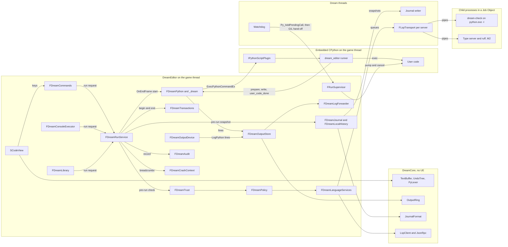

Flows: **edit** (key → `SCodeView` → `TextBuffer`; COW snapshot ≤ 0.2 ms → journal writer, D17). **Run** (every route → `Submit` → one-shot `OnEndFrame` → `FDreamPython::EnterRun`, §3.6). **Supervise** (watchdog → pending call and GIL hand-off → drain, cancel, pump, §3.2, §5). **Output** (`_dream.write` and `FDreamOutputDevice` → MPSC → GT drain → `OutputRing`, batched `LogPython`, D19, §6). **Language** (one `FLspTransport` per child; results applied on the GT only when nothing executes, §3.7, §7). **Policy** (feeds trust, servers, presentation, transaction defaults, RT-18).

### 2.5 Dependency rules and CI enforcement

Static checks live in the repository's `ci/checks/` (outside the plugin) and run with tier 1 on every commit; package checks repeat on the staged package.

| # | Rule | Source | Check |
|---|---|---|---|
| 1 | DreamCore has no engine includes | D7, MAINT-02 | CMake build with no engine include path; include scan allowing only standard and `dream/…` headers outside `Private/UE/` |
| 2 | No Epic source copied | D12 | Fail on "Copyright Epic Games" or Epic licence text; every Dream source carries the SPDX Apache-2.0 header; re-implementations (CodeEditor behaviours, the `FPyScopedGIL` pattern) are written from behaviour and reviewed |
| 3 | No `test_*.py` under `Content/Python` | D22 | Tree and package scans |
| 4 | No `init_unreal.py` in the plugin | D7, U36 | Tree and package scans |
| 5 | One entry call | D14 | `ExecPythonCommandEx` only in `Private/Python/DreamPythonEntry.cpp`, two literal templates (§3.6); no `PyRun_*`, `PyEval_EvalCode*`, `Py_CompileString*`, `PyImport_ExecCodeModule*` |
| 6 | `Python.h` confinement | D7, D15 | Included only via our `DreamPythonInclude.h`, only from `Private/Python`, `Private/Run/RunSupervisor*`, `Private/Compat` |
| 7 | Compat confinement | D15 | `->cframe`, `->gilstate_counter`, `_Py*` names and version-macro comparisons only in `Private/Compat`; `sys.version_info` only in `_impl/compat.py` |
| 8 | Banned APIs | D2, D3, D4, D14, RT-11 | `FTSTicker::GetCoreTicker().Tick(`, `EnterDebuggingMode`, `PyErr_SetInterrupt`, `FInteractiveProcess`, `FMonitoredProcess`, `WritePipe` with `FString`, `EPythonCommandFlags::Unattended`, `wait_for_client`, `debugpy.configure(`, pip |
| 9 | Ticker work gated | RT-01 | Raw `AddTicker`, `RegisterActiveTimer`, `OnEndFrame.Add` only in `FDreamDeferral`, `FDreamRunService`, or marked `DREAM_TIMER_EXEMPT(paint-only)` |
| 10 | Module direction | D7, D11 | Parsed `Build.cs`: DreamCore → Core only; DreamEditor ↛ DreamMCP; DreamMCP links no Experimental module |
| 11 | No UFUNCTION in 1.0 | D7, D29 | `UFUNCTION(` absent from `Source/DreamEditor` |
| 12 | Manifests and licences | D4, D12, RT-11, RV-10 | Every file under `Binaries/ThirdParty` and `Content/Python/_dream_vendor` listed with a matching SHA-256 and an allowed licence; nothing under `Content/Python/Lib`; RT-11 prune list absent |
| 13 | No writes under the engine dir | D17 | `FDreamPaths` rejects targets under `FPaths::EngineDir()`; tier-4 file audit |

### 2.6 Compatibility layer (D15, RT-02, RT-20)

1.0 supports UE 5.8 with CPython 3.11.8 only; the next engine ships in 1.0.x and the 3.13 canary runs from M2 (RT-20).

#### 2.6.1 What is version-specific

| Surface | Isolated in | Tested by |
|---|---|---|
| CPython ABI: headers, `python311.lib`, cp311 wheels (debugpy `.pyd`) | Build per Python version; vendored tree and manifest | Tier 3 per DLL; package check |
| CPython internals: `PyThreadState::gilstate_counter` (`Engine/Source/ThirdParty/Python3/Win64/include/cpython/pystate.h:129`), `_PyCFrame` (`:38-53`, field at `:110`) | `FDreamPyCompat` (§2.6.3) | T-ARCH-010, T-ARCH-011 |
| CPython API semantics: `PyErr_GetHandledException` (`.../include/pyerrors.h:22`, new in 3.11, returns a new reference), pending calls (a post from a non-main thread does not set the eval breaker, `.../include/internal/pycore_pystate.h:57-61`; C16), `PyThreadState_SetAsyncExc` | `FDreamPyCompat`, the watchdog's GIL hand-off (§3.2 GIL-4) | Tier 3 cancel suite |
| Python-level: tracing (`settrace` vs `sys.monitoring`), traceback carets (RT-14), tokenizer grammar (3.12 f-strings) | `_impl.compat`, `_impl.debugger` tracer abstraction, `dream::PyLexer` language level | Tier 2; tier 1 golden corpora per level |
| Engine Python API and behaviour: `FPythonCommandEx` and EvaluateStatement (07a Q3); `GIsRunningUserScript` set by `EvalString` (D14); delegates cleared after broadcast (`PythonScriptPlugin.cpp:1497-1498, 1718-1719`); console dict copy (E4); `unreal.log*` as dict entries (RT-07); reinstancing only on success (E9) | `Private/Python`, `_impl.namespaces`, `_impl.streams` | Engine-facts suite; G2(6) |
| Engine frame and Slate: `OnEndFrame` after the core ticker (`LaunchEngineLoop.cpp:6103, 6108, 6127`); non-reentrant `FTSTicker` (`Engine/Source/Runtime/Core/Private/Containers/Ticker.cpp:99-102`); `CanTickPython` conditions (`.../Private/PyUtil.cpp:1822-1838`); pump, modal, pre-processor, window-action APIs (07b) | `FDreamEngineCompat`, `FDreamRunService`, `FDreamDeferral` | Engine-facts suite; G2 |
| Editor integration: TSF ACP rules, `IWindowsMessageHandler`, docstring grammar (D5), menu names, `UTransBuffer`, `IConsoleCommandExecutor` | `SCodeView`, `FDreamCommands`, `_impl.docstrings`, `Integration/` | G1(3), G7, golden tests per engine, tier-4 smoke |

#### 2.6.2 Isolation rules

- Only `Private/Compat/` reads CPython internals or compares version macros (§2.5 rule 7). In 1.0 it holds `static_assert(PY_MAJOR_VERSION == 3 && PY_MINOR_VERSION == 11)` and `static_assert(ENGINE_MAJOR_VERSION == 5 && ENGINE_MINOR_VERSION == 8)`; a canary build sets `DREAM_COMPAT_CANARY=1` for the next branch.
- `FDreamPyCompat::CheckRuntime()` compares the runtime major.minor from `Py_GetVersion()` with the compiled `PY_VERSION` before `_dream` is created. A mismatch means no `_dream`, runs disabled and a banner.
- The **engine-facts suite** (tier 4) has one assertion per engine behaviour in §2.6.1. It runs first on every engine preview, and a failing fact blocks the port.

#### 2.6.3 Native re-entry check (RT-02)

RT-02 skips the pump and defers cancel delivery when Python was re-entered from native code since `_run` began, suggesting a frame-depth or `cframe` comparison. This TDD uses the GIL-state counter, adds a user-code-window gate and re-captures the mark for each supervised evaluate (RV-05), and keeps `cframe` as a diagnostic. This subsection is the single definition; §5.4.2, §5.4.5, §5.7.5 and §8.3.4 apply it:
- **Why not `cframe`.** In CPython 3.11 every C-level eval-loop entry pushes a new `_PyCFrame`, including a generator resumed by `FOR_ITER`. A `cframe` comparison would treat a generator loop body as nested, never pump it, and fail G2(1)'s generator case. This is CPython behaviour the headers do not show; T-ARCH-010 confirms it in Phase 0.
- **The signal.** Unreal enters Python from native code through `FPyScopedGIL` = `PyGILState_Ensure` (07a Q2): the delegate thunk and the UFUNCTION override both take it first (`.../Private/PyWrapperDelegate.cpp:30-31`; `.../Private/PyWrapperObject.cpp:2258-2259`). Ensure increments `tstate->gilstate_counter`. Generators, `sorted(key=…)` and `__init__` do not.
- **Rule.** `user_code_begin` captures the GT counter as the run's mark. A pending call is *native re-entered* when the counter is higher than the active mark. ctypes callbacks count too, as intended.
- **User-code window.** The mark cannot see Python that runs after `_run` returns. The mark includes `RunString`'s own `PyGILState_Ensure`, and a `PostInitInstance` override during reinstancing (E9) takes the GIL again after that scope closes, so the counter equals the mark there. The pump and delivery therefore also require `bUserCodeActive`, which is true only from `user_code_begin` to `user_code_done`. A pending call outside that window records the deferral reason `OutsideUserCode` and returns 0; the C++ output drain may still run (§5.4.2 step 5).
- **Evaluate marks.** A pause leaves the counter at the run's mark, and the Paused window's request handler takes the GIL with `PyGILState_Ensure`, one above it, so every pending call during an evaluate would look re-entered. `_dream.eval_begin` therefore captures a fresh mark (`CaptureEntryMark`) for each supervised evaluate. While the evaluate is active, the re-entry check and §5.7.5 condition 4 compare against the evaluate's mark; `eval_end` restores the run's mark (§8.3.4).

```cpp
// Private/Compat/DreamPyCompat.h — GT, GIL held, unless noted.
struct FDreamEntryMark { PyThreadState* ThreadState = nullptr; int32 GilCounter = 0; const void* CFrame = nullptr; };
struct FDreamPyCompat
{
    static bool CheckRuntime(FText& OutReason);
    static FDreamEntryMark CaptureEntryMark();                     // from _dream.user_code_begin (run mark) and _dream.eval_begin (evaluate mark)
    static bool IsNativeReentered(const FDreamEntryMark& Mark);    // gilstate_counter > Mark.GilCounter; Mark = the active mark
    static PyObject* GetHandledException();                       // new reference (RT-06); the caller holds it in a TDreamPyRef
    static int AddPendingCall(int (*Fn)(void*), void* Arg);       // any thread, no GIL to post; the watchdog then forces a GIL hand-off (GIL-4, RV-01)
    static int SetAsyncExc(uint64 ThreadId, PyObject* ExcOrNull);
};
```

**Per-version testing.** Tiers 2 and 3 run against the shipped 3.11.8 and, from M2, a stock CPython 3.13 (T-ARCH-012). The engine-facts and G2 suites run on each engine preview (D15). A port is done when tiers 1–7 pass and every fact holds or has a compat branch.

### 2.7 Security boundaries (D20)

**Dream is not a sandbox.** User code has full editor privileges, and the documentation says so.

| Boundary | Control | Not protected (documented) |
|---|---|---|
| Untrusted files → Run | `FDreamTrust::Evaluate` is pre-run step 1 (U7); restricted mode and banner (U39); Run once is audited | A trusted root an attacker can write |
| Studio libraries → Run | SHA-256 manifest; changes prompt (D28) | A compromised publisher |
| Policy | Machine (admin-only paths, verified by owner and ACL at load; a layer that fails the check is ignored, with a persistent banner and a doctor error naming the file and its owner, RV-06), then studio (`DREAM_POLICY_PATH`; a configured file that is missing counts as unreachable), then project policy, then user settings (RT-18); locked keys, and no lower layer loosens a lock (RV-08); the doctor warns when the studio policy file or its folder is writable by the user; inspector shows the source (U38) | Local admins; repository committers; anyone who can write the studio policy file or its folder (equivalent to code execution on every workstation) |
| Network | No listener in 1.0 (D20) except the debugpy socket: explicit command only, `127.0.0.1` port 0, in-process adapter (RT-11), persistent indicator (U15). It refuses any connection whose first bytes are not `Content-Length:` and any second client while one is attached; it stays open for re-attach, with no idle timeout, until `debug.allow_debug_server` turns off or the editor exits (RV-04). The key and the audit event `debug.server_started` land with the listener in M2. No token: the pinned debugpy has none (RV-04) | Any local process of any user can connect while it is open, and a connected client can run code; HTTP-shaped clients are refused, and no second client is accepted while an IDE is attached. Epic Remote Execution gets a warning if widened (D10) |
| Child processes | SHA-256 before every spawn; kill-on-close Job; `python.exe -I`; separate stderr; frames parsed by fuzzed `dream::JsonRpc` (D4) | A binary malicious at publish time |
| Persisted data | JSON only; never `pickle`, `eval`, `exec` (SEC-06); journals stay in per-user storage and out of the bundle unless ticked (D17, D26); a storage root override comes only from user settings or the machine and studio layers, and a policy value must contain the `{User}` token (RV-08) | Same-user processes can read storage |
| Our package | `_boot` checks `dream_editor.__file__` is under this plugin; shadowing stops boot, doctor lists it (U36); bundle hashes the package (D26) | The shadowing module already ran |
| Telemetry, crashes | None by default; breadcrumbs content-free (D26) | — |

### 2.8 Failure modes and tests for §2

| Failure | Detection | Handling | What the user sees |
|---|---|---|---|
| DreamCore includes an engine header | Tier-1 build, include scan | Merge blocked | — |
| No Python in this build, or PythonScriptPlugin missing | `WITH_PYTHON` 0 or `IPythonScriptPlugin::Get()` null | State `Unavailable`; editing, journal, `dream-check` still work | Banner |
| Runtime Python differs from headers | `CheckRuntime` | No `_dream`; runs disabled | Banner naming both versions |
| `dream_editor` shadowed | `_boot` path check | `BootFailed`; doctor entry | Banner with the path |
| ThirdParty binary missing or mismatched | SHA-256 on a task thread before spawn | Spawn refused; that server off | "Language server failed verification"; typing and runs unaffected |
| An engine fact changed | Engine-facts suite on the canary | Port blocked until Compat has a branch | — |

| ID | Tier | What it checks | Pass criterion | Covers | Lands |
|---|---|---|---|---|---|
| T-ARCH-001 | 1 | DreamCore builds and tests with CMake on three OSes, no engine includes, no exceptions or RTTI | Green on all three | D7, D22, MAINT-02, MAINT-06 | M1 |
| T-ARCH-002 | 1 | Include scan of `Source/DreamCore` | Only standard and `dream/` includes outside `Private/UE/` | D7, MAINT-02, MAINT-06 | M1 |
| T-ARCH-003 | 1 | Provenance scan | No Epic copyright text; no file without the SPDX header | D12, RT-19, MAINT-05 | M1 |
| T-ARCH-004 | 1 | Tree and staged-package scan; a source scan that every call of `FDreamRunService::Submit` is reached from a user command, the public API (§11.7), a console command or the console executor, or reload-on-save, and none from a startup or tab-open handler, or from a file-change handler other than FDreamReloadOnSave's (§9.3) (SEC-03 code-path audit; `DreamEditorTests` is not scanned) | No `test_*.py` under `Content/Python`, no `init_unreal.py`, no `DreamEditorTests`, no `Tests/`; the Submit scan finds no other caller | D7, D22, U36, MAINT-03, MAINT-06, SEC-03 | M1 |
| T-ARCH-005 | 1 | Descriptor check | As §2.3.1; no `PythonRequirements` | D4, D16, D17 | M1 |
| T-ARCH-006 | 1 | `Build.cs` direction | Rule 10 holds | D7, D11 | M1 |
| T-ARCH-007 | 1 | Banned-API, confinement and UFUNCTION scans (rules 5–8, 11) | Zero violations | D2, D3, D4, D14, D15, RT-11, MAINT-06 | M1 |
| T-ARCH-008 | 1 | Manifests | Every file listed with matching SHA-256 and allowed licence; prune list absent | D4, D12, RT-11, MAINT-05, SEC-NF-03 | M1 |
| T-ARCH-009 | 7 | Tampered fake-server binary | Spawn refused; typing and runs unaffected | D4, D20, REL-03, SEC-NF-03 | M1 |
| T-ARCH-010 | 3 | Re-entry mark on `python311.dll`: generator body, `sorted(key=…)`, comprehension, deep recursion, ctypes callback; then a loop run inside an outer `PyGILState_Ensure` scope, as a supervised evaluate does, checked against the outer mark and against a fresh mark captured inside the scope | First four "not nested", callback "nested", 10,000 of 10,000; the scoped loop is "nested" against the outer mark and "not nested" against the fresh mark | RT-02, RV-05, D15, G2(1) | M1 |
| T-ARCH-011 | 4 | Python delegate (`add_callable`) and Python UFUNCTION override invoked from C++ mid-run | Their pending calls skip pump and defer cancel; Stop lands after return | RT-02, G2(2), LRS-13 | M1 |
| T-ARCH-012 | 2 | From M2: tier-2 and compat tier-3 suites on stock CPython 3.13 | Green, or each failure filed as a port item | RT-20, D15, COMPAT-05, COMPAT-02 | M2 |
| T-ARCH-013 | 4 | Engine-facts suite | Every fact holds on 5.8.x | D15, RT-01, RT-07, E3, E4, E9 | M1 |
| T-ARCH-014 | 4 | Forced runtime-version mismatch | No `_dream`; runs disabled; banner text | D15, COMPAT-02 | M1 |
| T-ARCH-015 | 4 | Listener audit over a session using every feature of the build under test; (from M2) with and without a machine-layer `debug.allow_debug_server: false`, and with the key turned off mid-session while the listener is open | No new listener; (from M2) after "Debug in VS Code" one on 127.0.0.1; with the key false, command disabled and no socket; turning the key off mid-session closes the socket at the first idle tick after the policy swap | D20, U15, RT-11, RV-04, SEC-NF-01, SEC-08, DBG-07 | M1 (M2: Debug in VS Code and the policy key) |
| T-ARCH-016 | 2 | 10,000 fuzzed session, manifest and journal files, (from M2) policy files and (from M4) snippet files with `eval`, `exec`, `compile`, `pickle.loads` trapped | No trap fires; no crash | SEC-06, D20 | M1 (M2: policy files; M4: snippet files) |
| T-ARCH-017 | 4 | Shadowing `dream_editor` earlier on `sys.path` | Boot refused with the path; (from M4) doctor lists it | D7, U36, ENV-07 | M1 (M4: doctor item) |
| T-ARCH-018 | 4 | File-write audit through an `IPlatformFile` wrapper | Zero writes under the engine dir; only D17 storage, `Intermediate/Dream`, user-chosen paths | D17, PER-08 | M1 |
| T-ARCH-019 | 4 | debugpy location: staged-package scan; then a session with a fixture `debugpy` package on `sys.path` (a studio copy), checked before and after the first "Debug in VS Code" | No file under `Content/Python/Lib/site-packages`; every debugpy file under `Content/Python/_dream_vendor/` and in the manifest; before the command, `_dream_vendor` is not on `sys.path` and `import debugpy` in a run returns the fixture copy; after it, `_dream_vendor` is first on `sys.path` | RV-10, D3, RT-11, DBG-07, COMPAT-03 | M2 |

### 2.9 Open items

1. **RT-02 mechanism.** Closed by RV-05: on 3.11 the re-entry signal is `gilstate_counter`, not `cframe` (§2.6.3). T-ARCH-010 still confirms it on the shipped interpreter in Phase 0 (P0-3), and the field is re-checked in the 3.13 headers at the canary (T-ARCH-012).
2. **debugpy location.** Closed by RV-10: debugpy is vendored in `Content/Python/_dream_vendor/debugpy`, not in D3's `Content/Python/Lib/site-packages`, and is prepended to `sys.path` only on the first "Debug in VS Code" (§2.2, T-ARCH-019).
3. UE's behaviour when a project explicitly disables PythonScriptPlugin while Dream is enabled is not verified.

---

## 3. Threading, lifecycle and the run-entry invariant

This is the concurrency contract that §5, §6, §7 and §10 obey.

### 3.1 Thread inventory

| Thread | Count, lifetime | May touch | Must never touch | GIL | Talks to GT via |
|---|---|---|---|---|---|
| **Game thread** | 1 | Slate, UObjects, Python runs and helpers, DreamCore models, settings | Blocking I/O beyond budgets; waiting on a GIL-needing thread while holding the GIL (§3.2) | Per §3.2 | — |
| **Watchdog** (`FRunSupervisor::FWatchdog`, `FRunnable`) | 1; created at the first run, joined at module shutdown; sleeps when unarmed | Run-state atomics; `AddPendingCall`; its own `PyThreadState`, one per Python generation, for the GIL hand-off after each post and for `SetAsyncExc` when §5 allows | Slate, UObjects, output store, other Python | Takes the GIL once per post: outside `PostLock` it calls `PyEval_RestoreThread` on its own thread state and at once `PyEval_SaveThread`, which costs one switch interval (5 ms), rounded up to the OS timer resolution, of GT latency per pump request: about 5–7 ms under the editor's 1 ms resolution (`timeBeginPeriod(1)`, `Engine/Source/Runtime/Core/Private/Windows/WindowsPlatformMisc.cpp:1076`), and about 16 ms at Windows' default 15.6 ms resolution, which Windows 11 may apply to a minimised or occluded editor (GIL-4, RV-01); microseconds around `SetAsyncExc`. It creates the thread state on its own thread with `PyThreadState_New` at its first hand-off in a generation, inside the `bInPython` bracket, so the state's thread ID is the watchdog's, never the GT's. The GT deletes it at Python shutdown (§3.8) | Atomics, pending calls |
| **Journal writer** (`FDreamJournal`, `FRunnable`) | 1; first tab spawn to module shutdown, or abandoned if it has not acknowledged `CLEAN` within 2 s (§3.8, §10.2.5) | D17 storage; immutable `TextBuffer` snapshots; `JournalFormat`; history blobs, retention, audit lines, run-log spill and checkpoint writing on a lower-priority lane. Commits always run first; the other work runs in slices of at most 50 ms, and due commits are drained between slices (§10.2.1) | Python, Slate, UObjects | Never | MPSC jobs; flags polled on the GT |
| **LSP transport** (`FLspTransport`, `FRunnable`) | One per child: M1 1, M2 up to 3; from deferred start | Its pipes and Job; `JsonRpc` framing; stderr log | Python, Slate, UObjects | Never | SPSC queues; results via `FDreamDeferral` |
| **Output ingest** (`DreamOutput`, `FRunnable` owned by `FDreamOutputStore`) | 1; lives as long as the output store | Raw-record MPSC queue; line splitting, link scan, thread attribution through `FDreamThreadTable` (the device pushes only the native thread ID), `FDreamLogForwarder` echo, run-log appends (§6.2, §6.3) | Python, Slate, UObjects | Never | SPSC view queue drained on the GT (§6.2) |
| **File watcher** | None of ours: `IDirectoryWatcher` completes on the GT in `UEditorEngine::Tick` (`Engine/Source/Editor/UnrealEd/Private/EditorEngine.cpp:1948`; 07e Q4) | Callback records events; actions run via `FDreamDeferral` | — | — | — |
| **Find-in-files worker** (`FDreamSearchWorker`, `FRunnable`, below-normal) | 1; first use (M2) | Reads files under roots; `SearchEngine`; regex over copied output pages (OUT-06); change hashing | Python, Slate, UObjects; writing files | Never | Job and result queues, cancel token |
| **Storage probe** (`DreamStorageProbe`, `FRunnable`) | 1; created at the first override probe or cross-root scan; abandoned at `OnPreExit`, never joined (§10.1) | The override root until its probe returns; other candidate storage roots for the cross-root orphan scan and deletes (§10.1) | Python, Slate, UObjects; the session's own journal namespace | Never | Result queue polled on the GT |
| **Studio share I/O** (`DreamPolicyIO` from M2, `DreamLibraryIO` from M4; `FRunnable`) | 1 each; `DreamPolicyIO` from `StartupModule`, `DreamLibraryIO` at the first mirror or studio publish; abandoned at `OnPreExit`, never joined (§11.2.3, §11.5.1) | `DreamPolicyIO`: the studio policy share (the studio layer's load, its 5-minute poll and the doctor's `AccessCheck`, §11.2.3); `DreamLibraryIO`: the studio library share, its mirror folder and `mirror.lock` | Python, Slate, UObjects; the storage roots | Never | Result queue polled on the GT |
| **User Python threads** | Any | Pure Python; `_dream.write`, `progress`, `check_cancel` | `unreal.*`: UFunction calls raise off the GT (`.../Private/PyUtil.cpp:606-616`); property access is unchecked, so `dream-check` flags it (SUM201) | As CPython requires | `_dream` |
| **debugpy threads** (M2) | pydevd threads and the in-process adapter (RT-11); once per session. The listener closes when `debug.allow_debug_server` turns off or at editor exit, and cannot be restarted in that session (RV-04) | Loopback socket, Python | `unreal.*` | Python threads | The GT polls `DebugpyBridge` from idle-tick helper calls at 2 Hz (§8.6, §12.1.3) |
| **Engine threads** | Render, task graph, log | Pump enqueues one RHI EndFrame and calls `Renderer->Sync()` (07b Q6); `FDreamOutputDevice::Serialize` runs on any thread (D19); ThirdParty SHA-256 runs as `UE::Tasks` | — | — | MPSC |

### 3.2 GIL rules

After init the GIL is released, and each C++ entry takes it with `FPyScopedGIL` = `PyGILState_Ensure`/`Release` (07a Q2). That header is private to PythonScriptPlugin, so Dream has `FDreamScopedGil` (`Private/Python/DreamGil.h`): a non-copyable RAII type calling the same two functions. The watchdog is the one exception: it takes the GIL on its own thread state (GIL-4).

| # | Rule |
|---|---|
| GIL-1 | Only the GT, the watchdog (for the hand-off after each post and for `SetAsyncExc`, always on its own thread state, GIL-4), user Python threads and debugpy threads take the GIL. A debug build asserts `PyGILState_Check() == 0` on the journal, output-ingest, LSP and search threads |
| GIL-2 | `_dream` functions are called from Python, so the GIL is held. They never release it (except `pause`), never call Python, never wait. `write` copies UTF-8 into a lock-free MPSC node and returns, which is why worker threads may call it freely |
| GIL-3 | C++ releases the GIL around three waits only: the Slate pump (D2), `AddModalWindow` for the Paused window (D3), and the wait in `OnPythonShutdown` until the watchdog has left Python (§3.8). The engine releases it around reflected calls, find/load, `unreal.log*` and GC (07a Q2); there the watchdog gets the GIL without waiting |
| GIL-4 | **Every post is followed by a GIL hand-off** (RV-01). `Py_AddPendingCall` needs no GIL to post, but in CPython 3.11 a post from a thread other than the main thread does not set the eval breaker: the pending-call bit is computed on the posting thread, where `_Py_ThreadCanHandlePendingCalls()` is `_Py_IsMainThread()` and so false (`Engine/Source/ThirdParty/Python3/Win64/include/internal/pycore_pystate.h:57-61`; C16). The GT notices a post only when it next takes the GIL, and a pure-Python loop never does. So after each successful post, outside `PostLock`, the watchdog sets the atomic `bInPython`, re-checks `bPythonAlive`, calls `PyEval_RestoreThread` on its own thread state and at once `PyEval_SaveThread`, then clears `bInPython`. That costs one switch interval (5 ms), rounded up to the OS timer resolution, of GT latency per pump request: about 5–7 ms under the editor's 1 ms resolution (`timeBeginPeriod(1)`, `Engine/Source/Runtime/Core/Private/Windows/WindowsPlatformMisc.cpp:1076`), and about 16 ms at Windows' default 15.6 ms resolution, which Windows 11 may apply to a minimised or occluded editor. The callback then runs on the GT with the GIL at the next bytecode boundary of whatever Python runs there. `SetAsyncExc` is not a liveness mechanism; the hand-off is. The watchdog creates its thread state with `PyThreadState_New` on its own thread at its first hand-off in a generation, inside the `bInPython` bracket (§5.4.1 step 1a), and takes the GIL only on that state, for the §5.7.5 channel too. At most one post is outstanding (atomic flag); a full queue returns -1 and the watchdog retries. A callback returning -1 must set an exception first (07a Q1). Each callback checks run ID and generation and does nothing when stale |
| GIL-5 | Lock order: the GIL is outermost. Nothing takes the GIL while holding a Dream mutex. A debug-build checker (`FDreamLockOrder`) asserts on inversion |
| GIL-6 | No GIL holder waits on a thread that may need the GIL. The GT may wait on the journal, output-ingest, LSP and search threads only because of GIL-1. The watchdog needs the GIL on every post, so the GT never waits for it while holding the GIL: `user_code_done` only sets an atomic that stops new posts; `EndRun` waits for the watchdog to leave Python after `ExecPythonCommandEx` has returned, without the GIL (§5.7.7); `HandleShutdown` releases the GIL before it waits (§3.8) |
| GIL-7 | Every C++-held `PyObject` is a `TDreamPyRef` (§3.8); one dropped without the GIL is queued to the GT |
| GIL-8 | User threads alive at run end are listed, never killed; Stop cancels the GT run only (D24) |

### 3.3 Game-thread execution contexts

| Context | Where (evidence) | Run active possible? | May start a run | May call helpers | Dream uses it for |
|---|---|---|---|---|---|
| Slate input handler | From `PumpMessages`, outside the Slate tick (`LaunchEngineLoop.cpp:5784`); `SButton` holds capture during `OnClicked` (`Engine/Source/Runtime/Slate/Private/Widgets/Input/SButton.cpp:442, 458-461`) | Yes, nested in our pump | **No**; enqueue only (D14(1)) | No; queue a request | Keys, commands, `Submit` |
| Slate tick (pre/post-tick, widget `Tick`, active timers, paint) | `LaunchEngineLoop.cpp:5921, 5991` (E10); `IsTicking` true | Yes, in our pump | No | No | Paint, caret, output drain ≤ 2 ms per frame (D19) |
| Core ticker callback | `LaunchEngineLoop.cpp:6103`; not re-entrant (`Ticker.cpp:99-102`) | Yes, if user code ticks it (RT-01) | **No** (RT-01) | Yes, through `FDreamDeferral`, when not executing | LSP results, watcher actions, stub slices, alias refresh, debugpy polling |
| `GEngine->Tick` | `LaunchEngineLoop.cpp:5859` (E10) | No; the pump never ticks it (D2) | No | No | Watcher callbacks record events |
| **`FCoreDelegates::OnEndFrame`** | `LaunchEngineLoop.cpp:6127`, after the core ticker (`:6103`) and deferred commands (`:6108`); broadcast only there (09 §5); not ticking, no capture | No; runs begin here | **Yes: the only run-start point** (RT-01); also boot, Enable Python, `@task` steps, 1.1 bridge and MCP dispatch | Yes: prepare, boot | `FDreamRunService::HandleEndFrame` |
| Blocking modal loop | `Engine/Source/Runtime/Slate/Private/Framework/Application/SlateApplication.cpp:2218-2280`; ticks Slate, never the core ticker or `OnEndFrame` (E6) | Yes: script dialogs, Paused window | No; queued runs wait | Only the debugger provider while Paused (D3) | Paused window |
| Slow-task dialog | Ticks only on progress calls, ≤ 5 Hz (`Engine/Source/Editor/UnrealEd/Private/FeedbackContextEditor.cpp:419-439`) | Yes | No | No | Stop calls `OnUserCancel` (D2) |
| Pending-call callback | Bytecode boundary, GIL held | Yes | No | No; C API only | Drain, cancel, pump (§5) |
| Our pump | Inside a pending call, GIL released: `Tick(All)`, `PumpMessages` when no modal, guarded EndFrame, `Sync` (07b Q6) | By definition | No | No | Live UI; Run window on the first pump (RT-04) |
| Engine-invoked Python (delegate thunk, UFUNCTION override, `PostInitInstance` during reinstancing) | Foreign; `FPyScopedGIL`; sets `GIsRunningUserScript` (07a Q7) | Yes | No | No | Detected by §2.6.3: the re-entry mark while user code runs, the user-code-window gate after `_run` returns; pump and cancel deferred |
| Lifecycle handlers | `OnPythonInitialized` on the first core tick; `OnPythonShutdown` in `ShutdownPython`, GIL held (07a Q6) | Shutdown: pathological only | No | Initialized: create `_dream`; Shutdown: `_shutdown` | §3.5 |

**RT-01 in one paragraph.** User code can call engine functions that tick the core ticker synchronously; material baking does so in its texture-streaming wait (`Engine/Source/Developer/MaterialBaking/Private/MaterialBakingModule.cpp:710-717`), reached from Python's `merge_static_mesh_actors` (09 RT-01). A run started inside `FTSTicker::Tick` would nest the ticker and fail `checkf(GetThreadId(PrevState) == 0)` at `Ticker.cpp:102`. `OnEndFrame` keeps E10's properties without being inside the ticker.

### 3.4 Startup and deferred start (D16, RT-17)

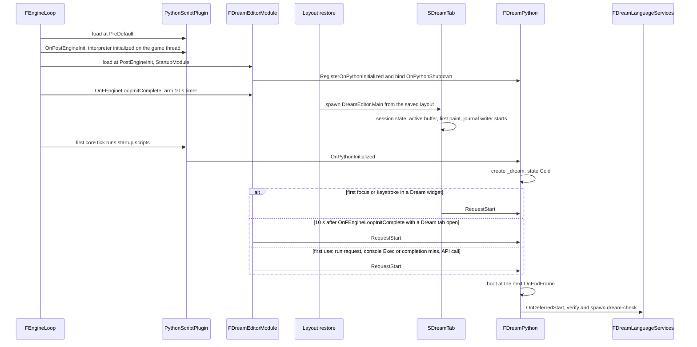

- **`StartupModule`** (B1): detect headless (`IsRunningCommandlet()`, `FApp::IsUnattended()`, `!FApp::CanEverRender()`); load policy (RT-18); read settings CDOs; register `DreamEditorStyle` (lazy font faces), `DreamEditor` TCommands, spawners for `DreamEditor.Main` and the shelf tab (U27), a `UToolMenus::RegisterStartupCallback`, `FDreamConsoleExecutor` (C++ only), crash keys; bind lifecycle delegates (§3.5), `OnFEngineLoopInitComplete`, `FEditorDelegates::MapChange`. **No Python, file scan, child process or thread.**
- **Layout restore** (B2): `SDreamTab` restores from C++ and paints at once (RT-17): session state from `UDreamPerProjectUserSettings`; `FDreamJournal::Open` (root and locks) starts the journal writer, which reads the namespaces, checks for an unclean exit and queues the recovery scan on its own thread (§10.3); only the active buffer loads (journal if newer than disk), its visible lines lexed. Other tabs load on activation (PERF-02). Safe mode (D17) skips restore but lists recoverable buffers (§10).
- **Deferred-start trigger** (RT-17), first of: the first focus or keystroke in a Dream widget; 10 s after `OnFEngineLoopInitComplete` if a Dream tab is open; first use (run request, console `Exec`, a live-completion request from `FDreamConsoleExecutor` (§6.6 step 2 miss), API call). It acts only in state `Cold`. The keystroke is handled by C++ at once; typing never waits for Python. The tab-open condition on the 10 s timer refines RT-17; §17.1 records it as OI-96. With the tab closed, the first `Python (Dream)` completion miss boots Python, so a following keystroke gets results (T-REPL-013, UEI-08).
- **Boot** runs at the next `OnEndFrame`: `ExecPythonCommandEx(EvaluateStatement, "__import__('dream_editor')._boot(globals(), <generation>)")`. It imports the runner core, registers `ScriptCancelled`, captures the Session (console dict, D8) and its key set for Reset session, and never writes the name `dream_editor` into the Session (RT-15). Then `FDreamLanguageServices::OnDeferredStart` spawns `dream-check` (M1; type server and ruff in M2) if a buffer is open (D4).
- `dream_editor` binds `_dream` lazily (`_impl.native`), so a studio `init_unreal.py` importing it early still works; native-only calls raise until `_dream` exists.

| Phase | Budget | Source |
|---|---|---|
| B1 module load: DLL load, CDO construction and `StartupModule` of DreamCore and DreamEditor, measured as B-01 defines (§13.2) | ≤ 10 ms (proposed share of 30 ms) | D22, PERF-01 |
| B2 restore spawn with an active buffer ≤ 1 MB | ≤ 20 ms (proposed share; RT-17 puts restore inside the startup window, so B1 + B2 ≤ 30 ms) | D22, RT-17 |
| 20 tabs: restore start → last tab-strip paint (B-18); other tabs load on activation | ≤ 300 ms | PERF-02 |
| `_dream` creation | ≤ 1 ms (proposed) | D7 |
| Boot | ≤ 50 ms (proposed: under 3 frames at 60 Hz, once per generation; heavy `_impl` modules import on first use) | RT-17 |
| Child spawn | ≤ 2 ms GT per child (proposed); hashing off the GT | D4 |

### 3.5 Python lifecycle state machine (D16)

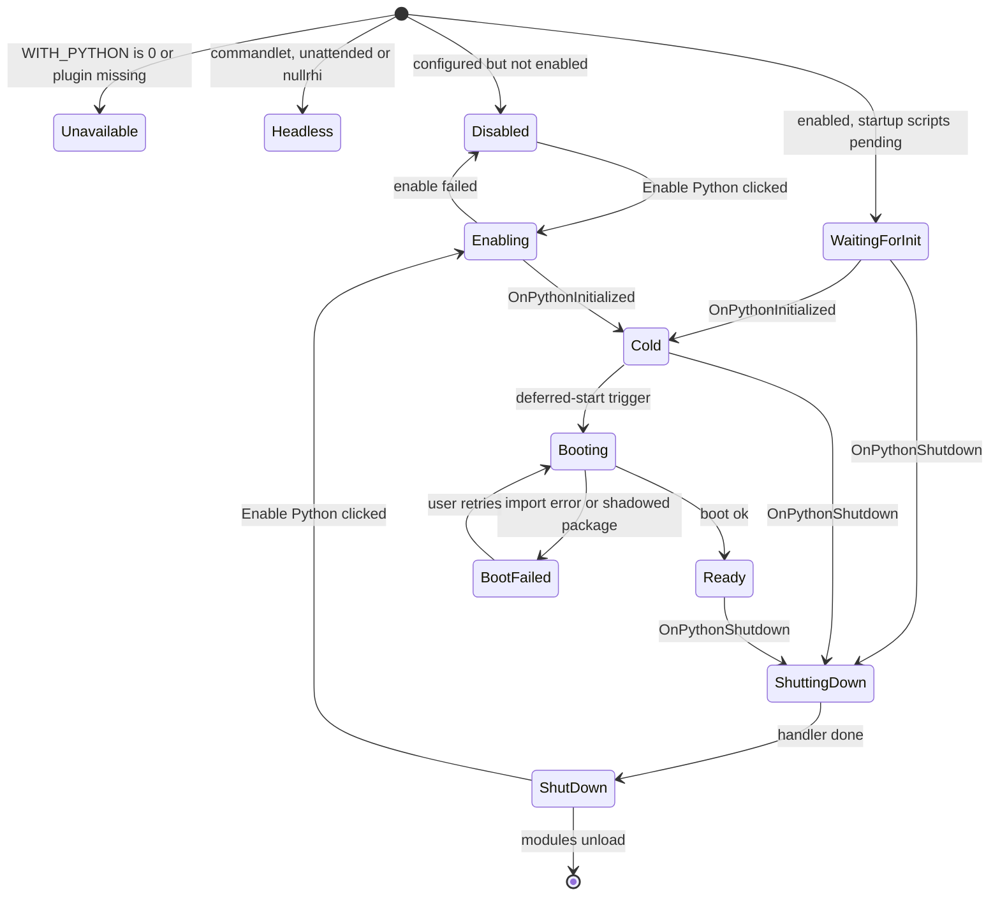

Editor exit also passes through `ShuttingDown`: `OnPreExit` runs `ShutdownPython` (`PythonScriptPlugin.cpp:1028`; `LaunchEngineLoop.cpp:6937`) before modules unload (`LaunchEngineLoop.cpp:5182`).

| State | Editing, journal | Runs | Resolver, inspector | `dream-check`, LSP | Console executor | UI |
|---|---|---|---|---|---|---|
| Unavailable | On | Disabled | Off | On; `unreal` lints use the cached snapshot or are off | Not registered | Banner |
| Disabled | On | Disabled | Off | On | "Python is disabled" | Banner; **Enable Python** only if `Engine.Python.IsPythonLifeCycleDynamic`, not restrictive, and policy `python.allow_enable_at_runtime` allows (D16, SEC-07, §9.5) |
| WaitingForInit, Booting, Enabling | On | Queued | Off | On | Queued | Status text |
| Cold | On | First request boots, then runs | Off | Spawn on trigger | On | — |
| Ready | On | On | On, never while executing | On | On | — |
| BootFailed | On | Disabled | Off | On | Error | Banner with reason, Retry |
| ShuttingDown | On, buffers kept | Refused | Stopped | On | Refused | — |
| ShutDown | On | Disabled | Off | On | "Python is not running" | Banner, Enable Python |
| Headless | No UI | `-run=PythonScript` only | Off | Off | Not registered | — |

**Delegate binding across cycles.** Both delegates are cleared after broadcast (`PythonScriptPlugin.cpp:1497-1498, 1718-1719`), so a one-time binding breaks after a disable/enable cycle (D16):
- `StartupModule`: `RegisterOnPythonInitialized(CreateRaw(this, &FDreamPython::HandleInitialized))` (calls back at once if already initialized, `IPythonScriptPlugin.h:100`) and `OnPythonShutdown().AddRaw(this, &FDreamPython::HandleShutdown)`.
- `HandleInitialized`: re-add the shutdown binding if `!OnPythonShutdown().IsBoundToObject(this)`; increment the generation; create `_dream`; then set `FRunSupervisor`'s `bPythonAlive` to true under `PostLock`, before any `BeginRun`.
- `HandleShutdown`: add the `OnPythonInitialized` binding; it survives because the shutdown broadcast clears only its own delegate.
- `ShutdownModule`: `RemoveAll(this)` on both if PythonScriptPlugin is still loaded.

**Enable Python is deferred.** `ForceEnablePythonAtRuntime` runs startup scripts synchronously once the plugin has ticked (`PythonScriptPlugin.cpp:727-760`). Those are user scripts, so the click handler only arms the next `OnEndFrame`. In restrictive mode Dream never force-enables and disables runs with an explanation (SEC-07).

### 3.6 The run-entry invariant (D14, RT-01, RT-15)

| # | Invariant |
|---|---|
| INV-1 | **One queue.** Every route builds an `FDreamRunRequest` and calls `FDreamRunService::Submit`: selection, line, cell, buffer, REPL, console executor, Run File, shelf, snippet, reload, entry point, debug, public `run()`, `@task` steps; bridge (1.1), agent (1.2) |
| INV-2 | **One start point.** A one-shot `FCoreDelegates::OnEndFrame` handler (RT-01) removes itself (removal during broadcast is supported) and starts at most one run per broadcast; it re-arms if anything is executing |
| INV-3 | **One entry call.** `FDreamPython::EnterRun` calls `ExecPythonCommandEx` with `EvaluateStatement`, `Flags = None` and `"__import__('dream_editor')._run(<id>)"`. `EvalString` sets `GIsRunningUserScript`, quieting foreign Python Slate and ticker callbacks (07a Q7); attended flags keep script dialogs alive (`SlateApplication.cpp:2134-2146`); no Session name is needed (RT-15) |
| INV-4 | **Catch-all runner.** `_run` catches every `BaseException`, so `EvalString` succeeds, `@unreal.uclass` reinstancing runs (E9) and tracebacks are ours. `ExecPythonCommandEx` returning false is reported as an internal error |
| INV-5 | **One run at a time.** User run commands are disabled, `run()` raises inside a run, bridge and agent requests wait up to their timeout or are refused (D14(4)) |
| INV-6 | **Helpers never run user code.** They run only from `FDreamDeferral` idle ticks or the `OnEndFrame` start handler, never in the pump or while executing (D14(5)); C++ calls only the fixed table in §12.1.3 |
| INV-7 | **Delivery window.** Cancel delivery and the pump are on only between `user_code_begin` and `user_code_done` (`bUserCodeActive`, §2.6.3, RV-05); `user_code_done` is the first statement of the `finally` around `exec`, so delivery stops before our cleanup (RT-06). It also stops new watchdog posts at once, without waiting for the watchdog (GIL-6) |

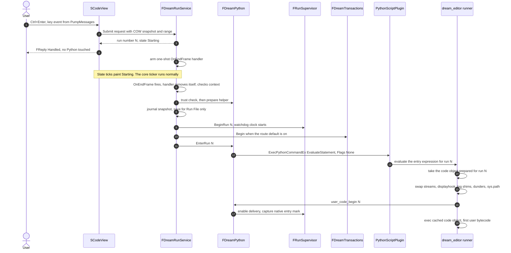

Pre-run order follows U7: trust, parse, journal snapshot, save (Run File only). The prepare helper parses with the RT-14 wrapper and the auto-print rewrite and caches the code object in `_impl.runner` by run ID (in statement mode, one code object per top-level statement after the whole-module compile, RUN-27, §5.3.2); compiling executes no user code. Any failure ends the run `not executed`, with its number (U7, U8) and no transaction. A Run File waiting for an async checkout stays `Starting` and re-arms on completion (§5).

```python
# dream_editor/__init__.py — structure only; §5.3 owns the details.
def _run(run_id):                                   # entry expression __import__('dream_editor')._run(id)
    try:
        _impl.runner.run(run_id)                    # code object cached by prepare() in Starting;
                                                    # swaps, user_code_begin, exec, user_code_done first
                                                    # in the handler (RT-06), restore, report_outcome
    except BaseException:                           # D14(3): nothing escapes, not even a runner bug
        try:
            _dream.user_code_done(run_id)
            _impl.runner.report_internal_error(run_id)
        except BaseException:
            pass
```

`FDreamPython::EnterRun` (private, `friend class FDreamRunService`) asserts `IsInGameThread()`, `IsInEndFrameStart()`, and that Slate is not ticking, not processing input and has no mouse captor, then builds the `FPythonCommandEx` above. `FDreamPython::Boot` is the second and last call site.

**Static check that no route bypasses `_run`:** (1) the text scan of §2.5 rule 5; (2) `EnterRun` is private with one friend; (3) the run-time assertion above; (4) a tier-4 route-coverage test that drives every 1.0 `EDreamRunRoute` and asserts `EnteredVia = EndFrame` and that `_run` received the ID. A literal-code run attaches the engine's `LogOutput` capture for its whole duration (E3); the RT-07 shims keep it bounded (§6).

### 3.7 The ticker-client deferral rule (RT-01)

User code can tick the core ticker mid-run and our pump ticks Slate mid-run, so Dream work can be dispatched while user code is on the stack. Every Dream ticker, timer or delegate client that can call Python, touch run state, mutate buffers or apply async results uses one gate:

```cpp
// Private/Run/DreamDeferral.h — GT only.
enum class EDreamDeferPolicy : uint8 { DeferWhileExecuting, RefuseWhileExecuting };
class FDreamDeferral
{
public:
    static FTSTicker::FDelegateHandle AddTicker(FName Client, EDreamDeferPolicy Policy, float DelaySeconds,
                                                bool bNeedsPython, TFunction<bool(float)> Body);
    static void RemoveTicker(FTSTicker::FDelegateHandle Handle);
    static bool CanRunNow(FName Client, EDreamDeferPolicy Policy, bool bNeedsPython);   // timers, delegates
    static uint64 GetDeferredCount(FName Client);                                       // test hook
};
// CanRunNow is false while FDreamRunService::IsRunActive(), or FRunSupervisor::GetPumpDepth() > 0,
// or (bNeedsPython and the lifecycle state is not Ready).
```

An idle frame runs at most 5 ms of Python-needing helper work in total (proposed, matching D6's 5 ms and D5's 4 ms slices). Between `@task` steps nothing executes, so deferred clients run and the editor stays interactive (RT-09).

| Client | Policy | Needs Python | Owner |
|---|---|---|---|
| LSP result application; server restart with backoff | Defer | No | §7 |
| Live completion, hover, signature | Refuse; popup shows static results (D6) | Yes | §7 |
| Stub snapshot slices (≤ 4 ms) | Defer | Yes | §7 |
| File-watcher actions (external changes, §10.15); re-stat after a run; reload-on-save enqueues a Reload run | Defer | No | §9, §10.15 |
| Alias refresh (U19); map-change release of aliases and inspector frames | Defer | Yes | §5, §8 |
| debugpy client polling, 2 Hz (proposed); turns the GT's pydevd tracer off while no client is attached and on when one connects (RV-03) | Defer | Yes | §8 |
| Policy snapshot swap; I keys apply at the first idle tick after the swap, never inside a run (a value that must act mid-run is an atomic the policy worker sets); registers the machine-folder watcher when the poll reports that the folder appeared (§11.2.3) | Defer | No | §11 |
| Session-name cache: copy the Session's top-level names and their types' member lists into C++ after each run (RV-23) | Defer | Yes | §7 |
| Bridge dispatch (1.1, `OnEndFrame`) | Wait up to timeout, else refuse (D14(4)) | Yes | §11 |
| MCP tool dispatch (1.1) | Refuse while a user run or pause is active (D11) | Yes | §11 |
| Journal scheduler, caret blink, status-bar paint | Exempt (C++ only, no run state), marked `DREAM_TIMER_EXEMPT(paint-only)` | No | §4, §10 |

### 3.8 Object ownership and shutdown

C++ holds as few `PyObject`s as possible; Python state stays in Python and C++ uses integer handles. Each C++-held object is a `TDreamPyRef` (generation-stamped, registered in `FDreamPython`).

| Object | Owner | Created | Released |
|---|---|---|---|
| `_dream` module | `FDreamPython` | `HandleInitialized`: `PyModule_Create`, then `sys.modules['_dream']` (D7) | `HandleShutdown` |
| `ScriptCancelled` class | `FRunSupervisor` | `register_cancel_class` at import | `HandleShutdown` |
| `ScriptCancelled` instance delivered in a run | `FRunSupervisor` | First delivery (RT-06 identity check) | `EndRun` |
| Helper callables; pause provider | `FDreamPython` | First use per generation; `set_pause_provider` | `HandleShutdown`; end of debug session |
| Watchdog `PyThreadState` (not a `PyObject`) | `FRunSupervisor` | By the watchdog, on its own thread, with `PyThreadState_New` at its first hand-off in a generation, inside the `bInPython` bracket (GIL-4) | `HandleShutdown` step 2: `PyThreadState_Clear` and `PyThreadState_Delete` under the GIL |
| Session dict, last-run namespace, post-mortem frames, writers | Python | — | Python; frames at next run, map change or dismiss (D3) |
| Run request and outcome | Transient | `prepare`, `report_outcome` | Converted to C++ structs at once |

**UObject rules.** C++ never stores a raw `UObject*` past the current call; members are `TWeakObjectPtr` or `FSoftObjectPath`; nothing calls `AddToRoot`. Dream-written aliases (U19) and inspector frames are released on `FEditorDelegates::MapChange` (`Engine/Source/Editor/UnrealEd/Public/Editor.h:231`) through a deferred helper, so Dream never keeps an old world alive; user-bound names stay the user's. The transaction buffer pins every object a run modifies (RT-08, §5).

**Python shutdown** (`HandleShutdown`, GIL held):
1. State `ShuttingDown`. If executing (only if user code triggered it), log an error, mark the run `lost`, skip step 4.
2. `FRunSupervisor::OnPythonShutdown`: invalidate the run ID, clear the outstanding-call flag, disarm, and clear `bPythonAlive` under `PostLock`. Release the GIL (`Py_BEGIN_ALLOW_THREADS`) and wait until the watchdog's `bInPython` is false. The watchdog sets `bInPython` before it re-checks `bPythonAlive`, so it either backs off or is already committed; one waiting in `PyEval_RestoreThread` gets the GIL, sees `bPythonAlive == false`, releases it and clears `bInPython` (RV-01). Re-take the GIL, then clear and delete the watchdog's thread state (`PyThreadState_Clear`, `PyThreadState_Delete`) and set `WatchdogState` to null. The next generation's first hand-off creates a new one.
3. If the debug server is listening, close it through pydevd's `do_kill_pydev_thread()` (`DebugpyBridge`, §8.6.2, RV-04). Stop resolver and snapshot; mark the Session invalid; keep buffers (D16).
4. Call `dream_editor._shutdown(generation)`, best effort.
5. Release every `TDreamPyRef`; assert the registry is empty. A ref alive later raises `ensure` and is leaked rather than decremented after `Py_Finalize`.
6. Bind `OnPythonInitialized`; state `ShutDown`; banner.

**Module shutdown** (Python is already finalized because `OnPreExit` ran first): assert the registry is empty; touch no Python. Unregister the pre-processor, console executor, spawners, menus (`UToolMenus::UnregisterOwner`), commands, style and delegate bindings; send LSP `shutdown`/`exit` with 500 ms grace (proposed), then `TerminateProc(KillTree)` and close the Job; cancel and join the search worker; the storage probe, policy I/O and library I/O threads were abandoned at `OnPreExit` and are not joined (§10.1, §11.2.3, §11.5.1); flush the journal writer and join it, except that a writer that has not acknowledged `CLEAN` within 2 s is marked abandoned: release the locks, skip the join and keep the writer's code and state alive until process exit (§10.2.5); the abandon fence stops its file operations first, before the locks are released; join the watchdog. Total ≤ 2 s (proposed; D17 already tolerates 2 s of typing loss). After a crash the Job kills the children and G6 covers the journal.

### 3.9 Failure modes, tests and open items for §3

| Failure | Detection | Handling | What the user sees |
|---|---|---|---|
| `OnEndFrame` not reached (blocking modal or long slow task outside a run) | Request age in `Starting` | Starts at the next `OnEndFrame` | After 1 s (proposed): "Starting… waiting for the editor to become idle" |
| User code ticks the core ticker (RT-01) | `FDreamDeferral` | Defer or refuse | Bridge and MCP callers get "busy" |
| Boot fails | `_boot` error or `false` return | `BootFailed`; Retry; details in `LogDream` | Banner |
| Shutdown while executing | Handler sees executing | Run `lost`; no helpers | Banner "Python was shut down during run #N" |
| `PyObject` outlives shutdown | Registry not empty | `ensure`; deliberate leak | Log error |
| Lock-order inversion, wrong-thread access | Debug checkers | CI fails | — |
| `EnterRun` from a forbidden context | Assertions | Refuse, re-arm, report | One more frame in `Starting` |
| Enable Python fails | `false`, or no `OnPythonInitialized` within 10 s (proposed) | Back to `Disabled` | Banner with reason |
| Journal writer hung at exit (for example in `FlushFileBuffers` on a dead network root) | No `CLEAN` acknowledgement within 2 s | Writer abandoned: locks released, join skipped, its code and state kept until process exit (§10.2.5) | Exit is not delayed past 2 s; the next start treats the session as unclean |

| ID | Tier | What it checks | Pass criterion | Covers | Lands |
|---|---|---|---|---|---|
| T-LIFE-001 | 4 | Added startup as B-01 defines (§13.2): both variants have PythonScriptPlugin enabled and Python initialized; tab closed, and tab open with a 1 MB active buffer | B1 ≤ 10 ms; B1 + B2 ≤ 30 ms; median of 5 cold starts per variant (B-01) | D22, PERF-01, RT-17, ENV-06 | M1 |
| T-LIFE-002 | 4 | Tab restored, no input for 9 s | `dream_editor` not imported; no `dream-check` process | RT-17, ENV-06 | M1 |
| T-LIFE-003 | 4 | Each trigger: focus, keystroke, 10 s timer, console `Exec`, and a `Python (Dream)` completion miss with the Dream tab closed | Boot exactly once, at the first trigger; after the completion-miss boot, a later keystroke gets results | RT-17, D16, ENV-06, UEI-08 | M1 |
| T-LIFE-004 | 4 | `-DisablePython` | Typing, journal, `dream-check` work; Run disabled with reason; Enable shown only when dynamic and not restrictive | D16, SEC-07, ENV-05 | M1 |
| T-LIFE-005 | 4 | Enable Python click | `ForceEnablePythonAtRuntime` called from `OnEndFrame`, not the click; boot follows | D16, RT-01, ENV-05 | M1 |
| T-LIFE-006 | 4 | 100 disable/enable cycles with a run each | No crash; registry empty after each shutdown; `_dream` recreated; Session is the new console dict; one watchdog thread state per generation, created on the watchdog thread and deleted at each shutdown; in every generation the watchdog state's `thread_id` differs from the GT's, and an async `ScriptCancelled` posted to the GT's ID reaches the GT run | D7, D16, ENV-05, RV-01 | M1 |
| T-LIFE-007 | 4 | Delegate re-binding | Each handler fires once per cycle | D16, ENV-05 | M1 |
| T-LIFE-008 | 3 | Shutdown while the watchdog waits for the GIL in its hand-off (`PyEval_RestoreThread`), and shutdown racing a post (watchdog between setting `bInPython` and re-checking `bPythonAlive`), 1,000 times each | No deadlock; the wait for `bInPython` ends in < 100 ms; no post, and no hand-off whose step-1 re-check (§5.4.1) ran after `bPythonAlive` became false; a hand-off already past that re-check completes before the wait for `bInPython` ends; the watchdog's thread state is cleared and deleted under the GIL | D16, D2, RV-01 | M1 |
| T-LIFE-009 | 5 | Headless under `-run=PythonScript`, `-unattended`, `-nullrhi` | No spawner, pump, pre-processor or LSP; runner semantics tests pass | D16, D27 | M1 |
| T-LIFE-010 | 2 | `dream_editor` in plain CPython without `_dream` | Imports; native-only calls raise `RuntimeError` | D16, D22 | M1 |
| T-LIFE-011 | 3 | `_dream.write` from 8 threads, 50,000 lines/s, 60 s | No deadlock or loss; per-thread order; p99 ≤ 2 µs (proposed: a 50k lines/s producer stays under 10% of a core) | D19, D24, LRS-08 | M1 |
| T-LIFE-012 | 4 | Thread-affinity and lock-order checkers during the G2 soak, over the game, watchdog and output-ingest threads, (from M1) the journal-writer and LSP threads and (from M2) the find-in-files worker | Zero asserts; `PyGILState_Check` false on the output-ingest thread, (from M1) the journal and LSP threads and (from M2) the search thread; zero inversions | D7, D24, G2(7) | M1 (M2: search thread) |
| T-LIFE-013 | 4 | Editor exit with tab, servers and journal backlog | Refs released in `HandleShutdown`; no Python in `ShutdownModule`; joins ≤ 2 s; no child left | D16, D17 | M1 |
| T-LIFE-014 | 4 | Map change after runs and a post-mortem | Dream aliases and frames released; old world collected at next GC | D3, U19, D30 | M1 |
| T-LIFE-015 | 4 | Restrictive mode | Runs disabled with explanation; never force-enables | SEC-07, D16 | M1 |
| T-ENTRY-001 | 4 | Route coverage, every 1.0 `EDreamRunRoute` | `EnteredVia = EndFrame`; `_run` got the ID | D14, RT-01, RUN-19 | M1 |
| T-ENTRY-002 | 1 | Entry static check | Rule 5 holds | D14, RUN-19, MAINT-06 | M1 |
| T-ENTRY-003 | 4 | Start-context assertions for key, button and menu starts | Not ticking, no input processing, no captor, inside `OnEndFrameStart` | D14, RT-01 | M1 |
| T-ENTRY-004 | 4 | `merge_static_mesh_actors` with material merging, `create_proxy_mesh_actor`, fixture UFUNCTION ticking the core ticker | No crash, `check` or `ensure`; Dream clients deferred or refused | RT-01, G2(2) | M1 |
| T-ENTRY-005 | 4 | Attended flags | `Flags` None always; `unreal.EditorDialog.show_message` in a run returns the clicked button | D14, RUN-19 | M1 |
| T-ENTRY-006 | 4 | Foreign Python slate post-tick and ticker callbacks during a pumped run | 0 invocations | G2(6), D14 | M1 |
| T-ENTRY-007 | 3 | User code raises `Exception`, `KeyboardInterrupt`, `ScriptCancelled`, `SystemExit(0)`, `SystemExit(3)`, `GeneratorExit`, a custom `BaseException` | `ExecPythonCommandEx` returns true each time; outcome recorded | D14 | M1 |
| T-ENTRY-008 | 4 | Reinstancing after a failed run | Redefined `@unreal.uclass` reinstanced | D14, E9, RUN-19 | M1 |
| T-ENTRY-009 | 4 | One run at a time | Second run command disabled; queued request starts after the first ends | D14 | M1 |
| T-ENTRY-010 | 2 | `del dream_editor`, `dream_editor = 5`, `globals().clear()`, Reset session | Next run works | RT-15, RUN-19 | M1 |
| T-ENTRY-011 | 4 | 10,000 completions, slices and env queries against trap objects (`__getattr__`, property, `__repr__`, getset getter) | Trap counters 0; `ProcessEvent` counter 0 | D14, D6, E1 | M1 |
| T-ENTRY-012 | 4 | §3.7 clients during a core-ticker-ticking run and during pumps | Each defers or refuses per policy; none calls Python | RT-01 | M1 |
| T-ENTRY-013 | 1 | Ticker registration scan | Rule 9 holds | RT-01, MAINT-06 | M1 |
| T-ENTRY-014 | 4 | Ctrl+Enter path | Handled synchronously; GIL taken 0 times in `OnKeyDown`; run starts at next `OnEndFrame` | D14, D8, G5 | M1 |
| T-ENTRY-015 | 4 | (from M4) Trust refusal, `SyntaxError`, Run File save failure | Order trust, parse, snapshot, save; each failure `not executed`, numbered, no transaction | U7, U8, RUN-16, RUN-20 | M1 (M4: trust refusal) |
| T-ENTRY-016 | 4 | Run queued during a blocking modal outside a run | `Starting` until the modal closes, then starts | RT-01 | M1 |
| T-ENTRY-017 | 4 | Boot and (from M3) `@task` steps | Both execute inside the `OnEndFrame` start handler | RT-01, D24 | M1 (M3: @task steps) |

Open items:
1. **Two extensions of D14's wording.** Boot is a second `ExecPythonCommandEx` call outside `_run` (it imports only our package), and prepare runs in the `OnEndFrame` handler, which D14(5) did not list. Neither executes user code; the D14 owner confirms.
2. Confirm `FApp::CanEverRender()` is false for an editor started with `-nullrhi` (T-LIFE-009).
3. The 10 ms / 20 ms split of D22's 30 ms is re-baselined from Phase 0 measurements.

---

## 4. Text engine and code view

This section covers the text stack.
- **DreamCore** (C++, no UE dependency, tier 1): the model, undo, lexer, search, carets, folds, diff, snippets and keymap resolution.
- **DreamEditor:** the SCodeView widget, with input routing, IME, accessibility, fonts, encodings and the G1, G5 and G7 suites.

Decisions: D1, D7, D8, D23, D25, RT-05, RT-14, RT-16, U21–U24, RV-02, RV-19, RV-22, and the owner ruling PO-02 (08 §10: the statement extent, Run line and advance, ran-line marks).

**Conventions.**
- **Offset:** a UTF-16 code-unit position (`dream::Offset`, `int64_t`). Inside the model each line ends with one `\n`; §4.13 restores CRLF or CR on save.
- **Line:** 0-based in code, 1-based in the UI.
- **GT:** the game thread. Only GT mutates the model, lexer state and views.
- **Workers** read immutable `dream::TextSnapshot`s. DreamEditor launches them with `UE::Tasks::Launch` (§3) and passes a `dream::CancelToken`. GT applies a result only if the snapshot version still matches, or after mapping it through later ChangeSets.
- **"Proposed"** marks a number not found in 08. Each one comes with a reason and a test.

| Component | Module | Thread | Lands |
|---|---|---|---|
| dream::TextBuffer (+ dream::AnchorSet, dream::TextCodec) | DreamCore | GT writes; snapshots on any thread | M1 |
| dream::UndoTree, dream::PyLexer, dream::Keymap | DreamCore | GT | M1 |
| dream::SearchEngine (PCRE2), dream::Diff | DreamCore | Worker | M1 (diff view M2) |
| dream::CaretSet, dream::FoldModel | DreamCore | GT | M1 model; multi-caret, fold UI and cells M2 |
| dream::SnippetEngine | DreamCore | GT | M2 engine; library and forms M4 (§11) |
| SCodeView, FDreamCommands | DreamEditor | GT | M1 |

**Keystroke budget.** G1(1) and D22 allow ≤ 2 ms p95 per keystroke on a 100k-line file, for model + tokenize + invalidate. The split below is proposed: the lexer gets the largest share because a cascade is the only unbounded step. T-LEX-008 measures each stage.

| Stage | Share |
|---|---|
| Keymap and CaretSet | 0.05 ms |
| `TextBuffer::Apply` + `UndoTree::Record` | 0.15 ms |
| `MapThrough` (anchors, carets, folds) | 0.10 ms |
| PyLexer sync relex | ≤ 1.00 ms |
| IME, LSP and search notifications; view invalidation | 0.15 ms |
| Headroom | 0.55 ms |

---

### 4.1 dream::TextBuffer

#### 4.1.1 Responsibilities
- An immutable, path-copied piece tree with a line index.
- Edit batches applied on GT, returning a `ChangeSet`.
- O(1) snapshots for the journal's ≤ 0.2 ms snapshot (D17), search, diff and LSP sync.
- Column conversion between UTF-16, code points and UTF-8.
- Ownership of `dream::AnchorSet`.

#### 4.1.2 Code unit: UTF-16, LF-only
**Decision:** store `char16_t`. Every hot path speaks UTF-16, and the remaining conversions are off GT or rare. The cost is 2× memory for ASCII: a 10 MB file takes 20 MB. With the lexer's line records and tokens (§4.3.3) and the folds, the model stays within PERF-11's 4.5 × text (T-ENC-007). Files over 50 MB never enter the model (§4.13).

| Consumer | Its unit | Effect of a UTF-16 model |
|---|---|---|
| `FString`/`TCHAR` | UTF-16 everywhere: `wchar_t` on Windows, `char16_t` on Linux and Mac (`Engine/Source/Runtime/Core/Public/Unix/UnixPlatform.h:46`, `.../Mac/MacPlatform.h:46`) | A line goes zero-copy into `ShapeUnidirectionalText(const TCHAR*, Start, Len, …)` (`Engine/Source/Runtime/SlateCore/Public/Fonts/FontCache.h:809`) |
| TSF ACP and `ITextInputMethodContext` (`uint32` indices, `Engine/Source/Runtime/ApplicationCore/Public/GenericPlatform/ITextInputMethodSystem.h:46-133`) | UTF-16 with a single `\n` per break (07c Q2; `Engine/Source/Runtime/Slate/Private/Widgets/Text/SlateEditableTextLayout.cpp:21-28`) | ACP index equals model offset, so there is no map to get wrong |
| LSP (§7); PCRE2 (§4.4) | UTF-16 by default; 16-bit library | Direct |
| Python columns | `ast` and `co_positions` count UTF-8 bytes. Checked on the engine's `python.exe`: in `é = 1; y = 2`, `y` has `col_offset` 8 | Converted per line, O(line), when a traceback or lint arrives |
| Disk, journal | UTF-8 | Converted at load and save, and on the journal writer thread |

CRLF and CR become LF at load; the style is file metadata (§4.13). The IME ACP space, LSP positions and the model are therefore one space.

#### 4.1.3 Piece tree, line index, snapshots
- **Chunks.**
  - Chunk 0 is the loaded text.
  - Add chunks hold typed and pasted text, 65,536 units each (proposed: bounded allocation and `uint32` offsets). They are append-only and never reallocated.
  - Each chunk has an append-only LF index in fixed 1,024-entry blocks, so readers never see a reallocation.
  - Chunks are refcounted; they live while a tree, snapshot or undo op refers to them.
- **Piece:** `{uint32 Chunk, Start, Len, Lf}`.
- **Tree:** a persistent B+-tree with fan-out 32 (proposed: depth ≤ 4 at 10^6 pieces). Child slots cache `(Len, Lf)`. An edit copies only the root-to-leaf path.
- **Lookups:** descend by `Lf` (line to offset) or `Len` (offset to line); both are O(log n). `LineIterator` walks consecutive lines for paint and lexing.
- **Coalescing:** an insert that continues the last piece at the add-chunk tail extends it, so typing a word makes one piece.
- **Compaction:** at pieces > 2 × lines + 4,096 (proposed) after 2 s idle, a worker rebuilds from a snapshot. GT installs the result only if the version is unchanged.
- **`EditBatch`:** non-overlapping ranges applied from the highest offset down. One batch gives one root, one version and one `ChangeSet`, with per-range `{At, OldLen, NewLen, StartLine, StartCol16, OldLines, NewLines}`.
  - Consumers: PyLexer, CaretSet, FoldModel, search, the IME's `NotifyTextChanged`, §7's incremental `didChange` and §10's dirty mark.
- **`dream::AnchorSet`:** a sorted vector of `{Offset, Gravity, Kind (Point|LineStart), DeletePolicy (Collapse|Remove), Owner}`.
  - `MapThrough` costs O(log a + anchors after the edit).
  - Owners: breakpoints (§8), ran-line marks (§4.8.2, EDT-18), folds, line-ending exceptions (§4.13) and diagnostics (§7).
- **`MapLine(Version, Line)`** maps a line of an older version through the ChangeSets applied since, for traceback links (§6.4) and ran-line marks (§4.8.2). It returns −1 when the line was deleted or the version is older than the buffer's oldest kept ChangeSet (proposed: the undo history's horizon), and callers then use the raw number or drop the mark.
- **Snapshot:** a root reference plus totals; taking one is a single atomic increment. Chunk text is written before its root is published (release), and readers acquire. §10 encodes snapshots off GT with `dream::TextCodec::Encode`. The pre-run step (U7) takes the snapshot that §5 compiles.

```cpp
namespace dream {
enum class EditOrigin : uint8_t { Typing, Command, Ime, Undo, Reload, Load };
struct EditBatch { std::vector<EditRange> Ranges; EditOrigin Origin; };     // EditRange {At, DeleteLen, Insert}
struct ChangeSet { uint64_t VersionBefore, VersionAfter; EditOrigin Origin; std::vector<ChangeRange> Ranges; };
class TextSnapshot {                       // immutable, any thread
public:
  uint64_t Version() const; int64_t Length() const; LineNo LineCount() const;
  Offset LineStart(LineNo) const; LineNo LineOf(Offset) const;
  std::u16string_view LineView(LineNo, std::u16string& Scratch) const;   // zero-copy if one piece
  void CopyRange(Offset, int64_t Len, std::u16string& Out) const;
  template <class Fn> void ForEachSpan(Offset, int64_t Len, Fn&&) const;
};
class TextBuffer {                         // mutation on GT only
public:
  TextSnapshot Snapshot() const;  ChangeSet Apply(const EditBatch&);
  int32_t Utf8ColToUtf16(LineNo, int32_t ByteCol) const;  int32_t CodepointColToUtf16(LineNo, int32_t Col) const;
  LineNo MapLine(uint64_t Version, LineNo) const;           // -1: deleted or version gone (§6.4, §4.8.2)
  AnchorSet& Anchors();  bool InstallCompacted(TextSnapshot Built, uint64_t BuiltFromVersion);
};
}
```

#### 4.1.4 Failure modes and tests
| Failure | Detection | Handling | What the user sees |
|---|---|---|---|
| A huge paste exhausts memory | `bad_alloc` in `Apply` | Batch rejected atomically | "Paste too large"; text unchanged |
| A stale column (old traceback) | Bounds check | Clamp to line end | Link lands at line end |
| Compaction races an edit | Version mismatch | Result dropped and retried | Nothing |

| ID | Tier | What it checks | Pass criterion | Covers | Lands |
|---|---|---|---|---|---|
| T-CORE-001 | 1 | Piece tree against a string oracle over 1M random edits; typing coalescing | Equal at every checkpoint; 10,000 typed characters add ≤ 2 pieces | D1, MAINT-02 | M1 |
| T-CORE-002 | 1 | Line-index round trip on 100k lines | `LineOf(LineStart(l)) == l`; ≤ 4 × depth node visits | G1(1) | M1 |
| T-CORE-003 | 1 | A reader holds snapshot V during 10k edits | Reader sees V only; TSan and ASan clean | D17 | M1 |
| T-CORE-004 | 1 | Snapshot cost on 100k lines with 50k pieces | p99 ≤ 2 µs (D17 allows 0.2 ms) | D17, PERF-12 | M1 |
| T-CORE-005 | 1 | Compaction version check | Equal text; a stale build is refused | D1 | M1 |
| T-CORE-006 | 1 | ChangeSet minimality for single and batched edits | Exact spans; never the whole document | G1(3) | M1 |
| T-CORE-007 | 1 | Column conversions on ASCII, `é`, CJK, emoji, combining marks | Equal to golden columns from the engine's `ast` and `tokenize` | RUN-06 | M1 |
| T-CORE-008 | 1 | AnchorSet, 10k anchors × 10k edits | Equal to an oracle; delete policies hold | DBG-01 | M3 |
| T-CORE-009 | 1 | Model share of the budget | `Apply` p95 ≤ 0.1 ms on 100k lines | G1(1), PERF-03 | M1 |
| T-CORE-040 | 1 | `MapLine` over 1,000 random edits from a recorded version | Equal to a line-tracking oracle; a deleted line and a version older than the kept ChangeSets give −1 | OUT-05, D1 | M1 |

---

### 4.2 dream::UndoTree

**Responsibilities.** Operation-based undo and redo per buffer: grouping, caret restore, branches, a memory bound, save points, run boundaries, and the recovery group.

- **Ops:** `{At, Removed: PieceSpan, Inserted: PieceSpan}`. Removed text stays in its immutable chunk and inserted text is already in an add chunk, so an op costs O(pieces), not O(text). The stock widget instead keeps 99 full-text snapshots (07c Q1).
- **Nodes** hold the ops, `CaretsBefore` and `CaretsAfter`, versions, times, kind and flags.
- **Undo** applies the inverse ops as one batch and restores `CaretsBefore`. **Redo** follows `LastChild`.
- **Branches.** An edit after an undo makes a branch, so nothing is lost. `SelectBranch` is M1; the branch UI is Later.

| Rule | Condition | Effect |
|---|---|---|
| R1 | Contiguous typing of one kind, gap ≤ 1,000 ms (proposed: a pause splits a burst) | Merge into the open group |
| R2 | Whitespace after non-whitespace | Close the group first (undo by word) |
| R3 | Newline | Close; the newline and its auto-indent are one group |
| R4 | Kind change, or the caret moved by navigation, click or find | Close |
| R5 | Paste, cut, comment, indent, line commands, auto-close, completion, snippet, format, Replace All, drop, reload, history restore | Exactly one group |
| R6 | IME composition | One group at `EndComposition` (§4.10) |
| R7 | Multi-caret edit | One group |
| R8 | Pre-run snapshot (U7) | Close; mark `RunBoundary(#N)` |
| R9 | Save | Close; mark `SavePoint` |

- **Dirty** means the current node is not the save node; if the save node was pruned, any edit makes the buffer dirty.
- **Journal interplay.**
  - Undo history is not journaled in 1.0 (proposed: records stay text plus JSON (SEC-06), and PER-02 does not list undo).
  - Recovery opens the disk text as the root, then applies the journal text with `dream::Diff::ToMinimalEdits` as one group, `Recovered unsaved changes`. One Ctrl+Z therefore shows the disk version (U30, PER-03).
  - A history restore is one group (U30).
  - `RunBoundary` lets §10 map a local-history run entry to an undo position.
- **Memory bound.**
  - Retained bytes are chunk bytes reachable only from undo ops.
  - Caps (proposed: bounded RAM under scripted mass edits): max(32 MB, 4 × text) per buffer and 256 MB per process.
  - Pruning drops the oldest groups first, non-current branches first, and keeps the newest 1,000 groups (EDT-08). The status bar then says "Older undo history trimmed".
- **Ctrl+Z** in a Dream widget is always text undo and always consumed (D8).

```cpp
class UndoTree {
public:
  void Record(const ChangeSet&, std::vector<UndoOp>&&, const CaretSet& Before, const CaretSet& After, GroupKind, double NowSec);
  void BeginGroup(GroupKind); void EndGroup(); void CloseGroup();
  std::optional<EditBatch> Undo(CaretSet& Out); std::optional<EditBatch> Redo(CaretSet& Out);
  void MarkSavePoint(); bool IsAtSavePoint() const; void MarkRunBoundary(uint32_t Run);
  void SelectBranch(uint32_t Child); bool WasTrimmed() const;
};
```

**Failure modes.**
- An inverse op that does not match the current text is a bug. Development builds assert. Shipping drops the redo stack and logs, and shows a toast "Undo history reset"; the text stays intact.
- When a cap is reached, groups are pruned and a status note appears.

| ID | Tier | What it checks | Pass criterion | Covers | Lands |
|---|---|---|---|---|---|
| T-CORE-010 | 1 | Undo/redo round trip: 10M edits nightly, 100k per commit | Undo all gives the initial text and tokens; redo all gives the final | G1(4), EDT-08 | M1 |
| T-CORE-011 | 1 | Rules R1–R5 on scripted typing and commands | Boundaries as expected; each R5 command is one step | EDT-08, INT-10 | M2 |
| T-CORE-012 | 1 | Branches; 10-caret restore | Redo follows the newest branch; carets restored exactly | EDT-06 | M2 |
| T-CORE-013 | 1 | Dirty flag across save, undo and a pruned save node | Clean only at the save node | BUF-02 | M1 |
| T-CORE-014 | 1 | Cap with 2,000 × 1 MB pastes | ≤ cap; newest groups kept; `WasTrimmed` true | EDT-08 | M1 |
| T-CORE-015 | 1 | `RunBoundary`; the recovery group | Boundary holds the exact text that ran; one undo after recovery gives the disk text | D8, U7, U30 | M1 |
| T-CORE-016 | 1 | IME: 50 updates, then commit | One undo step | G1(3) | M1 |

---

### 4.3 dream::PyLexer

**Responsibilities.** Incremental Python 3.11 tokens for highlighting. It also produces the line facts that FoldModel, smart indent, bracket matching, comment toggle and the cell commands use.

#### 4.3.1 Grammar
**Target:** CPython 3.11.8. Checked on the engine's `python.exe`:
- `tokenize` returns an f-string as one STRING token.
- Reusing the enclosing quote inside an f-string field is a SyntaxError.
- A field may span lines inside a triple-quoted f-string.
- `#` inside a field is an error.
- `keyword.softkwlist` is `['_', 'case', 'match']`.
- `unicodedata.unidata_version` is 14.0.0.

**Kinds** (theme key in brackets, §4.12):
- Text [Normal]; Keyword, SoftKeyword, KeywordConstant [Keyword]; Builtin; SelfParam [Self].
- FunctionName and ClassName [Definition]; Decorator [PreProcessorKeyword]; Number.
- String, Docstring, StringEscape; FStringBrace and FStringConversion [Operator]; FStringSpec [String].
- Operator and Bracket [Operator]; Comment; CellMarker and RegionMarker [Cell]; Error.

**Rules.**
- **String prefixes:** the 24 valid prefixes. Invalid ones split as NAME + STRING, as in CPython.
- **Numbers** follow CPython: underscores, `0x`/`0o`/`0b`, exponents, `j`. Invalid forms are Error.
- **Identifiers** use XID tables generated at build time by `dream_tools/gen_unicode_tables.py` from `unicodedata` on the engine's `python.exe -I`, so they equal `str.isidentifier()`.
- **Soft keywords** are keywords when all hold: they start a logical line; the physical line ends with `:` at depth 0; the next token is not `=`, `.`, `,` or `)`.
- **Docstring:** a lone string on its line, after a line ending in `:` or at module top.
- **Long lines:** past 20,000 units, the rest of the line is Text (proposed: VS Code's limit).

#### 4.3.2 f-strings and nested quotes
**Py311 mode (the default):**
- **Literal part.** `{{` and `}}` are text. `{` enters Expr at depth 1. Escapes apply unless the string is raw. The frame's own quote sequence ends the string.
- **Expr part.**
  - Brackets raise the depth.
  - At depth 1: `}` closes the field; `!r`, `!s` or `!a` is a conversion; `:` enters Spec, which lexes like a literal and may hold nested fields.
  - A string with a **different** quote pushes a nested frame, possibly another f-string.
  - The **enclosing** quote ends the f-string, as in 3.11, and the open field becomes Error.
  - `#` and `\` are Error. A newline is allowed only inside a triple-quoted frame.

**Py312Plus mode (PEP 701):** selected when the interpreter is 3.12+ (the 1.0.x port and the 3.13 canary, RT-20). Any quote nests; comments and backslashes are allowed in fields. Depth cap 8 (proposed; real code nests 2–3); deeper nesting is Error.

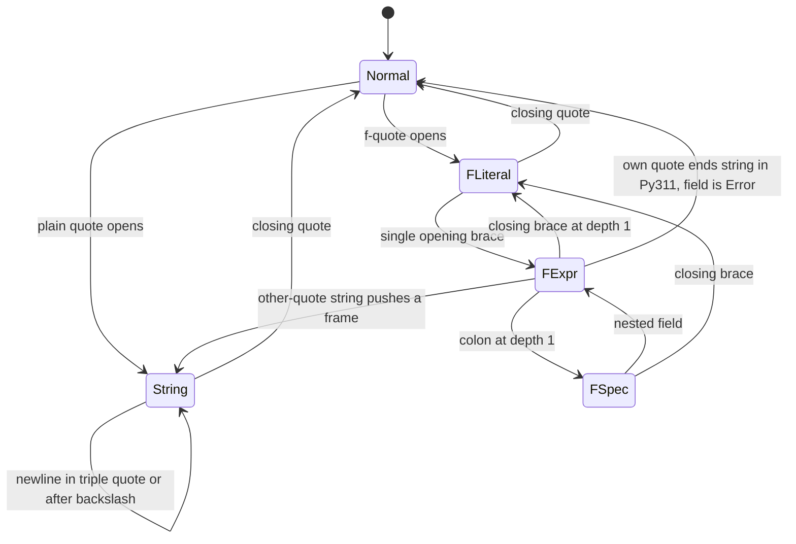

#### 4.3.3 Line states and invalidation
**Per-line record** in a `dream::LineArray` (a gap buffer spliced by ChangeSets):
- packed tokens (`uint32`: 24-bit start, 8-bit kind);
- an interned end-state id;
- a 128-bit XXH3 line hash (BSD-2), which keys the shaping cache;
- facts: `IndentCols`, `BracketDelta`, and the flags Blank, CommentOnly, StartsInString, StartsContinuation, CellMarker, Region and EndsWithColon;
- a Dirty bit.

**State.**
- `LexState {Mode, Flags {BackslashJoin, EndsWithColon}, Frames[≤8]}`, with `Frame {Quote, Triple, Prefix, Part, ExprDepth}`.
- States are hash-consed per buffer (0 = Normal), so equality is one integer compare.
- **Bracket depth is not in the state;** otherwise typing `(` would relex the rest of the file. FoldModel uses `BracketDelta` instead.

**Algorithm.**
1. Splice the line array and mark changed lines Dirty.
2. Relex from the first dirty line with the previous line's end state. After a clean line whose end state is unchanged, jump to the next dirty line or stop.
3. The keystroke path spends up to 1.0 ms (the proposed G1(1) share).
4. The rest runs in idle slices of ≤ 1.0 ms per frame (proposed) from `SCodeView::Tick`, visible lines first.
5. Lines past the frontier keep their old tokens until reached; nothing waits.

```cpp
class PyLexer {
public:
  explicit PyLexer(LexGrammar);                                  // Py311 | Py312Plus
  void OnChange(const ChangeSet&, const TextSnapshot&);
  int32_t Relex(const TextSnapshot&, double BudgetMs, LineNo PriorityFirst, LineNo PriorityLast);
  LineNo Frontier() const; std::span<const uint32_t> Tokens(LineNo) const;
  Hash128 LineHash(LineNo) const; LineFacts Facts(LineNo) const;
  static void LexFull(const TextSnapshot&, LexGrammar, std::vector<std::vector<uint32_t>>& Out);   // oracle
};
```

**Failure modes.**
- **A cascade over budget** (`"""` near the top of a large file): the budget timer moves the rest to idle slices, visible lines first. Lines below the frontier keep their old colours for a few frames.
- **Frame stack over the cap:** Error to the end of the string.
- **Incremental result differs from a full lex:** caught by fuzzing and by the `Dream.Lexer.Verify` console command (development builds); handled by a full relex, which shows as a one-frame recolour.

| ID | Tier | What it checks | Pass criterion | Covers | Lands |
|---|---|---|---|---|---|
| T-LEX-001 | 1 | Golden corpus: the engine's `Lib/**/*.py` plus fixtures | Boundaries equal 3.11 `tokenize` for every file that compiles (f-string sub-tokens merged) | EDT-01 | M1 |
| T-LEX-002 | 1 | Py311 f-strings: nesting, `{{`, `!r`, nested spec, multi-line field, same quote, `#` | Expected sub-tokens; Error exactly where `compile()` fails | EDT-01 | M1 |
| T-LEX-003 | 1 | Py312Plus fixtures; depth 8 and 9 | Matches 3.12 golden tokens; depth 9 is Error, no crash | COMPAT-05, RT-20 | M1 |
| T-LEX-004 | 1 | Prefixes, numbers and XID tables | Equal to `tokenize`; invalid forms split or Error as in CPython; XID equals `str.isidentifier()` on every code point | EDT-01 | M1 |
| T-LEX-005 | 1 | Soft keywords on 200 fixtures; docstrings, definitions, decorators, `self` | Keyword exactly where `ast` has a match node; other kinds as expected | EDT-01 | M1 |
| T-LEX-006 | 1 | Line-end states, interning, invalidation scope | Equal states share an id; an in-line edit relexes 1 line; closing `"""` stops the cascade within 2 lines | EDT-01 | M1 |
| T-LEX-007 | 1 | Differential fuzzing: 10M edits nightly, 100k per commit | Incremental equals `LexFull` after every edit; tokens sorted and non-overlapping | G1(4) | M1 |
| T-LEX-008 | 1 | Budget: 100k lines, 5,000-edit trace (typing, paste, `"""` toggles, undo) | p95 ≤ 2 ms total; each stage within its share | G1(1), PERF-03, D22 | M1 |
| T-LEX-009 | 1 | A 1 MB line; lone surrogates; NUL | Tokens up to column 20,000; no crash; full coverage | G1(4) | M1 |
| T-LEX-010 | 1 | Line facts used by folding | Equal to an oracle built from `tokenize` NL and NEWLINE tokens | EDT-07 | M2 |

---

### 4.4 Search and replace (dream::SearchEngine)

**Responsibilities.** In-buffer find and replace (EDT-09): case, whole word, regex, in-selection, preserve case and a live count. It also supplies incremental find and the compiled pattern that find in files reuses (§7.9).

| Option | Licence (D12) | Verdict |
|---|---|---|
| **PCRE2 10.4x**, 16- and 8-bit libraries | BSD-3 (sljit JIT: BSD-2) | **Chosen.** Native UTF-16 subjects; Python-like syntax (`(?P<n>)`, `(?P=n)`, lookaround, backreferences); match, depth and heap limits |
| RE2 | BSD-3 | Rejected: UTF-8 and Latin-1 only, so every search transcodes; no lookaround or backreferences |
| `std::regex` | Toolchain | Rejected: recursive backtracking overflows the stack on long lines; no Unicode classes |
| UE `FRegexPattern` (ICU) | Engine | Rejected: DreamCore has no UE dependency (D7) |

**Compile.**
- Options: `PCRE2_UTF | UCP | MULTILINE | NEVER_BACKSLASH_C`, plus `CASELESS` or `LITERAL` as needed.
- Whole word: `(?<![\p{L}\p{N}_])…(?![\p{L}\p{N}_])`.
- `\Z` becomes `\z`. Unsupported Python constructs show an error under the find box.
- JIT off (proposed: no executable memory in the editor; the G1 harness shows whether it is needed).
- Limits (proposed: a bad pattern costs tens of milliseconds at most per line): match 10^6, depth 10^4, heap 32 MB. A line over a limit is skipped and counted: "Pattern too complex on n lines".

**Run.**
- A worker copies the snapshot into one contiguous buffer with `ForEachSpan` (about 1 ms per 8 MB). It is cached per version and freed after 30 s idle (proposed), so multi-line patterns need no special case.
- The visible range is searched first. Partial results go to GT every 5 ms (proposed); the count reads "n of m+". The cap is 100,000 matches (proposed).
- A change in the find box restarts the search: at once for literals, after 150 ms idle for regexes (proposed).

**After edits.** Matches shift through each ChangeSet, overlapped matches drop, and the edited lines ±1 are rescanned after 100 ms (proposed). Patterns that can match `\n` rescan the whole document.

**Replace.**
- Syntax: `\1`, `\g<1>`, `\g<name>`, `$1`, `${name}`, `$$`, `\n`, `\t`, `\\`.
- Preserve case: upper stays upper, capitalised stays capitalised, otherwise as typed.
- Replace All is one batch and one undo group. In-selection uses anchors captured when the bar opened.

**Matching-word highlight** (EDT-02): a whole-word search over the visible lines, 250 ms after the caret stops (proposed).

**Find in files (§7.9)** owns enumeration, threading, the panel and cross-file Replace All (NAV-06). It reuses `Compile(Query, CodeUnit::Utf8)` (same options, 8-bit library) on disk files and `Utf8HitToLineCol16`. It searches open buffers through their live snapshots.

```cpp
class SearchEngine {
public:
  static std::expected<std::shared_ptr<const CompiledQuery>, SearchError> Compile(const SearchQuery&, CodeUnit);
  static void Run(const TextSnapshot&, const CompiledQuery&, Offset PriorityFirst, Offset PriorityLast,
                  CancelToken&, const std::function<void(std::span<const Match>, bool bDone)>& Sink);
  static EditBatch BuildReplaceAll(const TextSnapshot&, const CompiledQuery&, std::u16string_view Template);
};
```

| ID | Tier | What it checks | Pass criterion | Covers | Lands |
|---|---|---|---|---|---|
| T-CORE-017 | 1 | Literal, case, whole word; Python-flavour regex and replacement syntax | Equal to a naive oracle and to Python `re` golden results from the engine interpreter | EDT-09 | M1 |
| T-CORE-018 | 1 | `(a+)+$` on a line of 100k `a` | Limit error within 50 ms; other lines still searched | EDT-09 | M1 |
| T-CORE-019 | 1 | Multi-line matches; incremental order and cancel on 100k lines | Spanning matches found; viewport first; first literal batch ≤ 16 ms; cancel ≤ 1 ms | EDT-09 | M1 |
| T-CORE-020 | 1 | Match maintenance after random edits | Equal to a full rescan | EDT-09 | M1 |
| T-CORE-021 | 1 | Replace All, in-selection, preserve case | One undo group; nothing changes outside the selection | EDT-09 | M1 |
| T-CORE-022 | 1 | UTF-8 path for find in files | Same hits as the UTF-16 path | NAV-06 | M2 |

---

### 4.5 dream::CaretSet and dream::FoldModel

**Responsibilities.**
- **CaretSet:** carets, selections, movement, and the edit builders.
- **FoldModel:** indentation, region and `# %%` cell structure for folding and the run-cell commands.

**CaretSet (M1 model; multi-caret UI M2).**
- **`Selection {Anchor, Active, StickyX}`**, with `StickyX` in pixels from measured advances (§4.8). `Normalize` merges overlapping or touching selections and keeps the primary. `MapThrough` uses AnchorSet gravity.
- **Movement:** grapheme; Python-aware word (XID identifier, operator run, whitespace); smart Home; End; Up and Down with sticky X; page; document; matching bracket.
- **Graphemes** come from an injected `IGraphemeBreaker`. DreamEditor uses `FBreakIterator::CreateCharacterBoundaryIterator()` (`Engine/Source/Runtime/Core/Public/Internationalization/BreakIterator.h:13`). DreamCore's default handles surrogate pairs and combining marks.
- **Pixels:** the view implements `ILayoutOracle {XAtOffset, OffsetAtX}`, which column selection uses.
- **Multi-caret edits** are one descending batch (R7). Composition with several carets collapses to the primary (proposed: keeps the ACP selection single).

**Edit builders** read PyLexer facts:

| Builder | Behaviour |
|---|---|
| Auto-indent and dedent | One unit after a line ending in `:` outside strings and comments; one fewer after `return`, `pass`, `break`, `continue`, `raise` (EDT-03) |
| Backspace; Tab / Shift+Tab | Backspace deletes to the previous tab stop in leading whitespace; Tab and Shift+Tab indent or dedent the selected lines |
| Toggle comment | Adds `# ` at the minimum indent of non-blank lines; removes it when all are commented (EDT-04) |
| Line commands | Duplicate, move, delete, join (EDT-04) |
| Auto-close | `( [ { ' "` outside strings and comments; type-over; wrap the selection (EDT-05) |
| Indent detection | On load, the dominant unit of indented lines; ties use the project setting |

**FoldModel (M1 model; UI and cells M2).**
- **Recompute** runs on GT 300 ms after typing stops (proposed), in one pass of ≤ 1 ms on 100k lines (proposed).
- **Skipped as continuations:** lines that start in a string, or where the running `BracketDelta` sum (clamped at 0) is positive.
- **Indentation regions.** For each line L that is not blank, not comment-only and not a continuation, with indent i: the region runs from L to the last line before the next such line with indent ≤ i. Trailing blanks are excluded. A region needs at least one line besides its header.
- **Markers:** `# region [name]` / `# endregion`, stack-nested; unmatched markers are ignored.
- **Cells** (RUN-03):
  - A header matches `^[ \t]*#[ \t]*%%`, its first token is a Comment and its start state is Normal, so `# %%` inside a string is not a header.
  - The title is the rest of the line. A cell runs to the line before the next header. Text before the first header is an implicit cell.
  - `CellAt(line)` gives §5 the range for Run cell. Run cell and advance moves the caret past the next header.
- **Collapse state** is keyed by header anchors and survives recompute. Editing, finding or going to a hidden line reveals it. §10 persists `{line, header hash}` (BUF-07).
- **View mapping:** `ViewToBuffer` and `BufferToView` are O(log folds).

**Statement extent (RUN-02, RUN-26; PO-02).** `dream::StatementExtent` gives §5 the lines that Run current line (Ctrl+Alt+Enter) and Run line and advance (Alt+Enter) submit; `NextStatementLine` gives the advance target. Both read PyLexer line facts (§4.3.3) and never call Python.
- **Freshness.** The command first relexes from the frontier through the lines it scans (`Relex` with no budget over that range; proposed: a run command is not on the keystroke path), so no fact is stale. It does not use FoldModel's cached regions, which lag typing by 300 ms; it applies the same rules to the scanned lines.
- **Terms.** The bracket depth at a line start is the running `BracketDelta` sum from line 1, clamped at 0, as in FoldModel (one pass, ≤ 1 ms on 100k lines). A line is a **continuation** when it starts in a string (StartsInString), after a trailing backslash (StartsContinuation) or at a positive bracket depth. A **logical line** is a line that is not a continuation plus the continuation lines after it. A **statement start** is the first line of a logical line that is not blank and not comment-only. A logical line **opens a compound statement** when its first token is `if`, `while`, `for`, `try`, `with`, `def`, `class` or `async`, keywords that only begin compound statements, or when its last token, ignoring a comment, is `:` (EndsWithColon on its last physical line). The first-token test catches a header that holds its body on the same line, such as `try: import json` or `if c: a()`, which does not end with `:`. A **`match` header** is a logical line whose first token is `match` and that ends with `:` (EndsWithColon on its last physical line). A **clause line** is a statement start whose first token is `elif`, `else`, `except` or `finally`, or one whose first token is `case` and whose enclosing header, the previous statement start with less indentation, is a `match` header (proposed). `case` and `match` are soft keywords, so the test reads the logical line and its enclosing header, not the token's text alone and not the highlighting kind of §4.3, whose soft-keyword rule looks at one physical line. Only `case` blocks can stand directly in a `match` body, so this needs no pattern parsing: it holds for a one-line `case X: f()` and for a pattern that spans lines up to its `:`, and it fails for an identifier named `case`, such as `case(1)` in a loop body (`for case in OverrideNew, OverrideInit, OverrideBoth:` in the engine's `Lib/test/test_descr.py`) or `case.doModuleCleanups()` (`Lib/unittest/suite.py`), whose enclosing header is not a `match`. The first tokens are read from the snapshot at the token starts that PyLexer keeps for the line.
- **Extent from the caret line C:**
  1. If C is blank or comment-only and not a continuation, there is no statement. Run current line runs nothing and the status bar says "No statement on this line"; Run line and advance moves the caret to the next statement without a run (proposed).
  2. Otherwise S is the statement start of the logical line that holds C (walk up while the line is a continuation). The extent starts as S's logical line, so a caret inside an open bracket, an open triple-quoted string or after a trailing backslash takes the whole logical line. **Decorated definitions:** when S's first token is `@`, `def`, `class` or `async def`, S moves up over the decorator logical lines directly above it at the same indentation (blank and comment-only lines between them are allowed) to the first one, so a caret on the `def` or `class` line, or on a lower decorator, still takes every decorator and never rebinds the name to the undecorated object (proposed).
  3. **Continuation clause on the caret line:** if S's first token is `elif`, `else`, `except` or `finally`, S moves up to the previous statement start at the same indentation whose first token is none of these; if S is a `case` clause line, S moves up to its enclosing `match` header (the previous statement start with less indentation). A statement start whose first token is the identifier `case` is not a clause line and takes rule 6. Proposed: a clause alone is a `SyntaxError`, and it belongs to that compound statement. Rule 5 then applies, because S now opens a compound statement (by its first token or its `:`), so the extent is the whole statement with all its clauses.
  4. **Decorator:** while the first token of the current logical line is `@`, the extent runs on through the next statement start, until it reaches the decorated `def` or `class`, which then takes rule 5.
  5. **Compound statement:** when the logical line opens a compound statement, its body joins: every line up to the next statement start whose indentation is ≤ S's (the indentation-region rule above; the `case` clauses of a `match` are its body). Then, while that next statement start has S's indentation and its first token is `elif`, `else`, `except` or `finally`, that clause and its body join too. This holds for one-line headers and clauses as well: `try: import json` above `except ImportError: json = None` is one extent of two lines from either caret. Trailing blank and comment-only lines are excluded.
  6. Otherwise the extent is the single logical line. An indented one runs through the RT-14 wrapper (§5.3.2).
- **Next statement.** `NextStatementLine(Ran)` is the first statement start after `Ran.Last`, the last line of the executed range, except that **clauses are skipped**: while that target is a clause line of a compound statement H (H found as in rule 3) whose extent (rule 5) contains the whole executed range, the target moves to the first statement start after H's extent. So stepping through an `if`, `try`, `for`, `while` or `case` body never lands on its `else:`, `except:`, `finally:` or next `case` line, whose run would run the whole statement again, the branch already stepped through included; it lands after the compound statement (proposed). Run line and advance puts the caret at its first non-blank column, and the view scrolls to keep the caret 3 lines from the edges (§4.8.3). When there is none, the caret stays and the status bar says "End of buffer".
- **With a selection,** Run line and advance submits the selection (RUN-01 rule), clears it and calls `NextStatementLine` with the selection's line range. A selection that ends at column 0 of a line ends on the line before (proposed: the usual whole-line selection made with Shift+Down).
- **When the caret moves.** SDreamTab moves the caret when `Submit` accepts the request (§5.2.2), before the run executes, so the outcome never changes where it lands; a refused request leaves the caret and the selection as they were (proposed). Each press is one numbered run (U8) with its own undo step (RUN-07).

```cpp
struct LineRange { LineNo First, Last; };
std::optional<LineRange> StatementExtent(const TextSnapshot&, const PyLexer&, LineNo Caret);   // nullopt: blank or comment-only
std::optional<LineNo> NextStatementLine(const TextSnapshot&, const PyLexer&, LineRange Ran);     // nullopt: end of buffer; skips clauses (above)
class CaretSet { public:
  void Set(std::vector<Selection>, int32_t Primary); void Normalize(); void MapThrough(const ChangeSet&);
  void Move(MoveKind, bool Extend, const TextSnapshot&, const ILayoutOracle&, const IGraphemeBreaker&);
  static EditBatch ToggleComment(const TextSnapshot&, const PyLexer&, const CaretSet&); };
class FoldModel { public:
  void Recompute(const TextSnapshot&, const PyLexer&); void MapThrough(const ChangeSet&);
  void SetCollapsed(LineNo Header, bool); void RevealLine(LineNo);
  int32_t BufferToView(LineNo) const; LineNo ViewToBuffer(int32_t) const;
  std::span<const Cell> Cells() const; const Cell* CellAt(LineNo) const; };
```

| ID | Tier | What it checks | Pass criterion | Covers | Lands |
|---|---|---|---|---|---|
| T-CORE-023 | 1 | `Normalize`; 10 carets type and delete | Merged correctly; in sync; one undo restores all | EDT-06 | M2 |
| T-CORE-024 | 1 | Grapheme, word, smart Home, sticky X (fake oracle) | Never inside a surrogate pair or before a combining mark; golden stops | EDT-06, EDT-03 | M2 |
| T-CORE-025 | 1 | Every edit builder in the table | EDT-03, EDT-04 and EDT-05 acceptance holds; nothing auto-closes inside strings | EDT-03, EDT-04, EDT-05 | M1 |
| T-CORE-026 | 1 | Indentation and region folds | Golden regions; a 200-line function folds to one line | EDT-07 | M2 |
| T-CORE-027 | 1 | Cells: `# %%`, `#%%`, indented, inside a `"""` string, implicit first cell | Golden cells; the string case is not a header | RUN-03 | M2 |
| T-CORE-028 | 1 | Collapse state through edits; reveal; mapping; recompute cost; indent detection | All kept; ≤ 1 ms p95 on 100k lines; expected unit for 2-, 4-, 8-space and tab fixtures | EDT-07, BUF-07, EDT-03 | M2 |
| T-CORE-037 | 1 | Statement extent, golden cases: a plain line; an indented body line; a `for` header with its body and `else`; `if`/`elif`/`else` with the caret on each header; `try`/`except`/`finally`; a `match` with the caret on a `case` line, on a one-line `case X: f()` and on each line of a `case` pattern that spans two lines; `case(1)` and `case.cleanup()` as calls in a `for case in items:` body; a call whose arguments span three lines, with the caret on each line; an open `"""` string; a trailing backslash; two decorators, one with arguments over two lines, above a `def`, with the caret on each decorator line and on the `def` line; the one-line pairs `try: import json` / `except ImportError: json = None` and `if c: a()` / `else: b()`, with the caret on each line; a body followed by blank and comment lines; a blank and a comment-only caret line | Each extent equals its golden range; the clause and `case` carets, the one-line `case` included and every line of the two-line pattern, give the whole `match` or compound statement; each `case` call in the loop body gives its own line only; every decorator caret and the `def` caret give decorators plus the whole `def`; each one-line pair gives both lines from either caret; blank and comment-only carets give none; no extent ends on a blank or comment-only line | RUN-02, RUN-26 | M1 |
| T-CORE-038 | 1 | Next statement after every T-CORE-037 extent; at the end of the buffer; a selection ending at column 0 of a line; stepping line by line through a `try` body with an `except` clause, an `if` body with an `else`, an `if`/`else` nested in a `try` body, a `case` body followed by another `case`, a `case` body followed by a one-line `case X: f()` and a `case` whose pattern spans two lines, and a `for case in items:` body whose lines are `case(1)` and `case.cleanup()` | The caret target is the first non-blank column of the first statement start after the extent, never a blank, comment-only or continuation line, and never a clause of a compound statement whose extent holds the run; none at the end of the buffer; the column-0 end counts the line before; each body walk lands after the whole compound statement (the nested walk after the outer `try`, each `case` walk after the `match`) and no step runs a header; the walk through the `for case in items:` body lands on `case.cleanup()` after `case(1)`, not after the loop | RUN-26 | M1 |
| T-CORE-039 | 1 | Extent against `ast` on the engine's `Lib/**/*.py`: for every top-level statement of every file that compiles, the caret on its first line, on each decorator line and on the `def` or `class` line of a decorated definition, and on each continuation line of a simple statement; then the same with the lexer frontier forced above the caret | The extent equals the statement's lines from its first decorator (or `lineno`) to `end_lineno`; with the stale frontier the facts are relexed first and the result is the same | RUN-02, RUN-26 | M1 |

---

### 4.6 dream::Diff

**Responsibilities.** Line and intra-line diff for local history and the recovery diff. Minimal edits for reload, format and restore. Change bars.

**Algorithm.**
1. Hash lines with XXH3-64 and intern them (collisions resolved by comparing text).
2. Trim the common prefix and suffix.
3. Run Myers O(ND) with linear-space middle-snake division.
4. Slide hunks to blank-line or indent boundaries when the result is equivalent (proposed: readable Python hunks).
5. **Cap** (proposed: bounded worker latency): above D = 4,000 or 50 ms, the remaining middle becomes one replace hunk marked `bApproximate`.
6. Intra-line ranges come from a word-token Myers pass. Diff runs on a worker.

**Users.**
- **Local history and recovery** (§10, U30, PER-04). The M2 diff view is two read-only SCodeViews with synchronized scrolling and hunk decorations (§4.14).
- **`ToMinimalEdits`** for reload in place (BUF-04, §10.15), format (§7) and history restore. Anchors on unchanged lines (breakpoints, folds, carets) stay put.
- **Change bars** (EDT-02). Edited lines get provisional bars at once. 300 ms after typing stops (proposed), a worker diffs the text against the save-point snapshot (O(1) to keep). Undoing to the save point clears all bars.

```cpp
namespace dream { struct Diff {          // stateless; every member is static
static Result Lines(const TextSnapshot& Old, const TextSnapshot& New, const Options&, CancelToken&);   // Hunks, bApproximate
static EditBatch ToMinimalEdits(const TextSnapshot& Old, const TextSnapshot& New, const Result&);
}; }
```

| ID | Tier | What it checks | Pass criterion | Covers | Lands |
|---|---|---|---|---|---|
| T-CORE-029 | 1 | Myers on random pairs; adversarial inputs | Hunks turn A into B with the edit count of an O(N²) oracle (≤ 200 lines); adversarial inputs return in ≤ 50 ms, `bApproximate`, still valid | PER-04 | M1 |
| T-CORE-030 | 1 | `ToMinimalEdits` | Breakpoint and fold anchors on unchanged lines keep their lines | BUF-04, DBG-01 | M3 |
| T-CORE-031 | 1 | Change bars | Provisional on edit; final after the debounce; none at the save point | EDT-02 | M1 |

---

### 4.7 dream::SnippetEngine

**Scope:** parse VS Code bodies (D28) plus `${param:name}` (U31), expand them, and run the tab-stop session. §11 owns the library and the forms.

```text
any         ::= tabstop | placeholder | choice | variable | param | text
tabstop     ::= '$' int | '${' int '}' | '${' int transform '}'
placeholder ::= '${' int ':' any* '}'
choice      ::= '${' int '|' text (',' text)* '|}'
variable    ::= '$' var | '${' var '}' | '${' var ':' any* '}' | '${' var transform '}'
param       ::= '${param:' name '}'                                  (U31)
transform   ::= '/' regex '/' (format | text)* '/' options           (regex via SearchEngine)
format      ::= '$' int | '${' int ':' ('/upcase'|'/downcase'|'/capitalize'|'/camelcase'|'/pascalcase') '}'
              | '${' int ':+' if '}' | '${' int ':?' if ':' else '}' | '${' int ':-' else '}'
escapes     ::= '\$' '\}' '\\', and '\,' '\|' inside a choice
```

- Malformed input is literal text, as in VS Code.
- Limits (proposed: bounded recursion): depth 16 and body 64 KB.
- Variables: `TM_*`, `CLIPBOARD`, `CURRENT_*`, `UUID`, `RANDOM`, `RANDOM_HEX`, `LINE_COMMENT` (`#`). An unknown variable becomes a placeholder with its name.

**Insert mode** (EDT-12):
- Multi-line bodies are re-indented to the insertion line; `\t` becomes the indent unit.
- Tab stops become AnchorSet ranges.
- Parameters become mirrored tab stops holding their default literals (SNP-02): each `${param:name}` is one mirrored group, ordered after the numbered stops and before `$0`.
- **Inserting never shows a form** (RV-22, which closes OI-43). U31's once-per-run form applies to runs only (§11).

**Run mode** (shelf and snippet runs, §11):
- Params take the literal for the form values. Stops take their default text and choices their first option.
- Literals come from `FormatPyLiteral(JsonValue)`, whose `eval` equals the value with the same type (D28: substituted as `repr`, never raw):
  - str uses repr's quote rule, escaping `\\`, the quote, `\t\n\r`, C0 and DEL as `\xNN`, and lone surrogates as `\uDxxx`;
  - `True`, `False`, `None`; floats as the shortest round trip, with `float('inf')` and `float('nan')`; lists and dicts recursively.

**Session.**
- Tab goes to the next stop (1…n, then params, then `$0`); Shift+Tab goes back.
- Activating a stop puts every range of that index into the CaretSet, so mirrors are multi-caret edits in one group. Transforms are recomputed after each edit.
- A choice asks §7's popup for its list.
- The session ends on Esc, Tab at `$0`, an edit outside every stop, an undo past the insertion, or a new expansion (proposed: no nesting).

```cpp
class SnippetEngine { public:
  static std::pair<std::shared_ptr<const SnippetAst>, std::vector<SnippetError>> Parse(std::u16string_view Body);
  static Expansion Expand(const SnippetAst&, const ExpandContext&, ExpandMode /*Insert|Run*/);
  static std::u16string FormatPyLiteral(const JsonValue&); };
class SnippetSession { public: void Start(Expansion, Offset At, AnchorSet&); bool Next(CaretSet&); bool Prev(CaretSet&);
  void OnChange(const ChangeSet&, TextBuffer&, UndoTree&); void End(); bool IsActive() const; };
```

| ID | Tier | What it checks | Pass criterion | Covers | Lands |
|---|---|---|---|---|---|
| T-CORE-032 | 1 | Parser golden set; malformed input; depth 17 | AST equals golden; malformed is literal; depth 17 refused without a crash | D28, SNP-02 | M4 |
| T-CORE-033 | 2 | `FormatPyLiteral` on 100k fuzzed values from a tier-1 generator, checked in plain CPython | `eval(lit) == value` with the same type; byte-equal to `repr` for ASCII str, int, bool, None | D28, U31 | M1 |
| T-CORE-034 | 1 | Run-mode params; Insert re-indent, `\t`, `TM_SELECTED_TEXT`, unknown variable; Insert-mode params | No raw param remains; golden text; inserting `${param:prefix}` with default `"SM_"` leaves a mirrored tab stop holding `"SM_"` and requests no form | U31, EDT-12, SNP-02 | M4 |
| T-CORE-035 | 1 | Navigation, end conditions, mirrors, transforms, choices | Order 1…n, params, `$0`; each end condition ends the session; one group per mirrored edit; choice request lists the options | EDT-12, SNP-02 | M4 |

---

### 4.8 SCodeView

SCodeView is an `SLeafWidget` that draws and edits any `IDreamLineSource` (§4.14). It hosts input (§4.9), IME (§4.10) and accessibility (§4.11).

#### 4.8.1 Layout, shaping and the cache
- **Line height:** max character height × 1.2 (proposed: JetBrains Mono's design gap), pixel-snapped.
- **No soft wrap** in the code view at 1.0 (proposed). Read-only sources wrap lazily, visible lines only. Their scroll position is a logical line plus a row, so nothing wraps the whole document.
- **Visible range:** the viewport plus 8 lines of overscan each side (proposed; a wheel notch is 3 lines), mapped through FoldModel.
- **Paint runs every frame.** Global invalidation is off by default (`GSlateEnableGlobalInvalidation = false`, `Engine/Source/Runtime/SlateCore/Private/SlateCoreClasses.cpp:52`), so the caret-only budget is the steady-state cost.
- **Shaping unit:** within a line, the longest run with one face and one shaping method, split at tabs. A typical line is one run.
- **Shaping:** `GetFontCache()->ShapeUnidirectionalText(…, ETextShapingMethod::KerningOnly)` (`FontCache.h:809`) on a zero-copy line view.
  - KerningOnly disables ligatures, so glyphs and columns stay one-to-one.
  - Lines with RTL or complex scripts use FullShaping in logical order; there is no bidi reordering in 1.0 (proposed; documented).
- **Colour runs** are cached `GetSubSequence` results (`FontCache.h:485`), each painted with its own tint, without reshaping.
- **Cache:** `SCodeView::FLineShapeCache`, an LRU of 4,096 lines (proposed: about three 4K screens).
  - Key: `{LineHash128, StyleSignature, FontSize×Zoom, GeometryScale, ShapingMethod}`, so identical lines share an entry (D1).
  - `IsDirty()` entries (`FontCache.h:410`) are reshaped. The cache is flushed on `FSlateFontCache::OnReleaseResources()` (`FontCache.h:870`) and on theme or font changes.
- **Measured advances** (D23):
  - Caret x comes from `GetMeasuredWidth(Start, End)` (`FontCache.h:426`); hit testing from `GetGlyphAtOffset` (`:464`).
  - CJK fallback glyphs get their real width. Sticky x, column selection, indent guides and tab stops (TabWidth × the measured space advance) all use pixels.
- **Long lines** over 10,000 units (proposed) are shaped in 1,024-unit segments near the viewport.
  - Paint and shaping read only the viewport's segments, through `ForEachSpan`. `LineView` is zero-copy only for a single piece, so after an edit a 1 MB line would otherwise be copied (2 MB) on every frame.
  - Each long line keeps a **segment-width table**. A segment not yet measured is estimated as its units × the measured space advance. Idle slices on GT then measure the other segments, nearest the viewport first, and replace the estimates; the horizontal scroll extent is corrected with them, keeping the segment at the viewport's left edge in place. Measuring stays on GT, because `FSlateFontServices::GetFontCache` serves only the game and render threads (`Engine/Source/Runtime/SlateCore/Private/Rendering/SlateRenderer.cpp:42-54`).
  - The x of a far segment, the caret x for End and the scroll extent are prefix sums over that table. A caret move into estimated segments (End, Go to line and column) measures the segments before the caret first, so the caret lands at the measured x within 2 frames (T-VIEW-009).
  - Segment shapes are cached under the line hash plus the segment index.
- **Visible special characters** (proposed; Trojan Source defence):
  - bidi controls (U+202A–202E, U+2066–2069, U+200E, U+200F, U+061C) and zero-width characters draw as boxed labels with a warning squiggle;
  - C0 controls draw as U+2400 pictures.

#### 4.8.2 Paint and gutter
**Layers:**
1. Background, current line, the ran-line tint (EDT-18, M2), selection (inactive colour when unfocused), find matches, bracket pair, matching word.
2. Text: one `FSlateDrawElement::MakeShapedText` per colour run (`Engine/Source/Runtime/SlateCore/Public/Rendering/DrawElementTypes.h:153`). The paint geometry is the shaped size × 1/Scale, as Slate's text runs do, so there is no double scaling (A11Y-04).
3. Squiggles: one tiled-brush `MakeBox` per range; then the IME underline and the special-character labels.
4. Carets: 2 px × scale, blinking at the OS caret time (proposed; 530 ms where the OS has none), reset per key, hollow when unfocused.
5. Cell headers (M2): a hairline and `#22 · ran 14:03 · 0.4 s` (the last run's number, time and duration; ` · error` or ` · cancelled` when it did not end ok, proposed) from run records (RUN-03), without a virtual line.

**Gutter lanes**, left to right. Each draws from `IDreamDecorationProvider`s with versions:

| Lane | Content | Source |
|---|---|---|
| Breakpoints | Dot = enabled; hollow = disabled; dot with bar = conditional. Click = F9 command; right-click or Shift+F9 edits the condition (U22). A diagnostic icon shows when the line has no breakpoint | §8 (M3), §7 |
| Line numbers | Right-aligned; current line bold | Buffer |
| Run and ran markers | Ran-line marks after statement-mode runs (EDT-18, M2, below): one bar per line of each statement that completed, raised, was running when Stop took effect or ended the run through `SystemExit`, with distinct colours and dash patterns (A11Y-05); a later run replaces only the marks on the lines of its own statements, and an edit removes a line's mark. In Live (docked) Preview (M4) also the execution arrow at the line of the last pump (§5.5.4) | §5 |
| Change bars | Added and modified lines: an outlined bar, two 1 px × scale rails in the added or modified colour (proposed), so a change bar never looks like a filled ran mark; deleted lines: a wedge | §4.6 |
| Folds | Chevrons | §4.5 (M2) |

**Ran-line marks (EDT-18, M2; PO-02).** `FDreamRanMarks`, one per buffer, is the `IDreamDecorationProvider` behind the marks.
- **Data.** When a statement-mode run (RUN-27) of the buffer ends (selection, line, cell or buffer route), FDreamRunService passes it the run number, the source snapshot's version, the statement ranges of the prepare result (§5.3.2) and the two counts that `_dream.run_statement` keeps in the run record (§5.3.7): statements started and statements returned. Statements below the returned count are **ok**. When the last started statement did not return, it is **exited** if the run ended through `SystemExit` (§5.3.9, detail `exited (code n)`, whatever the outcome), and otherwise **raised** if the run ended `error` or **stopped** if it ended `cancelled` (proposed). A Stop that landed between two statements leaves every started statement returned, so it adds no stopped mark. Statements not reached stay unmarked.
- **Mapping.** Each range is mapped from the snapshot's version to the current one with `TextBuffer::MapLine` (§4.1.3); a line that maps to −1 gets no mark. The marks are then `LineStart` anchors in the buffer's `AnchorSet` with delete policy Remove, so they move with later edits.
- **Lifetime: the marks keep the line-by-line trail.** A run removes the marks on the lines of every statement in its range, reached or not, and adds its own; marks on every other line stay, each with its own run number in its tooltip. So five Alt+Enter presses leave five ok marks, each naming its own run, and a whole-buffer run, whose range is the whole buffer, replaces every mark. A Run File of the buffer (no statement mode) clears every mark, and so does **View ▸ Clear Ran-Line Marks** (proposed). An edit that touches a marked line removes that line's mark, and the other lines keep theirs. Marks are not persisted (proposed: they describe this session's runs).
- **Paint.** A thin bar in the run lane, left of the change bars (the lane table above), in the ok, error, cancel or exit colour (`Dream.Gutter.RanOk`, `Dream.Gutter.RanError`, `Dream.Gutter.RanCancel`, `Dream.Gutter.RanExit`, proposed tokens; solid, dashed, dotted and dash-dot), and a light tint of the ok colour behind ok lines only (layer 1, mockup 01's ok style); raised, stopped and exited lines get the bar alone. A ran mark never shares a look with a change bar: the change bars are outlined (the lane table above) and the ran marks filled or patterned, and at least 3 px × scale separates the run lane from the line numbers and from the change bars (proposed), so the ok mark and an added-line bar, both green, and the exited mark and a modified-line bar, both blue, differ in shape as well as position (A11Y-05). The bar's tooltip reads "Ran in #22 · ok", "Raised in #22", "Stopped in #22" or "Exited in #22 (code 0)", so colour is never the only signal. OUT-11 still adds the `runtime` Problems item at the raising line (§7.8.1).
- **View ▸ Ran-Line Marks** (proposed label; on by default; kept in the per-project session state) hides the bars and the tint; **View ▸ Clear Ran-Line Marks** (proposed) removes every mark of the active buffer.

#### 4.8.3 Scrolling, zoom, DPI and mouse
- **Scroll:** the OS lines-per-notch (default 3); Shift+wheel horizontal. The caret is kept 3 lines from the edges (proposed). The `SScrollBar`s belong to SDreamTab.
- **Zoom** is per tab (D23). Ctrl+wheel, Ctrl+= and Ctrl+- step 10% within 50–300%; Ctrl+0 resets (EDT-10; the range is proposed). The base is 10 pt (proposed, one step above the engine's 9 pt, `Engine/Source/Editor/EditorStyle/Private/StarshipStyle.cpp:8845`). Zoom is stored in tab session state (§10, EDT-10).
- **DPI:** `FontScale = AllottedGeometry.Scale`. A monitor change reshapes the visible lines once; rects snap to device pixels.
- **Mouse:**
  - click, double-click and triple-click select caret, word and line; Shift+click extends; drag selects with auto-scroll;
  - Alt+click adds a caret and Alt+Shift+drag selects a pixel column (M2);
  - Ctrl+click goes to definition (M2, §7);
  - middle-drag on a selection starts `FDreamCodeDragDropOp` for drag-to-shelf (SNP-04, §11).
- **Drops** of assets and actors (D30, M2): §11 formats the text, inserted at the drop caret as one group.
- **Clipboard:** copy with no selection copies the line, and pasting such a line inserts it above the caret line (proposed). Paste normalises CRLF and strips NULs, reporting the count.

```cpp
class SCodeView : public SLeafWidget {
public:
  SLATE_BEGIN_ARGS(SCodeView) : _Mode(EDreamViewMode::Editor) {}
    SLATE_ARGUMENT(TSharedPtr<IDreamLineSource>, LineSource)
    SLATE_ARGUMENT(EDreamViewMode, Mode)                        // Editor, ReadOnly, Prompt
    SLATE_ARGUMENT(TSharedPtr<IPromptHandler>, PromptHandler)
  SLATE_END_ARGS()
  virtual int32 OnPaint(const FPaintArgs&, const FGeometry&, const FSlateRect&, FSlateWindowElementList&, int32, const FWidgetStyle&, bool) const override;
  virtual void Tick(const FGeometry&, const double, const float) override;   // lexer slices, IME layout notify, blink
  virtual FReply OnKeyDown(const FGeometry&, const FKeyEvent&) override;
  virtual FReply OnKeyChar(const FGeometry&, const FCharacterEvent&) override;
  virtual TSharedRef<FSlateAccessibleWidget> CreateAccessibleWidget() override;   // WITH_ACCESSIBILITY
  void SetRunActive(bool bActive);            // §5: read-only, IME off, ReleaseAllPointerCapture
  void AddDecorationProvider(TSharedRef<IDreamDecorationProvider>);    // Collect(FirstLine, LastLine, Out), GetVersion()
  FSlateRect GetCaretScreenRect() const;      // §7 popups, §4.10
};
```

#### 4.8.4 Failure modes and tests
| Failure | Detection | Handling | What the user sees |
|---|---|---|---|
| Paint over budget (cold cache, DPI change) | `Dream.Paint` stat (§13) | Visible lines first; overscan spread over later frames | At most one slow frame |
| Missing glyph or face | `IsDirty`, or no glyph | DroidSansFallback (§4.12); logged once | Tofu box |
| Run starts during a drag-select | `SetRunActive(true)` | `FSlateApplication::Get().ReleaseAllPointerCapture()` (`Engine/Source/Runtime/Slate/Public/Framework/Application/SlateApplication.h:796`) | Selection ends at run start |

| ID | Tier | What it checks | Pass criterion | Covers | Lands |
|---|---|---|---|---|---|
| T-VIEW-001 | 4 | Full 4K viewport; scroll and page trace on 100k lines, with the Dream tab visible and hidden | `OnPaint` p95 ≤ 2 ms; the `Slate/DrawWindows_Private` delta (visible minus hidden) p95 ≤ 1 ms (proposed), reported with G1(2) | G1(2), PERF-04 | M1 |
| T-VIEW-002 | 4 | Caret-only frames | p95 ≤ 0.5 ms | G1(2), PERF-04 | M1 |
| T-VIEW-003 | 4 | Virtualization and cache keys | A one-line scroll shapes ≤ 1 + overscan lines; identical lines share; zoom or DPI misses; dirty entries reshaped; flushed on release | G1(2), D1 | M1 |
| T-VIEW-004 | 4 | CJK measured-advance golden test (D23); tabs and guides | Caret x = sum of advances; midpoint hit tests exact; tab stops and guides at multiples of the space advance | D23, D1, EDT-02, EDT-16 | M1 |
| T-VIEW-005 | 4 | Gutter and squiggles at 100%, 150% and 200% DPI | Clicks hit the right line and lane; squiggles on exact ranges with icon and text | EDT-02, DBG-01, INT-07, A11Y-04 | M3 |
| T-VIEW-006 | 4 | Run and ran markers; cell header from fake records | Drawn; a mark is cleared by an edit of its line, and a later run replaces only the marks on its own statements' lines (EDT-18, T-VIEW-020); header text correct | RUN-03 | M2 |
| T-VIEW-007 | 4 | Per-tab zoom; move to a 150% monitor | Only that tab changes and the zoom survives restart; one reshape, pixel-snapped, no double scaling | EDT-10, A11Y-04 | M1 |
| T-VIEW-008 | 4 | Current line, selection, bracket pair, matching word; bidi, zero-width and C0 labels | Expected rects; labels with warning squiggles | EDT-02, EDT-17 | M1 |
| T-VIEW-009 | 4 | A 1 MB line scrolled horizontally, after an edit that splits it across pieces; End on a 1 MB CJK line | Within G1(2); only nearby segments shaped; paint copies no more than the visible segments; End puts the caret at the measured x within 2 frames; once the idle slices finish, the scroll extent equals the summed measured widths | G1(2), D23 | M1 |
| T-VIEW-010 | 4 | Mouse gestures, including M2 | Expected carets and selections | EDT-06 | M2 |
| T-VIEW-011 | 4 | `SetRunActive` | Read-only, IME off, capture released; restored at Idle | D2, G2(5) | M1 |
| T-VIEW-012 | 4 | Status bar: Ln/Col, (from M2) indent, encoding, EOL; (from M2) asset drop with a fake formatter | Updates ≤ 250 ms; drop is one undo group at the drop caret | WS-05, UEI-01, D30 | M1 (M2: indent, encoding, EOL and asset drop) |
| T-VIEW-013 | 4 | Keystroke to present with the editor idle at ≥ 60 fps (Insights) | ≤ 16 ms p95 | PERF-05 | M1 |
| T-VIEW-020 | 4 | Ran-line marks per outcome and their trail: a five-statement buffer run that raises in statement 4, then an edit on line 2; a run stopped during statement 3 of five; a fake run end that is `cancelled` with 2 statements started and 2 returned (a Stop between statements); a run whose statement 3 calls `sys.exit()`; five Alt+Enter presses from line 1 of a five-statement buffer, then a selection run of statements 2–3, then a whole-buffer run; View ▸ Ran-Line Marks off and on; View ▸ Clear Ran-Line Marks | Statements 1–3 ok, 4 error, 5 unmarked, each bar with its tooltip and dash pattern, and only the ok lines tinted; the edit removes only line 2's mark; the stopped run marks 1–2 ok and 3 stopped; the between-statements end marks 1–2 ok and nothing else; the `sys.exit()` run marks 1–2 ok and 3 exited, "Exited in #N (code 0)", and 4–5 none; the five presses leave five ok marks whose tooltips name runs #N..#N+4; the selection run replaces only the marks of statements 2–3, and the whole-buffer run replaces all five; the toggle hides and restores bars and tint; Clear removes every mark | EDT-18, A11Y-05 | M2 |
| T-VIEW-021 | 4 | Ran-line marks through edits: lines typed above the selection while its run waits in `Starting` for its journal commit (held by a hung `FileOps` as in T-PER-015, released by the driver within 2 s); after the run, 3 lines inserted above a marked statement and one marked line deleted; then a Run File of the buffer | Marks land on the lines that ran (mapped with `MapLine`), move with the inserted lines, and the deleted line's mark is gone; Run File clears every mark | EDT-18 | M2 |

---

### 4.9 Input routing and keymap

#### 4.9.1 Event path and resolution
- **Slate's order** (07e Q2): pre-input listener, pre-processors, tunnel, bubble, then MainFrame's unhandled handler.
- **SCodeView is the focused leaf.** Whatever it returns as Handled never reaches `SLevelEditor`, `FTabCommands` or MainFrame.
- `FDreamInputPreProcessor` (§5) exists only during runs (D25), so idle routing is decided entirely here.
- Key-ups for consumed key-downs are Handled too (proposed: no stray releases).
- **We do not route through `FUICommandList::ProcessCommandBindings`.** It returns false when `CanExecute` is false, so the key would bubble on (`Engine/Source/Runtime/Slate/Private/Framework/Commands/UICommandList.cpp:203-251`).

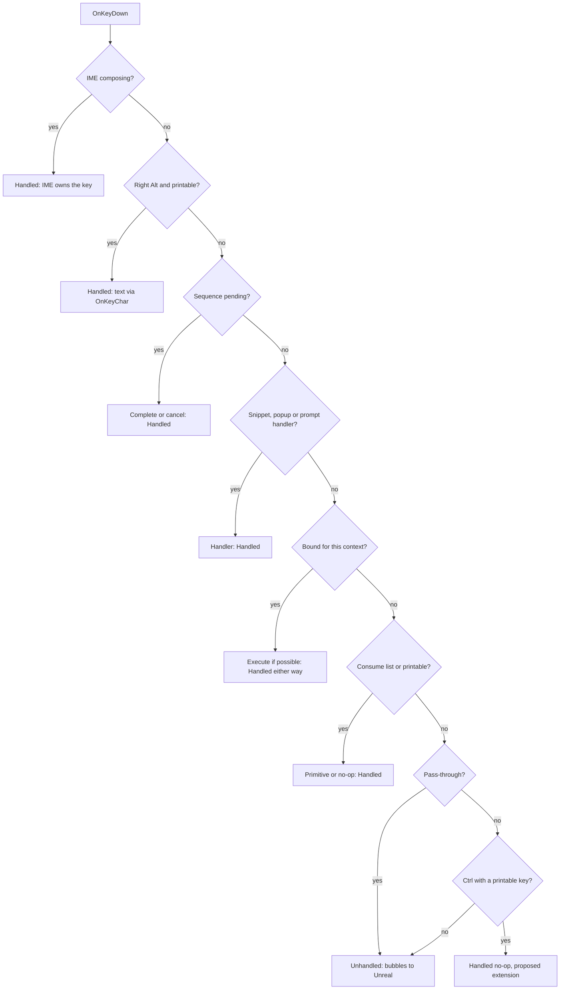

- **Printable:** a character code ≥ 0x20, not 0x7F, with no Ctrl or Alt. The code is Windows' `MapVirtualKey(…, MAPVK_VK_TO_CHAR)` (`Engine/Source/Runtime/ApplicationCore/Private/Windows/WindowsApplication.cpp:3317`). Enter, Tab and Esc carry control codes, so the AltGr test never captures them.
- **Sub-handler order:** snippet session (Tab, Shift+Tab, Esc), popup (Up, Down, PgUp, PgDn, Enter, Tab, Esc), prompt (§4.14).
- **Idle Esc:** close the popup, end the snippet session, collapse carets or close the find bar, whichever applies first. It is always consumed (D8), so it shadows Unselect All and PIE Stop while focused.

#### 4.9.2 FDreamCommands and dream::Keymap
- **`FDreamCommands`:** `TCommands` with context `DreamEditor`, parent `NAME_None` (parentless, D25) and style set `DreamEditorStyle`. Chords persist in `EditorKeyBindings.ini`; Dream's keymap page and Unreal's Keyboard Shortcuts both edit them (U24).
- **`dream::Keymap`** (tier 1) is rebuilt at start and on `FInputBindingManager::RegisterUserDefinedChordChanged` (`Engine/Source/Runtime/Slate/Public/Framework/Commands/InputBindingManager.h:129`).
- **Bindings `FInputChord` cannot express** live in `UDreamUserSettings` and appear on Dream's page only: two-stroke sequences (VS Code preset, M4), Shift Shift, Numpad Enter.
- **Context bits:** Focused, Editable, Prompt, Output, PausedSource, HasSelection, MultiCaret, SnippetActive, PopupOpen, RunActive, Paused, TaskRunning.
- **Shift Shift:** two bare Shift key-ups within 300 ms (proposed) with nothing in between.

```cpp
namespace dream {
struct Stroke { KeyCode Key; uint8_t Mods; char32_t Char; bool bRightAlt, bNumpadEnter, bRepeat; };
enum class ResolveKind : uint8_t { Unhandled, Command, Pending, TextInput, ConsumeOnly, ToSubHandler };
class Keymap { public:
  void SetBindings(std::vector<Binding>); void SetPassThrough(std::vector<Stroke>); void SetConsumeExtension(bool);
  Resolution Resolve(const Stroke&, uint32_t ContextMask, double NowSec, bool bComposing, bool bSubHandlerWants);
  std::optional<CommandId> OnKeyUp(const Stroke&, double NowSec); };      // Shift Shift
}
```

#### 4.9.3 AltGr, Numpad Enter, commits and focus
**AltGr (RT-16).**
- `IsRightAltDown()` with a printable character is always text, never a command. This mirrors the stock check order (`.../SlateEditableTextLayout.cpp:1280-1285`).
- Windows reports AltGr as LeftCtrl+RightAlt, so Polish AltGr+Z types `ż` and never fires Undo Last Run.
- Ctrl+Alt chords use the left Alt only (stated on the keymap page). Undo Last Run is bound only in Dream widgets.
- The same rule covers Linux, where AltGr arrives as Right Alt.

**Numpad Enter (G7).**
- `EKeys::Enter` does not distinguish the keys (`Engine/Source/Runtime/InputCore/Private/Windows/WindowsPlatformInput.cpp:23`). `FDreamNumpadEnter` (Win64) adds two hooks:
  - **An `IWindowsMessageHandler`** (`Engine/Source/Runtime/ApplicationCore/Public/Windows/WindowsApplication.h:262, 346`).
    - Handlers run before the key message is deferred (`.../WindowsApplication.cpp:2280-2291`, deferral `:2368-2390`, dispatch `:3321`).
    - On `WM_KEYDOWN` or `WM_SYSKEYDOWN` with `VK_RETURN`, it pushes `lParam` bit 24 into a FIFO of at most 16 entries (proposed). It never consumes the message.
  - **The `OnApplicationPreInputKeyDownListener`** (`.../SlateApplication.h:742-743`), which runs before pre-processors for every key-down (`.../SlateApplication.cpp:4974-4982`). It pops one entry per `EKeys::Enter` into `bCurrentEnterIsNumpad`; an empty FIFO gives false.
- `OnPostTick` (`SlateApplication.h:573`) purges stale entries.
- A synthetic Slate Enter counts as main Enter, a newline: the safe default.
- If G7 fails, the binding is removed. It never falls back to main Enter.

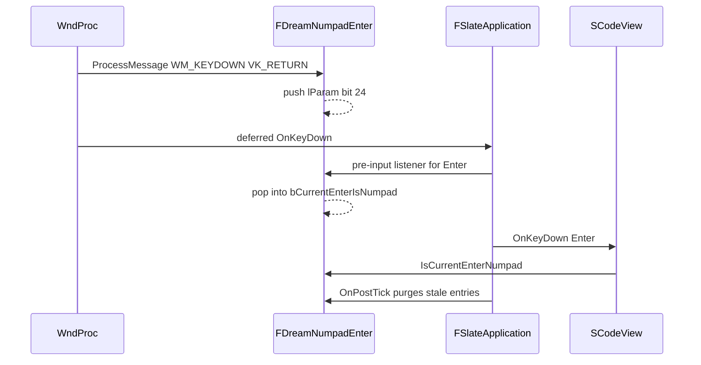

**OnKeyChar.**
- Characters insert at once. All characters of one frame join one undo group, and lexing is coalesced in `Tick`. This covers IMM commits, dead keys and Linux SDL text, which arrives one character at a time (`Engine/Source/Runtime/ApplicationCore/Private/Linux/LinuxApplication.cpp:391-400`). Multi-character commits are always accepted (D1).
- A high surrogate waits for its low half; a lone half is dropped.
- C0 characters and 0x7F are ignored.
- Read-only views ignore typed characters but still consume the keys.

**Focus.**
- **First focus** registers the IME context (§4.10); every focus activates it, resets the blink and calls `FDreamPython::RequestStart(EDreamStartReason::Focus)` (RT-17, §3.4).
- **Focus loss** cancels any composition and then deactivates (Epic's order, 07c Q2). The selection is kept.
- **Popups** never take focus.
- **The find box** takes focus; Esc or Enter returns it.
- **At run start**, `SetRunActive(true)`; §5 restores focus after the run.
- **Ctrl+M** (proposed, A11Y-01, CFG-08) toggles whether Tab moves focus out of the view. It shadows the Level Editor's Move Selection to Current Level while focused (RV-19).

#### 4.9.4 Charcoal default keymap and the consume list
Chords act only while a Dream widget has focus. **A bound chord is consumed even when it cannot execute**; the status bar says why ("Debugger arrives in M3", "Run in progress"). The table matches SPEC §9.3: the Lands column follows each chord's requirement, and the last column names the Unreal binding that §9.3 lists as shadowed (Level Editor bindings in `Engine/Source/Editor/LevelEditor/Private/LevelEditorActions.cpp`: Ctrl+S at 4367, Ctrl+PageUp/PageDown at 4491-4492, Esc at 4597, Ctrl+M at 4653, F4 at 4701, Ctrl+Shift+K at 4689).

| Command | Chord | Lands | Shadows while focused |
|---|---|---|---|
| RunSelectionOrBuffer | Ctrl+Enter; Numpad Enter (Win64, G7) | M1 | — |
| RunBuffer / RunLine (RT-14 wrapper; statement extent, §4.5) | Ctrl+Shift+Enter / Ctrl+Alt+Enter | M1 | — |
| RunLineAdvance | Alt+Enter (proposed) | M1 | — |
| RunCell / RunCellAdvance | Ctrl+Alt+Shift+Enter / Alt+Shift+Enter | M2 | — |
| Stop | Shift+F5; Esc during a run per RT-05 (§5) | M1 | Esc: Level Editor Unselect All, PIE Stop (inert during a run) |
| DebugRunOrContinue / RunEntryPoint (U21) | F5 / Ctrl+F5 | M3 | — |
| StepOver / Into / Out | F10 / F11 / Shift+F11 | M3 | F10, F11: PIE Blueprint stepping, viewport toggles; Shift+F11: Fullscreen |
| RunToCursor; ToggleBreakpoint / EditCondition; EvaluateInFrame (U22) | Ctrl+F10; F9 / Shift+F9; Alt+F8 | M3 | — |
| Complete / ParameterInfo | Ctrl+Space / Ctrl+Shift+Space | M1 | Ctrl+Space: Open Content Browser drawer |
| QuickDocs; QuickFix; FormatDocument (U22) | Ctrl+Q; Ctrl+.; Shift+Alt+F | M1; M1 (SUM102, `# noqa`), M2 (rest) (INT-09); M2 | — |
| ToggleComment | Ctrl+/ | M1 | — |
| Find / Replace / FindInFiles | Ctrl+F / Ctrl+H / Ctrl+Shift+F | M1 / M1 / M2 | Ctrl+H: Show All; Ctrl+Shift+F: Open Content Browser (Level Editor) |
| FindNext / FindPrevious | F3 / Shift+F3 (proposed) | M1 | — |
| GoToLine / GoToDefinition | Ctrl+G / F12, Ctrl+Click | M1 / M2 | Ctrl+G: Level Editor Regroup |
| GoToFile / GoToSymbol (NAV-03) | Ctrl+Shift+N / Ctrl+Shift+O (proposed) | M2 | — |
| NavigateBack / Forward (NAV-01) | Alt+Left / Alt+Right | M2 | — |
| CommandPalette / SearchEverywhere | Ctrl+Shift+P / Shift Shift | M2 | — |
| NewTab / CloseTab / ReopenClosed | Ctrl+T / Ctrl+W / Ctrl+Shift+T | M1 | Ctrl+W: Close Major Tab |
| NextTab / PreviousTab | Ctrl+PageDown / Ctrl+PageUp | M1 | Ctrl+PageUp/PageDown: Level Editor Bring selection forward a snap layer / Send selection backward a snap layer |
| Save / DuplicateLine | Ctrl+S / Ctrl+D | M1 | Ctrl+S: Save Current Level; Ctrl+D: Level Editor Duplicate |
| Undo / Redo (text) | Ctrl+Z / Ctrl+Y, Ctrl+Shift+Z | M1 | Ctrl+Z/Y: TRANSACTION UNDO and REDO |
| UndoLastRun (RT-16) | Ctrl+Alt+Z, left Alt only | M1 | — |
| NextError / PrevError (U13) | F4 / Shift+F4 | M1 | F4: Level Editor Show Actor Details |
| NextProblem / PrevProblem (U13) | F8 / Shift+F8 | M1 | F8: PIE Possess or Eject Player (`Engine/Source/Editor/UnrealEd/Private/Kismet2/DebuggerCommands.cpp:365`) |
| InsertSelectionAlias (U20) | Ctrl+Shift+V | M2 | — |
| ZoomIn / ZoomOut / ZoomReset (EDT-10) | Ctrl+= / Ctrl+- / Ctrl+0; Ctrl+wheel | M1 | — |
| AddNextOccurrence | Alt+J (proposed; Ctrl+D is Duplicate line, D8) | M2 | — (Alt+J is the viewport-local Top view, `Engine/Source/Editor/UnrealEd/Private/EditorViewportCommands.cpp:47`, which never acts while a Dream widget has focus) |
| MoveLineUp / Down; DeleteLine | Alt+Up / Alt+Down; Ctrl+Shift+K (proposed) | M2 (EDT-04) | Ctrl+Shift+K: Level Editor snap toggle "Actor" (EnableActorSnap) |
| Fold / Unfold | Ctrl+Shift+[ / Ctrl+Shift+] (proposed) | M2 | — |
| ToggleTabMovesFocus (CFG-08) | Ctrl+M (proposed) | M1 | Ctrl+M: Level Editor Move Selection to Current Level |

- **Hard-wired primitives**, not rebindable in 1.0 (proposed): arrows, Home/End and PgUp/PgDn (with Shift and Ctrl), Backspace, Delete, Ctrl+Backspace, Ctrl+Delete, Tab, Shift+Tab, Enter, Esc, Ctrl+C/V/X/A.
- **Prompt keys** (§4.14, D8): Enter, Shift+Enter, Ctrl+Enter, Up at an empty prompt, Ctrl+Up, Ctrl+R (M2, REPL-02).
- **Presets** (PyCharm, VS Code) are in §11 (M4). The VS Code preset binds RunLineAdvance to Alt+Enter as Charcoal does; the PyCharm preset leaves it unbound, because Alt+Enter is Quick fix there (RUN-26), and it stays in the command palette and the split Run button's menu (U6) in every preset.
- **RunLineAdvance (RUN-26, PO-02)** runs the current statement by the §4.5 extent and moves the caret to the next statement (§4.5). No main-frame, Level Editor or consume-list command binds Alt+Enter in 5.8. The only bindings are tool-local: the PCG plugin, enabled by default, binds it to Apply Changes inside its HLSL source editor (`Engine/Plugins/PCG/Source/PCGEditor/Private/Widgets/SPCGCodeEditorTextBox.cpp:69`, context `PCGShaderTextEditorDocumentTextBox`), and the game viewport's fullscreen toggle (`Engine/Source/Runtime/Engine/Private/GameViewportClient.cpp:674`, `bAltEnterTogglesFullscreen`) acts while the viewport has focus; neither acts while a Dream widget has focus. Win64 delivers Alt+Enter as `WM_SYSKEYDOWN`; §4.16.1 shows why neither the window menu nor a beep follows.
- **Hint chip** (RUN-26, mockup 01; proposed). Until the first RunLineAdvance in the project, a focused buffer tab draws a chip "Alt+Enter runs this line and moves to the next" (with the bound chord) at the end of the caret line. It shows only while RunLineAdvance has a chord, so never in the PyCharm preset unless the user binds it; only when the caret line is a statement start (§4.5); and not while a popup is open or within 1 s of the last keystroke. The first RunLineAdvance, or a click on the chip, hides it for good; the flag is kept in `UDreamPerProjectUserSettings` with the session state (§10).
- **The "Shadowed Unreal shortcuts" page** (CFG-06, U23 as completed by RV-19, D25) computes its rows: `ComputeShadowed()` matches our chords against the commands that can act while a Dream widget has focus, which are the main-frame global bindings, the Level Editor command list (Level Editor, PlayWorld and debugger commands) and the D8 consume list. Other contexts, such as the Outliner's F5 or viewport-local chords, are not listed. For Charcoal this gives every shadow in the table above, F4, F8, Ctrl+PageUp/PageDown and Ctrl+M included, plus the extension below and the consume-list rows of §11.1.4. Alt+Enter (RunLineAdvance) adds no row: no main-frame, Level Editor or consume-list command binds it.

| List | Keys | Consumed without an action? |
|---|---|---|
| **Consume list (D8)** | Every printable and AltGr key; Tab, arrows, Home/End, PgUp/PgDn, Delete, Backspace, Esc; Ctrl+Z, Ctrl+Y, Ctrl+Shift+Z, Ctrl+C, Ctrl+V, Ctrl+X, Ctrl+A, Ctrl+D, Ctrl+S, Ctrl+W | Yes, in every Dream view, read-only and prompt included |
| Bound chords (above) | All | Yes, even when `CanExecute` is false |
| **Extension (proposed)** | Unbound Ctrl, Ctrl+Shift or left-Ctrl+Alt chords on a letter, digit or OEM key, unless pass-through | Yes. In 5.8 it takes these mapped Level Editor commands (`Engine/Source/Editor/LevelEditor/Private/LevelEditorActions.cpp`): Ctrl+N New Level (4366), Ctrl+Alt+S Save Current Level As (4368), Ctrl+Shift+Semicolon Build Lighting (4427), Ctrl+E Edit Asset and Ctrl+Shift+E Edit Multiple Assets (4466-4467, mapped in `SLevelEditor.cpp:156-163`), Ctrl+Alt+D Select Immediate Children and Ctrl+Shift+D Select All Descendants (4600-4601), Ctrl+Shift+A Select All Actors of Same Class (4602; a bound chord in PyCharm), Ctrl+Shift+G Allow Group Selection (4676), and Ctrl+Shift+Period Recompile Changed Shaders and Ctrl+Shift+Comma Profile GPU (4703-4704). Ctrl+L (4710) is declared but mapped by no command list, so it shadows nothing. Later engines add more. Its Ctrl+M is a bound chord (ToggleTabMovesFocus) |
| **Pass-through** | Ctrl+Tab, Ctrl+Shift+Tab, Ctrl+P, Ctrl+B, F1, Alt+F1, Shift+F1, Ctrl+O, Ctrl+Shift+S, Ctrl+Alt+Shift+S, Ctrl+Shift+W, Ctrl+Alt+E/K/P, Ctrl+backtick, Alt+backtick, Alt+P, Alt+S, Pause | No, never |
| Other (unbound F-keys, Alt+letter) | — | No |

#### 4.9.5 Failure modes and tests
| Failure | Detection | Handling | What the user sees |
|---|---|---|---|
| Rebind onto a primitive; binding a pass-through chord | Keymap page validation | Rejected; allowed with a warning | Inline error or warning |
| A chord leaks to Unreal (regression) | G5, every build | Release blocked | — |
| Numpad FIFO desync | G7; per-frame purge | Main Enter is the default | At worst one newline instead of a run |

| ID | Tier | What it checks | Pass criterion | Covers | Lands |
|---|---|---|---|---|---|
| T-KEY-001 | 1 | Every branch of the resolution flowchart | Expected kind | D8, CFG-03 | M1 |
| T-KEY-002 | 1 | AltGr | RightAlt+printable is text, including Ctrl+RightAlt+Z; LeftCtrl+LeftAlt+Z is UndoLastRun; RightAlt+Shift+Enter is not text | RT-16 | M1 |
| T-KEY-003 | 1 | Bound chord that cannot execute; pass-through entries | Consumed; pass-through stays Unhandled with the extension on | D8, U23, CFG-07 | M1 |
| T-KEY-004 | 1 | Sequences; Shift Shift | Pending then Command; a wrong second stroke cancels; Shift Shift only within 300 ms with nothing between | CFG-02, WS-06 | M2 |
| T-KEY-005 | 4 | Rebind in Unreal's Keyboard Shortcuts; parentless context; shadow page | Applied without restart and stored in the ini; MainFrame does not unbind; page lists every shadow in the §4.9.4 table, F4, F8, Ctrl+PageUp/PageDown and Ctrl+M included, and no chord from another context (the Outliner's F5, the viewport's Alt+J) | D25, U23, U24, CFG-06, CFG-08 | M1 |
| T-KEY-006 | 4 | Three characters in one frame; surrogate halves; controls | One group, one relex pass; pairs joined; controls ignored | D1, D23 | M1 |
| T-KEY-007 | 4 | Focus rules; Ctrl+M | IME activation; `RequestStart` once; cancel then deactivate; popups never focused; Ctrl+M toggles Tab focus | RT-17, EDT-14, A11Y-01, CFG-08 | M1 |
| T-KEY-008 | 4 | Every Charcoal command from its chord | Executes when `CanExecute` | D8, U21, U22 | M1 |
| T-KEY-018 | 4 | RunLineAdvance binding and entry points: Alt+Enter in a buffer tab, the palette command and the split Run button's menu; Alt+Enter while a run is active; the shadowed-shortcuts page; the hint chip on a fresh profile, while typing, with the completion popup open, after the first Alt+Enter, after a click on it, and with RunLineAdvance unbound on the keymap page | Each entry point submits one Line run and moves the caret as §4.5 says; during a run Alt+Enter is consumed with "Run in progress" and the caret stays; the page has no Alt+Enter row; the chip shows at the end of a statement-start caret line on the fresh profile, hides while typing and while the popup is open, never shows again after the first Alt+Enter or the click (also after a restart), and never shows while the command is unbound | RUN-26, D8, CFG-06 | M1 |
| T-KEY-019 | 4 | Preset bindings for RunLineAdvance | VS Code binds Alt+Enter to it; PyCharm leaves it unbound and Alt+Enter opens Quick fix; the palette entry works in both | RUN-26, CFG-02 | M4 |

---

### 4.10 IME

`SCodeView::FTextInputContext` implements `ITextInputMethodContext`: Windows TSF and IMM in M1 (G1(3)); macOS in 1.2; Linux commit-only (D23).

**Registration**, as Epic does it (07c Q2):
- `GetTextInputMethodSystem()` (`SlateApplication.h:362`) may be null, and is on Linux (`Engine/Source/Runtime/ApplicationCore/Public/GenericPlatform/GenericApplication.h:550`).
- First focus: `RegisterContext`, `NotifyLayoutChanged(Created)`, `SetWindowFocus`, then `ActivateContext`.
- Focus loss: cancel the composition if composing, then deactivate.
- Destruction: deactivate, then unregister.

**ACP space:** the whole document, with ACP index equal to model offset (§4.1.2). 5.8's single-`\n` rule holds by construction.

| Method | Answer |
|---|---|
| `GetTextLength` | `Length()`, O(1); buffers ≤ 50 MB fit `uint32` |
| `Get/SetSelectionRange` | The primary selection; a set collapses multiple carets |
| `GetTextInRange` | `CopyRange`, O(log n + len). Epic materialises the document instead (`.../SlateEditableTextLayout.cpp:4019-4029, 4119-4131`) |
| `SetTextInRange` | `Apply` with origin Ime; refused while `IsReadOnly()` |
| `GetCharacterIndexFromPoint`, `GetTextBounds` | Hit test and rect from the shaped line, at the current zoom and DPI. The candidate window is placed from these (`Engine/Source/Runtime/ApplicationCore/Private/Windows/WindowsTextInputMethodSystem.cpp:388-392`) |
| `Begin/EndComposition`, `UpdateCompositionRange` | Open and close the Ime group (R6); keep the range as anchors for the underline |

**Notifications.**
- Every non-IME edit (typing, paste, undo, format, snippet, reload, LSP edit) sends `NotifyTextChanged(Begin, OldLen, NewLen)` from the ChangeSet span. A batch sends one span, from its lowest start to its highest end. This is always minimal, never the whole document (07c Q2).
- IME edits are not echoed.
- `NotifyLayoutChanged(Changed)` fires from `Tick` when the geometry, scroll, zoom or caret position changes.
- `NotifySelectionChanged` is never called, as in Epic's tested code; the G1 harness tries the alternative.

**Runs.**
- `SetRunActive(true)` deactivates the context and makes `IsReadOnly()` true on every platform. TSF calls bypass Slate's key routing, so this is what blocks IME text in the docked Preview presentation (G2(5)).
- On macOS it also avoids the main thread blocking in `GameThreadCall` (`Engine/Source/Runtime/ApplicationCore/Private/Mac/CocoaTextView.cpp:253-275`).

**Linux.** No context is registered. Commits arrive through `OnKeyChar` (§4.9.3). There is no preedit and the candidate window does not follow the caret: an engine limit.

**Budget:** each query ≤ 50 µs p95 on 100k lines (proposed: composition makes several queries per key within G1(1)).

**Shadow validator** (test builds, `-DreamImeShadow`): a copy of the ACP text, updated only from IME calls and our notifications, is compared with the buffer after each callback, and every index is bounds-checked. Shipping builds keep the bounds checks; repeated clamps log and offer Plain mode (§4.15).

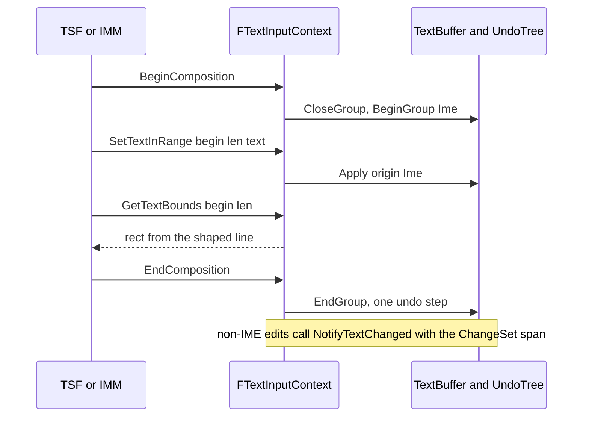

| Failure | Detection | Handling | What the user sees |
|---|---|---|---|
| Index out of range from the IME | Bounds check | Clamp, log, count | Nothing, or a misplaced candidate window |
| Desync in the field | Repeated clamps | Banner offers Plain mode | "Input method problem detected. Switch this tab to Plain mode?" |
| IME text during a run | Read-only, inactive context | Refused | Nothing inserted |

| ID | Tier | What it checks | Pass criterion | Covers | Lands |
|---|---|---|---|---|---|
| T-IME-001 | 4 | Registration against a recording IME double; ACP on a CRLF file | Epic's call order for first focus, focus loss while composing and destroy; `\n` separators; length equals the buffer | EDT-14, G1(3) | M1 |
| T-IME-002 | 4 | Notifications for typing, paste, undo, reload, and a multi-edit programmatic ChangeSet of the kind format and snippet expansion apply | One span per ChangeSet; none for Ime edits | G1(3) | M1 |
| T-IME-003 | 4 | Query cost on 100k lines; `GetTextBounds` at 3 DPI × 3 zoom | p95 ≤ 50 µs; within 1 px of the painted composition | G1(1), G1(3), A11Y-04, PERF-19 | M1 |
| T-IME-004 | 4 | Composition lifecycle | One undo group; underline; text lexed; refused when read-only | EDT-14 | M1 |
| T-IME-005 | 4 | 30-minute scripted session: MS-IME Japanese, Microsoft Pinyin, Korean (SendInput on the IME agent) | Zero desyncs; committed text as expected | G1(3), A11Y-02 | M1 |
| T-IME-006 | 8 | Manual checklist each release: reconversion, candidate placement, focus switch mid-composition, zoom | All items pass | G1(3), EDT-14 | M1 |
| T-IME-007 | 4 | During a run, inside the G2(5) leak suite | Context inactive; nothing inserted; reactivated at Idle | D23, G2(5) | M1 |
| T-IME-008 | 4 | Linux Preview: a 3-character IBus commit | No context registered; one undo group | D23, A11Y-02, COMPAT-01 | M4 |
| T-IME-009 | 4 | Injected bad indices in a shipping build | Clamped; banner after the threshold | G1, D1 | M1 |

---

### 4.11 Accessibility

- **Widget.** `CreateAccessibleWidget()` (`Engine/Source/Runtime/SlateCore/Public/Widgets/SWidget.h:658`) returns `FDreamAccessibleCodeView : FSlateAccessibleWidget, IAccessibleText, IAccessibleProperty`. It is active only when `Accessibility.Enable` is on, which is off by default (07c Q7).
- **Type:** TextEdit, or Text for read-only views. **Name:** `Dream code editor, <tab name>`, `Dream output` or `Dream REPL input`. **Help:** "Line N of M, column C" plus the diagnostic at the caret.
- **`GetText()`** returns `const FString&` (`Engine/Source/Runtime/ApplicationCore/Public/GenericPlatform/Accessibility/GenericAccessibleInterfaces.h:400`), so a cached string is rebuilt per version: the whole document up to 64k units, else the visible lines ± 50 (proposed: bounded copies).
- **`GetValue()`** is the selection (capped at 4,096 units, proposed) or the current line. `SetValue` is a no-op (proposed), so a screen reader cannot replace lines.
- **Announcements.** `FDreamA11y::Announce` calls `MakeAccessibleAnnouncement` (`:976`) and records to a test sink.
  - Announced: run states with U2 names ("Run #23 error at line 43"), find counts, go-to-line, completion opening, F4 and F8 targets.
  - They are coalesced over 250 ms (proposed), because the platform drops earlier ones (`:972-976`).
- **During runs.** The OS asks through `RunInThread(…, bWaitForCompletion = true)` on GT (`:969`), so its queries wait for a pump. The Run window carries its own accessible text.
- **Ceiling.** 5.8's UIA text range returns `E_NOTIMPL` for word and line units, `Move` and `Select` (`Engine/Source/Runtime/ApplicationCore/Private/Windows/Accessibility/WindowsUIAControlProvider.cpp:103-130, 207-214, 244-256`). Caret-level reading is impossible through Slate. The SPEC target: focusable, named, value = current line or selection, run states announced (D23).
- **Keyboard-only use** (A11Y-01): every command is in the palette; Ctrl+M moves focus; gutter actions have commands.

| ID | Tier | What it checks | Pass criterion | Covers | Lands |
|---|---|---|---|---|---|
| T-A11Y-001 | 4 | Accessible widget with `Accessibility.Enable=1`; `GetValue`, `GetText` | Interfaces present with the specified type, name and help; line or capped selection; document or window by size; rebuilt on version change only | A11Y-03, D23 | M1 |
| T-A11Y-002 | 4 | Announcements through the sink | U2 names; coalesced within 250 ms | A11Y-03, U2 | M1 |
| T-A11Y-003 | 4 | Keyboard reachability | Every command runs by chord or palette, gutter actions included | A11Y-01 | M1 |
| T-A11Y-004 | 4 | Colour is never the only signal | Diagnostics have icon and text; ran markers differ in pattern | A11Y-05 | M1 |
| T-A11Y-005 | 8 | Narrator smoke test on Win64 (D23) | Reads name, line and value; announces the run outcome | D23 | M1 |
| T-A11Y-006 | 4 | Accessible query during a 10 s run | No deadlock; answered at the next pump or after the run | D2 | M1 |

---

### 4.12 Fonts and theme

- **Font.** JetBrains Mono (OFL-1.1, which D12 allows for fonts), in Regular, Bold, Italic and Bold Italic, in the plugin's `Resources/Fonts/`.
- **Composite.** The `DreamEditorStyle` style set builds an `FStandaloneCompositeFont` (`Engine/Source/Runtime/SlateCore/Public/Fonts/CompositeFont.h:494`):
  - `DefaultTypeface.AppendFont(Face, Path, EFontHinting::Default, EFontLoadingPolicy::LazyLoad)` (`:369`) for each face;
  - `FallbackTypeface` = the engine's `Engine/Content/Slate/Fonts/DroidSansFallback.ttf` (`:465`) for CJK.
- **Why not DroidSansMono:** it has a single face (07c Q6).
- Faces load at first paint, not at editor start (D22). A missing user font falls back to JetBrains Mono, with a log entry.
- **Theme.**
  - Token defaults come from `SyntaxHighlight.SourceCode.{Normal, Operator, Keyword, String, Number, Comment, PreProcessorKeyword, Error}` (`Engine/Source/Editor/EditorStyle/Private/StarshipStyle.cpp:8853-8861`), so Dream looks native (D23).
  - Extra kinds (Builtin, Self, Definition, Docstring, Escape, Cell, Bidi warning) and editor colours are `DreamEditor.Syntax.*` and `DreamEditor.Editor.*` keys derived from that palette.
  - Faces: Comment and Docstring italic, Definition bold, everything else regular (proposed: one face run per typical line).
  - Users edit a theme JSON (CFG-04): persistence in §11, schema in §12.

| ID | Tier | What it checks | Pass criterion | Covers | Lands |
|---|---|---|---|---|---|
| T-VIEW-014 | 4 | Composite font; default theme | Four faces resolve; CJK uses DroidSansFallback; no font load at startup; token colours equal the `SyntaxHighlight.SourceCode.*` values | D23, D22, CFG-04 | M1 |
| T-VIEW-015 | 4 | Theme JSON round trip and live apply | Identical JSON; repaint with the new colours; cache flushed | CFG-04 | M1 |

---

### 4.13 Encodings and large files

**Load (`dream::TextCodec`):**
1. Files ≤ 1 MB load on GT; larger ones on a worker.
2. **BOM:** UTF-8, UTF-16 LE or BE. UTF-32 is refused.
3. **Binary:** with no UTF-16 BOM, a NUL in the first 8 KB refuses the file (D23), with "Open in external editor".
4. **Encoding:** BOM, then the PEP 263 cookie, then UTF-8.
   - The cookie follows `tokenize.detect_encoding`: `^[ \t\f]*#.*?coding[:=][ \t]*([-\w.]+)` on line 1, or on line 2 when line 1 is blank or a comment.
   - A BOM with a non-UTF-8 cookie opens read-only with Python's error.
5. **Decode.**
   - Strict UTF-8. Invalid input (overlong, encoded surrogates, above U+10FFFF) gets U+FFFD markers, opens **read-only** and offers "Reopen with encoding…".
   - Built-in codecs: utf-8, utf-8-sig, utf-16, latin-1, ascii, cp1252, with Python's aliases.
   - Other cookies open read-only: "Encoding x is not supported for editing" (proposed: no further codec tables).
6. **Line endings.** Count CRLF, LF and CR; the dominant style is metadata. In a mixed file, minority terminators are kept as LineStart anchors (proposed: BUF-06 requires byte-identical round trips), and the status bar shows "Mixed" with "Normalize". Then normalize to LF.
7. Build the buffer and detect the indent unit (§4.5).

**Save.**
- `TextCodec::Encode` runs on a worker and re-emits the BOM, the dominant terminator and the exceptions.
- Characters the encoding cannot hold block the save, with "Save as UTF-8?". §10.14 owns the atomic write and its failure handling, §10.15 external changes (BUF-04), and §11 the checkout.
- New files: UTF-8, no BOM, LF, 4 spaces; studios can override (BUF-06).

**Size tiers (D23):**

| Size | Behaviour |
|---|---|
| < 1 MB | Normal; Plain mode is offered (§4.15) |
| 1–10 MB | Normal. Over 5 MB the type server and ruff never get the buffer, and dream-check reports SUM902 (§7.1.5) |
| > 10 MB | Progressive open: a worker decodes 4 MB slices (proposed) and publishes chunks. The first slice paints at once (PERF-10: ≤ 1 s). The buffer is read-only until loaded; highlighting is progressive |
| > 50 MB | Read-only through `FDreamMappedFileLineSource` (§4.14): memory-mapped (`IMappedFileHandle`, `Engine/Source/Runtime/Core/Public/Async/MappedFileHandle.h:114`), kept as UTF-8, visible lines transcoded. No highlighting (proposed: bounded memory). Up to 2 GB (proposed) |
| `<Project>/Intermediate/Dream/` stubs | Always read-only (BUF-09) |

| ID | Tier | What it checks | Pass criterion | Covers | Lands |
|---|---|---|---|---|---|
| T-ENC-001 | 1 | Unedited round trip: UTF-8, BOM, CRLF, CR, mixed endings (and after edits elsewhere), no final newline, UTF-16 LE/BE, Latin-1 cookie | Byte-identical; unedited exception lines keep their terminators | BUF-06 | M1 |
| T-ENC-002 | 1 | 60 cookie fixtures | Equal to the engine's `tokenize.detect_encoding`, errors included | BUF-06 | M1 |
| T-ENC-003 | 1 | Invalid UTF-8 cases | Read-only; U+FFFD at exact positions; reopen as Latin-1 and save gives the original bytes | D23 | M1 |
| T-ENC-004 | 1 | NUL placement | Refused in the first 8 KB; loads after (shown visibly); UTF-16 BOM loads | D23 | M1 |
| T-ENC-005 | 4 | Files of 0.9, 9.9, 10.1 and 50.1 MB | Plain mode only for 0.9; 10.1 progressive, first paint ≤ 1 s; 50.1 mapped and read-only | D23, BUF-09, PERF-10 | M1 |
| T-ENC-006 | 1 | CJK into a Latin-1 file; new-file defaults; a stub path | Save blocked with the UTF-8 offer; defaults and overrides apply; stub opens read-only | BUF-06, BUF-09 | M1 |
| T-ENC-007 | 1 | Memory for a 10 MB ASCII file: model, lexer, folds | ≤ 4.5 × text size | PERF-11 | M1 |

---

### 4.14 Read-only line sources and prompt mode

One widget draws every text surface (D1), through `IDreamLineSource`:
```cpp
class IDreamLineSource { public: virtual ~IDreamLineSource() = default;
  virtual int64 GetFirstLineId() const = 0;  virtual int64 GetNumLines() const = 0;  virtual uint64 GetVersion() const = 0;
  virtual bool GetLine(int64 Index, FDreamLineView& Out, FString& Scratch) const = 0;   // text, tokens, hash, flags
  virtual bool IsEditable() const { return false; }  virtual bool IsAppendOnly() const { return false; }
  virtual dream::TextBuffer* GetBuffer() { return nullptr; } };
class IPromptHandler { public: virtual ~IPromptHandler() = default;                     // §6.5
  virtual EDreamPromptEnter OnEnter(const FString& Input) = 0;      // Run or Newline (classify_input, §6.5, D8)
  virtual bool OnHistory(int32 Direction, FString& OutText) = 0;   // Up at empty prompt, Ctrl+Up
  virtual void OnSubmit(const FString& Input) = 0; };              // Ctrl+Enter always
```

| Source | Owner | Notes |
|---|---|---|
| `FDreamBufferLineSource` | §4 | Editable: TextBuffer, PyLexer, FoldModel |
| `FDreamOutputStore` | §6 | Append-only. `GetFirstLineId` keeps the scroll anchored when the ring drops lines. Follow mode (OUT-09): auto-scroll at the bottom, otherwise hold and show "↓ n new lines". The Run window's live run view uses the same source, filtered to its run (D2, PO-03, §5.5.3) |
| Paused-window source | §8 | Snapshot of the paused file plus a full lex; current-line arrow and breakpoints (U17) |
| `FDreamMappedFileLineSource` | §4.13 | Files over 50 MB |
| Diff panes | §10 | Hunk decorations (§4.6) |

- **Read-only views** keep the consume list, selection, copy, find and the context menu; editing keys do nothing.
- **Prompt mode** (the REPL, §6.5):
  - The gutter draws `>>>` and `...`, outside the text.
  - Enter asks `OnEnter`; Shift+Enter inserts a newline; Ctrl+Enter submits; Up at an empty prompt or Ctrl+Up opens history (D8).
  - A submit clears the input, the only clear-on-run in the product (D8).

| ID | Tier | What it checks | Pass criterion | Covers | Lands |
|---|---|---|---|---|---|
| T-VIEW-016 | 4 | Output source: follow, hold, ring drop; 50k lines/s from a fake store | Follows at bottom; holds and counts when scrolled up; same line id after drops; paint within G1(2); ≥ 10 Hz during pumps | OUT-09, OUT-04, G2(3) | M1 |
| T-VIEW-017 | 4 | Prompt mode with a fake handler; (from M3) the Paused source view | (from M3) the Paused source view is read-only with the arrow; Enter, Shift+Enter, Ctrl+Enter and history routed as specified; prompts in the gutter | U17, REPL-01, REPL-02, D8 | M1 (M3: Paused source view) |

---

### 4.15 The G1 harness and the fallbacks

| Harness part | Tier | Measures | Gate |
|---|---|---|---|
| `DreamCoreBench` (CMake) | 1 | The T-LEX-008 trace on a 100k-line corpus (concatenated engine stdlib, PSF); p50, p95 and p99 per stage | G1(1) |
| `fuzz_lexer_diff`, `fuzz_undo_roundtrip` (libFuzzer) | 1 | 100k edits per commit, 10M nightly | G1(4) |
| `Dream.Perf.CodeView` (perf-reference GPU agent `GPU-1`, 3840×2160, §14.1) | 4 | `OnPaint` time from `FPlatformTime::Cycles64`; scroll trace and caret-only idle. Second measure: the element-batching cost of the same frame, which runs after `OnPaint` on the game thread (`FSlateRHIRenderer::DrawWindows_Private`, CSV stat `Slate/DrawWindows_Private`, `Engine/Source/Runtime/SlateRHIRenderer/Private/SlateRHIRenderer.cpp:1512-1515`; `ElementBatcher->AddElements` at :1634). It is the stat's delta between the 4K fixture with the Dream tab visible and hidden, ≤ 1 ms p95 (proposed), reported with G1(2) | G1(2) |
| `Dream.IME.Composition` (Windows IME agent) | 4 | T-IME-005, plus the `NotifySelectionChanged` variant | G1(3) |
| Manual IME checklist | 8 | T-IME-006 | G1(3) |

Results are JSON keyed by machine; CI compares them with a rolling baseline (D22). Phase 0 exits on G1 (RT-10, §15.1). The manual IME checklist is G1's manual checklist, run per release candidate; the automated G1 status that CI reads excludes it (§14.3).

| G1 result | Fallback (D1) |
|---|---|
| (1) or (4) fails (model or latency) | **Scintilla's document layer and Lexilla** (HPND, D12) behind the seam: `dream::IDocument` (TextBuffer or `ScintillaDocumentAdapter`) and `dream::ILexer` (PyLexer or `LexillaPythonAdapter`, mapping style bytes to kinds). Scintilla's own undo is off; UndoTree keeps recording. Offsets stay UTF-16 through Scintilla's UTF-16 line character index (to confirm in the spike). Renderer, keymap and IME are unchanged. There is no O(1) snapshot, so D17's 0.2 ms holds only for small buffers (measured) |
| (2) fails (paint) | Caret-only split (proposed): the text layer as a child under `SInvalidationPanel`, and a thin caret overlay that repaints alone on blink |
| (3) fails (IME) | **Plain mode** per buffer under 1 MB: stock `SMultiLineEditableText` with live syntax update off, so Epic's IME and per-line `InsertAt` apply (07c Q1). `OnKeyDownHandler` runs before the stock handling (`Engine/Source/Runtime/Slate/Private/Widgets/Text/SMultiLineEditableText.cpp:771-783`), so the consume list holds. Edits are diffed into TextBuffer ops, so journal, runs and undo stay on our model; Ctrl+Z drives UndoTree |
| Any | **Never CEF** (D1) |

| ID | Tier | What it checks | Pass criterion | Covers | Lands |
|---|---|---|---|---|---|
| T-VIEW-018 | 4 | Plain mode under 1 MB | Minimal ops reach TextBuffer; journal and undo intact; consume list holds; hidden at ≥ 1 MB | D1, D23, EDT-15 | M1 |
| T-CORE-036 | 1 | Seam conformance between TextBuffer and the Scintilla adapter (built only if G1(1) or (4) fails) | The same 100k-edit script gives identical text, ChangeSets and tokens | D1, G1 | M1 |
| T-VIEW-019 | 4 | Caret-only split (built only if G1(2) fails) | Caret frames ≤ 0.5 ms p95 | G1(2) | M1 |

---

### 4.16 The G5 key-routing suite and the G7 design

#### 4.16.1 G5 (`Dream.Keys.G5`, tier 4, every build from M1)
- **Fixture:** the Level Editor with 20 actors, 3 selected, and SCodeView docked in the Level Editor area. Repeated floating, as the output view and the prompt, (from M3) as the Paused source view, and with PIE running.
- **Chords** are generated: every `FDreamCommands` chord, every consume-list key, every extension chord. Pass-through chords are the control and must still reach Unreal.
- **Injection:** synthetic Slate events (`FSlateApplication::ProcessKeyDownEvent` / `ProcessKeyCharEvent`), and OS-level `SendInput` from an input-bot `FRunnable`, which also works while GT sits in a modal loop.
  - The input bot needs an unlocked interactive desktop session on its agent (§14.1).
  - §14.5 reuses it for journey-test steps during supervised runs and inside user modals, where AutomationDriver cannot act.
- **Probes** after each chord:
  - actor count and names (nothing deleted or duplicated);
  - the map package's dirty flag and the `.umap` timestamp (no save);
  - `GEditor->Trans` queue length and undo count (no TRANSACTION UNDO);
  - the live tab count;
  - `GEditor->PlayWorld`;
  - FDreamRunService's Undo Last Run counter;
  - the expected buffer effect.

| Layout | Keys | Expected |
|---|---|---|
| German 00000407 | AltGr+Q, AltGr+7, AltGr+8, AltGr+ß; Shift+´ then Space | `@`, `{`, `[`, `\`; a backtick through the dead key |
| French 0000040C | AltGr+0, AltGr+4, AltGr+5, AltGr+8; AltGr+7 then Space | `@`, `{`, `[`, `\`; a backtick through the dead key |
| Polish Programmers 00000415 | Shift+2, Shift+[, the backtick key, **AltGr+Z, AltGr+X** | `@`, `{`, a backtick, **`ż`, `ź`**; the Undo Last Run counter stays 0 (RT-16) |

- **Alt+Enter (RUN-26).** The input bot sends Alt+Enter through `SendInput`, so Windows posts `WM_SYSKEYDOWN` with `VK_RETURN` and, after `TranslateMessage`, `WM_SYSCHAR`. The engine defers `WM_SYSKEYDOWN` to Slate (`Engine/Source/Runtime/ApplicationCore/Private/Windows/WindowsApplication.cpp:2346-2360`), which dispatches it to `OnKeyDown` (`:3321`), and then still passes it to `DefWindowProc` (`:3164`): `DeferMessage` returns void (`:4188`), so the 0 that `ProcessDeferredMessage` returns for a handled key (`:3324-3327`) never reaches Windows. That is harmless, because `DefWindowProc` generates no `SC_KEYMENU` for `WM_SYSKEYDOWN` with `VK_RETURN` (checked on Windows 11 for this TDD). The window menu and the beep would come from `WM_SYSCHAR`, which `ProcessMessage` answers with 0 for every character except Alt+Space when `bConsumeAltSpace` is off (`:2332-2344`), so `DefWindowProc` never sees the Alt+Enter character. G5 asserts that SCodeView routes the chord to RunLineAdvance, that a probe `IWindowsMessageHandler` sees no `WM_SYSCOMMAND` with `SC_KEYMENU` and no `WM_ENTERMENULOOP` on the main frame, and that focus stays in the code view. The same chord in the prompt and in read-only views is consumed without effect (proposed: RunLineAdvance acts only in buffer tabs).
- **During runs:** the whole set is re-sent while a run pumps (a loop calling `dream_editor.sleep(0.01)`), in the Run window and, from M4, in Live (docked) Preview. Buffers must not change.
- **Popup modals (RV-02):** the Run window and the Paused window are popup windows, so neither becomes the active top-level regular window. G5 confirms that Esc and Shift+F5 sent by the input bot still reach both and stop the run (T-KEY-017). The Paused-window case runs from M3.
- **RT-05:**
  1. A run calls `unreal.EditorDialog.show_message(…, unreal.AppMsgType.YES_NO_CANCEL)` after writing a marker file. The bot waits for the marker, then 300 ms, then sends Esc. The call returns CANCEL and the outcome is `ok`.
  2. Esc with no modal cancels the run.
  3. (From M4) Esc with a menu open in docked mode closes only the menu.
  4. Shift+F5 during the dialog: the run ends `cancelled` after the dialog returns.

#### 4.16.2 G7 (`Dream.Keys.G7`, tier 4, Win64, from M1)
- **Mechanism:** §4.9.3.
- **Cases:** `SendInput` with and without `KEYEVENTF_EXTENDEDKEY`; `PostMessage` with and without bit 24; modifiers; auto-repeat (bit 30); IME on, where `VK_PROCESSKEY` must not push; focus moving between SCodeView, the find box and the viewport; synthetic Slate Enter.
- **Mix:** 10,000 random interleavings must classify 100% correctly.
- **Remote Desktop:** the suite also runs on an agent inside an RDP session, plus a manual run (T-KEY-016, tier 8). Tier-8 tests are the gate's manual checklist, run per release candidate; the automated G7 status that CI reads excludes them (§14.3).
- **On failure:** `bNumpadEnterRuns` is forced off and hidden, and Numpad Enter acts as Enter. It never falls back to main Enter.

| ID | Tier | What it checks | Pass criterion | Covers | Lands |
|---|---|---|---|---|---|
| T-KEY-009 | 4 | G5 core: docked in the Level Editor, actors selected, generated chord set | Every probe holds; pass-through controls reach Unreal | G5, D8, CFG-03, BUF-03, CFG-07, REL-07 | M1 |
| T-KEY-010 | 4 | G5 variants: floating, output, prompt, PIE running and (from M3) the Paused source view | Every probe holds, including read-only and prompt views | G5, D8 | M1 (M3: Paused source view) |
| T-KEY-011 | 4 | G5 AltGr layouts | Expected text, including dead keys, the German and French backslash, and `ż` `ź`; no Undo Last Run | G5, RT-16, CFG-07 | M1 |
| T-KEY-012 | 4 | G5 during runs in the Run window and (from M4) in Live (docked) Preview | Every probe holds; buffers unchanged | G5, RT-03, RT-04, REL-07 | M1 (M4: Live (docked) pass) |
| T-KEY-013 | 4 | RT-05 cases 1, 2 and 4, and (from M4) case 3 (a menu open in docked mode) | CANCEL with outcome `ok`; cancels; (from M4) menu only; cancels after the dialog | G5, RT-05, LRS-11 | M1 (M4: case 3, docked) |
| T-KEY-014 | 4 | G7: 10,000 interleavings | 100% classification | G7, RUN-01 | M1 |
| T-KEY-015 | 4 | G7 safety | Synthetic Enter counts as main; FIFO purged after `OnPostTick`; with the failed-gate flag, Numpad Enter inserts a newline | G7 | M1 |
| T-KEY-016 | 8 | G7 on a real Remote Desktop client | 100% over 200 presses | G7 | M1 |
| T-KEY-020 | 4 | G5 Alt+Enter (§4.16.1): `SendInput` Alt+Enter with the caret on line 1 of a three-statement buffer, three times, docked in the Level Editor with actors selected and with the tab floating; then with focus in the level viewport (control) | Runs #N..#N+2, one per statement, and the caret ends on the last statement with "End of buffer"; no `SC_KEYMENU` or `WM_ENTERMENULOOP` reaches the main frame; focus stays in the code view; every G5 probe holds; the viewport control runs nothing | G5, RUN-26 | M1 |
| T-KEY-017 | 4 | G5 popup modals (RV-02): a 10 s pumping run with the Run window open, then (from M3) a Debug run paused at a breakpoint with focus on the call stack; the input bot sends Esc in one pass and Shift+F5 in another, each after the window's shown probe; in the M3 pass, a fixture also adds a Slate child window to the Paused window, then F10 is pressed | Each key stops the run as `cancelled`; while either window is open, `FSlateApplication::GetActiveTopLevelRegularWindow()` (`Engine/Source/Runtime/Slate/Public/Framework/Application/SlateApplication.h:1640`) never returns it; after F10 the child is alive under the root window and no `check` fires | G5, RT-05, LRS-11, DBG-04 | M1 (M3: Paused-window pass) |

#### 4.16.3 Open items for §4
- **The consume extension** (§4.9.4) goes beyond D8's literal list. It needs the D8 owner's sign-off; G5 covers it.
- **D25 check:** parent the context to MainFrame in a test build. If the engine only warns, parent it, so conflicts show in Keyboard Shortcuts.
- **OEM chords depend on the layout** (Ctrl+/ is the `#` key on German keyboards). The keymap page shows physical keys.
- **`NotifySelectionChanged` and PCRE2 JIT:** decided by G1 harness data.
- **The Scintilla fallback** has no O(1) snapshot. Re-measure D17 if that fallback is taken.
- **XID and grapheme tables** derive from the Unicode Character Database. Their licences (Unicode-3.0 and Unicode-DFS-2016, character data) are on the MAINT-05 allow-list (§11.10); OI-48 closes when the notice is in ThirdPartyNotices.
- **Undo across restarts** is not in 1.0. Revisit after pilots.

---

## 5. Execution and the RunSupervisor

This section specifies how Dream runs user code and keeps the editor usable while it runs. It covers pain #1 (R06 §3: "never strand the user"). It implements D2, D8, D14 and D24 as amended by RT-01 to RT-09, RT-14 and RT-15, and the run-model rulings U2 and U6 to U12, U19 and U21, and the owner rulings PO-02 (statement mode, Run line and advance) and PO-03 (the Run window as the live output area). Where this text and an ADR differ, 08 §10, 08 §9 and 08 §7 win, in that order.

**Terms used in this section.**

| Term | Meaning |
|---|---|
| Run | One execution of user code through the single entry path (D14). It has a run number and a record |
| Route | Where the request came from: buffer, selection, line, cell, REPL, console executor, Run File, shelf, snippet, reload, entry point, task step, bridge (1.1), MCP (1.1/1.2) |
| Run number | `#N`, counted per editor session from 1 (U8). Shown to users |
| Run ID | `uint64`, unique per entry into `_run`, and per supervised evaluate (§8.3.4), within the editor process, never reused: the Python generation in the high 32 bits and `EntrySerial`, a per-process counter bumped for every entry into `_run` and every supervised evaluate, in the low 32 bits (§5.2.5, §12.1.2). Internal guard token. A task has one run number and one run ID per step; the run number is a separate field |
| User-code window | The interval between `_dream.user_code_begin(run_id)` and `_dream.user_code_done(run_id)`. Stop is delivered only inside it, and the pump runs only inside it (§5.4.2 step 5) |
| Pending call | A `Py_AddPendingCall` callback. It runs on the game thread, with the GIL held, at a bytecode boundary (07a Q1), after the game thread next takes the GIL. The watchdog forces that with a GIL hand-off after every post (§5.4.1, RV-01) |
| Pump | The mid-script Slate tick run from the pending call (§5.4.4) |
| Delivery | Raising `ScriptCancelled` in user code |
| Deferral | A pending call that skips the pump and any delivery because the moment is unsafe (RT-02) |
| Presentation | How a supervised run is shown: Run window (default, RT-03), Live (docked) Preview, or Off (kill switch) |
| Foreign modal | A modal window that is not the Run window or the Paused window, for example a script's `EditorDialog` or `ScopedSlowTask` dialog |

**Threads.** The game thread (GT) owns every run, the runner, the pending-call callback, the pump, the transactions and all UI. One watchdog thread (`DreamRunWatchdog`, an `FRunnable`) schedules pending calls, forces a GIL hand-off after each one (§5.4.1) and measures native time. User worker threads may write output and report progress. Nothing else runs Python on Dream's behalf.

### 5.1 Run lifecycle

**Responsibilities.**
- Define one state machine, shared by the status bar, the run banner, the Run window, WS-07 and the docs (U2).
- Give every run an outcome from the U2 set, including runs that never executed (U7) and runs lost to an editor exit.

#### 5.1.1 States and outcomes

| State (U2 label) | Meaning | Set by | Editor input |
|---|---|---|---|
| `Idle` | No run, task or pause | FDreamRunService | Normal |
| `Starting` | Request accepted; pre-run steps in progress (§5.1.2). No Python is executing yet unless the parse step is running | FDreamRunService | Normal until entry |
| `Running` | `_run` has been entered | FDreamRunService | Blocked from the first pump (§5.5) |
| `Stopping…` | Stop was requested; control has not yet returned | FRunSupervisor | Blocked |
| `Paused` | A debug run is stopped at a breakpoint or step (§8) | §8 pause hook | Blocked by the Paused window |
| `Task running` | A `@task` is active; the editor is interactive between steps (U10) | FDreamRunService | Normal between steps; blocked during a supervised step |

"In native call" is not a state (U2). Native time is reported after the fact (§5.8).

| Outcome (U2) | When |
|---|---|
| `ok` | User code returned, or `SystemExit` with code 0 or `None` |
| `error` | An exception other than `ScriptCancelled` ended the run, or `SystemExit` with any other code |
| `cancelled` | The run ended because of Stop (§5.3.9 has the full classification) |
| `not executed` | A Starting step failed: trust, parse, compile, save, or Stop before entry. The run still has a number (U7) |
| `lost` | The editor exited during the run. Written on recovery from the journal's run marker (§10) |

`SystemExit` is never silent (RUN-18). The run header always says `exited (code n)`; the outcome follows U2.

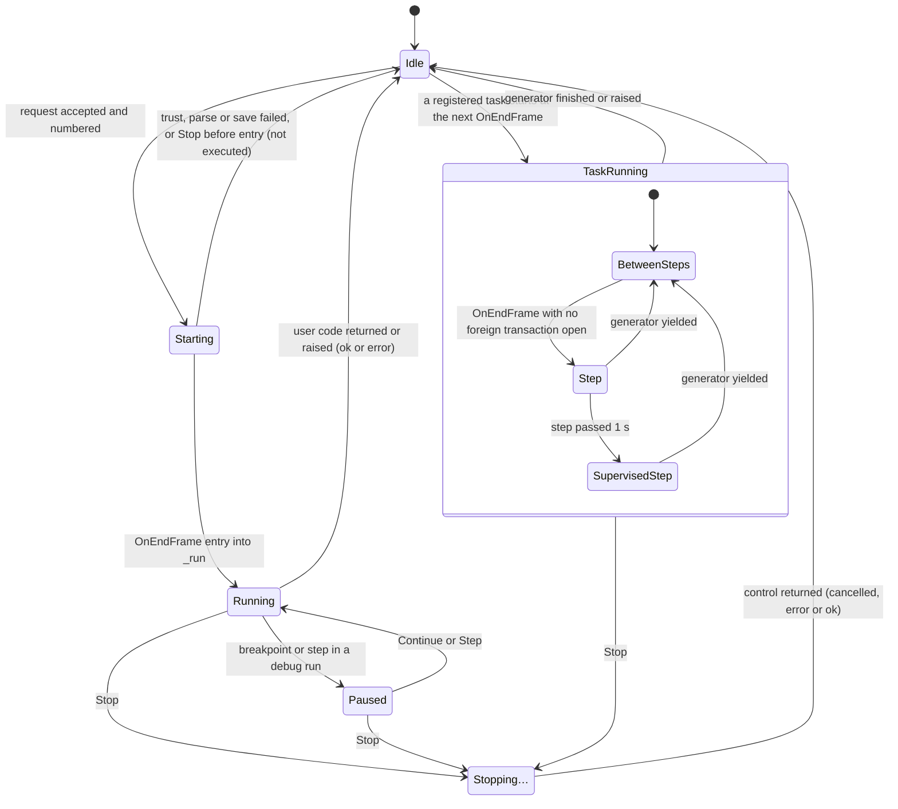

`TaskRunning` displays as `Task running`. A task is its own run with its own number (D24); the run that created it ends first.

#### 5.1.2 Starting steps (U7)

All steps run on the game thread from the one-shot `FCoreDelegates::OnEndFrame` handler that follows acceptance (RT-01). The order is fixed.

| # | Step | Owner | Failure → outcome |
|---|---|---|---|
| 1 | Trust check of the source path and SHA-256 (M4; always allowed before M4) | FDreamTrust (§11) | Not trusted: `not executed`, inline U39 banner |
| 2 | Parse and compile: `runner.prepare(run_id, request)` through a direct C-API helper call (D14(5): executes no user code). Also registers linecache and refreshes aliases (§5.3) | FDreamPython + runner | `SyntaxError`: `not executed`; caret placed at the error (RUN-16) |
| 3 | Journal snapshot, ≤ 0.2 ms (D22) | FDreamJournal (§10) | Snapshot failure is logged and the run continues; only crash recovery for this run is weaker |
| 4 | Run File only: save to disk, with an async checkout if read-only (D8). The state stays `Starting` and the editor stays live until the save completes | buffer save path (§10.14) | Save or checkout failed: `not executed`; the original bytes on disk survive and the buffer stays dirty (§10.14) |
| 5 | Stop requested during steps 1–4 | FDreamRunService | `not executed`, detail "stopped before user code started" |
| 6 | Entry: begin the transaction (§5.9), `FRunSupervisor::BeginRun`, then `ExecPythonCommandEx` (§5.2.4) | FDreamRunService | — |

A parse failure never saves the file, because step 2 precedes step 4.

#### 5.1.3 Stop sources by state

| State | Stop controls |
|---|---|
| `Starting` (async save) | Banner Stop |
| `Running`, `Stopping…` | Run window Stop, banner Stop (docked), WS-07 Stop (docked), Shift+F5 everywhere, Esc under the RT-05 rule (§5.6.3) |
| `Paused` | Paused window Stop (§8), Shift+F5, Esc under RT-05 |
| `Task running`, between steps | WS-07 Stop, tab banner Stop, Shift+F5 when a Dream widget has focus (U10). No pre-processor is registered |
| `Task running`, supervised step | As `Running` |

### 5.2 Run requests, routes and FDreamRunService

**Responsibilities.**
- Accept run requests from every route, number them, and run exactly one at a time (D14(4)).
- Drive the Starting steps, the entry call and the finish steps.
- Own run records, run history (RUN-12) and the run-state events that WS-07, the banner and the API consume.
- Call the audit hook (§11) for every run, `not executed` included.

#### 5.2.1 Routes

| Route | Built by | Namespace | Auto-print | Statement mode (RUN-27) | Aliases | Transaction default (RT-08) | Filename | Lands |
|---|---|---|---|---|---|---|---|---|
| Selection, line, cell | SDreamTab from dream::CaretSet (the line extent and Run line and advance: §4.5) | Session | On | On | U19 rule | On | real path or `<dream:Tab Name#id>` | M1 |
| Buffer | SDreamTab | Session | On | On | U19 rule | On | same | M1 |
| REPL | REPL widget | Session | On | On | U19 rule | On | `<dream:REPL#N>` | M1 |
| Console executor (`Python (Dream)`) | FDreamConsoleExecutor | Session | On | On | U19 rule | On | `<dream:Console#N>` | M1 |
| Run File | SDreamTab, API | Isolated | Off | Off (one `exec`) | None | **Off**, one-click Run in transaction | real path | M1 |
| Shelf, snippet | FDreamLibrary (§11) | Isolated | Off | Off (one `exec`) | Bound fresh | On | item `.py` path, else `<dream:Item Name#id>` | M4 |
| Reload, reload-on-save, revert (routes `Reload`, `ReloadOnSave`, `Revert`) | §9 | n/a | Off | Off | None | Off (proposed: imports are never undoable, D8) | n/a | M3 |
| Entry point (Ctrl+F5, U21) | §9 | Session | Off | Off (reload and call, §9.4) | U19 rule | On (proposed: interactive tool run) | module file | M3 |
| API (`dream_editor.run()` from foreign Python, for example an EUW button) | `_dream.enqueue_run` (§11.7) | Isolated for a file, Session for a tab | As the target | As the target (On for a tab) | As the target | As the target (Run File off) | as the target | M1 |
| Task step | FDreamRunService | as creator | Off | Off | None | Per step, `Dream: task #N` (RT-09) | generator's file | M3 |
| Bridge | FDreamRunService via bridge (D10) | Session unless the envelope says otherwise | On | On | U19 rule | On | `<dream:bridge Client#N>` | 1.1 |
| MCP run tools | DreamMCP (D11) | Agent namespace (a separate persistent dict) | Off | Off (one `exec`) | None | On, per call | `<dream:agent Name#N>` | 1.2 |
| Headless (D27) | out of process | n/a | n/a | n/a | n/a | Off | n/a | 1.2 |

A debug run (F5) is any route with `bDebug = true` (§8). The split Run button (U6) sets the namespace and the transaction override on the request. **Statement mode** (RUN-27, PO-02) is On exactly where auto-print is On: those routes compile and run each top-level statement as its own code object and echo it (§5.3.2, §5.3.7, OUT-12); a debug run on them uses statement mode too (§8.5). The split Run button's Isolated choice makes a tab run Isolated, which turns auto-print, and so statement mode, off. Run line and advance (Alt+Enter, RUN-26) submits a `Line` request, or a `Selection` request when text is selected.

#### 5.2.2 Queue, numbering and one run at a time

- `Submit` runs on the game thread and may be called from a Slate input handler. It never executes Python. It registers a one-shot `OnEndFrame` handler and returns.
- If the state is not `Idle`, user requests are refused with a reason. The UI disables run commands in those states; refusal is the backstop.
- Bridge requests (1.1) wait in a FIFO of at most 8 (proposed: bounds memory and wait time) until `Idle` or their timeout. MCP run requests are refused while a user run, pause or task is active (D11).
- Requests are refused, without a number, when Python is disabled, shut down or not yet initialized (D16); the tab shows the D16 banner.
- The run number is assigned at acceptance, so `not executed` runs are numbered (U7). The counter is per editor session and does not reset after a Python restart (U8).
- A request is deferred one frame if, at `OnEndFrame`, `UE::IsSavingPackage()`, `IsGarbageCollecting()` or `FUObjectThreadContext::Get().IsRoutingPostLoad` is true (the RT-02 trio).

#### 5.2.3 Run records

`FDreamRunRecord` lives in a ring of 500 records (RUN-12) and is persisted through §10. Fields: run number; run IDs (one per step for tasks); route; badge (agent or bridge client); buffer ID, tab title, file path, line range; SHA-256 of the executed text and the journal snapshot ID (for re-run of the same snapshot, RUN-12); the source `TextSnapshot` the request was cut from (for input echo and the Location row, §6.2, §5.4.7); in statement mode, the statement ranges from `prepare` and the started and returned counts that `_dream.run_statement` records (RUN-27, §5.3.7, §4.8.2); for a selection run, the selection's end column (for the echo, §6.2); namespace mode; start and end (`FPlatformTime::Seconds` and UTC); state; outcome, detail and location (file, line); transaction info (§5.9); output line range (§6); supervision stats (pumps, pump seconds, max pump ms, deferrals by reason, deliveries, Stop-requested and Stop-effective times, native intervals, §5.8); threads still alive at end (§5.11); origin run number (for tasks).

At `Running`, FDreamJournal writes a run-start marker, and FDreamCrashContext records the run number and route (D26). At finish, the journal writes the end marker and the crash context is cleared. A start marker without an end marker becomes a `lost` record on recovery.

At finish, `FDreamAudit::RunEnded(const FDreamRunRecord&)` (§11.4; `RunStarted` at `Running`) writes the D20 JSONL entry (run ID, route, source path and SHA-256, start and end, outcome). This includes `not executed` runs and U39 "Run once" decisions (§11).

#### 5.2.4 Entry and finish

```cpp
FPythonCommandEx Cmd;
Cmd.ExecutionMode = EPythonCommandExecutionMode::EvaluateStatement;
Cmd.Flags = EPythonCommandFlags::None;                       // attended (D14(2))
Cmd.Command = FString::Printf(TEXT("__import__('dream_editor')._run(%llu)"), RunId);  // RT-15
const bool bOk = IPythonScriptPlugin::Get()->ExecPythonCommandEx(Cmd);
```

- This sets `GIsRunningUserScript` for the whole run (`Engine/Plugins/Experimental/PythonScriptPlugin/Source/PythonScriptPlugin/Private/PythonScriptPlugin.cpp:1831`), so foreign Python Slate and ticker callbacks stay quiet (07a Q7).
- `_run` never raises, so `RunString` always reaches `FPyWrapperTypeReinstancer::Get().ProcessPending()` (`.../PythonScriptPlugin.cpp:1879`, E9).
- `Cmd.LogOutput` is not used. Its size is recorded in the run stats so G2(3) can assert it stays bounded (RT-07).
- Output blocks are keyed by run number, run IDs by entry (§6.2). FDreamRunService calls `FDreamOutputStore::BeginRunBlock(RunNumber)` when the run enters `Starting`, `BindRunId(Id, RunNumber)` before each entry into `_run` (one per task step), and `EndRunBlock(RunNumber)` after the last entry returns or the run is abandoned. At `Starting` it also calls `FProblemsModel::OnRunStarted(RunSourceKey, Buffer)` (§7.8.1), where the source key is the buffer ID, the entry-point file or the shelf item ID, so the runtime Problems items of that source clear.
- `bOk == false` means the runner itself failed (a Dream bug, or `dream_editor` failed to import). The outcome is `error` with the detail "Dream internal error", the `CommandResult` traceback goes to the output, and FDreamPython calls `_impl.streams.emergency_restore()` as a helper.

Finish steps, in order, on the game thread after `ExecPythonCommandEx` returns:
1. `FRunSupervisor::EndRun(RunId)` (§5.7.7).
2. `FDreamTransactions::EndRunTransaction` and the dangling check (§5.9).
3. Remove run protections and close the Run window (§5.5).
4. Read the outcome reported by the runner; finalize the record, the run footer (§6), history, audit and crash context.
5. State to `Idle` (or to `Task running` if the run registered a task), broadcast `OnRunFinished`, and schedule the next queued request at a later `OnEndFrame`.

#### 5.2.5 Interfaces

```cpp
enum class EDreamRunRoute : uint8 { Selection, Line, Cell, Buffer, Repl, ConsoleExecutor, RunFile,
    Shelf, Snippet, Reload, ReloadOnSave, Revert, EntryPoint, TaskStep, Api, Bridge /*1.1*/, Mcp /*1.1-1.2*/ };
enum class EDreamRunState : uint8 { Idle, Starting, Running, Stopping, Paused, TaskRunning };      // U2
enum class EDreamRunOutcome : uint8 { None, Ok, Error, Cancelled, NotExecuted, Lost };            // U2
enum class EDreamNamespaceMode : uint8 { Session, Isolated, Agent };
enum class EDreamRunPresentation : uint8 { RunWindow, LiveDocked, Off };
enum class EDreamStopSource : uint8 { RunWindowButton, BannerButton, StatusBarButton, Esc, ShiftF5,
    PausedWindow, InterruptCleanup, Api };
using FDreamRunId = uint64;              // (Generation << 32) | EntrySerial, §12.1.2
// EntrySerial: per-process counter, bumped for every entry into _run and every supervised evaluate (allocated before prepare;
// one per task step). The run number is a separate field of FDreamRunRecord and of the _dream
// calls that report it (task_register, ScriptCancelled.run_number).

struct FDreamRunRequest {
    EDreamRunRoute Route; bool bDebug = false;
    FGuid BufferId; FString TabTitle; FString FilePath; bool bDirty = false;
    FString Text;                          // selection already extended to the start of its first line
    int32 FirstLine = 1;                   // 1-based buffer line of Text's first line
    TSharedPtr<const FString> BufferText;  // whole-buffer snapshot for linecache
    EDreamNamespaceMode Namespace = EDreamNamespaceMode::Session;
    TOptional<bool> TransactionOverride;   // U6 "Run in / without transaction"
    TArray<FString> Argv;                  // Run File (RUN-14)
    FString Badge; double TimeoutSeconds = 0.0;
};
struct FDreamSubmitResult { bool bAccepted = false; int32 RunNumber = 0; FText Reason; };

class FDreamRunService : public TSharedFromThis<FDreamRunService> {
public:
    FDreamSubmitResult Submit(FDreamRunRequest&& Request);     // GT; never runs Python
    bool CanSubmit(EDreamRunRoute Route, FText& OutReason) const;   // GT; console executor and API (§6.6, §11.7)
    FDreamSubmitResult Rerun(FDreamRunId Id);                  // GT; replays the recorded snapshot (RUN-12)
    bool RequestStop(FDreamRunId Id, EDreamStopSource Source); // GT; ignored unless Id is the active run
    void RequestInterruptCleanup();                          // GT
    EDreamRunState GetState() const;
    bool IsRunActive() const;      // true from entry to finish, while paused and during a task step (RT-01 check)
    bool IsInEndFrameStart() const;                          // true only inside HandleEndFrame (§3.6)
    uint32 GetRunGeneration() const;                         // +1 at every run end, Reset session and Python restart (§7)
    void RecordLostRun(const FDreamLostRun& Lost);            // crash recovery (§10.7.4)
    const FDreamRunRecord* GetActiveRecord() const;
    TConstArrayView<FDreamRunRecord> GetHistory() const;      // newest last, at most 500
    DECLARE_EVENT_OneParam(FDreamRunService, FOnRunStateChanged, const FDreamRunRecord&);
    FOnRunStateChanged& OnRunStateChanged();
    FOnRunStateChanged& OnRunFinished();
private:
    void HandleEndFrame();          // one-shot; Starting steps, entry, finish
    void FinishRun(FDreamRunRecord& Rec, bool bExecOk, const FString& CommandResult);
};
```

Every Dream ticker client (LSP result application, file-watcher actions, bridge, MCP toolset) checks `IsRunActive()` and defers or refuses, because user code can tick the core ticker in a nested way (RT-01).

### 5.3 The runner: `dream_editor._impl.runner`

**Responsibilities.**
- Compile the request with exact line and column numbers, run it in the right namespace with the right dunders, and capture its result.
- Swap streams and hooks for the run only, and restore them with compare-and-restore.
- Catch every `BaseException`, classify the outcome and report it, so `_run` never raises (D14(3)).
- Work without `_dream` in plain CPython (tier 2) and under `-run=PythonScript` (tier 5), through a null `_dream` from `_impl.env` (D16).

#### 5.3.1 Entry (RT-15)

`ExecPythonCommandEx` evaluates `__import__('dream_editor')._run(<id>)`. That expression does not depend on any name in the Session, so `del dream_editor`, rebinding it or `globals().clear()` cannot break later runs. Reset session never restores or removes `dream_editor`.

```python
def _run(run_id: int) -> None:            # dream_editor/__init__.py
    try:
        _impl.runner.run(run_id)
    except BaseException:                 # last resort; only reached on a runner bug
        try:
            _dream.user_code_done(run_id)
            _impl.runner.report_internal_error(run_id)
        except BaseException:
            pass
```

#### 5.3.2 Prepare: compile rules

`prepare(run_id, request)` runs during Starting (§5.1.2 step 2). It compiles with `dont_inherit=True` and stores the code object in `_PREPARED[run_id]`, or in statement mode one code object per top-level statement (RUN-27, rows below). It never executes user code.

| Case | Rule |
|---|---|
| Saved file, clean | Filename = the normalised absolute path |
| Saved file, dirty | Filename = the real path; the buffer text is registered in linecache under that path (D8) |
| Untitled buffer | Filename = `<dream:Tab Name#id>`, `id` = the buffer's stable ID, so the traceback link survives renames |
| linecache | `linecache.cache[filename] = (len(text), None, lines, filename)`. `mtime=None` keeps `checkcache()` from evicting it. The **whole buffer** is registered, not just the selection |
| Entry lifetime | Replaced on the next run of that buffer. For a dirty real path, removed when the buffer is saved, only if the entry is still the tuple we wrote (identity check). Pseudo-file entries stay until Reset session, so functions defined by a closed tab keep their source |
| Selection, line, cell whose first line starts at column 0 | `tree = ast.parse(text, filename)`; `ast.increment_lineno(tree, first_line - 1)` |
| Indented first line (RT-14) | `tree = ast.parse("if True:\n" + text, filename)`; `mod = ast.Module(body=tree.body[0].body, type_ignores=[])`; `ast.increment_lineno(mod, first_line - 2)`. The original indentation is kept, so 3.11 caret columns stay exact and triple-quoted strings compile |
| Selection starting mid-line | Extended to the start of its first line by FDreamRunService before submit (RT-14) |
| Auto-print (Session runs) | If the last top-level statement is `ast.Expr`, it becomes `Expr(Call(Name('__dream_display__'), [value]))` (§5.3.6) |
| Statement mode (RUN-27; the routes of §5.2.1) | After the rows above (RUN-06 offset, RT-14 wrapper, auto-print rewrite), the whole module is compiled once, `compile(mod, filename, "exec", dont_inherit=True)`, exactly as for one `exec`. So every compile-time error ends the run `not executed` before any code runs (RUN-16), including "`from __future__ imports must occur at the beginning of the file`", which `ast.parse` accepts and only `compile` raises (checked on the engine's 3.11.8). Then each top-level statement `stmt` of `mod.body` is compiled alone: `compile(ast.Module(body=[stmt], type_ignores=[]), filename, "exec", flags=future_flags, dont_inherit=True)`, with warning display silenced for those compiles only: `warnings.showwarning` and `warnings._showwarnmsg_impl`, the two slots that `catch_warnings(record=True)` swaps, are set to a no-op and then restored by compare-and-restore (§5.3.5). The whole-module compile has already shown every compile-time warning once, and on 3.11.8 these warnings bypass the warnings registry, so each would otherwise show twice. `warnings.filters` is not touched: `catch_warnings()` replaces it and calls `_filters_mutated()` on entry and exit (`Engine/Binaries/ThirdParty/Python3/Win64/Lib/warnings.py:471-473`, `:492`), which invalidates every once-per-location registry, so a `DeprecationWarning` that one `exec` shows once per session, such as one raised by a deprecated `unreal` API, would show again on every run, and a worker thread's own `catch_warnings` overlapping it could leave the filters wrong for the session. The cost is that a warning another thread raises during those compiles (up to about 100 ms for 10,000 statements, §5.13) is dropped (proposed). Checked on the engine's 3.11.8: one `SyntaxWarning` over the two compiles, one `DeprecationWarning` over three runs, `warnings.filters` unchanged, and a worker's warning inside the window dropped. These extra compiles run in `Starting`, on the game thread (budget in §5.13) |
| `future_flags` | The OR of `getattr(__future__, name).compiler_flag` for every name that the module's leading `from __future__` imports name, so `from __future__ import annotations` gives the same function and module `__annotations__` as one `exec` |
| Module annotations | When the whole-module code object has a `SETUP_ANNOTATIONS` instruction (the compiler emits it when the module has an annotated assignment outside a `def` or `class` body, inside compound statements included; checked on the engine's 3.11.8), `prep.setup_annotations` is set. `_execute` then runs `prep.ns.setdefault('__annotations__', {})` before statement 0, as that instruction does at the start of one `exec`, so a statement before the first annotated one sees `__annotations__` exactly as with one `exec` |
| Statement ranges | `first_line` is the smallest of `stmt.lineno` and the `lineno` of its decorators (on 3.11.8 a decorated `def` or `class` reports its `def` line as `lineno`); `last_line` is `stmt.end_lineno`; both are buffer lines after the RUN-06 offset. `_PREPARED[run_id]` keeps `(first_line, last_line, code)` per statement, in order |
| Bare string after the first statement | A statement at index ≥ 1 that is `Expr(Constant(str))` gets `code = None`: it is echoed and not executed, because compiled alone it is a module docstring and would rebind `__doc__` in the Session, and it has no effect anyway. The first statement keeps one-`exec` semantics (a leading docstring sets `__doc__`). A trailing string that the auto-print rewrite turned into a display call is no longer a bare string, so it runs. Evidence: [research/probes/v12/stmt_mode.py](research/probes/v12/stmt_mode.py), run on the engine's `python.exe -I -B` (3.11.8): a mid-buffer string compiled alone sets `__doc__` ("mid doc"); skipping it keeps the leading docstring ("lead doc"); `annotations` passed in `flags` gives the same `f.__annotations__` and module `__annotations__` as one `exec` |
| Mode | `exec` mode for every compile: one module code object, or in statement mode one per top-level statement after the whole-module check. No top-level await |

A `SyntaxError` returns `{'ok': False, 'error': {msg, lineno, offset, end_offset, text}}` with buffer coordinates. Success returns `{'ok': True, 'statements': [[first_line, last_line], ...]}` in statement mode and `'statements': None` otherwise. C++ keeps the ranges in the run record for the echo (§6.2), the Location row (§5.4.7) and the ran-line marks (§4.8.2). A per-statement compile that fails after the whole-module compile passed, which is not expected, ends the run `not executed` like any compile error (proposed).

#### 5.3.3 Namespaces (D8, E4)

| Mode | Dict | Lifetime |
|---|---|---|
| Session | UE's console dict, captured once by an entry command that passes `globals()` (§3), and captured again after a Python restart (D16). Shared with the Output Log Python console and the names `init_unreal.py` defines in Public scope (E4) | Editor session |
| Isolated | A fresh dict: `__name__='__main__'`, `__file__`, `__builtins__`, `__doc__=None`, `__package__=None`, `__spec__=None` | Kept as the **last-run namespace** for the Variables view and the post-mortem inspector, until the next run starts, Reset session, a map change or Python shutdown (the D3 release rule) |
| Agent (1.2) | A separate persistent dict for MCP run tools (D11); sharing the Session is a second opt-in | Editor session |

**Reset session** (disabled while a run is active): delete every key not present at first capture; restore the captured value of every key that was present; skip the key `dream_editor` entirely (RT-15); clear the alias ownership table (§5.3.8); release the last-run namespace. The dict object stays the same.

#### 5.3.4 Dunders, `sys.path` and `argv`

- `__name__` is `'__main__'` for every buffer run. The previous value is saved and restored.
- `__file__`:
  - saved files: set to the real path for the run;
  - untitled buffers, REPL and console: removed for the run (D8 "no `__file__`");
  - at the end, the previous value is restored with `ns.pop('__file__', None)` followed by assignment if there was one. It never uses `del ns[...]`, so a key deleted mid-run (for example by a Public-scope file run, E4) cannot raise.
- `sys.path` (D8):
  - Run File inserts `entry = os.path.dirname(path)` at index 0 and keeps a reference to that exact string object;
  - at the end it removes the first element that `is entry`, if any;
  - it never snapshots or restores the whole list, and never calls `os.chdir`;
  - other routes do not touch `sys.path`.
- `sys.argv` (Run File, RUN-14): set to `[path, *args]` for the run, then restored by compare-and-restore.

#### 5.3.5 Swaps for the run

Each swap is installed after `prepare` and before `user_code_begin`, and restored in the runner's `finally`. **Compare-and-restore:** restore only if the slot still holds our object. Otherwise leave the user's replacement in place and log one info line (D25). Each restore step has its own `try/except Exception`, so one failure never skips the others.

| Slot | Replacement | Why |
|---|---|---|
| `sys.stdout`, `sys.stderr` | `_dream` writers tagged with run ID and stream (§6) | D19 batch path, no per-line `GLog->Flush()` |
| `sys.displayhook` | `_impl.autoprint.displayhook` | Code compiled in `single` mode during the run prints a result line and binds `_` in the Session, never `builtins._` (D8) |
| `unreal.log`, `unreal.log_warning`, `unreal.log_error` in the `unreal` module dict | `_impl.streams` shims calling `_dream.log_shim(verbosity, text)` | RT-07: the RunString capture lambda would otherwise grow `LogOutput` for the whole run. The shims accept one positional argument like `"O:log"`, convert it to a string, drop empty or whitespace-only messages (`ShouldLog`, `.../Private/PyCore.cpp:1158-1173`) and emit at Log, Warning or Error |
| `warnings.showwarning` | `_impl.streams.showwarning` (warning line through our batch path) | The engine's `_redirect_warning` calls `log_warning` directly (`Engine/Plugins/Experimental/PythonScriptPlugin/Content/Python/unreal_core.py:61-63`), so warnings would bypass the RT-07 shim |
| `time.sleep` in the `time` module | `_impl.task.sliced_sleep` (§5.10.3) | D2 Stop during sleep |
| `ns['__dream_display__']` | Display function for this run (Session runs with auto-print) | §5.3.6 |
| `__name__`, `__file__`, `sys.path` entry, `sys.argv` | §5.3.4 | D8 |

Bindings made before the run bypass the swaps: `from unreal import log`, `from time import sleep`, and logging handlers that hold the old `sys.stderr`. This is documented. The FOutputDevice catcher (§6) still records those lines.

#### 5.3.6 Auto-print and `_` (D8)

- Session runs only (selection, line, cell, buffer, REPL, console). Off for Run File and Isolated runs.
- `__dream_display__(value)` runs **inside** the user-code window, so a slow or hanging `__repr__` can be stopped and its traceback points at the user's line.
- `None` prints nothing and does not rebind `_`. Otherwise it writes a `result` line `# Result: <repr>`, truncated at 10,000 characters with an expander (§6), and sets `ns['_'] = value` in the Session (not in builtins).
- The runner removes `__dream_display__` after the run, if it is still the object it placed.
- **Statement mode (RUN-27) leaves this unchanged.** The rewrite applies to the last top-level statement only, which in statement mode is the last statement to run, so its `# Result:` line follows its echo (OUT-12). Earlier expressions print nothing (proposed: no "each expression" option in 1.0, PO-02).

#### 5.3.7 Executing and handling exceptions (RT-06)

```python
def run(run_id: int) -> None:
    prep = _PREPARED.pop(run_id, None)
    if prep is None:
        _dream.report_outcome(run_id, NOT_EXECUTED, "request expired", None); return
    swaps = _swaps.install(prep)
    outcome = None
    try:
        try:
            threads_before = _threads.snapshot()
            _dream.user_code_begin(run_id)
            _execute(prep)                 # by prep.kind: statement mode, one exec, a task step, a reload or an entry point
            _dream.user_code_done(run_id)
            outcome = _ok(prep)
        except BaseException as exc:
            _dream.user_code_done(run_id)   # FIRST statement of the handler (RT-06)
            outcome = _classify(prep, exc)   # in statement mode, a landing with no user frame reads _dream.statement_counts
    finally:
        swaps.restore()
    _report(prep, outcome, threads_before)  # report_outcome(...); the statement counts are already in C++ (run_statement)

def _execute(prep) -> None:
    if prep.kind == "statements":          # statement mode (RUN-27): the routes of §5.2.1 with auto-print On
        if prep.setup_annotations:         # the whole module had SETUP_ANNOTATIONS (§5.3.2)
            prep.ns.setdefault("__annotations__", {})
        for index, (first, last, code) in enumerate(prep.statements):
            _dream.run_statement(prep.run_id, index, code, prep.ns)   # C: Stop check, started = index + 1, echo, eval, returned = index + 1
    elif prep.kind == "exec":              # one exec: Run File, Isolated runs, shelf, snippet, an API run of a file, MCP
        exec(prep.code, prep.ns)
    elif prep.kind == "task_step":         # next(gen), or gen.throw / gen.close after a Stop (§5.10.4)
        _tasks.step(prep)
    elif prep.kind == "reload":            # Reload, ReloadOnSave, Revert: _impl.reload.execute (§9)
        _reload.execute(prep)
    else:                                  # "entry_point": optional deep reload, import, then call (§9.4)
        _entry.call(prep)
```

- `user_code_begin` captures the native re-entry mark (§5.4.5) and enables delivery. `user_code_done` disables delivery, clears any pending async exception for the game thread, and stops re-delivery before any runner cleanup (RT-06).
- **Statement mode** (RUN-27, PO-02). `_dream.run_statement(run_id, index, code, ns)` (§12.1.1) is one C call per statement. In order, it (1) checks Stop: if Stop was requested for the run, it raises a new `ScriptCancelled` as a delivery does (§5.7.3, counted in `Deliveries`) and runs nothing, so a statement that caught and swallowed Stop (the `except BaseException: pass` shapes of G2(1)) never lets a later statement start; (2) sets the run record's started count to `index + 1`; (3) pushes the statement's input echo (§6.2); (4) unless `code` is `None` (a bare string after the first statement, §5.3.2), evaluates it in `ns` with `exec`'s rules (`PyEval_EvalCode(code, ns, ns)`, after inserting `__builtins__` when the dict lacks it, as `exec` does); (5) sets the returned count to `index + 1`, before it returns. Both are counts, so while statement 2 (index 1) runs the started count is 2 and the returned count 1. An exception from the statement propagates with the returned count unchanged, one below the started count. The statements run in order in one dict, each after its echo, so each statement's echo is followed directly by its output (§6.2). Filenames and line numbers are those of one `exec`, so tracebacks, `linecache`, `inspect.getsource` and breakpoints behave the same, and so does `__annotations__`, once `_execute` has done what `SETUP_ANNOTATIONS` does (§5.3.2). An exception or a Stop ends the run at that statement, and later statements do not run. C++ keeps both counts for the Location row (§5.4.7) and the ran-line marks (§4.8.2), and `_dream.statement_counts(run_id)` returns them to the runner (§12.1.1), because the cancel detail is built in Python (§5.3.9). The cost is one C call per top-level statement (budget in §5.13); a loop is one statement, so the G2 numbers are unchanged.
- **Where a Stop lands in statement mode.** Between statements the runner's own frame checks the eval breaker right after `run_statement` returns and at the loop's back edge, and every such check sees final counts, because `run_statement` records them in C before it returns. A Stop can also land at the first instruction of a statement's code object (its `RESUME`, at line 0, before any of the statement ran), inside that statement's frame. The handler catches each as below. When the traceback has no frame from `prep.filename` (the Stop landed in the runner, or `run_statement`'s Stop check raised it), `_classify` reads `(started, returned) = _dream.statement_counts(prep.run_id)`, because a traceback cannot tell these landings apart (C frames do not appear in it), and the detail is "Stop arrived as the code finished" when the returned count is n, and otherwise "stopped after statement k of n" with k the returned count (proposed); the next statement never starts. `report_outcome` passes that detail on unchanged. A Stop at a statement's line 0 is reported at that statement's first line (§5.3.9, §5.4.7).
- **Outside statement mode**, a delivery can land at the eval-breaker check right after `_execute` returns. The handler catches it. If its traceback contains no frame from `prep.filename`, the detail says "Stop arrived as the code finished".
- For `error` outcomes the runner does not set `sys.last_type`, `sys.last_value` or `sys.last_traceback`, because they would pin frames and UObjects past the release triggers of §8.7. It calls `PostMortem.retain(run_id, exc)` instead (D3, §8.7). If a studio replaced `sys.excepthook`, the runner calls it in a second, short user-code window, so Stop still works inside it. The engine also calls replaced excepthooks (07a Q3).
- Tracebacks are formatted without runner frames (any frame under the `dream_editor/_impl` directory is dropped). In statement mode, a statement frame at line 0 (a Stop at its first instruction) is shown at that statement's first line.

#### 5.3.8 Selection aliases (U19)

- `prepare` writes `sel`, `sel_assets`, `world` and `subsys` into the Session while the interpreter is idle. It writes a name only when the key is absent, or still holds the object Dream wrote last time (an `is` check against `_impl.aliases.LAST_WRITTEN`).
- Any other value marks the name user-owned for the session. Dream never touches it again. Ctrl+Shift+V's inserted `sel = …` line is such a user assignment (U20). The ownership table records the run number at which the name became user-owned, so the aliases section and the hover can say "sel: your value since Run #N; no longer refreshed" (§7.7, VAR-02).
- Shelf and snippet runs get the aliases bound in their fresh Isolated dict, without ownership tracking. Run File gets none.
- What each alias holds is specified in §11.

#### 5.3.9 Outcome classification

| How it ended | Stop requested | Outcome | Detail |
|---|---|---|---|
| Returned | No | `ok` | — |
| Returned | Yes | `cancelled` | "the script handled Stop and returned" |
| `ScriptCancelled`, or any exception whose `__context__`/`__cause__` chain (up to 16 links, proposed) contains one of ours (§5.7.1) | — | `cancelled` | file and line where it landed; in statement mode, a landing at a statement's line 0 gives that statement's first line, and a landing with no user frame gives "stopped after statement k of n" or "Stop arrived as the code finished", from the counts `_dream.statement_counts` returns (§5.3.7) |
| `SystemExit(0)` or `SystemExit(None)` | — | `ok` | `exited (code 0)` |
| `SystemExit(n)`, any other `n` | — | `error` | `exited (code n)` |
| Any other `BaseException` (including a foreign `KeyboardInterrupt`) | Either | `error` | exception type and line |
| A Starting step failed | — | `not executed` | the step and reason |

The editor process is never asked to quit (RUN-18). `_dream.report_outcome(run_id, outcome, detail, location)` passes the result to C++.

#### 5.3.10 Pending `@unreal.uclass` reinstancing (E9)

Because `_run` returns normally after every outcome, `RunString` always processes pending reinstancing. Task steps are separate `ExecPythonCommandEx` calls, so reinstancing is processed after every step. Reinstancing runs after `user_code_done`, so no Stop can be delivered into it. A pending call that fires in a `PostInitInstance` override during reinstancing is refused by the user-code-window gate (§5.4.2 step 5); the re-entry mark does not catch it, because the counter equals the mark there (RV-05).

#### 5.3.11 Interfaces

```python
# dream_editor/__init__.py
class ScriptCancelled(KeyboardInterrupt):
    run_number: int; source: str; delivery: int        # source: "Stop button", "Esc", "Shift+F5", ...
def _run(run_id: int) -> None: ...
# dream_editor/_impl/runner.py
def prepare(run_id: int, request: dict) -> dict: ...    # C-API helper; compile, linecache, aliases;
                                                        # {'ok': True, 'statements': [[first, last], ...] | None}
def discard(run_id: int) -> None: ...                   # Starting aborted after prepare
def run(run_id: int) -> None: ...
def execute_for_test(request: dict, dream: object) -> "RunResult": ...  # tiers 2 and 5, no _dream
# dream_editor/_impl/namespaces.py
def session() -> dict: ...
def last_run() -> dict | None: ...
def reset_session() -> list[str]: ...                   # returns the removed keys
```

### 5.4 FRunSupervisor

**Responsibilities.**
- Keep the editor painting and Stop working while user code holds the game thread, using the engine's public mid-frame Slate recipe (D2).
- Never tick FTSTicker or GEngine. Never pump in an unsafe state (RT-02).
- Measure pump cost, native time and deferrals, and expose live run stats to the presentations.

#### 5.4.1 Watchdog thread

- One `FRunnableThread` named `DreamRunWatchdog`, created lazily on the first run and parked on an `FEvent` between runs.
- `BeginRun(Id, Params)` sets `CurrentRunId`, `ArmAt = now + Params.ArmDelay` and wakes the thread. `ArmDelay` is about 300 ms for runs (D2, RT-04) and 1 s for task steps (RT-09).
- Each period `P = 1/f`, while the run is armed and `bUserCodeActive` is true (§5.7.2), if `bPendingOutstanding` is false, it sets the flag and calls `Py_AddPendingCall(&PendingCallTrampoline, (void*)PostId)` under `PostLock`, where `PostId` is `ActiveEvalId` while a supervised evaluate is active and `CurrentRunId` otherwise (§8.3.4). If the call returns -1 (queue full), it clears the flag, counts a failure and evaluates the alternate channel (§5.7.5). `user_code_done` clears `bUserCodeActive`, so no new post follows it (§5.7.6).
- **GIL hand-off after every post (RV-01).** After a successful post the watchdog, outside `PostLock`, takes the GIL and gives it back at once. CPython 3.11 computes the pending-call bit of the eval breaker on the posting thread, where `_Py_ThreadCanHandlePendingCalls()` is false (`Engine/Source/ThirdParty/Python3/Win64/include/internal/pycore_pystate.h:57-61`). So the game thread notices a post only when it next takes the GIL, and a pure-Python loop such as `while True: pass` never does. The steps:
  1. Set the atomic `bInPython`, then re-check `bPythonAlive`. If it is false, clear `bInPython` and skip the hand-off.
  1a. If `WatchdogState` is null or stamped with an older generation, create it here with `PyThreadState_New(PyInterpreterState_Main())` and stamp it with the current generation. Creation, like every Python call the watchdog makes, happens only inside the `bInPython` bracket, after the `bPythonAlive` re-check.
  2. `PyEval_RestoreThread(WatchdogState)`. If the game thread is running bytecode, this waits one switch interval (5 ms by default, rounded up to the OS timer resolution) and then asks it to drop the GIL at its next eval-breaker check. The time spent waiting, capped at 20 ms, is stored with `PostTime` as `HandOffWait` (§5.8).
  3. `PyEval_SaveThread()` at once, then clear `bInPython`. When the game thread takes the GIL back, its eval breaker is recomputed on the main thread and our call runs.

  The cost per pump request is one switch interval (5 ms) rounded up to the OS timer resolution: about 5–7 ms under the editor's 1 ms resolution (`timeBeginPeriod(1)`, `Engine/Source/Runtime/Core/Private/Windows/WindowsPlatformMisc.cpp:1076`), and about 16 ms at Windows' default 15.6 ms resolution, which Windows 11 may apply to a minimised or occluded editor. The 07a Q1 probe missed the problem because its posting thread held the GIL. `SetAsyncExc` (§5.7.5) is not a liveness mechanism; the hand-off is.
- **The watchdog's thread state.** The watchdog owns one `PyThreadState` per Python generation. It creates it on its own thread with `PyThreadState_New(PyInterpreterState_Main())` (`.../include/cpython/pystate.h:255`) at its first hand-off in that generation (step 1a). 3.11 stores the creating thread in `thread_id` (`.../include/cpython/pystate.h:132`), so `PyThreadState_SetAsyncExc(GameThreadId, …)` never matches this state. The game thread never makes it current. The §5.7.5 channel uses the same state inside the same `bInPython` bracket.
- **At most one of our pending calls is outstanding**, counting the one that is executing. The flag is cleared when the callback **exits**, not when it is entered. Otherwise CPython's pending-call loop would run a freshly queued call back to back in the same check. The fast chain (§5.7.3) hands the flag to the call it re-queues.
- It records `PostTime` and `HandOffWait` for native-time measurement (§5.8).
- While `Paused` (§8) it posts nothing, except during a supervised evaluate (§8.3.4), which is armed like a short run and sets `bUserCodeActive` for its duration (§5.4.5). Under the Off presentation it posts nothing.
- **Shutdown safety:** posting happens under `PostLock` after checking `bPythonAlive`. `OnPythonShutdown` (GIL held, 07a Q6) clears `bPythonAlive` and takes `PostLock`, so no post is in flight. It then releases the GIL with `Py_BEGIN_ALLOW_THREADS` and waits until `bInPython` is false. There is no timeout: a watchdog blocked in `PyEval_RestoreThread` gets the GIL, gives it back at once and clears the flag. Because the watchdog sets `bInPython` before it re-checks `bPythonAlive`, a hand-off either sees `bPythonAlive` false or is waited for. Shutdown then re-takes the GIL and calls `PyThreadState_Clear` and `PyThreadState_Delete` on the watchdog's thread state. The next Python generation gets a new one. `bInPython` and `bPythonAlive` are `std::atomic<bool>` with sequentially consistent stores and loads (the default), because each side stores one flag and then loads the other.

#### 5.4.2 The pending-call callback

`int FRunSupervisor::OnPendingCall(FDreamRunId Id)` runs on the game thread with the GIL held. Steps:

1. **Run-ID guard.** While a supervised evaluate is active, return 0 unless `Id == ActiveEvalId` (§8.3.4). Otherwise, if `Id != CurrentRunId` or the run has ended, return 0.
1a. **Paused gate.** If `IsPaused()` and no supervised evaluate is active, return 0: no bookkeeping, no drain, no pump, no cancellation, no `SetAsyncExc` (§8.3.1 step 2). A call left queued while paused runs in the first Python code a Paused-window request handler runs, before any `_dream.eval_begin`, and returns here.
2. **Bookkeeping.** Record `RunTime`, the native interval `RunTime - PostTime - HandOffWait` (§5.8), and the line at this pump (§5.4.7).
3. **Re-entrancy.** If `PumpDepth > 0`, return 0. CPython 3.11 also refuses to run pending calls recursively; that is CPython source behaviour, confirmed by T-SUP-012.
4. **Drain output** into FDreamOutputStore with a 2 ms budget (D22). This is pure C++ and safe in every state.
5. **Deferral check** (§5.4.3). If unsafe: record the reason and return 0. The watchdog posts again next period. If `bUserCodeActive` is false, record the reason `OutsideUserCode` and return 0 (RV-05). This is the pump gate: Python that runs after `user_code_done` in the same entry, such as a `PostInitInstance` override during reinstancing (§5.3.10), never pumps. Step 4's drain may still have run.
6. **Cancellation** (§5.7.3). If a delivery is due: `PyErr_SetObject` and return -1, without pumping.
7. **Transaction size watch** (§5.9.4).
8. **Pump** (§5.4.4), unless the presentation is Off.
9. **Post-pump cancellation.** If a Stop click was processed during this pump, deliver now (`PyErr_SetObject`, return -1). Stop latency is then one pump, not one more period.
10. Return 0.

#### 5.4.3 Guards and deferral (RT-02)

| Condition | Source | Action |
|---|---|---|
| `UE::IsSavingPackage()` | `Engine/Source/Runtime/CoreUObject/Public/UObject/UObjectGlobals.h:246` | Defer: no pump, no delivery |
| `IsGarbageCollecting()` | `CanTickPython`, `.../Private/PyUtil.cpp:1822-1838` | Defer |
| `FUObjectThreadContext::Get().IsRoutingPostLoad` | same | Defer |
| Native re-entry since `_run` began, or since the active supervised evaluate began (§5.4.5) | RT-02, RV-05 | Defer |
| `bUserCodeActive` is false: Python after `user_code_done`, for example reinstancing (§5.3.10) | RV-05 | Defer with reason `OutsideUserCode`; the watchdog has stopped posting (§5.4.1) |
| The innermost Python frame lies under the vendored debugpy directory (`Content/Python/_dream_vendor/debugpy`, which holds pydevd; RV-10), found by the §5.4.7 frame walk: VS Code holds the game thread at a breakpoint and pydevd's wait loop re-takes the GIL | RT-11 | Skip delivery and the §5.7.5 channel; keep pumping. The Run window shows "Paused in VS Code: Stop takes effect when you continue in the IDE." A `ScriptCancelled` raised in pydevd's frames would leave through its trace function and turn IDE debugging off for that thread |
| `FSlateApplication::Get().IsTicking()` | D2 | Skip the pump; delivery allowed |
| `FSlateApplication::Get().IsProcessingInput()` (`SlateApplication.h:1416`) | 07b Q2(a) | Skip the pump (proposed: never tick Slate from inside input routing) |
| `PumpDepth > 0` | D2 | Return at step 3 |
| State `Paused` | D3 | Nothing is posted, except during a supervised evaluate (§8.3.4) |
| Presentation Off | D2 | No pump; deliveries are impossible because nothing is posted |

A deferral is never an error. The run stats count deferrals by reason, and the footer reports long deferrals (§5.8).

#### 5.4.4 The pump

```cpp
void FRunSupervisor::Pump(FPumpContext& Ctx)
{
    TGuardValue<int32> Depth(PumpDepth, PumpDepth + 1);    // atomic; read by the watchdog under the GIL
    FSlateApplication::FScopedPreventDebuggingMode NoBp(LOCTEXT("DreamPump", "A Dream run is updating the editor"));
    SCOPE_STALL_DETECTOR_PAUSE();
    FSlateApplication& App = FSlateApplication::Get();
    Py_BEGIN_ALLOW_THREADS
        Presentations.OnPumpBegin(Ctx);                    // first pump: protections and the Run window (§5.5)
        if (!App.GetActiveModalWindow().IsValid()) { App.PumpMessages(); }  // TickPlatform pumps only for a modal
        const bool bWasTicking = App.IsTicking();
        App.Tick(ESlateTickType::All);
        if (!bWasTicking && GIsRHIInitialized)
        {
            ENQUEUE_RENDER_COMMAND(DreamPumpEndFrame)([](FRHICommandListImmediate& RHICmdList) { RHICmdList.EndFrame(); });
        }
        App.GetRenderer()->Sync();                         // runs queued AsyncTask(GameThread) work
    Py_END_ALLOW_THREADS
}
```

- This is the slow-task recipe (`Engine/Source/Editor/UnrealEd/Private/FeedbackContextEditor.cpp:419-439`), with `PumpMessages` added when no modal is active (07b Q6).
- `FScopedPreventDebuggingMode` (`SlateApplication.h:954-957`) makes a Blueprint breakpoint inside the pump refuse cleanly.
- The GIL is released so worker threads and nested foreign Python can run (07b Q7).
- The pump never calls `FTSTicker::GetCoreTicker().Tick`, `GEngine->Tick`, GC or `FCoreDelegates::OnEndFrame`. So viewports do not render during a supervised run (U11).
- Our own deferred work is never applied inside a pump. LSP results, file-watcher actions (external changes, §10.15), policy snapshot swaps (§11.2.3) and the inspector wait for `IsRunActive()` to clear (RT-01; D2 consequences). A value that must act mid-run is read from an atomic flag that its worker sets, not from a deferred swap (§11.2.3).
- A breakpoint reached inside a pump, for example in a Python delegate fired by queued `AsyncTask(GameThread)` work in `Renderer->Sync()`, does not pause: §8.4 refuses it with `EDreamPauseRefusal::InsidePump` while `FRunSupervisor::GetPumpDepth() > 0` (§5.4.8).

#### 5.4.5 Native re-entry detection (D15 compatibility layer)

RT-02 asks us to detect Python re-entered from native code since `_run` began. The 3.11 implementation uses the thread state's `gilstate_counter` (`Engine/Source/ThirdParty/Python3/Win64/include/cpython/pystate.h:129`):
- Engine thunks that call Python from C++ take the GIL with `FPyScopedGIL`, which is `PyGILState_Ensure` (`.../Private/PyGIL.h:11-33`). Examples: delegates (`.../Private/PyWrapperDelegate.cpp:30`) and Python class overrides (`.../Private/PyWrapperObject.cpp:2031`).
- `PyGILState_Ensure` increments `gilstate_counter` on the game thread's state. The `Py_BEGIN_ALLOW_THREADS` around every reflected call (`.../Private/PyUtil.cpp:644-647`) does not change it.
- So `FDreamPyCompat::IsNativeReentered(Mark)` is `PyThreadState_Get()->gilstate_counter > Mark.GilCounter`. `Mark` is captured in `user_code_begin`. RV-05 confirms this signal for 3.11.
- **Supervised evaluates (RV-05).** `_dream.eval_begin(run_id)` captures a fresh entry mark (`FDreamPyCompat::CaptureEntryMark`) for the evaluate; while an evaluate is active, the §5.4.3 re-entry check and the §5.7.5 condition 4 compare against the evaluate's mark; `eval_end` restores the run's mark. Without this, the Paused window's `PyGILState_Ensure` would hold the counter at the run's mark plus 1 for the whole evaluate, so every pending call would defer and the evaluate could neither paint nor be cancelled (§8.3.4). `eval_begin` also sets `bUserCodeActive` for the evaluate, and `eval_end` restores its previous value. An exception stop pauses after `user_code_done` (RT-06, §8.2.5), so without this the posting condition (§5.4.1) and the pump gate (§5.4.2 step 5) would block the evaluate.
- **What the mark does not catch.** Python that runs after `user_code_done` in the same `RunString`, such as a `PostInitInstance` override during reinstancing (§5.3.10). `RunString`'s own `FPyScopedGIL` scope (`.../PythonScriptPlugin.cpp:1844-1877`) has closed before `ProcessPending` (`:1879`), so the override's `PyGILState_Ensure` brings the counter back to exactly the mark. The `bUserCodeActive` gate (§5.4.2 step 5) refuses those calls instead.

**Why not the `cframe` pointer RT-02 names.** In 3.11, `tstate->cframe` changes on every C-level entry into the evaluator (`.../cpython/pystate.h:108-110`). That includes generator resumption from `FOR_ITER`, `__init__` called through `type.__call__`, and `sorted(key=…)` callbacks. A `cframe` comparison would defer Stop inside generator bodies forever and fail G2(1)'s generator shape. `cframe` is still captured for diagnostics (frame depth). The 3.13 canary re-checks the counter (RT-20, D15).

C extensions that call back into Python through `PyGILState_Ensure` on the same thread (for example sqlite3 user functions) also count as re-entry. Stop is deferred until the callback returns, and the footer says so (§5.8).

```cpp
// Declared in §2.6.3 (Private/Compat/DreamPyCompat.h); built per Python minor version.
FDreamEntryMark FDreamPyCompat::CaptureEntryMark();                   // GIL held, game thread
bool FDreamPyCompat::IsNativeReentered(const FDreamEntryMark& Mark);  // gilstate_counter > Mark.GilCounter
```

#### 5.4.6 Adaptive rate and the cost cap

- Pump cost `C` is measured around step 8. `C̄` is an EWMA with α = 0.2 (proposed).
- Target rate 15 Hz. It rises to 20 Hz while output arrived since the last pump or while `Stopping…`, if `C̄·f ≤ 10%`. It falls toward 10 Hz while `C̄·f > 10%` (D2, D22).
- **Hard limit.** If `C̄ > 15 ms`, so that 10 Hz would exceed 15% of wall time, the rate drops below 10 Hz to `0.15/C̄`, with a floor of 2 Hz (proposed: keeps the UI alive). The run is flagged "pump overload" in its stats and in Insights. CI treats this as a G2(4) failure.
- Insights channels `Dream.Pump` and `Dream.Run` carry per-pump cost, rate and deferrals (TEL-03).

#### 5.4.7 Live run stats

`FDreamRunLiveStats` is updated in step 2 of the callback, on the game thread, so presentations bind to it without locks:
- state and elapsed time;
- the line at the last pump: a frame walk with `PyEval_GetFrame`/`PyFrame_GetBack`, at most 64 frames (proposed), giving the innermost frame whose `co_filename` is the run's filename plus the innermost frame if different, for example "line 43 (in json/decoder.py:337)". Frames under the `dream_editor/_impl` directory are skipped, so a runner frame is never shown as the innermost frame. In statement mode, a matched frame whose line is ≤ 0 (a statement's code object at its first instruction, §5.3.7) gives the last started statement's first line, and when no frame has the run's filename (the pending call ran in the runner between two statements), the row shows the last started statement's range instead of one line, for example "Lines 12–14 · `for a in actors:` · statement 3 of 12" (proposed). The cancel location (§5.3.9) follows the same rule; the Live (docked) execution arrow (§5.5.4) takes the run-file line, and between statements the first line of the last started statement, because an arrow needs one line;
- that line's source text (PO-03), read in C++ from the run's source snapshot (§6.2), never through Python: leading whitespace stripped and cut at 80 characters with "…" (proposed), for example "Line 43 · `for a in actors:` · fix_materials.py". A run with no source snapshot, whose code was read from a file rather than cut from a buffer or a REPL or console submission (an API run of a file, a shelf or snippet item, an entry point, a task step), shows "Line 43 · <file>" with no source text (proposed);
- in statement mode (RUN-27), "statement k of n" (proposed wording): k is the started count that `_dream.run_statement` records (§5.3.7), and n the number of prepared statements;
- progress (§5.10.1) and the user's slow-task progress, from `GWarn->GetScopeStack().GetProgressFraction(0)` (`Engine/Source/Runtime/Core/Public/Misc/SlowTaskStack.h:14`) and `FSlowTask::GetCurrentMessage()` (`.../Misc/SlowTask.h:147`) (LRS-04);
- transaction size and status (§5.9);
- the swallow report and the cleanup timer (§5.7);
- the last native interval and the deferral reason (§5.8).

#### 5.4.8 Nested foreign Python policy

RT-03 requires a written policy before docked mode can become the default. This is the draft.
- **What can run during a pump.** `AsyncTask(GameThread)` work inside `Renderer->Sync()` (`Engine/Source/Runtime/RenderCore/Private/RenderingThread.cpp:2562-2566`) in both presentations. In docked mode, widget ticks in every window, including UMG and EUW Blueprint ticks that call Python (`Engine/Source/Runtime/UMG/Private/Slate/SObjectWidget.cpp:114-129`).
- **What Dream guarantees.** No pump and no delivery inside nested Python (§5.4.5). Its output is captured with the run. Our pending calls never nest. `SetAsyncExc` is never used while the pump depth is above 0. No pause inside a pump: a breakpoint hit there is refused with `EDreamPauseRefusal::InsidePump` while `FRunSupervisor::GetPumpDepth() > 0` (§8.4), so the Paused window's blocking loop never runs inside our pending call or inside `Renderer->Sync()`.
- **What Dream cannot guarantee.** That nested code does not change state the suspended script uses. This is documented, and it is one reason the Run window is the default.

### 5.5 Presentations

**Responsibilities.** Show the supervised run, block editor input safely, and keep Stop reachable.

#### 5.5.1 Choosing the presentation

| Rule | Result |
|---|---|
| Studio policy forces a value (FDreamPolicy) | That value |
| Safe mode (D17) | Run window |
| `UDreamUserSettings::RunPresentation` | Run window (default, RT-03), Live (docked) Preview, or Off |
| Live (docked) chosen, but the Dream tab's run banner is not visible on screen (closed tab, background tab, minimised window) | Run window for this run (proposed: docked mode has nothing to show) |
| `FSlateApplication::Get().CanAddModalWindow()` is false | Common protections only, no window (only in renderer-less states, which are headless anyway) |

Docked becomes the default only after the extended G2 is green for 4 consecutive weeks **and** the §5.4.8 policy is published (RT-03, 08 §7.2). The docked Preview is item 3 on the cut list (08 §7.1).

#### 5.5.2 Common run protections (both presentations, from the first pump)

| Protection | Mechanism |
|---|---|
| Input pre-processor | FDreamInputPreProcessor (§5.6), registered before the first `PumpMessages` (RT-04) |
| Editor close veto | `IMainFrameModule::RegisterCanCloseEditor` (`Engine/Source/Editor/MainFrame/Public/Interfaces/IMainFrameModule.h:231`) returns false and shows a toast: "Run #22 is active. Stop it before closing the editor." |
| Window-frame actions | `FSlateApplication::RegisterOnWindowActionNotification` (`SlateApplication.h:1841`) returns true (abort) for `ClickedNonClientArea`, `Maximize`, `Restore` and `WindowMenu` (`Engine/Source/Runtime/ApplicationCore/Public/GenericPlatform/GenericApplicationMessageHandler.h:126-129`), so no Win32 move loop starts inside our `PumpMessages` (RT-03). It is registered in both presentations (stricter than RT-03, harmless) |
| Read-only buffers | `SCodeView::SetReadOnly(true, Reason)` on every Dream buffer and the REPL input |
| Python-calling widgets | `FDreamLanguageServices::SetRunActive(true)` disables live completion, hover, the inspector, watches and Variables refresh (D2) |
| Ticker clients | Defer while `IsRunActive()` (RT-01) |
| Async exceptions | Never at pump depth above 0 (RT-03, §5.7.5) |

All protections are removed in finish step 3. Focus returns to the widget that had it before, if it still exists.

#### 5.5.3 Run window (`SDreamRunWindow`, default)

**Opening.** On the first pump (about 300 ms into the run, RT-04), inside the GIL-released region and **before** `PumpMessages`:
1. Register the common protections.
2. If a foreign modal is active, do not open the window (§5.12). Re-check on every pump and open once no foreign modal is active.
3. Create the `SWindow`: `IsPopupWindow(true)`, `ActivationPolicy(FApp::HasFocus() ? EWindowActivationPolicy::Always : EWindowActivationPolicy::Never)`, `FocusWhenFirstShown(FApp::HasFocus())`, `CreateTitleBar(false)`, `HasCloseButton(false)`, `SupportsMinimize(false)`, `SupportsMaximize(false)`, the placement arguments of step 4, and a `SetRequestDestroyWindowOverride` (`Engine/Source/Runtime/SlateCore/Public/Widgets/SWindow.h:721`) that refuses closing while the run is active. Alt+F4 then does nothing to it. The popup and activation settings match the engine's slow-task modal (`Engine/Source/Editor/UnrealEd/Private/FeedbackContextEditor.cpp:530-536`, RV-02). A popup window is never a regular window, so it never becomes the active top-level window that `unreal.parent_external_window_to_slate` parents tool windows to: that call takes the active top-level window only if it is regular, and otherwise the first visible regular window, normally the main frame (`.../Private/PySlate.cpp:176-189`; `Engine/Source/Runtime/Slate/Private/Framework/Application/SlateApplication.cpp:2882-2909`). The Paused window (§8.3.1) takes the same popup, activation, focus and close settings, but not the placement of step 4: it is placed from its own saved geometry (§8.3.1 step 7). G5 confirms that Esc and Shift+F5 still reach both popup windows (T-KEY-017, §4.16.1).
4. **Position and size (PO-03).** The window covers the output area (§6.4): its rect is the output area widget's cached geometry captured at entry (`BeginRun`), so it reads as part of the tab (RT-03). By default that is the top of the Dream tab (WS-03); with `layout.output_position = bottom` it is the bottom.
   - **Placement in desktop pixels.** Step 3 passes `.AutoCenter(EAutoCenter::None)`, `.ScreenPosition(Rect.GetTopLeft())`, `.ClientSize(Rect.GetSize())` and `.AdjustInitialSizeAndPositionForDPIScale(false)`, where `Rect` is the final rect of this step: the area's cached rect after the minimum size and the work-area move below, so a window that grows up in the bottom layout, or is moved into the work area, opens where it was computed. This is what the engine's menus do for a rect they already have in desktop pixels (`Engine/Source/Runtime/Slate/Private/Framework/Application/MenuStack.cpp:494-501`). The defaults would centre the window in the work area and multiply a non-zero position and the size by the monitor's DPI scale (`Engine/Source/Runtime/SlateCore/Public/Widgets/SWindow.h:252-255`, `Engine/Source/Runtime/SlateCore/Private/Widgets/SWindow.cpp:284-289` and `:365`), so at 150% the window would come out 1.5 times too large and offset. A popup window gets no simulated border, so its window size is its client size (`SWindow.cpp:193-196`, `:1603-1606`).
   - **Minimum size, per dimension** (proposed). Width = max(area width, 480 × s) and height = max(area height, H_min × s), where s is the DPI scale at the area and 480 and H_min are Slate units. **H_min** is the height of the other rows plus 5 lines of the live run view, measured with the Notes row empty: about 280 at 100% scale for the rows of the Contents table below, which follow mockup 02; the v1.1 minimum of 200 fitted the old output tail and would leave the live view no line. When the area is shorter than that, the window grows toward the code area: down from the area's top-left in the top layout, up from its bottom-left in the bottom layout. When it is narrower than 480 × s, the window is 480 × s wide from the area's left edge. The rect is then moved inside the monitor's work area, because `SWindow`'s sane placement checks only the top-left corner (`SWindow.cpp:319-331`).
   - **Notes during the run** (proposed). When the Notes row gains lines (a native-call note, a swallow report, the cleanup timer with Interrupt cleanup, "Paused in VS Code…") and the live run view would then show fewer than 5 lines, the window grows by the shortfall toward the code area, in the same direction as above (down for a window centred because the area is not visible) and kept inside the work area, with `SWindow::ReshapeWindow` (`SWindow.h:527-528`) at that pump. It does not shrink again during the run. A window that opened taller than H_min × s grows only when its live view would drop below 5 lines. If the work area cannot take the growth, the live view keeps what is left.
   - **Not visible.** If the output area is not visible on screen (closed or background tab, minimised window), the window is 640 × 360 Slate units (proposed) centred on `GetActiveTopLevelRegularWindow()`, or the main frame.
5. `FSlateApplication::Get().AddModalWindow(Window, ParentWidget, /*bSlowTaskWindow=*/true)` (`SlateApplication.h:428`), then `Window->ShowWindow()`, because slow-task modals are created hidden (07b Q3).

Before the modal is added, the pump draws and ticks no other window, so the editor keeps its last painted frame: the one painted before the run started, normally with `Starting…` on the Run button (RV-16, RV-17).

**AddModalWindow rules (D2).**
- Non-blocking: it returns at once and never runs the 60 Hz modal loop.
- The platform filters input to every other window, `WM_CHAR` included (`SlateApplication.cpp:4886-4901`). The editor refuses to close.
- **Nothing outside the modal is drawn (RV-16).** While the Run window or the Paused window is up, only the modal hierarchy (the active modal and its child windows), tooltips and notification windows are drawn (`SlateApplication.cpp:1476-1497`), and input outside it is consumed. WS-07, the Dream tab and the REPL keep their last painted frame and cannot be clicked. The Running pattern is live only in task mode and in Live (docked) Preview (§5.5.4).
- **No dimmed frame (RV-17).** The editor behind the window shows its last painted frame, undimmed. Painting a dimmed editor would mean drawing the whole main frame, editor utility widgets included, inside the user's script, which is the RT-03 hazard. The Run window's own text is the cue (Footer row below).
- It is deliberately **not** an `FScopedSlowTask`: `GIsSlowTask` would suppress users' own `make_dialog`, and an engine slow task repaints only at 5 Hz.
- Input queued by the OS during the first 300 ms is dispatched by the first pump's `TickPlatform` **after** the modal exists, so the platform filter drops it (RT-04). So in this presentation the pre-processor sees, from the first pump, every key delivered to the Run window; Esc or Shift+F5 pressed before the window appears is discarded with the rest (LRS-11).

**Contents** (bound to FDreamRunLiveStats):

| Row | Content |
|---|---|
| Title | `Dream · Run #22 · <tab or item>` |
| State | `Running` or `Stopping…`, with the elapsed time and the run number (U2); at the right of the row, the hint "Esc or Shift+F5" and **Stop**, which is drawn as a disabled `Stopping…` once Stop has been requested (proposed) |
| Location | "Line 43 · `for a in actors:` · fix_materials.py": the line at the last pump with its source text from the snapshot, plus the innermost frame if different (§5.4.7); in statement mode also "statement 7 of 12" (proposed wording) |
| Progress and undo meter | One row of two meters. Left, progress: `312 / 1,204 · 7.8/s · ETA 1 min 54 s`; rate and ETA appear after 3 samples; `n=None` gives an indeterminate bar (U12); a user slow task's message and fraction appear when present. Right, the undo meter: "Undo record 34 MB of 256 MB"; warning style at 50%; "Recording stopped at 100%: partly undoable" (RT-08) |
| Live run view | A read-only `SCodeView` over `FDreamOutputLineSource` filtered to this run (§4.14, §6.4): the run's echo lines (OUT-12) and output as each pump drains them, folded as the Output preset says, with follow mode and the "↓ n new lines" chip (OUT-09). It takes the height the other rows leave, at least 5 lines (H_min, step 4; proposed) |
| Notes | Swallow report; the cleanup timer with **Interrupt cleanup** (visible only in `Stopping…` after 10 s, RT-06); last native interval (§5.7, §5.8); "Paused in VS Code: Stop takes effect when you continue in the IDE." while pydevd holds the game thread (§5.4.3). The row sits below the live run view and takes no height while it is empty (proposed); when it gains lines at the minimum height, the window grows (step 4) |
| Footer | "Viewports resume when the run ends" (U11) and "Clicks and keys outside this window are ignored until the run ends" (RV-17) |

The rows and their order follow mockup 02, so H_min's "about 280" (step 4) is measured for this arrangement: the Title, State, Location, meter and Footer rows take about 187 Slate units and 5 live-view lines about 95.

**The live run view (PO-03).** The Run window is the output area during a run.
- Each pump drains the view queue (≤ 2 ms, §6.2) before `Tick(All)`. A written line is painted by the first pump that starts at least 5 ms after the write, because `DreamOutput` collects for up to 5 ms before it hands a batch to the view queue (§6.2). In the worst case that is one pump period, plus the wait until the game thread next checks its eval breaker and runs the posted call (up to one 50 ms slice inside the sliced sleep, §5.10.3; the whole call inside a native call that does not pump, LRS-03), plus the 5 ms window and the GIL hand-off (§5.13). A script that prints between sliced sleeps, as T-SUP-037's does, prints at a slice end and is pumped at slice ends, so its worst case is about 110 ms at every rate from the G2(3) floor of 10 Hz to 20 Hz (proposed; a simulation of that shape with 50 ms slices, the 5 ms window and a 6 ms pump gives 106 ms at 10, 15 and 20 Hz). Lines written before the first pump, about 300 ms in, appear when the window opens.
- The wheel and the scrollbar scroll it, the "↓ n new lines" chip jumps to the newest line, and a click on an echo fold chip ("… 34 more lines", §6.4) expands that statement's echo in place; the pre-processor passes exactly these (§5.6.2). It takes no keyboard focus and no text selection during the run (proposed), so keys reach the window as before and the G5 run pass is unchanged.
- **Short runs**, which end before the first pump (about 300 ms, RT-04), never open the window. The editor cannot paint while Python holds the game thread, so their echo and output appear together on the next painted frame after the run returns. Per-line painting is never promised for them.
- **Hand-off.** In finish step 3, before the teardown below, the view that will show the run takes over the live view's state, so after the window is destroyed the area under it shows the same block, scrolled the same way (proposed). That view is the Output view, or the REPL view for a REPL run while the REPL tab is active. The views differ in height and position from the live view, so "the same way" depends on the follow state:
  - **Following** (the live view was at its newest line): the view is in follow mode, with the run's last line at its bottom and earlier history above it.
  - **Not following** (the user had scrolled back): the view scrolls so that the live view's first visible line is drawn at the screen y where the live view drew it, clamped at the start of the store, so the text being read does not move; follow mode stays off. When that y is outside the view's visible rows, which happens when the window grew past a short area (step 4: the live view then starts below the area's last row in the top layout, or above its first row in the bottom layout), the line is drawn at the nearest visible row instead; when the window was centred because the area was not visible, it is drawn at the view's top row (proposed). Follow mode stays off in both cases.
  - **Tab.** When a run starts whose output the active tab cannot show, Problems, or the REPL tab for a run whose route is not REPL (the REPL view is filtered to route = REPL, §6.5), the area switches to the Output tab at run start, before Python runs (proposed). The switch is painted with the next painted frame: for a short run, the frame after it returns, together with its echo and output; for a longer run, the area is under the Run window, so the user finds the Output tab at hand-off. So the tab does not depend on how long the run takes, and an Alt+Enter walk started with Problems or the REPL tab showing keeps its history in view.
- The code area is not drawn while the window is up (RV-16, RV-17), so the executing line appears in the Location row and not in the code view. Live (docked) Preview draws a gutter arrow instead (§5.5.4).

**Teardown.** Finish step 3, in order:
1. Detach the window's Slate child windows. Copy `GetChildWindows()` into `Kept` (a `TArray<TSharedRef<SWindow>>`), then call `Window->RemoveDescendantWindow(Child)` for each and ignore the return value, which is false for a direct child (`Engine/Source/Runtime/SlateCore/Private/Widgets/SWindow.cpp:1896-1911`). Destroying a window destroys the child windows still in its list first (`Engine/Source/Runtime/Slate/Private/Framework/Application/SlateApplication.cpp:2435-2456`). Never call the root's `AddChildWindow` while a child's old parent is alive: it calls the old parent's `RemoveDescendantWindow` and `check`s the result (`SWindow.cpp:1863-1872`), which is fatal in the Development editor.
2. On Win64, re-own every top-level HWND of the game thread whose `GW_OWNER` is the Run window's HWND to the main frame's HWND (`EnumThreadWindows`, `SetWindowLongPtr(GWLP_HWNDPARENT)`; `PySlate.cpp:189` makes the same call with the literal -8). This also covers the native windows of the Slate children detached in step 1, which Slate created owned by this window's HWND. `::DestroyWindow` destroys every window the destroyed window owns (`Engine/Source/Runtime/ApplicationCore/Private/Windows/WindowsWindow.cpp:672`), so without this step a PySide or Qt tool window parented during the run would vanish with the Run window (RV-02).
3. Clear the destroy override and call `RequestDestroyWindow`, which destroys the window at once (`DestroyWindowsImmediately`, `SlateApplication.cpp:2456`). The modal stack pops and Slate re-enables the other windows. Then release Dream's last `TSharedPtr` to the window.
4. Re-parent each entry of `Kept` whose `GetParentWindow()` is now null with `FGlobalTabmanager::Get()->GetRootWindow()->AddChildWindow(Child)`, guarded by `ensure(!Child->GetParentWindow().IsValid())`. An entry whose old parent is still referenced stays in `Kept` and is retried at the next pump or the next idle tick, whichever comes first.

The Paused window follows steps 1–4 at each destroy (§8.3.1). There, step 4 runs after `AddModalWindow` returns and before `PyEval_RestoreThread(Saved)`.

#### 5.5.4 Live (docked) Preview

Docked mode adds these to the common protections:
- The tab keeps painting: a run banner (state, elapsed time, line at the last pump, progress, undo meter, Stop, Interrupt cleanup, "Viewports resume when the run ends"), with streaming output in the normal output view.
- **Execution arrow (PO-03, LRS-09).** Because docked mode repaints the tab, the run's code view draws an arrow in the gutter's run lane (§4.8.2) at the run-file line at the last pump: the line of the innermost frame whose `co_filename` is the run's filename (§5.4.7), which is in the run's own buffer (a run with no open buffer, such as an API run of a file, draws no arrow). So while statement 2 calls a function defined in another tab, the arrow stays on statement 2's call line, and no other tab draws an arrow. When the pump lands between two statements, where the Location row shows a range (§5.4.7), the arrow sits at the first line of the last started statement. It moves at each pump and is removed in finish step 3.
- Keyboard focus moves to the banner (`SetAllUserFocus`, `SlateApplication.h:686`). Typed characters, which pre-processors never see (07b Q5), land on a widget that accepts no text. Focus is re-asserted on every pump, in case an OS activation moved it.
- The pre-processor whitelists the banner, the output view (scrolling, its "↓ n new lines" chip and its echo fold chips) and the WS-07 Stop (§5.6).
- Every pump ticks and paints every window. This is the RT-03 hazard class; G2(6) measures it.
- **Evaluated variant (RT-03(d)).** When the Dream tab floats in its own window, the setting `LiveDockedRedrawMode = DreamWindowOnly` replaces `Tick(All)` with `PumpMessages` plus `ForceRedrawWindow(DreamWindow)` (`SlateApplication.h:1066`). It ships only if G2(5) and G2(6) pass with it.

#### 5.5.5 Off (kill switch)

- No watchdog arming, no pending calls, no pump, no pre-processor, no Run window.
- Runs still go through `_run`, the transaction, the swaps and the record. Output appears when the run ends.
- `progress()` is recorded; `check_cancel()` returns False; the sleep shim is not installed. Stop is unavailable. This is the stock engine behaviour plus the cooperative API (D2).

### 5.6 FDreamInputPreProcessor

**Responsibilities.** Swallow editor input during a supervised run, except for Stop targets; map Esc and Shift+F5 to Stop; never steal Esc from a script's dialog (RT-05).

#### 5.6.1 Registration

- Registered on the first pump in **both** presentations (RT-04), with `FInputPreprocessorRegistrationKey{ EInputPreProcessorType::PreEngine, 0 }` (`SlateApplication.h:189-236, 1568`). Also registered for supervised task steps and while `Paused`.
- Unregistered in finish step 3. While idle, our keys are handled in widget `OnKeyDown` (D25).
- Pre-processors in earlier buckets (Overlay) can still pre-empt it; we do not fight them (D25).

#### 5.6.2 Decisions

| Event | Foreign modal active | Our modal active (Run or Paused window) | No modal (docked, or `CanAddModalWindow()` false, §5.5.1) |
|---|---|---|---|
| Shift+F5 key-down | Stop, swallow | Stop, swallow | Stop, swallow |
| Esc key-down | Pass (the dialog gets Cancel) | Stop, swallow, unless §5.6.3 says pass | Stop, swallow, unless a menu is open |
| Other key down or up | Pass | Pass (keys go to our window) | Swallow; the matching key-up is also swallowed |
| Mouse down or double-click | Pass if the target is inside that modal's window tree, else swallow | Pass if inside our window (Stop, Interrupt cleanup, and the Run window's live run view: its scrollbar, its "↓ n new lines" chip and its echo fold chips, PO-03), else swallow | Pass only on a Stop target (§5.6.4), else swallow |
| Mouse up | Follows the decision for its down, per pointer index | same | same |
| Mouse up with no recorded down while `IsDragDropping()` (an OS drop, E7) | Swallow and call `CancelDragDrop()` | same | same, unless the target is a Stop target |
| Wheel | Pass inside that modal | Pass inside our window; it scrolls the Run window's live run view (PO-03) | Pass over the output view, else swallow |
| Real mouse move | Pass | Pass | Swallow outside Stop targets; synthetic moves bypass pre-processors (07b Q5) |
| Analog, motion | Swallow | Swallow | Swallow |

Swallowing a mouse-down requires swallowing its mouse-up, because Slate clears pressed-button state on a swallowed up only for touch (07b Q5).

#### 5.6.3 The Esc rule (RT-05)

Esc means Stop only when all of these hold:
- the active modal is the Run window or the Paused window, or no modal is active;
- `FSlateApplication::Get().AnyMenusVisible()` is false (`SlateApplication.h:513`);
- no text-entry widget in the Paused window has keyboard focus (evaluate console, Add watch, inline watch edit, breakpoint-condition editor, filter boxes; §8.3.5). There, Esc goes to the widget: it closes completion first, then clears or cancels the input (§8.3.5). The test is on the focused widget (`GetKeyboardFocusedWidget()`, `SlateApplication.h:1653`): Esc goes to it when it is editable text, meaning an `SEditableText` or `SMultiLineEditableText` whose `IsTextReadOnly()` is false (`Engine/Source/Runtime/Slate/Public/Widgets/Text/ISlateEditableTextWidget.h:208`), or an `SCodeView` that is not read-only. This is a further narrowing that RT-05's "only when" allows.

Otherwise Esc passes through, so `unreal.EditorDialog.show_message` receives Cancel (`Engine/Source/Editor/UnrealEd/Private/Dialogs/Dialogs.cpp:253-258`). **Shift+F5** and the Stop buttons are the run-level Stop in every context. Swallowing Esc otherwise is harmless: PIE's Esc Stop cannot act while GEngine is not ticking (D8).

#### 5.6.4 Stop targets and the OS drag-drop risk (E7)

- **Stop targets:** the whole Run window; the whole Paused window; the run banner (Stop, Interrupt cleanup); in docked mode, the output view (wheel, scrollbar, and clicks on its "↓ n new lines" chip and on its echo fold chips; any other click on its text is swallowed in the view, so keyboard focus stays on the banner, §5.5.4); the WS-07 Stop button.
- **The Run window's live run view (PO-03)** takes mouse-wheel events, scrollbar drags, and clicks on its "↓ n new lines" chip and on its echo fold chips (which expand in place, §6.4), as docked mode's output view does. Any other click on its text is swallowed in the view (no selection or focus during the run, §5.5.3). Every other key and click outside the Stop targets stays swallowed, and nothing reaches any other window, which G2(5) checks (T-SUP-038).
- Hits are found with `LocateWindowUnderMouse(Pos, GetInteractiveTopLevelWindows(), true)` (`SlateApplication.h:1492, 1674`) and a widget-path test against the registered weak pointers (the Translation Picker pattern, 07b Q5).
- **OS drag-drop (E7).** An Explorer drop arrives through `OnOLEDrop` and `FSlateApplication::OnDragDrop`, which synthesizes a left mouse-up and calls `ProcessMouseButtonUpEvent` (`Engine/Source/Runtime/Slate/Private/Framework/Application/SlateApplication.cpp:7585`). Pre-processors see that event first (`SlateApplication.cpp:6148`). So the "mouse up with no recorded down while dragging" row swallows the drop, and `CancelDragDrop()` (`SlateApplication.h:922`) discards the external drag, so it cannot drop later. This was verified in source for this TDD; G2(5) proves it end to end. If G2(5) still sees a leak, E7 stays a documented limitation.

#### 5.6.5 Interface

```cpp
class FDreamInputPreProcessor final : public IInputProcessor {
public:
    struct FContext { EDreamRunPresentation Presentation; TWeakPtr<SWindow> RunWindow, PausedWindow;
                      TArray<TWeakPtr<SWidget>> StopTargets; TWeakPtr<SWidget> OutputView;
                      TWeakPtr<SWidget> LiveRunView; };                // the Run window's live run view (PO-03)
    explicit FDreamInputPreProcessor(TWeakPtr<FDreamRunService> Service);
    void SetContext(const FContext& InContext);                       // GT
    virtual void Tick(const float, FSlateApplication&, TSharedRef<ICursor>) override {}
    virtual bool HandleKeyDownEvent(FSlateApplication&, const FKeyEvent&) override;
    virtual bool HandleKeyUpEvent(FSlateApplication&, const FKeyEvent&) override;
    virtual bool HandleMouseMoveEvent(FSlateApplication&, const FPointerEvent&) override;
    virtual bool HandleMouseButtonDownEvent(FSlateApplication&, const FPointerEvent&) override;
    virtual bool HandleMouseButtonUpEvent(FSlateApplication&, const FPointerEvent&) override;
    virtual bool HandleMouseButtonDoubleClickEvent(FSlateApplication&, const FPointerEvent&) override;
    virtual bool HandleMouseWheelOrGestureEvent(FSlateApplication&, const FPointerEvent&, const FPointerEvent*) override;
    virtual bool HandleAnalogInputEvent(FSlateApplication&, const FAnalogInputEvent&) override { return true; }
    virtual bool HandleMotionDetectedEvent(FSlateApplication&, const FMotionEvent&) override { return true; }
    virtual const TCHAR* GetDebugName() const override { return TEXT("DreamRunInput"); }
private:
    bool IsEscStop(FSlateApplication& App) const;
    bool IsTextEntryFocused(FSlateApplication& App) const;   // §5.6.3: editable text inside the Paused window
    TSet<FKey> SwallowedKeys;
    TMap<uint32, bool> DownSwallowedByPointer;
};
```

`RequestStop` called from the pre-processor or a button only sets atomics, calls `OnUserCancel` (§5.12; for the evaluate's Cancel, only when §8.3.4 allows it) and updates the UI. Delivery happens in the pending call (§5.4.2 step 9). While the run is paused, a run-level Stop (Shift+F5, Esc, the Paused window's Stop button) also queues `terminate` in the Paused window, which ends the pause (§8.3.3); the evaluate's Cancel does not (§8.3.4).

### 5.7 Cancellation protocol

**Responsibilities.** Turn Stop into a `ScriptCancelled` in the run's own frames. Defeat swallowing without interrupting cleanup. Never hit the wrong code. Leave nothing behind for the next run.

#### 5.7.1 The exception

- `class ScriptCancelled(KeyboardInterrupt)` lives in `dream_editor` (D2).
- It is not caught by `except Exception`. asyncio and unittest re-raise `KeyboardInterrupt` but would swallow a plain `BaseException` (E5).
- At import, `dream_editor` calls `_dream.register_cancel_class(ScriptCancelled)`. C++ keeps a strong reference until `OnPythonShutdown` (D16).
- Every delivery through a pending call creates a new instance with `run_number`, `source` and `delivery` set. The class defaults are `run_number = 0`, `source = "async"` and `delivery = 0`, so an instance created by the alternate channel (§5.7.5), which must pass the type rather than an instance, is still recognisable.
- "Ours" means: an instance of `ScriptCancelled` whose `run_number` is the current run's number, or 0.

#### 5.7.2 Per-run cancellation state

Atomics: `bStopRequested`, `StopSource`, `bUserCodeActive`, `bInterruptCleanup`, `Deliveries`. Times: `StopRequestedAt`, `FirstDeliveryAt`, `LastDeliveryAt`, `LastCheckAt`. Flags: `bLastCheckHandling`, `bLastAddFailed`. The game thread writes them; the watchdog reads them. `bUserCodeActive` also gates new posts (§5.4.1) and the pump (§5.4.2 step 5).

**Evaluate stop state.** A supervised evaluate (§8.3.4) has its own copy of `bStopRequested`, `StopSource`, `bInterruptCleanup`, `Deliveries`, the four times and the two flags. `bUserCodeActive` is not copied: `eval_begin` and `eval_end` save and restore it. `BeginSupervisedEvaluate` zeroes the copy and `EndSupervisedEvaluate` discards it. While `ActiveEvalId` is nonzero, the §5.4.2 step 9 and §5.7.3 deliveries, the §5.7.4 checks, the §5.7.5 conditions 1 to 3 and `check_cancel()` on the game thread use the evaluate's copy. `RequestStop(EvalId)`, the evaluate's Cancel, sets only the evaluate's copy. `RequestStop` with the paused run's ID (Shift+F5, Esc or a Stop button, §5.6) sets the run's state and, while an evaluate is active, the evaluate's copy too. The evaluate is cancelled first ("Evaluate cancelled"); once it returns, the `terminate` that the Stop queued (§8.3.3) stops the run as a Paused-window Stop does (§8.5).

#### 5.7.3 Delivery in the pending call

```cpp
// GIL held, game thread, after the deferral check (§5.4.2 step 6, and again at step 9)
if (bStopRequested && bUserCodeActive) {
    const bool bHandling = IsHandlingOurs();             // §5.7.4
    LastCheckAt = Now; bLastCheckHandling = bHandling;
    const bool bDue = Deliveries == 0                                       // first delivery
                   || bInterruptCleanup.exchange(false)                     // RT-06 explicit choice
                   || (!bHandling && Now - LastDeliveryAt >= 0.250);        // swallowed: re-deliver
    if (bDue) {
        PyObject* Exc = NewCancelledInstance();          // run_number, source, delivery
        PyErr_SetObject(ScriptCancelledType, Exc);       // must set an error before returning -1 (07a Q1)
        Py_DECREF(Exc);
        LastDeliveryAt = Now; if (Deliveries++ == 0) FirstDeliveryAt = Now;
        RequeueBeforeReturn();                           // fast chain, below
        return -1;
    }
    if (bHandling) UpdateCleanupReport();               // "cleanup is running (finally at line 88)"
}
```

**Fast chain (proposed).** Before returning -1, the callback queues its own next pending call and leaves `bPendingOutstanding` set, so the re-queued call is the one outstanding call. In 3.11, a callback that returns -1 leaves the pending-call signal set, so the re-queued call runs at the **next** eval-breaker check. This is CPython 3.11 behaviour, confirmed by T-CAN-012.
- For `for x in xs: try: work(x) except: pass`, the next check after the exception is swallowed is the loop's back-edge, which lies outside the protected range. The re-delivery lands there and propagates.
- The chain never re-queues on a `return 0` path, because CPython would then run the call again up to 32 times in the same check.
- It ends at the first check that finds the exception being handled. From then on the watchdog cadence applies.

#### 5.7.4 The handled-exception check (RT-06)

`IsHandlingOurs()`:
1. `H = PyErr_GetHandledException()` (`Engine/Source/ThirdParty/Python3/Win64/include/pyerrors.h:22`, a new reference; the caller holds it in a `TDreamPyRef`, GIL-7, so no check leaks it).
2. Return true if `H`, or an exception in its `__context__` chain (`PyException_GetContext`, up to 16 links, proposed), is ours (§5.7.1).

The chain walk covers a `try/except` nested inside a `finally`: the inner exception's context is ours. On 3.11.8 the handled exception is visible inside `finally` and `__exit__` during propagation, and cleared after a swallowing `except:` (09 §5).

- **Handling** means cleanup: no re-delivery, no async channel.
- **Not handling after a delivery** means swallowed: re-deliver every 250 ms (D2).
- **Swallow report.** When a check finds our exception handled and the handler is not a `finally` or `__exit__` (the frame's line lies in an `except` clause), the Run window shows "The script caught Stop at line 57. Dream keeps stopping it."
- A loop whose body is mostly inside a swallowing handler that calls functions stops only when a re-delivery lands outside the protected range. The probability per delivery equals the share of eval-breaker checks outside it. G2(1)'s 1.25 s target applies to its listed shapes; this limit is documented, and `check_cancel()` is the remedy.

#### 5.7.5 The alternate channel: `PyThreadState_SetAsyncExc`

The watchdog uses `PyThreadState_SetAsyncExc(GameThreadId, ScriptCancelledType)` only when **all** of these hold:
1. At least 1 s has passed since the first delivery (D2).
2. `bLastCheckHandling` is false and `LastCheckAt > LastDeliveryAt` (RT-06: swallowed, not cleaning up).
3. The last `Py_AddPendingCall` returned -1. This is the purpose D2 gives the channel: "independent of CPython's 32-slot pending-call queue". When our call is queued but not running, the game thread is not executing bytecode, and an async exception would act at the same boundary. It could also land in nested native-entered Python.
4. Under the GIL, taken with `PyEval_RestoreThread` on the watchdog's own thread state inside the `bInPython` bracket (§5.4.1): `PumpDepth == 0` (RT-03), `bUserCodeActive`, `CurrentRunId` and `ActiveEvalId` unchanged, the game thread state's `gilstate_counter` equals the entry mark, or the active supervised evaluate's mark (no native re-entry, §5.4.5), and the last pending call did not find a debugpy frame innermost (§5.4.3).

Conditions 3 and 4 are stricter than the D2 text; open item 1 records them. The raised instance has `run_number = 0`, which §5.7.1 counts as ours. The channel is not a liveness mechanism: pumps and first deliveries depend on the GIL hand-off (§5.4.1, RV-01), never on this channel.

#### 5.7.6 Deferral, Interrupt cleanup and guards

- **Deferral.** Under any §5.4.3 deferral condition, nothing is delivered. The pending call returns 0 and the watchdog posts again next period (RT-02), except after `user_code_done` (`OutsideUserCode`), when nothing more is posted.
- **Interrupt cleanup.** If the run is still alive 10 s after the first delivery (`UDreamUserSettings::CleanupInterruptSeconds`, RT-06), the Run window and banner show **Interrupt cleanup**. Each click delivers once at the next pending call, regardless of the handling check. The 10 s timer counts from the first delivery and is never reset, so a loop that re-enters a slow handler still reaches it.
- **Run-ID guards.** Pending calls carry the run ID, or `ActiveEvalId` during a supervised evaluate (§8.3.4). `check_cancel()`, `_dream.write` and the alternate channel check `CurrentRunId`, which stays the paused run's ID during an evaluate; `check_cancel()` on the game thread during an evaluate reports the evaluate's stop state.
- **`user_code_done(run_id)`** clears `bUserCodeActive` and, when an async exception is pending on the game thread's state, calls `PyThreadState_SetAsyncExc(PyThreadState_Get()->thread_id, nullptr)` (the clear is conditional, §5.7.7). It holds the GIL, so it is serialised with the watchdog's GIL work. Clearing `bUserCodeActive` also stops new posts (§5.4.1), and any call still outstanding is refused by the pump gate (§5.4.2 step 5, RV-05). `user_code_done` does not wait for the watchdog, because a GIL holder never waits on a thread that may need the GIL (GIL-6); `EndRun` does the waiting (§5.7.7).
- **Never signals.** No `PyErr_SetInterrupt(Ex)`: UE initialises Python with `install_signal_handlers = 0` (`.../PythonScriptPlugin.cpp:1178`), and the call logs "Signal 2 ignored" before `signal` is imported (07a Q1). No `signal` import, no thread or process killing (D2). Cancellation never uses tracing (D25).

#### 5.7.7 End of run (`EndRun`)

Called on the game thread, without the GIL, after `ExecPythonCommandEx` returns:
1. Set `CurrentRunId = 0`, disarm the watchdog, and wait until `bInPython` is false (§5.4.1). A watchdog in a GIL hand-off or in the §5.7.5 channel needs the GIL, which we do not hold, so it finishes at once.
2. Take the GIL. Clear the async exception channel (below), then `Py_MakePendingCalls()` to consume any stale pending call of ours now, at a safe point. Release the GIL.
3. Final output drain. Freeze the stats into the record.

The clear is conditional: `user_code_done` nulls the game thread's async exception only when one is pending, and `EndRun` drops the eval breaker by delivering it to a trivial evaluation (`FDreamPyCompat::ClearAsyncExc`). A NULL `PyThreadState_SetAsyncExc` on an empty state arms 3.11's interpreter-wide eval breaker until the next real delivery.

#### 5.7.8 Sequences

Stop in a tight loop:

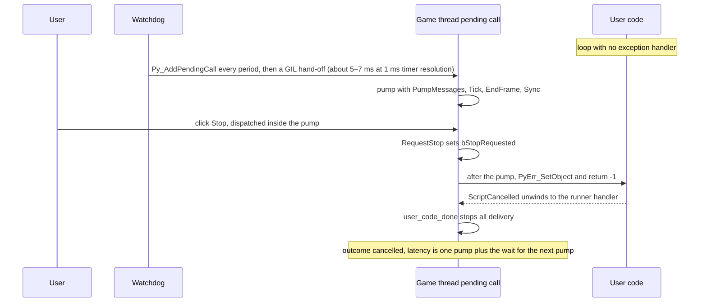

Stop with a bare `except`:

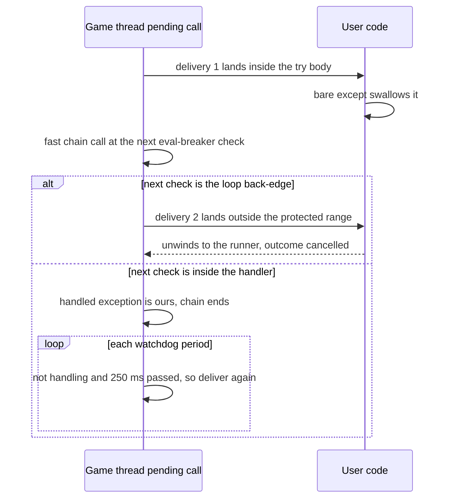

Stop during a long `finally` (RT-06):

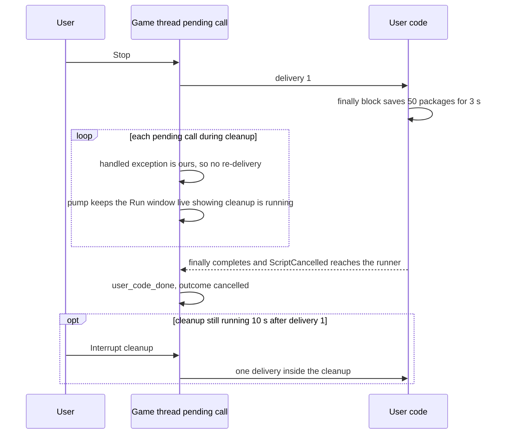

Stop during a native call:

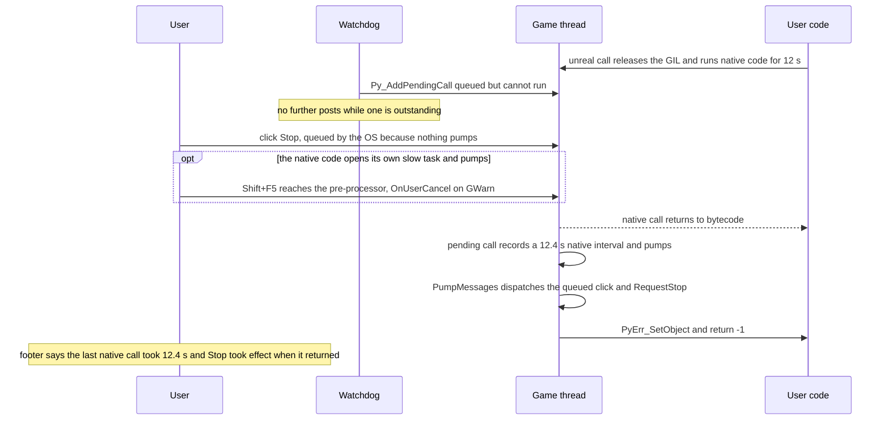

### 5.8 Native calls and honest reporting

**Responsibilities.** Say truthfully what the editor could and could not do during the run (D2 "honest states", U2).

**Measurement.**
- Each of our pending calls has a `PostTime` (watchdog) and a `RunTime` (game thread). In pure Python the gap is the GIL hand-off (§5.4.1): one switch interval (5 ms) rounded up to the OS timer resolution: about 5–7 ms under the editor's 1 ms resolution (`timeBeginPeriod(1)`, `Engine/Source/Runtime/Core/Private/Windows/WindowsPlatformMisc.cpp:1076`), and about 16 ms at Windows' default 15.6 ms resolution, which Windows 11 may apply to a minimised or occluded editor.
- The watchdog stores `HandOffWait`, the time it waited for the GIL in the hand-off, capped at 20 ms. The gap is `RunTime - PostTime - HandOffWait`, so the hand-off is never reported as native time (RV-01). The cap keeps a C call that holds the GIL, which the watchdog waits behind, counted as native time.
- A gap of at least 100 ms (proposed: one period at 10 Hz) is a **native interval**. It covers a UFunction call, `time.sleep` outside the shim, a `Thread.join` or a blocking C extension.
- The recorded length is a lower bound, accurate to one period, because the game thread may enter native code just after a pending call.
- The line is attributed from the frame at the pending call that ends the interval, which is the line of the call that returned.
- Deferral time (§5.4.3) is summed separately by reason.

**What the user sees.**

| Situation | Where | Wording |
|---|---|---|
| A native interval ended (intervals over 1 s; shorter ones count only toward the totals) | Run window, banner, after the fact | "The last native call took 3.2 s (line 43)." |
| Stop was requested during a native interval | Run footer | "Stop took effect when the native call at line 43 returned (12.4 s)." |
| Native time ≥ 1 s in total (proposed) | Run footer | "Native calls: 41.2 s of 60.0 s; longest 12.4 s at line 43." |
| Deferral ≥ 1 s in total (proposed) | Run footer | "The editor was not updated for 14.0 s while Python ran inside engine callbacks." |
| Stop caught by the script | Run window, live | Swallow report (§5.7.4) |
| Cleanup running | Run window, live | "Stopping… cleanup is running (finally at line 88), 4 s" |
| Always | Run window, banner | "Viewports resume when the run ends." (U11) |

There is no live "Waiting for native call" state. Nothing can paint during a native call that does not pump (U2; 08 §4). Windows may mark the editor "Not Responding" during a long native call; this is outside our control and documented. If the native call opens its own slow task, the engine's dialog is what shows (D2).

### 5.9 FDreamTransactions

**Responsibilities.** One undo step per run where the route default or the user asks for it (U3, RT-08). Pair Begin and End on every exit path. Watch the size. Make Undo Last Run safe and honest. Keep text undo separate.

#### 5.9.1 Defaults and titles

- Per-route defaults are in the §5.2.1 table (RT-08). The per-tab toggle **One undo step per run** (U3), the U6 split-button override and a studio default (policy) apply on top.
- Titles: `Dream: <tab> #N` (U3); `Dream: REPL #N`; `Dream: Console #N`; `Dream: <item> #N` for library items; `Dream: <file> #N` when Run File is run in a transaction; `Dream: task #N` for every task step (RT-09); `Dream: bridge <client> #N` (1.1); `Dream: agent <name> #N` (1.2).

#### 5.9.2 Begin and End pairing

**Begin** (entry, step 6):
- If `GEditor->IsTransactionActive()` is already true, run without a transaction (proposed: nesting would merge our run into someone else's record). The header says "undo unavailable: another edit was in progress".
- Otherwise call `GEditor->BeginTransaction(TEXT("Dream"), Title, nullptr)` (`Engine/Source/Editor/UnrealEd/Classes/Editor/EditorEngine.h:1062`). `INDEX_NONE` (cannot transact during loading) means run without a transaction, with a note.
- Read `Trans->GetTransaction(Trans->GetQueueLength() - 1)->GetContext().TransactionId`: while active, the open transaction is the last entry (`.../Classes/Editor/TransBuffer.h:130-131`). Store it with the title.

**End** is called by `FDreamRunTxnScope`, an RAII object owned by `HandleEndFrame`, on every C++ exit path: normal, error, cancelled, runner internal error, the early end at 100% (§5.9.4) and Python shutdown. After End:
- **Dangling check (D8).** While `GEditor->IsTransactionActive()`, call `EndTransaction()`, at most 16 times (proposed). Report "Closed 2 transactions the script opened and never closed." This covers a manual `__enter__` without `__exit__` (07e Q1).
- **Empty.** If the top entry is not ours, and no cancel event was seen, nothing was recorded. The engine discards empty transactions (`.../Private/EditorTransaction.cpp:515-527, 1331-1336`), and no Undo is offered.
- **Transient.** If `GetTransaction(i)->ContainsPieObjects()` is true (`.../Classes/Editor/Transactor.h:385`), the header adds "changes to PIE objects are not undoable" (D8).
- **Imports.** Imports and reimports are never undoable (RUN-07, RV-20): `FReimportManager::Reimport` opens no transaction (`Engine/Source/Editor/UnrealEd/Private/Editor.cpp:328-341`). Inside the user-code window of the run, or of any step of a task, Dream counts `UImportSubsystem::OnAssetPostImport` and `OnAssetReimport` broadcasts (`Engine/Source/Editor/UnrealEd/Public/Subsystems/ImportSubsystem.h:66-67`). If either fired, the header adds "imports and reimports in this run are not undoable"; **Undo this run** reverts only the recorded edits.
- **Renames and moves.** Asset renames and moves are never undoable (RUN-07): the packages on disk, the redirector, the asset registry and the saved referencers are not transacted: `Engine/Source/Developer/AssetTools/Private/AssetRenameManager.cpp` opens no transaction and saves the renamed packages itself (`:1992-2006`). Inside an open transaction, however, the engine records the renamed object. `UObject::Rename` calls `Modify()` unless `REN_NonTransactional` (`Engine/Source/Runtime/CoreUObject/Private/UObject/Obj.cpp:399`), `ObjectTools::RenameSingleObject` passes `REN_None` or `REN_DontCreateRedirectors` (`ObjectTools.cpp:4635`), and the soft-path fix-up calls `Modify(true)` on each referencer (`AssetRenameManager.cpp:672`). Undoing that record renames the object back to its old name and outer (`Obj.cpp:1787-1831`) while its packages, the redirector and the registry stay moved. That record outlasts the call only when the rename leaves a redirector, for example for a source-controlled asset, for a map, unloaded or read-only referencer, or for an asset in a collection (`AssetRenameManager.cpp:994, 1032, 1068, 1291, 1322`). Without a redirector, `rename_asset` deletes the emptied old package before it returns (`ObjectTools::CleanupAfterSuccessfulDelete`, `AssetRenameManager.cpp:2028-2036`). The undo buffer is that package's only referencer, so the engine resets the buffer (`ObjectTools.cpp:2540-2549`, reason "Delete Selected Item"). This cancels our transaction (§5.9.3), and the run's later edits are not recorded. Inside the user-code window of the run, or of any task step, Dream counts `IAssetRegistry::OnAssetRenamed` broadcasts (`Engine/Source/Runtime/AssetRegistry/Public/AssetRegistry/IAssetRegistry.h:943`). The engine raises one on the game thread for every asset that `ObjectTools::RenameSingleObject` renames or moves (`Engine/Source/Editor/UnrealEd/Private/ObjectTools.cpp:4659`), which is the path `rename_asset` and `rename_assets` take through `IAssetTools::RenameAssets`. If any fired, the header adds "asset renames and moves in this run are not undoable". If the run or step had a transaction (status not Off), Dream sets its status to Cleared, which replaces a Purged or CancelledByScript status from §5.9.3 and suppresses that section's banner, and, after End, calls `GEditor->ResetTransaction(LOCTEXT("DreamAssetRename", "Dream: assets renamed"))` (`.../Classes/Editor/EditorEngine.h:1067`), as the engine does after asset deletes (`ObjectTools.cpp:2548, 3505`). Neither Undo this run nor Edit ▸ Undo can then split an asset from its package. The note becomes "asset renames and moves in this run are not undoable · undo history cleared", and a run offers no Undo this run. In a task, Cleared is the status of the renaming step, not of the task. The reset also clears the task's earlier steps, so the task's walk-back (§5.9.6) counts only the steps after the last renaming step. When the walk stops there rather than at a foreign entry, its message reads "Can undo k of N recorded steps (steps a–b). Step s renamed assets, so the undo history before it was cleared." A task whose last step that recorded changes is Cleared counts as a Cleared run wherever §5.9.3 and §6.4 name one: its footer reads `not undoable`, and its header offers no Undo this run chip. A task with recorded steps after its last renaming step keeps the chip for the walk-back (§5.9.6).

#### 5.9.3 Purged or cancelled transactions

`Cast<UTransBuffer>(GEditor->Trans)->OnTransactionStateChanged()` (`TransBuffer.h:188-189`) is watched during the run. `TransactionCanceled` for our ID (`Engine/Source/Runtime/Core/Public/Misc/ITransaction.h:19-30`) sets the status:
- **Purged** if the undo buffer was reset while our transaction was open. At End, `GetQueueLength()` is below its value before Begin, or a map load (`FEditorDelegates::OnMapOpened`) or an asset delete (`FEditorDelegates::OnAssetsPreDelete`, `Engine/Source/Editor/UnrealEd/Public/Editor.h:378`) happened during the run. The engine resets on a map load and when a delete finds an object that only the undo buffer references (`ObjectTools.cpp:2548, 3505`). The reset cancels our transaction and empties the buffer (`EditorTransaction.cpp:1379-1402`), and edits after it are not recorded. The banner names the reason from `Trans->CanUndo(&Text)` ("Can't undo after: <reason>", `EditorTransaction.cpp:1490-1495`);
- **CancelledByScript** otherwise, for a user `cancel()` on a nested scope (07e Q1). A run or step in which an asset rename fired ends Cleared instead, with no banner (§5.9.2).

A banner then says "Undo is unavailable for this run: <reason>." `cancel()` is never presented as rollback, and there is no rollback on error (U9). Errors and cancels keep the transaction, and the run header offers **Undo this run**, except for a Cleared run (§5.9.2).

#### 5.9.4 Size watch (RT-08)

- On every pump, read `DataSize()` of our open transaction (`Transactor.h:398`; the cost is linear in its record count, `EditorTransaction.cpp:1084-1094`).
- The budget is `[Undo] UndoBufferSize` in megabytes from `GEditorPerProjectIni`, as the engine reads it (`.../Private/EditorServer.cpp:1255-1265`; default 256, `Engine/Config/BaseEditorPerProjectUserSettings.ini:492`).
- At **50%**: banner and Run-window warning: "Undo record 128 MB of 256 MB. The next edit will evict older undo history."
- At **100%**: call `GEditor->EndTransaction()` at once. Set status Partial and label the run **partly undoable**.
  - If `IsTransactionActive()` is still true, a user scope is open inside ours, and recording continues until it closes. The report says so.
  - The budget never applies to an open transaction; eviction happens only at the next Begin (`TransBuffer.h:96-121`). Ending at 100% bounds memory at about the budget plus the objects pinned against GC (`EditorTransaction.cpp:1263-1281`). The GC pinning is documented, as is the fact that `collect_garbage()` frees nothing a transaction has recorded.

#### 5.9.5 Undo Last Run

Undo Last Run is offered on the toolbar, as **Undo this run** in the run header, and as Ctrl+Alt+Z **only inside Dream widgets**. It is never a global chord (RT-16). Checks, in order:

| # | Check | Refusal text |
|---|---|---|
| 0 | Status is not Cleared (for a task: the status of its last step that recorded changes) | "Run #22 renamed or moved assets, so the undo history was cleared." |
| 1 | `GEditor->Trans` is the standard buffer captured at `OnPostEngineInit` | "Another tool replaced the undo buffer (for example the AI Assistant)." (07e Q6) |
| 2 | `!GEditor->IsTransactionActive()` | "An edit is in progress." |
| 3 | The top undoable entry, `GetTransaction(GetQueueLength() - GetUndoCount() - 1)`, has our TransactionId and title | "Edits were made after Run #22. Use Edit ▸ Undo History." |
| 4 | Status Partial | Inline confirm: "Run #22 is partly undoable. Undo the recorded part?" |
| 5 | Record size | Shown. If `DataSize() ≥ budget`: "This record is over the undo budget. The next edit will evict it." |

Then `GEditor->UndoTransaction()` (`EditorEngine.h:1068`) and mark the record Undone. **Ctrl+Z inside a Dream widget is always text undo** (dream::UndoTree) and is always consumed (D8, §4).

#### 5.9.6 Task steps and the walk-back (RT-09)

- Each step opens and closes its own `Dream: task #N` transaction around its `ExecPythonCommandEx`. No transaction stays open across frames, so PIE start, viewport undo and mode exits behave normally (`Engine/Source/Editor/UnrealEd/Private/PlayLevel.cpp:2585-2613`; `EditorTransaction.cpp:1466-1474`).
- A step is deferred to a later frame while a foreign transaction is open, for example a gizmo drag. Otherwise the step's edits would merge into it (`TransBuffer.h:76`).
- **Walk-back.** Starting at the top undoable entry, count consecutive entries whose TransactionId is in the task's step set, and stop at the first foreign entry. The UI says "Can undo 28 of 40 recorded steps (steps 13–40). A manual edit after step 12 blocks the rest." Then it calls `UndoTransaction()` that many times, re-running check 3 before each call. RT-09's example string is illustrative; the counts come from this walk. Steps that recorded nothing do not count.

#### 5.9.7 Interface

```cpp
enum class EDreamTxnStatus : uint8 { Off, NotStarted, Open, Recorded, Empty, Partial, Purged, CancelledByScript, Cleared, Undone }; // Cleared: reset after an asset rename (§5.9.2)
struct FDreamTxnHandle { EDreamTxnStatus Status = EDreamTxnStatus::Off; FGuid TransactionId; FText Title;
                        SIZE_T LastSize = 0; SIZE_T Budget = 0; bool bWarned50 = false;
                        bool bPieObjects = false; bool bImported = false; bool bRenamed = false; }; // §5.9.2 notes
class FDreamTransactions {
public:
    void Initialize();                                           // OnPostEngineInit: StandardTrans, budget, delegate
    FDreamTxnHandle BeginRunTransaction(const FDreamRunRecord& Rec);
    void OnPump(FDreamTxnHandle& H);                              // size watch; may end at 100%
    void EndRunTransaction(FDreamTxnHandle& H, FDreamRunRecord& Rec); // pairing, dangling, empty, transient
    bool CanUndoLastRun(const FDreamRunRecord& Rec, FText& OutReason, FDreamUndoPreview& OutPreview) const;
    bool UndoLastRun(FDreamRunRecord& Rec);
    FDreamTxnHandle BeginTaskStep(FDreamRunRecord& TaskRec, int32 StepIndex);
    int32 CountUndoableTaskSteps(const FDreamRunRecord& TaskRec, int32& OutFirstStep) const;
    bool UndoTask(FDreamRunRecord& TaskRec);
};
```

### 5.10 Cooperative API and `@task`

**Responsibilities.** Give script authors cheap, explicit ways to report progress, honour Stop and keep the editor live across long jobs (D24).

#### 5.10.1 `progress(i, n=None, msg="")` (M1)

- `i` is the count of items completed (0 to `n`). `n=None` gives an indeterminate bar (U12).
- `_dream.progress` stores the latest sample with its timestamp, and appends to a 16-entry ring at most every 100 ms (proposed: keeps a 1M-call loop cheap).
- Rate = Δi/Δt over the last 10 samples (proposed). ETA = (n − i)/rate. Both are shown after 3 samples (U12).
- Callable from any thread. Outside a run it does nothing. It feeds the Run window, the banner, WS-07 (U14) and the run record. WS-07 shows it live only in task mode and in Live (docked) Preview; behind the Run window it keeps its last painted text (RV-16, §5.5.3).

#### 5.10.2 `check_cancel()` (M1)

| Context | Result |
|---|---|
| No Stop requested | Returns False |
| Stop requested, game thread, inside the user-code window, no deferral condition | Raises `ScriptCancelled` (counts as a delivery) |
| Stop requested but a deferral condition holds (for example inside an import hook) | Returns True, so the caller can return early |
| Worker thread | Returns True or False and never raises (proposed: a worker decides for itself) |
| Off presentation | Returns False |

#### 5.10.3 Run-scoped sleep shim (M1)

`_impl.task.sliced_sleep(seconds)` validates its argument like `time.sleep`. On the game thread during a run, it sleeps in slices of `min(remaining, 50 ms)` (proposed: below the 100 ms period at 10 Hz) by calling the original `time.sleep`. Pending calls, pumps and Stop run between slices. On other threads, or outside a run, it calls the original.

#### 5.10.4 `@dream_editor.task` (M3)

```python
@dream_editor.task
def reimport(paths):
    for i, p in enumerate(paths):
        do_one(p)
        dream_editor.progress(i + 1, len(paths), p)
        yield                                      # one item per step
```

- Calling a decorated generator function on the game thread returns a `Task` handle and registers it with `_dream.task_register(task)`, which returns the task's run number. A second task while one is active raises `RuntimeError("Task #22 is already running")`.
- The task starts at the first `OnEndFrame` after the creating run ends (RT-01). It is its own run, with its own number and record (D24).
- **Stepping.** One step per engine frame from a persistent `OnEndFrame` handler. Each step:
  1. Defer if a foreign transaction is open, or under the RT-02 trio.
  2. Begin the step transaction (§5.9.6).
  3. `ExecPythonCommandEx("__import__('dream_editor')._run(<step run id>)")`. The runner sees kind `task_step` and calls `next(gen)` inside the user-code window with the swaps installed. Swaps are removed between steps, so the editor's own console sees stock streams.
  4. End the step transaction.
  5. Record the step.
- **Supervision.** The watchdog arms at 1 s for steps (RT-09). A step that runs longer is supervised like a run: pump, protections, presentation and Stop. Between steps nothing is registered, buffers stay editable and viewports render (U10, U11).
- **Undo (RT-09, RV-20).** Each step runs in its own transaction `Dream: task #N` (§5.9.6), so property edits made in a step, such as a `set_editor_property` after a reimport, can be undone, and the walk-back counts those steps. The reimports themselves are never undoable (RUN-07), and the run block says so with the §5.9.2 imports note.
- If more than half of the last 10 steps were supervised (proposed), the task banner says "Steps take 1.5 s on average; the editor is blocked during each step. Yield more often."
- **Stop.** Between steps, Stop sets the task's flag. The next step calls `gen.throw(ScriptCancelled(...))` inside the user-code window, so `finally` blocks run under the RT-06 rules. If the generator yields again, the following step calls `gen.close()`. A `RuntimeError` from an ignored `GeneratorExit` ends the task as `cancelled` with the detail "the task ignored Stop and was closed".
- **Ends.** `StopIteration` gives `ok`. Any other exception is classified as in §5.3.9. Python shutdown abandons the task with outcome `cancelled` and the detail "Python was shut down". Editor close during a task is vetoed with a toast offering **Stop task and close**.
- **Other runs.** User runs, REPL lines and console lines are refused while a task is active (D14(4)), with the reason shown. Editing, completion and hover work between steps, because the interpreter is idle there.
- Task steps are never traced by the debugger in 1.0 (open item 8).

### 5.11 Worker threads (D24)

- **No worker lane in 1.0.** There is no "run on a worker thread" mode and no `call_on_game_thread`: a worker that marshals to the game thread while that thread's run waits on the worker deadlocks. SPEC LRS-08 moves to Later.
- The documented pattern is pure-Python I/O in threads, consumed by a `@task` through a `queue.Queue`.
- **Output tagging.** Worker writes go through the `_dream` writer with the thread name. After the run ends, writes through a stale writer reference, and stock-stream writes caught by FDreamOutputDevice, are tagged `background (run #N)` (§6).
- **Stop** cancels the game-thread run only. Pending calls run only on the main thread, which is the game thread (07a Q1).
- **Thread listing.** At `user_code_begin`, the runner records the idents of `threading.enumerate()`. At the end it lists threads that are new and still alive, with name and daemon flag: "2 threads started by this run are still running: fetch-1, fetch-2." They are never killed.
- The pump releases the GIL, so workers make progress during pumps.
- Lints SUM201 and SUM202 (U5) flag `unreal.*` in thread targets and `time.sleep` loops (§7). Debugger breakpoints are not hit on worker threads in 1.0 (D3).

### 5.12 User modals and slow tasks during runs

| Situation | Behaviour |
|---|---|
| The script opens a `ScopedSlowTask` dialog | It becomes the top modal. Our pump keeps it painting between its own 5 Hz updates (D2). The pre-processor passes mouse input to it, passes Esc (RT-05) and maps Shift+F5 to Stop. Our Run window, if open, shows its last frame |
| Stop while a user slow task is open | Also calls `FFeedbackContextEditor::OnUserCancel()` (`Engine/Source/Editor/UnrealEd/Public/FeedbackContextEditor.h:53`), but only if `GWarn` is still the editor context captured at `OnPostEngineInit`. Their `should_cancel()` then returns true. The Paused window's evaluate Cancel (`RequestStop(EvalId)`) calls it only when `GIsSlowTask` was false at `eval_begin` (§8.3.4), so it never cancels a slow task that the paused run opened |
| The script opens a blocking modal (`EditorDialog.show_message`) | The engine's 60 Hz modal loop runs (E6). Our pending calls do not run, because the game thread is in native code, except inside nested Python, where they defer. Esc goes to the dialog. Shift+F5 records Stop, and a notification toast (notification windows are drawn over modals) says "Stop requested. It takes effect when this dialog closes." Dream never closes user dialogs |
| A foreign modal is active at the first pump | No Run window until it closes (adding ours on top would break the slow task's own `TickSlate`, FCE:419-439). Common protections apply |
| A native call opens an engine slow task | Its dialog shows. Shift+F5 sets `OnUserCancel` so the operation can cancel early |
| Unattended flags | Never set for Dream runs, so script modals work (D14(2); `SlateApplication.cpp:2134-2140`) |

### 5.13 Performance budgets for this section

| Budget | Value | Source | Test |
|---|---|---|---|
| Stop latency, pure Python, nothing swallowed | p99 ≤ 250 ms, click to exception: from the input bot's `SendInput` timestamp of the injected OS click or Shift+F5 to the `ScriptCancelled` constructor in the pending call. The injection-to-pre-processor interval is reported as a sub-interval. This is the one measuring point for the gate | G2(1), PERF-14 | T-CAN-001 |
| Stop latency, the G2 swallowing shapes | ≤ 1.25 s, same measuring point | G2(1), PERF-14 | T-CAN-003 |
| Stop mechanism sub-budget, stop flag set to `ScriptCancelled` constructed (no pump, no pre-processor) | p99 ≤ 20 ms (proposed) | G2(1) | T-CAN-002 |
| GIL hand-off after a post | One switch interval (5 ms), rounded up to the OS timer resolution, of added latency before the pending call runs, per post: about 5–7 ms under the editor's 1 ms resolution (`timeBeginPeriod(1)`, `Engine/Source/Runtime/Core/Private/Windows/WindowsPlatformMisc.cpp:1076`), and about 16 ms at Windows' default 15.6 ms resolution, which Windows 11 may apply to a minimised or occluded editor; against `while True: pass` each callback runs within one period plus 10 ms at 1 ms timer resolution, and within one period plus 40 ms at the 15.6 ms default (T-SUP-032) | RV-01 | T-SUP-032 |
| Arm delay, first pump, Run window open | about 300 ms; 1 s for task steps | D2, RT-04, RT-09 | T-SUP-016 |
| Pump rate | 10–20 Hz, target 15 Hz | D2 | T-SUP-017 |
| Pump overhead | ≤ 10% of wall time at the target rate; fail above 15% at 10 Hz | D22, G2(4) | T-SUP-005 |
| Repaint during a 1,000 lines/s flood | ≥ 10 Hz | G2(3) | T-SUP-004 |
| Live run view latency, write to painted line in the Run window | Painted by the first pump that starts at least 5 ms after the write: at most one pump period, plus the wait for the game thread's next eval-breaker check (up to one 50 ms slice in a sliced sleep; the whole call in a native call), plus the 5 ms ingest window and the GIL hand-off (§5.5.3); about 110 ms at 10 Hz, and at 15 and 20 Hz, for T-SUP-037's print-then-sleep shape; ≤ 150 ms for every line written after the window opens (LRS-01 acceptance, proposed); lines written before the first pump appear when it opens | PO-03, G2(3), LRS-01 | T-SUP-037 |
| Statement-mode execution overhead (RUN-27), excluding user code | ≤ 5 µs per top-level statement, the `run_statement` call and a one-line echo included (proposed: a 10,000-statement buffer pays at most 50 ms while it runs, when pumps keep the Run window live) | PO-02 | T-RUN-033 |
| Statement-mode prepare (RUN-27): the per-statement compiles in `Starting`, on top of the whole-module compile | ≤ 10 µs per top-level statement (proposed; about 5 to 9 µs was measured for `x = i` lines on the engine's 3.11.8, so a 10,000-statement buffer adds up to about 100 ms to `Starting`, when nothing paints) | PO-02, D22 | T-RUN-033 |
| Output drain per pump | ≤ 2 ms | D22 | T-SUP-026 |
| Re-delivery period; alternate channel start | 250 ms; 1 s | D2 | T-CAN-006, T-CAN-008 |
| Interrupt cleanup offer | 10 s (setting) | RT-06 | T-CAN-010 |
| `LogOutput` | Bounded; 0 entries for `print` and shimmed `unreal.log*` | G2(3), RT-07 | T-SUP-004 |
| Memory growth, 8-hour streaming soak | ≤ 5% | G2(7) | T-SUP-009 |
| Journal snapshot in Starting | ≤ 0.2 ms | D22 | T-RUN-018 |
| Run start | at the next `OnEndFrame` after the request, plus the Starting steps (proposed) | RT-01 | T-RUN-021 |
| Pending call without a pump (check or delivery only) | ≤ 50 µs (proposed: keeps the fast chain and deferrals cheap) | — | T-SUP-012 |
| Task step overhead, excluding user code | ≤ 0.5 ms (proposed: well under one frame) | — | T-TASK-008 |
| Editor frame time during a task | within 10% of idle | SPEC LRS-05 | T-TASK-008 |
| Transaction size watch | 50% warn, 100% stop recording, of `UndoBufferSize` | RT-08 | T-TXN-007 |

SPEC v1.0 PERF-13 uses D22's 10%/15% budget. The overhead against the plugin disabled is still recorded, as information only.

### 5.14 Failure modes

| Failure | Detection | Handling | What the user sees |
|---|---|---|---|
| **RT-01** User code ticks the core ticker (material baking, HLOD build, a fixture UFUNCTION) | Prevented by design; G2(2) | Runs start from `OnEndFrame`, outside `FTSTicker::Tick` (`Engine/Source/Runtime/Launch/Private/LaunchEngineLoop.cpp:6103, 6127`). Nested ticks dispatch our ticker clients, which check `IsRunActive()` and defer | The script works, as it does from the Output Log |
| **RT-02** A pending call fires inside Python called from native code mid-operation (import hook, delete hook, UFUNCTION override) | `gilstate_counter` exceeds the entry mark, or the supervised evaluate's mark (§5.4.5); `IsSavingPackage`, `IsGarbageCollecting`, `IsRoutingPostLoad` | Skip the pump, defer delivery, re-arm | UI pauses inside the hook; Stop takes effect after it; the footer reports the deferral |
| **RT-03** Docked pump ticks every window; an EUW tick runs Python mid-script | G2(6) counters | Run window default; docked is a Preview with the §5.5.2 protections; no `SetAsyncExc` at pump depth > 0; the §5.4.8 policy | Docked Preview users may see dashboards tick (documented) |
| **RT-03** Title-bar drag, minimise or maximise enters the Win32 move loop inside `PumpMessages` | `OnWindowAction` callback | Veto in both presentations | The window does not move or resize during the run |
| **RT-04** Input in the window between arming and the modal | — | Pre-processor and Run window installed in the first pump, before `PumpMessages`; the platform filter drops queued input | Clicks and keys during the first 300 ms do nothing |
| **RT-05** Esc in a script's dialog | Active modal is not ours, or a menu is open | Esc passes through; Shift+F5 stops | The dialog cancels; the run continues |
| **RT-06** Re-delivery interrupts `finally`, `__exit__` or runner cleanup | Handled-exception check with context walk; `user_code_done` first | No re-delivery while handling; Interrupt cleanup from 10 s | "Stopping… cleanup is running"; cleanup completes |
| **RT-07** `unreal.log*` grows `LogOutput` for the run | `Cmd.LogOutput.Num()` in stats | Run-scoped shims; `warnings.showwarning` swap; compare-and-restore | Nothing; memory stays flat. Pre-bound `log` is documented |
| **RT-08** Run-wide transaction grows without bound and pins objects | Size watch each pump | Run File off by default; 50% warn; 100% end recording; Undo Last Run warns about eviction | Undo meter; "partly undoable" |
| **RT-09** Task transaction held across frames | — | Per-step transactions; steps deferred while a foreign transaction is open | Viewport undo and PIE work during tasks; walk-back counts |
| Stale `ScriptCancelled` reaches the next run or foreign code | Run-ID guard | `SetAsyncExc(tid, NULL)` in `user_code_done` and `EndRun`; `Py_MakePendingCalls` drain | Nothing |
| Delivery lands in runner code after user code returned | Traceback has no user frame | Caught by the handler; outcome `cancelled` | "Stop arrived as the code finished" |
| Runner bug escapes `_run` | `ExecPythonCommandEx` returns false | `emergency_restore` helper; outcome `error` | "Dream internal error" with the traceback |
| `dream_editor` fails to import | `ExecPythonCommandEx` false at `__import__` | Run `error`; Python features disabled | Banner with the import error |
| User deletes or rebinds `dream_editor` in the Session | — | Entry does not use the name (RT-15) | Nothing |
| User replaces `sys.stdout` or `unreal.log` during the run | Compare-and-restore mismatch | Leave theirs in place | One info line |
| User deletes `__file__` or our `sys.path` entry mid-run | — | `pop` and assign; remove only our string object | Nothing |
| Our pending-call slot is unavailable (queue full) | `Py_AddPendingCall` returns -1 | Retry next period; the §5.7.5 channel under its gates | Possibly slower Stop |
| A pure-Python loop never re-takes the GIL, so a post would never be noticed (CPython 3.11 sets the pending-call bit only on the main thread) | — | GIL hand-off after every post (§5.4.1, RV-01) | Nothing; the Run window opens and Stop works |
| Python that runs after `user_code_done`, such as a `PostInitInstance` override during reinstancing | `bUserCodeActive` false | Pump gate: defer with `OutsideUserCode`; no new posts (§5.4.2, RV-05) | Nothing |
| VS Code holds the game thread at a breakpoint during a run | Innermost frame under the vendored debugpy directory | Keep pumping; no delivery, no `SetAsyncExc` (§5.4.3) | "Paused in VS Code: Stop takes effect when you continue in the IDE." |
| A script parents a PySide or Qt tool window to the editor during a run | — | The Run window is a popup, so the tool is parented to the main frame; teardown re-owns any HWND the Run window owns (§5.5.3, RV-02) | The tool window stays open after the run |
| Pump re-entered, or called while Slate is ticking or routing input | `PumpDepth`, `IsTicking`, `IsProcessingInput` | Skip | Nothing |
| Pump overload (`C̄` > 15 ms) | Rate controller | Rate below 10 Hz to hold 15%; flagged | Choppier updates; CI fails G2(4) |
| Blueprint breakpoint during a pump | `FScopedPreventDebuggingMode` | Engine refuses with our reason | Engine notification |
| Stall detector during long pumps | — | `SCOPE_STALL_DETECTOR_PAUSE` | Nothing |
| Foreign modal active at the first pump | `GetActiveModalWindow()` | Defer the Run window | The user's dialog keeps painting |
| Alt+F4 or File ▸ Exit during a run | CanCloseEditor; destroy override on the Run window | Veto | Toast "Run #22 is active" |
| Docked: user activates a floating window and presses Alt+F4 | G2(5) | Focus re-asserted each pump; window close is not vetoable in docked mode | Possible close of that window (documented docked hazard) |
| OS drag-drop onto the editor (E7) | Mouse-up while `IsDragDropping()` | Swallow and `CancelDragDrop()` | Nothing is imported |
| Long native call | Native interval | Report afterwards | Frozen UI; possibly "Not Responding"; footer wording (§5.8) |
| `time.sleep(600)` on the game thread | — | Sliced sleep | Live UI; Stop works |
| `Thread.join` or a blocking C call on the game thread | Native interval | None possible | Footer reports it |
| Worker threads alive at run end | Thread diff | List them; never kill | Info line |
| User `cancel()` on a nested transaction, a map load, or an asset delete that resets the undo buffer | `TransactionCanceled` for our ID | Status CancelledByScript or Purged | Banner "Undo is unavailable for this run" |
| Script leaves a transaction open | `IsTransactionActive()` after End | Close up to 16 | Warning line |
| A transaction is already active at run start | Check before Begin | Run without a transaction | Header note |
| `GEditor->Trans` swapped by another tool | Pointer compare | Undo Last Run refused | Reason text |
| Python shut down during a run or task | `OnPythonShutdown` | Wait, with the GIL released, until the watchdog has left Python (`bInPython`), then delete its thread state (§5.4.1); abandon the run or task | Outcome `error` or `cancelled`, with the reason |
| Editor crash during a run | Journal start marker without an end marker | Record `lost` on recovery | History shows `lost` |
| Stop during Starting (checkout wait) | Stop flag | `not executed` | "stopped before user code started" |
| Syntax error | `prepare` | `not executed`; caret at the error | Error block; nothing ran; file not saved |
| Heavy-body loop that swallows Stop inside a handler that calls functions | Swallow report | Keep re-delivering; Interrupt cleanup after 10 s | "The script caught Stop at line 57" |
| `SetAsyncExc` lands in nested native-entered Python | Gates in §5.7.5 make it saturation-only | Residual risk, documented | Possibly an error logged by the engine boundary |
| Task step while a gizmo drag is open | `IsTransactionActive()` at `OnEndFrame` | Defer the step | Task pauses during the drag |
| Task ignores Stop | Generator yields after `throw` | `close()` | Outcome `cancelled`, "ignored Stop" |
| Task steps consistently > 1 s | Supervised-step ratio | Banner notice | "Yield more often" |
| Docked chosen but the tab is hidden | Visibility check | Run window for this run | Run window |
| Statement mode: a bare string after the first statement would rebind `__doc__` in the Session if compiled alone | `Expr(Constant(str))` at index ≥ 1 in `prepare` | Echoed, not executed (§5.3.2) | Its echo; `__doc__` unchanged |
| Statement mode: a compile-time error that only the whole module shows (a misplaced `from __future__` import) | The whole-module `compile` in `prepare` | `not executed` before any statement runs (RUN-16) | Error block; nothing ran and nothing was echoed |
| Stop lands in the runner's loop between two statements, or statement k caught and swallowed Stop | No user frame in the traceback; the returned count that `run_statement` keeps in C, read with `_dream.statement_counts`, is below n (§5.3.7) | `cancelled`; `run_statement`'s Stop check raises before statement k+1 starts | "stopped after statement k of n"; from M2, statements 1–k carry the ok mark (EDT-18) |
| Stop lands at a statement's first instruction (statement mode) | A frame of the run's filename at line 0 | Reported at that statement's first line (§5.3.7, §5.4.7) | "cancelled at batch.py:12", never ":0"; the statement is marked stopped (EDT-18) |
| Wheel or scrollbar input aimed at the Run window's live run view reaches another window | G2(5) (T-SUP-038) | Passed only inside the Run window; the platform's modal filter drops input to every other window | The live view scrolls; nothing else moves |
| The output area is narrower than 480 Slate units, shorter than the Run window's minimum height (H_min, §5.5.3) or not on screen at entry | Cached geometry at `BeginRun` | Each dimension clamped to its minimum: a short area gives a window that grows toward the code area, a narrow one a window 480 Slate units wide from the area's left edge, both kept inside the monitor's work area; 640 × 360 and centred when not visible (§5.5.3) | The Run window extends past the area by the shortfall (over the code area for height, to the right for width), or opens centred |

### 5.15 Tests

Tier numbers follow D22. Tier 3 uses a C-API embedding harness on the shipped `python311.dll`, with FRunSupervisor's callback and watchdog built without Slate. Tier 4 tests run in the editor on GPU agents. Idle steps use the async Automation driver. Input during a supervised run, a pause or a user modal comes from the G5 input-bot `FRunnable` (§4.16.1, `SendInput`), because the Automation driver runs its steps from FTSTicker, which does not tick during a run. The test-only module `DreamEditorTests` (§2.2; never shipped; fixtures in §14.2) provides `TickCoreTicker(n)`, `SleepNative(seconds)`, `CallPythonOverride(obj)`, `FillPendingCallQueue()`, `PostSupervisorCall(RunId)`, which calls `Py_AddPendingCall` with our callback and `RunId` (default: the current run's ID) from the calling thread and does no GIL hand-off (a post from the main thread sets the eval breaker itself), and `QueueOsKeys(keys)`, which sends keys with `SendInput` and returns once `GetQueueStatus(QS_KEY)` shows them in the game thread's queue.

**Synchronisation (no sleeps).** Tests synchronise on run-state probes and `DreamTestLatch` latches (§14.2: `_dream_test.wait(name)` is a pumped wait loop built on `dream_editor.sleep(0.01)`, and the driver releases it with `release(name)`), never on fixed sleeps or timing races. "Stop during X" means the driver injects Stop after the probe or latch that marks X has fired. Durations in a test, such as `time.sleep(60)` or a 3 s `finally`, are the shape under test, not synchronisation.

#### 5.15.1 G2 suite (08 §3 as amended by 08 §7.2 and 09 §4)

Every G2 test runs in the Run window and the Live (docked) Preview presentations unless stated, with the Content Browser, Sequencer and a Details panel open. The Run window pass runs from Phase 0 (P0-2), except T-LIFE-012's journal-writer and LSP-thread checks, which join at M1, and its search-thread check, which joins at M2. The Live (docked) pass of each test joins at M4 with LRS-09 and moves to 1.1 with cut-list item 3 (§15.3).

| ID | Tier | What it checks | Pass criterion | Covers | Lands |
|---|---|---|---|---|---|
| T-CAN-001 | 4 | G2(1) shapes: `while True: pass`; `[x for x in itertools.count() if x < 0]`; `sum(1 for _ in itertools.count())`; deep recursion repeated at depth 900; a busy loop inside `__init__`; loops calling `unreal.SystemLibrary.get_engine_version()` and `EditorActorSubsystem().get_all_level_actors()`; `time.sleep(60)`. Stop by the input bot after the first pump (state probe): an OS click on the Stop button, or Shift+F5, through `SendInput`. Time from the `SendInput` timestamp to the `ScriptCancelled` constructor (§5.13); the injection-to-pre-processor interval is reported separately | p99 ≤ 250 ms over 200 stops per shape | G2(1), LRS-02, D2, PERF-14 | M1 |
| T-CAN-002 | 3 | The same shapes in the harness; the Stop mechanism sub-budget: the fake pump sets the stop flag inside the pending call, as a Stop click processed during a pump does (§5.4.2 step 9), and the timer runs from that store to the `ScriptCancelled` constructor | p99 ≤ 20 ms (proposed: mechanism only, no pump and no pre-processor); reported and never failing G2 until OI-98 signs the value off (§13.3 rule 4) | G2(1), D2 | M1 |
| T-CAN-003 | 4 | G2(1) swallowing shapes: `while True: try: n += 1 except: pass`; `for i in itertools.count(): try: sum(range(1000)) except KeyboardInterrupt: pass`; the same with `except BaseException: pass`. Stop and timing as in T-CAN-001 | p99 ≤ 1.25 s | G2(1), D2, PERF-14 | M1 |
| T-CAN-004 | 4 | G2(1) RT-06: Stop during a 3 s `finally`, and during a 3 s `__exit__`, injected once a probe in the `try` body has fired; a marker set at the end of the cleanup | Cleanup completes, the marker is set, no `ScriptCancelled` is raised inside it, outcome `cancelled` | G2(1), RT-06, LRS-12 | M1 |
| T-SUP-001 | 4 | G2(2): 1,000 run/stop cycles across all T-CAN-001 and T-CAN-003 shapes, with PIE running. Each next run is `x = 1`. A registered foreign Python tick callback counts `KeyboardInterrupt`s | Zero `check`, `ensure` or crash; every next run `ok`; the foreign callback never sees `ScriptCancelled` | G2(2), D2 | M1 |
| T-SUP-002 | 4 | G2(2) RT-01: `merge_static_mesh_actors` with material merging while textures stream; `create_proxy_mesh_actor`; `TickCoreTicker(10)`; Stop during each | No crash or `checkf`; Dream ticker clients deferred (probe counters) | G2(2), RT-01, LRS-13 | M1 |
| T-SUP-003 | 4 | G2(2) RT-02: an `on_asset_post_import` hook taking 1 s per asset during `import_asset_tasks` of 20 assets; an `on_delete_actors_begin` hook; `CallPythonOverride`; Stop inside each | Zero pumps inside the hooks (deferral counter > 0); `ScriptCancelled` never raised inside a hook; delivered in user code after the call returns | G2(2), RT-02, LRS-13 | M1 |
| T-SUP-004 | 4 | G2(3): 60 s printing 1,000 lines/s; then an `unreal.log`/`log_warning`/`log_error` loop at 1,000 lines/s; then a `warnings.warn` loop | Output view repaints ≥ 10 Hz (paint counter); `Cmd.LogOutput.Num() == 0` for all three; all lines present in the OutputStore | G2(3), RT-07, D19 | M1 |
| T-SUP-005 | 4 | G2(4): a fixed 10 s CPU loop with the supervisor on, against Off, in a heavy layout (Level Editor, Content Browser, Sequencer, Details) | Overhead ≤ 10% at the achieved rate; the rate never falls below 10 Hz unless overhead would pass 15% (then fail) | G2(4), D22, PERF-13 | M1 |
| T-SUP-006 | 4 | G2(5) input-leak suite: typing, MS-IME JP composition, clicks on toolbars, menus, Details, viewport and Content Browser, OS drag-drop from Explorer (a helper process doing a real OLE drag) onto Content Browser and viewport, Alt+F4, File ▸ Exit, window close, PIE chords, title-bar drag, minimise and maximise. Injected at 50, 150 and 280 ms (before the first pump) and at 1 s | Zero leaked effects: no selection change, move, delete, import, menu, inserted text, closed window, started PIE or moved window; no drop after the run | G2(5), RT-03, RT-04, E7, REL-06 | M1 |
| T-SUP-007 | 4 | G2(6): `register_slate_post_tick_callback` and `register_ticker_callback` during a pumped run; a C++ FTSTicker probe | 0 Python callback fires; the core ticker is never ticked by the pump | G2(6), D2, REL-06 | M1 |
| T-SUP-008 | 4 | G2(6) RT-03: an open EUW whose Blueprint Tick calls Execute Python; a Python-subclassed EUW overriding tick; a queued `AsyncTask(GameThread)` firing a Python-bound delegate; Stop during each | Run window: 0 EUW Python ticks. In the Run window, and from M4 also docked: the AsyncTask case follows §5.4.8 (no pump or delivery inside it). (from M4) Docked: counts reported against the policy | G2(6), RT-03, LRS-09, REL-06 | M1 (M4: Live (docked) pass) |
| T-SUP-009 | 4 | G2(7): an 8-hour run streaming `print` and `unreal.log` at 1,000 lines/s; RSS sampled each minute from minute 10 | Memory growth ≤ 5%; `LogOutput` stays at 0 | G2(7), RT-07, D19, PERF-17 | M1 |
| T-SUP-010 | 4 | Docked default rule: a CI check over the nightly history | A build that makes Live (docked) the default fails unless the automated extended G2 has been green for the last 28 nightly runs and the §5.4.8 policy document exists. The automated status excludes tier-8 tests such as T-SUP-031, which form the gate's manual checklist and run per release candidate | RT-03, 08 §7.2, LRS-09 | M4 |
| T-SUP-034 | 4 | G2(5) tool-window ownership, Run window presentation: a run imports PySide6 (pinned in the test environment), creates and shows a `QWidget`, calls `unreal.parent_external_window_to_slate(int(w.winId()))` once the Run window is up (state probe), and waits on a latch that the driver releases 2 s later; a second case adds a Slate child window to the Run window during the run; then the run ends | After the run the Qt window still exists and is visible (`IsWindowVisible`), and its `GW_OWNER` is the main frame's HWND; the Slate child window is alive with the root window as parent; during the run the Run window was never the active top-level regular window; no `check` or `ensure` fires during teardown; the Slate child's `GetParentWindow()` is the root window before the first idle tick after the run ends | G2(5), RV-02, LRS-01 | M1 |
| T-SUP-038 | 4 | G2(5) live run view pass (PO-03), Run window presentation only: a 10 s run printing 50 lines/s; the input bot wheels over the live run view, drags its scrollbar, clicks an echo fold chip and clicks its "↓ n new lines" chip, then wheels, clicks, drags and types over the Content Browser, the viewport, the code area and the Output Log, and wheels over the Run window outside the live view | The wheel scrolls the live view and holds it (follow off, the chip counting); the drag moves it; the fold chip expands that statement's echo in place; the new-lines chip click returns to follow mode; zero leaked effects in every other window (the T-SUP-006 probes, plus no scroll position change in the Content Browser, the Output Log or the code area, and no camera move); focus stays where it was | G2(5), LRS-01, OUT-09 | M1 |

#### 5.15.2 Runner and service

| ID | Tier | What it checks | Pass criterion | Covers | Lands |
|---|---|---|---|---|---|
| T-RUN-001 | 2 | Column-0 selection lines 40–45 raising on line 43 | Traceback line 43 and the tab's filename | RUN-06, RT-14 | M1 |
| T-RUN-002 | 2 | Indented selection `    y = x["k"] + 1` raising `KeyError` | Carets `~^^^^^` under `x["k"]`; correct line | RT-14, RUN-06, RUN-02 | M1 |
| T-RUN-003 | 2 | Selection containing a triple-quoted string with lines at lower indentation | Compiles and runs | RT-14 | M1 |
| T-RUN-004 | 4 | Selection starting mid-line | Submitted text starts at column 0 of that line | RT-14 | M1 |
| T-RUN-005 | 2 | Untitled `<dream:Tab Name#id>` in linecache after `linecache.checkcache()`; `inspect.getsource` of a buffer function | Entry present with `mtime None`; source returned | D8, RUN-06 | M1 |
| T-RUN-006 | 2 | Dirty saved file traceback; then save | Traceback shows buffer text; after save the entry is gone only if it was ours | D8 | M1 |
| T-RUN-007 | 2 | `__name__` and `__file__` across routes; `__file__` deleted mid-run; previous `__file__` in the Session | `'__main__'`; path or absent as specified; previous value restored; no `KeyError` | RUN-11, D8, E4 | M1 |
| T-RUN-008 | 2 | Run File `sys.path`: normal; user removed our entry; user inserted an equal string; `os.getcwd()` | Before equals after except for the user's own changes; cwd unchanged | RUN-11, D8, RUN-24 | M1 |
| T-RUN-009 | 2 | Auto-print: last expression; `None`; Run File; Isolated; a 50,000-character repr | `# Result:` line; nothing for `None`; off for Run File and Isolated; truncated at 10,000 with expander; `_` in the Session and not in builtins | RUN-08, D8 | M1 |
| T-RUN-010 | 3 | Last expression whose `__repr__` loops forever; Stop | Stopped; traceback points at the user's line | D8, D2 | M1 |
| T-RUN-011 | 2 | Session is the captured dict object; Isolated is fresh; last-run namespace kept, then released at the next run | Identity and lifetime as specified | D8, RUN-10 | M1 |
| T-RUN-012 | 2 | Reset session; then `del dream_editor`, `globals().clear()` and a run | Initial keys and values restored, added keys removed, `dream_editor` untouched; the run still works | D8, RT-15 | M1 |
| T-RUN-013 | 2 | Compare-and-restore for stdout, stderr, displayhook, `unreal.log*`, `showwarning` and `time.sleep`, with and without user replacement during the run | Ours restored; user replacements kept with one info line | D19, D25, RT-07, COMPAT-03 | M1 |
| T-RUN-014 | 2 | Every `BaseException` kind, and a delivery right after user code returns | `_run` returns `None`; outcomes match §5.3.9 | D14, RT-06, U2 | M1 |
| T-RUN-015 | 2 | `sys.exit(0)`, `sys.exit()`, `sys.exit(3)`, `sys.exit("msg")` | Header `exited (code …)`; outcomes `ok`, `ok`, `error`, `error` | RUN-18, U2 | M1 |
| T-RUN-016 | 5 | A failed run that redefined an `@unreal.uclass` | Reinstancing processed (instances use the new class) | D14, E9 | M1 |
| T-RUN-017 | 2 | Alias rule: absent, ours, user-rebound, after Reset, (from M4) shelf run | Written only when absent or identical; user-owned names never touched; (from M4) shelf gets fresh aliases | U19, UEI-03 | M1 (M4: shelf run) |
| T-RUN-018 | 4 | Starting order with injected failures at each step; journal snapshot cost | Each failure is `not executed` with a run number; a parse failure leaves the file unsaved; snapshot ≤ 0.2 ms | U7, RUN-16, D22, RUN-05, RUN-20 | M1 |
| T-RUN-019 | 4 | Numbering across REPL, console, `not executed`, (from M3) task steps, and a Python restart | Strictly increasing from 1 per session; no reset | U8 | M1 (M3: task) |
| T-RUN-020 | 4 | Entry call and a static check over DreamEditor sources | `EvaluateStatement`, Flags `None`, the RT-15 expression; no other `ExecPythonCommandEx`, `PyRun_*` or `PyEval_EvalCode` call sites | D14, RT-15, RUN-19 | M1 |
| T-RUN-021 | 4 | Context at entry, after a Run button click | Inside `OnEndFrame`; `IsTicking()` false; ticker-depth probe 0; no pointer capture; start ≤ 1 frame after the click plus Starting | RT-01, D14 | M1 |
| T-RUN-022 | 4 | Submit during `Running`, (from M3) `Paused` and `Task running` | Refused with a reason; no number assigned | D14 | M1 (M3: Paused and Task running) |
| T-RUN-023 | 6 | kill -9 during a run, then restart | The restart shows the lost-run block for it in the output, and its run record's outcome is `lost`; (from M2) History shows it as `lost` | U2, G6 | M1 (M2: History view) |
| T-RUN-024 | 4 | Audit hook with a fake FDreamAudit | One entry per run, including `not executed` | D20, SEC-05 | M1 |
| T-RUN-025 | 2, 5 | The D8 semantics matrix below, in plain CPython with a fake `unreal` and under `-run=PythonScript` | Every cell matches in both tiers | D8 | M1 |
| T-RUN-026 | 5 | `pickle`, `dataclasses` with string annotations and `typing.get_type_hints` on buffer-defined classes | Result recorded in §17; if common workflows break, the PEP 562 fallback is evaluated | D8 | M1 |
| T-RUN-027 | 4 | A nested `FTSTicker::Tick` from `TickCoreTicker` during a run, with an LSP result and a file-watcher action pending | Both defer until the run ends | RT-01, LRS-13 | M1 |
| T-RUN-028 | 2 | A run that starts two threads that outlive it | Info line lists both; neither is killed | D24, LRS-08 | M1 |
| T-RUN-029 | 4 | Run line and advance through SDreamTab: five Alt+Enter presses from line 1 of a five-statement buffer; the caret on a `for` header; on a decorator line, and on the `def` line below it; on `try: import json` above `except ImportError: json = None`; presses from the first body line of an `if` with an `else`, each body line calling a counter; on line 2 of a call spread over three lines; with a two-line selection; on a blank line; one press while a run is active | Runs #N..#N+4, one per statement, and the caret ends on the last line with "End of buffer"; the `for` press runs the whole loop and the caret lands on the line after its body; the decorator press and the `def` press each define the decorated function; the one-line `try` press runs both lines and the caret moves below them; the `if` walk lands after the `else` clause, and the counter shows each body line ran once; the call press runs the whole call; the selection runs, is cleared and the caret moves below it; the blank line moves the caret to the next statement with no run; the refused press leaves the caret; each run has its own undo step | RUN-26, RUN-02, U8, RUN-07 | M1 |
| T-RUN-030 | 2 | Statement mode against one `exec` on a corpus of 200 buffers (assignments, `def` and `class` with decorators, `global`, comprehensions, `try`, `with`, a `match`, `del`, star imports, `__name__` checks), run in plain CPython with a fake `_dream`, in fresh dicts, plus a buffer whose statement 1 prints `'__annotations__' in globals()` and whose statement 2 is `x: int = 1` | Equal namespaces (keys, and `repr` of values where defined); equal `print` order; `run_statement` called once per statement in order, its echo before that statement's first output; `__annotations__`, `inspect.getsource` of every function and `linecache` entries equal; the annotations buffer prints `True` in both | RUN-27, D8 | M1 |
| T-RUN-031 | 2 | Statement-mode semantics: `from __future__ import annotations` first; a bare string in mid-buffer; a leading docstring; a trailing bare string (auto-print rewrite); a three-statement buffer whose statement 2 raises at line 2; a statement with `x is 1` (a compile-time `SyntaxWarning`); a buffer whose statement 2 is `warnings.warn('old api', DeprecationWarning)`, run three times in the Session | Function and module `__annotations__` equal those of one `exec`; the `SyntaxWarning` is shown once, as with one `exec`; the `DeprecationWarning` is shown once over the three runs, as with one `exec`, and `warnings.filters` is the same list object, unchanged, before and after each prepare; the mid-buffer string is echoed, not executed, and `__doc__` is unchanged; the leading docstring sets `__doc__`; the trailing string prints `# Result:`; the traceback names line 2 of the buffer, statement 1 ran and statement 3 never ran | RUN-27, RUN-08, RUN-06 | M1 |
| T-RUN-032 | 2 | Compile errors in statement mode: `x = 1` followed by a misplaced `from __future__ import annotations`; `return` at module level in statement 3 of 3; a marker write in statement 1 of each | Both end `not executed` with the `SyntaxError` at its buffer line; the marker is never written; no echo line is emitted; the same text as a REPL submission also ends `not executed` with no echo line, and its header shows the submitted code instead (T-REPL-018) | RUN-27, RUN-16 | M1 |
| T-RUN-033 | 3 | Statement-mode overhead: a 10,000-line buffer of `x = i` lines, statement mode against one `exec`, with the real `_dream.run_statement`; prepare and execution timed separately | Execution: extra time ≤ 5 µs per statement; prepare: the per-statement compiles add ≤ 10 µs per statement; p95 over 20 runs each (proposed budgets, §5.13) | RUN-27, D22 | M1 |
| T-RUN-034 | 3, 4 | Stop in statement mode. Tier 4: a buffer whose statement 2 waits on a latch in a loop and whose statement 3 writes a marker, Stop during statement 2; the same with statement 2's wait inside `try: … except BaseException: pass`. Tier 3, three statements with the real `run_statement` and a harness hook that makes a pending Stop due (a) just before statement 1's `run_statement` returns, (b) just before statement 3's returns, (c) just before statement 2's code is evaluated | Tier 4: outcome `cancelled` at statement 2's line, the marker is never written, returned count 1; with the swallowing handler, statement 2 returns, the Stop check in statement 3's `run_statement` raises, the marker is never written, and the detail is "stopped after statement 2 of 3". Tier 3: (a) "stopped after statement 1 of 3", which `_classify` builds from `_dream.statement_counts` returning (1, 1), and statement 2 neither echoed nor run; (b) "Stop arrived as the code finished", built the same way from (3, 3), and `report_outcome` receives each detail unchanged; (c) outcome `cancelled` at statement 2's first line, not line 0, with started 2 and returned 1, and the Location row at that pump names statement 2's first line | RUN-27, D2, LRS-02 | M1 |
| T-RUN-035 | 4 | Statement mode per route: selection, line, (from M2) cell, buffer, REPL, the console executor and an API run of a tab use it; Run File, an Isolated selection run (split Run button) and an API run of a file do not; (from M3) the entry point and a task step do not; (from M4) a shelf item does not | Each statement-mode route gives one echo per statement and a statement count in the run record; each other route has one `exec`, no echo lines and a header naming the source and range | RUN-27, OUT-12, RUN-21 | M1 (M2: cell; M3: entry point and task step; M4: shelf item) |

**D8 runner semantics matrix** (T-RUN-025):

| Check | Buffer, selection, cell | REPL, console | Run File | Shelf, snippet |
|---|---|---|---|---|
| Namespace | Session (captured console dict) | Session | Fresh dict, kept as last-run | Fresh dict |
| `__name__` | `'__main__'` | `'__main__'` | `'__main__'` | `'__main__'` |
| `__file__` | Path if saved, else absent; previous restored | Absent; previous restored | Path | Item path if file-backed |
| Filename | Path or `<dream:Tab Name#id>` | `<dream:REPL#N>`, `<dream:Console#N>` | Path | Path or `<dream:Item Name#id>` |
| Auto-print and `_` | On | On | Off | Off |
| Statement mode and echo (RUN-27, OUT-12) | On | On | Off | Off |
| Aliases | U19 rule | U19 rule | None | Fresh |
| `sys.path` after the run | Unchanged | Unchanged | Own entry removed | Unchanged |
| Transaction default | On | On | Off | On |

#### 5.15.3 Supervisor, presentations and input

| ID | Tier | What it checks | Pass criterion | Covers | Lands |
|---|---|---|---|---|---|
| T-SUP-011 | 3 | Pending call posted by the watchdog from a non-Python native thread: no current thread state at the post, and no other Python thread alive. The watchdog then creates its own thread state for the hand-off (§5.4.1) | Runs on the initializing thread; `WatchdogState->thread_id` equals `PyThread_get_thread_ident()` read on the watchdog thread and differs from `GameThreadId`; `PyThreadState_SetAsyncExc(GameThreadId, ScriptCancelled)` raises `ScriptCancelled` in the game thread's loop | D2, 07a Q1, RV-01, LRS-01, LRS-02 | M1 |
| T-SUP-012 | 3 | One outstanding call; no nesting while a callback releases the GIL; cost of a check-only callback | Never two of ours queued or running; no nested run; ≤ 50 µs | D2 | M1 |
| T-SUP-013 | 3 | `gilstate_counter` and `cframe` inside a generator body, `__init__`, a `sorted(key=)` callback, and a native callback via `PyGILState_Ensure` | Counter equal in the first three and greater in the native callback; `cframe` differs in all four | RT-02, D15 | M1 |
| T-SUP-014 | 4 | Each §5.4.3 guard forced on in turn | The row's action while forced (for every Defer row, no pump and no delivery); resumes within one period after | RT-02, D2, LRS-13 | M1 |
| T-SUP-015 | 4 | Blueprint breakpoint inside an EUW tick reached during a docked pump | Refused with Dream's reason; no nested debugging loop | D2 | M4 |
| T-SUP-016 | 4 | First pump time: a run held on a `DreamTestLatch` latch, released by the driver at 150 ms and, in a second run, at 400 ms after entry | 400 ms case: first pump at 300 ms plus at most one period, and the Run window opens. 150 ms case: the run never pumps or opens a window | D2, RT-04, LRS-01 | M1 |
| T-SUP-017 | 4 | Injected pump costs of 1, 5, 12 and 20 ms | Rates 15–20, about 15, 10 and below 10 with the overload flag | D2, D22 | M1 |
| T-SUP-018 | 4 | Run window opens on the first pump, before `PumpMessages`, over the output area, shown | Window visible; geometry within 4 px of the output rect, which the test sizes at least 480 × H_min Slate units (§5.5.3) | RT-03, RT-04, LRS-01 | M1 |
| T-SUP-019 | 4 | Run window content with progress, a 40% undo record and a swallow | U2 labels; line at last pump; `i / n`, rate and ETA after the 3rd sample; meter; footer text | U2, U11, U12, LRS-01 | M1 |
| T-SUP-020 | 4 | Alt+F4 on the Run window; run end | Window stays during the run; destroyed after; other windows enabled | D2 | M1 |
| T-SUP-021 | 4 | A user slow task open at the first pump, held open on a latch that the driver releases after checking the window state, then closed by the script | No Run window while the slow task is open; it opens at the next pump after the slow task closes; their dialog repaints at the pump rate | D2, §5.12 | M1 |
| T-SUP-022 | 4 | Docked protections and the execution arrow: a docked run of a buffer whose statement 2 loops for 3 s calling a function defined in another tab | Focus on the banner; buffers read-only; CanClose vetoes; window actions vetoed; completion and hover disabled; the gutter arrow is on the run-file line at the last pump (§5.5.4) and moves at each pump; while the function from the other tab runs, it stays on statement 2's call line and the other tab's gutter shows no arrow; it is gone after finish step 3 | D2, RT-03, LRS-09 | M4 |
| T-SUP-023 | 4 | Docked chosen with the tab closed; safe mode; a policy forcing Off | Run window; Run window; Off | D17, D20, RT-03, LRS-10 | M4 |
| T-SUP-024 | 4 | Off presentation | No watchdog posts, no pre-processor; output appears at the end; entry invariant holds | D2, LRS-10 | M1 |
| T-SUP-025 | 4 | Pre-processor registration in the Run window and (from M4) Live (docked) Preview presentations | Registered at the first pump at PreEngine priority 0; unregistered at finish | RT-04, D25 | M1 (M4: Live (docked) pass) |
| T-SUP-026 | 4 | 50k lines/s ingest for 60 s during a run, with the pump rate pinned to 10 Hz by the test | Drain ≤ 2 ms per pump; the view-queue backlog stays under 1 s of input, and no "lines not shown" marker appears | D22, D19, OUT-04, PERF-09 | M1 |
| T-SUP-027 | 4 | Esc in each context, through the input bot: (from M4) no modal (docked); after the Run window appears; Esc and Shift+F5 queued before the first pump in the Run window presentation (the run's first statement calls the fixture `QueueOsKeys`, which returns only when `GetQueueStatus(QS_KEY)` shows the keys queued, so the first pump can only follow); `show_message` open; a menu open; (from M3) in the Paused window, focus in the evaluate console with completion open, in the Add watch field, in an inline watch edit and in a filter box; (from M3) focus on the Paused window's stack | Stop; Stop; both keys discarded and the run continues (RT-04); dialog returns Cancel and the run continues; menu closes; in each text field the first Esc closes completion if open, the next clears or cancels the input, and the run continues; Stop | RT-05, G5, LRS-11 | M1 (M3: Paused-window cases; M4: docked case) |
| T-SUP-028 | 4 | Shift+F5 with no modal, the Run window, a foreign modal and (from M3) the Paused window | Stop in every case | RT-05, U21, LRS-11 | M1 (M3: Paused window) |
| T-SUP-029 | 4 | Mouse pairing: down outside, up on Stop; down on Stop, up outside; wheel over output | No click leaks; Stop fires only for down and up on Stop; output scrolls | D2 | M1 |
| T-SUP-030 | 4 | Fixture `SleepNative(3)` called at line 12 | "The last native call took 3.0 s (line 12)" within one period | U2, §5.8, LRS-03 | M1 |
| T-SUP-031 | 8 | Manual: IME composition, typing and drag-drop during runs in the Run window and (from M4) Live (docked) Preview | No text, no drop, no effect | G2(5), D23 | M1 (M4: docked) |
| T-SUP-032 | 3 | On Win64 the harness calls `timeBeginPeriod(1)` at start, as the editor does. GIL hand-off against `while True: pass` on the initializing thread, with no other Python thread alive; the watchdog posts at 15 Hz with the hand-off (§5.4.1). Negative control: the same posts without the hand-off against a 2 s pure-Python loop (`while time.perf_counter() < t_end: pass`) | The first callback runs within one period plus 10 ms after arming, and each later one within one period plus 10 ms of the previous, p99 over 1,000 callbacks; a Stop then ends the loop with `ScriptCancelled`; no native interval is recorded (every `RunTime - PostTime - HandOffWait` is under 100 ms). Control: no callback runs until the loop ends. Win64 only, second case after `timeEndPeriod(1)` (the harness calls `timeBeginPeriod(1)` again when it ends): each callback within one period plus 40 ms of the previous, p99 | RV-01, D2, LRS-01, LRS-02, G2(1) | M1 |
| T-SUP-033 | 4 | Pump gate after user code (RT-02): a re-run that redefines an `@unreal.uclass` actor class with 10 instances in the level; its `_post_init` calls `PostSupervisorCall()` and then loops for 200 ms; the run's own code ends right after the class statement | The posted call runs inside `_post_init` during `ProcessPending` (callback probe) and records an `OutsideUserCode` deferral; zero pumps and zero deliveries during `ProcessPending`; the watchdog posts nothing after `user_code_done`; outcome `ok` | RT-02, RV-05, E9, LRS-13 | M1 |
| T-SUP-035 | 3 | Python shutdown while the watchdog is in a GIL hand-off: the harness holds the GIL in C until the probe shows `bInPython` true, then calls `OnPythonShutdown`; a second case shuts down while the watchdog is idle; then Python is initialised again and a run is supervised | Shutdown returns only after `bInPython` is false; the watchdog's thread state is cleared and deleted under the GIL; no crash and no call into Python from the watchdog after shutdown; the new generation creates a new watchdog thread state and its first pending call runs | RV-01, D16, LRS-01 | M1 |
| T-SUP-036 | 4 | Run window geometry (PO-03): a 2 s run from a buffer with the default layout; the same after Move Output to Bottom; with the output area dragged to 150 px, in both positions; with the Dream tab floating 420 px wide; each at 100%, 125% and 150% DPI, with the output area dragged to 320 Slate units tall in a Dream tab at least 1,100 Slate units wide, so that the area is at least 480 × H_min Slate units at every scale on a 1080p monitor, and with the Dream tab on a second monitor at another scale; an API run of the tab while the Dream tab is a background tab; a 20 s run in the 150 px area, at the minimum height, that shows the native-call note (a 2 s `SleepNative`) and then the cleanup note with Interrupt cleanup (Stop during a 12 s `finally`) | Wherever the output area is at least 480 × H_min Slate units, the window's screen rect is within 4 px of the output area's, at the top by default and at the bottom after the move, at every scale; the 150 px area gives a window as wide as the area and H_min tall, growing down from the area's top-left in the top layout and up from its bottom-left in the bottom layout, inside the monitor's work area, and the window's screen position is that computed top-left; the narrow tab gives a window 480 Slate units wide from the area's left edge; at the minimum height the live view shows at least 5 lines, and still at least 5 after each note appears, the window having grown toward the code area; with the tab hidden the window is 640 × 360 Slate units, centred on the main frame, and its live view shows at least 5 lines | LRS-01, WS-03, RT-03 | M1 |
| T-SUP-037 | 4 | Live run view (PO-03): a buffer whose statement 2 prints a line and then sleeps 200 ms, 25 times, and whose statement 3 prints a final line, with paint probes on the live view; then the output area after the run; the same run with the live view scrolled back by the wheel before it ends, in the default area and then with the output area dragged to 150 px in each layout and with the Dream tab a background tab; the same buffer run with the REPL tab active, and with Problems active; an API run of a file that is not open in a tab; then a 100 ms run with the REPL tab active | Every line written after the window's first paint is painted in the live view within 150 ms of its write, and the lines written before it appear in that first paint (proposed; the probe compares the write timestamp with the first paint that shows the line); statement 2's echo is above its output; the Location row names the executing line with its source text and "statement 2 of 3"; after the following run the Output view is in follow mode with the run's last line at its bottom; after the scrolled-back run in the default area the live view's first visible line is within 2 px of the screen y it had; in the 150 px area that line is at the Output view's nearest visible row (its last row in the top layout, its first in the bottom layout), and with the background tab at its top row; follow mode is off in each; in the REPL and Problems cases the Output tab is active from the run's start and shows the block at the end; the file run's Location row reads "Line n · <file>" with no source text; the 100 ms run opens no window, switches the area from the REPL tab to Output, and its echo and output appear together with that switch in the next painted frame | LRS-01, OUT-12, OUT-09 | M1 |

#### 5.15.4 Cancellation

| ID | Tier | What it checks | Pass criterion | Covers | Lands |
|---|---|---|---|---|---|
| T-CAN-005 | 3 | First delivery sets the error and returns -1; negative control returning -1 without an error | `ScriptCancelled` in user code; control raises `SystemError` | D2, 07a Q1 | M1 |
| T-CAN-006 | 3 | Handling check in `finally`, `__exit__` and `except` bodies, and after a swallow | No re-delivery while handling; re-delivery within 250 ms plus one period after a swallow | RT-06, LRS-12 | M1 |
| T-CAN-007 | 3 | `try/except OSError` nested inside a `finally` during cleanup | Still "handling" (context walk) | RT-06 | M1 |
| T-CAN-008 | 3 | Alternate channel with `FillPendingCallQueue()`, while handling, at pump depth 1, and with native re-entry | `SetAsyncExc` used only when saturated, ≥ 1 s, not handling, depth 0, no re-entry | D2, RT-06, RT-03 | M1 |
| T-CAN-009 | 3 | Statements after `user_code_done`; a pending async exception at that moment | No delivery; async exception cleared | RT-06 | M1 |
| T-CAN-010 | 4 | Cleanup of 30 s; loop re-entering a 5 s handler | Interrupt cleanup appears at 10 s in both; one click, one delivery | RT-06, LRS-12 | M1 |
| T-CAN-011 | 3 | 1,000 cycles; stale pending call and stale async exception from run k | No-op in run k+1; no `KeyboardInterrupt` anywhere afterwards | D2, G2(2) | M1 |
| T-CAN-012 | 3 | Fast chain on `for` with `except: pass` around a C call | Stops within 2 deliveries in 99% of 1,000 trials; never more than 32 callback runs in one check | D2, G2(1) | M1 |
| T-CAN-013 | 3 | Static scan of `_dream` and DreamEditor imports and symbols; `sys.modules` after a run | No `PyErr_SetInterrupt*`; `dream_editor` never imports `signal` | D2 | M1 |
| T-CAN-014 | 2 | `ScriptCancelled` under `except Exception`, in an asyncio task, in a unittest case | Not caught by `except Exception`; propagates out of `asyncio.run` and unittest | D2, E5 | M1 |
| T-CAN-015 | 4 | Stop during a user `ScopedSlowTask`; `GWarn` swapped by a test context | `should_cancel()` true; with the swapped context, `OnUserCancel` is not called | D2, LRS-04 | M1 |
| T-CAN-016 | 3 | `check_cancel()` in each §5.10.2 context | As in the table | D24 | M1 |
| T-CAN-017 | 4 | Stop during a 5 s async checkout in Starting | `not executed`, "stopped before user code started"; no Python entry | U7 | M4 |
| T-CAN-018 | 4 | Stop from the Paused window (fake §8 pause port) | `ScriptCancelled` raised by the debugger path; outcome `cancelled` | D3, U17 | M3 |
| T-CAN-019 | 4 | `Stopping…` shown until return; location in the header | Label persists until control returns; header names file and line | D2, U2 | M1 |
| T-CAN-020 | 4 | Stop during `SleepNative(5)` | Delivered at return; the footer has the §5.8 Stop wording | U2, LRS-03 | M1 |
| T-CAN-021 | 3 | `time.sleep(60)` on the game thread and on a worker; Stop once a probe shows both sleeps have started | Game thread stops within 250 ms of the Stop; the worker sleeps the full time | D2 | M1 |
| T-CAN-022 | 3 | Swallow report for `except KeyboardInterrupt:` at line 57 | Report names line 57 | D2, §5.7.4, LRS-14 | M1 |

#### 5.15.5 Transactions

| ID | Tier | What it checks | Pass criterion | Covers | Lands |
|---|---|---|---|---|---|
| T-TXN-001 | 4 | Defaults for every route; titles | Match §5.2.1 and §5.9.1 | RUN-07, RT-08, U3 | M1 |
| T-TXN-002 | 4 | Exit paths: `ok`, `error`, `cancelled`, runner bug, 100% end, Python shutdown | `IsTransactionActive()` false after each; one record where expected | D8 | M1 |
| T-TXN-003 | 4 | Script calls `ScopedEditorTransaction.__enter__()` and drops it | Closed; warning line | D8, 07e Q1 | M1 |
| T-TXN-004 | 4 | Transaction already open at entry | Run without a transaction; header note | §5.9.2 | M1 |
| T-TXN-005 | 4 | User `cancel()` on a nested scope | Status CancelledByScript; banner | D8 | M1 |
| T-TXN-006 | 4 | Map load mid-run | Status Purged; banner | D8 | M1 |
| T-TXN-016 | 4 | A run sets a property on a fixture asset, then deletes it with `unreal.EditorAssetLibrary.delete_asset` | Status Purged; the banner names "Delete Selected Item"; `GetQueueLength()` is 0 | D8 | M1 |
| T-TXN-007 | 4 | `UndoBufferSize=32`; script grows the record past 16 and 32 MB; also with a user scope open at 100% | Warning at 50%; End at 100%; "partly undoable"; nested case reported | RT-08 | M1 |
| T-TXN-008 | 4 | Run File modifying 10,000 material instances: default (off) and Run in transaction; then a manual edit | Off: RSS within 5% (proposed) of a Dream-disabled baseline. On: warning and stop fire per RT-08; after the edit, Undo Last Run reports eviction | RT-08, RUN-24 | M1 |
| T-TXN-009 | 4 | Undo Last Run checks 1–5 | Each refusal or confirmation text appears; success only when all pass | D8, RT-08, RUN-22 | M1 |
| T-TXN-010 | 4 | Polish layout AltGr+Z and AltGr+X in every Dream widget and in the Level Editor | Characters typed; Undo Last Run never fires | RT-16, G5, RUN-22 | M1 |
| T-TXN-011 | 4 | Ctrl+Z in SCodeView after a run | Text undo; no `TRANSACTION UNDO` | D8, G5 | M1 |
| T-TXN-012 | 4 | A run that edits actors and then raises | Edits kept; **Undo this run** reverts them | U9, RUN-22 | M1 |
| T-TXN-013 | 4 | REPL line that changes nothing | No undo entry; no Undo offered | D8 | M1 |
| T-TXN-014 | 4 | Run that edits PIE objects | Transient note in the header | D8 | M1 |
| T-TXN-015 | 4 | A run, and (from M3) a two-step `@task`, that each reimport a fixture texture and then set its `lod_group` with `set_editor_property`; and, run last, a run that renames a fixture static mesh with `unreal.EditorAssetLibrary.rename_asset` and then sets its `lod_group` | Header note "imports and reimports in this run are not undoable" in both; **Undo this run**, and the task walk-back, revert the `lod_group` edits; a run without an import shows no import note; the rename run says "asset renames and moves in this run are not undoable · undo history cleared", offers no Undo this run, shows no "Undo is unavailable" banner, ends with status Cleared, and Undo Last Run refuses it with check 0's text; `GetQueueLength()` is 0 after it; after a save and a reload the mesh keeps its new path and its `lod_group` | RUN-07, RV-20, RT-09 | M1 (M3: @task) |

#### 5.15.6 Tasks

| ID | Tier | What it checks | Pass criterion | Covers | Lands |
|---|---|---|---|---|---|
| T-TASK-001 | 4 | Stepping context and cadence | Each step inside `OnEndFrame`, `IsTicking()` false; one step per frame; frame counter and viewport advance between steps | RT-01, D24 | M3 |
| T-TASK-002 | 4 | Per-step transactions | Each step `Dream: task #N`; `IsTransactionActive()` false at the end of every `OnEndFrame` | RT-09 | M3 |
| T-TASK-003 | 4 | Walk-back with a manual actor move after step 12 of 40 | Undo reports and reverts steps 13–40 only | RT-09 | M3 |
| T-TASK-004 | 4 | Step while a test opens a foreign transaction for 30 frames | Step deferred 30 frames; no merge | RT-09 | M3 |
| T-TASK-005 | 4 | A 1.5 s step | Armed at 1 s; pumps, protections and Stop active during the step only | RT-09 | M3 |
| T-TASK-006 | 4 | Stop between steps; a generator that swallows and yields | `finally` runs; swallowing task closed; outcome `cancelled` | D24, U10 | M3 |
| T-TASK-007 | 4 | User run, REPL and console submissions during a task; editing; Stop via WS-07, banner and Shift+F5 in a Dream widget | Submissions refused with reason; editing works; each Stop control works | U10, D14 | M3 |
| T-TASK-008 | 4 | @task soak: 20 minutes, 10,000 items, viewport ticking; PIE start at minute 5; manual edit at minute 10; Stop at minute 15 in a second run | Frame time within 10% of idle; step overhead ≤ 0.5 ms; no "Cancelling open … operation" notice; walk-back stops at the manual edit; Stop within one item; per-run log written | D24, RT-09, LRS-05 | M3 |
| T-TASK-009 | 2 | Second task while one runs; task created outside a Dream run | `RuntimeError`; external task accepted as its own run | D24 | M3 |
| T-TASK-010 | 4 | `ForceDisablePythonAtRuntime` between steps | Task abandoned, outcome `cancelled` "Python was shut down"; no crash | D16 | M3 |

### 5.16 Open items

1. **Alternate-channel gate.** §5.7.5 uses `SetAsyncExc` only when the pending-call queue is saturated, the pump depth is 0 and there is no native re-entry. That is stricter than D2's "each period from 1 s". RV-01 settles that the channel is not a liveness mechanism (the GIL hand-off is, §5.4.1); the chief architect should still confirm the gate.
2. **RT-02 signal.** `gilstate_counter` replaces the `cframe` comparison for 3.11 (§5.4.5). RV-05 accepts it for 3.11, with the `bUserCodeActive` pump gate and the per-evaluate mark. It must be re-verified on the 3.13 canary (RT-20) and recorded in the D15 compatibility layer.
3. **Heavy-body swallowing loops** stop probabilistically (§5.7.4). Proposed: a `dream-check` rule for a bare or `KeyboardInterrupt` handler inside a loop. This needs a new SUM2xx code (a U5 amendment, §7).
4. **Runs between task steps** (REPL inspection during a long task) are refused in 1.0. They are a 1.x candidate.
5. **Esc in the Paused window's text fields.** Resolved: Esc passes to every text-entry widget in the Paused window (evaluate console, Add watch, inline watch edit, breakpoint-condition editor, filter boxes), closing completion first and then clearing or cancelling the input (§5.6.3, §8.3.5).
6. **Docked floating-window close** after an OS activation is not vetoable. G2(5) decides whether docked needs a fix.
7. **Stale stream references** (logging handlers holding the stock `sys.stderr`) still reach `LogOutput`. Proposed: rebind the stock `_Logger.log_func` for the run (`unreal_core.py:33-49`), if G2(7) with a logging workload shows growth.
8. **Breakpoints in task steps** are not supported in 1.0.
9. **SPEC PERF-13** (3%) against D22 (10%/15%). Resolved: SPEC v1.0 PERF-13 uses the D22 numbers (§17.2).
10. **ForceRedrawWindow variant** (RT-03(d)) is evaluated by G2(5) and G2(6) before it ships.
11. **Task API from outside Dream runs** (EUW buttons). It is allowed here; D29 must list it as public API or forbid it.

---

## 6. Output, REPL and console executor

This section specifies how Python output is captured, stored, shown and echoed to the Unreal log, how the REPL prompt works, and the `Python (Dream)` console executor. It implements D19 as amended by RT-07, the run rulings U8, U9, U13 and U17, the thread rules of D24, the review rulings RV-16, RV-18 and RV-23, and the owner rulings PO-01 (the output area on top) and PO-02 (input echo, OUT-12) of 08 §10.

**Terms.**
- **Line record:** one logical output line plus its metadata (run, type, thread, time, flags).
- **Run block:** the lines from a run's header to its footer.
- **Ingest:** turning raw writes into line records (split, classify, scan links). It runs on the `DreamOutput` thread.
- **Drain:** moving processed line records into the store on the game thread.
- **Echo:** forwarding a line to the Unreal log (`LogPython` or `LogDream`), which feeds the Output Log and `Saved/Logs`.
- **Input echo:** an `echo` line (OUT-12, PO-02): one source line of an executed statement, appended before the statement's output, so a run block reads as a history of what ran. Input echo is never forwarded to the Unreal log. In this section "echo" alone means forwarding; "input echo", "echo lines" and the `echo` type mean OUT-12.
- **Output area:** the zone of the Dream tab that holds the Output, REPL and Problems tabs and the one REPL prompt strip, above the code area by default (WS-02, WS-03, PO-01; renamed in v1.2, when it moved to the top).
- **Run log:** a per-run text file in the D17 location.
- **`<root>`:** the per-user, per-project storage root of §10.1 (`%LOCALAPPDATA%\DreamPythonEditor\<EngineVer>\<ProjectHash>\` on Windows; D17, U29). A second editor instance writes its journal, history entries and REPL history in its own namespace, and only the primary writes the shared files (§10.5, §6.5).
- **Run ID and run number:** a run ID is the `FDreamRunId` (`uint64`, §12.1.2) of one entry into `_run`, so a task has one per step. The run number `#N` names the run and its block. Records carry run IDs; the store maps them to run numbers (§6.2).

**Milestones.** Capture, store, echo, the output view, the REPL and the console executor land in **M1** (D9, D19), with the output area on top (WS-03) and input echo with the Echo input toggle and Normal folding (OUT-12). Filters by run, source and regex (OUT-06), presets and SGR colours (OUT-03, which brings Echo All and Minimal for input echo), Ctrl+R and the prefix filter (REPL-02) and Copy as script (OUT-10) land in **M2**. REPL suspension while paused (REPL-07) lands with the debugger in **M3**.

**Path shorthand.** In §6 and §9, `.../Private/` stands for `Engine/Plugins/Experimental/PythonScriptPlugin/Source/PythonScriptPlugin/Private/`. Every other engine path is written in full the first time it appears.

### 6.1 Capture

**Responsibilities.**
- Replace the interpreter's output paths for the duration of each run, and restore them on every exit path.
- Tag every write with run ID, stream and thread.
- Keep blank lines. Label stderr as `stderr`, never as an error.
- Keep `unreal.log*` calls made during a run out of the engine's `LogOutput` capture (E3, RT-07).
- Attribute worker-thread output to the run that started the thread, and tag it `background` after that run ends (D24).

**Design: the swapped slots.** `dream_editor._impl.streams.StreamSwap` installs these slots after the pre-run steps (U7) and before user code. It restores them after `_run` has called `_dream.user_code_done(run_id)` (RT-06), so no `ScriptCancelled` can arrive during the restore.

| Slot | Stock value in 5.8 | During a run |
|---|---|---|
| `sys.stdout` | `TextIOWrapper(_Logger(log, log_flush), line_buffering=True)` (`Engine/Plugins/Experimental/PythonScriptPlugin/Content/Python/unreal_core.py:58`) | `_dream.Writer(STREAM_STDOUT, run_id)` |
| `sys.stderr` | Same, with `log_error` (`unreal_core.py:59`) | `_dream.Writer(STREAM_STDERR, run_id)` |
| `warnings.showwarning` | `_redirect_warning`, which calls `log_warning` (`unreal_core.py:61-63`) | `_impl.streams.showwarning` |
| `unreal.log`, `unreal.log_warning`, `unreal.log_error` in the `unreal` module dict (hoisted at `.../Private/PythonScriptPlugin.cpp:1789-1806`) | C functions in `_unreal_core` | `_dream.shim_log`, `_dream.shim_log_warning`, `_dream.shim_log_error` |
| `sys.displayhook` | CPython default | Autoprint hook (§5) |

- **Why `warnings.showwarning` is swapped.** `_redirect_warning` looks up `log_warning` in `unreal_core`'s own globals (`from _unreal_core import *`, `unreal_core.py:3`), not through the `unreal` dict. The RT-07 shims alone would therefore miss warnings, which would still grow `LogOutput`. Our `showwarning` honours the `file=` argument as the stdlib does, and otherwise writes a `warning` line. (Verified in the local engine.)
- **Compare-and-restore** (D19, D25). For each slot, `cur = read(slot)`:
  - if `cur is ours`, or the slot was deleted, write back the pre-run value;
  - otherwise leave `cur` in place, and add a footer note: "`sys.stdout` was replaced during run #22 by `colorama.ansitowin32.StreamWrapper`; Dream left it in place."
  - Runs never nest (D14(4)), so the saved value is always the pre-run value.
- **Isolated runs** swap the same slots. Streams are interpreter-global.

**Design: `_dream.Writer`.** A C type created per run. It implements the text-stream protocol that libraries probe.

| Member | Behaviour |
|---|---|
| `write(s)` | `s` must be `str`, or it raises `TypeError` as `TextIOWrapper` does. It encodes to UTF-8, turning lone surrogates into U+FFFD, pushes one raw record and returns `len(s)`. It holds the GIL, so it never blocks on the UI |
| `flush()` | No I/O, and it does not commit partial lines (see below). It never calls `GLog->Flush()` |
| `buffer` | A `_dream.BinaryWriter`. `write(b)` decodes UTF-8 with replacement, then follows the same path |
| `encoding`, `errors`, `name`, `line_buffering` | `"utf-8"`, `"replace"`, `"<dream stdout>"` / `"<dream stderr>"`, `True` |
| `isatty()`, `readable()`, `seekable()`, `writable()` | `False`, `False`, `False`, `True` |
| `fileno()` | Raises `io.UnsupportedOperation` |
| `closed`, `close()`, `detach()` | `False`. Both methods raise `io.UnsupportedOperation`, as the stock `_Logger` does (`unreal_core.py:46-49`) |

**Design: line splitting.** This runs on the ingest thread (§6.2), with one partial-line buffer per (native thread ID, stream, run ID).
- `\n` and `\r\n` end a line. The terminator is not stored.
- `print()` produces an empty line record. Empty lines are kept in the store and the view (D19). They are not echoed (§6.3).
- A lone `\r` discards the open partial text, which matches how progress bars redraw a line. The view shows the partial text as a provisional last line of its block (flag `Partial`). *Proposed: tqdm-style tools rewrite the whole line, so "replace" is enough; terminal column overwrite is not emulated.*
- **A CR split from its LF.** `print(x)` writes `x` and then `"\n"` as two calls, so text that ends in CR (output of Windows tools split on `\n`, such as p4, git or a CSV read with `newline=''`) arrives as `"text\r"` followed by `"\n"`. A CR at the end of a record is therefore held in that key's partial state. If the next record for the key starts with LF, the pair ends the line. Anything else makes it a carriage return (replace). At run end, or when the partial text reaches 16 KB, a held CR ends the line.
- A partial line is committed by a newline, at run end, or when it reaches 16 KB. *Proposed: this bounds per-key memory.*
- **Partial lines and input echo** (OUT-12). Before an `Echo` record of a run is committed, every open game-thread partial line of that run (stdout and stderr) is committed as a line of its own, flagged `Partial` (unterminated) and `EchoSplit`, so the text of `print('Working...', end='')` in statement k stays above statement k+1's echo in the store, the view and the run log, which matches the view (OUT-08); a later write to that stream starts a new line (proposed). The split is view history only and never reaches the Output Log: FDreamLogForwarder holds an `EchoSplit` line and forwards it joined with the next line of the same stream and run, or alone at run end, so `LogPython` and `Saved/Logs` get "Working... done" as one line, as one `exec` does and as stock UE does with its line-buffered `sys.stdout` (`Engine/Plugins/Experimental/PythonScriptPlugin/Content/Python/unreal_core.py:58`; §6.3 rule 1). A view that shows none of the echo lines between the two parts (Echo input off, Minimal, or the echo evicted) draws them as one line, as it draws `Continued` records.
- Lines over 64 KB are split into continuation records flagged `Continued`. The view joins them visually. *Proposed: this keeps a line inside one store chunk.*

**Design: thread attribution** (D24). C++ keeps `FDreamThreadTable`, a map from native thread ID to {name, origin run ID, `PyThreadState*`}, guarded by a reader-writer lock.
- **Where it runs.** Producers push only the native thread ID with each record. Attribution runs on the `DreamOutput` thread at ingest (§6.2), so FDreamOutputDevice, which runs synchronously on whatever thread logs, never takes the table's lock (§6.3).
- The table's write lock is held only for the insert. The thread name is read before the lock is taken, and no code under the lock logs or calls Python.
- `_run` calls `_dream.capture_begin(run_id, alive)`, where `alive` holds the `native_id` of every thread in `threading.enumerate()`.
- A write from the game thread is tagged with the current run.
- A write from a thread whose origin run is known is tagged with that run. If that run has ended, the line is flagged `Background`.
- A write from an unknown thread that is not in `alive` started during the current run. It gets the current run as its origin.
- A write from a thread that was alive before the run, with no known origin, gets run 0 ("outside runs") and `Background`.
- The thread name comes from `threading.current_thread().name`. It is read once, the first time a (thread ID, `PyThreadState*`) pair writes.
- At run end, `_run` lists the threads that started during the run and are still alive. The footer says "2 threads started by this run are still running: Worker-1, Downloader. Dream does not stop them" (D24).

**Design: the RT-07 log-shim emit path.**
1. `unreal.log(obj)` inside a run calls `_dream.shim_log`. It converts with `str(obj)`, as the stock `PyUtil::PyObjectToUEString` does (`.../Private/PyCore.cpp:1181`).
2. It applies `ShouldLog`: empty or whitespace-only text is dropped entirely, as in the stock function (`.../Private/PyCore.cpp:1158-1173`).
3. It calls `log_shim(verbosity, text)`. That pushes a record of type `info`, `warning` or `error` with origin `unreal.log`.
4. The record is echoed to `LogPython` at Log, Warning or Error (§6.3). It never calls `GetPythonLogCapture().Broadcast` and never calls `GLog->Flush()`, so `FPythonCommandEx::LogOutput` does not grow (E3).
5. The shims carry the originals' `__name__`, `__qualname__` and `__doc__`, so `help(unreal.log)` still reads correctly.
6. **Bypass.** A `from unreal import log` binding made before the run still calls the C function. The engine's capture still records those lines, and FDreamOutputDevice still shows them (§6.3). This is documented, as RT-07 requires.

**Design: stale stream references** (D19).

| Holder | Path | Result |
|---|---|---|
| Captured the stock stream before the run (for example `logging.StreamHandler()` at import time) | Stock `_Logger` → C `log_error` → `UE_LOG` | FDreamOutputDevice captures the line and attributes it to the active run (§6.3) |
| Kept our writer after the run (for example a wrapper installed by `colorama.init()`) | `_dream.Writer` with a run that has ended | `Background` lines, attributed to the writer's run and echoed by FDreamLogForwarder |
| `print(..., file=sys.__stdout__)` | CPython's original C stdio | Not captured. It goes to the process console, if any. Documented |

**Interfaces.**

```python
# dream_editor/_impl/streams.py
class StreamSwap:
    def __init__(self, run_id: int) -> None: ...
    def install(self) -> None: ...                 # called by runner._run before user code
    def restore(self) -> list[str]: ...            # after user_code_done; returns footer notes
def showwarning(message, category, filename, lineno, file=None, line=None) -> None: ...
```

```text
_dream C API (added by this section; see §12.1.1 for the full list and the constant values)
  Writer(stream: int, run_id: int)            stream is STREAM_STDOUT or STREAM_STDERR
  write(stream: int, run_id: int, text: str)  stream is a STREAM_* constant: 1 STREAM_STDOUT, 2 STREAM_STDERR,
                                              3 STREAM_RESULT, 4 STREAM_NOTICE (runner notice), 5 STREAM_INFO,
                                              6 STREAM_WARNING, 7 STREAM_ERROR, 8 STREAM_AGENT,
                                              9 STREAM_DEBUGGER, 10 STREAM_LOGPOINT, 11 STREAM_EVALUATE
  log_shim(verbosity: int, text: object)      0 = Log, 1 = Warning, 2 = Error
  shim_log, shim_log_warning, shim_log_error  pre-bound callables over log_shim
  capture_begin(run_id: int, alive_native_ids: tuple[int, ...]) -> None
  capture_end(run_id: int) -> None
  clear_output() -> None
  run_statement(run_id: int, index: int, code, ns: dict) -> None
                                              statement mode (RUN-27, §5.3.7): Stop check, then the input echo of
                                              prepared statement `index` (OUT-12, §6.2), read in C++ from the run's
                                              source snapshot, then the statement itself
```

- **Argument errors** follow §12.1: an `int` stream the call does not accept raises `ValueError` (for example `write(12, …)`, which names no constant, or `Writer(STREAM_RESULT, …)`); a stream that is not an `int` raises `TypeError` (for example `write("stdout", …)`). Each constant maps one to one onto a line type (§6.2). Prose such as "`write(STREAM_RESULT, …)`" names the constant.
- Run IDs are `FDreamRunId` values (§12.1.2), validated in C++ (D7). A `write` with a run ID that is neither current nor a known past run is tagged run 0 and `Background`.
- Header, footer and `echo` lines can only be created by C++: no `STREAM_*` constant names them, and `run_statement` takes a statement index, never text.
- `STREAM_AGENT` is accepted only when the current run's route is agent or bridge (1.1).

### 6.2 The MPSC queue and FDreamOutputStore

**Responsibilities.** Move output from any thread to the game thread without blocking producers on the UI. Hold a bounded, typed, indexed history for the view. Write run logs. Meet 50k lines/s of ingest at ≤ 2 ms per frame of game-thread time (D19, D22).

**Design: threads.**

| Thread | Work | Budget |
|---|---|---|
| Producers (any thread) | `_dream.Writer`, `_dream.write`, the log shims, FDreamOutputDevice, FDreamRunService (headers, footers, Dream info lines), `_dream.run_statement` (input echo, game thread). Each builds one `FDreamRawRecord` and pushes it to the MPSC queue | About 1 µs per write *(proposed: an allocation plus a lock-free push)* |
| `DreamOutput` (an `FRunnable` owned by FDreamOutputStore) | Wakes on an event when the queue becomes non-empty, then collects for up to 5 ms. It attributes threads and maps run IDs to run numbers (§6.1, run blocks below), splits lines, handles CR, parses SGR, scans links, applies the 10,000-character result cap, echoes through FDreamLogForwarder, sends run-log appends, and pushes processed batches to the view queue (SPSC) | Off the game thread |
| Run-log pipe (`UE::Tasks::FPipe` "DreamRunLog") | Appends to run-log files | Off the game thread |
| Game thread | `FDreamOutputStore::Drain(Budget)` moves batches from the view queue into `dream::OutputRing` and invalidates the output view **once** per drain. It is called from an FTSTicker callback every frame while idle, and from the RunSupervisor pending-call callback before each pump (D2) | ≤ 2 ms per call; unfinished work waits for the next call |
| Filter worker (`UE::Tasks`) | Regex filters and search over a ring snapshot | Off the game thread |

Because echo and run logs are handled on `DreamOutput`, `Saved/Logs` and run logs stay current even while the game thread is stuck in a native call. Only the view waits for the next pump.

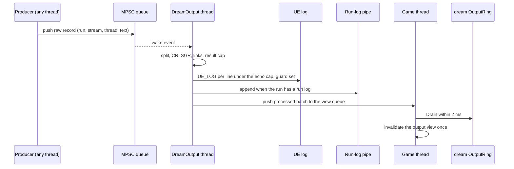

**Design: records.**
- `FDreamRawRecord` holds `{FDreamRunId RunId; uint8 Stream; uint8 Origin; uint16 Flags; uint32 NativeThreadId; double Time; TArray<UTF8CHAR> Text}`. `FDreamRunId` is the `uint64` of §12.1.2, so a stale ID from an earlier Python generation is never mistaken for a live one. Records from FDreamOutputDevice carry run ID 0 and only the native thread ID; ingest attributes them (§6.1).
- Origins are `Python`, `UnrealLog` (the shims), `LogPython` (captured by the device), `Dream` and `Agent`.
- The queue is `TQueue<FDreamRawRecord, EQueueMode::Mpsc>`. An atomic `QueuedBytes` tracks its size.

**Design: `dream::OutputRing`** (DreamCore, no UE types).
- **Text chunks.** Text is UTF-8 in 64 KB chunks (R05 §2.3). Chunks are append-only, sealed when full and shared as `std::shared_ptr<const Chunk>`. A `Snapshot` holds chunk references and a sequence range, so worker threads read without locks.
- **Line index.** A circular array of `LineMeta`, at most 40 bytes each. Fields: `Seq` (uint64, monotonic); `RunNumber` (uint32, the run's `#N` resolved at ingest; 0 = outside runs); `Type`; `Flags`; `ThreadTag`; `TimeMs`; chunk index and offset; text length; offset of the style spans; offset of the link spans. A row is found as `Seq − FirstSeq`, so lookup is O(1). `Echo` lines have no style or link spans, so their link-span field holds the buffer line number instead (proposed: keeps `LineMeta` at 40 bytes).
- **Line types** (D19): `Stdout`, `Stderr`, `Result`, `Notice` (runner notices), `Info`, `Warning`, `Error`, `Agent`, `Debugger`, `Logpoint`, `Evaluate`, `RunHeader`, `RunFooter`, `Echo` (input echo, OUT-12). The first eleven are the `STREAM_*` constants 1–11 in order (§6.1, §12.1.1); only C++ creates the two run-block types and `Echo`.
- **Flags:** `Background`, `Partial`, `Continued`, `Truncated`, `HasLinks`, `FromUnrealLog`, `FromLogPython`, `EchoFirst` (the first echo line of a statement), `EchoSplit` (a partial line committed before the next statement's echo, §6.1).
- **Style spans** come from SGR parsing, as run-length spans. Other ANSI escapes are stripped (R05 §2.3).
- **Link spans:** `{Start, Len, Kind (PythonFrame, PseudoFile, FileLine), Line, Col, PathOffset}`. The path text is stored in the chunk.
- **Caps.** Whichever comes first: `MaxLines` (default 200,000, D19) or `MaxBytes` (default 64 MB, OUT-04). Eviction drops the oldest sealed chunk and its index entries, and reports `(FirstEvicted, LastEvicted, RunIds)` to a listener.
- **Helpers** in the same component, each a pure function tested at tier 1: `ScanLinks(std::string_view, std::vector<LinkSpan>&)`, `ParseSgr(...)` and `SplitLines(...)`. `ScanLinks` uses a hand-written scanner, not `std::regex`. It recognises:
  - `File "<path>", line N` (Python frames, real paths and `<dream:...>` pseudo files);
  - `<path>(N)` and `<path>(N,C)` (Unreal and MSVC style).

**Design: run blocks.** A block belongs to a run number; the records in it carry run IDs.
- FDreamRunService (§5) calls `BeginRunBlock(RunNumber)` when a run enters `Starting`. A `not executed` run therefore still has a block (U7), although it never entered `_run`.
- Before each entry into `_run` (one per task step), it calls `BindRunId(Id, RunNumber)`. That pushes a zero-length bind record through the same queue, so the binding reaches the ingest thread before any record of that entry. Ingest maps each record's run ID to its run number through these bindings. An ID that was never bound, or that belongs to an earlier Python generation, is tagged run 0 and `Background`. Bindings are kept for the runs in the 500-record ring (RUN-12); later lines from older runs' threads get run 0.
- It calls `EndRunBlock(RunNumber)` after the run's last entry returns or the run is abandoned.
- `BeginRunBlock` and `EndRunBlock` push zero-length `RunHeader` and `RunFooter` records through the same queue. They are therefore ordered after every game-thread write that came before them.
- The view renders their text from `FDreamRunRecord` (§5), so the header updates in place when the outcome is known.
- FDreamOutputStore keeps `TMap<uint32 /*run number*/, FRunSpan{HeaderSeq, FooterSeq, LineCount, Bytes, RunLogPath, DroppedLines}>` and `TMap<FDreamRunId, uint32>` for the bindings.
- Background lines that arrive after a footer are appended at the end of the output. They carry a `↑ #22` link back to their run block.

**Design: input echo** (OUT-12, PO-02).
- **The call.** `_dream.run_statement(run_id, index, code, ns)` (§5.3.7) pushes statement `index`'s echo on the game thread inside the user-code window, after its Stop check and just before it evaluates the statement. The echo is C++ only and builds no Python string: it looks up the run's statement ranges from the prepare result (§5.3.2) and pushes one raw record per source line, read from the run's source snapshot, with type `Echo`, origin `Dream`, the buffer line number, and `EchoFirst` on the first line pushed. `run_statement` also sets the run record's started count to `index + 1` for the Location row (§5.4.7) and the ran-line marks (§4.8.2). An index outside the prepared range raises `ValueError`; a run that is not the active run raises `RuntimeError` and nothing is evaluated.
- **Each snapshot line once.** Statement k pushes lines max(first_line, last line echoed in this run + 1) through last_line, so a line that holds two statements, such as the REPL one-liner `import os; os.getcwd()`, is echoed once, and a statement that starts on a line already echoed pushes only its later lines, or none (proposed). So the history reads as the buffer did, and Copy as script copies each line once.
- **A selection that ends mid-line** is echoed only up to the selection's end column on its last line (kept in the run record), so the echo never shows text that did not run (proposed).
- **Source snapshot.** For buffer routes, the `TextSnapshot` that the request's text was cut from, which the journal snapshot step commits (§10.2.5), so the echo, the journal and the compiled text agree. For REPL and console runs, a snapshot of the submitted text, numbered from 1 like `<dream:REPL#N>`.
- **Order.** The records go through the same MPSC queue as the run's game-thread writes, so each statement's echo comes after every line of the statement before it and before every line the statement itself writes. A worker thread's lines interleave with them in push order. An unterminated line that statement k left open is committed before statement k+1's echo (§6.1).
- **What is echoed.** A statement's lines from its first decorator to its last line, including the blank and comment lines inside it. Blank and comment-only lines between statements belong to no statement and are not echoed (proposed). A bare string after the first statement is echoed though it does not run (§5.3.2).
- **Cost.** One push per line, about 1 µs (the producer budget above). A one-line statement's echo is inside the per-statement budget of §5.13.
- **Store and caps.** Echo lines are ordinary ring lines: the OUT-04 caps and eviction apply, and the store keeps every echo line. Folding is a view matter (§6.4).
- **Routes.** Only statement-mode routes echo, through `run_statement` (§5.2.1). Run File, Isolated, shelf, snippet, entry-point and task runs emit no echo lines; their header names the source and range.

**Design: run logs (spill)** (D19, D17, OUT-08).
- **Location:** `<root>\RunLogs\<session start>\run-<N>.log` (SPEC OUT-08; `<session start>` is the editor session's UTC start as `yyyymmdd-hhmmss`). It is never under `Saved/` (D17).
- **When a file is created.** By default every run that produces output gets a run log from its first line (SPEC OUT-08; `UDreamUserSettings::bAlwaysWriteRunLogs`, default on). A user or studio can turn the setting off. Then the ingest thread buffers each active run's lines in memory until one of these happens:
  - the run reaches 10,000 lines *(proposed)*;
  - the run has lasted 30 s *(proposed: J5 needs a log for long jobs)*;
  - the echo cap starts suppressing lines (§6.3);

  It then writes the buffer to a new file and streams every later line, including background lines, which reopen the file in append mode.
- **Runs without output** never get a file. With the setting off, small runs get none either; their echo is still in `Saved/Logs`.
- **Input echo in run logs** (OUT-12). Echo lines are written to the run log, so the file matches the view (OUT-08). Echo lines alone do not create a file: a run whose only lines are echo, such as `x = 1`, gets none, and a run's file starts with the echo lines held before its first other line (proposed: keeps one file per REPL assignment from appearing).
- **Format** (§12):
  - line 1 is `# dream-run-log 1`;
  - a header line names the run, route, source, namespace, UTC start time, engine version and plugin version;
  - each output line is `[hh:mm:ss.mmm] <type> [<thread>] <text>`, where type is one of `stdout`, `stderr`, `result`, `notice`, `info`, `warn`, `error`, `agent`, `debugger`, `logpoint` or `evaluate`;
  - each input echo line is `[hh:mm:ss.mmm] echo [<line>] <text>`, where `<line>` is the buffer line number, or `>>>` or `...` for REPL and console runs (proposed);
  - the file ends with `# end outcome=<o> duration=<s> lines=<n>`.
- **Back-pressure.** Pending pipe bytes are capped at 32 MB. Lines over the cap are written later as one gap line: "[N lines not written: disk too slow]".
- **Retention** follows D17 (30 days by default, studios can configure it). Run logs also have their own 1 GB-per-project cap, removing the oldest first. *Proposed: the D17 500 MB cap is sized for local history.*
- Run logs are excluded from the diagnostics bundle unless the user selects them (D26).

**Design: memory bounds.**

| Item | Bound | Source |
|---|---|---|
| Ring text | 64 MB or 200k lines, whichever first | D19, OUT-04 |
| Line index | 200k × ≤ 40 B ≈ 8 MB | Derived |
| Full-result blobs (§6.4) | ≤ 16 MB each and ≤ 64 MB in total, evicted with their run's lines | Proposed: a few large results without unbounded growth |
| MPSC queue | Hard cap 64 MB. Above it, new records are dropped and counted per (run, stream). Producers never block | Proposed |
| View queue (SPSC) | 200k lines or 64 MB pending. Above it, the ingest thread stops feeding the view for that run, still echoes and logs, and later adds "N lines not shown (the view could not keep up); full log: <path>". It forces a run log | Proposed |
| Per-run spill buffer | 10,000 lines or 4 MB | Proposed |
| Thread table | 1,024 entries, LRU | Proposed |

At the defaults the ring text and its line index come to about 72 MB. PERF-11 counts this full ring on top of the core's 50 MB plus 4.5 × the open text (§4.1.2, T-ENC-007).

**Design: eviction marker.** When lines are evicted, the view's first row becomes "▲ 1,204,551 earlier lines dropped (runs #1–#40). Large runs have logs in `<root>\RunLogs`; all Python output is also in the editor log." If a run's header was evicted but some of its lines remain, the view draws a synthetic header from the run record, followed by "(earlier lines dropped; full log: <path>)".

**Budgets** (all release gates, D22):
- ingest of 50k lines/s at ≤ 2 ms per frame of game-thread time. Because `Drain` stops at its budget, the 2 ms bound alone holds by construction, so the gate also requires that the view keeps up: over 60 s at 50k lines/s the view-queue backlog stays under 1 s of input and no "lines not shown" marker appears. This holds idle (per-frame drains, T-OUT-015) and during a run (per-pump drains at 10 Hz pumps, T-SUP-026);
- G2(3): at 1,000 lines/s, the view repaints at ≥ 10 Hz during a run;
- 10M lines over 8 h with memory growth ≤ 5% (D19, G2(7));
- scrolling 200k lines at 60 fps (PERF-09).

The `DreamOutput` thread exposes Insights counters (TEL-03): queue bytes, lines/s, drain ms, view-queue backlog, echo-suppressed lines and dropped lines.

**Interfaces.**

```cpp
namespace dream {
enum class LineType : uint8_t { Stdout = 1, Stderr, Result, Notice, Info, Warning, Error, Agent, Debugger, Logpoint, Evaluate,   // = STREAM_* 1..11
                                RunHeader, RunFooter, Echo };                                    // C++ only (Echo: OUT-12)
struct OutputRingConfig { uint32_t MaxLines = 200000; uint64_t MaxBytes = 64ull << 20; uint32_t ChunkBytes = 64u << 10; };
class OutputRing {
public:
  explicit OutputRing(const OutputRingConfig&);
  uint64_t Append(const LineMeta& Meta, std::string_view Utf8, std::span<const StyleSpan>, std::span<const LinkSpan>);
  bool GetLine(uint64_t Seq, LineView& Out) const;      // O(1)
  uint64_t FirstSeq() const; uint64_t EndSeq() const;
  Snapshot TakeSnapshot() const;                         // safe to read on any thread
  void ClearBefore(uint64_t Seq);
  void SetEvictionListener(std::function<void(const EvictionInfo&)>);
};
}
```

```cpp
class FDreamOutputStore {
public:
  void Push(FDreamRawRecord&& Record);                    // any thread
  int32 Drain(double BudgetSeconds);                     // game thread; returns lines moved
  void BeginRunBlock(uint32 RunNumber);  void EndRunBlock(uint32 RunNumber);   // game thread
  void BindRunId(FDreamRunId Id, uint32 RunNumber);       // game thread, before each entry into _run (§5)
  void Clear();                                          // game thread; see §6.4
  IDreamLineSource& GetLineSource();                      // §4.14
  FString GetRunLogPath(uint32 RunNumber) const;
  DECLARE_EVENT_OneParam(FDreamOutputStore, FOnLinesAppended, const FDreamAppendInfo&);
  FOnLinesAppended& OnLinesAppended();
};
```

### 6.3 FDreamLogForwarder and FDreamOutputDevice

**Responsibilities.** Echo our output to the Unreal log with the same category and verbosity users get today, without the per-line `GLog->Flush()` and never through `unreal.log` (E3). Catch Python output that bypasses our writers. Never echo a line twice.

**Design: forwarding rules.** FDreamLogForwarder runs on the `DreamOutput` thread. It calls `UE_LOGF` once per line, in bursts, and **never** calls `GLog->Flush()`.

| Source | Store type | Echoed to | Verbosity |
|---|---|---|---|
| `print`, `sys.stdout` | `stdout` | `LogPython` | Log |
| `sys.stderr` | `stderr` | `LogPython` | Error, as in stock (`unreal_core.py:59`). The UI still says **stderr** |
| `unreal.log` shim | `info` | `LogPython` | Log |
| `unreal.log_warning` shim, warnings | `warning` | `LogPython` | Warning |
| `unreal.log_error` shim | `error` | `LogPython` | Error |
| Runner traceback | `error` | `LogPython` | Error. Stock runs also log tracebacks at Error, line by line (`.../Private/PyUtil.cpp:1753-1777`) |
| Result | `result` | `LogPython` | Log, as `# Result: <repr>` after the 10,000-character cap |
| Console-executor input | — (sent by `Exec`, not from the store) | `LogPython` | Log, matching the stock executors (`.../Private/PythonScriptPlugin.cpp:441-452`). Echoed once, by `FDreamLogForwarder::EchoNow` with `GDreamForwarding` set (§6.6) |
| Input echo of statement-mode runs (OUT-12), console runs included | `echo` | Never forwarded: the Output Log stays the echo of output (D19). Written to the run log (§6.2) | — |
| Run header and footer summaries; Dream info lines (reload reports, notes) | header, footer, `info`, `warning` | `LogDream` | Log or Warning |
| Runner notices (notes the runner writes into the run block, §5) | `notice` | `LogDream` | Log |
| Debugger events and skip notices (§8.2, §8.4) | `debugger` | `LogDream` | Log |
| Logpoint messages (§8.2.3) | `logpoint` | `LogDream` | Log, as `<file>:<line>: <message>` |
| Evaluate-console input and results in the Paused window (§8.3) | `evaluate` | `LogDream` | Log |
| Agent lines (1.1) | `agent` | `LogDream` | Log |
| Lines captured by FDreamOutputDevice | `info`, `warning`, `error` | Never echoed (they are already in the log) | — |

**Design: fidelity rules for pipelines that parse `Saved/Logs`.**
1. Python output keeps category `LogPython` and the stock verbosity mapping, one log line per output line. A line that statement mode split at an echo boundary (`EchoSplit`, §6.1) is forwarded joined with the next line of its stream, so the Output Log does not depend on where statements begin.
2. Trailing `\r\n` is stripped. Whitespace-only lines are **not** echoed, because the stock `ShouldLog` drops them (`.../Private/PyCore.cpp:1158-1173`). They stay in our view (D19).
3. Order is preserved per thread. Relative to other categories, a line may move by up to the 5 ms ingest window.
4. Dream's own lines use `LogDream`, so `LogPython` parsers see only Python output.
5. **Echo cap** (default 5,000 lines/s, D19; policy key `output.echo_cap_lines_per_s`, §11.2.2; 0 means unlimited). FDreamLogForwarder counts lines in 1 s wall-clock windows. Above the cap in a window, lines are not echoed. At the end of the window it echoes one summary line: `LogPython: Warning: [Dream] Run #22: 48,000 lines not echoed in the last second (echo cap 5,000/s). Full output: <run log path>`. Suppression forces a run log, so the summary always names a real file. Pipelines that need every line set the cap to 0 by policy.

**Design: FDreamOutputDevice.**
- Registered with `GLog->AddOutputDevice` in `FDreamEditorModule::StartupModule`, and removed in `ShutdownModule`. It touches no Python, so it does not wait for `_dream`.
- `CanBeUsedOnMultipleThreads()` returns `true`. Devices like this are unbuffered and receive `Serialize` synchronously on the logging thread (`Engine/Source/Runtime/Core/Private/Misc/OutputDeviceRedirector.cpp:440-442, 904-907`, from 07a Q4). That is what makes a thread-local guard work.
- `Serialize(V, Verbosity, Category)`:
  1. return if `GDreamForwarding` (a `thread_local bool` that FDreamLogForwarder sets around its `UE_LOGF` calls);
  2. return unless `Category == LogPython`, or the category is in `UDreamUserSettings::RunLogCategories` while a run is active (default empty; OUT-01's "configurable categories");
  3. push a record with origin `LogPython`, type from verbosity (Log and Display become `info`, Warning becomes `warning`, Error and Fatal become `error`), and only the native thread ID. Attribution happens on the `DreamOutput` thread through `FDreamThreadTable` (§6.1).

  It never logs, takes no lock other than the lock-free push, and must cost ≤ 100 ns for a filtered-out line *(proposed: it sees every log line in the editor)*. Because it never reads `FDreamThreadTable`, a log emitted on a thread that holds the table's write lock cannot deadlock it.
- **What it catches.** Direct `_unreal_core.log*` calls, from pre-bound names or stale stock streams. Engine tracebacks from `LogPythonError`. LogPython output of foreign Python (Editor Utility Widgets, other plugins' callbacks) while idle, which is shown in an "Outside runs" block when `bCaptureLogPythonOutsideRuns` is set (default on, *proposed*).
- **Bypass counter.** If more than 10,000 captured `LogPython` lines arrive during one run *(proposed)*, the footer warns: "N lines reached LogPython through a pre-run `unreal.log` binding. The engine holds them in memory until the run ends (RT-07)."
- **Startup ring.** The device registers before Python initializes (PythonScriptPlugin initializes in `OnPostEngineInit` and runs startup scripts on the first core tick, 07a Q6). It keeps the first 2,000 LogPython lines *(proposed)* of the session in a startup ring. The environment doctor reads it for `init_unreal.py` failures (§9.5). If the ring holds Warning or Error lines, the view shows them in a collapsed "Editor startup" block.

**Design: crash flush.** On `FCoreDelegates::OnHandleSystemError` (`Engine/Source/Runtime/Core/Public/Misc/CoreDelegates.h:173`), the store signals `DreamOutput` to echo everything still queued, ignoring the cap. It flushes open run logs and waits at most 100 ms *(proposed)*. kill -9 runs no handler; the loss there is bounded by the 5 ms ingest window.

**Interfaces.**

```cpp
class FDreamLogForwarder {                       // DreamOutput thread only, except EchoNow
public:
  void Forward(TConstArrayView<FDreamForwardLine> Lines);   // one UE_LOGF per line, GDreamForwarding set
  static void EchoNow(const FDreamForwardLine& Line);       // any thread; one UE_LOGF with GDreamForwarding set (console input, §6.6)
  void SetEchoCap(int32 LinesPerSecond);                    // from settings and policy; 0 = unlimited
  void EmergencyFlush();
};
class FDreamOutputDevice final : public FOutputDevice {
public:
  virtual void Serialize(const TCHAR* V, ELogVerbosity::Type Verbosity, const FName& Category) override;
  virtual bool CanBeUsedOnMultipleThreads() const override { return true; }
  TArray<FDreamStartupLine> CopyStartupRing() const;        // §9.5 doctor
};
extern thread_local bool GDreamForwarding;
```

### 6.4 The output view

**Responsibilities.** Show the store as typed, coloured, collapsible run blocks, each statement's input echo followed by its output. Turn tracebacks into links. Offer the per-run actions. Stay at 60 fps over 200k lines.

**Design: the output area** (U25, WS-02, WS-03, RV-18, PO-01).
- **Layout.** `SDreamTab` stacks, top to bottom: the toolbar, the shelf bar (M4), and a centre column between the left side bar (Files, Snippets, Outline) and the right side bar (Variables, Watch, Environment), which span its full height. The centre column is a vertical `SSplitter` with two slots: the **output area** (`SDreamOutputArea`: the tab row Output · REPL · Problems, the tab body, then the REPL prompt strip directly below the body, §6.5) and the **code area** (editor tabs, breadcrumbs, cell headers, the task banner). By default the output area is the first slot, so the REPL prompt sits between the output and the code, like Maya's input under its history.
- **Split** (proposed): in a fresh profile the output area takes 40% of the centre column's height, and each slot keeps at least 120 px (`SSplitter::FSlot` `Value`, `MinSize` and `OnSlotResized`, `Engine/Source/Runtime/Slate/Public/Widgets/Layout/SSplitter.h:80-88`). `OnSlotResized` writes the fraction to the per-project session state (§11.1.1), so sizes persist (WS-02).
- **Position** (WS-03): the user setting `layout.output_position` (§11.1.2), `top` (default, Maya's layout) or `bottom` (the v1.1 arrangement, PyCharm style). **View ▸ Output Position ▸ Top / Bottom** and the palette commands **Move Output to Top** and **Move Output to Bottom** set it. SDreamTab then swaps the two slots at once, keeping each slot's size value, and the setting is saved with `SaveConfig()`, so it survives a restart. The commands have no default chord (proposed). The prompt strip stays directly below the output area's tab body in both positions (RV-18).
- **The Run window** opens exactly over this widget's cached geometry during a supervised run (§5.5.3).

**Design: widget.** The output view is an `SCodeView` in read-only line-source mode (§4.14), fed by `FDreamOutputLineSource : IDreamLineSource`.
- Line height is fixed, and soft wrap is off by default. A toggle turns on wrap with estimated heights (§4.14).
- Only visible rows are painted (D1).
- Find (Ctrl+F) uses `dream::SearchEngine` over a snapshot, off the game thread.

**Design: rendering by type.** Colour is never the only signal (A11Y-05).

| Type | Colour token | Gutter glyph | Badge |
|---|---|---|---|
| stdout | `Dream.Output.Stdout` | none | thread name for non-game threads |
| stderr | `Dream.Output.Stderr` (amber, not red) | none | `stderr` |
| result | `Dream.Output.Result` | none | the prefix `# Result: ` is drawn as decoration |
| info, warning, error | `Dream.Output.Info/Warning/Error` | none, ⚠, ✖ | `unreal.log` or `LogPython` by origin |
| notice | `Dream.Output.Notice` | none | `dream` |
| debugger | `Dream.Output.Debugger` | none | `debugger` |
| logpoint | `Dream.Output.Logpoint` | ◆, the logpoint glyph of §8.2.3 | `logpoint · <file>:<line>` |
| evaluate | `Dream.Output.Evaluate` | none | `evaluate`; the same lines also show in the Paused window's console |
| agent | `Dream.Output.Agent` | none | `agent:<name>` |
| echo (input echo, OUT-12) | `Dream.Output.Echo` | the buffer line number, then `›` (proposed); in REPL and console runs `>>> ` on a statement's first line and `... ` on the others, in place of the number | none |
| any with `Background` | dimmed | none | `background · from #22` |

**Design: header and footer.** Both are rendered from `FDreamRunRecord` (§5).

```text
▼ #22 · Untitled-3 · lines 12–20 · Session · 14:03:11                   running 4.1 s
▼ #22 · Untitled-3 · lines 12–20 · Session · 14:03:11                   ok · 0.42 s
  12 › actors = sel
  13 › for a in actors:
  14 ›     print(a.get_name())
Cube_01
Cube_02
  20 › len(actors)
# Result: 2
└ #22 ok · 0.42 s · undo: "Dream: Untitled-3 #22" (3 objects, 12 KB) · [Undo this run] [Re-run]
▼ #23 · REPL · Session · 14:04:02                                       ok · 0.01 s
>>> x = 41
>>> x + 1
# Result: 42
```

The two headers of #22 are the same line before and after the outcome is known. Lines 15–19 of #22 are blank or comments between statements, so they are not echoed (§6.2).

- **Header fields:** chevron; run number; route badge (`REPL`, `console`, `shelf: <name>`, `reload`, `entry point`, `task`, `agent:<name>` or `bridge:<client>` in 1.1); source and range; for an agent run (1.2), its submitted code, the first line plus "(+n lines)", which expands in place to the full code (proposed), because agent routes emit no echo lines (AI-03, OUT-12); namespace; start time. On the right: the live state (U2), then outcome and duration.
- **Transaction notes** (§5.9.2): one muted line directly under the header, with one clause per flag joined by " · " in this order: "changes to PIE objects are not undoable", "imports and reimports in this run are not undoable", "asset renames and moves in this run are not undoable". When §5.9.2 reset the undo buffer, the line ends " · undo history cleared". The flags are `FDreamTxnHandle::bPieObjects`, `bImported` and `bRenamed` in the run record's transaction info (§5.9.7), set by `EndRunTransaction`. For a task, a flag set by any step is set on the record.
- **REPL and console runs** do not repeat the submitted code in the header (PO-02): the run's echo lines, with `>>> ` and `... ` prompts, follow it (OUT-12). When none of a REPL or console run's echo lines is shown in a view, because Echo input is off, the preset is Minimal, they were evicted, or the run emitted none (a `not executed` submission such as a `SyntaxError`), that view's header shows the submitted code as v1.1 did, its first line plus "(+n lines)" (proposed), so the history never loses the input. Runs without statement mode (Run File, Isolated, shelf, snippet, entry point, task) emit no echo lines; their header names the source and range.
- **Clicking the chevron** collapses the block to its header. Collapse is view state, kept per run number.

| Footer field | Text | Source |
|---|---|---|
| Outcome (U2) | `ok`, `error <ExceptionType>`, `cancelled at <file>:<line>`, `not executed <reason>`, `lost` | Run record |
| Exit | `exited (code n)` when `SystemExit` ended the run (RUN-18) | Run record |
| Native time | "Stop took effect when the last native call returned (12.4 s)" (D2, U2) | Run record |
| Transaction (U3, RT-08) | `undo: "Dream: <tab> #N" (k objects, size)`; `partly undoable (recording stopped at 100% of the undo buffer)`; `no transaction (Run File)`; `not undoable` (status Cleared; the Transaction notes line gives the reason, §5.9.2); `undo unavailable: <reason>` (D8) | FDreamTransactions (§11) |
| Notes | Stream slots left in place (§6.1); threads still alive (D24); dropped lines and run-log path; the bypass counter (§6.3) | This section |
| **Actions** | **[Undo this run]** (U9), **[Inspect]** (§8), **[Re-run]**; **[Run in transaction]** when the run had none (RT-08) | Below |

- **Undo this run** (U9) is enabled when `FDreamTransactions::CanUndoLastRun(Record, OutReason, OutPreview)` (§5.9.7) holds: the run's transaction is on top of the undo stack and `GEditor->Trans` is still the standard buffer (D8). Otherwise the chip is disabled and its tooltip gives the reason. A Cleared run (§5.9.2) shows no chip. A partial record asks for confirmation first (RT-08). A task undoes "12 of 40 steps" (RT-09). Errors and cancels keep their transaction; there is no rollback (U9).
- **Inspect** opens the post-mortem inspector (§8, D3). It appears only on the most recent `error` or `cancelled` run whose frames are still retained. Frames are released at the next run, on a map change or when dismissed (D3).
- **Re-run** calls `FDreamRunService::Rerun(RunId)`. That submits the stored source snapshot with the same route options as a new run with a new number (RUN-12).

**Design: result lines** (D8).
- The autoprint hook (§5) sends the full `repr` with `_dream.write(STREAM_RESULT, ...)`.
- The ingest thread keeps the first 10,000 characters as the line text (flag `Truncated`) and stores the rest as a blob of at most 16 MB.
- The line ends with a chip: "… 1,204,551 more characters · [Show all] [Copy]".
- **Show all** expands the result in place, as continuation lines, when the full text is ≤ 1 MB. Larger results open in a read-only tab named "Result #22" *(proposed: keeps the ring small)*.
- Multi-line `repr`s are one result per line. Only the first line carries the prefix.
- Copy always yields the raw `repr` without the prefix.

**Design: traceback links.**

| Kind | Example | Click target |
|---|---|---|
| Real path | `File "D:\dev\studio_tools\importer.py", line 88` | Open or focus the file at line 88. The line is selected and the caret goes to the column if the frame has one |
| Pseudo file (D8) | `File "<dream:Untitled-3#a41f>", line 18` | Buffer a41f, even after a rename. The id is the first 4 hex digits of the buffer's `FGuid`, extended until it is unique among known buffers (RUN-06). A closed tab offers **Reopen tab**, or shows a disabled link with a tooltip |
| REPL or console input | `File "<dream:REPL#42>", line 1` | Scroll to run #42's echo lines (OUT-12) and highlight the echo line with that number. If those lines are hidden (Echo input off, Minimal) or evicted, scroll to run #42's header, which then shows the submitted code (proposed) |
| Unreal or MSVC style | `D:\x\y.py(88)` or `(88,5)` | Same as a real path |

- **Line mapping.** Links record the buffer version from the run's journal snapshot. A click maps the line through later edits with `dream::TextBuffer::MapLine(Version, Line)` (§4). When the version is gone, the raw number is used.
- **Missing file.** The link is greyed and the tooltip says the file no longer exists.
- Dream's own frames are hidden by the runner before formatting (D7).

**Design: the F4 / Shift+F4 walk** (U13). `FDreamCommands::NextError` and `PrevError` are bound only while a Dream widget has focus. F4 shadows the Level Editor's Show Actor Details there (§4.9.4, RV-19), and G5 checks it.
- The walk visits link spans on `error`, `stderr` and `warning` lines, in output order.
- When a run fails, the cursor moves to that run's header, so the next F4 lands on its first frame.
- Each step opens the target, highlights the output row and expands a collapsed block if needed.
- At either end the walk wraps, and the status bar says "Wrapped to the first error".
- With no links it says "No errors in output".
- F8 / Shift+F8 walk Problems instead (U13, §7).

**Design: filters** (OUT-03, OUT-06).
- **Toggles** (M1): one per type, plus `background`. Hiding Info hides only `info` lines. The toolbar's **Echo input** toggle (mockups 01, 03 and 06) is the `echo` type's toggle, the same switch; it is on by default and hides or shows only echo lines (OUT-12).
- **Run filter** (M2): "This run", "Last run" or "#N". It includes that run's background lines.
- **Source filter** (M2): by tab name.
- **Route filter:** fixed at route = `Repl` for the REPL tab's view (§6.5, RV-18); Output applies none.
- **Regex text box** (M2).
- **Presets** (M2):
  - Minimal hides `echo` and `info` lines and the footers of `ok` runs;
  - Normal is the default; it folds each statement's echo (below);
  - Echo All shows every echo line unfolded (OUT-03, PO-02).
- **Echo folding** (OUT-12; view only). In Normal, a statement's echo, its `EchoFirst` line and the echo lines after it, shows its first 6 lines (proposed) and then a chip "… 34 more lines" that expands in place. Expansion is view state kept per run number and statement, like a block's collapse. Until the presets land in M2 the view folds as Normal (proposed). The store keeps every echo line either way, and the Run window's live run view folds the same way, its chips expanding on a click there too (§5.5.3). **Expand Echo** and **Fold Echo** (context menu and palette, proposed) act on the statement at the caret or on every statement of the selected runs, and Enter on a chip line expands it, so folding never needs the mouse (A11Y-01).
- **Visible index.** Filters and collapsed blocks produce `FDreamVisibleIndex`, a sorted array of `[SeqBegin, SeqEnd)` ranges with prefix sums. Row-to-sequence lookup is O(log R).
- Type and run filters are applied incrementally on the game thread as lines drain.
- A regex filter runs on the filter worker over a snapshot. Its result swaps in atomically (R05 §2.3). New lines are matched in the next worker pass, at most every 100 ms *(proposed)*.
- Budget: a regex over 200k lines in ≤ 300 ms, off the game thread (OUT-06).

**Design: follow mode** (OUT-09). When the view is at the bottom, it follows new output. Otherwise it holds its position and shows a "↓ 3,421 new lines" chip.

**Design: Clear and its API.**
- Toolbar **Clear**, the context menu and `dream_editor.clear_output()` (D29, which calls `_dream.clear_output()`) all call `FDreamOutputStore::Clear()` on the game thread.
- A call from user code during a run is applied at the next drain.
- Clear calls `ClearBefore(EndSeq)` but keeps the active run's header, so its later output still has a home.
- Run logs, run records and history are not touched.
- Console command `Dream.ClearOutput` (API-03).

**Design: copy.**
- Ctrl+C copies the selection across chunk boundaries as raw text, without decorations.
- Context menu: **Copy run output**, **Copy traceback**, and **Copy as script** (OUT-10, M2). Copy as script copies a selection of echo lines, or the echo of the selected runs, as runnable Python: the echo text in order, folded lines included, dedented by the smallest indentation of its non-blank lines (proposed: `textwrap.dedent` rules, done in C++). Prompts and line numbers are decorations, so they are never copied. For a run with no echo lines (a route without statement mode) the item is disabled, with the tooltip "This run has no input echo" (proposed).

**Open items.** Whether to keep "Restore" after Clear: lines stay in the ring until evicted, so it is cheap.

### 6.5 The REPL

**Responsibilities.** One multi-line prompt strip in the output area (U25, RV-18, PO-01) that shares the Session namespace. Every submission is a numbered run (U8), echoed with Python console prompts (OUT-12). Persistent history.

**Design: widget.** `SDreamRepl` hosts one `SCodeView` in prompt mode (§4.14 contract): prompt glyphs `>>>` and `...` in the gutter, auto-height up to 12 lines and then scrolling *(proposed)*, the same highlighter, keymap and completion host as buffers (D1; REPL-03 via §7). The prompt text is journaled as the special buffer `repl-input` (§10), so a crash never loses it.

**Design: placement** (RV-18).
- There is **one prompt strip**. It sits below the output area's tab body (§6.4), so it stays put when the user switches between tabs. With the output area on top (the default, WS-03) the strip lies between the output and the code, like Maya's input under its history.
- It shows while the Output or REPL tab is active, and hides while Problems is active. The palette command **Focus REPL** reveals it, selecting the REPL tab when Problems is showing, and moves focus to the prompt.
- **Output** shows every run as a numbered block, REPL runs included.
- **The REPL tab** is a filtered view of the same `FDreamOutputStore`, with the route filter fixed at `Repl` (§6.4), plus the history list. It copies no lines.

**Design: keys.** These are `FDreamCommands` in the `DreamEditor` context, active only while the REPL has focus. All of them are in the G5 sweep.

| Key | Condition | Action |
|---|---|---|
| Enter | Completion popup open | Accept the completion (§7) |
| Enter | History popup open | Put the entry in the prompt without running it |
| Enter | Prompt empty | Nothing |
| Enter | Caret not on the last line | Newline and auto-indent |
| Enter | Caret on the last line | The completeness decision below |
| Shift+Enter | Always | Newline and auto-indent (D8) |
| Ctrl+Enter; Numpad Enter (Win64, if G7 passes) | Always | Submit, even if incomplete. An incomplete input ends `not executed` with its SyntaxError (RUN-16) |
| Up | Prompt empty | Open the history popup (D8) |
| Up | Prompt not empty | Move the caret up |
| Ctrl+Up | Always | Open the history popup, filtered by the prompt text (D8) |
| Ctrl+R | Always | History search popup, substring match (REPL-02, M2; in the G5 sweep) |
| Esc | A popup is open | Close the popup |
| Esc | Otherwise | Clear the prompt. Ctrl+Z restores it as a text undo |

**Design: completeness.** `codeop` needs Python. D14(5) allows helper calls only from idle FTSTicker callbacks, so a key handler never calls Python.

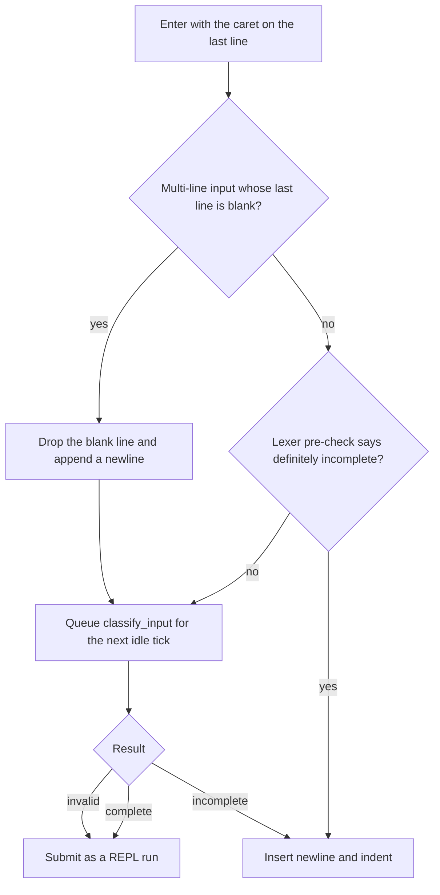

- **Lexer pre-check** (C++, `dream::PyLexer` end-of-text state). It returns "definitely incomplete" only for: an open bracket; an open triple-quoted string; a trailing backslash; a decorator line; or a last line that starts with an opening compound-statement keyword (`if`, `for`, `while`, `try`, `with`, `def`, `class`, `async`, `match`) and whose last token, ignoring a trailing comment, is `:`; continuation clauses (`elif`, `else`, `except`, `finally`, `case`) are left to `classify_input`, so a stray one is reported at once. "Definitely incomplete" can still be invalid when an earlier line has a syntax error; the error then shows when the input is run. It never returns "complete"; only `classify_input` does.
- **`_impl.runner.classify_input(source, last_logical_indented)`** returns `"complete"`, `"incomplete"` or `"invalid"`:
  - it returns `"incomplete"` when `source` does not end with a blank line and its last logical line starts with indentation. A blank Enter is what ends the source with a blank line: the flowchart drops the blank line and appends a newline, so the source then ends with `\n`. C++ computes `last_logical_indented` from `dream::PyLexer` line facts: the first physical line of the last logical line has `IndentCols > 0` (§4.3.3). So `x = [\n    1,\n    2]`, whose last logical line starts on the unindented `x = [`, needs no blank Enter;
  - otherwise it returns the result of `codeop.compile_command(source, "<dream:REPL>", "exec")`: `None` means incomplete; `SyntaxError`, `OverflowError` and `ValueError` mean invalid;
  - any other exception is treated as complete, and the run reports it;
  - **why the indentation rule:** on the engine's 3.11.8 interpreter, `"exec"` mode reports `for i in range(3):\n    print(i)` and `def f():\n pass` as complete, while `"single"` mode makes `x=1\ny=2` invalid. Neither mode alone gives REPL-01's "a blank Enter runs it". T-REPL-001 pins the rule on the engine interpreter.
- **Type-ahead.** While a decision is pending (one frame at most), key events are queued, up to 64 *(proposed)*, and replayed in order afterwards.

**Design: submission.**
- The REPL calls `FDreamRunService::Submit` with: route `Repl`; namespace Session; autoprint on, so statement mode (RUN-27); One undo step per run on (RT-08), titled `Dream: REPL #N` (U3); pseudo file `<dream:REPL#N>`.
- **Echo of submissions** (OUT-12, PO-02). Each top-level statement of the submission is echoed before its output, with `>>> ` on its first line and `... ` on the others, so Output and the REPL tab read like a Python console. The block's header does not repeat the input while its echo shows (§6.4).
- The run starts from `OnEndFrame` (RT-01).
- On acceptance, the prompt clears and the text moves into history (D8). This also happens for `not executed`, so Up recalls a mistyped block.
- When the run is refused, the text stays in the prompt.
- linecache entries for REPL inputs are kept for the last 500 runs (RUN-12).

**Design: REPL state by run state.**

| Run state (U2) | Prompt |
|---|---|
| `Idle` | Editable |
| `Starting`, `Running`, `Stopping…` | Read-only. The text is kept. The placeholder says "Run #N is active". Once the Run window opens, the editor keeps its last painted frame (RV-16), so the placeholder stays visible only in Live (docked) Preview |
| `Paused` | Input refused (U17, REPL-07). The editor is not drawn while the Paused window is open (RV-16), so the REPL keeps its last painted frame and cannot be clicked. The message moves to the Paused window's footer: "The REPL is suspended; use Evaluate" (§8.3.5) |
| `Task running` | Editable. Submit is refused with "Task #N is running. Stop it or wait." (D14(4)) |
| Python disabled or shut down | Read-only, under the D16 banner (§9.5) |

**Design: history** (REPL-02, D17).
- **File:** `<root>\Repl\history.jsonl`. Line 1 is a header: `{"format":"dream.repl-history","schema":1,"importedConsoleHistory":true}` (`schema` is the one JSON version key, §12.4). Each entry is `{"id":"<uuid>","t":<unix ms>,"src":"repl"|"console"|"ue-console","text":"..."}`. It is JSON only, never pickle (SEC-06).
- **Writes** are single-line appends on a `UE::Tasks::FPipe` ("DreamReplHistory"). On load, a torn last line fails to parse and is dropped.
- **Second instance** (§10.5). Only the primary appends to, compacts or clears `history.jsonl`. A secondary appends its entries to `journal/i-<pid>-<process_start>/repl-history.jsonl` in its own namespace, in the same format. Its popup shows the primary's file as loaded at its start plus its own entries. The next primary start merges that file into `history.jsonl`, deduplicating entries by `id`, before it deletes the namespace.
- **Cap** 10,000 entries *(proposed: the Output Log keeps 64, which is too few for a daily REPL)*. When the file holds twice the cap, the primary rewrites it to a temporary file and renames it into place, keeping the previous generation as `.1`.
- **Dedupe:** adding the same text as the newest entry is skipped. On load, the last occurrence of any repeated text wins.
- **Popup:** newest at the bottom. It shows each entry's first line plus "(+n lines)" and a `UE console` badge for imported entries. From M2, typing filters it by prefix, or by substring with Ctrl+R (REPL-02).
- History holds code, so it follows the journal privacy rules: local only, and excluded from the diagnostics bundle unless the user selects it (D17, D26). **Clear REPL history** is a palette command.
- **Read-only import from `ConsoleHistory.ini`** (D19). The first time history opens in a project whose Dream history has no import flag:
  - read `IConsoleManager::Get().GetConsoleHistory(TEXT("Python"), Out)` and `TEXT("PythonREPL")` (`Engine/Source/Runtime/Core/Public/HAL/IConsoleManager.h:1312`);
  - that call loads `FPaths::GeneratedConfigDir()/ConsoleHistory.ini`, sections `[ConsoleHistoryPython]` and `[ConsoleHistoryPythonREPL]` (`Engine/Source/Runtime/Core/Private/HAL/ConsoleManager.cpp:2632-2672, 3537-3542`; verified);
  - entries from the `Python` key that are only a `.py` path are skipped, because they are file runs, not code;
  - entries are tagged `ue-console`, and the flag is set;
  - Dream never calls `AddConsoleHistoryEntry` or writes that file. The engine rewrites the whole file on every entry (07e Q6).

**Interfaces.**

```cpp
class SDreamRepl : public SCompoundWidget {
public:
  void Submit(EDreamReplSubmit Mode);                 // Auto (Enter), Force (Ctrl+Enter)
  void OpenHistory(const FString& Filter, EDreamHistoryMatch Match);
};
class FDreamReplHistory {
public:
  void Add(const FString& Text, EDreamHistorySource Source);   // game thread; async append
  TArray<FDreamHistoryEntry> Query(const FString& Filter, EDreamHistoryMatch, int32 Max) const;
  void ImportConsoleHistoryOnce();
  void GetLatest(int32 Max, TArray<FString>& Out) const;      // for FDreamConsoleExecutor
};
```

```python
# dream_editor/_impl/runner.py
def classify_input(source: str, last_logical_indented: bool) -> str: ...   # "complete" | "incomplete" | "invalid"; never executes code
```

### 6.6 FDreamConsoleExecutor ("Python (Dream)")

**Responsibilities.** Give the Output Log console a Python executor that runs through our runner (D14), in the Session, with Stop, capture and one undo step per run, plus real completions (D19, UEI-08). It ships in M1 (D19).

**Design: lifecycle.**
- It is registered with `IModularFeatures::Get().RegisterModularFeature(IConsoleCommandExecutor::ModularFeatureName(), &Executor)` from FDreamPython's `OnPythonInitialized` handler.
- It is unregistered in `OnPythonShutdown`, and registered again after a re-enable (D16). This mirrors the stock executors (07a Q5).
- It is not registered when `UDreamProjectSettings::bRegisterConsoleExecutor` is false (default true; UEI-08 "disabled per project") or when policy sets `console_executor.enabled` to false. An invalid policy layer does not unregister it: as an editing aid, that key falls back to its default (RV-07, §11.2.2).
- Studios can also hide it with `FOutputLogModule::GetConsoleCommandExecutorPermissionList()` (`Engine/Source/Developer/OutputLog/Public/OutputLogModule.h:124`; filtered at `Engine/Source/Developer/OutputLog/Private/SOutputLog.cpp:57`). Nothing in Dream assumes it is visible.
- **It never becomes the preferred executor.** Dream never writes `[OutputLog] PreferredCommandExecutor`. Without a preference, `SConsoleInputBox` picks the first executor by display name (`SOutputLog.cpp:707-730`), and "Cmd" sorts before "Python (Dream)".

| Method | Behaviour |
|---|---|
| `GetName` | `"DreamEditor"` |
| `GetDisplayName` / `GetDescription` / `GetHintText` | "Python (Dream)" / "Run Python in the Dream session, with Stop and one undo step per run" / "Enter Python (Dream session)" |
| `Exec(Input)` | (1) If `FDreamRunService::CanSubmit(EDreamRunRoute::ConsoleExecutor, Reason)` fails, log `LogDream: Warning: Python (Dream): <reason>` and return `true`. (2) Add to `FDreamReplHistory` with source `console`. (3) Echo the input to `LogPython` at Log, as the stock executors do, through `FDreamLogForwarder::EchoNow` with `GDreamForwarding` set. FDreamOutputDevice skips it, so the input appears once in the Output Log. (4) Submit a run: Session, autoprint on, transaction on (RT-08), pseudo file `<dream:Console#N>`. (5) Return `true`. The run starts later from `OnEndFrame` (RT-01). `Exec` is called from `SConsoleInputBox::OnTextCommitted`, a Slate input handler (`SOutputLog.cpp:433-470`), where D14 forbids starting a run |
| `GetSuggestedCompletions(Input, Out)` | See below |
| `GetExecHistory(Out)` | `FDreamReplHistory::GetLatest(64, Out)`, oldest first. 64 matches the stock behaviour |
| `AllowHotKeyClose`, `AllowMultiLine` | `true`, `true` (stock parity; Shift+Enter adds a line) |
| `GetHotKey`, `GetIterateExecutorHotKey` | The active chords of `FGlobalEditorCommonCommands::OpenConsoleCommandBox` and `SelectNextConsoleExecutor`, as in stock |

**Design: completions.** The console box calls `GetSuggestedCompletions` synchronously from `OnTextChanged`, a Slate handler (`SOutputLog.cpp:376-426`). D14(5) forbids calling Python there, and RV-23 makes no exception: completion never calls Python from a Slate handler. So completions come from C++ caches.
1. `dream::PyLexer` extracts the dotted chain before the end of `Input` (base and partial name).
2. Call `FDreamLanguageServices::QueryLiveCompletionCached(Ctx, Items)` (§7).
   - **`unreal.*` chains** are served by `FUnrealNameIndex` (§7.5.3): the `unreal.` top level at once, and `unreal.X.` members from the class records it loads (RV-23).
   - **Session names** are served from the C++ cache that the idle slice after each run fills (step 5).
   - On a **hit**, filter by the partial name in C++ and return. Budget ≤ 1 ms of game-thread time on a hit *(proposed, inside D22's 5 ms)*.
   - On a **miss**, call `RequestLiveCompletion(Ctx)`. The D6 resolver serves it on the next idle FTSTicker callback, and the next keystroke gets results. If the Python state is `Cold`, the miss also calls `FDreamPython::RequestStart(EDreamStartReason::ConsoleCompletion)` (RT-17, §3.4), so completions start working with the Dream tab closed and before anything has been executed.
3. Each suggestion is `FConsoleSuggestion(Name = Input.Left(PartialStart) + Item.InsertText, Help = Item.Detail)`, capped at 100. Choosing a suggestion replaces the whole box text with `Name` (`SOutputLog.cpp:676`; verified), so `Name` must be the full line.
4. The box sorts again (prefix match first, then alphabetical; `SOutputLog.cpp:405-422`). Our ranking does not survive. This is documented.
5. **Prewarm** (RV-23). In the idle slice after each run, and once after the deferred start, an idle helper copies the Session's top-level names, plus the member lists of their types, into the C++ cache, and builtins once per Python generation. After a lookup with a single module or class match, its members are requested speculatively, so `unreal.EditorAssetLibrary.` is ready by the time `.` is typed.

**Interfaces.**

```cpp
class FDreamConsoleExecutor final : public IConsoleCommandExecutor {
public:
  static FName StaticName();                                  // "DreamEditor"
  virtual FName GetName() const override;
  virtual FText GetDisplayName() const override;
  virtual FText GetDescription() const override;
  virtual FText GetHintText() const override;
  virtual void GetSuggestedCompletions(const TCHAR* Input, TArray<FConsoleSuggestion>& Out) override;
  virtual void GetExecHistory(TArray<FString>& Out) override;
  virtual bool Exec(const TCHAR* Input) override;
  virtual bool AllowHotKeyClose() const override { return true; }
  virtual bool AllowMultiLine() const override { return true; }
  virtual FInputChord GetHotKey() const override;
  virtual FInputChord GetIterateExecutorHotKey() const override;
};
```

**Decided (RV-23, closes OI-61).** There is no exception to D14(5): no synchronous resolver call from a Slate handler, even when the full idle guard holds. The console box cannot be told to refresh its suggestions, so a base that neither `FUnrealNameIndex` nor the post-run cache holds still answers one keystroke late.

### 6.7 Failure modes

| Failure | Detection | Handling | What the user sees |
|---|---|---|---|
| User code replaces `sys.stdout` or a shim during a run | Identity check at restore | Leave it in place; record a note | Footer note naming the replacing type |
| A wrapper keeps our writer after the run | Write with an ended run ID | `Background` lines, attributed and echoed | Dimmed lines with `background · from #22` |
| `from unreal import log` bound before the run | Captured by FDreamOutputDevice with origin `LogPython` | Shown; the bypass counter runs | Lines tagged `LogPython`; footer warning above 10,000 |
| Echo loop (our echo captured by our device) | `GDreamForwarding` is set on the logging thread | The device ignores the line | Nothing; test T-OUT-021 |
| A flood above ingest capacity | `QueuedBytes` above 64 MB; the view queue above its cap | Drop with counters; force the run log; the view stops for that run | "N lines not shown; full log: <path>" |
| The game thread is stuck in a native call | No drain | Echo and run logs continue on `DreamOutput` | The view catches up at the next pump; `Saved/Logs` is current |
| A run-log write fails (disk full, ACL) | I/O error on the pipe | The run continues; that run's log is abandoned | Footer: "Run log could not be written: <error>"; the doctor flags the folder (§9.5) |
| Giant `repr` or line | Over 10,000 characters, 64 KB or 16 MB | Truncate, continuation records, blob cap | Expander chip; "result truncated at 16 MB" |
| Lone surrogates or invalid UTF-8 | Encode error | U+FFFD | Replacement characters |
| Python shut down during a run (`ForceDisablePythonAtRuntime` called by user code) | `OnPythonShutdown` (D16) | Writers are invalidated and C++ drops its `PyObject`s; the run ends abandoned | Footer: "Python was shut down during the run" |
| Editor crash with lines still queued | `OnHandleSystemError` | Emergency flush to the log and run logs, waiting at most 100 ms | The lines are in `Saved/Logs` |
| `codeop` classification raises something unexpected | Exception in `classify_input` | Treated as complete | The run shows the error |
| History file corrupt | JSON parse error past line 1 | Rename to `history.jsonl.corrupt`; start empty | Toast: "REPL history was unreadable and has been set aside" |
| `ConsoleHistory.ini` missing | Empty `GetConsoleHistory` | Nothing imported; the flag is set | Nothing |
| Executor `Exec` during a task or run | `CanSubmit` fails | Refused, with a log line | "Python (Dream): Task #N is running" in the Output Log |
| Executor hidden by the permission list | Not in the box's list | None needed | The Dream REPL is unaffected |
| Link target gone | Stat fails, or the buffer ID is unknown | Disabled link, or **Reopen tab** | Tooltip with the reason |
| `clear_output()` called mid-run | Called from user code | Applied at the next drain; the active header is kept | Output clears; the run block continues |
| A very long statement is echoed (a 50,000-line literal) | Echo line count | Pushed like any lines; the OUT-04 caps apply; Normal folds it after 6 lines | The first 6 lines and a "… 49,994 more lines" chip |
| Input echo forwarded to `LogPython` (regression) | T-OUT-044 | Release blocked; the forwarder skips the `echo` type | — |
| A `<dream:REPL#N>` link whose echo lines are hidden or evicted | Visible-index lookup | Scroll to the run's header instead (§6.4) | The header of #N is highlighted |

### 6.8 Tests

| ID | Tier | What it checks | Pass criterion | Covers | Lands |
|---|---|---|---|---|---|
| T-OUT-001 | 1 | `OutputRing` caps and eviction | At 200,000 lines or 64 MB (whichever first), the oldest chunk is evicted; `FirstSeq` advances; the listener reports exact ranges and run IDs | OUT-04, D19 | M1 |
| T-OUT-002 | 1 | `SplitLines`: `\n`, `\r\n`, lone `\r`, empty lines, partial lines, 16 KB commit, 64 KB continuation; `print('x\r')` (`"x\r"` then `"\n"`), CRLF split across two writes, a CR at the end of a run's last write | Golden corpus of 500 cases matches exactly; `print('x\r')` and the split CRLF each give one line `x`; the held CR at run end commits its text as a line | D19, OUT-01 | M1 |
| T-OUT-003 | 1 | `ParseSgr`: SGR becomes spans; other escapes are stripped | Golden corpus matches; no escape bytes in stored text | OUT-03 | M2 |
| T-OUT-004 | 1 | `ScanLinks` for Python frames, `<dream:...>`, `path(N)` and `path(N,C)` | 100% recall on 300 positive cases; 0 false positives on 10,000 lines of normal output | OUT-05, RUN-06 | M1 |
| T-OUT-005 | 1 | Snapshot reads while appends continue | 1M appends with 4 reader threads; TSan clean; readers see consistent lines | OUT-06 | M2 |
| T-OUT-006 | 1 | `FDreamVisibleIndex` with type filters and collapsed blocks | Row-to-sequence mapping matches a brute-force model over 100k random operations | OUT-02, OUT-03 | M1 |
| T-OUT-007 | 1 | Regex filter speed | 200k lines in ≤ 300 ms on the reference agent | OUT-06 | M2 |
| T-OUT-008 | 2 | `StreamSwap` compare-and-restore for all 7 slots on ok, error, cancel and `SystemExit` | Every slot is restored; a user-replaced slot is left with a note; a deleted `unreal.log` is restored | D19, D25, RT-07, RT-06 | M1 |
| T-OUT-009 | 2 | Log shims | `str()` conversion; whitespace-only text dropped; verbosity mapping; `__name__` preserved; originals back after the run; a pre-bound `log` bypasses (documented case) | RT-07 | M1 |
| T-OUT-010 | 2 | `showwarning` swap | A warning during a run becomes a `warning` line; `file=` is honoured; the stock hook is back afterwards | D19 | M1 |
| T-OUT-011 | 3 | `_dream.Writer` protocol | `write` returns `len`; non-`str` raises `TypeError`; `buffer.write(bytes)`; `isatty` false; `fileno` raises; surrogates become U+FFFD | D19 | M1 |
| T-OUT-012 | 3 | Thread attribution | A thread from run 5 writing during run 7 is tagged 5 and `Background`; a pre-existing thread is tagged 0; names are captured; game-thread writes get the current run; the footer lists the run's threads still alive at its end | D24 | M1 |
| T-OUT-013 | 3 | Run-ID guard and stream argument | An unknown run ID is tagged 0; a run ID from an earlier Python generation is tagged 0 and `Background`; `write(12, ...)` (no such constant) raises `ValueError`; `write("stdout", ...)` raises `TypeError`; headers come only from C++; `STREAM_AGENT` is refused outside agent and bridge routes; two run IDs bound to one run number with `BindRunId` (as a task's steps are, §6.2) land in one run block | D7, D19 | M1 |
| T-OUT-014 | 3 | Producer throughput and caps | 8 threads plus the game thread at 50k lines/s for 60 s: zero loss under the caps; with the ingest thread paused, drop counters and a marker | D19, OUT-04 | M1 |
| T-OUT-015 | 4 | Game-thread drain cost at 50k lines/s, idle, for 60 s | Drain ≤ 2 ms per frame at p99 in an Insights capture; over the 60 s the view-queue backlog stays under 1 s of input and no "lines not shown" marker appears | D22, PERF-09, OUT-04 | M1 |
| T-OUT-016 | 4 | G2(3): a 60 s run at 1,000 lines/s, once with `print` and once with `unreal.log` | View repaint ≥ 10 Hz; `LogOutput` holds ≤ 100 entries when the run returns | G2(3), RT-07, E3 | M1 |
| T-OUT-017 | 4 | G2(7): 8-hour soak, 10M mixed lines (print, `unreal.log`, workers) | Memory growth ≤ 5% | G2(7), REL-04, D19, PERF-17 | M1 |
| T-OUT-018 | 4 | Echo fidelity against stock | Same script, stock exec versus a Dream run: the (verbosity, text) sequence of `LogPython` lines in the editor log is equal, excluding whitespace-only lines; empty lines appear in our view | D19 | M1 |
| T-OUT-019 | 4 | No per-line `GLog->Flush()` | A probe device counts `Flush` calls caused by a 10k-line Dream run: 0 (stock: ≥ 10,000) | D19, 07a Q4 | M1 |
| T-OUT-020 | 4 | Echo cap | 20k lines/s for 5 s: ≤ 5,000 echoed per window, plus one summary naming an existing run log that holds all 100k lines; with cap 0, all lines are echoed | D19, OUT-01 | M1 |
| T-OUT-021 | 4 | FDreamOutputDevice capture and guard | A pre-bound `log`, a `logging.StreamHandler` made before the run, and an engine traceback are captured and attributed; none of our echoed lines appear twice; idle LogPython output from a foreign tool lands in the "Outside runs" block; 10,001 bypass lines in one run give the footer warning; a `Python (Dream)` console input appears once in the editor log and not as an "Outside runs" line; a `UE_LOG` emitted on a thread while it holds the `FDreamThreadTable` write lock (a test hook) returns and the line is captured, with no deadlock | D19, RT-07, UEI-08 | M1 |
| T-OUT-022 | 4 | Device cost | 1M non-LogPython lines from 4 threads: added cost ≤ 100 ns per line | D19, D22 | M1 |
| T-OUT-023 | 4 | Run-log creation | with the default setting a run with one output line makes a file at `<root>\RunLogs` and a run with no output makes none; with the setting off, 10,001 lines make a file with every line and 9,999 make none; the eviction marker names the folder; a run whose header was evicted gets a synthetic header; a throttled disk produces one gap line instead of blocking | OUT-04, OUT-08, D17 | M1 |
| T-OUT-024 | 4 | Header and footer text for every outcome and transaction state | Golden text for ok, error, cancelled, not executed, lost, exit code 3, partly undoable, no transaction and unavailable; the header updates in place | OUT-02, U2, U3, RT-08, RUN-18 | M1 |
| T-OUT-025 | 4 | Footer actions | Undo this run is enabled only when the run is on top; Inspect appears only on the latest failed run; Re-run submits a new run with the same snapshot | U9, RUN-12, D3 | M2 |
| T-OUT-026 | 4 | Result truncation and expander | A 25,000-character `repr` shows 10,000 characters and a chip; Show all reveals the rest; copy returns the raw `repr` without the prefix; a 20 MB `repr` is capped at 16 MB with a note; Show all on a result over 1 MB opens a read-only tab | D8, RUN-08 | M1 |
| T-OUT-027 | 4 | Link clicks | A real path opens at its line; `<dream:Untitled-3#a41f>` opens buffer a41f after a rename; the line maps through 5 edits made after the run | OUT-05, RUN-06 | M1 |
| T-OUT-028 | 4 | F4 / Shift+F4 | Order matches the golden list; after a failure the first F4 lands on that run's first frame; wrap message; the chord is consumed in the Level Editor | U13, OUT-05, G5 | M1 |
| T-OUT-029 | 4 | Filters and presets | Hiding Info hides only info lines; a run filter includes that run's background lines; Minimal hides echo and info lines and ok footers; Echo All shows every echo line unfolded | OUT-03, OUT-06 | M2 |
| T-OUT-030 | 4 | Follow mode | After scrolling up during a flood, the viewport holds and shows "↓ n new lines" | OUT-09 | M1 |
| T-OUT-031 | 4 | Clear from toolbar, menu and API | All three clear; a mid-run `clear_output()` keeps the active header; run logs are untouched | OUT-07, D29 | M1 |
| T-OUT-032 | 4 | Copy and Copy as script | A selection across a chunk boundary is copied exactly; five REPL runs give five lines of runnable code | OUT-10 | M2 |
| T-OUT-033 | 4 | `\r` progress line | A tqdm loop shows one updating line; one final line is echoed | D19 | M1 |
| T-OUT-034 | 4 | Python shut down during a run | `ForceDisablePythonAtRuntime` from user code: no crash, no leaked `PyObject`s (refcount audit), footer note | D16 | M1 |
| T-OUT-035 | 5 | Headless degrade | Under `-run=PythonScript`, `dream_editor.clear_output()` is a no-op without `_dream`, and the stock streams are untouched | D16, D29 | M1 |
| T-OUT-036 | 6 | Crash flush | A forced fatal error inside a native call right after 100 prints: all 100 lines are in the editor log and the run log | D19, D26 | M1 |
| T-OUT-037 | 4 | Startup ring | A fixture `init_unreal.py` that logs a warning and raises: the ring holds both lines; the view shows a collapsed "Editor startup" block; with no warnings or errors there is no block | D19, U36 | M1 |
| T-OUT-038 | 4 | Extra run categories | With `RunLogCategories = [LogEditorScripting]`, those lines are captured during a run and ignored while idle; with the default (empty), they are never captured | OUT-01 | M1 |
| T-OUT-039 | 4 | Game thread stalled in a native call | A run prints from a worker thread during a 10 s native sleep: `Saved/Logs` and the run log receive the lines within 100 ms; the view catches up at the next pump; over the view-queue cap, the "N lines not shown" marker appears and the run log is complete | D19, D24 | M1 |
| T-OUT-040 | 4 | Type rendering and echo of every line type | Golden paint: stderr uses the stderr colour and a `stderr` badge, never the error colour; warning and error lines carry ⚠ and ✖ glyphs; background lines are dimmed with their origin badge; `notice`, `debugger`, `logpoint` and `evaluate` lines carry their §6.4 badges and are echoed once to `LogDream`, never to `LogPython` | D19, A11Y-05 | M1 |
| T-OUT-041 | 4 | Input echo order: a three-statement selection whose statement 2 prints; a buffer with a decorated function, a `for` loop and comment lines between statements; a statement whose worker thread prints after it returns; the line `import os; os.getcwd()`; a selection of `a = 1; b = 2` that ends after `a = 1;`; a statement that does `print('a', end='')` followed by one that prints `b`, with Echo input on and then off | Echo 1, echo 2, the printed line, echo 3, in that order; each echo line has its buffer line number and `›` in the `Dream.Output.Echo` colour; the decorator lines are echoed with their function; comment lines between statements are not echoed; the worker line follows the echo of its statement; the shared line is echoed once, followed by the result; the mid-line selection echoes `a = 1;` only; `a` is committed above the second statement's echo and `b` below it, and with Echo input off they are drawn as one line `ab` | OUT-12, A11Y-05 | M1 |
| T-OUT-042 | 4 | Echo folding: a 40-line statement in Normal, then expanded with a click; then, with the keyboard only, Expand Echo and Fold Echo from the palette and from the context menu on the statement at the caret and on two selected runs, and Enter on a chip line; (from M2) Echo All and Minimal | Normal shows the first 6 lines and "… 34 more lines", and the chip expands in place and stays expanded after scrolling; Expand Echo expands, and Fold Echo folds back, the caret's statement or every statement of the two selected runs; Enter on a chip line expands that statement; the keyboard steps send no mouse event (A11Y-01); the store holds all 40 lines; (from M2) Echo All shows all 40 unfolded and Minimal shows none | OUT-12, OUT-03, A11Y-01 | M1 (M2: Echo All and Minimal) |
| T-OUT-043 | 4 | Echo input toggle on the toolbar and the `echo` type toggle, set before a run and after it; during a Run-window run, `dream_editor.suppress(echo=True)` (hides) and later `suppress(echo=False)` (shows) called by the run itself (§12.2), the only way to change it then, because the toolbar is neither drawn nor clickable (RV-16) | On by default; turning either off hides only echo lines and turns the other off; `suppress(echo=True)` turns Echo input off and returns `{'echo': False, ...}` (the previous state, same polarity: not suppressed); the live run view opens with the setting in force and follows each `suppress` call at the next pump; turning it on again restores the same rows | OUT-12, OUT-03 | M1 |
| T-OUT-044 | 4 | Input echo and the logs: a statement-mode run that prints one line; the same input through the `Python (Dream)` console; a REPL run `x = 1`; a statement that does `print('Working...', end='')` followed by one that does `print(' done')`, then the same two lines through one `exec` (Run File) | The Output Log and `Saved/Logs` get the printed line and no echo line; for the split print they get one `LogPython` line `Working... done` in both routes, while the statement-mode run log holds `Working...`, the second statement's echo and ` done`, as the view shows them; the console input appears once in the Output Log (from `EchoNow`) and as echo lines in Dream's view; the run log holds the echo lines as `echo [<line>]` before the printed line, so it matches the view; the `x = 1` run, whose only lines are echo, makes no run log | OUT-12, OUT-08, D19, UEI-08 | M1 |
| T-OUT-045 | 4 | `_dream.run_statement` echo contract: an unknown run ID; an index past the prepared range; a 3-line statement; a REPL run; text typed into the buffer while the run waits in `Starting` for its journal commit (held by a hung `FileOps` as in T-PER-015, released by the driver within 2 s) | `RuntimeError` and nothing evaluated; `ValueError`; three records with `EchoFirst` on the first, line numbers from the prepared range and no Python object allocated (allocation probe); REPL lines numbered from 1; the echo shows the compiled text, not the later typing | OUT-12, D7 | M1 |
| T-OUT-046 | 4 | Copy as script from echo: five REPL runs selected; the echo lines of an indented selection run; a folded 40-line echo; the REPL line `x += 1; print(x)`; a Run File run | Five lines of runnable code; the `;` line copies as one line, so pasting it runs it once; the indented echo copies dedented, with no `>>> `, `›` or line number; the folded statement copies all 40 lines; the item is disabled for the Run File run with its tooltip | OUT-10, OUT-12 | M2 |
| T-REPL-001 | 2 | `classify_input` on the engine's 3.11.8 interpreter, with `last_logical_indented` from the lexer facts | Golden results: `for i in x:` incomplete; `x = (1,` incomplete; `@dec` incomplete; `def f():\n pass` incomplete; the same with a trailing `\n` complete; `for i in range(3):\n    print(i)` incomplete; the same plus `\n` complete; `x = [\n    1,\n    2]` complete; `x=1\ny=2` complete; `lambda:` invalid; `else:` invalid; `if x:\n    pass\nelse:` incomplete; `x = (1 2,` invalid; `if x: pass  # note:` complete | REPL-01, D8 | M1 |
| T-REPL-002 | 1 | Lexer pre-check against `classify_input`; the generator includes trailing comments that contain `:` | On 100k generated inputs, no input the pre-check calls "definitely incomplete" is `complete` in `classify_input` (0 such inputs; each is `incomplete` or `invalid`, with golden results recorded on the engine interpreter); it never returns complete | D8, REPL-01 | M1 |
| T-REPL-003 | 4 | Enter, Shift+Enter, Ctrl+Enter, Enter mid-input, Esc, type-ahead | Each case matches the §6.5 table; Esc clears and Ctrl+Z restores; 20 keys typed right after Enter land in order | REPL-01, D8, G5 | M1 |
| T-REPL-004 | 4 | A submission is a run | Number `#N`, Session, `# Result:`, transaction `Dream: REPL #N`; the prompt is cleared into history, a `not executed` input included; a refused submission keeps its text; viewport Ctrl+Z undoes `set_actor_location` | U8, REPL-06, RUN-07, U3 | M1 |
| T-REPL-005 | 4 | History popup | Up on an empty prompt opens it; Up with text moves the caret; Ctrl+Up filters; Enter fills the prompt without running; Esc closes | REPL-02, D8 | M1 |
| T-REPL-006 | 4 | Ctrl+R search and Clear REPL history | Ctrl+R finds an entry written in a previous editor session; Clear REPL history empties the popup and the file | REPL-02 | M2 |
| T-REPL-007 | 6 | History durability | kill -9 at random points during 1,000 appends: the file always loads, losing at most the torn last entry; cap and dedupe hold; compaction is atomic | REPL-02, D17, G6 | M1 |
| T-REPL-008 | 4 | `ConsoleHistory.ini` import | A fixture with both sections is imported once with badges; the file's SHA-256 is unchanged after the import and after 100 submissions | D19 | M1 |
| T-REPL-009 | 4 | Suspension states | Paused (G4 fixture): REPL input is refused and the Paused window's footer says "The REPL is suspended; use Evaluate"; after Continue the REPL accepts input; Task running refuses with a reason; Python disabled shows the banner; the text is kept | U17, U10, D16, D14, REPL-07 | M3 |
| T-REPL-010 | 4 | Executor registration | Listed as "Python (Dream)" after Python init; not active unless chosen; `PreferredCommandExecutor` unchanged; gone on shutdown; back after re-enable | UEI-08, D19, D16 | M1 |
| T-REPL-011 | 4 | Hiding the executor | A permission-list deny on `DreamEditor` hides it; with the project setting off, or (from M4) a policy that forbids it, it is never registered | UEI-08, D20 | M1 (M4: policy case) |
| T-REPL-012 | 4 | Executor `Exec` | `x = 41` then `x + 1` gives two run numbers and `# Result: 42` in our view and the Output Log; each input is echoed once to `LogPython`; `Exec` returns before `_run` starts; (from M3) refused during a task | UEI-08, D14, RT-01 | M1 (M3: task refusal) |
| T-REPL-013 | 4 | Executor completions | `unreal.EditorAss` suggests `unreal.EditorAssetLibrary` in ≤ 1 ms on a hit; after a miss, the next keystroke has results; `Name` is the full line; after `unreal.EditorAssetLibrary` resolves, typing `.` hits the cache (speculative prefetch); with the Dream tab closed and Python `Cold`, the miss calls `RequestStart` and the second keystroke after `unreal.EditorAss` has results; after a run binds `my_tool`, `my_tool.` completes on the first keystroke; a probe counts 0 Python calls from `GetSuggestedCompletions` | UEI-08, D6, ENV-06 | M1 |
| T-REPL-014 | 4 | Executor history | `GetExecHistory` returns the latest 64 Dream entries; `ConsoleHistory.ini` is not written | D19 | M1 |
| T-REPL-015 | 4 | Numpad Enter in the REPL | Forces submit when G7 passes; never acts as main Enter | G7 | M1 |
| T-REPL-016 | 6 | The unsent prompt survives a crash | kill -9 with 3 lines in the prompt: after restart the `repl-input` journal restores the text | D17, G6 | M1 |
| T-REPL-017 | 4 | Prompt strip and REPL tab (RV-18): switch the output area between Output, REPL and Problems; run Focus REPL from Problems; submit one REPL run and one buffer run | The single strip shows under Output and REPL and is hidden under Problems; Focus REPL selects the REPL tab and focuses the prompt; Output shows both runs as numbered blocks; the REPL tab shows only the REPL run, from the same store lines, plus the history list | REPL-01, WS-02, U25 | M1 |
| T-REPL-018 | 4 | REPL echo: submit `x = 41`; then submit the three lines `def f():`, `    return 1 / 0`, `f()` as run #N; click its traceback link `File "<dream:REPL#N>", line 2`; turn Echo input off and click again; submit `import os; os.getcwd()`; submit the three lines `y = (1,`, `     2,` and `print(y` (a `SyntaxError`) | Each statement's echo shows `>>> ` on its first line and `... ` on the others, in Output and in the REPL tab; no header repeats the submitted code while its echo shows; the link scrolls to run #N's echo and highlights its line 2; with echo hidden, run #N's header shows `def f():` and "(+2 lines)" and the link scrolls to it; the `;` line is echoed once; the `SyntaxError` submission ends `not executed` with no echo, and its header shows `y = (1,` and "(+2 lines)" | OUT-12, OUT-05, REPL-01 | M1 |

---

## 7. Language intelligence

This section covers everything that understands code:
- the out-of-process language servers and their transport;
- our own checker `dream-check`;
- the `unreal` stub pipeline;
- the in-process live resolver;
- completion merging, hover and signatures;
- diagnostics and quick fixes;
- navigation.

It implements D4, D5 and D6, as amended by RT-01, RT-12, RT-13 and RT-17, plus the rulings U4, U5, U13, U22 and U23 and the review rulings RV-11, RV-12, RV-21 and RV-23 (08 §9).

**Terms.**

| Term | Meaning |
|---|---|
| Type server | The one supported LSP server for inference, completion, hover, definition and type diagnostics: the G3 winner, Pyrefly provisionally (RT-12) |
| Static / live result | From a language server / from the resolver (§7.5), which reads real objects in the editor without running code |
| Snapshot | Stage 1 of the stub pipeline: JSON describing every wrapped `unreal` type (§7.4.2) |
| Generation | Counter that `FDreamRunService` increments at every run end, Reset session and Python restart (§3). Live caches are keyed by it |
| Idle | Game thread, in a Dream FTSTicker callback, with `FDreamRunService::IsRunActive()` false and no modal window open |
| Document version | The `uint64` version of a `dream::TextBuffer`, incremented on every edit (§4) |

**Engine facts verified for this section** (local UE 5.8 install; `PSP/` = `Engine/Plugins/Experimental/PythonScriptPlugin/Source/PythonScriptPlugin/`):

| # | Fact | Evidence |
|---|---|---|
| N1 | `get_editor_property` on an object property pythonizes through `LoadObjectPropertyValue`. For a **soft** object or class property, that calls `LoadSynchronous()`, so the read **loads the asset**. Hard references return the pointer | `PSP/Private/PyConversion.cpp:1142-1145`; `Engine/Source/Runtime/CoreUObject/Private/UObject/PropertySoftObjectPtr.cpp:254-257`; default at `Engine/Source/Runtime/CoreUObject/Public/UObject/UnrealType.h:2879-2882` |
| N2 | Attribute assignment uses notify mode `Never` and the runtime read-only flags (`CPF_EditConst` or `CPF_BlueprintReadOnly`). `set_editor_property` uses notify mode `Default` and only `CPF_EditConst` | `PSP/Private/PyWrapperObject.h:52`; `PSP/Private/PyWrapperObject.cpp:432-439, 878, 906`; `Engine/Source/Runtime/CoreUObject/Public/UObject/PropertyAccessUtil.h:101, 104` |
| N3 | Script constants are `constant_value` descriptors whose `__get__` calls the constant getter. Their `__doc__` and `__name__` are separate, side-effect-free slots. Enum entries are `_EnumEntry` descriptors. UFunctions are `methodwithclosure_descriptor` or `classmethodwithclosure_descriptor` | `PSP/Private/PyConstant.cpp:121-123, 158, 165`; `PSP/Private/PyWrapperEnum.cpp:582, 589`; `PSP/Private/PyMethodWithClosure.cpp:479, 604, 709` |
| N4 | On Unix, `CreateProc` uses `posix_spawnp`, so there is no pre-exec hook. The engine avoids fork paths because `atfork` handlers crash glibc. The binary `WritePipe` can write short | `Engine/Source/Runtime/Core/Private/Unix/UnixPlatformProcess.cpp:1043-1121` (comment at `:1111-1113`), `:666-684` |
| N5 | `UObject::ProcessEvent` calls `FBlueprintContextTracker::EnterScriptContext`, which broadcasts the static `OnEnterScriptContext` on the game thread. This happens under `DO_BLUEPRINT_GUARD`, which is 1 in every editor build | `Engine/Source/Runtime/CoreUObject/Private/UObject/ScriptCore.cpp:2122-2125, 322-330`; `Engine/Source/Runtime/CoreUObject/Public/UObject/Script.h:519-521`; `Engine/Source/Runtime/Core/Public/Misc/CoreMisc.h:338-344` |
| N6 | `_unreal_<m>` names are the lower-cased C++ module name, after mapping CoreUObject→core, SlateCore→slate, UnrealEd→editor and PythonScriptPlugin→python | `PSP/Private/PyGenUtil.cpp:2766-2789` |
| N7 | Reading an element of an `unreal.Array`, `Map` or `Set` pythonizes the element property. For a soft object or soft class element that is `LoadObjectPropertyValue`, so the read **loads the asset**, as in N1. `str()` of an array exports every element as text through `PyUtil::GetFriendlyPropertyValue`, which loads nothing | `PSP/Private/PyWrapperArray.cpp:426` (index), `PSP/Private/PyWrapperMap.cpp:228-235` (iteration), `:848` (value lookup), `PSP/Private/PyWrapperSet.cpp:127` (iteration); `PSP/Private/PyConversion.cpp:1136-1145`; `PSP/Private/PyWrapperArray.cpp:900-919`, `PSP/Private/PyUtil.h:585` |

N1 narrows D6's E2 rule: the resolver reads **hard** references only (§7.5.2). N7 extends it to container elements (RV-21). The D30 inspector needs the same rules (contract to §8).

**Component map.**

| Component | Layer | Thread | Lands |
|---|---|---|---|
| `FLspTransport` | DreamEditor | `Dream.Lsp.<id>.Read` and `.Write` | M1 |
| `dream::JsonRpc`, `dream::LspClient` | DreamCore | The transport's read thread | M1 |
| `FDreamLanguageServices` | DreamEditor | Game thread (FTSTicker) | M1 with `dream-check`; type server and ruff in M2 |
| `dream-check` | `dream_tools`, out of process | Child process | M1 |
| `stubsnap` (Stage 1) | `dream_editor._impl` | Game thread, idle slices | M1 (RT-13) |
| `stubgen` (Stage 2) | `dream_tools` | Child process | M1, built for G3 only and not shipped (RV-11); M2, shipped |
| Export stubs | `dream_tools` | Child process | M2 |
| `resolver`, `docstrings`, `saferepr` | `dream_editor._impl` | Game thread, idle | M1; `/Game` paths in M2 |
| `dream::CompletionMerge` | DreamCore | Game thread | M1 |
| Problems, quick fixes | DreamEditor | Game thread | M1 (dream-check, parse, runtime; Ctrl+. with the SUM102 fix and `# noqa`); M2 (LSP, ruff, format) |
| Navigation | DreamEditor + DreamCore | Game thread; `Dream.FindInFiles` | M1 go to line; M2 the rest |

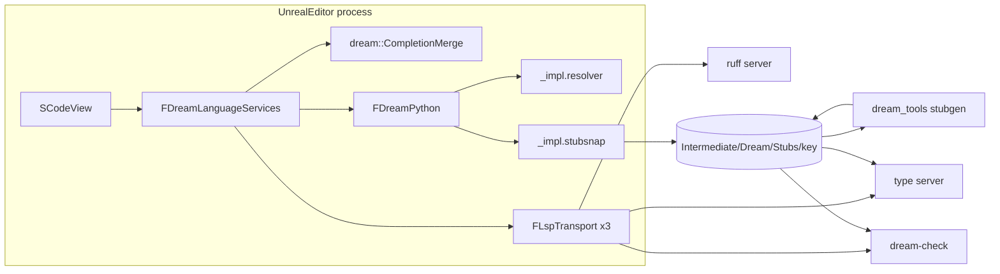

**Game-thread budgets.**

| Work | Budget | Source |
|---|---|---|
| Resolver call | ≤ 5 ms per call; p95 ≤ 5 ms over the 500-chain corpus | D6, D22 |
| Completion popup | ≤ 30 ms from keystroke to first paint with a live result, at ≥ 60 fps | D6, PERF-06 |
| Snapshot slice | ≤ 4 ms per slice; ≤ 60 s idle time in total on the G3 fixture | D5, G3 |
| Result drain (`FDreamLanguageServices::Tick`) | ≤ 1 ms per frame. *Proposed*: keeps D22's 2 ms output-ingest frame budget intact when both run | — |
| Deferred start | ≤ 1 ms per server (thread creation only). *Proposed* | RT-17, PERF-01 |

---

### 7.1 FLspTransport

#### 7.1.1 Responsibilities

- Start one child process with three **separate** pipes. The child is the type server, ruff, `dream-check`, or a batch tool (`stubgen`, `export`).
- Contain the child so it dies with the editor on every exit path, including a crash or kill -9.
- Frame bytes with Content-Length, without altering them. Hand parsed messages to the game thread through queues. The game thread never touches a pipe.
- Write the child's stderr to a log file.

#### 7.1.2 Why the engine helpers cannot be used

| Helper | Defect | Evidence |
|---|---|---|
| Legacy `CreateProc(…, PipeWriteChild, PipeReadChild)` | Merges stderr into stdout | `Engine/Source/Runtime/Core/Private/Windows/WindowsPlatformProcess.cpp:511-518` |
| `FProcessStartInfo` | Defaults to `StdErr = StdOut` | `Engine/Source/Runtime/Core/Public/GenericPlatform/GenericPlatformProcess.h:196-209` |
| Any `CreateProc` | Assigns no Job Object, so a server outlives a crash | `WindowsPlatformProcess.cpp:538-698, 1076-1097` |
| `WritePipe(FString)` / `ReadPipe` | Appends `\n` to every write / splits UTF-8 sequences across reads | `WindowsPlatformProcess.cpp:2052, 1998` |
| `FInteractiveProcess` | Merges stderr, splits lines, drops empty lines, logs every line | `Engine/Source/Runtime/Core/Private/Misc/InteractiveProcess.cpp:108, 133-146` |
| `FMonitoredProcess` | Has no stdin pipe | `Engine/Source/Runtime/Core/Private/Misc/MonitoredProcess.cpp:111-116` |

We use only these: `CreatePipe`, `CreateProc(const FProcessStartInfo&)` with an explicit `StdErr` (`GenericPlatformProcess.h:629`), the binary `ReadPipeToArray` and `WritePipe(const uint8*, int32)` (`:848, 871`), and `TerminateProc(Handle, true)`.

#### 7.1.3 Spawn and containment

Every spawn runs on the child's **read thread**, at the start of `FLspTransport::Run()`. That keeps process creation off the game thread, and Linux needs it (below).

**Windows (supported at 1.0).**
- `FDreamChildJob` is created once per editor process with `CreateJobObjectW` and `JOB_OBJECT_LIMIT_KILL_ON_JOB_CLOSE`. Its handle stays open until module shutdown. If the editor dies, the OS closes the handle, which kills every child.
- **Spawn mode `Engine`** (the default): `CreatePipe` ×3, with `bWritePipeLocal=true` for stdin. Then `CreateProc(FProcessStartInfo{ Uri, Arguments, WorkingDirectory=<Project>, bHidden=true, bInheritHandles=false, StdIn, StdOut, StdErr })`. Then `AssignProcessToJobObject` in the next statement.
- **Spawn mode `Suspended`.** `CreateProc` cannot start a process suspended, so grandchildren started in the first microseconds can escape the job (07e new risk 5). This native path calls `CreateProcessW` with:
  - `CREATE_SUSPENDED | CREATE_NO_WINDOW | CREATE_NEW_PROCESS_GROUP | EXTENDED_STARTUPINFO_PRESENT`;
  - a `PROC_THREAD_ATTRIBUTE_HANDLE_LIST` holding only the three child pipe ends.
  
  It then assigns the job and calls `ResumeThread`. *Proposed:* where `PROC_THREAD_ATTRIBUTE_JOB_LIST` exists (Windows 10+), use it, so the assignment is atomic.
- **Escape check.** 2 s after spawn, the read thread lists processes whose parent is the server and calls `IsProcessInJob` on each. An escaped process is terminated, a warning goes to `LogDreamLsp`, and that profile is set to `Suspended` in per-user state from then on. A profile can also ask for `Suspended` up front (§7.2.5).

**Linux (1.0 Preview).** `PR_SET_PDEATHSIG` must be set in the child before `exec`. That rules out two routes:
- the engine's `posix_spawnp` (N4) has no hook for it;
- a `fork()` of our own would run the `atfork` handlers the engine deliberately avoids.

So we ship **`dream-spawn`**, a first-party C helper of about 60 lines, in `Binaries/<Platform>/`.
- `dream-spawn --exec --ppid <pid> -- <server> <args…>` calls `prctl(PR_SET_PDEATHSIG, SIGKILL)`. It then checks `getppid() == pid` and exits with code 125 if the parent is already gone, which closes the race. Then it calls `execvp`. The death signal survives `execve`.
- Linux sends the death signal when the **creating thread** exits. The read thread lives exactly as long as the server, so stopping the transport kills the server too.
- `dream-check` does the `prctl` and `getppid` steps itself through `ctypes`.

**macOS (1.2).** `dream-spawn --watch --ppid <pid> -- <server>` forks and execs the server. It waits on `kqueue` `EVFILT_PROC NOTE_EXIT` for the editor, kills the server's process group with `SIGKILL` when the editor exits, and forwards the server's exit status.

**All platforms.**
- `initialize` sends `processId = FPlatformProcess::GetCurrentProcessId()`. LSP asks servers to exit when that process dies.
- **Orphan sweep.** Each spawn appends `{pid, start_time, exe_path, editor_pid}` to `lsp-children.json` in the D17 storage root. At deferred start, every entry whose editor is dead, and whose PID still matches the recorded start time and executable, is killed with its tree.

#### 7.1.4 I/O threads, framing and queues

There are **two** `FRunnable`s per child. `WriteFile` on a synchronous anonymous pipe blocks when the pipe is full (07e Q3). A single thread blocked writing to a server that floods stdout without reading stdin would deadlock both processes.

| Thread | Loop |
|---|---|
| `Dream.Lsp.<id>.Read` | Spawn, then repeat: `ReadPipeToArray(StdOut)` → `FrameDecoder::Feed`; `ReadPipeToArray(StdErr)` → log; drain `CommandQueue` into `dream::LspClient`; `LspClient::Tick(now)`; post events; wait on `WakeRead` |
| `Dream.Lsp.<id>.Write` | Wait on `WakeWrite`; pop frames; `WritePipe(const uint8*, int32)` until every byte is written (POSIX can write short, N4) |

- **Polling.** `ReadPipeToArray` peeks without blocking (`WindowsPlatformProcess.cpp:2014-2037`). The read thread waits **1 ms** while a request is in flight or bytes arrived in the last 50 ms, and **10 ms** otherwise. *Proposed:* ≤ 1 ms added latency while the user works, near-zero CPU while idle. `Post` sets `WakeRead`.
- **Queues.**
  - `CommandQueue`: `TQueue<FLspCommand, EQueueMode::Mpsc>`, game thread → read thread.
  - `OutQueue`: Mpsc, read thread → write thread. The read thread also enqueues `$/cancelRequest` itself.
  - `EventQueue`: `TQueue<FLspEvent, EQueueMode::Spsc>`, read thread → game thread. Diagnostics are **coalesced per document** before posting, so only the newest set ever waits.
- **Caps.** *Proposed values, with reasons:*
  - frame ≤ 64 MB (real responses stay under 10 MB);
  - header ≤ 8 KB;
  - pending outbound bytes ≤ 32 MB.
  
  Exceeding a cap is a protocol error (§7.3.5). No buffer over 5 MB is ever sent (§7.1.5), so a large paste cannot reach the outbound cap, and a restart never re-sends a frame that broke it.
- **stderr** goes to `<D17 root>/Logs/LSP/<serverId>.log` (a secondary instance's go under its namespace, §10.5), rotated at 10 MB with 3 generations kept. Above 1 MB/s it is dropped behind a `[dream: N bytes dropped]` marker (*proposed*). `window/logMessage` goes to the same file. These logs feed the D26 bundle (TEL-01).
- **Protocol trace** (`LanguageServices.Trace`, off by default) writes `<serverId>.trace.jsonl`. It contains code, so it is excluded from the diagnostics bundle unless ticked in (D17, D26).
- **Batch mode** (`stubgen`, `export`) uses the same framing. The tool sends `dream/progress` and `dream/done` notifications, and no `LspClient` is involved.

#### 7.1.5 Deferral and shutdown

- **Deferred start (RT-17).** Nothing spawns at editor start or at layout restore. The deferred start (§3.4) calls `FDreamLanguageServices::OnDeferredStart` at its first trigger: the first focus or keystroke in a Dream widget, a first-use request listed in §3.4, or 10 s after `FCoreDelegates::OnFEngineLoopInitComplete` (`Engine/Source/Runtime/Core/Public/Misc/CoreDelegates.h:247`), whichever comes first. The servers then start in order: `dream-check`, ruff, type server, 500 ms apart (*proposed*, to spread the CPU spike).
- **Never started:**
  - in safe mode (D17);
  - in headless modes (D16);
  - when policy disables language services.
- **Buffers over 5 MB** (UTF-8 bytes, *proposed*; BUF-09, matching SUM902):
  - the type server and ruff never get them;
  - `dream-check` gets only a `dream/skipped {uri, version, bytes}` notification, never the text, and reports SUM902 (§7.3.3);
  - the size check runs before each frame's `didChange` is built. A buffer that crosses 5 MB is sent `didClose` (and `dream/skipped` to `dream-check`) instead of the change. One that drops below 5 MB is reopened with `didOpen` at its current version.
  
  **Plain-mode buffers** (the IME fallback for files below 1 MB, EDT-15) are opened in every server like any other buffer.
- **Shutdown.** Send `shutdown` and wait ≤ 500 ms. Send `exit` and wait ≤ 500 ms. Then `TerminateProc(Handle, true)`. All children stop in parallel, so exit gains ≤ 1 s (*proposed*). The job closes last.

#### 7.1.6 Interfaces

```cpp
enum class EDreamSpawnMode : uint8 { Engine, Suspended /*Win64*/, Shim /*Linux, macOS*/ };
enum class EDreamTransportMode : uint8 { Lsp, Batch };
struct FDreamLaunchSpec
{
    FString ServerId, Executable, Arguments, WorkingDirectory, StderrLogPath;
    EDreamSpawnMode SpawnMode = EDreamSpawnMode::Engine;
    EDreamTransportMode Mode = EDreamTransportMode::Lsp;
    TOptional<FString> ExpectedSha256;                 // manifest or policy (§7.3.4)
};
class FLspTransport final : public FRunnable
{
public:
    static TUniquePtr<FLspTransport> Start(const FDreamLaunchSpec& Spec, dream::ServerProfile Profile);
    void  Post(FLspCommand&& Command);                       // any thread
    int32 Drain(TArray<FLspEvent>& Out, int32 MaxEvents);    // game thread only
    void  RequestStop(FTimespan Grace);                      // shutdown → exit → kill tree
    uint32 GetPid() const;
    EDreamTransportState GetState() const;                    // Spawning, Running, Exited, Failed
    uint32 Run() override;
    void   Stop() override;
};
```

**Open items.** Confirm `PROC_THREAD_ATTRIBUTE_JOB_LIST` on the minimum Windows build. Measure whether any pinned server starts grandchildren.

---

### 7.2 dream::JsonRpc and dream::LspClient

#### 7.2.1 Responsibilities

- **`dream::JsonRpc`:** framing, encoding, message classification, ids and error codes. It is pure, has no UE dependency (D7), and is tested at tier 1.
- **`dream::LspClient`:** one per server. It is single-threaded, on the read thread, and owns all protocol state:
  - capability negotiation;
  - document sync;
  - pending requests and their deadlines;
  - stale-result dropping;
  - server-to-client requests;
  - per-server configuration.

#### 7.2.2 Framing

- **`FrameDecoder`** is a state machine over byte chunks:
  1. `Header`: read up to `\r\n\r\n`, at most 8 KB. `Content-Length` is required; `Content-Type` is ignored.
  2. `Body`: read exactly N bytes, emit the frame, return to `Header`.
- **Errors** (`MissingLength`, `BadLength`, `HeaderTooLong`, `FrameTooLarge`, `BadJson`) are fatal for that instance, because LSP has no resync marker. The supervisor restarts the server (§7.3.5).
- **`EncodeFrame`** produces `Content-Length: <UTF-8 bytes>\r\n\r\n<body>` as one buffer, with no trailing newline.
- **Parsing** into DreamCore's JSON DOM happens on the read thread. The parser is a vendored permissive one, recorded in §12.

#### 7.2.3 Documents, requests and staleness

- **URIs.**
  - File buffers use their `file:` URI.
  - Scratch tabs use a virtual path that is never written: `file:///<Project>/Intermediate/Dream/Scratch/<Tab>-<id>.py`, so imports resolve from the project.
  - The REPL prompt is `__dream_repl__.py`. It holds the current input only, and its diagnostics are never shown.
  - The LSP version is the buffer's document version.
- **Sync.**
  - *Incremental:* a `Change` command carries the edits and an immutable, copy-on-write `dream::TextSnapshot` (§4). One frame's edits become one `didChange`.
  - *Full:* if the server asks for full sync, we send the snapshot's whole text.
  - *Position encoding:* we offer `["utf-8", "utf-16"]` and prefer UTF-8. Columns are converted on the read thread with the snapshot's line index.
- **Pending table.** `unordered_map<int64_t, Pending{Method, DocId, DocVersion, Deadline, Owner}>`.
- **Cancellation (D4).** These requests have a **1.5 s** deadline: completion, resolve, hover, signatureHelp, codeAction and workspace/symbol. When it passes, `Tick` sends one `$/cancelRequest` and reports `Timeout`, and a late answer is dropped. Definition, documentSymbol and formatting get 5 s (*proposed*: they are rarer and larger).
- **Staleness.**
  - Responses whose `DocVersion` is older than the newest version sent are dropped on the read thread. The game thread checks again when it applies a result (§7.3.6).
  - `ContentModified` (-32801) and `RequestCancelled` (-32800) are dropped silently.
  - A stale **formatting** result is never applied. The status bar says "Document changed during formatting; try again".
- **Diagnostic versions.**
  - An older version is mapped forward with `dream::TextBuffer::MapRange(from, to)`, which uses an edit log of ≥ 64 versions (§4).
  - If the log no longer covers that version, the set is dropped.
  - A set with no version is taken to refer to the newest version sent before it arrived.
- **Stall.** Three consecutive timeouts with no stdout bytes for 10 s mark the server `Stalled`, and it counts as a crash (*proposed*).

#### 7.2.4 Capabilities and server-to-client traffic

**Client capabilities we declare:**
- sync: open, change (incremental), close, save;
- completion: `snippetSupport` (expanded by `dream::SnippetEngine`), `labelDetailsSupport`, `resolveSupport` (documentation, detail), `insertReplaceSupport`;
- Markdown hover;
- signature help: `activeParameterSupport` and `labelOffsetSupport`;
- diagnostics: `versionSupport`, `relatedInformation`, `codeDescriptionSupport`, `dataSupport`;
- code actions: literals for `quickfix`, `source.fixAll` and `source.organizeImports`, plus edit resolve;
- linked definitions, hierarchical document symbols, workspace symbols, formatting and range formatting;
- `workspace.configuration`, `workspaceFolders`, `workDoneProgress`;
- `didChangeWatchedFiles` without dynamic registration. We send stub changes ourselves (§7.4.6).

Server capabilities become a `ServerFeatures` bitset, which drives routing (§7.3.6).

| Server → client | Handling |
|---|---|
| `workspace/configuration` | Answered from the profile per `scopeUri`. `dream-check` asks for section `dream` and gets `{oneUndoStepPerRun, bufferKind, namespaceMode}` |
| `client/registerCapability`, `workDoneProgress/create`, `$/progress` | Accepted. Progress shows in the status-bar language item |
| `showMessage`, `showMessageRequest` | Logged; the request is answered `null`. No popups |
| `workspace/applyEdit` | Accepted only within 5 s of a code action the user picked from that server, and only into open buffers. Otherwise `{applied:false}` |
| Anything else | `-32601 MethodNotFound` |

#### 7.2.5 Per-server configuration mapping

A **server profile** is a data file, `Config/Dream/LspProfiles/<id>.json`, pinned with its binary (D15). `LspClient::ApplyProfile` maps one neutral configuration onto it.

```cpp
namespace dream {
struct NeutralConfig {
    std::string PythonVersion = "3.11", Platform, InterpreterPath;    // engine python.exe
    std::string StubPath;                      // <cache>/<key>/pkg, or the minimal stub (§7.10.1)
    std::vector<std::string> ExtraPaths;       // editor sys.path captured at deferred start
    std::vector<std::string> WorkspaceRoots;   // project, script roots, AdditionalPaths
    std::vector<std::string> Excludes;         // always **/Intermediate/PythonStub/** (D5)
    DiagProfile Profile = DiagProfile::Quiet;
    uint32_t MaxRssMB = 1536;                  // G3, D22
};
}
```

**Profile fields:**
- `id`, `support` (`supported` | `experimental`), `version`, `command`, `spawn`;
- templates for `initializationOptions` and `workspaceConfiguration`;
- `configFile`: written under `<Project>/Intermediate/Dream/Lsp/<id>/` and passed by a flag. It is never written into the project root;
- `memoryFlag`;
- `diagnosticCodeMap` (§7.8.2).

Templates use `{stubPath}`, `{extraPaths}`, `{pythonVersion}`, `{platform}`, `{excludes}`, `{interpreter}` and `{maxRssMB}`.

| Server | Command | Mapping |
|---|---|---|
| Pyrefly | `pyrefly lsp` (**UNVERIFIED**, D4) | Generated `pyrefly.toml`: `search-path`, `python-version`, `python-platform`, `project-excludes`. Key names to be verified in G3 |
| basedpyright (experimental) | `basedpyright-langserver --stdio` | Section `basedpyright.analysis`: `stubPath`, `extraPaths`, `typeCheckingMode: "basic"` (Quiet), `diagnosticMode: "openFilesOnly"`. Also `python.pythonPath`; `exclude` in a generated `pyrightconfig.json`; Node `--max-old-space-size` (a bundled basedpyright runs on the pinned Node.js runtime, §7.3.2) |
| ty (experimental) | `ty server` | Generated `ty.toml`: `environment.extra-paths`, `environment.python-version` |
| ruff | `ruff server` | `initializationOptions.settings`: `configurationPreference: "filesystemFirst"` (`"editorOnly"` for untrusted folders, D20); `lint.select` (§7.3.2); `lint.external: ["SUM"]`, so `# noqa: SUMxxx` survives |
| dream-check | `python.exe -I <plugin>/Tools/Python/dream_launch.py check --data <cache>/<key>/snapshot --parent-pid <pid>` | Section `dream` |

#### 7.2.6 Interfaces

```cpp
namespace dream {
enum class LspState : uint8_t { Starting, Initializing, Ready, Stalled, ShuttingDown, Exited };
class LspClient {
public:
    LspClient(ILspIo& Io, const ServerProfile& Profile, const NeutralConfig& Config, IClock& Clock);
    void Start(int64_t ParentPid, std::span<const WorkspaceFolder> Roots);
    void OnFrame(json::Value&& Message);
    void Open(DocId, std::string Uri, uint64_t Version, TextSnapshotRef Text);
    void Change(DocId, uint64_t Version, std::span<const TextChange> Changes, TextSnapshotRef After);
    void Close(DocId);
    RequestId Request(Method, DocId, uint64_t DocVersion, json::Value Params, Duration Timeout);
    void Cancel(RequestId);
    void Reply(const json::Value& ServerRequestId, json::Value Result);
    void Tick(TimePoint Now);              // deadlines, cancel frames, stall detection
    void Shutdown(Duration Grace);
    ServerFeatures Features() const;  LspState State() const;
};
namespace JsonRpc {
class FrameDecoder { public: FrameResult Feed(std::span<const uint8_t>, std::vector<json::Value>& Out); };
std::vector<uint8_t> EncodeFrame(const json::Value& Message);
}}
```

---

### 7.3 FDreamLanguageServices and the server set

#### 7.3.1 Responsibilities

- Choose the servers to run, from defaults, settings and policy.
- Start them at deferred start, supervise them, and restart them with backoff.
- Route each request to the servers that support it, in parallel with the resolver.
- Apply results **only while no run is on the stack** (RT-01).
- Own the Problems model (§7.8).
- Report health to the status bar (WS-05, INT-11).

#### 7.3.2 The server set (RT-12)

| Role | At 1.0 | Bundled | Status |
|---|---|---|---|
| Type server | The **G3 winner**. Pyrefly is provisional and wins ties within 3 points (D4) | Yes, from M2 | Supported |
| G3 loser (e.g. basedpyright), and ty | User- or policy-supplied binary | No | **Experimental**, no SLA. The loser may be promoted in 1.1 |
| jedi-language-server, pylsp | Not offered | — | Rejected (D4) |
| ruff server | Always on with language services | Yes, from M2 | Supported |
| `dream-check` | Always on | Our Python, from M1 | Supported |

- **Experimental servers** show the badge `Types: <id> (experimental)`. Without a binary path the type-server role is empty, and the status bar says why.
- **ruff's quiet rule set** applies only when the project has no ruff configuration: `F`, `E9`, `PLE`, `B006`, `B012`, `B015`, `B018`, `RUF006`. *Proposed:* these are bug-risk rules with near-zero false positives, to be tuned with pilots.
  - ruff reports syntax errors in every mode.
  - `F401` and `F841` show as hints in scratch tabs and the REPL.
  - Formatting runs only on demand, or on save if the user opts in (INT-10).
- **Shipping.** Binaries live in `Binaries/ThirdParty/DreamTools/<Platform>/<tool>/<version>/` (§2.2) as `RuntimeDependencies`, listed with SHA-256 hashes in `manifest.json` (D4).
  - The hash is checked on a background task at first spawn, and cached by (path, size, mtime).
  - **Never `PythonRequirements`** (07d Q5).
  - **Packaging cost** (runtime size, SBOM, signing, Fab status) is a G3 selection input (§7.10.1). A Node-based winner such as basedpyright ships a pinned Node.js runtime as one more `DreamTools` binary, listed in `Resources/Manifest.json` (§11.10) like every other file under `Binaries/ThirdParty`.
  - If Fab refuses bundled executables, the Fab package ships without them, and the environment doctor and the status bar link the GitHub binaries pack; `language_services.binaries.<name>` accepts the downloaded path (RV-24, §15.4).

#### 7.3.3 dream-check

`dream-check` is our own LSP server, written in pure Python 3.11 stdlib. It runs out of process on the engine's `python.exe -I`, from `Tools/Python/dream_tools/check/`. It is part of M1 and proves the transport with no third-party binary (D4, D9).

- **Launch.** In 3.11, `-I` implies `-P`, so `Tools/Python/dream_launch.py` (§2.2) adds `Tools/Python` to `sys.path`. It loads the shared parser by path, with `spec_from_file_location("dream_docstrings", <plugin>/Content/Python/dream_editor/_impl/docstrings.py)`, so `dream_editor/__init__` never runs. `docstrings.py` may import only the stdlib.
- **Loop.** A reader thread decodes frames from `sys.stdin.buffer`.
  - A document is analysed 300 ms after its last change. This is the normative diagnostics debounce of INT-07; 300 ms plus the analysis stays inside PERF-08's 1 s. Analysis uses `ast.parse(text, feature_version=(3, 11))` and one visitor per rule family.
  - Target: ≤ 100 ms for 5,000 lines (*proposed*).
  - A buffer over 5 MB never reaches `dream-check`. It gets a `dream/skipped {uri, version, bytes}` notification instead (§7.1.5) and publishes SUM902 alone for that URI.
- **Parent watch.**
  - Linux: `prctl` (§7.1.3).
  - Every platform: a thread checks once a second whether `--parent-pid` is alive (`os.kill(pid, 0)`, or `OpenProcess` plus `WaitForSingleObject` through `ctypes`) and exits if it is not.
- **Unreal data (RT-13).** The snapshot (§7.4.2) is loaded lazily into compact indexes:
  - names;
  - per-class members and their kinds;
  - own editor properties with flags;
  - deprecation markers;
  - parsed return types.

  When the snapshot is missing, incomplete or for another key, SUM101–SUM103 are off, and SUM900 says "Unreal API data is being built" or "unavailable". `FDreamLanguageServices` sends `dream/snapshotChanged {path, key}` when a snapshot completes.

**Rules** (U5; SUM204 and SUM205 are added for LRS-07). Every rule has a positive and a negative fixture (INT-08).

| Code | Sev. | Detection | Quick fix |
|---|---|---|---|
| SUM101 unknown `unreal.*` name | Warning | An `ast.Attribute` chain rooted at a name bound by `import unreal [as X]`, plus `from unreal import N`. Level 1 is checked against the top-level names. Level 2 is checked against the class members (bases included) when level 1 is a known class. `getattr(unreal, …)` and names assigned into `unreal` in the same file are skipped | `Replace with unreal.<closest>` (`difflib.get_close_matches`, cutoff 0.8) |
| SUM102 attribute assignment where `set_editor_property` is needed | Warning | `Assign` or `AugAssign` to `obj.p`. `obj`'s class C is inferred (below), and `p` is in C's Editor Properties (own and inherited). It fires when `p` is not a getset of C (edit-only, so the assignment raises), or when the getset is `[Read-Only]` while the editor list says `[Read-Write]` (BlueprintReadOnly but editable, N2). If C is unknown, it fires as Information only when `p` is edit-only on some class, is an attribute on no class, and `obj` is not `self` or `cls`. An off-by-default variant also flags `[Read-Write]` attributes, because attribute writes skip edit-change notifications (N2). Messages: edit-only, "`<p>` is not a Python attribute of `<C>` (editor-only property); this assignment raises AttributeError. Use set_editor_property."; read-only mismatch, "`<p>` is read-only as an attribute; use set_editor_property."; the variant, "Attribute writes skip edit-change notifications; set_editor_property sends them." The Information case uses the edit-only text and names the classes where `p` is edit-only | Yes, see below |
| SUM103 deprecated API | Warning | Access to a member whose docstring says `deprecated: '<old>' was renamed to '<new>'.` (07d Q2), or whose class or function doc says it is deprecated | Rename to `<new>` |
| SUM104 missing transaction around actor edits in a loop | Info | Only when **One undo step per run is off** for the buffer (from `workspace/configuration`). A loop body (not a nested `def`) calls a mutator (`set_*`, `add_*`, `destroy_*`, `attach_*`, `modify`, `set_editor_property`) on an `Actor` or `ActorComponent` subclass or on `EditorActorSubsystem`, outside `with unreal.ScopedEditorTransaction(...)` | Wrap the loop in that block |
| SUM201 `unreal.*` inside a threading target | Warning | Targets are a `threading.Thread(target=…)` function, a `Thread` subclass's `run`, and callables passed to `concurrent.futures` `submit` or `map`. Their bodies, and same-module callees down to depth 3 (*proposed*), are searched for `unreal` access. Property access is not thread-gated (`PSP/Private/PyUtil.cpp:606-616`, D24) | — |
| SUM202 `time.sleep` in a loop on the game thread | Warning | `time.sleep` (or an imported `sleep`) in a loop, outside thread targets and `@dream_editor.task` generators | `dream_editor.sleep(…)` plus the import (D24) |
| SUM203 `asyncio.run` on the game thread | Warning | `asyncio.run`, `run_until_complete` or `run_forever` outside thread targets | — |
| SUM204 `input()` on the game thread | Warning | Builtin `input` called outside thread targets | — |
| SUM205 `Thread.join()` with no timeout on the game thread | Info | `.join()` with no arguments on a value inferred as `threading.Thread` | — |
| SUM301 `os.rename` / `shutil.move` on a Content path | Warning | The first or second argument is a literal, f-string, `os.path.join` or `pathlib` expression containing `/Content/`, `\Content\` or a leading `/Game/`, or is built from `unreal.Paths.project_content_dir()` or `unreal.SystemLibrary.get_project_content_directory()` | — (the message names `EditorAssetLibrary.rename_asset`) |
| SUM900 / SUM901 / SUM902 | Info | 900: Unreal data unavailable. 901: a rule raised (the other rules still run). 902: buffer skipped because it is over 5 MB (on `dream/skipped`, §7.1.5) | — |

**Type inference** (local, flow-insensitive, one scope at a time) feeds SUM102, SUM104 and SUM205. These patterns give a known class:
- `x = unreal.C(...)`;
- `x = unreal.C.cast(...)` and `get_default_object()`;
- annotations, including on parameters;
- `x = <call>` when the snapshot's parsed `Returns` is a class;
- `for x in <call>` when it returns `Array[C]`;
- `isinstance(x, unreal.C)` guards.

User code is not followed.

**SUM102 quick fix.**
- `obj.p = v` becomes `obj.set_editor_property("p", v)`. `v` is copied from the source text by `ast` positions, so multi-line values survive.
- `obj.p += v` becomes `obj.set_editor_property("p", obj.get_editor_property("p") + v)`.
- Chained and tuple targets get no fix.
- The fix is a `quickfix` with `isPreferred: true`.

**Suppression.** `# noqa: SUM102` or a bare `# noqa`. Codes listed in policy `lint.enforced` cannot be turned off in settings, but `# noqa` still works, because it is visible in the code.

#### 7.3.4 Policy controls

`FDreamPolicy` (§11) supplies these keys. A policy lock wins over every settings layer (U38). Key names follow the §11.2.2 schema.

| Key | Effect |
|---|---|
| `language_services.enabled` | `false`: no child processes at all. Status: "Language services disabled by policy". Editing, running and live completion are unaffected (D4) |
| `language_services.server` | `pyrefly`, `basedpyright`, `ty` or `none` (pin) |
| `language_services.binaries.<name>` | Approved binaries, "bring your own binary": `{"path", "sha256"}`. A hash mismatch refuses the server and adds a doctor item (ENV-04) |
| `language_services.allow_user_binaries` | `false`: users cannot point to their own binaries |
| `language_services.allow_experimental` | `false`: experimental servers cannot be chosen (RT-12) |
| `language_services.ruff`, `language_services.dream_check` | Turn either one off |
| `language_services.max_rss_mb` | Overrides 1,536 (G3, PERF-11) |
| `lint.enforced`, `lint.disabled` | Codes users cannot turn off, or cannot turn on (SEC-02) |
| `live_completion.enabled` | Turns the resolver off |

**Invalid policy layer** (§11.2.3, RV-07). Only the permission keys here take their closed values: `language_services.binaries.<name>` (each server uses a valid higher layer's binary, else its bundled one; the invalid layer and the layers below it supply no binaries, and a server with no bundled binary is not started) and `language_services.allow_user_binaries` (`false`). The editing aids (`language_services.enabled`, `.server`, `.allow_experimental`, `.ruff`, `.dream_check`, `.max_rss_mb` and `live_completion.enabled`) are not closed: the invalid layer's values for them are ignored and the other layers, else the defaults, apply, so a broken project file never turns completion or diagnostics off for a team.

#### 7.3.5 Supervision

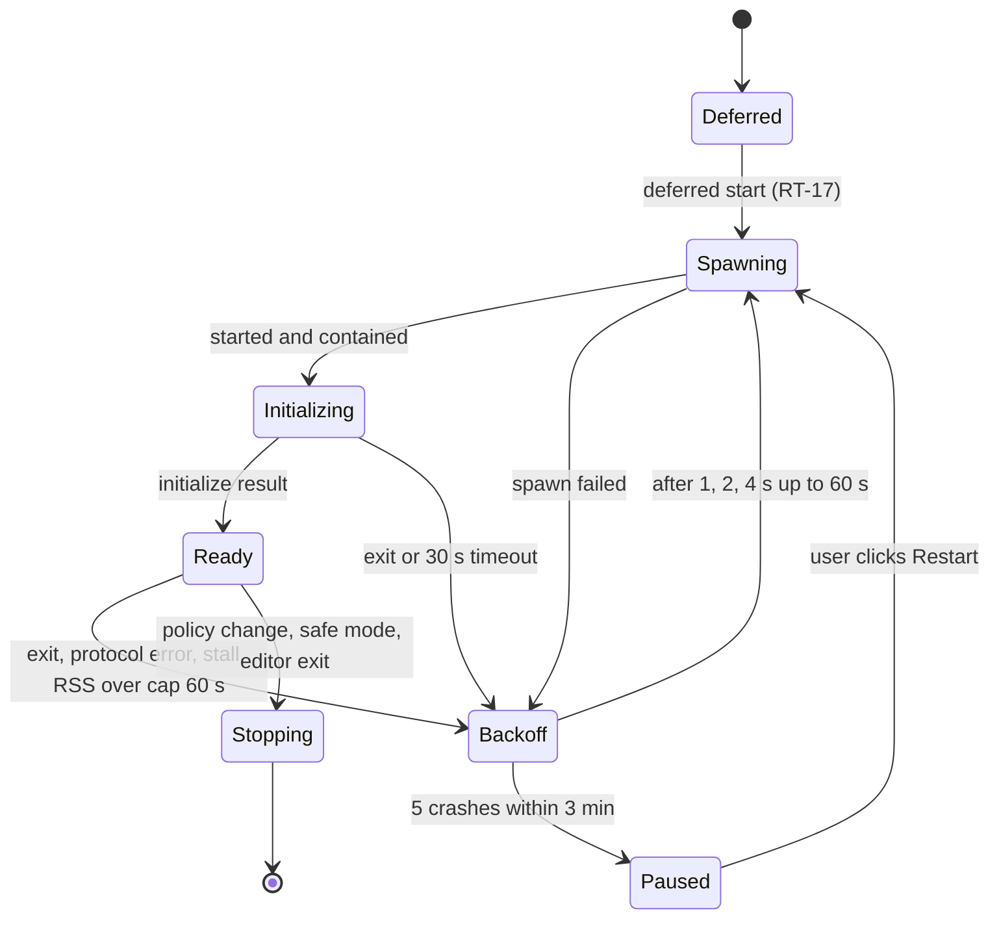

- **Backoff** is 1, 2, 4 s and so on, doubling to a 60 s cap. Five crashes within 3 minutes pause the server: "Language features paused — [Restart] [View log]" (R05 §2.5, INT-11). 5 minutes of healthy uptime reset the backoff (*proposed*).
- **Initialize timeout** is 30 s (*proposed*; G3 already wants a first completion within 15 s).
- **Memory.** RSS means the working set: `WorkingSetSize` from `GetProcessMemoryInfo` on Windows, `VmRSS` from `/proc/<pid>/status` on Linux. `FDreamChildJob` reads it for each child at 1 Hz, the same quantity and rate as the G3 gate (§7.10.1, B-10). Over `maxRssMB` for 60 s triggers a restart (R05 §2.5).
  - Private commit is logged, not enforced. `FPlatformProcess::GetApplicationMemoryUsage` is not used: on Windows it returns `PrivateUsage` (`Engine/Source/Runtime/Core/Private/Windows/WindowsPlatformProcess.cpp:862-881`; "virtual memory usage", `GenericPlatformProcess.h:707-708`). Commit can be far above the working set for Node and large Rust heaps, so enforcing it would restart healthy servers until they reach Paused.
- **After a restart,** every open document is re-sent with `didOpen` at its current version. Old diagnostics stay stale (greyed) until the first new publish, or for at most 10 s (*proposed*).
- **Health states**, shown per role within 250 ms (WS-05): `Starting`, `Ready`, `Restarting (n)`, `Paused`, `Disabled (policy | safe mode | setting)`, `Experimental`.

#### 7.3.6 Routing and idle application (RT-01)

| Feature | Type server | ruff | dream-check | In process |
|---|---|---|---|---|
| Completion | ✓ (M2) | | | Resolver (M1) |
| Hover, signature help | ✓ | | | Docstring parser (M1) |
| Diagnostics | ✓ (quiet) | ✓ | ✓ | Parse check, runtime items |
| Code actions | ✓ | ✓ | ✓ | |
| Formatting | Never asked | ✓ | | |
| Definition, symbols | ✓ | | | Resolver and `dream::PyLexer` fallbacks |

- **Sending.** Requests are posted at once, from any game-thread context. `Post` is a non-blocking enqueue.
- **No client-side debounce for the type server and ruff.** Edits go out as one `didChange` per frame (§7.2.3), and each server schedules its own analysis. INT-07's 300 ms debounce is `dream-check`'s (§7.3.3). PERF-08's 1 s after a typing pause applies to all three servers (T-LSP-031, T-DIAG-019).
- **Applying.** **Results are applied only in `FDreamLanguageServices::Tick`**, an FTSTicker callback whose first statement is `if (Runs.IsRunActive()) return true;`.
  - User code can tick the core ticker re-entrantly (material baking, HLOD builds, RT-01). When it does, events stay queued until the run ends.
  - `IsRunActive()` is true from run entry until `user_code_done`, including pumped and Paused time. It is false between `@task` steps, so results do apply while a task keeps the editor interactive (§3 contract).
- **Drain budget.** `Tick` spends ≤ 1 ms per frame. It re-checks each buffer's version before applying a result, and drops stale ones.

#### 7.3.7 Interfaces

```cpp
class FDreamLanguageServices : public TSharedFromThis<FDreamLanguageServices>
{
public:
    void Initialize(FDreamPolicy& Policy, FDreamRunService& Runs, FDreamPython& Python);
    void OnDeferredStart();
    void OnBufferOpened(FDreamBufferId, const FDreamBufferInfo&);
    void OnBufferChanged(FDreamBufferId, uint64 Version, TConstArrayView<dream::TextChange>, dream::TextSnapshotRef);
    void OnBufferClosed(FDreamBufferId);
    TSharedRef<FDreamCompletionSession> BeginCompletion(FDreamBufferId, uint64 Version, const FDreamCaret&, ECompletionTrigger);
    void RequestHover(FDreamBufferId, uint64 Version, FDreamTextPos, FOnDreamHover);
    void RequestSignature(FDreamBufferId, uint64 Version, FDreamTextPos, FOnDreamSignature);
    void RequestDefinition(FDreamBufferId, uint64 Version, FDreamTextPos, FOnDreamLocations);
    void RequestCodeActions(FDreamBufferId, uint64 Version, FDreamTextRange, FOnDreamCodeActions);
    void FormatDocument(FDreamBufferId, TOptional<FDreamTextRange> Range);     // ruff only
    const FProblemsModel& GetProblems() const;
    EDreamLanguageHealth GetHealth(EDreamServerRole) const;
    void SetRunActive(bool bActive);                                           // §5.5.2: live features off during supervised runs
    bool QueryLiveCompletionCached(const FDreamCompletionContext& Ctx, TArray<FDreamCompletionItem>& Out) const;  // GT; true on a hit, ≤ 1 ms (§6.6)
    bool Tick(float DeltaTime);                                                // no-op while IsRunActive()
};
```

**Open items.**
- Does each pinned server accept `didOpen` for a `file:` URI that does not exist? If not, use `untitled:` for that profile.
- Pyrefly's command, keys and `processId` handling (G3).

---

### 7.4 Stubs for the `unreal` module (D5)

#### 7.4.1 Responsibilities

- **Stage 1 (M1, RT-13).** `stubsnap` writes a read-only snapshot on idle slices and calls nothing.
- **Stage 2 (built in M1 for G3, internal; shipped in M2; RV-11).** `dream_tools.stubgen` turns the snapshot into a split `.pyi` package, out of process. In M1 it runs only inside the G3 harness (§7.10.1) and is not in the shipped build. The `.pyi` package and its use by the shipped type server land in M2.
- **One package** feeds the type server, `dream-check` and Export stubs. The cache is kept fresh per module.
- **Developer Mode is never required or toggled.**

#### 7.4.2 Stage 1: the snapshot

**What is walked.**
- Every `sys.modules['_unreal_<m>']` (N6).
- The `unreal` dict itself: module functions, glue types, and names added by the engine's `unreal_<module>.py` helpers.

Types are grouped by `_unreal_*` module, never by `__module__`, which reports `builtins` (07d Q2). Types in no `_unreal_*` module (Blueprint-generated classes) are skipped; live completion covers them.

**How it is read.** Only dict reads and allow-listed C slots are used.
- **Type dicts** come through `type.__dict__['__dict__'].__get__(cls)`, and bases through `type.__dict__['__bases__']`.
- **Member kind** is decided by `type(value)` identity:

| Python type of the value | Kind |
|---|---|
| `getset_descriptor` | `getset` |
| `methodwithclosure_descriptor` | `method` |
| `classmethodwithclosure_descriptor` | `classmethod` (`X.` docs) |
| `method_descriptor`, `builtin_function_or_method` | `glue` |
| `constant_value` | `constant` |
| `_EnumEntry` | `enum_entry` (N3) |
| `member_descriptor` | `member` |
| Builtin scalars | `data`, with the value |
| Anything else | `other`, with the type name |

- **`__doc__`** is read only from objects whose type is in `_DOC_SAFE_TYPES`: the C descriptor types above, plus `type`, `function`, `property`, `classmethod` and `staticmethod`. Nothing else is read.
- **Never called:** getters, properties, `constant_value` or `_EnumEntry`. (Epic's own generator does call ScriptConstant getters, `PSP/Private/PyWrapperTypeRegistry.cpp:3590-3597`.)
- **`PyTest*` types** are filtered out, and their count is recorded.
- **Editor Properties.** The shared parser (§7.4.4) extracts each class's Editor Properties. The snapshot stores only **own** entries (those not inherited from the first base), and the doc with that block removed, so inherited lists are not repeated in every subclass.

**Slicing.**
- C++ calls `stubsnap.step(budget_ns=4_000_000)` from an idle FTSTicker callback:
  - at most once per frame;
  - never within 300 ms of a Dream keystroke (*proposed*: never competes with typing).
- `step` checks `perf_counter_ns()` after each type and after every 64 members, and returns 0.5 ms early.
- Each type record is `json.dumps`-ed inside the slice and passed to `_dream.stub_emit(module, bytes)`.
- `_dream.stub_module_done(module, count, sha256)` makes a background `UE::Tasks` task write `modules/<m>.jsonl` (write to a temp file, then rename). The game thread does no snapshot I/O.

**Order and completion.**
- Modules are walked largest first.
- `manifest.json`, then `.complete`, are written last.
- An interrupted walk leaves no marker. The next deferred start re-walks the modules whose files are missing.

**Schema** (`schema` 1, the JSON version key of §12.4).

```json
// manifest.json
{ "format": "dream.stubsnap", "schema": 1, "key": "9f2c4a1e7b3d5a60",
  "engine": { "version": "5.8.0-<changelist>", "python": "3.11.8" }, "complete": true,
  "modules": [ { "name": "engine", "cpp_module": "Engine", "file": "modules/engine.jsonl",
                 "types": 4210, "sha256": "…", "snap_ms": 812 } ],
  "unreal_module": "modules/__unreal__.jsonl", "filtered": { "pytest_types": 23 },
  "stats": { "slices": 9876, "max_slice_us": 3890, "total_idle_ms": 41234 } }
```

| JSONL record `rec` | Fields |
|---|---|
| `module` (first line) | `name`, `cpp_module`, `count` |
| `type` | `name`, `kind` (`class`/`struct`/`enum`/`delegate`/`glue`), `bases`, `base_modules`, `uobject` (`Object` in the MRO), `doc` (without the Editor Properties block), `eprops` (own: `[name, type_text, "rw"\|"ro", tooltip]`), `members` (`{"n", "k", "doc"?, "t"?, "v"?}`) |
| `func`, `data` (in `__unreal__.jsonl`) | `name`, plus `doc` or `t`/`v` |

#### 7.4.3 Cache key and location

- **Location:** `<Project>/Intermediate/Dream/Stubs/<key>/` (D5, D17). It holds:
  - `snapshot/manifest.json` and `snapshot/modules/*.jsonl`;
  - `pkg/unreal/*.pyi`;
  - `pkg/index.json` (qualified name → `[file, line]`, used by §7.9.1);
  - `report.json` and `.complete`.
- **Key:** the first 16 hex digits of SHA-256 over these fields:
  - engine version and changelist;
  - Python version;
  - sorted enabled plugins as `name@VersionName` (`IPluginManager::GetEnabledPlugins`);
  - project module stamps;
  - snapshot format version;
  - stubgen version.

  A module stamp is the size and mtime of the file from `FModuleManager::GetModuleFilename`. *Proposed:* hashing large DLLs at startup costs too much I/O.
- **Retention:** the 2 newest keys are kept; older ones are deleted at deferred start (*proposed*).

#### 7.4.4 The shared docstring parser

`dream_editor._impl.docstrings` is the only parser. stubsnap, stubgen, `dream-check`, live hover and signature help all use it (D5, D6). It normalises `\r\n` first. The grammar comes from 07d Q2 and `PSP/Private/PyGenUtil.cpp:624-680, 1468-1535, 2098-2165, 3513-3550`:

```text
method_doc    := first_line "\n" tooltip? args_block? returns_block?
first_line    := ("x." | "X.") NAME "(" [param ("," param)*] ")" [" -> " ret]
param         := NAME ["=" default_text]
ret           := type_text | "(" NAME "=" type_text ("," NAME "=" type_text)* ")" [" or None"]
args_block    := "Args:" ("\n    " NAME " (" type_text "): " text ("\n        " text)*)+
returns_block := "Returns:" "\n    " ["(" type_text "): "] text
glue_doc      := NAME "(" typed_params ")" " -> " type_text " -- " text
property_doc  := "(" type_text "): [" ("Read-Write" | "Read-Only") "] " text
class_doc     := tooltip? cpp_source? editor_props?
cpp_source    := "**C++ Source:**" "\n" ["\n- **Plugin**: " NAME] "\n- **Module**: " NAME "\n- **File**: " FILE
               | "**Asset Source:**" text
editor_props  := "**Editor Properties:** (see get_editor_property/set_editor_property)"
                 ("\n- ``" NAME "`` (" type_text "): [" RW "] " text ("\n  " text)*)+
deprecated    := "deprecated: '" NAME "' was renamed to '" NAME "'."
type_text     := NAME | "type(" NAME ")" | ("Array" | "Set") "[" type_text "]"
               | "Map[" type_text ", " type_text "]" | "Optional[" type_text "]" | builtin
```

- `X.` means static and `x.` means instance.
- Parse functions return `None` on failure and never raise; the caller degrades to untyped output.
- The goldens are 500 real docstrings captured from the G3 fixture. They are re-captured for every engine version and canary (D15).

#### 7.4.5 Stage 2: the transformer

`python.exe -I …/Tools/Python/dream_launch.py stubgen --snapshot <dir> --out <dir>/pkg --modules all|<m,…> --report <dir>/report.json` runs in Batch mode under the Job Object. *Proposed targets:* ≤ 60 s for the full package on the G3 fixture, and ≤ 5 s per module.

**Package layout.**
- `unreal/__init__.pyi` has explicit re-exports only: `from ._engine import StaticMeshActor as StaticMeshActor`, plus the module-level functions. No star imports.
- There is one `unreal/_<m>.pyi` per `_unreal_<m>` module. A file over 2 MB is split into `_<m>_2.pyi`, `_<m>_3.pyi` and so on, in topological order. *Proposed:* this keeps every file under PyCharm's default 2,500 KB code-insight limit (R03 C2).
- **Base ordering:** classes are sorted topologically, then by name. Bases from other files are imported explicitly; import cycles are legal in stubs.

**Emission rules.**

| Snapshot | `.pyi` |
|---|---|
| `getset` `[Read-Write]` / `[Read-Only]` | `@property def p(self) -> T` plus a setter / without a setter |
| Edit-only editor property | Not an attribute. It stays in the docstring and feeds the completers (§7.5.4) |
| `method` / `classmethod` | `def m(self, a: T, b: U = <literal or ...>) -> R` / `@classmethod def m(cls, …)`. Types come from `Args:`/`Returns:` |
| Output tuple `(a=T, b=U)` | `tuple[T, U]`; with `or None`, `Optional[tuple[T, U]]` |
| `glue` | Parsed from the `name(self, x: T) -> R -- text` form |
| `enum_entry` / `constant` | `NAME: ClassVar[E]` / `NAME: ClassVar[T or Any]`. The value is never computed |
| Struct | `def __init__(self, <editor property>: T = ..., …) -> None`, in the order of the list |
| Anything unparseable (**untyped degradation**) | `def m(self, *args: Any, **kwargs: Any) -> Any` or `p: Any`, recorded in `report.json` |

Docstrings are copied into the stubs, so server hover shows Epic's text.

#### 7.4.6 Per-module regeneration

1. `FDreamPython` subscribes to `FModuleManager::Get().OnModulesChanged()` (`Engine/Source/Runtime/Core/Public/Modules/ModuleManager.h:531`).
   - The handler only records the module name and restarts a **2 s debounce**. It never runs Python, because scripts load modules mid-run.
   - 2 s matches Epic's own stub debounce (`PSP/Private/PythonScriptPlugin.cpp:1575-1576`), so PythonScriptPlugin's wrappers for that module exist by then (`:2008-2021`).
2. When idle, stubsnap re-walks only the mapped `_unreal_<m>` modules.
3. If a module's `sha256` changed, `stubgen --modules <m>` rewrites `_<m>*.pyi` and `__init__.pyi` only.
4. The type server gets `workspace/didChangeWatchedFiles`, and `dream-check` gets `dream/snapshotChanged`.
5. If stubgen fails, the previous package stays, and one retry runs at the next idle period.

#### 7.4.7 Export stubs, and Epic's stub

**Export stubs for VS Code / PyCharm** (INT-12, M2) runs `dream_tools export` into a folder the user picks:
- It copies `pkg/unreal/` to `<dest>/typings/unreal/`.
- It writes `pyrightconfig.json`: `{"stubPath": "typings", "pythonVersion": "3.11", "extraPaths": […], "exclude": ["**/Intermediate/PythonStub"]}`.
- It writes snippets for `.vscode/settings.json` (`python.analysis.stubPath`, `.extraPaths`, `.exclude`) and `pyrefly.toml` (keys as verified in G3).
- It writes `README-Dream-stubs.txt`, with the PyCharm steps: mark `typings` as a sources root, and use the engine `python.exe`.
- It also prints the snippets as an output block.

**Epic's `Intermediate/PythonStub/unreal.py`** is excluded from every workspace (`NeutralConfig::Excludes`), and our servers never analyse it.
- It is the **CI oracle** (§7.10.1).
- It is the **fallback trigger**: if walker fidelity is still under the G3 bar after about two weeks of parser work, Epic's stub becomes the high-fidelity path. A background `UnrealEditor-Cmd <project> -run=PythonOnlineDocs -NoHTML` child, under the Job Object, produces it, and it is split by each class's `**C++ Source:**` Module line (D5). This path is designed but is built only if the trigger fires.

---

### 7.5 The live resolver

#### 7.5.1 Responsibilities

- Answer completion, hover, signature and definition queries from live objects in the buffer's namespace, within **5 ms**, running no user or engine code (D6, INT-02).
- Provide the unreal-aware completers.
- Export Session names for the Problems filter (§7.8.2).

#### 7.5.2 The safety policy (D6)

| Rule | Implementation |
|---|---|
| Walk only with `inspect.getattr_static` | Members are listed from MRO dicts (via `type.__dict__['__dict__']`) plus the instance `__dict__`. The instance dict is read via `object.__getattribute__`, and only when the type's `__dict__` slot is the standard `getset_descriptor`. `dir()` is never called |
| Literal subscripts on listed containers only; never on soft-element unreal containers (N7, RV-21) | Allowed when `type(v)` **is** exactly `list`, `tuple`, `dict`, `unreal.Array` or `unreal.Map`, and the key is an int, negative int or str literal. Subclasses are refused. For an exact `unreal.Array`, `unreal.Map` or `unreal.Set`, the resolver first calls `_dream.container_element_kind(v)`, which reads in C++ the element property: `ArrayProp->Inner`, the map's value property, or the set's element property. Elements are subscripted, iterated or paged only when that property is not an `FSoftObjectProperty`, `FSoftClassProperty` or `FLazyObjectProperty`, and a map is listed only when its key property is not one either. Otherwise the step resolves at type level. Where such a container's value is shown (Variables, §8.8), it is the first 100 elements as export text from `_dream.container_export_text(v, 0, 100)`: C++ calls `FProperty::ExportTextItem_Direct`, as `FPyWrapperArray::Str` does through PythonScriptPlugin's private `PyUtil::GetFriendlyPropertyValue` (`.../Private/PyUtil.cpp:1347-1356`), and cuts each entry at 200 characters, never by indexing. A failed call means "do not read". At type level, `Array[T][i]` → `T` and `Map[K, V][k]` → `V` |
| Never call a function, property, `__get__` or `__getattr__`, including unreal getsets (E1) | Kinds come from `type(attr)` identity (§7.4.2). `getset`, `constant`, `_EnumEntry` and `property` values are never read. The chain continues at type level from the doc's `(Type)` |
| `get_editor_property` only for object-reference properties (E2) that are **hard** (N1) | All of these must hold: the doc type is a class with `Object` in its MRO; the property is not deprecated; its normalised name (lower case, no `_`) is in `_dream.hard_object_props(type_name)`. The call is `_GEP(obj, name)`, with `_GEP = inspect.getattr_static(unreal.Object, 'get_editor_property')` captured at import. Structs, containers and soft, lazy or deprecated properties resolve at type level only |
| No `inspect.signature` | It raises on unreal callables (`PSP/Private/PyMethodWithClosure.cpp:470-483`). The docstring parser is used instead |
| No `isinstance` on live values | It can read a user `__class__`. Use `type(v)` and `type.__dict__['__mro__']` instead |
| `__doc__` only from `_DOC_SAFE_TYPES` | Any other descriptor is opaque: listed by name, with no doc and no type |
| Call steps at type level | `C()` gives a C instance. `m()` gives the parsed `Returns` type. So `unreal.EditorActorSubsystem().` and `get_selected_level_actors()[0].` resolve without calling anything |

**`_dream.hard_object_props(py_class_name) -> frozenset[str]`** (C++, in `FDreamPython`):
1. Find the class with `FindFirstObject<UClass>(Name, EFindFirstObjectOptions::NativeFirst)`.
2. Keep `CastField<FObjectProperty>` properties (this includes `FClassProperty`) and `FWeakObjectProperty`. Exclude `FSoftObjectProperty`, `FSoftClassProperty` and `FLazyObjectProperty`.
3. Use `ScriptName` metadata, else the C++ name, normalised as above.
4. If two properties normalise to the same name, exclude both. An unknown class gives an empty set.

Results are cached per class. Every failure means "do not read".

**`_dream.container_element_kind(v) -> str | None`** (C++, in `FDreamPython`): for an exact `unreal.Array`, `Map` or `Set` wrapper, the class name of the element property (for example `"SoftObjectProperty"`); for a map, the key property's class name when the key is a soft or lazy kind, otherwise the value property's, so one check covers both. It reads only the wrapper's property pointer, never an element. Any other value, or any failure, gives `None`, which the resolver treats as "do not read". §8's Variables paging and safe watches use the same check (RV-21).

**Residual risk.** A dict lookup with a literal key can call a stored key's `__eq__` on a hash collision. This is accepted and documented.

#### 7.5.3 Request flow, deadline and caches

- **Chain extraction.** `dream::PyLexer` tokenises backwards from the caret and produces the chain, for example `[("name","sel"), ("sub",0), ("attr","static_mesh_component"), ("prefix","set_")]`. It also gives the context: `member`, `name`, `string_arg(func, index)` or `call_args`. Python never tokenises.
- **Roots per namespace mode** (D8):

| Buffer | Roots, in order |
|---|---|
| Session-mode buffer, REPL, console executor | Session dict, then `builtins` |
| Isolated-mode buffer | That buffer's kept last-run namespace, else none |
| Paused evaluate console | The selected frame's `f_locals`, then `f_globals` (§8) |

  `unreal` resolves everywhere, through `sys.modules['unreal'].__dict__`.
- **Disabled during runs.** The resolver is called only from `FDreamLanguageServices`' idle ticker: never in the pump, never in an input handler, never while `IsRunActive()` (D14(5), D6).
  - During `Running`, `Stopping…` and `Task running`, completion uses static results and `FUnrealNameIndex` (below), with the footer "Runtime results paused while code runs".
  - The Paused window is the one exception: its modal loop runs no user code.
- **Deadline.**
  - `deadline_ns` is the call start plus 5 ms. Python checks `perf_counter_ns()` at every step and every 256 names, and returns partial results with `incomplete: true`.
  - C++ also times each call. Over 20 ms (*proposed*: 4× the budget) trips a **circuit breaker**: live resolution is off for that root type for the rest of the session, and one warning is logged.
- **Caches** (per generation, D6).
  - `FLiveMemberCache` (C++) is keyed by `(type token, generation)`, where the token is `id(type)` plus the type name. It is an LRU with 512 entries (*proposed*).
    - After `.`, Python only resolves the chain to a token. It lists members only for a new token. C++ filters later keystrokes without calling Python.
  - When Dream rewrites aliases (U19), `FDreamPython::GetSessionEpoch()` is bumped, which invalidates cached roots but not member lists.
  - Values read with `get_editor_property` expire after 10 s (*proposed*: Details-panel edits do not bump the generation).
  - Namespaces with more than 10,000 names use only the per-type caches.
  - **After each run** (RV-23), idle slices of ≤ 2 ms (*proposed*) copy the Session's top-level names, with their kinds and type tokens, into a C++ root table, and the member lists of their types into `FLiveMemberCache`; types already cached are skipped. Namespaces over 10,000 names copy only the member lists. The first keystroke after a run, in a Dream buffer or in the console executor (§6.6), is then answered from C++. Completion never calls Python from a Slate handler (D14(5)), and `unreal.*` members come from `FUnrealNameIndex`.
- **`FUnrealNameIndex`** (C++) is loaded from the snapshot on a background task. It holds top-level `unreal` names, kinds and per-class record offsets, with an LRU of 256 loaded classes (*proposed*). It serves:
  - the `unreal.` top level instantly;
  - `unreal.X.` while code runs;
  - the console executor's synchronous `GetSuggestedCompletions` (UEI-08; contract with §6).

  Live results add only the names the index lacks.

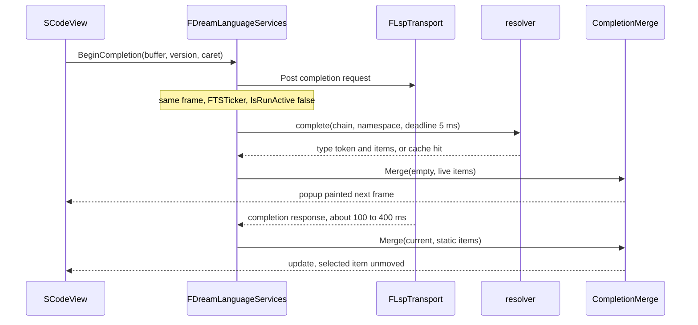

#### 7.5.4 Unreal-aware completers

| Completer | Context | Source | Lands |
|---|---|---|---|
| Editor-property names | String argument 0 of `get_editor_property('…')` / `set_editor_property('…')` on a resolved class | Its Editor Properties list (own and inherited), with type and `[Read-Write]`/`[Read-Only]` as detail | M1 |
| Enum members | Members of a class whose metatype is `_EnumType` | Type-dict keys whose value is an `_EnumEntry` (N3), ranked first. Docs from the entry's `__doc__` slot | M1 |
| `/Game` asset paths | String argument 0 of `unreal.load_asset`, `load_object`, `find_asset`, and the `EditorAssetLibrary` load and find functions | `FAssetPathCache` (C++). Folders from `IAssetRegistry::GetSubPaths` and assets from `GetAssetsByPath(Path, Out, false)` (`Engine/Source/Runtime/AssetRegistry/Public/AssetRegistry/IAssetRegistry.h:311, 679`), filled for the folder being typed on idle slices of ≤ 2 ms (*proposed*). Invalidated by `OnAssetAdded`, `OnAssetRemoved` and `OnAssetRenamed` (`:929, 936, 943`). Cached entries return at once; the rest merge in late. While `IsLoadingAssets()` (`:1025`), a row says "Asset Registry loading…". It never loads a package | M2 |

#### 7.5.5 Snake_case fuzzy matching

One matcher in `dream::CompletionMerge` scores completion and the Go To palette.
- Query characters must appear in order, case-insensitively.
- Scoring:
  - +32 for a whole-label prefix;
  - +16 per match at a word start (string start, after `_`, or a camelCase hump);
  - +8 per consecutive match;
  - +4 per exact-case match;
  - −1 per skipped character after the first match.
- The DP is O(|q|·|label|), with labels capped at 128 characters.
- Examples: `gep` → `get_editor_property`; `sal` ranks `set_actor_location` above `salt`.
- The weights are *proposed* and tuned on T-MRG-019.

#### 7.5.6 Interfaces

```python
# dream_editor/_impl/resolver.py — game thread, idle only, never raises
def complete(req: dict) -> dict:
    """req: {"chain", "context", "namespace": "session"|"isolated:<buf>"|"frame:<id>", "deadline_ns", "want_members_for"}
       -> {"token", "items", "incomplete", "root_bound", "elapsed_us"}"""
def hover(req: dict) -> dict | None: ...
def signature(req: dict) -> dict | None: ...
def definition(req: dict) -> dict | None: ...     # {"file", "line"} or {"stub": qualified_name}
def session_names(namespace: str) -> tuple[str, ...]: ...
# dream_editor/_impl/saferepr.py — game thread, never raises, runs no user code (§7.7)
def saferepr(value: object, deadline_ns: int) -> str: ...   # ≤ 200 characters
# dream_editor/_impl/stubsnap.py
def begin(key: str, modules: list[str] | None) -> None: ...
def step(budget_ns: int) -> tuple[bool, dict]: ...  # (done, stats)
def cancel() -> None: ...
# _dream additions (C API): hard_object_props(py_class_name) -> frozenset[str];
#   container_element_kind(value) -> str | None; container_export_text(value, start, count) -> list[str];
#   struct_export_text(value) -> str | None; soft_props(value) -> frozenset[str]; prop_export_text(value, name) -> str (§8.8);
#   stub_emit(module, fragment: bytes) -> None; stub_module_done(module, count, sha256) -> None
```

**Open items.**
- N1 refines E2 and needs the chief architect's sign-off. RV-21 already rules that inspection never loads and never runs user code, and N7 applies that to container elements. §8's inspector must adopt both.
- Confirm that resolving a `TObjectPtr` never loads in the 5.8 editor. T-RES-017 counts package loads.

---

### 7.6 dream::CompletionMerge and the popup

#### 7.6.1 Merge

`MergeCompletions` is a **pure function**: no state, no I/O, deterministic.
- **Key:** the label, exact and case-sensitive (D6).
- **When both sources have a label,** the static item supplies the detail, documentation and insert text. The live concrete type is appended (" · runtime: StaticMeshActor"), and the badge is `static`.
- **Badges (U4):**
  - `runtime`: live-only items;
  - `static`;
  - `keyword`: DreamCore's table of 3.11 keywords, soft keywords and builtin names;
  - `snippet`: from `FDreamLibrary`.

  There is **no `project` badge**.

| Buffer kind | Group order |
|---|---|
| REPL, scratch, console executor | G0 scope names (Session names, frame locals, parameters) → G1 live members → G2 static members → G3 keywords and snippets |
| File buffer | G0 static locals → G2 → G1 → G3. If the chain's root is bound in the Session and the tab runs in Session mode, the REPL order is used (D6) |

- **Within a group:** fuzzy score, then server `sortText`, then label. `_` names sink unless the prefix starts with `_`; dunders come last. Snippets match by prefix only.
- **No-reorder rule (D6).** With S the selected index, a late merge keeps items `0..S` in identity and order. New and re-scored items go below S. A new item that ranks above S lands at S+1. Pinned items may still be enriched in place.
- **Incomplete lists.** If a server says `isIncomplete` or the resolver says `incomplete`, the next keystroke re-requests. Otherwise a growing prefix is re-filtered locally.

```cpp
namespace dream {
enum class CompletionSource : uint8_t { Live, Static, Keyword, Snippet };
struct CompletionCandidate { std::string Label, FilterText, SortText, Detail, Documentation, InsertText, RuntimeType;
                             CompletionKind Kind; CompletionSource Source; ScopeGroup Group;
                             bool bInsertIsSnippet = false; uint64_t ResolveHandle = 0; };
struct MergeContext { BufferKind Kind; bool bRootBoundInSession; std::string_view Prefix; int32_t SelectedIndex; };
struct MergedList   { std::vector<MergedItem> Items; int32_t SelectedIndex = 0; bool bIncomplete = false; };
MergedList MergeCompletions(const MergedList& Previous, std::span<const CompletionCandidate> Incoming,
                            CompletionSource IncomingSource, const MergeContext& Context);   // pure
}
```

#### 7.6.2 Popup lifecycle

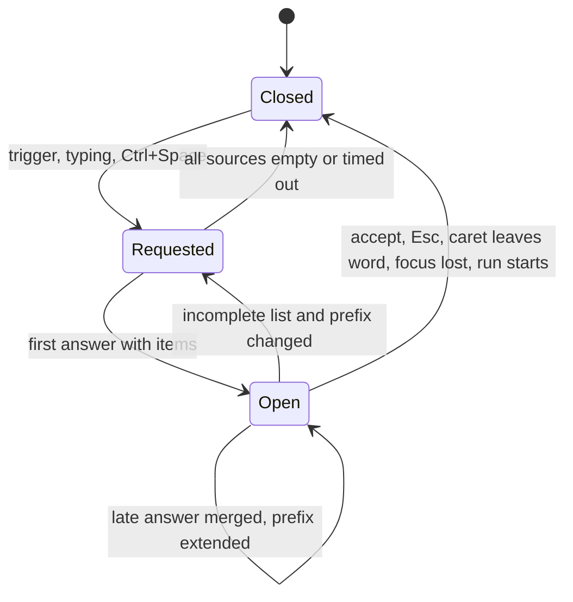

- **Triggers:**
  - an identifier character after `Completion.MinChars` (default 1);
  - `.`;
  - a quote in an unreal-aware string context;
  - **Ctrl+Space**, never Ctrl+Tab (D8).
  
  Shell mode (CFG-05) opens only on Tab or Ctrl+Space.
- **First answer.** Live answers come in the same frame (the FTSTicker runs after both Slate ticks, E10), and the popup paints the next frame. That gives ≤ 30 ms at ≥ 60 fps (PERF-06); at lower frame rates, one frame plus the resolver time.
  - With no live answer, the popup opens on the server's answer.
  - After an explicit Ctrl+Space, a "Loading…" row appears at 150 ms (*proposed*).
- **Accept** with Enter or Tab.
  - Server `textEdit` and `insertText` are honoured; snippet text goes through `dream::SnippetEngine`.
  - Live items insert their label.
  - No commit characters (*proposed*: `(` and `.` never accept, which avoids surprising insertions).
- **Resolve.** `completionItem/resolve` is sent for the selected item when its docs show, and cancelled when the selection moves.
- **Close.** A run start closes the popup (D6).

---

### 7.7 Hover, signature help and quick docs

One parser serves live and static sources (D5, D6).

- **Hover.** LSP hover and `resolver.hover` run in parallel.
  - The live answer shows as soon as it exists. For unreal members it is the parsed first line, Args, Returns, `[Read-Write]` flag and C++ Source.
  - A static answer within 1.5 s replaces the body, and the live type stays as a footer (INT-05: ≤ 300 ms to show).
  - **Values** are shown only through `dream_editor._impl.saferepr`, the bounded reading of U18's "`repr` on built-in types only" (RV-21). No user `__repr__` runs:
    - it recurses only into exact `list`, `tuple`, `dict`, `set` and `frozenset` (`type(v) is list`, and so on), to depth 2 and at most 20 items per level;
    - it calls `repr` only on exact `int`, `float`, `bool`, `None`, `str` and `bytes`, each cut at 200 characters (a `str` or `bytes` is sliced before `repr`, and a `repr` that raises, such as an int over the 3.11 digit limit, shows `<int>`);
    - it shows an `unreal.Object` wrapper as its class and path, read through C++ as §8.8 does;
    - it shows anything else as `<TypeName>`, with the name read by `type.__dict__['__name__'].__get__(type(v))`;
    - it stops at 200 characters in total, or at the resolver deadline, whichever comes first.
    
    An `unreal.Array`, `Map` or `Set` is not an exact built-in container, so it shows as `<Array>`, `<Map>` or `<Set>`, and hover never reads its elements (§7.5.2). §8's safe watches and Variables use the same helper (§8.3.6).
  - Hover on an alias says "selection as of <time>" (U19). Once the name is user-owned (U19, U20), the hover says "sel: your value since Run #N; no longer refreshed", with the alias's own name in place of `sel`.
- **Signature help** (INT-04) opens on `(` and `,`.
  - `dream::PyLexer` computes the active parameter from the call's `(` to the caret: commas at depth 0, and `name=` matched against the parameter list. A server `activeParameter` wins.
  - Live signatures come from `docstrings.parse_method`. `X.` methods show no `self`.
- **Quick docs, Ctrl+Q** (D8). A non-modal popup at the caret, closed with Esc. It shows:
  - the full docstring;
  - for classes, the Editor Properties table, with a filter, flags and inherited rows marked;
  - the C++ Source block;
  - a link built from `QuickDocs.OnlineUrlTemplate`.
  
  **F1 is not used**, because the AI Assistant's pre-processor takes it (D8). `help()` and `dir()` stay in the context menu.
- **Open item.** The default online URL template is unverified, so it ships as a setting.

---

### 7.8 Diagnostics, Problems and quick fixes

#### 7.8.1 Model

```cpp
enum class EDreamProblemSource : uint8 { TypeServer, Ruff, DreamCheck, Parse, Runtime };
enum class EDreamSeverity : uint8 { Error, Warning, Info, Hint };
struct FDreamProblem
{
    FDreamBufferId Buffer; EDreamProblemSource Source; EDreamSeverity Severity;
    FString Code, Message, DedupClass; FDreamAnchoredRange Range;      // anchors move with edits (§4)
    uint64 DocVersion = 0; uint32 RunNumber = 0; bool bStale = false, bHasQuickFix = false;
    FString RunSourceKey;                 // Runtime only: buffer ID, entry-point file or shelf item ID of the raising run
    FString ModulePath;                   // Runtime only: file of the raising frame, for reload clearing
};
class FDreamLanguageServices::FProblemsModel
{
public:
    void ReplaceSource(FDreamBufferId, EDreamProblemSource, TArray<FDreamProblem>&& Items);
    void AddRuntimeProblem(const FDreamRunRecord& Run);           // U13, from §5/§6
    void OnLinesEdited(FDreamBufferId, int32 FirstLine, int32 LastLine);
    void OnRunStarted(const FString& RunSourceKey, FDreamBufferId Buffer); // clears Runtime items of that source; that buffer's Parse items
    void OnModuleReloaded(const FString& ModulePath);            // RLD-01: clears Runtime items raised in that file
    void ClearRuntimeItems();                                    // Problems ▸ Clear runtime items
    TArray<const FDreamProblem*> GetVisible(FDreamBufferId) const;  // merged, deduplicated, sorted
};
```

| Source | Produced by | Cleared when |
|---|---|---|
| Type server, ruff, dream-check | `publishDiagnostics` | A publish replaces that source's set; document close; on a crash, marked stale until the first new publish or 10 s |
| Parse | A pre-run parse fails in `Starting` (U7, RUN-16): the run is `not executed` | The next successful parse, or an edit of the line |
| Runtime (U13) | A run ends `error`: one item at the innermost traceback frame that maps to a Dream buffer (`<dream:Tab#id>` or an open file). Code = exception type; message truncated at 500 characters (*proposed*). The item keeps the run's source key: the buffer for buffer routes, the file for Run File and entry points, the item ID for shelf and snippet runs | The next run started from the same source as the run that raised it (buffer, entry point or shelf item); a reload of its module (RLD-01); an edit of the line; or Problems ▸ Clear runtime items. So an error raised in an imported `importer.py:88` by a run of `Untitled-3` clears when `Untitled-3` runs again |

#### 7.8.2 Merge, severity and filtering

- **Dedup** shows one item per `(Buffer, StartLine, DedupClass)`.
  - Each profile's `diagnosticCodeMap` sets `DedupClass`:
    - `syntax` for any syntax error;
    - `undefined-name:<n>` for ruff `F821`, pyright-family `reportUndefinedVariable` and the equivalent codes of other servers (verified in G3);
    - `unused-import:<n>` for `F401` and `reportUnusedImport`;
    - otherwise `<Source>:<Code>`, which never merges.
  - Which item is kept: for `syntax`, Parse > ruff > dream-check > type server; for every other class, type server > ruff > dream-check.
  - The tooltip names the duplicates that were merged.
- **Severity.** LSP 1–4 map to Error, Warning, Info and Hint. Hints are drawn faded and are not listed. The quiet profile (D4) maps to each server's own setting.
- **Session-name filter.** In Session-mode buffers, undefined-name items for names bound in the Session are hidden. The names come from `resolver.session_names`, read after each run in an idle slice, plus `sel`, `sel_assets`, `world` and `subsys` (U19). Isolated buffers keep the items.
- **Navigation.** F8 / Shift+F8 walk Problems. F4 / Shift+F4 walk traceback frames (U13). While a Dream widget has focus, F4 shadows the Level Editor's Show Actor Details and F8 shadows PIE Possess or Eject Player; the shadowed-shortcut page lists both (U23, RV-19). Counts in the status bar update within 250 ms (WS-05).

#### 7.8.3 Quick fixes and formatting

- **Quick fix: Ctrl+.** (Alt+Enter in the PyCharm preset; U22, focus only).
  - `textDocument/codeAction` goes to every capable server in parallel.
  - The menu lists preferred actions first, then type server, ruff and dream-check. Late sources append without moving the selection (§7.6.1).
  - A `WorkspaceEdit` applies as **one undo step per buffer** (EDT-08). Files that are not open are opened as dirty buffers, and nothing is written until the user saves. A fix computed for an older version is dropped and requested again.
  - Typical actions (INT-09): ruff fixes and line ignores, type-server add-import, SUM102 rewrite, SUM101 did-you-mean, SUM202 `dream_editor.sleep`, "Suppress SUMxxx on this line".
- **Format document: Shift+Alt+F** (PyCharm preset: Ctrl+Alt+L, U22) sends ruff `formatting`. A selection uses `rangeFormatting`. The result is one undo step. Format on save is opt-in (INT-10). Without ruff, the command is disabled with a reason.
- **Open item.** The Pyrefly and ty entries of `diagnosticCodeMap` (G3).

---

### 7.9 Navigation

#### 7.9.1 Go to definition (NAV-01)

Chords: F12, Ctrl+Click, or Ctrl+B in the PyCharm preset (shadows Browse to Asset while focused, U23).

1. **LSP `textDocument/definition`**, with a 5 s timeout. Stub targets open read-only (BUF-09).
2. **Live fallback,** when the server is down, slow or empty. `resolver.definition` resolves the expression under the caret:
   - **Python function:** `__code__` via `getattr_static` (an allow-listed slot), then `co_filename` and `co_firstlineno`.
   - **Class:** `__module__`, then that module's `__file__`, then the `class <Name>` line found by `dream::PyLexer`. `inspect.findsource` is never called.
   - **unreal symbol:** `pkg/index.json`. In M1, with no stubs yet, Quick docs opens instead.

Alt+Left / Alt+Right walk a 50-entry jump history (*proposed*).

#### 7.9.2 Outline (NAV-02)

- **With a server:** `documentSymbol` (hierarchical), merged with `# %%` cells from `dream::PyLexer`; servers do not know cells.
- **Without one:** an indentation scan by `dream::PyLexer` and `dream::FoldModel` lists `class`, `def` and `async def` with their nesting. It runs for the visible buffer only, within §4's keystroke budget.
- Click to jump; type to filter.

#### 7.9.3 The Go To palette and Shift Shift

`SDreamGoToPalette` chooses a provider by prefix:

| Prefix | Provider |
|---|---|
| `>` | `FDreamCommands` commands, with their chords (WS-06) |
| (none) | Files: open, recent, under the roots |
| `@` | Symbols in this file |
| `#` | LSP `workspace/symbol` |
| `:` | Line (NAV-03 P0, M1) |

- Ctrl+Shift+P opens the palette with `>`, and Ctrl+G with `:`. Ranking uses §7.5.5.
- **Shift Shift** cannot be an `FInputChord` (07e Q2), so it uses custom timing (D8).
  - `SDreamTab` and `SCodeView` track Shift key-down and key-up while a Dream widget has focus.
  - It triggers on two bare Shift presses (either side), with no other key or mouse button between them, where the second key-down comes within `Navigation.ShiftShiftIntervalMs` of the first key-up (default 300 ms, *proposed*; range 200–500).
  - It opens "everything" mode: files, symbols, snippets and commands. A symbol from an open file appears within 200 ms (WS-06).

#### 7.9.4 Find and replace in files (NAV-06)

- **Thread.** Ctrl+Shift+F (shadowed while focused, U23) starts `FDreamLanguageServices::FFindInFilesWorker`, an `FRunnable` named `Dream.FindInFiles`. A new query cancels the old one through a per-file generation check.
- **Roots:**
  - the project `Content/Python`;
  - script roots;
  - UE AdditionalPaths;
  - enabled project plugins' `Content/Python`.
- **Ignore files.** `.gitignore`, `.ignore` and `.p4ignore` are honoured at every directory level, with gitignore semantics (negation, anchoring, directory-only, `**`). The matcher lives in `dream::SearchEngine`.
- **Built-in excludes:** `Intermediate`, `Saved`, `Binaries`, `DerivedDataCache`, `.git`, `__pycache__`, plus `Search.Exclude`.
- **Skipped files:** over 5 MB, or containing a NUL byte in the first 8 KB.
- **Matching.** `dream::SearchEngine` does literal, case, whole-word and regex matching. **Open buffers are searched from their in-memory snapshots.**
- **Streaming.** Results stream to the game thread every 50 ms (*proposed*), inside the 1 ms drain.
- **Replace All** applies one edit per buffer, opening files as buffers. It writes one group record in `FDreamLocalHistory`, so "Undo Replace in Files" reverts every buffer at once (§10). Saving uses the normal path, including checkout (BUF-05).

---

### 7.10 Verification harnesses

#### 7.10.1 G3: stubs and language server

G3 runs during M1 and must pass before M2 starts (RT-10, §7.2 of 08).

**What M1 builds for G3 (RV-11).** The docstring parser and the Stage 2 transformer (§7.4.4–§7.4.5) are built in M1, together with a test-only probe client (`Tests/G3/probe`, built on `dream::LspClient`). They run inside the G3 harness against Pyrefly and basedpyright binaries pinned in CI only. Nothing third-party ships in M1: the `.pyi` package and its use by the shipped type server land in M2. The Phase 0 re-baseline budgets this work.

**Fixture `DreamG3Fixture`** (test repository only):
- ≥ 100 engine plugins, listed in its `.uproject`;
- one C++ project module and two project plugins with Python-exposed types;
- Developer Mode on **only here**, so the engine writes the oracle `Intermediate/PythonStub/unreal.py`.

**Procedure.** One editor session (tier 4) waits for the oracle, then runs stubsnap with production slicing and records every slice. stubgen, the comparisons and the server probes (tier 7: the probe client against the CI-pinned servers) then run out of process.

| Check | Pass (G3) | Method |
|---|---|---|
| Slices | Each ≤ 4 ms; total ≤ 60 s idle | `manifest.stats` and C++ timers |
| Parse / clean | Every `.pyi` parses with `ast`, and type-checks with zero errors under **both** Pyrefly and basedpyright | Each server's CLI |
| Coverage | ≥ 99.5% of classes, functions and properties in Epic's stub | `(class, member, kind)` sets from `ast` on both sides; `PyTest*` excluded on both; constants reported, not gated |
| Type agreement | ≥ 95% for parameters, returns and properties | Normalised strings (strip `unreal.`, `typing.`; Epic writes AutoCompletion mode, so no `Optional`) |
| Server | RSS ≤ 1.5 GB; warm completion p95 ≤ 400 ms for `unreal.`, `unreal.EditorAssetLibrary.` and `unreal.EditorActorSubsystem().`; diagnostics ≤ 1 s after a typing pause; first completion ≤ 15 s after spawn | RSS is the working set, sampled at 1 Hz as the supervisor samples it (§7.3.5). Warm = 100 requests per probe after the first answer (*proposed*) |
| Golden corpus | Score per server | 200 cases (below) |

- **Golden corpus.** 200 JSON cases in `Tests/G3/corpus/`: 80 completion, 60 hover and 60 signature (*proposed* split), drawn from journeys J1–J8 and the most-used editor APIs. Each case is `{id, kind, text (with ‸ for the caret), expect: {contains, absent, top_k, signature_label, active_param, hover_contains}}`. Score = passed / 200 × 100.
- **Selection (D4, RT-12).** Among servers that pass every absolute threshold, the higher score ships as the only supported server. Within 3 points, Pyrefly. The other becomes experimental.
  - Packaging cost (runtime size, SBOM, signing, Fab status) is also a G3 selection input, recorded with the scores. A Node-based winner ships a pinned Node.js runtime listed in `Resources/Manifest.json` (§7.3.2).
- **Fallbacks.**
  - *No server passes:* live completion serves `unreal.*`, and the server serves user code only (R05). `StubPath` then points to a minimal `unreal/__init__.pyi` that holds only `def __getattr__(name: str) -> Any: ...`. The **fallback thresholds** then apply (RV-12), and are recorded with the G3 result:
    - the shipped server is the highest scorer that meets the RSS and diagnostics thresholds above;
    - PERF-07 measures three user-code probes, `self.` in a method, a project module (a package under the fixture's `Content/Python`, such as `studio_tools.`) and `os.path.`, at warm p95 ≤ 400 ms; its first-completion bound (≤ 15 s after spawn) is unchanged;
    - `unreal.*` completion is gated by PERF-06 (runtime completion, T-RES-008, T-MRG-007).
    
    The M2 exit and INT-14 then read "G3 thresholds, or the recorded fallback thresholds, hold in CI".
  - *Walker fidelity fails after two weeks:* the §7.4.7 Epic-stub path is used.
- **After G3,** the suite runs nightly, and every toolchain bump is re-qualified on it (D15).

#### 7.10.2 The LSP chaos suite (tier 7)

**`DreamFakeLsp`** is a C++ test executable built from DreamCore. A JSON scenario drives it, with steps such as `respond`, `delay_ms`, `crash_after_n`, `abort`, `stop_reading_stdin`, `stop_writing`, `write_raw_bytes`, `flood_diagnostics`, `flood_stderr`, `spawn_grandchild`, `ignore_shutdown` and `send_request`.
- **Every commit:** it runs through the real `FLspTransport` and `FDreamLanguageServices`, in an editor Automation test.
- **Nightly:** the pinned real servers are killed (`TerminateProcess` / `SIGKILL`) and hung (`SuspendThread` / `SIGSTOP`).
- **Invariants in every scenario:** keystroke p95 ≤ 2 ms, no crash, drain ≤ 1 ms per frame, correct status states. The scenarios are in §7.12 (T-LSP-004 to -008, -021 to -024, -030, -041).

#### 7.10.3 The ProcessEvent counter test

A tier-4 test (D6 verification) opens a level with 200 actors and getter-instrumented fixtures, binds the Session to them, and runs 10,000 completions, hovers and signatures over the 500-chain corpus. The Session also holds `unreal.Array`, `Map` and `Set` values whose elements are soft object and soft class references, read from a fixture data asset, and lists and dicts of objects with a counting `__repr__`; the corpus subscripts and hovers them (RV-21). It counts two delegates:
- `FBlueprintContextTracker::OnEnterScriptContext`, which fires on every `ProcessEvent` in editor builds (N5). It catches UFunction calls, BlueprintGetters and ScriptConstant getters.
- `FCoreUObjectDelegates::OnEndLoadPackage` (`Engine/Source/Runtime/CoreUObject/Public/UObject/UObjectGlobals.h:3385-3386`), which catches soft-reference loads (N1).

**Pass: both counts are 0, and so is the fixtures' `__repr__` counter.** §8 reuses the harness for D30's inspector.

---

### 7.11 Failure modes

| Failure | Detection | Handling | What the user sees |
|---|---|---|---|
| Bundled binary missing or hash mismatch | Manifest check at first spawn | Not started; doctor item | "Types: unavailable — binary failed verification [Details]" |
| BYO binary refused by policy or hash | Pre-spawn policy check | Not started | "Types: blocked by policy" |
| Spawn fails (CreateProc error, antivirus) | Invalid handle | Backoff, then Paused | "Language features paused — [Restart] [View log]" |
| Repeated crashes | Process exit | Backoff 1–60 s; Paused after 5 in 3 min | `Restarting (n)`, then Paused; editing and running unaffected (REL-03) |
| Stall | 3 timeouts and 10 s of silence | Kill and restart; counts as a crash | Brief `Restarting`; live results continue |
| Malformed or oversized frame | `FrameDecoder` error | Kill and restart | As for a crash; the log names the error |
| Diagnostics or stderr flood | Coalescing; stderr rate cap | Newest set per document; drop marker | Nothing |
| Full stdin pipe | Write thread blocked | Read thread keeps draining; 32 MB outbound cap → protocol error | Nothing, or a restart |
| Editor crash or kill -9 | — | Job close (Win64); death signal (Linux); `processId` and `--watch` (macOS); orphan sweep | No leftover processes |
| Grandchild escapes the job | 2 s escape check | Killed; profile switches to Suspended | Nothing |
| RSS (working set) over the cap for 60 s | 1 Hz sampling | Restart; private commit only logged | "Type server restarted: memory above 1.5 GB" |
| Buffer grows past 5 MB | Size check before each `didChange` | `didClose` in the type server and ruff; `dream/skipped` to `dream-check`; reopened below 5 MB | SUM902 on the buffer; other diagnostics cleared |
| Result arrives during a run | `IsRunActive()` in `Tick` | Queued; applied after the run if not stale | Problems update after the run |
| Stale result | Version check (both threads) | Dropped | Formatting says "try again" |
| Snapshot interrupted | No `.complete` | Missing modules re-walked | SUM900 until done |
| Slice overrun (huge type) | `step` over 4 ms | 64-member batches; overrun counted | Nothing; G3 fails if it repeats |
| Docstring format changes (new engine) | Parser returns `None`; canary goldens fail | Untyped degradation; parser fix | Some members typed `Any` |
| stubgen crash | Non-zero exit | Previous package kept; one retry when idle | Doctor: "Stubs out of date" |
| Unknown descriptor type | `type(attr)` not known | Opaque | Name without type or doc |
| Resolver too slow | Over 20 ms | Circuit breaker for that type | Static-only results for that type |
| Python disabled or shut down (D16) | `OnPythonShutdown` | Resolver and stubsnap stop; index and LSP continue | No `runtime` items |
| `dream-check` crash or `python.exe` missing | Exit or spawn failure | Backoff; doctor item | `Lint: restarting` |
| Asset Registry still loading | `IsLoadingAssets()` | Partial list; refresh on `OnFilesLoaded` | "Asset Registry loading…" row |
| Soft reference in a chain | `hard_object_props` | Type level only | Declared-class members |
| Soft-element `Array`, `Map` or `Set` in a chain | `container_element_kind` | Never indexed or iterated; type level only | Declared element-class members |
| Container or object with a user `__repr__` on hover | `saferepr` exact-type checks | Shown as `<TypeName>`; output capped at 200 characters | No user code runs |
| Session names flagged as undefined | Session-name filter | Hidden in Session buffers | No false squiggles |
| Huge or network tree in find in files | Generation check; streaming | Cancellable; game thread unaffected | Streaming results |
| Untrusted folder ships a ruff config | `FDreamTrust` (§11) | `editorOnly` for that file | Quiet rules apply |
| Unsolicited `applyEdit` | No user action within 5 s | Refused | Nothing |

### 7.12 Tests

| ID | Tier | What it checks | Pass criterion | Covers | Lands |
|---|---|---|---|---|---|
| T-LSP-001 | 1 | `FrameDecoder`, input split at every byte; libFuzzer | Same messages; no crash in 10M inputs | D4 | M1 |
| T-LSP-002 | 1 | Missing, negative or over-64 MB length; header over 8 KB; bad JSON | Correct `FrameError`; no allocation over the cap | D4, REL-03 | M1 |
| T-LSP-003 | 1 | `EncodeFrame` with multi-byte UTF-8 | Exact byte count; no trailing `\n` | D4 | M1 |
| T-LSP-004 | 7 | 1 MB of stderr interleaved with frames; 100 MB of stderr | 0 frame errors; log rotates at 10 MB; excess over 1 MB/s dropped with a marker | D4, TEL-01 | M1 |
| T-LSP-005 | 7 | Server floods stdout and never reads stdin; we send 10 MB | No deadlock; keystroke p95 ≤ 2 ms | D4, REL-03 | M1 |
| T-LSP-006 | 7 | Win64: kill -9 the host | Server gone within 1 s | D4 | M1 |
| T-LSP-007 | 7 | Immediate grandchild, Engine and Suspended modes | Engine: escape detected, profile flips; Suspended: contained, killed with the host | D4 | M1 |
| T-LSP-008 | 7 | Linux `dream-spawn --exec`; host killed, including before `prctl` | SIGKILL delivered; early case exits 125 | D4 | M1 |
| T-LSP-009 | 2 | dream-check parent watch; `processId` in `initialize` | Exits within 2 s of parent death; PID matches | D4 | M1 |
| T-LSP-010 | 4 | Docked tab restored at editor start | No child and no `dream_editor` import before the first focus or keystroke, or 10 s after `OnFEngineLoopInitComplete`; added startup ≤ 30 ms; spawn order dream-check, ruff, type server | RT-17, PERF-01 | M2 |
| T-LSP-011 | 1 | Completion, hover and formatting replies for an old version | Dropped; formatting notice | D4, D6 | M1 |
| T-LSP-012 | 1 | 1M random edits, UTF-8 and UTF-16, astral characters | Fake server's mirror equals the client at every version | D4 | M1 |
| T-LSP-013 | 1 | Server wants Full sync | Full text on each change | D4 | M1 |
| T-LSP-014 | 1 | Fake clock: request pending 1.5 s | One `$/cancelRequest`; late reply dropped; Timeout reported | D4, PERF-07 | M1 |
| T-LSP-015 | 1 | Crash sequence | Backoff 1, 2, 4 … 60 s; Paused after 5 in 180 s; reset after 300 s healthy | INT-11 | M1 |
| T-LSP-016 | 7 | Restart with 5 open documents | All re-opened at current versions; diagnostics back within 5 s | INT-11 | M1 |
| T-LSP-017 | 1 | Capability negotiation | Missing features not routed; UTF-8 when offered, else UTF-16 | D4 | M1 |
| T-LSP-018 | 1 | Profile goldens for Pyrefly, basedpyright, ty, ruff, dream-check | Equal to goldens; excludes contain `**/Intermediate/PythonStub/**`; no config file written to the project root | D4, D5 | M2 |
| T-LSP-019 | 1 | Server → client requests | `configuration` per `scopeUri`; unknown → `MethodNotFound`; unsolicited `applyEdit` → `applied:false` | D4 | M1 |
| T-LSP-020 | 4 | Results during a run, with nested FTSTicker ticks from user code | Nothing applied until the run ends; stale results then dropped | RT-01 | M1 |
| T-LSP-021 | 7 | Stall | Restart after 3 timeouts and 10 s; keystroke p95 ≤ 2 ms | INT-11, REL-03 | M1 |
| T-LSP-022 | 7 | 10,000 diagnostics/s for 60 s | Drain ≤ 1 ms per frame; queue memory flat | REL-03, PERF-08 | M1 |
| T-LSP-023 | 7 | 100 MB frame | Protocol error and restart; peak allocation under 64 MB | D4 | M1 |
| T-LSP-024 | 7 | Fake server A holds a 1.6 GB working set for 60 s; fake server B holds 1.6 GB of private commit with a 1.0 GB working set for 120 s | A restarted with notice; B not restarted, its commit logged; both sampled at 1 Hz | PERF-11, G3 | M1 |
| T-LSP-025 | 4 | Policy `language_services.enabled=false` | No children; status says why; edit and run work | SEC-02, D4 | M4 |
| T-LSP-026 | 4 | Policy pins basedpyright with a BYO path: wrong, then right SHA-256; also no path at all | Refused; then started with the Experimental badge; with no path, the role is empty and says why | RT-12, SEC-02, INT-14 | M4 |
| T-LSP-027 | 4 | Bundled binary hash mismatch | Not started; (from M4) doctor item | ENV-04, D4, INT-14 | M2 (M4: doctor item) |
| T-LSP-028 | 4 | `-DreamSafeMode` | No servers | D17 | M1 |
| T-LSP-029 | 4 | Every health transition | Shown within 250 ms | WS-05, INT-11 | M1 |
| T-LSP-030 | 7 | Kill the server 10 times while typing | Typing never blocks; every state shown | INT-11, REL-03 | M1 |
| T-LSP-031 | 2 | dream-check on a 5,000-line file: edits 100 ms apart for 5 s, then a pause | No analysis while edits arrive less than 300 ms apart; diagnostics ≤ 1 s after the last change | INT-07, PERF-08 | M1 |
| T-LSP-032 | 2 | dream-check import audit under `-I` | Only stdlib, `dream_tools`, `dream_docstrings`; no `dream_editor` | D4, D7 | M1 |
| T-LSP-033 | 7 | ruff with no config, then a `ruff.toml` selecting E501 | Quiet set only; then E501 reported | INT-07, D4 | M2 |
| T-LSP-034 | 7 | Format twice, then undo | Idempotent; one undo step | INT-10, EDT-08 | M2 |
| T-LSP-035 | 7 | `# noqa: SUM102` with ruff on | ruff silent about it | D4, U5 | M2 |
| T-LSP-036 | 7 | Scratch virtual path, each pinned server | `didOpen` accepted; completion works | D4 | M2 |
| T-LSP-037 | 1 | Diagnostics coalescing | Only the newest set per document posted | REL-03 | M1 |
| T-LSP-038 | 7 | G3 server thresholds, or the recorded fallback thresholds when the "no server passes" fallback is in force (RV-12) (M1: the CI-pinned servers in the G3 harness, RV-11; from M2: also the shipped server) | G3: RSS ≤ 1.5 GB; warm p95 ≤ 400 ms on 3 probes; diagnostics ≤ 1 s; first completion ≤ 15 s. Fallback: RSS ≤ 1.5 GB; diagnostics ≤ 1 s; warm p95 ≤ 400 ms on `self.`, a project module and `os.path.`; first completion ≤ 15 s | G3, PERF-07, PERF-11, INT-14 | M1 (M2: shipped server) |
| T-LSP-039 | 7 | Golden corpus and selection rule, run in M1 against the CI-pinned servers (RV-11); from M2, nightly on the shipped server | Scores recorded; winner chosen per D4 (Pyrefly within 3 points) | G3, RT-12, INT-06, INT-14 | M1 (M2: shipped server) |
| T-LSP-040 | 7, 4 | Fallback minimal stub: in M1 the G3 probe client runs each CI-pinned server with `StubPath` set to the minimal `unreal/__init__.pyi` (§7.10.1, RV-11); (from M2) the shipped server in the editor | No unknown-attribute diagnostics on `unreal.*` names; (from M2) `unreal.*` completion comes from live results | G3 | M1 (M2: shipped server in the editor) |
| T-LSP-041 | 7 | Orphan sweep: a recorded child whose editor died; a reused PID with another start time | First killed; second untouched | D4 | M1 |
| T-LSP-042 | 7 | macOS `dream-spawn --watch`: host killed | Server group killed within 1 s (1.2) | D4, D9 | 1.2 |
| T-LSP-043 | 4 | Protocol trace | Off by default; when on, (from M4) excluded from the bundle unless ticked | D17, D26, SEC-NF-04 | M1 (M4: bundle exclusion) |
| T-LSP-044 | 4 | Editor exit with 3 servers, one ignoring `shutdown` | All gone; exit delay ≤ 1 s | D4 | M2 |
| T-LSP-045 | 4 | Open a 6 MB file; open a 2 MB file and paste 4 MB into it, then undo; open a 500 KB file in Plain mode | 6 MB file: (from M2) never sent to the type server or ruff; `dream-check` gets only `dream/skipped` and reports SUM902. Paste: (from M2) `didClose` to the type server and ruff, `dream/skipped` to `dream-check`, no protocol error; undo reopens it at the current version. Plain-mode file: opened in every running server (all three from M2) | BUF-09, EDT-15 | M1 (M2: type server and ruff) |
| T-STUB-001 | 2 | Fake `unreal` with counting getters, `constant_value`, `_EnumEntry`, properties, module `__getattr__` | All counters 0 | D5, INT-15 | M1 |
| T-STUB-002 | 2 | 50,000 fake types, 4 ms budget | Max step ≤ 4.5 ms; completes | D5, G3, INT-15, PERF-15 | M1 |
| T-STUB-003 | 2 | `PyTest*` types | Absent; counted in `filtered` | D5, INT-15 | M1 |
| T-STUB-004 | 2 | `__module__ == 'builtins'` types in `_unreal_engine` | Grouped under `engine` | D5 | M1 |
| T-STUB-005 | 4 | Walker on the 100-plugin fixture | Each slice ≤ 4 ms; total ≤ 60 s idle | G3, INT-15, PERF-15 | M1 |
| T-STUB-006 | 2 | Schema validation and round trip | Valid v1; reload equals source | D5, RT-13, INT-15 | M1 |
| T-STUB-007 | 2 | Parser on 500 captured 5.8 docstrings | Equal to goldens | D5, D6 | M1 |
| T-STUB-008 | 2 | Fuzzed docstrings | Never raises; failures return `None` | D5 | M1 |
| T-STUB-009 | 2 | `__init__.pyi` | `X as X` for every public name; no star import | D5 | M1 |
| T-STUB-010 | 2 | Base ordering | Topological; cross-file bases imported | D5 | M1 |
| T-STUB-011 | 2 | Every `.pyi` | Parses with `ast`; none over 2 MB | D5, INT-12 | M1 (M2: shipped package) |
| T-STUB-012 | 7 | Stage 2 package under the CI-pinned Pyrefly and basedpyright (M1, RV-11); from M2, the shipped package | 0 errors | G3 | M1 (M2: shipped package) |
| T-STUB-013 | 4 | Coverage against Epic's stub | ≥ 99.5% classes, functions, properties | G3, INT-01 | M1 |
| T-STUB-014 | 4 | Type agreement | ≥ 95% parameters, returns, properties | G3 | M1 |
| T-STUB-015 | 2 | Unparseable member doc | Untyped output; listed in `report.json` | D5 | M1 |
| T-STUB-016 | 2 | Cache key and retention | Key changes with each input, stable otherwise; only 2 keys kept | D5 | M1 |
| T-STUB-017 | 4 | Load a test plugin module at runtime | After 2 s, only `_<m>*.pyi` and `__init__.pyi` change; `didChangeWatchedFiles` sent | D5 | M2 |
| T-STUB-018 | 4 | Project without Developer Mode | `bDeveloperMode` unchanged; no `PythonStub/unreal.py`; no "Generating unreal.py" task | D5, INT-01 | M1 |
| T-STUB-019 | 2 | Export stubs | Package, valid `pyrightconfig.json`, VS Code and `pyrefly.toml` snippets, README; printed block | INT-12 | M2 |
| T-STUB-020 | 7 | pyright CLI completion probe on the export | `unreal.EditorAssetLibrary.` completes; nothing skipped for size | INT-12 | M2 |
| T-STUB-021 | 2 | Generated server configs | Exclude `Intermediate/PythonStub` | D5 | M1 |
| T-STUB-022 | 2 | `docstrings.py` imports | Stdlib only | D5, D7 | M1 |
| T-STUB-023 | 2 | `unreal` dict walk | Functions and glue types present; Blueprint types absent | D5 | M1 |
| T-STUB-024 | 4 | M1 shipped build (stubgen is built for G3 only and not shipped, RV-11) | Snapshot completes; SUM101 fires on `unreal.EditorAssetLibary`; no `.pyi` package and no third-party binary in the build | RT-13, INT-08, INT-15 | M1 |
| T-STUB-025 | 2 | Walk interrupted mid-module | No `.complete`; resumes; SUM900 meanwhile | D5, RT-13 | M1 |
| T-STUB-026 | 4 | `OnModulesChanged` during a run | Only recorded; walk starts when idle | D5, D14 | M1 |
| T-STUB-027 | 2 | stubgen exits non-zero | Previous package kept; one retry | D5 | M1 |
| T-STUB-028 | 4 | Slice gating | No slice while `IsRunActive()`, a modal is open, or within 300 ms of a Dream keystroke | D5, D14 | M1 |
| T-RES-001 | 2 | `property`, `__getattr__`, `__getattribute__`, custom descriptor with side effects | Members listed; counters 0 | D6, INT-02 | M1 |
| T-RES-002 | 2 | Unreal getset with a counting getter | Never invoked; type from `(Type)` | D6, E1 | M1 |
| T-RES-003 | 2 | Object reference vs struct, container, deprecated | Only the object reference read via `get_editor_property` | D6, E2 | M1 |
| T-RES-004 | 2 | Soft property (excluded by `hard_object_props`) | Never read; type level | D6, INT-02 | M1 |
| T-RES-005 | 2 | Literal subscripts on exact list, tuple, dict, Array, Map; non-literal key; dict subclass; fake `container_element_kind` reporting `SoftObjectProperty`, `SoftClassProperty`, `LazyObjectProperty` or `None` | Only literals on exact types resolve; subclass `__getitem__` never called; a soft, lazy or `None` element kind resolves at type level with no `__getitem__` or `__iter__` call | D6, INT-02 | M1 |
| T-RES-006 | 2 | `inspect.signature` patched to count | 0 calls | D6 | M1 |
| T-RES-007 | 2 | 100,000 names; deep chains | Returns within 5.5 ms with `incomplete: true` | D6, PERF-06 | M1 |
| T-RES-008 | 4 | 500-chain corpus in the editor | p95 ≤ 5 ms | D6, PERF-06 | M1 |
| T-RES-009 | 2 | Same request twice, then a new generation | Cache hit without namespace access; then miss | D6 | M1 |
| T-RES-010 | 2 | Namespace by buffer mode | Session names in Session buffers only; Isolated sees its last run; `unreal.*` everywhere | D6, D8, RUN-10 | M1 |
| T-RES-011 | 4 | Requests while Running and (from M3) Task running | Resolver not called; footer shown; `unreal.EditorAssetLibrary.` completes from the index | D6, D14 | M1 (M3: Task running) |
| T-RES-012 | 2 | Paused root | Frame locals, then globals | D6 | M1 |
| T-RES-013 | 2 | `get_editor_property('‸')` | Own and inherited editor properties with flags | D6 | M1 |
| T-RES-014 | 2 | Enum members | Entries first, from dict keys; no `__get__` | D6 | M1 |
| T-RES-015 | 4 | `/Game/` path completion | Cached at once; late folder merge; invalidated on add/rename/remove; loading row while `IsLoadingAssets()`; 0 package loads | D6 | M2 |
| T-RES-016 | 1 | Fuzzy goldens | `gep` → `get_editor_property` first; `set_actor_location` above `salt` for `sal` | D6 | M1 |
| T-RES-017 | 4 | ProcessEvent counter (§7.10.3): 10,000 completions, hovers, signatures, including subscripts and hovers on Session-bound `Array`, `Map` and `Set` values of soft object and soft class references, and hovers on lists and dicts of objects with a counting `__repr__` | `OnEnterScriptContext` 0; `OnEndLoadPackage` 0; `__repr__` counter 0 | D6, INT-02, U18 | M1 |
| T-RES-018 | 2 | User descriptor whose `__doc__` is a property | Not invoked; opaque item | D6 | M1 |
| T-RES-019 | 2 | Value whose `__class__` is a counting property | Counter 0 | D6 | M1 |
| T-RES-020 | 2 | `session_names` with 10,000 names | Within one 2 ms slice | U13, D6 | M1 |
| T-RES-021 | 4 | Console executor `unreal.EditorAss` | Suggests `EditorAssetLibrary`; no Python call on the input path | UEI-08 | M1 |
| T-RES-022 | 2 | Call forced over 20 ms | Breaker for that type; one log line | D6 | M1 |
| T-RES-023 | 2 | Hover on `sel`; then hover again with `sel` marked user-owned by Run #N (as after running the Ctrl+Shift+V line) | "selection as of <time>"; then "sel: your value since Run #N; no longer refreshed" | U19, U20, VAR-02 | M3 |
| T-RES-024 | 4 | Live `StaticMeshActor` with an instrumented getter | Editor properties and functions listed; getter never invoked | INT-02 | M1 |
| T-RES-025 | 2 | Class unknown to `hard_object_props` | No `get_editor_property` call | D6 | M1 |
| T-RES-026 | 4 | `hard_object_props` on object, soft, weak, lazy and class properties | Contains object, weak, class only | D6 | M1 |
| T-RES-027 | 2 | Alias rewrite; a 10 s-old `get_editor_property` value | Root cache cleared, member lists kept; value re-read | D6, U19 | M1 |
| T-RES-028 | 4 | A fixture data asset with `TArray`, `TMap` and `TSet` properties of soft object and soft class references (targets not loaded), read into the Session by a run. Then: `meshes[0].` and `by_name["a"].` completion; hover on each container; (M3) Variables expands and pages each one, and safe watches `meshes[0]`, `len(meshes)` and `min(meshes)` refresh after the run (RV-21) | `OnEndLoadPackage` 0 and `OnEnterScriptContext` 0 throughout; completion lists the declared element class's members; no element is subscripted or iterated; (M3) Variables shows export text for the first 100 elements | D6, INT-02, VAR-01, VAR-04 | M1 (M3: Variables and watches) |
| T-RES-029 | 2 | `saferepr` and hover on: a list of 10 objects with a counting `__repr__`, nested in a dict; a 2,000,000-element list of ints; a 1 MB `str`; a list nested 5 deep | Counter 0; objects shown as `<TypeName>`; depth 2 and 20 items per level; every result ≤ 200 characters and returned in under 5 ms | D6, U18, INT-05 | M1 |
| T-MRG-001 | 1 | `MergeCompletions` property test | Deterministic | D6 | M1 |
| T-MRG-002 | 1 | Same label static and live | One item: static docs, runtime annotation, `static` badge | D6, INT-03 | M1 |
| T-MRG-003 | 1 | Badges | Only `runtime`, `static`, `keyword`, `snippet` | U4, INT-03 | M1 |
| T-MRG-004 | 1 | No-reorder property test | Items `0..S` unchanged by any late merge | D6 | M1 |
| T-MRG-005 | 1 | REPL and scratch ranking | G0, G1, G2, G3 | D6, REPL-03 | M1 |
| T-MRG-006 | 1 | File ranking with and without a Session-bound root | Static first; REPL order when bound | D6 | M1 |
| T-MRG-007 | 4 | Keystroke to popup paint with a live result at 60 fps | ≤ 30 ms p95 | PERF-06, D6 | M1 |
| T-MRG-008 | 4 | Server answers after 300 ms with the popup open | Merged; selection and items above unmoved | D6, INT-03 | M2 |
| T-MRG-009 | 1 | Prefix extension | Local re-filter unless incomplete | D6 | M1 |
| T-MRG-010 | 4 | Shell mode | No popup until Tab or Ctrl+Space | CFG-05 | M2 |
| T-MRG-011 | 4 | Ctrl+Space vs Ctrl+Tab | Only Ctrl+Space opens completion | D8 | M1 |
| T-MRG-012 | 1 | `_` and dunder names | Demoted unless the prefix starts with `_` | D6 | M1 |
| T-MRG-013 | 4 | Run starts with the popup open | Closes | D6 | M1 |
| T-MRG-014 | 1 | Server `sortText`, `filterText` | Respected within a group | D6 | M1 |
| T-MRG-015 | 4 | REPL `unreal.EditorAssetLibrary.sa` | Offers `save_asset` | REPL-03 | M1 |
| T-MRG-016 | 4 | `sel[0].` on a live `StaticMeshActor` | Static `Actor` plus live members, deduplicated | INT-03 | M2 |
| T-MRG-017 | 4 | `completionItem/resolve` | Sent for the selected item; cancelled on move | D4 | M2 |
| T-MRG-018 | 4 | Snippet-format insert | `dream::SnippetEngine` tab stops | EDT-12 | M4 |
| T-MRG-019 | 1 | Golden merge corpus | Equal to goldens | D6 | M1 |
| T-MRG-020 | 4 | Hover on `save_asset`; on a user object | Within 300 ms; static replaces live; values only through `saferepr`, so the user object shows as `<TypeName>` | INT-05, U18 | M1 |
| T-MRG-021 | 4 | Signature help on `rename_asset(` and after `,` | Both parameters; active parameter right | INT-04 | M1 |
| T-MRG-022 | 4 | Ctrl+Q on a class | Docstring, filterable Editor Properties, C++ Source, link; F1 unused | INT-05, D8 | M1 |
| T-MRG-023 | 4 | Ctrl+Space with only a slow server | "Loading…" at 150 ms; opens on the answer | D6 | M2 |
| T-MRG-024 | 4 | Accept keys | Enter and Tab accept; `(` and `.` do not | D6 | M1 |
| T-DIAG-001 | 2 | SUM101, incl. `import unreal as ue`, `from unreal import X` | Positives only; closest-name fix; SUM900 without a snapshot | U5, INT-08, RT-13 | M1 |
| T-DIAG-002 | 2 | SUM102: edit-only (`mesh.lod_group = …`), BlueprintReadOnly-but-editable, unknown type, negatives (`tex.lod_bias = 1`, a Read-Write attribute); then the variant turned on | Warning on the two cases, each with its §7.3.3 message (edit-only: "… raises AttributeError. Use set_editor_property."); Information on unknown type; silent on `self.x` and Read-Write attributes by default; with the variant on, `tex.lod_bias = 1` gets the notification message | U5, INT-08 | M1 |
| T-DIAG-003 | 2 | SUM102 fix goldens | Assign and AugAssign rewritten; multi-line value kept; no fix for chained targets | U5, INT-09 | M1 |
| T-DIAG-004 | 2 | SUM103 | Fires; fix renames | U5, INT-08 | M1 |
| T-DIAG-005 | 2 | SUM104 with the undo toggle on and off; inside `ScopedEditorTransaction` | Only when off and unwrapped | U5, U3 | M1 |
| T-DIAG-006 | 2 | SUM201: direct, depth-2 helper, `Thread.run`, `executor.submit` | Fires on each | U5, LRS-07 | M1 |
| T-DIAG-007 | 2 | SUM202 in a loop, in a thread target, in a task | First only; fix inserts `dream_editor.sleep` | U5, LRS-07 | M1 |
| T-DIAG-008 | 2 | SUM203 | `asyncio.run`, `run_until_complete` flagged | U5, LRS-07 | M1 |
| T-DIAG-009 | 2 | SUM204, SUM205 | `input()` and timeout-less `join()` flagged | LRS-07 | M1 |
| T-DIAG-010 | 2 | SUM301: literal, f-string, `project_content_dir()`; temp-dir negative | Content paths only | U5, INT-08 | M1 |
| T-DIAG-011 | 2 | `# noqa: SUM102`, bare `# noqa` | Suppressed | INT-09 | M1 |
| T-DIAG-012 | 4 | Undefined name from the type server and ruff | One item; type server kept; ruff named in the tooltip | INT-07 | M2 |
| T-DIAG-013 | 4 | Syntax error from Parse, ruff, dream-check | One item; Parse kept | RUN-16, INT-07 | M2 |
| T-DIAG-014 | 4 | Severity and quiet profile | Hints unlisted; style rules absent | INT-07 | M1 |
| T-DIAG-015 | 4 | Clearing | Publish replaces; close clears; crash → stale → cleared | INT-11 | M1 |
| T-DIAG-016 | 4 | Run raising on buffer line 43 | Runtime item at 43; cleared on the next run and on editing line 43 | U13, OUT-11 | M1 |
| T-DIAG-017 | 4 | F8 / Shift+F8, F4 / Shift+F4 | Walk Problems and traceback frames in order | U13, OUT-05, OUT-11 | M1 |
| T-DIAG-018 | 4 | `sel` and Session names in Session vs Isolated buffers | Hidden vs shown | D8, U19 | M1 |
| T-DIAG-019 | 7 | Diagnostics latency, real servers | ≤ 1 s after a typing pause | PERF-08, G3 | M1 |
| T-DIAG-020 | 1 | Old-version diagnostics | Mapped through the edit log; dropped beyond it | D4 | M1 |
| T-DIAG-021 | 4 | Ctrl+. (Charcoal), (from M4) Alt+Enter (PyCharm) | One merged menu; one undo step per buffer | U22, INT-09, EDT-08 | M1 (M4: Alt+Enter in the PyCharm preset) |
| T-DIAG-022 | 7 | Ctrl+. on an unused import (ruff F401 or the type server's unused-import diagnostic) | Offers removal | INT-09 | M2 |
| T-DIAG-023 | 4 | `applyEdit` after a user action / unsolicited | Accepted within 5 s / refused | D4 | M1 |
| T-DIAG-024 | 4 | Multi-file `WorkspaceEdit` | Buffers dirty; no disk writes | INT-09 | M1 |
| T-DIAG-025 | 4 | Status-bar problem counts | Update within 250 ms | WS-05 | M1 |
| T-DIAG-026 | 2 | A rule raises | SUM901; other rules still report | U5 | M1 |
| T-DIAG-027 | 2 | `dream/skipped` for a 6 MB buffer | SUM902 only; no text received or parsed | BUF-09 | M1 |
| T-DIAG-028 | 4 | Policy `lint.enforced: ["SUM301"]` | Not disableable in settings; `# noqa` still works | SEC-02 | M4 |
| T-DIAG-029 | 4 | Shift+Alt+F; stale reply; no ruff | One undo step; stale dropped with notice; command disabled with a reason | INT-10, U22 | M2 |
| T-DIAG-030 | 4 | File in an untrusted folder with its own `ruff.toml` | ruff uses `editorOnly`; quiet set applies | D20 | M4 |
| T-DIAG-031 | 4 | A run of `Untitled-3` raises `KeyError` in imported `importer.py:88`. Then, each from that state: fix the caller and re-run `Untitled-3`; run another buffer; Problems ▸ Clear runtime items; Run File on a script that raises, then Run File again. (M3) Reload `importer` (RLD-01). (M4) A shelf item that raises, then is run again | One runtime item at `importer.py:88`; re-running `Untitled-3` and Clear runtime items each remove it; running another buffer keeps it; the second Run File clears the first one's item; (M3) the reload removes it; (M4) the shelf item's re-run clears its own item | OUT-11, U13, RLD-01 | M1 (M3: reload; M4: shelf item) |
| T-NAV-001 | 4 | F12 on a user function in another file | Opens at its `def` | NAV-01 | M2 |
| T-NAV-002 | 4 | F12 on `unreal.StaticMeshActor` | Stub opens read-only at the class | NAV-01, BUF-09 | M2 |
| T-NAV-003 | 4 | F12 with the server down | Function via code object; unreal type via `index.json` | NAV-01, D6 | M2 |
| T-NAV-004 | 4 | Alt+Left / Alt+Right | History back and forward | NAV-01 | M2 |
| T-NAV-005 | 4 | Outline with and without a server | Every top-level `def`, `class` and `# %%` cell | NAV-02 | M2 |
| T-NAV-006 | 4 | Prefix `:` and Ctrl+G; (from M2) prefixes `>`, `@` and `#` | Each provider answers; line jump works | NAV-03, WS-06 | M1 (M2: >, @ and # prefixes) |
| T-NAV-007 | 4 | Shift Shift timing; Shift+letter; Shift+click; unfocused | Opens only for two bare presses within the interval, while focused | D8, WS-06 | M2 |
| T-NAV-008 | 4 | Search everything for an open-file symbol | Within 200 ms | WS-06 | M2 |
| T-NAV-009 | 1 | Ignore matcher goldens: negation, anchoring, directory-only, `**`, nested files | Matches git on the corpus | NAV-06 | M2 |
| T-NAV-010 | 4 | Find in a 20,000-file tree | Off the game thread; drain ≤ 1 ms per frame; dirty buffers searched from memory; built-in excludes honoured | NAV-06 | M2 |
| T-NAV-011 | 4 | New query mid-search | Old cancelled; no mixed results | NAV-06 | M2 |
| T-NAV-012 | 4 | Replace across 20 files, then undo | One command reverts all | NAV-06 | M2 |
| T-NAV-013 | 1 | NUL-byte and over-5 MB files | Skipped | NAV-06, BUF-09 | M2 |
| T-NAV-014 | 4 | `#` workspace symbols | From the type server; notice when it is down | NAV-03 | M2 |

---

## 8. Debugging and inspection

Decisions: D3, D25, D30, as amended by RT-10 and RT-11, ruled on by U15–U18 and U21–U22, and amended after the v1.0 review by RV-02 to RV-05, RV-10, RV-16 and RV-21 (08 §9). Engine abbreviations used here: **SA** = `Engine/Source/Runtime/Slate/Private/Framework/Application/SlateApplication.cpp`, **SAH** = `Engine/Source/Runtime/Slate/Public/Framework/Application/SlateApplication.h`.

| Feature | Lands |
|---|---|
| debugpy attach "Debug in VS Code / PyCharm" (§8.6), with the minimal policy resolver for `debug.allow_debug_server` and the `debug.server_started` audit event (§8.6.4, RV-04); post-mortem inspector (§8.7); G4 spike (RT-10) | M2 |
| In-editor debugger: bdb engine, breakpoints, stepping, Paused window (§8.1–8.5); Variables view and object inspector (§8.8) | M3 (1.0). Opt-in Preview if G4 fails (§8.9.2) |
| Set variable, docked debug panels, worker-thread pauses, breakpoints outside Dream runs, `sys.monitoring` backend | 1.x / Later (D3, D9) |

**Terms.**
- **Debug run**: a run started by F5 (U21) or by Debug in the Run split button (U6). Its run record (§5) has `debug = true`. Only buffer, selection, line, cell and Run File routes can be Debug runs; REPL, console executor, shelf, snippet and `@task` runs cannot.
- **Pause**: the game thread is blocked in the Paused window's modal loop, on top of a suspended user frame.
- **Stop epoch**: the time from one pause to the next resume. Frame and variable handles are valid for one stop epoch.
- **User frame**: a frame whose code is not in `dream_editor`, `_dream` or the vendored `debugpy`.

### 8.1 Debugger architecture

**Responsibilities.**
- Run user code under a bdb engine (`bdb.Bdb`, engine stdlib, 07d) during Debug runs only.
- Serve one DAP-shaped interface (DAP: the Debug Adapter Protocol, R03 C4) to the Paused window, the Variables view and the post-mortem inspector.
- Hide tracing behind a backend interface, so a `sys.monitoring` backend (PEP 669, Python ≥ 3.12) can replace `sys.settrace` later (D15, COMPAT-02).
- Own the trace slot during Debug runs and detect foreign tracers (D25).
- Add no cost outside Debug runs (DBG-06).

#### 8.1.1 Components and threads

| Component | Layer, thread | Owns |
|---|---|---|
| `dream_editor._impl.debugger` | Python, game thread | `DebugSession`, `DreamBdb(bdb.Bdb)`, `TraceBackend`/`SettraceBackend`, `BreakpointTable`, `PauseGate`, `SafeEvaluator`, `VariableStore` (DAP handles), `PostMortem`, `DebugpyBridge`, `handle_request()` |
| `_dream` pause hooks | C API, game thread | `pause_context`, `pause`, `eval_begin`, `eval_end` (§8.1.5) |
| `FRunSupervisor` | DreamEditor, game thread | `CanPause`, `EnterPause`, the inert-pump flag, supervised evaluates, close and PIE vetoes while paused |
| `SDreamPausedWindow` | DreamEditor, game thread | The whole 1.0 debugger UI (U17) |
| `FDreamBreakpoints` (new) | DreamEditor, game thread | Breakpoint store: line markers per buffer, persistence via §10.3, the per-run `DebugConfig` |
| `SDreamVariablesTree` (new widget) | DreamEditor, game thread | The tree shared by the Paused window, the Variables tab (U25) and the post-mortem inspector |
| `FDreamPython` | DreamEditor, game thread | `_dream`; the cached `handle_request`; `CallDebugger(const FString&)` under `FDreamScopedGil` (§3.2) |

The GIL is released only around the modal loop (§8.3.2). debugpy's daemon threads (§8.6) are the only background Python threads we start. The watchdog runs no Python; it takes the GIL only on its own thread state, for the hand-off after each post and for the §5.7.5 `SetAsyncExc` channel (GIL-1, GIL-4, RV-01).

#### 8.1.2 The DAP-shaped interface

`FDreamPython::CallDebugger(RequestJson)` calls `handle_request(request_json) -> response_json` on the game thread, from a clean point (§8.3.3). JSON is parsed in C++ with the `dream::JsonRpc` value type. Field names follow DAP, so the same UI model can later drive debugpy or a 1.x editor-hosted DAP endpoint.

| Request | Notes |
|---|---|
| `setBreakpoints`, `setExceptionBreakpoints` | Allowed while paused; effective at once. Filters `uncaught` (default on, DBG-05) and `raised` with class names |
| `threads`, `stackTrace`, `scopes` | The game thread; worker threads are listed as `running`. User frames only (§8.1.6). Scopes are Locals, Globals and Special (return value after Step out; the exception on exception stops) |
| `variables` (`count` ≤ 100) | D30 rules (§8.8) |
| `evaluate` (`context` = `repl`, `watch`, `hover`), `completions` | `watch` uses `SafeEvaluator` for safe watches (U18). Completion uses the D6 live resolver on the frame's namespaces; like every request it goes through the queue (§8.3.3), so no Slate handler calls Python (RV-23) |
| `continue`, `next`, `stepIn`, `stepOut`, `runToCursor`, `terminate` | Returned to the trace callback as the resume command (§8.5) |

Events (`stopped`, `continued`, `output`, `breakpoint`, `terminated`) and notices go to C++ through `_dream.write(STREAM_DEBUGGER, run_id, text)`; logpoint messages use `STREAM_LOGPOINT` and evaluate output `STREAM_EVALUATE` (§6.1, §12.1.1).

#### 8.1.3 The tracing abstraction

```python
class TraceBackend(Protocol):                 # dream_editor/_impl/debugger.py
    def install(self, session: "DebugSession") -> None: ...   # game thread
    def uninstall(self) -> None: ...                          # compare-and-restore
    def invalidate_code_interest(self) -> None: ...           # breakpoints changed
    def set_stepping(self, mode: StepMode, frame: FrameType | None) -> None: ...
    def owns_slot(self) -> bool: ...
class SettraceBackend: ...      # 3.11, shipped in 1.0
class MonitoringBackend: ...    # >= 3.12, Later; tier-2 contract tests only
```

**`SettraceBackend`.**
- **Call filter.** `sys.settrace(self._on_call)`. For each `call` event it looks up `frame.f_code` in `_interest: dict[CodeType, frozenset[int] | None]`. On a miss it classifies the code once: the code is interesting if stepping is active and the frame is a user frame, or if a verified breakpoint line is in `frozenset(l for _, _, l in code.co_lines() if l)`. Interesting code gets bdb's local `trace_dispatch`; all other code gets `None`, so CPython raises no line events in it. A breakpoint in one function never traces its neighbours, because nested code objects have their own `co_lines()`. `_interest` is cleared when breakpoints or stepping change, and dropped at run end.
- **Worker threads.** `threading.settrace(self._worker_trace)` for the run, compare-and-restored with `threading.gettrace()` (present in the engine's 3.11.8; we checked). It emits only the skip notice (§8.4).
- **Fallback if the overhead gate fails.** If T-DBG-030 exceeds 3×, the call filter moves into `_dream` as a C trace function (`PyEval_SetTrace`) with a C hash set of interesting code objects. bdb and the UI do not change.

**`MonitoringBackend` (Later).** `sys.monitoring.use_tool_id(DEBUGGER_ID, "dream")`, `set_local_events(code, LINE | PY_RETURN)` for interesting code only, `RAISE` and `PY_UNWIND` for exception filters, and `DISABLE` returned at other locations. It is chosen when `sys.version_info >= (3, 12)` and the setting `Debugger.Backend = auto`.

**When the trace is installed.** Only during a Debug run, and only while a verified breakpoint or logpoint exists, stepping is active, a `raised` filter is set, or `breakpoint()` was called. Break on uncaught needs no trace (§8.2.5). Outside Debug runs Dream never sets `sys.gettrace()` (DBG-06). The in-process debug server installs pydevd's tracer on every thread when it starts listening; Dream turns it off on the game thread whenever no IDE is attached (§8.6.2, RV-03), so DBG-06 also holds while the server listens with no client. pydevd also sets `threading.settrace` and patches thread start, so Python threads running when the debug server starts, and those started later (a run's worker threads among them), are traced by pydevd until they end or the editor exits. Only the game thread is untraced while no IDE is attached.

#### 8.1.4 One trace owner (D25, U16)

| Owner | Detected by | Debug run | Start debug server (§8.6) |
|---|---|---|---|
| Free | `sys.gettrace()` is `None`, and `threading.gettrace()` is `None` or, once `DebugpyBridge.started()` is true (the debug server was started in this session; it stays true after the listener closes, §8.6.2) and while `is_client_connected()` is false, is pydevd's own dispatcher (`threading.gettrace() is pydevd.get_global_debugger().trace_dispatch`). The in-process `listen` installs it with `threading.settrace` in `PyDB.patch_threads` (`debugpy/_vendored/pydevd/pydevd.py:2579-2591`), and `trace_this_thread(False)` does not remove it | Allowed | Allowed |
| Dream | A Debug run is active | — | Disabled: "A Dream Debug run is active" |
| debugpy | `debugpy.is_client_connected()` (polled, §8.6.3) | Disabled: "VS Code is attached; disconnect it to use Dream's debugger" (U16) | — |
| Foreign (coverage, a profiler's tracer, pdb, another plugin) | Any other trace function | Inline prompt (below) | Allowed |

- The prompt is an inline banner on the tab (U26) with no default focus: "Another tracer is active (`<module>.<qualname>`). A Debug run replaces it for the run and restores it afterwards. [Debug anyway] [Run without debugging] [Cancel]".
- `uninstall()` restores the previous tracers only if the current value is still ours. If user code replaced it mid-run, Dream leaves it and writes one notice line.
- While the debug server listens with no client, pydevd's game-thread tracer is off (§8.6.2, RV-03), so the slot reads Free and Debug runs are allowed. A Debug run started in that state replaces pydevd's thread tracer with `SettraceBackend`'s for the run, with no prompt, and compare-and-restores it at run end.
- After a debugpy client disconnects, Dream turns pydevd's game-thread tracer off again (§8.6.2), so the slot is normally free and Debug runs are re-enabled. If another tracer holds it, F5 shows the prompt (U16).
- Cancellation never uses tracing (D2).
- **Fallback (RV-03), only if T-DBG-052 fails on the pinned debugpy.** The table gains an owner row "debugpy listening, no client", detected by `DebugpyBridge.started()`. In that state a Debug run is allowed with no F5 prompt: it swaps pydevd's tracer out at run start and restores it at run end (compare-and-restore, as for a foreign tracer). DBG-06 and the DBG-06 sentence of §8.1.3 then hold only until the debug server is started, the "Debug in VS Code" confirmation says so, and T-DBG-030 records the overhead of a non-Debug run under the listening server's tracer.

#### 8.1.5 Interfaces

```cpp
// DreamEditor/Private/Run/RunSupervisor.h — pause part (the run part is in §5)
// The full list of pause refusals (§8.4). There is no "native re-entered" refusal: user frames entered
// from native code may pause (§8.4, Native re-entry).
enum class EDreamPauseRefusal : uint8 { None, NotDebugRun, NotGameThread, SlateTicking, EngineCallback,
    EngineBusy, PIETransition, Unattended, AlreadyPaused, WindowFailed, PolicyDisabled,
    InsidePump };                                    // FRunSupervisor::GetPumpDepth() > 0 (§8.4 rule 11)
enum class EDreamResumeKind : uint8 { Continue, StepOver, StepInto, StepOut, RunToCursor, Stop };
struct FDreamStopInfo { FDreamRunId RunId; FString Reason; FString SourceKey; int32 Line; FString Description; };
struct FDreamResume   { EDreamResumeKind Kind; FString SourceKey; int32 Line; };
class FRunSupervisor {
public:
    EDreamPauseRefusal CanPause(FDreamRunId RunId) const;                             // game thread
    TValueOrError<FDreamResume, EDreamPauseRefusal> EnterPause(const FDreamStopInfo&); // GIL held on entry and return
    bool  IsPaused() const;
    FDreamRunId BeginSupervisedEvaluate(FDreamRunId RunId);                           // §8.3.4; returns the EvalId
    void  EndSupervisedEvaluate(FDreamRunId EvalId);
};
```

`FDreamRunId` is the 64-bit ID of §12.1.2, one per entry into `_run`; each supervised evaluate's `EvalId` is one too (§8.3.4).

```python
# _dream additions (C API, game thread)
def pause_context(run_id: int) -> int: ...                 # EDreamPauseRefusal; no allocation
def pause(run_id: int, stop_json: str) -> tuple[str, str]: ...  # blocks; returns (command, args_json)
def eval_begin(run_id: int) -> int: ...                    # supervised evaluate id; fresh entry mark (§8.3.4)
def eval_end(eval_id: int) -> None: ...                    # invalidate; restore the run's mark; SetAsyncExc(tid, NULL); drain
def is_game_thread() -> bool: ...

# dream_editor._impl.debugger, called by the runner (§5.3)
class DebugConfig(TypedDict):
    run_id: int; breakpoints: list["BreakpointSpec"]; break_on_uncaught: bool
    raised_classes: list[str]; just_my_code: bool; stop_on_entry: bool
def begin_run(cfg: DebugConfig) -> None: ...      # after stream setup, before user code
def on_uncaught(exc: BaseException) -> None: ...  # in _run's handler, after user_code_done (RT-06)
def end_run(run_id: int) -> None: ...             # compare-and-restore every hook
def breakpointhook(*args, **kwargs) -> None: ...  # run-scoped sys.breakpointhook
def handle_request(request_json: str) -> str: ...
```

#### 8.1.6 Hiding our frames

- `DreamBdb(skip=["dream_editor", "dream_editor.*", "_dream", "debugpy", "debugpy.*"])`. Stepping never stops in our shims: the RT-07 `unreal.log*` shims, the run-scoped `time.sleep`, `progress()`.
- `stackTrace` drops frames under the `dream_editor` package directory and every frame above the user module frame (the runner).
- **The runner's frames (`dream_editor/_impl`) are never user frames**, with `just_my_code` on or off. In statement mode (RUN-27) each top-level statement runs in its own module frame, called from the runner's loop (§5.3.7), so the outermost user frame is the current statement's frame.
- Step out of the outermost user frame continues to run end.
- `just_my_code` (default on) keeps Step into out of the engine `Lib` directory, every `site-packages` and the plugin's `_dream_vendor` folder (§8.6.1); the Paused window has a "Step into library code" toggle.

### 8.2 Breakpoints

#### 8.2.1 Model and source keys

```python
class BreakpointSpec(TypedDict):
    id: int; source_key: str; line: int; enabled: bool
    condition: str | None; hit_condition: str | None; log_message: str | None
```

`FDreamBreakpoints` keeps each breakpoint as a line marker on the buffer's `dream::TextBuffer` line index, so it moves with edits (§4). It keys breakpoints by buffer UUID for open buffers and by normalised path for files that are not open.

| Buffer | `source_key` sent to Python | Matches |
|---|---|---|
| File tab, clean or dirty | `os.path.normcase(os.path.realpath(path))` | The runner's compile under the real path (D8), and modules imported from that path |
| Untitled tab | This run's pseudo filename `<dream:Tab Name#id>` (D8), for example `<dream:Untitled-3#a41f>`; the id is the short hex buffer id (RUN-06) | The runner's compile |
| File not open | The normalised path from remembered file state (§10.3) | Modules imported by the run (DBG-02) |

`DreamBdb.canonic()` leaves `<dream:…>` names unchanged. The pseudo filename is rebuilt per run, so renaming a tab keeps its breakpoints. Selection, line and cell runs keep buffer line numbers (RT-14), so lines need no offset.

#### 8.2.2 Verification

At Debug run start and after each `setBreakpoints`, Python compiles the source's current text (linecache, which holds dirty-buffer text, D8) and collects executable lines from `co_lines()` of all nested code objects.
- A breakpoint on a non-executable line moves to the next executable line within 5 lines (proposed: matches VS Code on blank and comment lines). Otherwise it is unverified (hollow glyph, tooltip "No code on this line").
- A syntax error leaves the file's breakpoints unverified with that reason.
- Budget: ≤ 5 ms per file on the game thread (proposed: the D6 budget). Larger files are verified at the first `call` event for their code.

#### 8.2.3 Conditions, hit counts, logpoints

| Kind | Semantics | On error |
|---|---|---|
| Condition | `eval(cond, f_globals, f_locals_copy)`; pause when truthy | An `Exception` pauses with "Condition raised NameError: …". Non-`Exception` `BaseException`s (`ScriptCancelled`) propagate, so Stop works during a slow condition |
| Hit condition | `N` or `== N`: the Nth hit; `>= N`: from the Nth; `% N`: every Nth. Counted after the condition passes, and also when a pause is refused (§8.4) | A parse error makes the breakpoint unverified |
| Logpoint | `log_message` with `{expr}` placeholders, evaluated like conditions. Written as a `logpoint` line tagged `file:line` in the run's output block. Never pauses | A failing placeholder renders as `{NameError: x}` |

Gutter glyphs: filled (verified), hollow (unverified), grey (disabled), diamond (logpoint), dotted (condition or hit count). Shift+F9 or a right-click on the glyph edits the condition (U22). While paused, the tab's gutter cannot be reached (the platform filters input to non-modal windows), so the same gestures work in the Paused window's source view (§8.3.5).

#### 8.2.4 `breakpoint()`

`begin_run` sets `sys.breakpointhook = debugger.breakpointhook` for every Dream run; `end_run` compare-and-restores it (D25).

| Situation | Behaviour |
|---|---|
| Debug run, debugger enabled | `DreamBdb.set_trace(sys._getframe(1))`: install the trace if needed; pause at the caller's next line |
| A debugpy client is connected | `debugpy.breakpoint()`: the external IDE stops (§8.6.3) |
| Not a Debug run | Notice "breakpoint() ignored: this is not a Debug run (press F5 to debug)", once per run. D3 allows pauses only in Debug runs |
| Unattended, or disabled by policy | The same notice with the reason |

#### 8.2.5 Exceptions

- **Uncaught (default on).** The runner catches every `BaseException` (D14). In a Debug run its handler calls `_dream.user_code_done(run_id)` first (RT-06), then `on_uncaught(exc)`, which calls `sys.settrace(None)` and pauses with reason `exception` on the innermost user frame of `exc.__traceback__`. The stack is the traceback's frames, with live locals. This stop is inspection only: Step is disabled, Continue ends the run as `error`, Stop ends it as `cancelled`. It happens before the run's transaction ends, so Evaluate edits join it (DBG-05).
- `ScriptCancelled`, and `SystemExit` with code `0` or `None`, never stop (proposed: pydevd's default).
- **Raised (opt-in, class filter).** Needs the trace: an `exception` event in an interesting frame pauses when `isinstance(exc, filter)`.
- An exception whose innermost frame is ours is an internal error (§5.3.9) and never pauses.

#### 8.2.6 Persistence

- Open tabs: breakpoints are part of the tab's view state, in `UDreamPerProjectUserSettings` at clean shutdown (D21) and in the journal `SESSION` record for crashes (§10.2.2).
- Closed files: `<root>/state/file-state.json` with caret and folds (§10.3; a secondary instance keeps its file state in its own namespace, §10.5), so DBG-01's "persist across sessions outside the file" and BUF-07 hold.
- When a file reloads from disk (BUF-04, §10.15), markers are re-anchored with `dream::Diff`: unchanged lines keep their marker, and a marker on a deleted line moves to the next surviving line.

### 8.3 The Paused window

`SDreamPausedWindow` holds the whole 1.0 debugger (U17). It is one of the two Dream modal windows (U26).

**Never `EnterDebuggingMode`** (SAH:944). D3 and 07b Q1 give five reasons:
1. It sets `GIntraFrameDebuggingGameThread`, so `ProcessEvent` returns early (`Engine/Source/Runtime/CoreUObject/Private/UObject/ScriptCore.cpp:2073-2083`), and every `unreal.*` evaluate or watch silently returns defaults.
2. It refuses under any modal, slow tasks included (SA:3864-3891).
3. It has no frame throttle.
4. Its EndFrame is unguarded.
5. PIE close, editor close and Blueprint Resume resume it from outside.

#### 8.3.1 Entering the pause

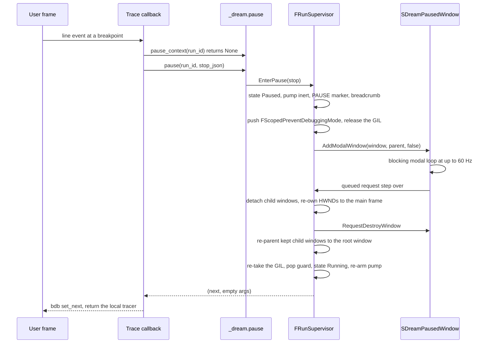

`FRunSupervisor::EnterPause`, on the game thread:
1. Re-check `CanPause` (§8.4). On refusal, return the code; Python writes the notice and continues.
2. Set the run state to `Paused` (U2). The pending-call callback (§5) returns 0 while `IsPaused()` and no supervised evaluate is active (§8.3.4): no pump, no cancellation, no `SetAsyncExc`. Request a best-effort journal `PAUSE` marker (§10.2.2) and update the pause breadcrumb (§10.9). While the Paused window is open nothing outside it is drawn (SA:1476-1497), so WS-07 and the Dream tab keep their last painted frame and show no Paused text; `Paused` stays in the status snapshot for screen readers and the API (RV-16).
3. Presentation. Run window: its text becomes "Paused at `file:line`", and one guarded Slate refresh (the D2 recipe with the `IsTicking()` check) draws it before the Paused window opens, because afterwards only the Paused window is drawn. The Run window becomes the parent. Live (docked) Preview (RT-03): the same guarded refresh, so the banner reads "Paused — see the Paused window" before the modal draws only itself.
4. `FDreamInputPreProcessor` enters paused mode (§5). It passes input through, because the platform filters input to non-modal windows (SA:4886-4901). Its only job is Esc = Stop when the Paused window is the active modal, no menu or popup is open, and no text-entry widget in the window has keyboard focus (§5.6.3, §8.3.5). Shift+F5 always stops.
5. Push `FSlateApplication::FScopedPreventDebuggingMode(LOCTEXT("DreamPaused", "The Dream debugger is paused"))` (SAH:954-960), so a Blueprint breakpoint hit by an evaluate refuses instead of nesting (07b Q1).
6. Parent = `FSlateApplication::Get().GetActiveModalWindow()` (SAH:806) when one exists: the Run window, or a user `ScopedSlowTask` dialog (G4(3)). Otherwise the window hosting the Dream tab, or the root window.
7. Window and geometry. The `SWindow` is built with `.IsPopupWindow(true)` and `.ActivationPolicy(FApp::HasFocus() ? EWindowActivationPolicy::Always : EWindowActivationPolicy::Never)`, as the engine's slow-task modal is (`Engine/Source/Editor/UnrealEd/Private/FeedbackContextEditor.cpp:530-536`; RV-02). A popup window never becomes the active top-level regular window, which is where `unreal.parent_external_window_to_slate` parents a script's tool window by default (`Engine/Plugins/Experimental/PythonScriptPlugin/Source/PythonScriptPlugin/Private/PySlate.cpp:176-189`). Geometry comes from `UDreamUserSettings::PausedWindowGeometry` (global user layer, D21), kept in desktop pixels: it is read back with `GetPositionInScreen()` and `GetClientSizeInScreen()` (`Engine/Source/Runtime/SlateCore/Public/Widgets/SWindow.h:498, 513`) and applied with `.AutoCenter(EAutoCenter::None)`, `.ScreenPosition(...)`, `.ClientSize(...)` and `.AdjustInitialSizeAndPositionForDPIScale(false)`, as the Run window is placed (§5.5.3 step 4). With `SWindow`'s defaults (`SWindow.h:252-255`) the window would be centred in the work area, or its position and size multiplied by the DPI scale (`SWindow.cpp:284-289`, `:365`), so at 150% it would grow 1.5 times at every step's reopen. Only the popup, activation, focus and close settings are shared with the Run window (§5.5.3 step 3), not its output-area placement. Off-screen rectangles are centred on the parent. Geometry stays in memory across steps and is saved when the debug session ends.
8. `PyThreadState* Saved = PyEval_SaveThread();` debugpy and user worker threads keep running (07b risk 11).
9. `FSlateApplication::Get().AddModalWindow(Window, ParentWidget, /*bSlowTaskWindow=*/false)` (SAH:428). This is the engine's blocking loop (E6): up to 60 Hz, under `SCOPE_STALL_DETECTOR_PAUSE`, OS messages pumped so Windows does not ghost the editor, FTSTicker and GEngine not ticked, viewports not rendered. It releases pointer capture on entry (07b Q3). The editor behind keeps its last painted frame, undimmed (RV-17).
10. `AddModalWindow` returns at once when it cannot add the window: no renderer, or unattended mode (SA:2124-2146, checked). The window sets `bShown` in its first tick; `bShown == false` on return means `WindowFailed`: notice and continue.
11. Resume. Around `RequestDestroyWindow`, Dream re-parents what the window owns (RV-02): each `SWindow` in its `GetChildWindows()` moves to the root window by §5.5.3 Teardown steps 1–4: it is detached with `RemoveDescendantWindow` before the destroy, and attached with the root's `AddChildWindow` only once the Paused window is gone (`Engine/Source/Runtime/SlateCore/Public/Widgets/SWindow.h:986-1001`; root from `FGlobalTabmanager::Get()->GetRootWindow()`, `Engine/Source/Runtime/Slate/Public/Framework/Docking/TabManager.h:1609`). On Win64 it then gives every top-level HWND of the game thread whose `GW_OWNER` is the Paused window's HWND the main frame's HWND as owner (`EnumThreadWindows`, `SetWindowLongPtr(GWLP_HWNDPARENT)`, the call `PySlate.cpp:189` makes), because `::DestroyWindow` destroys every window it owns. When the window is destroyed: re-parent the kept child windows to the root window (§5.5.3 Teardown step 4), then `PyEval_RestoreThread(Saved)`, pop the guard, `RESUME` marker, state `Running`. The watchdog restarts its arming timer.

Each step destroys and reopens the window, because the blocking loop ends only when its window is destroyed, and each destroy detaches the window's child windows first and re-parents them to the root once the window is gone (step 11). The new window reuses the same content widget (tree expansion, scroll, console history) at the same geometry. T-DBG-024 bounds F10-to-first-paint at ≤ 100 ms (proposed: below a visible layout jump).

#### 8.3.2 GIL and nesting

- The GIL is released around the modal loop (step 8). Nested Python re-takes it: Dream's calls with `FDreamScopedGil` (§3.2), the engine's with its own `FPyScopedGIL`. Both call `PyGILState_Ensure`, which on the game thread restores the saved thread state (07b Q7) and raises its `gilstate_counter` one above the run's entry mark; §8.3.4 says why supervised evaluates need a fresh mark.
- The pause sits inside a trace callback, and CPython does not trace code run during a trace callback. An evaluate therefore cannot hit a breakpoint or nest a pause. `on_uncaught` is not a trace callback, so it removes the trace first (§8.2.5). `PauseGate` refuses `AlreadyPaused` as a backstop.
- The pump stays inert while paused (step 2), except for supervised evaluates (§8.3.4).

#### 8.3.3 Requests from a clean point

UI handlers never call Python. A click or key queues a request in `SDreamPausedWindow::PendingRequests`. A handler on `FSlateApplication::Get().GetOnModalLoopTickEvent()` (SAH:1851) drains the queue at the top of each modal-loop iteration, before `TickPlatform`. No input handler is on the stack there, and no pointer capture is held. That is the reason runs start from a clean point too (D14, RT-01). The handler takes the GIL, calls `CallDebugger` and applies the response.

Every blocking modal loop broadcasts that event, not only the Paused window's (SA:2238-2253). An evaluate may open an `EditorDialog`, whose loop broadcasts it again inside the evaluate. So the handler:
- acts only when `GetActiveModalWindow()` is the Paused window and its `bInRequest` flag is clear;
- sets `bInRequest` for the call and clears it when the response is applied;
- processes one request per modal-loop iteration.

Requests queued during an evaluate, for example F10 pressed while "Evaluating…" shows, wait until the evaluate returns; a dialog the evaluate opens never drains them. Stop is the exception. Shift+F5, Esc under §5.6.3 and the Paused window's Stop button call `RequestStop(RunId)` at once, from the pre-processor or the click handler (§5.6.5), and then queue `terminate`. During an evaluate, that immediate `RequestStop` cancels the evaluate (§5.7.2); the queued `terminate` waits until the evaluate returns and then stops the run (§8.5).

#### 8.3.4 Supervised evaluates

An evaluate or manual watch may run `while True: pass`. While it runs, the modal loop is not iterating, so nothing paints and nothing cancels. Each evaluate is supervised like a short run:
- `_dream.eval_begin(run_id)` returns `EvalId`, an `FDreamRunId` with the current generation and a fresh `EntrySerial`. `BeginSupervisedEvaluate` sets `ActiveEvalId` to the `EvalId` and arms the watchdog with the 300 ms delay. While `ActiveEvalId` is nonzero the watchdog posts it instead of `CurrentRunId` (§5.4.1), so the §5.4.2 step 1 guard accepts the evaluate's calls and rejects any call still carrying the paused run's ID. `CurrentRunId` stays the paused run's ID, so `_dream.write`, the run's writers, `current_run_id()`, thread attribution and the other run-ID checks (§5.7.6, §6.1, §12.1.1) keep attributing output to the paused run. The evaluate writes its `print` output with `_dream.write(STREAM_EVALUATE, run_id, text)`, where `run_id` is the paused run's ID, so the run's block receives `evaluate` lines (T-DBG-047). `EndSupervisedEvaluate` disarms and sets `ActiveEvalId` to 0. The pump runs for that id although the run is paused: the watchdog posts for it (§5.4.1), and its GIL hand-off (RV-01) makes the post fire even inside a pure-Python evaluate.
- **A fresh entry mark (RV-05).** The handler took the GIL with `FDreamScopedGil`, so the game thread's `gilstate_counter` is one above the run's mark for the whole evaluate (§8.3.2). Against the run's mark every pending call would be deferred as native re-entry (§5.4.2 step 5), so nothing would pump or cancel. `_dream.eval_begin(run_id)` therefore captures a fresh entry mark (`FDreamPyCompat::CaptureEntryMark`) for the evaluate. While an evaluate is active, the §5.4.3 re-entry check and the §5.7.5 condition 4 compare against the evaluate's mark; `eval_end` restores the run's mark.
- **The user-code window.** An evaluate is user code, so `eval_begin` also opens the pump gate `bUserCodeActive` (§5.4.2 step 5) for the evaluate and `eval_end` puts back the run's value. At an exception stop, `user_code_done` has already closed it (§8.2.5); without this, evaluates there could neither pump nor be cancelled.
- After 300 ms (the D2 arming delay) the pump ticks Slate. We are inside `ModalLoopTickEvent`, not a Slate tick, so the guard passes. Only the Paused window draws, showing "Evaluating… [Cancel]".
- Cancel calls `FRunSupervisor::RequestStop(EvalId)`. While `ActiveEvalId == EvalId`, that sets the evaluate's stop state and leaves the paused run's untouched, and the next pending call delivers `ScriptCancelled` to the evaluate under the D2 and RT-06 rules. The evaluate wrapper catches it ("Evaluate cancelled"), and it never reaches the paused run. The Cancel button calls `RequestStop(EvalId)` from its click handler, as the Stop buttons do (§5.6.5); it is not a `PendingRequests` entry (§8.3.3), which would wait for the evaluate to return. `RequestStop(EvalId)` calls `OnUserCancel` (§5.12) only when `GIsSlowTask` was false at `eval_begin`. Every open slow task shares the editor's cancel flag, which is reset only when a root slow task starts (`Engine/Source/Editor/UnrealEd/Private/FeedbackContextEditor.cpp:471`; `Engine/Source/Runtime/Core/Private/Misc/SlowTask.cpp:235-237`). With the paused run's slow-task dialog open, calling it would make that task's `should_cancel()` return true after Continue (`FeedbackContextEditor.cpp:702-710`, `SlowTask.cpp:248-258`). A run-level Stop during an evaluate cancels the evaluate first and then stops the run (§5.7.2).
- `eval_end` invalidates the id, restores the run's entry mark and pump gate, clears the async exception and drains the queue, as at run end (D2).

Conditions and logpoint placeholders run while the run is `Running`, so the normal pump covers them.

#### 8.3.5 Contents and keys

| Area | Content |
|---|---|
| Header | "Paused · Run #14 · rig_fix.py:43 · breakpoint". Reasons: `breakpoint`, `step`, `exception`, `breakpoint()`, `run to cursor`, `entry`. Step toolbar |
| Call stack | User frames, innermost first; selection drives the source view, Variables and the evaluate scope |
| Source view | Read-only `SCodeView` on the selected frame's file (linecache text, so dirty buffers show what runs), current-line arrow, breakpoint glyphs |
| Variables | Locals, Globals (Session or Isolated namespace, paged 100), Special, in `SDreamVariablesTree` (§8.8) |
| Watch | The shared watch list (U25), U18 rules (§8.3.6) |
| Evaluate console | Multi-line `SCodeView` with history and completion. Label: "Evaluate runs on the game thread and may modify editor state" (D3) |
| Footer | "The editor is paused. Viewports and other windows resume when you continue. The REPL is suspended; use Evaluate." (U11, REPL-07) |

The REPL is suspended while paused (U17); the console replaces it. The editor behind the modal is not drawn (RV-16), so the REPL cannot show that message; the footer carries it.

| Action | Key (U21, U22, RT-05; `DreamEditor` TCommands, rebindable) |
|---|---|
| Continue | F5 |
| Step over / into / out | F10 / F11 / Shift+F11 |
| Run to cursor (caret in the source view) | Ctrl+F10 |
| Evaluate the selection in the selected frame | Alt+F8 |
| Stop | Shift+F5; Esc when no menu or popup is open and focus is not in a text field |
| Toggle breakpoint in the source view | F9 |
| Edit breakpoint condition (source view) | Shift+F9, or right-click the glyph |

**Esc in text fields** (§5.6.3, RT-05's "only when"). The text-entry widgets are the evaluate console, the Add watch row, inline watch editing, the breakpoint-condition editor and the filter boxes (`SEditableText`, `SMultiLineEditableText` or an editable `SCodeView`). While one of them has keyboard focus, Esc goes to the widget: it closes completion first, then clears or cancels the input. It never stops the run there; Shift+F5 does.

#### 8.3.6 Watches (U18)

- **Safe watches** refresh on every stop, after every evaluate and after every run. After a run they use the Session namespace, or the last-run namespace after an Isolated run (D8). `SafeEvaluator` interprets the `ast` itself and never calls `eval`. Allowed:
  - `Name`: locals, then globals, then builtins;
  - `Attribute`: through the D6 safe resolver, so no getset descriptor or property runs (E1); unreal properties are read with `get_editor_property` (E2);
  - `Subscript` with a `Constant` index, key or slice, on exact `list`, `tuple`, `dict`, `str` and `bytes`, and on `unreal.Array` and `unreal.Map` under the element rule below;
  - `Call` to `len`, `type`, `isinstance`, `repr`, `str`, `int`, `float`, `bool`, `abs`, `min`, `max` with safe arguments.
- **Unreal container elements (RV-21).** Reading an element of an `unreal.Array`, `Map` or `Set` pythonizes its property, and a soft, soft-class or lazy object reference is then loaded with `LoadSynchronous` (`.../PythonScriptPlugin/Private/PyWrapperArray.cpp:426`, `.../Private/PyWrapperMap.cpp:848`). So for these containers the evaluator first calls `_dream.container_element_kind(v)` (C++: the array's inner property, the map's key and value properties, the set's element property; §12.1.1). A subscript, and `min` or `max` over the container, are evaluated only when no such property is `FSoftObjectProperty`, `FSoftClassProperty` or `FLazyObjectProperty`. Otherwise a subscript shows that element's export text from C++ (`_dream.container_export_text`, §12.1.1), never a Python value, and `min` or `max` needs a manual refresh: "would load assets". `len()` reads only the element count and stays safe.
- **Tightening.** `len`, `abs`, `min` and `max` call dunder methods, which on a user type could run user code. The evaluator applies them only to exact built-in types and unreal wrapper types, as U18 already does for `repr` and `str`. `min` and `max` also need every element to be an exact `int`, `float`, `bool`, `str` or `bytes`, because comparing elements calls their dunders. Otherwise: "needs a manual refresh: would call user code". `len(sel_assets)` stays safe (spec addition).
- **`repr` and `str` (RV-21).** They never call a value's own `__repr__` or `__str__`. Both return the bounded `_impl.saferepr(x, deadline_ns)` of §7.7: it recurses only into exact `list`, `tuple`, `dict`, `set` and `frozenset` (depth 2, 20 items per level), calls `repr` only on exact `int`, `float`, `bool`, `None`, `str` and `bytes` (cut at 200 characters), shows an `unreal.Object` wrapper as its class and path through C++, and shows any other value, unreal containers and structs included, as `<TypeName>` (from `type.__dict__['__name__']`). It stops at 200 characters or at the deadline. `str` of an exact `str` is the string itself, cut at 200 characters. So `repr([job, {"k": job}])` with a user `Job` shows `[<Job>, {'k': <Job>}]` and runs no user code.
- **Manual watches** are any other expression, marked "may run code", evaluated only on refresh as a supervised evaluate, shown "as of 14:03:12".
- Budget: all safe watches ≤ 5 ms per refresh (proposed: D6). The rest show "…" until refreshed. The list is stored in `UDreamPerProjectUserSettings`.

#### 8.3.7 Evaluate and the run's transaction

An evaluate runs while the run's transaction is open (D8, RT-08), so `set_editor_property` changes land in `Dream: <tab> #N` and Undo Last Run reverts them (G4(5)). After each evaluate the supervisor applies the RT-08 size watch, because no pump runs while paused. If the run has no transaction (Run File default, RT-08), each evaluate opens `Dream: evaluate in #N` (proposed: otherwise it cannot be undone as a unit). The console says which applies.

#### 8.3.8 What the pause refuses

| Event | Mechanism | User sees |
|---|---|---|
| Editor close: Alt+F4, File > Exit, a quit call | The editor refuses to exit while a modal is up (`Engine/Source/Editor/MainFrame/Private/Frame/MainFrameHandler.h:126`). Our `RegisterCanCloseEditor` veto (`Engine/Source/Editor/MainFrame/Public/Interfaces/IMainFrameModule.h:231`) also returns false while paused | Toast "The Dream debugger is paused. Continue or Stop first." |
| PIE start, for example queued by an evaluate | A request only queues; it would start on the first engine tick after the run (`Engine/Source/Editor/UnrealEd/Private/EditorEngine.cpp:2062-2065`). After each evaluate and each modal-loop tick, the supervisor calls `CancelRequestPlaySession()` when `GEditor->IsPlaySessionRequestQueued()` (`Engine/Source/Editor/UnrealEd/Classes/Editor/EditorEngine.h:1820, 1840`). It also registers an `IPIEAuthorizer` (`Engine/Source/Editor/UnrealEd/Public/IPIEAuthorizer.h:15`) that denies PIE while paused (checked at `Engine/Source/Editor/UnrealEd/Private/PlayLevel.cpp:2616-2630`) | "PIE start refused: the Dream debugger is paused" |
| Unattended session | Debugging is disabled before any run (§8.4 rule 7) | Debug commands disabled: "Unavailable in unattended sessions" |

### 8.4 Pause rules

`PauseGate.check(frame)` runs before every pause: Python checks first, then `_dream.pause_context`. The first failing rule wins.

| # | Rule | Where | Notice ("Breakpoint at importer.py:88 skipped: …") |
|---|---|---|---|
| 1 | Debug run, and `run_id == _dream.current_run_id()` | Python | none; there is no trace outside Debug runs |
| 2 | `threading.get_ident() == GAME_THREAD_IDENT` (captured at import) | Python | "on thread 'Thread-3': 1.0 pauses only on the game thread" |
| 3 | `engine_callback_depth == 0` (the wrapper flag, below) | Python | "inside a Python Slate or ticker callback" |
| 4 | Not already paused | C++ | "the debugger is already paused" |
| 5 | `IsInGameThread()` | C++ | as rule 2 |
| 6 | `!FSlateApplication::Get().IsTicking()` (SAH:397) | C++ | "inside a Slate tick" |
| 7 | `!GIsRunningUnattendedScript` (`Engine/Source/Runtime/Core/Public/CoreGlobals.h:181`) and `!FApp::IsUnattended()` | C++ | "unattended session" |
| 8 | `!UE::IsSavingPackage()`, `!IsGarbageCollecting()`, `!FUObjectThreadContext::Get().IsRoutingPostLoad` (RT-02) | C++ | "the engine is saving, collecting garbage or loading" |
| 9 | Not in a PIE transition: a flag set by `FEditorDelegates::PreBeginPIE` and `EndPIE`, cleared by `PostPIEStarted`, `ShutdownPIE` (`Engine/Source/Editor/UnrealEd/Public/Editor.h:274-286`) and `CancelPIE` (`Editor.h:298`). An aborted PIE start, such as Cancel on the Blueprint compile-error dialog, broadcasts only `CancelPIE`, sometimes after `EndPIE` | C++ | "PIE is starting or stopping" |
| 10 | Debugger enabled by policy, and the Preview opt-in if G4 failed (§8.9.2) | C++ | Debug commands disabled up front |
| 11 | Not inside the RunSupervisor's pump: `FRunSupervisor::GetPumpDepth() == 0`. The pump's `Sync` runs queued `AsyncTask(GameThread)` work after `Tick` returns, so `IsTicking()` is false there and a traced delegate could otherwise open the blocking loop inside the pump (`EDreamPauseRefusal::InsidePump`) | C++ | "inside an editor update during the run" |

Each notice is written once per (location, reason) per run as a `debugger` line (DBG-08). The trace returns and the code continues.

**The engine-callback wrapper flag.** During a Debug run, `begin_run` rebinds `unreal.register_slate_pre_tick_callback`, `register_slate_post_tick_callback` and `register_ticker_callback` in the `unreal` module dict; `end_run` compare-and-restores them (the RT-07 pattern). Callables registered during the run are wrapped: the wrapper increments `engine_callback_depth` around the call. Unregistering by handle still works.
- If the callback runs while the trace is active, rule 3 refuses.
- If it runs after the run, the trace is off. The wrapper checks `BreakpointTable.has_breakpoint_in(code)` and writes once per breakpoint per session: "Breakpoint at tick.py:12 is in a Slate tick callback; Dream does not pause there". The callback runs normally (G4(4)).
- Foreign Python tick callbacks are gated by `GIsRunningUserScript` during our runs (07a Q7) and untraced outside them. Breakpoints in code that runs only outside Dream runs are 1.x (D3).

**Native re-entry.** A user frame entered from C++ during the run, such as a Python UFUNCTION override or an import hook fired by `import_asset_tasks`, may pause unless rules 6–9 or 11 refuse. There is no native-re-entry refusal in `EDreamPauseRefusal`; §12.1.1's `pause_context` reasons are the ones in §8.1.5 and this table. The blocking modal is the engine's pattern for prompting from deep native code (07b Q3). The RT-02 cases are in T-DBG-036.

**Worker threads.** `_worker_trace` writes the rule-2 notice when a worker first reaches a verified breakpoint line, then returns `None` for that frame. Workers keep running while paused, because the GIL is released.

### 8.5 Stepping, run to cursor, evaluate and set variable

| Command | bdb call | Stops at | Notes |
|---|---|---|---|
| Continue | `set_continue()` | Next breakpoint or exception stop | With no breakpoints or filters left, `sys.settrace(None)` and full speed |
| Step over | `set_next(frame)` | Next line in this frame, or the caller after a return | A native `unreal.*` call is one line. The pump runs during the step, so Stop works |
| Step into | `set_step()` | Next line event in a user frame | `just_my_code` skips library frames |
| Step out | `set_return(frame)` | The caller's next line; Special shows `(return) <value>` | From the outermost user frame: run to end (§8.1.6) |
| Run to cursor | Temporary breakpoint at the source-view caret, then `set_continue()` | That line, or any earlier stop | Removed at the next stop of any kind; moved to an executable line as in §8.2.2 |
| Stop | Raise `ScriptCancelled` from the trace callback | — | Below |

**Statement boundaries (RUN-27, PO-02).** A debug run (F5) on a statement-mode route uses statement mode too, so the run is a chain of statement frames, each evaluated by `_dream.run_statement` from the runner's loop (§5.3.7). `DreamBdb` knows the run's statement code objects. When the frame of statement k returns during Step over or Step into, it does not stop on that return or in the runner's frames: it switches to `set_step()`, the runner's frames are skipped (§8.1.6), and the next stop is the first line of statement k+1, after its echo. **Step out** from a statement frame is Step out of the outermost user frame: it runs to the end of the run (§8.1.6), stopping only at a breakpoint or an exception stop, as with one `exec`. A bare string that is echoed but not executed (§5.3.2) has no frame, so stepping passes it. Breakpoints, Run to cursor and `stop_on_entry` work unchanged, because every statement keeps the run's filename and line numbers.

**Stop.** `FRunSupervisor::RequestStop(RunId)` has run (the Stop calls it at once, §8.3.3); when the queued `terminate` is applied, the trace callback raises the C++-held `ScriptCancelled` instance (D2). CPython propagates an exception raised in a trace callback into the traced frame and unsets the trace, so `finally` blocks and context managers run. The supervisor counts this as the first delivery, so RT-06 re-delivery applies if user code swallows it. On an exception stop, Stop ends the run as `cancelled` without raising again.

**Evaluate in frame** (Alt+F8 and the console).
- The code is compiled with the `autoprint` rewrite (§5.3.6) and run as `exec(code, frame.f_globals, dict(frame.f_locals))`.
- **Why a copy.** On the engine's CPython 3.11.8, a write to the traced frame's `f_locals` during a trace callback is copied back into the frame when the callback returns; a write to a caller frame's `f_locals` is not. We checked both with `python.exe -I -B` on the shipped interpreter. A live dict would make assignment work in the top frame only, and a deleted key would unbind the local.
- With a copy, local rebinding is never written back in 1.0. The console says: "Assignment to local 'x' is not written back in 1.0; set variable comes in 1.x". Mutating objects and assigning globals take effect.
- `print` output goes to the console and to the run's output block as `evaluate` lines.

**Set variable (DBG-09)** is 1.x (D3): `PyFrame_LocalsToFast` for caller frames on 3.11, PEP 667 write-through `f_locals` on 3.13+, behind `TraceBackend.set_local()`.

### 8.6 debugpy integration (M2)

#### 8.6.1 Vendoring and pruning (RT-11, D12)

- Vendored in a private folder, `Content/Python/_dream_vendor/debugpy` (RV-10), with the version pinned per plugin release (09 examined 1.8.20). It is not at D3's `Content/Python/Lib/site-packages`, because the engine adds every plugin's `Content/Python` site-packages folder to `sys.path` for all interpreter users (`.../PythonScriptPlugin/Private/PythonScriptPlugin.cpp:2063-2080`), where our copy would shadow a studio's own debugpy.
- `DebugpyBridge` prepends `<plugin>/Content/Python/_dream_vendor` to `sys.path` only on the first "Debug in VS Code" of the session, then imports `debugpy`. If `sys.modules` already holds a `debugpy` loaded from another folder, the command refuses: "Another debugpy is already loaded from `<path>`" (proposed: two copies in one process are not supported).
- Never pip-installed into the engine interpreter; Epic's `debugpy_unreal.install_debugpy()` writes into Program Files (07a Q8).
- Pruned: `inject_dll_*`, `run_code_on_dllmain_*`, all x86 files, all `.pdb`, `winappdbg`, every non-cp311 `.pyd`. Kept: the pure-Python packages, `attach_amd64.dll` (used by `set_trace_to_threads`), the cp311 speedups; for the Linux Preview, the `linux_and_mac` attach library (proposed).
- Every kept file is in the D4 SHA-256 manifest (§11). `FDreamTrust` verifies the tree on a background thread before the first import, in ≤ 100 ms (proposed: about 5 MB). A mismatch refuses the start ("debugpy files were modified") and adds an Environment doctor item (U36).
- pydevd is EPL-1.0, allowed with conditions (RT-11, D12), and named in NOTICE.

#### 8.6.2 Starting the debug server

```mermaid
sequenceDiagram
    participant User
    participant C as SDreamTab
    participant Py as DebugpyBridge
    participant D as pydevd in process
    participant IDE as VS Code or PyCharm
    User->>C: Debug in VS Code / PyCharm
    C->>C: policy key and manifest check
    C->>Py: start() from an idle FTSTicker callback
    Py->>D: listen on 127.0.0.1 port 0, in_process_debug_adapter
    D-->>Py: None, the server thread binds a port
    Py->>D: trace_this_thread(False) on the game thread
    loop every 50 ms for up to 2 s
        C->>Py: poll_port()
    end
    Py->>D: wrap the server socket and initialize_network (prologue check)
    C->>User: Debug server listening on 127.0.0.1 and the port
    IDE->>D: DAP attach over loopback
    loop 2 Hz while idle
        C->>Py: is_client_connected()
    end
    Py->>D: trace_this_thread(True) on connect, (False) on disconnect
    C->>User: banner that code outside Dream runs freezes the editor while the IDE pauses it
```

- **Call** `debugpy.listen(("127.0.0.1", 0), in_process_debug_adapter=True)` (RT-11): no adapter process, no `configure(python=…)`, no blocking `accept`, no Job Object. `wait_for_client()` is never called (07a Q8). Just before the call, `DebugpyBridge` sets `os.environ["PYDEVD_DISABLE_FILE_VALIDATION"] = "1"`, which pydevd reads once, when `listen` first imports it (`debugpy/_vendored/pydevd/_pydevd_bundle/pydevd_constants.py:261`). The engine's interpreter uses frozen stdlib modules, so without it pydevd writes four "Debugger warning: It seems that frozen modules are being used" lines to `sys.stderr` (`pydevd_file_utils.py:588-603`), which outside a run is the stock stream and logs them as `LogPython` errors.
- **Thread.** A D14(5) helper call from an idle FTSTicker callback that checks "run active" first (RT-01); never during a run or a pause.
- **Port discovery** (checked in the debugpy 1.8.20 bundle used by 09). The in-process branch of `listen` returns `None` (`debugpy/server/api.py:148-158`). pydevd binds on its own thread and stores the address privately (`debugpy/_vendored/pydevd/pydevd.py:1558`). `DebugpyBridge.poll_port()` reads `pydevd.get_global_debugger()._server_socket_name` every 50 ms for up to 2 s (proposed). The blocking `wait_for_server_socket_ready()` (`pydevd.py:1537-1538`) has no timeout, so it is never called on the game thread. On timeout: "Debug server failed to start; see the Dream log". T-DBG-040 pins this private behaviour at every debugpy bump.
- **Game-thread tracer off while no IDE is attached (RV-03).** The in-process `listen` runs pydevd's `settrace`, which installs its tracer on every thread before any client connects (measured at about 6.5× on a call-heavy loop). Right after `listen` returns, `DebugpyBridge` calls the public `debugpy.trace_this_thread(False)` on the game thread (`debugpy/public_api.py:200`; it calls `pydb.disable_tracing()`, `debugpy/server/api.py:358-366`). When the 2 Hz poll (§8.6.3) sees `is_client_connected()` turn true, it calls `trace_this_thread(True)`, so IDE breakpoints on the game thread hit; when it sees the client disconnect, it calls `trace_this_thread(False)` again. Non-Debug runs therefore have `sys.gettrace() is None` whenever no IDE is attached (DBG-06), and the §8.1.4 Free state returns after a disconnect. T-DBG-052 checks this against the pinned debugpy at every bump; if it fails, the §8.1.4 fallback applies. The PyDB constructor also replaces `sys.settrace` with `pydevd_tracing._internal_set_trace` (`debugpy/_vendored/pydevd/pydevd.py:577-579`, `pydevd_tracing.py:58-90, 125-130`). That wrapper writes a "PYDEV DEBUGGER WARNING" to `sys.stderr` for callers such as `SettraceBackend` and `bdb`, and during a Debug run `sys.stderr` is the run's writer. Right after `listen` returns, `DebugpyBridge` sets `pydevd_tracing.TracingFunctionHolder._warn = False`; T-DBG-040 pins that private name.
- **Listener hardening (RV-04).** Loopback is reachable by every local user's processes, not only the editor's user. pydevd accepts new connections until the process exits, and each new one disconnects the attached IDE. Its reader treats any `Content-Length:` header as a DAP frame, so an HTTP POST from a web page can carry one, and it executes an `evaluate` request that names no frame. Right after `poll_port()` finds the port, `DebugpyBridge`:
  1. replaces `py_db._waiting_for_connection_thread._server_socket` with a wrapper that delegates `listen`, `close` and `getsockname`. Its `accept()` loops on the real socket, peeks 16 bytes with `MSG_PEEK` and a 2 s timeout, and closes any connection whose bytes do not start with `b"Content-Length:"`, or that arrives while `is_client_connected()` is true. It returns the first connection that passes;
  2. wraps `py_db.initialize_network` on that instance with the same prologue check. This covers the `accept` that was already blocked on the raw socket when the wrapper went in.

  The listener is not closed after the first attach and has no idle timeout, so disconnect and re-attach keep working on the same port. T-DBG-040 pins both private names; T-DBG-051 probes the refusals.
- **Closing (RV-04).** When `debug.allow_debug_server` turns false mid-session (an I key, applied at the first idle tick after the policy swap, §11.2.3), and at editor shutdown (§3.8), `DebugpyBridge` calls pydevd's `do_kill_pydev_thread()` on `py_db._waiting_for_connection_thread`, which closes the listening socket. No new client can attach, and the indicator goes away.
- **Once per editor session.** pydevd's setup is process-global, and debugpy refuses a second `listen` (`debugpy/server/api.py:143-145`). The UI says "The debug server stays open until the editor closes or policy turns it off", and the Debug in VS Code confirmation adds "Python threads other than the editor's main thread, running now or started later, run under the debugger's tracer until the editor closes" (§8.1.3, DBG-06); there is no Stop debug server, and a closed server cannot start again in that session.

#### 8.6.3 Configurations, indicator, banner, exclusivity

- **VS Code.** [Copy] puts the configuration on the clipboard. [Write to project] adds or replaces the entry `Dream: attach to Unreal Editor` in `<Project>/.vscode/launch.json`, only when that file is absent or parses as plain JSON; files with comments get Copy only. Content: `"type": "debugpy"`, `"request": "attach"`, `"connect": {"host": "127.0.0.1", "port": <port>}`, `"justMyCode": true`, `"redirectOutput": true`, `"rules": [{"module": "dream_editor", "include": false}]`. The setting "Keep .vscode/launch.json updated" (off, proposed) rewrites the entry each session, because the port changes.
- **PyCharm.** A panel with host, port and path mappings, plus [Copy]. The 2026.2 run-configuration XML type for debugpy attach is an open item.
- **`redirectOutput`** is always true; Epic documents that without it debugger and editor can hang (`Engine/Plugins/Experimental/PythonScriptPlugin/Content/Python/debugpy_unreal.py:27`, via 07a Q8).
- **Indicator (U15).** While the server listens, the Dream status bar and the WS-07 item show "Debug server listening on 127.0.0.1:<port>" with [Copy port]. It is never hidden.
- **Frozen-editor banner.** While `is_client_connected()` (polled at 2 Hz from the idle ticker, D3), a persistent banner says: "VS Code is attached. Code outside Dream runs freezes the editor while the IDE has it paused; a Dream run's Run window stays live. Continue in the IDE to resume." Nothing can paint during a freeze outside a Dream run, so it is shown beforehand. If the next frame gap exceeds 1 s, it adds "The editor was paused by the external debugger for 42 s" (proposed).
- **IDE pause inside a Dream run.** Normal Dream runs stay supervised while a client is attached. When the IDE suspends the game thread inside one, pydevd's wait loop keeps running Python there and re-takes the GIL, so pending calls still fire. While the innermost Python frame is in the vendored debugpy or pydevd folder (the §5.4.7 frame walk), the supervisor keeps pumping but skips delivery and the §5.7.5 channel (§5.4.3), and the Run window says "Paused in VS Code: Stop takes effect when you continue in the IDE". A `ScriptCancelled` raised inside pydevd's frames would leave through its trace function and turn IDE debugging of the game thread off for the session, which the debug server cannot be restarted to undo (RT-11).
- **Exclusivity (U16).** While attached: Debug runs disabled with the reason, and `breakpoint()` in our runs calls `debugpy.breakpoint()`. After disconnect: §8.1.4.
- **Run output.** Our run-scoped streams (D19) replace `sys.stdout`, so Dream run output appears in Dream's Output, not in the IDE console. Output from code outside Dream runs reaches the IDE through `redirectOutput`. Teeing is an open item.

#### 8.6.4 Policy, security and the access token

- Policy key `debug.allow_debug_server` (default true, §11.2.2). When false, the command is hidden and `start()` refuses (U15, SEC-02). When it turns false mid-session, the listener closes (§8.6.2).
- **Lands with the listener in M2 (RV-04).** The key cannot wait for the full `FDreamPolicy` of M4. M2 ships a minimal `FDreamPolicy`: `dream::PolicyResolver` over the machine and studio layers, with the §11.2.1 owner check (RV-06), for `debug.allow_debug_server` only (the machine `studio_policy_path` is honoured to find the studio layer), including reload, so turning the key off mid-session closes the listener (§8.6.2). The `FDreamAudit` event `debug.server_started` lands in M2 with it (§11.4; the audit writer itself lands in M1). The M2 resolver applies the §11.2.3 invalid-layer and unknown-key rules to both layers (§11.2).
- The documented SEC-NF-01 exception (U15): loopback only, random port, explicit command, persistent indicator, policy key, non-DAP clients refused, no second client while one is attached (§8.6.2). Starting the server writes the audit event `debug.server_started` (§11.4).
- **Access token, settled for 1.8.20.** The public `listen` accepts no token (`debugpy/public_api.py:110-111`). pydevd authenticates only clients that send the custom `pydevdAuthorize` request with `debugServerAccessToken` (`debugpy/_vendored/pydevd/_pydevd_bundle/pydevd_process_net_command_json.py:208-216`). The debugpy adapter sends it; VS Code and PyCharm do not when they connect straight to an in-process server. A token would lock the IDEs out. 1.0 uses none. The residual risk is accepted under U15 and re-checked at each debugpy bump: any local process of any user can connect while the server is open, and a connected client can run code. HTTP-shaped clients are refused, and no second client is accepted while an IDE is attached.

### 8.7 The post-mortem inspector (M2)

**Responsibilities.** Show the frames and locals of the latest failed run after it ended, read-only, while the editor is idle (D3).

**Design.**
- **Retention.** When a run ends `error`, or `cancelled` with a traceback, the runner (§5.3.7) calls `PostMortem.retain(run_id, exc)`, keeping the exception, its traceback and its `__cause__`/`__context__` chain. The runner never sets `sys.last_value` or `sys.last_traceback`.
- **Entry points.** "Inspect" on the traceback header in Output, on the run header, and on the U13 `runtime` item in Problems. Only the latest retained run is inspectable; older tracebacks say "Frames were released when Run #15 started".
- **UI.** The Variables tab (U25) switches to "Post-mortem · Run #14 · KeyError": a frame list above `SDreamVariablesTree`. Selecting a frame moves the main editor caret to that line; the buffer stays editable. Safe watches use the selected frame. There is no evaluate console (read-only, D3).
- Isolated runs: frame globals are the last-run namespace (D8). A UObject destroyed since shows `<invalid object>`; the wrapper error is caught and no property is touched.

**Release.** Frames pin UObjects through Python wrappers. `PostMortem.release()` calls `traceback.clear_frames(tb)` on every traceback in the chain and drops all references. Triggers:

| Trigger | Hook |
|---|---|
| The next run of any route | `FDreamRunService`, before namespace setup (§5) |
| Map change | `FEditorDelegates::MapChange` (`Engine/Source/Editor/UnrealEd/Public/Editor.h:231`) |
| World cleanup | `FWorldDelegates::OnWorldCleanup` (`Engine/Source/Runtime/Engine/Classes/Engine/World.h:4582`) |
| Force delete | `FEditorDelegates::OnPreForceDeleteObjects` (`.../Editor.h:384`), so pins never block it |
| Dismiss | "Release frames", or leaving post-mortem mode |
| Python shutdown | `OnPythonShutdown` (D16) |

### 8.8 The Variables view and object inspector (D30, M3)

**Responsibilities.** Show name, type, short value and size for the active namespace, the paused frame or the post-mortem frame, expanding containers, UObjects and structs lazily, without running user code or getters and without loading assets (VAR-01, RV-21). Any short text of a value that the table below does not define comes from the bounded `_impl.saferepr` (§8.3.6), never from `repr()` of the value.

```python
class VariableNode(TypedDict):
    name: str; type_name: str; value: str; size: int | None
    variablesReference: int        # 0 = leaf; valid for one stop epoch
    kind: Literal["local", "global", "attr", "item", "property", "function", "special"]
    badges: list[str]              # "unreal", "property: not evaluated", "deprecated"
```

| Value | Children | Value text |
|---|---|---|
| Exact `list`, `tuple`, `dict`, `set`, `frozenset` | Pages of 100: `[0…99]`, `[100…199]` | `list (12)`; `len()` only on these types |
| `unreal.Array`, `unreal.Map`, `unreal.Set` | Pages of 100 only when `_dream.container_element_kind(v)` reports no `FSoftObjectProperty`, `FSoftClassProperty` or `FLazyObjectProperty` element property (for a map, neither the key nor the value property), because reading such an element loads it (§8.3.6, RV-21). Otherwise the first 100 elements are leaves holding their export text from `_dream.container_export_text` (C++ `FProperty::ExportTextItem_Direct`, as `FPyWrapperArray::Str` does, but capped at 100 elements, §12.1.1; an unresolved lazy element shows `Lazy <guid>`); they are never indexed or iterated | `Array[AssetData] (12)`; `len()` reads only the count |
| `unreal.Object` | Editor properties via `get_editor_property(name)` on expand only (E2), except `FSoftObjectProperty`, `FSoftClassProperty` and `FLazyObjectProperty` properties, which `_dream.soft_props(v)` names (N1, RV-21). Those are leaves holding their path text from `_dream.prop_export_text(v, name)` (C++ `FProperty::ExportTextItem_Direct` on the soft pointer, which writes the path without loading; an unresolved `FLazyObjectPtr` has no path and would export as `None` (`PropertyBaseObject.cpp:267-283`), so for a lazy object property whose target is not loaded `prop_export_text` writes `Lazy <guid>` from `GetUniqueID().ToString()`), never read through `get_editor_property`. Names come from the RT-13 snapshot metadata (§7); a Functions group with docstring signatures, never called; class hierarchy from the Python MRO | Native `get_name`, `get_path_name`, `get_class` (`Engine/Plugins/Experimental/PythonScriptPlugin/Source/PythonScriptPlugin/Private/PyWrapperObject.cpp:1118-1132`, checked): reflection reads, no `ProcessEvent` |
| unreal struct | Fields via `get_editor_property`, except soft, soft-class and lazy object fields, which are leaves holding `_dream.prop_export_text(v, name)` as for `unreal.Object` | `<StructName> {field: value, …}` from `_dream.struct_export_text(v)` (C++, §12.1.1). It walks the struct's properties with `TFieldIterator<FProperty>` and exports each scalar field with `FProperty::ExportTextItem_Direct`, writing an unresolved lazy object field as `Lazy <guid>` (§12.1.1). An array, set or map field shows only its count (`Array[N]`, `Set[N]`, `Map[N]`), and nested struct fields recurse under the same budget. It stops at 200 characters. Never `repr(v)`: the wrapper's repr exports every field and element (`PyWrapperStruct.cpp:1325-1326`, `PyUtil.cpp:1311-1356`) and can run a `@unreal.ustruct` subclass's `__repr__` |
| User-class instance | Static enumeration of `type(obj).__mro__` dicts and the instance `__dict__`, never `dir()`. Properties and getset descriptors show "property: not evaluated" with [Add as manual watch]. `__slots__` member descriptors are read (no code runs) | `object.__repr__(obj)`; user `__repr__` is never called |
| Exact `int`, `float`, `bool`, `None`, `str`, `bytes` | — | `repr`, cut at 200 characters with an expander. A subclass of these is a user-class instance (row above) |
| Deprecated unreal property | — | `<deprecated>`, without raising |

- **When reads are allowed.** D30: "on expand only, on the game thread, while idle … never during runs". We read this as "while the game thread is not executing user code". A pause qualifies: user code is suspended at a line boundary, which DBG-03 needs. `Running`, `Stopping…` and `Task running` (U10) do not; the view shows "Updates when the run ends". Recorded as a spec clarification.
- **Budget.** ≤ 5 ms of game-thread time per `variables` request (proposed: D6). The producer checks a deadline per child and returns a "…more" node.
- **Namespaces.** Session runs show the Session dict without the names present at first capture (D8), with "Show all". After an Isolated run, the last-run namespace until the next run, headed "Showing: last run (#14, Isolated)" with a switch to Session (D8). Editor context (VAR-02) shows the U19 aliases from the values §5.3.8 captured while idle.
- **Object inspector (VAR-03).** A non-modal docked panel (U26), opened from Variables, the REPL (`dream_editor.inspect(obj)`) or the selection. It reuses `SDreamVariablesTree` with editor properties, functions with signatures and the class hierarchy, plus "Copy Python path" (the D30 form `unreal.find_object(None, "<path>")`).

### 8.9 The G4 suite, the descope rule and trace overhead

#### 8.9.1 G4 suite

G4 (08 §3, RT-10): a spike in M2; the fixture suite gates 1.0 at M3 exit, nightly at tier 4 on GPU agents.
- **Driver.** FTSTicker and latent automation commands do not run inside the modal loop, so `FDreamPausedWindowTestDriver` (test module only) subscribes to `GetOnModalLoopTickEvent()`. Each modal-loop iteration it runs scripted actions: wait N frames, send keys through `FSlateApplication::ProcessKeyDownEvent`, read widget state, assert. Ten of the hundred G4(1) steps use OS-level `SendInput` (proposed), to cover the platform input filter.
- **Assert and ensure counting.** An `FOutputDevice` matching "Assertion failed" and "Ensure condition failed", plus `FCoreDelegates::OnHandleSystemEnsure`.
- **The M2 spike** builds the pause path end to end on a bare SWindow (trace callback, `_dream.pause`, GIL release, a slow-task parent, an `unreal.*` evaluate) and runs G4(1)–(3) with 10 steps.

| Criterion | Fixture | Pass | Test |
|---|---|---|---|
| (1) 100 stepped breakpoints, interactive, zero asserts and ensures | A 100-iteration loop with a breakpoint; step over, into a helper, out | 100 stops; the window repaints and Variables fills ≤ 100 ms after each stop (proposed); 0 asserts, 0 ensures | T-DBG-020 |
| (2) Watch `unreal.SystemLibrary.get_engine_version()` | Pause; add the manual watch; refresh | Equals `FEngineVersion::Current().ToString()` from C++, so we are not in debugging mode | T-DBG-021 |
| (3) Breakpoint inside a user `ScopedSlowTask` with its dialog | `with unreal.ScopedSlowTask(10) as t: t.make_dialog(True)`, breakpoint in the loop | Parent is the slow-task window; steps work; the task completes | T-DBG-022 |
| (4) Breakpoint in a Python Slate tick callback | A Debug run registers a counting post-tick callback with a breakpoint | No modal; one notice; the counter keeps rising | T-DBG-023 |
| (5) Evaluate changes an actor; Undo Last Run reverts | Evaluate `a.set_editor_property("tags", ["g4"])`, Continue, Undo Last Run | Title `Dream: <tab> #N`; tags restored | T-DBG-025 |
| (6) Close and PIE start refused | `RequestCloseEditor()`, Alt+F4 by `SendInput`, `RequestPlaySession()` from an evaluate | Editor alive; no PIE world after resume plus 10 frames | T-DBG-026, T-DBG-027 |
| (7) Green 2 consecutive weeks | All of the above | 14 consecutive green nights; a red resets the count | T-DBG-028 |

#### 8.9.2 The descope rule

If G4 is not green at M3 exit (D3, 08 §7.1 item 7), 1.0 ships the in-editor debugger as an opt-in **Preview**.
- The plugin config key `[Dream.Debugger] Maturity=Preview` is read by `FDreamPolicy`; policy key `debug.in_editor` may force it either way (§11.2.2).
- F5 shows: "The in-editor debugger is a Preview in this release. [Enable Preview] [Debug in VS Code instead]". The opt-in is per user (`UDreamUserSettings`).
- debugpy is the supported path. The debugger reaches GA in 1.1. The post-mortem inspector and the Variables view are unaffected.

#### 8.9.3 Trace overhead (D3: ≤ 3× on a 1M-iteration loop with one breakpoint set)

Tier 3, on the shipped `python311.dll`, with `dream_editor._impl.debugger` and the fake pause port; median of 5 runs on a pinned core.

| Case | Setup | Threshold |
|---|---|---|
| W1 | `work()` loops 1M times on `total += i`; one breakpoint in another function of the same file, never hit | ≤ 3× untraced (D3) |
| W2 | W1 with the breakpoint in another file | ≤ 3× |
| W3 | The loop calls `step(i)` from a file with no breakpoints | ≤ 3× |
| W4 (recorded only) | The breakpoint is inside `work()` after the loop, so every loop line raises a line event | Documented; inherent to settrace (R03 C4); the `sys.monitoring` backend removes it |
| W0 (DBG-06) | A non-Debug run of W1 | `sys.gettrace() is None`; time within 2% of a run without the debugger module imported |

If W1–W3 fail, the C call filter (§8.1.3) is built and the gate re-runs.

### 8.10 Failure modes

| Failure | Detection | Handling | What the user sees |
|---|---|---|---|
| `AddModalWindow` refuses | `bShown` false on return | `WindowFailed`; the run continues | "Could not open the Paused window; breakpoint skipped" |
| An evaluate hangs | Supervised evaluate > 300 ms | Pump paints the window; Cancel targets the evaluate (§8.3.4) | "Evaluating… [Cancel]", then "Evaluate cancelled" |
| An evaluate raises, or opens an `EditorDialog` | Wrapper catches `BaseException`; a nested modal stacks | The paused run is unaffected. The request handler ignores the dialog's modal loop, so requests queued meanwhile run after the evaluate returns (§8.3.3) | Traceback in the console; the dialog, then the Paused window |
| A breakpoint is hit inside the pump, for example in a delegate that the pump's `Sync` runs | Rule 11: `GetPumpDepth() > 0` | Pause refused; the code continues | One notice: "inside an editor update during the run" |
| A script's tool window is owned by the Paused window | `GW_OWNER` scan before each destroy (§8.3.1 step 11) | Re-owned to the main frame | The tool window stays open |
| A Blueprint breakpoint during an evaluate | `FScopedPreventDebuggingMode` | The engine refuses debugging mode | The engine's notification |
| A condition raises | `Exception` from the condition | Pause with the reason | "Condition raised …" |
| User code replaces `sys.settrace` mid-run | `owns_slot()` false at run end | Not overwritten | One notice line |
| debugpy port never appears; manifest mismatch | 2 s poll timeout; hash mismatch | Start fails; disabled for the session | "Debug server failed to start"; "debugpy files were modified" plus a doctor item |
| Another debugpy is already imported | `sys.modules["debugpy"]` loaded from outside `_dream_vendor` (§8.6.1) | Start refused | "Another debugpy is already loaded from `<path>`" |
| An HTTP-shaped client, or a second client while an IDE is attached, connects to the debug server | Prologue check in the accept wrapper (§8.6.2) | Connection closed; the attached IDE stays attached and its paused state is unchanged | Nothing; one Dream log line |
| `debug.allow_debug_server` turns false while the server listens | Policy swap, applied at the first idle tick (§11.2.3) | `do_kill_pydev_thread()` closes the listener (§8.6.2) | Indicator removed; notice "Debug server closed by policy" (proposed) |
| The IDE holds the game thread inside a Dream run and the user presses Stop | Innermost Python frame in the vendored debugpy folder (§5.4.3) | Pump continues; delivery waits until the IDE continues | Run window: "Paused in VS Code: Stop takes effect when you continue in the IDE" |
| OS logoff or shutdown while paused | `WM_ENDSESSION`; cannot be vetoed | The journal already has the pre-run snapshot and `PAUSE` | On recovery: run `lost`, "while paused" (§10.7.4) |
| Python shut down by an evaluate | `OnPythonShutdown` | Close the window; release every `PyObject` (D16) | "Python was shut down; the debug run ended" |
| Post-mortem pins during a level unload | MapChange and OnWorldCleanup | Release first (§8.7) | "Frames released (map changed)" |
| Remembered geometry off-screen | Not inside any work area | Centre on the parent | Centred window |
| A step at a statement boundary would stop in the runner's loop (statement mode, RUN-27) | Return event of a statement frame during Step over or Step into | Switch to `set_step()`; runner frames skipped (§8.5) | The next stop is the next statement's first line |

### 8.11 Tests

| ID | Tier | What it checks | Pass criterion | Covers | Lands |
|---|---|---|---|---|---|
| T-DBG-001 | 2 | Code-interest filter: a breakpoint in `f` traces only `f` | Line events in `f` and none in `g` of the same file | D3, DBG-06 | M3 |
| T-DBG-002 | 2 | No trace outside Debug runs, or in Debug runs without breakpoints | `sys.gettrace()` is None in user code | DBG-06 | M3 |
| T-DBG-003 | 2 | Condition `i == 7` in a 0–9 loop | One stop, `i == 7` | DBG-01 | M3 |
| T-DBG-004 | 2 | Hit conditions `5`, `>= 5`, `% 3` | Stops at {5}, {5…}, {3, 6, 9} | DBG-01 | M3 |
| T-DBG-005 | 2 | Logpoint with `{i}` and `{missing}` | 10 lines, `{NameError: missing}`; no stop | DBG-01 | M3 |
| T-DBG-006 | 2 | Verification moves a blank-line breakpoint; beyond 5 lines it is unverified | Lines and reasons as specified | D3 | M3 |
| T-DBG-007 | 2 | Source keys: pseudo filename, dirty real path, imported module | Stops in all three, including `studio_tools/importer.py` | DBG-02, D8 | M3 |
| T-DBG-008 | 2 | `breakpoint()` pauses in a Debug run; notice in a normal run | One stop; one notice | D3, DBG-01 | M3 |
| T-DBG-009 | 2 | Uncaught `KeyError` stops at the raise line after `user_code_done` | Reason `exception`; step commands rejected | DBG-05, RT-06 | M3 |
| T-DBG-010 | 2 | `ScriptCancelled` and `SystemExit(0)` never stop | 0 stops | DBG-05, D2 | M3 |
| T-DBG-011 | 2 | Step over, into, out, and out of the outermost frame | Golden stop sequence; no stop in runner frames | DBG-04, D7 | M3 |
| T-DBG-012 | 2 | Run to cursor; the temporary breakpoint goes after an earlier stop | Stops at target; later passes do not stop | DBG-04, U22 | M3 |
| T-DBG-013 | 2 | Stop from a pause raises through `finally` | `finally` ran; outcome `cancelled` | DBG-04, D2 | M3 |
| T-DBG-014 | 3 | Evaluate on an `f_locals` copy | Local rebinding not written back; mutation kept; notice written | D3, DBG-09 | M3 |
| T-DBG-015 | 2 | `SafeEvaluator` accepts U18 forms; refuses dunder calls on user types; `repr` and `str` through the bounded `saferepr` | `len(sel_assets)` evaluates; `len(UserThing())` and `min([UserThing(), UserThing()])` need manual; `repr([job, {"k": job}])` with a counting `__repr__` on `Job` shows `[<Job>, {'k': <Job>}]` with counter 0; `repr` of a 2,000,000-element list returns ≤ 200 characters in ≤ 5 ms; fake getset counter 0 | U18, E1, VAR-04 | M3 |
| T-DBG-016 | 2 | Manual watch runs only on refresh | Side-effect counter 0 until refresh, then 1 | U18 | M3 |
| T-DBG-017 | 2 | Foreign tracer prompt and compare-and-restore | Prompt; tracer restored; mid-run replacement kept | D25 | M3 |
| T-DBG-018 | 2 | Worker-thread breakpoint skipped | No stop; one notice naming the thread | D3, D24 | M3 |
| T-DBG-019 | 2 | Engine-callback wrapper | Pause refused; outside-run notice once; `unreal` dict restored | D3, DBG-08, D25 | M3 |
| T-DBG-020 | 4 | G4(1) | As §8.9.1 | G4(1), DBG-03, REL-02 | M3 |
| T-DBG-021 | 4 | G4(2) | As §8.9.1 | G4(2) | M3 |
| T-DBG-022 | 4 | G4(3) | As §8.9.1 | G4(3) | M3 |
| T-DBG-023 | 4 | G4(4) | As §8.9.1 | G4(4), DBG-08 | M3 |
| T-DBG-024 | 4 | Step re-open latency and kept panel state; then, at 150% DPI with the Paused window moved and resized by the user, ten F10 steps | p95 ≤ 100 ms F10 to first paint; expansion kept; after the ten steps the window's screen position and client size are unchanged within 1 px (no DPI growth, no re-centring) | U17 | M3 |
| T-DBG-025 | 4 | G4(5) | As §8.9.1 | G4(5), D8, U3 | M3 |
| T-DBG-026 | 4 | G4(6), editor close | Editor alive; toast | G4(6) | M3 |
| T-DBG-027 | 4 | G4(6), PIE start, including a request queued by an evaluate | No PIE world; `CancelPIE` broadcast once | G4(6) | M3 |
| T-DBG-028 | 4 | G4(7) dashboard bookkeeping | Counter resets on red; it reads the automated G4 suite only, never tier-8 tests (§14.3) | G4(7) | M3 |
| T-DBG-029 | 4 | Pump inert while paused: while the Paused window is idle, a fixture thread calls `PostSupervisorCall()` with the paused run's ID (no GIL hand-off, so the call waits for the game thread's next GIL acquisition); then an evaluate is requested that ends before the 300 ms arm delay, and the evaluated code calls `PostSupervisorCall(RunId)` with the paused run's ID on the game thread | The first call runs in the first Python code the game thread runs after the post, before `_dream.eval_begin`, and returns at the paused gate (§5.4.2 step 1a); the second returns at the run-ID guard (step 1); no Slate tick from the pump, no delivery; the run is still paused afterwards | D3, D2 | M3 |
| T-DBG-030 | 3 | Trace overhead W1–W3 (W4 recorded) | ≤ 3× each | D3, PERF-16 | M3 |
| T-DBG-031 | 4 | Supervised evaluate of `while True: pass`, cancelled with the Cancel button at a breakpoint stop, at an uncaught-exception stop and at the G4(3) breakpoint inside a `ScopedSlowTask` with its dialog (§8.9.1), whose loop body calls `t.should_cancel()` on the line after the breakpoint and records each result; then a second run paused at the first of those breakpoints, where Shift+F5 is pressed during a `while True: pass` evaluate; then a third run, where the Paused window's Stop button is clicked during a `while True: pass` evaluate. Every key and click is sent by the input bot (§14.2), because the Paused-window test driver acts only at modal-loop iterations (§8.9.1) | In every Cancel case: at least one pump and a delivered Cancel within 1 s ("Evaluate cancelled"); repaint ≤ 1 s; then F5 continues the run at each breakpoint stop, which ends as `ok` with no `ScriptCancelled` delivered to it and, in the slow task, `t.should_cancel()` False after Continue, and ends the run as `error` at the exception stop. In the second and third runs: "Evaluate cancelled" within 1 s of the Stop, then, with no further input, the run ends as `cancelled` | D2, D3, RT-02 | M3 |
| T-DBG-032 | 4 | Refusals: `IsTicking()`, package save, PIE transition, inside the pump (a breakpoint in a Python delegate fired by an `AsyncTask(GameThread)` task that the pump's `Sync` runs); then an aborted PIE start (Blueprint compile-error dialog, Cancel) followed by a breakpoint | No modal and one notice each for the four refusals, the pump one reading "inside an editor update during the run"; after the aborted PIE start the breakpoint pauses | DBG-08, RT-02 | M3 |
| T-DBG-033 | 5 | Unattended (`-unattended`, `-run=PythonScript`) | Debug run refused with reason; `breakpoint()` notice; no modal attempted | D3, D14 | M3 |
| T-DBG-034 | 4 | Remembered geometry; off-screen centred | Second pause at the saved rectangle | D3 | M3 |
| T-DBG-035 | 4 | Esc in the Paused window: never in a text field; elsewhere only with no popup open | With completion open in the evaluate console, the first Esc closes it, the second clears the input, and the run continues; Esc while adding or editing a watch, or in the breakpoint-condition editor, cancels the edit and the run continues; Esc with focus on the stack or toolbar stops; Shift+F5 with focus in the evaluate console stops | RT-05, U21 | M3 |
| T-DBG-036 | 4 | Native re-entry: UFUNCTION override from C++; import hook in `import_asset_tasks` | Both pause and resume; 0 ensures | RT-02, D3 | M3 |
| T-DBG-037 | 4 | Blueprint breakpoint hit by an evaluate | `GIntraFrameDebuggingGameThread` stays false | D3 | M3 |
| T-DBG-038 | 4 | Descope: `Maturity=Preview` | F5 banner; pauses after opt-in | D3, 08 §7.1 | M3 |
| T-DBG-039 | 3 | GIL released during the pause | A worker thread counts ≥ 100 during a 1 s simulated pause | D3 | M3 |
| T-DBG-040 | 2 | Pinned debugpy private behaviour: in-process `listen` returns None; port in `_server_socket_name` ≤ 2 s; `py_db._waiting_for_connection_thread._server_socket`, `py_db.initialize_network` and `do_kill_pydev_thread()` exist and behave as §8.6.2 uses them; `pydevd_tracing.TracingFunctionHolder._warn` exists | Port found, bound to 127.0.0.1; with both wrappers in, a connection that sends `GET / HTTP/1.1` is closed and one that sends `Content-Length:` is accepted; after `do_kill_pydev_thread()` a connect to the port is refused; with `_warn = False`, a `sys.settrace` call from a file outside pydevd and `threading` writes nothing to `sys.stderr` | RT-11, SEC-NF-01 | M2 |
| T-DBG-041 | 4 | Scripted DAP client (`python.exe -I`) attaches and stops in a menu-triggered call | `stopped` event; resumes on `continue` | DBG-07, RT-11 | M2 |
| T-DBG-042 | 4 | Exclusivity with a client attached: banner, `breakpoint()` routed to debugpy; (from M3) F5 disabled, then re-enabled after disconnect | Banner shown; IDE gets `stopped`; (from M3) F5 disabled with reason and enabled after disconnect | U16, D25, DBG-07 | M2 (M3: F5 state) |
| T-DBG-043 | 4 | Once per session; indicator persists; policy hides the command and closes an open listener, in an M2 build with only the minimal resolver; the key is turned false while the server listens (a) by editing an existing admin-owned machine file and (b) by creating an admin-owned `%ProgramData%\DreamPythonEditor\Policy.json` in a folder that did not exist at editor start | A second start is refused with the once-per-session text; the indicator stays until the listener closes; a machine-layer `debug.allow_debug_server: false` hides the command; turning it false while the server listens closes the listener within one idle tick of the policy swap (a new connect is refused); the swap follows the watcher event in case (a) and the next 5-minute poll in case (b) and removes the indicator; the audit log has one `debug.server_started` event | RT-11, U15, DBG-07, SEC-02 | M2 |
| T-DBG-044 | 1 | Packaging check rejects pruned binaries and non-cp311 `.pyd` | Fails on a planted `inject_dll_amd64.exe` | RT-11 | M2 |
| T-DBG-045 | 4 | Generated VS Code configuration | Equal to the golden file with the live port; commented file untouched | DBG-07, D3 | M2 |
| T-DBG-046 | 8 | Real VS Code and PyCharm attach, step, continue | Manual checklist passes | DBG-07 | M2 |
| T-DBG-047 | 4 | Debug Run File (no transaction): evaluate opens `Dream: evaluate in #N`; RT-08 size watch after an evaluate; `print` in an evaluate | One undoable step per evaluate; 50% warning raised by a large evaluate; output in the console and as `evaluate` lines | D3, RT-08 | M3 |
| T-DBG-048 | 2 | Raised-exception filter `ValueError` on a caught raise; no filter | One stop at the raise with the filter; none without | DBG-05 | Later |
| T-DBG-049 | 4 | Breakpoint persistence: open tab across restart and crash; closed file reopened; re-anchor after an external edit inserts 3 lines above | Same lines after restart; marker moved by 3 | DBG-01, BUF-07 | M3 |
| T-DBG-050 | 4 | Presentation on pause: Run window text and parenting; (from M4) docked Preview banner refreshed before the modal; Paused window footer | Run window reads "Paused at file:line" and parents the window; (from M4) docked banner reads "Paused — see the Paused window"; WS-07 shows no Paused text; the footer says "The REPL is suspended; use Evaluate" | U2, RT-03, REPL-07 | M3 (M4: docked banner) |
| T-DBG-051 | 4 | Debug-server listener hardening (RV-04): with the scripted DAP client (`python.exe -I`) attached and paused at a breakpoint, send (a) an HTTP POST with an `Origin` header and the body `{"command": "evaluate", "arguments": {"expression": <create a canary file>}}`, and (b) a second TCP client that sends a valid DAP `initialize`; then disconnect the first client and attach a new one | No canary file exists; the second client is closed, and the first stays attached with its paused state unchanged; after the disconnect the new client attaches on the same port | SEC-NF-01, DBG-07, U15, RT-11 | M2 |
| T-DBG-052 | 4 | Game-thread tracer with the debug server listening (RV-03); then `debug.allow_debug_server` is turned off | Starting the server logs no `LogPython` error; with the server listening and no client: `sys.gettrace()` is None on the game thread in a non-Debug run, the §8.1.4 owner is Free, `threading.gettrace()` is pydevd's dispatcher, and (from M3) F5 starts a Debug run with no prompt, whose output has no `PYDEV DEBUGGER WARNING` line, after which `threading.gettrace()` is pydevd's dispatcher again. A scripted DAP client attaches and a breakpoint it sets in a menu-triggered call on the game thread hits. After it disconnects, Free returns within one 2 Hz poll; after the listener closes, F5 still starts a Debug run with no prompt (from M3) | DBG-06, U16, D25, RT-11 | M2 (M3: F5 Debug run) |
| T-DBG-053 | 4 | Stop while the IDE holds the game thread inside a Dream run: a scripted DAP client sets a breakpoint that a normal Dream run hits; click Stop; then `continue` from the client; then a second run hits the breakpoint again | The Run window stays live and reads "Paused in VS Code: Stop takes effect when you continue in the IDE"; after `continue` the run ends `cancelled`; the second run's IDE breakpoint hits | DBG-07, U16, RT-02, D2 | M2 |
| T-DBG-054 | 4 | Tool windows survive the Paused window (RV-02): an evaluate creates a top-level window (a PySide6 `QWidget` when PySide6 is on the agent, otherwise a ctypes Win32 window) and calls `unreal.parent_external_window_to_slate` on it; then F10 twice and F5 | After each step and after the run, the window exists, is visible and its `GW_OWNER` is the main frame's HWND; the Paused window is a popup window (`IsRegularWindow()` false) | U17, D2, DBG-03 | M3 |
| T-DBG-055 | 4 | Request handler under a nested modal loop (§8.3.3): an evaluate runs 0.5 s and then opens `unreal.EditorDialog.show_message`; F10 is pressed twice while "Evaluating…" shows; the dialog is then closed | No request is drained while the dialog is open (the current-line arrow does not move); after the evaluate returns, the two F10s run as two steps in two modal-loop iterations | D3, D14, DBG-04 | M3 |
| T-DBG-056 | 4 | Condition editing while paused: Shift+F9 on a line of the Paused window's source view, type `i == 3`, Enter, then F5; separately, right-click a glyph | The breakpoint gets the condition (dotted glyph in the tab after the run); the run next stops only when `i == 3`; the right-click opens the same editor | DBG-01, U22 | M3 |
| T-DBG-057 | 4 | Private debugpy vendor path (RV-10): a fixture studio debugpy on `sys.path`; check before and after the first "Debug in VS Code"; repeat with the studio debugpy already imported | Before: `_dream_vendor` is not on `sys.path` and `import debugpy` in a run finds the studio copy; after: the server runs on Dream's copy from `_dream_vendor`; with the studio copy already imported, the command refuses with "Another debugpy is already loaded from `<path>`" | DBG-07, RT-11, D25 | M2 |
| T-DBG-058 | 4 | Stepping across statement boundaries (RUN-27): a Debug run of a three-statement buffer, `a = 1`, a two-line `for` loop, `b = 2`, with a breakpoint on statement 1; F10 from statement 1; F11 from the loop's last iteration; Shift+F11 from statement 2 with a breakpoint on statement 3, then again with no breakpoint; `just_my_code` off for one pass | F10 stops on the loop's first line; F11 from the loop's last body line stops on the `for` line, where the iterator runs out, and the next F11 stops on `b = 2`; no stop ever lands in a `dream_editor/_impl` frame or on a return event between statements, with `just_my_code` on or off; the stack shows only the statement's frame; Shift+F11 stops at statement 3's breakpoint, and without it the run ends `ok` | RUN-27, DBG-04, D3 | M3 |
| T-INSP-001 | 2 | Producer never invokes getset descriptors or properties | Fake `unreal` counters 0 over 1,000 expansions | D30, E1, VAR-01 | M3 |
| T-INSP-002 | 4 | `get_editor_property` on expand only, 0 BlueprintGetter calls | Fixture with 1,000 getter-backed properties: getter counter 0 | D30, E1, E2 | M3 |
| T-INSP-003 | 2 | Paging a 10,000-item list and an `unreal.Array` | 100 per page; 10,000 total | D30 | M3 |
| T-INSP-004 | 2 | User `__repr__`, `__len__` and `__getitem__` never called, also when user objects sit inside built-in containers | Counters 0 for a user object, a `list` and a `dict` holding user objects, and a `list` subclass | D30, VAR-01 | M3 |
| T-INSP-005 | 4 | Reads refused while running, allowed while paused | Placeholder during a run; values while paused | D30, DBG-03 | M3 |
| T-INSP-006 | 4 | 5 ms budget on a 5,000-property object | Each request ≤ 5 ms; "…more" continues | D30, D6 | M3 |
| T-INSP-007 | 2 | Last-run namespace after an Isolated run | Shown until the next run | D8, D30 | M3 |
| T-INSP-008 | 4 | Post-mortem Inspect, read-only | Frames and locals; no console | D3, DBG-10 | M2 |
| T-INSP-009 | 4 | Release on next run, map change, force delete, dismiss | Fixture actor refcount back to baseline each time | D3, DBG-10 | M2 |
| T-INSP-010 | 4 | Older tracebacks after release | "Frames were released when Run #N started" | D3, DBG-10 | M2 |
| T-INSP-011 | 4 | Object inspector groups and Copy Python path | Text equals `unreal.find_object(None, "<path>")` | VAR-03, D30 | M3 |
| T-INSP-012 | 2 | Watches after a run use Session or last-run namespace | Correct values; 50 safe watches ≤ 5 ms | U18, VAR-04 | M3 |
| T-INSP-013 | 4 | Session filter hides first-capture names; Show all reveals them; Editor context lists the U19 aliases | Filtered and full lists match; `sel` and `world` shown | D8, VAR-02, U19 | M3 |
| T-INSP-014 | 4 | Soft-reference containers (RV-21): a fixture data asset holds, unloaded, an `Array`, a `Set`, a `Map` with soft values and a `Map` with soft keys of soft object references, a soft-class `Array` and a lazy-object `Array`, 150 elements each; expand each in Variables; add the safe watches `meshes[0]` and `min(meshes)`; refresh 100 times | `OnEndLoadPackage` count 0; each container shows at most 100 export-text leaves, the lazy-object `Array`'s as `Lazy <guid>`; `meshes[0]` shows the element's export text; `min(meshes)` needs a manual refresh | VAR-01, VAR-04, D30, INT-02 | M3 |
| T-INSP-015 | 4 | Structs and soft properties (RV-21): a `@unreal.ustruct` subclass instance with a counting `__repr__`; a struct with a 100,000-element array field; a fixture UObject and a struct holding unloaded soft object, soft class and lazy object properties; expand each in Variables and in the object inspector | `__repr__` counter 0; the struct shows `<StructName> {…}` with the array field as `Array[100000]`; each request ≤ 5 ms; `OnEndLoadPackage` count 0; the soft object and soft class properties show their path text, and the unloaded lazy object property shows `Lazy <guid>`, as a leaf and in the struct's value text | VAR-01, VAR-03, D30, RV-21 | M3 |

### 8.12 Open items

| Item | Resolution path |
|---|---|
| `debugpy.trace_this_thread` turns pydevd's game-thread tracer off and on as §8.6.2 needs (RV-03) | T-DBG-052 at M2 and at every debugpy bump; if it fails, the §8.1.4 fallback row and the narrower DBG-06 |
| The accept wrapper and `do_kill_pydev_thread()` rely on pydevd private names (RV-04) | T-DBG-040 pins them at every debugpy bump |
| Teeing Dream run output to the IDE console while attached | Prototype against pydevd's output redirection; Dream Output stays authoritative (D19) |
| PyCharm 2026.2 configuration type for debugpy attach | Check at M2; until then the copy panel |
| Per-step window re-creation flicker | T-DBG-024 data from the M2 spike |
| `sys.monitoring` backend; set variable | Later / 1.x behind `TraceBackend` |

---

## 9. Reload and environment

This section specifies deep reload, revert module state, reload-on-save, the per-tab entry point, and the environment model with its doctor. Reload implements D18 (M3). Revert module state is cut-list item 5 (08 §7.1) and moves to 1.1 if the schedule slips. The Environment tab and doctor land in M4 (D9). The Python-disabled banner lands in M1 (D16).

**Terms.**
- **Root:** a directory whose modules Dream may reload or purge.
- **Never-touched set:** modules Dream never reloads or purges, whatever the roots say.
- **Reload set:** the modules one reload re-imports, in dependency order.
- **Stale reference:** a live object from a module's previous version.

### 9.1 Deep reload

**Responsibilities.** Re-import user and project modules in dependency order, so `from x import y` bindings and dependents see new code. Call unload hooks. Keep `@unreal.uclass` reinstancing working. Report exactly what changed and what still points at old code.

**Design: roots.** `FDreamReloadRoots::Compute()` (C++, game thread) builds normalised absolute paths and passes them in the run request. Engine-tree rules always win.

| Kind | Included |
|---|---|
| Project | `FPaths::ProjectDir()`, which covers `Content/Python`, project plugins' `Content/Python` and project-relative AdditionalPaths. Its `Intermediate/`, `Saved/` and `Binaries/` are excluded |
| User | `<Documents>/UnrealEngine/Python` (the first `sys.path` entry, R04 §3.2); AdditionalPaths outside the project; `UE_PYTHONPATH` entries; `UDreamPerProjectUserSettings::WatchedRoots`; studio-policy trusted roots (D20) |

**Design: the never-touched set** (D18). `_impl.reload.never_touched(name, mod)` returns a reason, or `None`. It reads `mod.__dict__` only, so a PEP 562 `__getattr__` never runs.

| Reason | Rule |
|---|---|
| `unreal` | The name is `unreal` or starts with `_unreal_`. Engine-side modules such as `unreal_core` are caught by the engine rule |
| `dream` | The top-level name is `dream_editor` or `_dream`, or the file is under the plugin's `Content/Python/_dream_vendor` (the vendored debugpy, §8.6.1, RV-10) |
| `builtin` | In `sys.builtin_module_names`, or frozen |
| `stdlib` | The top-level name is in `sys.stdlib_module_names`, or the file is under `sysconfig` `stdlib` or `platstdlib` |
| `site-packages` | The path has a `site-packages` or `dist-packages` component. This includes `<Project>/Intermediate/PipInstall` |
| `engine` | The file is under `FPaths::EngineDir()`. That covers the engine's `Content/Python` and engine and Fab plugins |
| `extension` | The file ends with a suffix in `importlib.machinery.EXTENSION_SUFFIXES` |
| `no file` | No `__file__` (namespace packages are traversed but not reloaded) |

**Design: dependency order.** `_impl.reload.plan()`.
1. **Candidates** are the modules in `sys.modules` under a root and not never-touched.
2. **Edges** A → B, where B is a candidate, if any of these hold:
   - A's source imports B or a submodule of B. Edges are found with `ast`, and relative imports are resolved with `importlib.util.resolve_name`;
   - `A.__dict__` holds the module B;
   - `A.__dict__` holds a function or class whose `__module__` is B (a `from` import);
   - A is a submodule of B (parent package).

   Parsed import lists are cached by (path, `st_mtime_ns`, size).
3. **Reload set** S: the targets (a package and its submodules, or the modules whose files changed) plus every candidate that depends on them, transitively.
4. **Order:** Tarjan SCCs, then a topological order with dependencies first. Ties and members of a cycle follow `sys.modules` insertion order, which is the order Python first imported them. So parent packages come first, then the changed (saved) module, then its importers; when a package's `__init__` re-exports a submodule, the two form a cycle, and `sys.modules` order still puts the parent first.

**Design: execution.** `_impl.reload.execute` runs inside a run, as the sequence below shows.

```mermaid
sequenceDiagram
    participant C as FDreamRunService
    participant R as runner _run
    participant M as _impl.reload
    participant E as Engine RunString
    C->>R: Reload run via the D14 entry path
    R->>M: plan(targets, changed_files, roots)
    M->>M: compile every changed source; on SyntaxError stop here
    M->>M: call __dream_unload__ in reverse dependency order
    M->>M: weakref old functions and classes, purge S from sys.modules
    M->>M: invalidate caches, remove stale bytecode, import_module in dependency order
    M->>M: on failure restore the old module and its dependents
    M->>M: gc.collect, then find stale references
    M-->>R: ReloadReport, posted with _dream.post_report
    R-->>E: _run returns normally (it catches every BaseException)
    E->>E: process pending Python-class reinstancing (E9)
```

0. **Compile check.** `compile()` every changed source in the plan, without executing it. On a `SyntaxError`, nothing runs: no hooks, no purge. The reload ends with the error and a link to its position, and its outcome is `not executed` (RUN-16, U7); every module keeps its current version. This catches the most common failure, a syntax error in the file just saved, before any unload hook tears down registrations. Step 0 also reads, for each changed file, the cached bytecode of the version that was imported (`importlib.util.cache_from_source(path)`, when its header's source size and mtime differ from the changed file's), and keeps that code object for step 4.
1. **Unload hooks.** For each module of S in reverse dependency order, `mod.__dict__.get("__dream_unload__")` is called with no arguments, once (D18). An exception is caught, its traceback is shown with links, and the reload continues. Hooks are user code, so they run supervised (Stop works).
2. **Purge.** Weak references to the old modules' functions, classes and class-level functions are recorded, up to 50,000 objects *(proposed)*. Then `del sys.modules[name]` for each module in S.
3. **Re-import** each name with `importlib.import_module`, dependencies first. Before the first re-import, call `importlib.invalidate_caches()` and delete `importlib.util.cache_from_source(path)` for every changed file in S. CPython validates a timestamp `.pyc` only by the integer source mtime and the size, so a second save within the same second that keeps the size would otherwise load the previous bytecode. A module that an earlier import already re-imported is not imported again.
4. **Failure at import time.** If module M raises, its error is reported. The old M, and every module of S that depends on M and has not been re-imported, are put back into `sys.modules`. They are marked "restored previous version: its `__dream_unload__` already ran, so registrations made at import are gone; fix the error and reload", with **[Re-run module top level]**. That action is a run on the D14 path that executes each restored module's previous top-level code again in its own `__dict__`, in dependency order, so its registrations come back. The code is the current source for a module whose file did not change, and the code object kept at step 0 for one that did; when step 0 found no usable bytecode, the action is not offered for that module. Modules that do not depend on M continue.
5. **Python UClasses.** Classes in S that subclass `unreal.Object` (a type check only) are listed as regenerated. The reload is a run on the D14 path, and `_run` catches every exception, so `RunString` always reaches its success path. Pending reinstancing is processed when the run returns (E9; the error path returns at `.../Private/PythonScriptPlugin.cpp:1873-1875`, before `ProcessPending` at `:1879`; verified), even if a module failed.
6. **Transaction:** off. Imports are never undoable (D8). The footer says `no transaction (reload)`.
7. **Number:** the reload is a run (D14 lists reload as a route), so it gets a run number (U8) and a History entry (RUN-12).

**Design: stale-reference report** (D18, U37, RLD-04). After `gc.collect()`, which works even when the user has called `gc.disable()`, the alive old objects are classified:

| Holder | Detection (no getters, E1; reads through `__dict__` and `type()`) | Report line |
|---|---|---|
| Session names (U37) | For each Session `(name, value)`: the value is an old module; or `type(value)` is an alive old class (a stale instance); or the value is an alive old function or class (a stale `from` import) | "Session names still bound to the previous version: `asset_name` (function), `imp` (instance of `Importer`)", listed by name |
| Other modules | An alive old object found in the `__dict__` of a module outside S | "`pipeline_ui` holds `studio_tools.naming.asset_name` (old)" |
| Unexplained | Alive old functions with no Python-visible holder: registered Slate and ticker callbacks, delegates, menu entries | "3 functions from the previous version are still alive, probably registered callbacks: `studio_tools.ui._on_tick` (ui.py:48) …", with links to their definition lines |

- The scan budget is 300 ms *(proposed)*. If it is exceeded, the report says "stale scan stopped after 300 ms (k of n objects checked)".

**Design: output block and actions** (U37).
- The report is the reload run's block: `⟳ #27 · reload · studio_tools · 4 modules · 184 ms`. The body is a table in dependency order: module, reason (`changed`, `target`, `imports naming`), unload hook (`called`, `absent`, `raised`), re-import ms, status. Then come the never-touched line and the stale sections.
- **Footer actions:**
  - **[Reset session]** calls the D8 Reset session: the console dict goes back to its keys at first capture (§5);
  - **[Show holders]** runs an idle helper, `describe_holders(report_id, key)`. It uses `gc.get_referrers` with a depth of 2 and at most 20 holders per object *(proposed)*, and appends an info sub-block tagged with the reload run;
  - **[Re-run]** runs the same reload again;
  - **[Re-run module top level]**, shown when a module was restored (step 4), re-executes the restored modules' previous top level.
- When the reload came from reload-on-save, a non-modal toast also appears: "Reloaded studio_tools · 4 modules in 184 ms · 2 stale references [Show report]".

**Design: commands.**
- Toolbar **Reload package** with a drop-down. The default target is the active tab's package, when that tab's file is a loaded module under a root. Otherwise a picker lists the loaded top-level packages under the roots.
- Palette: `Dream: Reload package…`, `Dream: Reload all user modules`.

**Interfaces.**

```python
# dream_editor/_impl/reload.py
@dataclass
class ReloadPlan:
    order: list[str]                 # dependencies first
    reasons: dict[str, str]          # "target" / "changed" / "imports <name>"
    skipped: dict[str, str]          # name -> never-touched reason
def never_touched(name: str, mod: types.ModuleType) -> str | None: ...
def plan(targets: Sequence[str] = (), changed_files: Sequence[str] = (), *, roots: Sequence[str]) -> ReloadPlan: ...
def execute(plan: ReloadPlan, *, session: dict, run_id: int) -> "ReloadReport": ...
def loaded_modules_for(files: Sequence[str], *, roots: Sequence[str]) -> list[str]: ...   # idle helper; imports nothing
def describe_holders(report_id: int, key: str) -> list[str]: ...                         # idle helper
```

```text
_dream.post_report(run_id: int, kind: str, payload_json: str) -> None   # kind in {"reload","revert"}; C++ keeps it for the footer actions
```

When a reload report arrives, C++ calls `FProblemsModel::OnModuleReloaded(ModulePath)` (§7.8.1) for each module in it that reloaded, so the Problems runtime items raised in those files clear (RLD-01, T-DIAG-031).

### 9.2 Revert module state (CE2)

**Responsibilities.** Charcoal-style "forget everything imported since a point" (R01 B; D18(2)), as an alternative to reload chains.

**Design.**
- **Snapshot.** `_impl.reload.snapshot_module_state()` stores a frozenset of `sys.modules` keys plus a generation number, and C++ records the time. It runs:
  - when FDreamPython first captures the Session (RT-17's deferred start);
  - after a Python restart (D16);
  - on **Update module state**.

  Modules imported by `init_unreal.py` are therefore always in the baseline, as in CE2 (R01: modules imported at startup are never reverted).
- **Revert.** A run with route `Revert`, which runs hooks (user code) through the D14 path:
  1. P = keys not in the baseline whose modules are under a root and not never-touched (§9.1);
  2. call `__dream_unload__` in reverse dependency order over P;
  3. `del sys.modules[name]` for each;
  4. if a surviving parent package's `__dict__[child]` is the purged module, delete that attribute, so `pkg.child` does not keep stale code;
  5. run the stale Session-name scan (§9.1) over the purged objects.
- **Report block:** `⟲ #31 · revert module state · 7 modules purged · 3 kept outside roots`, with the same actions as a reload.
- **Revert on execute** (`FDreamTabState::bRevertOnExecute`, per tab, off by default, D18). Before user code in every buffer, selection, line or cell run from that tab, `_run` performs the revert inside the same run. It then writes one info line: "Reverted module state: 4 modules purged (snapshot 14:02)". Other tabs are unaffected.
- **Public API:** `dream_editor.revert_module_state()` (D29) runs the revert inside the calling run. Purging the caller's own module is allowed; running frames keep their globals.

**Open items.** Threads started by user code keep references to purged modules, as normal Python semantics allow. Document this in the user guide.

### 9.3 Reload-on-save

**Responsibilities.** Opt-in, per watched root, off by default (D18(3), RLD-02). A save of an already-imported module under that root triggers a deep reload within 1 s (RLD-02). This is the only automatic code execution Dream has (SEC-03).

**Design: FDreamReloadOnSave** (game thread).
- **Configuration:** `UDreamPerProjectUserSettings::WatchedRoots`, an array of `FDreamWatchedRoot{FDirectoryPath Path; bool bReloadOnSave = false;}`. In the Files sidebar, an enabled root shows a "Reload on save" badge. A root that FDreamTrust does not trust (D20) cannot be enabled; the badge shows "untrusted".
- **Watching:** `IDirectoryWatcher::RegisterDirectoryChangedCallback_Handle(Root, Delegate, Handle, 0)` (`Engine/Source/Developer/DirectoryWatcher/Public/IDirectoryWatcher.h:72`), with the subtree included. The callbacks run on the game thread from `UEditorEngine::Tick`, and never while a script blocks that thread (07e Q4). Dream's own saves call `OnBufferSaved(Path)` directly from the save path (§10.14). Duplicates are removed by (path, `st_mtime_ns`, size), so two saves within one second are both seen.
- **Filter:** `.py` files with `FCA_Added`, `FCA_Modified` or `FCA_Removed`. `__pycache__`, `*.pyc`, `~*`, `*.tmp`, `*.swp` and editor atomic-save temporary names are ignored. `FCA_RescanRequired` means: stat every loaded module file under the root against the mtimes recorded at the last reload.
- **Debounce:** quiet for 300 ms after the last event, with a hard deadline 2 s after the first *(proposed: covers write-temp-rename saves and P4 sync bursts while staying inside RLD-02's 1 s for a single save)*.
- **Mapping:** the idle helper `loaded_modules_for(files)` imports nothing and runs no user code (D14(5)). If no loaded module matches, nothing happens, and no run number is used. A removed file adds the note "source deleted; not reloaded".
- **Storm guard:** if the plan would reload more than 200 modules *(proposed)*, nothing runs automatically. A banner says "Reload-on-save would reload 312 modules. [Reload now] [Skip]".
- **Deferral (RT-01).** The timer is an FTSTicker client, so it checks "run active" first. While FDreamRunService is in `Starting`, `Running`, `Stopping…`, `Paused` or `Task running`, the request is held. Pending files accumulate into a single request. The status bar says "Reload pending (run #N active)". It fires on the next transition to `Idle`. A nested core-ticker tick from user code (RT-01) therefore never starts a reload inside a run.
- **Python lifecycle:** watchers are paused while Python is disabled or shut down (D16).

```mermaid
stateDiagram-v2
    [*] --> Watching
    Watching --> Debouncing: py file event or Dream save
    Debouncing --> Debouncing: another event restarts the quiet timer
    Debouncing --> Deferred: quiet or deadline reached while a run, task or pause is active
    Debouncing --> Mapping: quiet or deadline reached while idle
    Deferred --> Mapping: run service returns to Idle
    Mapping --> Watching: no loaded module matches
    Mapping --> Confirm: more than 200 modules
    Mapping --> Reloading: submit a ReloadOnSave run
    Confirm --> Reloading: Reload now
    Confirm --> Watching: Skip
    Reloading --> Watching: run ends and the toast is shown
```

- **Scope:** the changed modules plus their transitive dependents (§9.1). The report gives the reason per module ("changed", "imports naming"). This usually includes the package `__init__` when it re-exports names, which is how RLD-02's "reloads its package" is met.
- **Route:** `ReloadOnSave`, badge `reload-on-save`. It has a run number, no transaction, and appears in the audit log (D20).

### 9.4 The run entry point per tab

**Responsibilities.** RUN-13 and journey J3: one chord reloads a package, then calls a function. **Ctrl+F5** (U21), only while a Dream widget has focus. G5 checks it.

**Design.**
- **Per-tab state** in `UDreamPerProjectUserSettings`: `FDreamEntryPoint{FString Callable; FString ReloadPackage; bool bReloadFirst = true;}`. `Callable` must match `^[A-Za-z_][\w.]*\.[A-Za-z_]\w*$`. An empty `ReloadPackage` means the top-level package of `Callable`'s module.
- **Toolbar:** a combo reading "Entry point (Ctrl+F5): studio_tools.ui.main · reload first".
- **Set entry point…** offers `<module>.main` when the tab's file is a module under a root and the outline (§7) has a `def main`. Validation at set time is syntactic only, because `importlib.util.find_spec` would import parent packages, which runs code.
- **Ctrl+F5 with no entry point** opens Set entry point….
- **One run**, route `EntryPoint`:
  1. if `bReloadFirst`, plan and execute a deep reload of `ReloadPackage` (§9.1) inside the run;
  2. if the reload failed, at its compile check or in any module, the call is skipped: "Entry point not called: reload of studio_tools failed (naming.py:12)", and the outcome is `error`;
  3. `importlib.import_module(module_part)`, then the attribute;
  4. if it is missing or not callable: "Entry point studio_tools.ui.main was not found [Edit entry point]";
  5. call it with no arguments;
  6. a non-`None` return value is shown as a result line. `_` is not bound, because this is not a Session expression.
- **Transaction:** on (One undo step per run), as for shelf runs. The reload part is not undoable (D8). *This route is not in RT-08's list; see spec_additions.*

### 9.5 Environment model and doctor

**Responsibilities.** Show where Python comes from and what shapes it: ENV-01, UEI-06, and the Environment tab of U25. Diagnose broken setups with actionable fixes (ENV-04 per U36). Report the Python lifecycle honestly: the disabled banner and Enable Python (D16), Developer Mode, and restrictive mode.

**Design: FDreamEnvironment.** It builds an `FDreamEnvSnapshot` from three sources and never runs Python during a run (D14(5)).

| Source | Thread | Content |
|---|---|---|
| `_impl.env.collect()` (an idle FTSTicker helper; ≤ 2 ms *(proposed)*; imports nothing) | Game | `sys.version`, `sys.flags.isolated`, `sys.path`, `unreal.get_interpreter_executable_path()` (07a Q8), `EXTENSION_SUFFIXES`, `sys.stdlib_module_names`, whether `PYTHONPATH` and `UE_PYTHONPATH` are set, the loaded module count |
| C++ engine facts | Game | The UE Python settings, read by reflection from the CDOs of `/Script/PythonScriptPlugin.PythonScriptPluginSettings` and `...PythonScriptPluginUserSettings` (their headers are private, so the reads go through `FDreamEngineCompat`, MAINT-01): `AdditionalPaths`, `StartupScripts`, `bIsolateInterpreterEnvironment`, both `bDeveloperMode` flags, `EnablePythonOverride` (07d Q6). Also the CVars `Engine.Python.IsPythonInRestrictiveMode`, `IsEnabledByDefault` and `IsPythonLifeCycleDynamic`; the command-line flags; FDreamPolicy's effective values and their sources (RT-18) |
| Scan task (`UE::Tasks`) | Worker | For each `sys.path` entry: existence; top-level names from `IFileManager::IterateDirectory`; `init_unreal.py`; `*.pyd` and `*.so` tags, and for an untagged `.pyd` the Python DLL named in its PE import table; `*.dist-info/METADATA` (Name, Version) and `WHEEL` (Tag); LSP binary SHA-256 against the D4 manifest; stub-cache version (D5, §7); a journal-folder write test (create, rename and delete a temporary file in `<root>`). Each entry times out after 2 s *(proposed: network shares)* |

The snapshot refreshes when the Environment tab becomes visible, after a run ends (throttled to once per 2 s *(proposed)*), and when the doctor is run.

**Design: the Environment sidebar tab** (U25: right sidebar Variables, Watch, Environment).

| Section | Content |
|---|---|
| Interpreter | Version, `python.exe` path, isolation, Developer Mode, restrictive mode, lifecycle state |
| `sys.path` | Each entry with an origin badge: `user`, `engine`, `project`, `plugin` (matched against `IPluginManager` content dirs), `pip` (`Intermediate/PipInstall`), `AdditionalPaths`, `UE_PYTHONPATH`, `runtime` (added by a script), `stdlib`. Watched roots and reload roots are marked. **Add a permanent path…** is the AdditionalPaths deep link |
| Packages | A read-only list of distributions: name, version, location and ABI tag. Install and Export PythonRequirements are ENV-02 and ENV-03 (P2, after 1.0) |
| Startup scripts | Every `init_unreal.py` on `sys.path` and every configured StartupScript, with this session's last result from the FDreamOutputDevice startup ring (§6.3). Failures link to their line. Dream ships no `init_unreal.py` (D7, U36) |
| Doctor | Check results with fixes, and a **Run doctor** button |

**Design: doctor checks** (U36). `FDreamEnvironment::RunDoctor()` is also the palette command `Dream: Run Doctor` (ENV-04) and the console command `Dream.Doctor` (API-03). A check that throws reports "check failed: <error>" as a warning, and the others continue. No game-thread slice may exceed 5 ms *(proposed, same as D6's helper budget)*, and the whole run should finish in ≤ 2 s on the fixture project *(proposed)*.

| ID | Check | Severity rule | Fix offered |
|---|---|---|---|
| DOC-01 | Interpreter path and version | Error if the path is missing or `python.exe -I -c` (5 s timeout) reports a different version from the embedded one | View log |
| DOC-02 | `sys.path` duplicates (normcase and abspath) and missing directories | Warning | Open Project Settings ▸ Plugins ▸ Python |
| DOC-03 | Shadowed modules: one top-level name in two entries, or a stdlib name shadowed by an earlier non-stdlib entry | Warning; Error when a stdlib name is shadowed | Reveal both files |
| DOC-04 | Startup-script failures: `LogPython` Error lines in this session that name `init_unreal.py` or a StartupScript. They come from the startup ring, or, if it missed the start, from this session's log file | Error | Open at the line |
| DOC-05 | Compiled extensions and wheels that cannot load on this interpreter. Compatible tags: `cp311-cp311-<plat>`, `cp3x-abi3-<plat>` with x ≤ 11, `py3-none-any`, `py3-none-<plat>` and `py2.py3-none-any`, where `<plat>` is this platform's tag (`win_amd64` on Win64). An untagged `.pyd` is judged by its PE import: `python311.dll` is cp311 and `python3.dll` is abi3 | Error ("cannot load") for any other tag or import; Warning ("cannot tell") for an untagged `.pyd` that imports neither *(proposed)* | Reveal |
| DOC-06 | `PYTHONPATH` set while isolated (ignored); `UE_PYTHONPATH` entries (honoured even when isolated, 07d Q6) | Info | — |
| DOC-07 | Developer Mode, project or user | Warning: "every module load opens a stub regeneration dialog; Dream does not need Developer Mode" (07d risk 1, D5) | Open the setting |
| DOC-08 | Restrictive mode | Info, plus the run gating below | Learn more |
| DOC-09 | Language-server binaries: present, SHA-256 matches the manifest (D4) | Error | View log; "reinstall the plugin" (Dream never writes under the engine directory, D17). In a Fab package shipped without executables (RV-24), the fix links the GitHub binaries pack, and `language_services.binaries` accepts the downloaded path |
| DOC-10 | Stub freshness (D5) | Warning if stale, Error if missing | Rebuild stubs (§7) |
| DOC-11 | Journal-folder write access | Error | Open folder |
| DOC-12 | Effective policy: files loaded (machine, studio, project; RT-18), invalid layers, locked keys; the machine layer's owner and ACL check (§11.2.1, RV-06); whether the current user can write the studio policy file or its folder | Error when the machine layer is ignored because `Policy.json` or its folder is not admin-owned, naming the file and its owner (RV-06). Error for an invalid layer, naming the line and the nearest known key (RV-07). Warning "studio policy writable by you" when an AccessCheck (`GetFileSecurity` on the resolved UNC path) grants the current user write access to the studio file or its folder. Otherwise Info | Open policy file |
| DOC-13 | Third-party `init_unreal.py` files on `sys.path` | Info (a list) | Reveal |

**Design: the Python-disabled banner** (D16). The tab still opens, and editing and the journal still work, because they are C++. `FDreamPython::GetDisabledReason()` mirrors the engine's own order (`.../Private/PythonScriptPlugin.cpp:108-180`; verified):

| Reason | Banner text |
|---|---|
| `-DisablePython` | "Python is disabled in this editor session (command-line flag -DisablePython)." |
| Commandlet deny-list | Not shown (headless; no UI, D16) |
| `EnablePythonOverride = Disable` | "…disabled in Editor Preferences ▸ Plugins ▸ Python." |
| CVar `Engine.Python.IsEnabledByDefault = false` | "…disabled by this project (Engine.Python.IsEnabledByDefault)." |
| `IsPythonLifeCycleDynamic` with no force-enable yet (`:1001`) | "This project starts Python on demand." |
| Python shut down mid-session | "Python was shut down at 14:03." |
| PythonScriptPlugin not loaded, or built without `WITH_PYTHON` | "The Python Editor Script Plugin is not enabled." Shows instructions only |

- **Enable Python** calls `IPythonScriptPlugin::Get()->ForceEnablePythonAtRuntime(UE_SOURCE_LOCATION)`. It is shown only when D16's condition holds: `Engine.Python.IsPythonLifeCycleDynamic` is true, `IsPythonConfigured() && !IsPythonInitialized()`, restrictive mode is off (§3.5), and the policy key `python.allow_enable_at_runtime` (default true) allows it. Otherwise the banner shows the instructions in the table above.
- In 5.8 source, the call re-runs `ConfigureAndInitializePython` with the force flag set (`:732-763`, `:995`), and runs the startup scripts if the engine has already ticked. The engine does not gate the call on `IsPythonLifeCycleDynamic`; Dream does, because D16 says so (§17.2).
- After `OnPythonInitialized`, FDreamPython recreates `_dream`, captures the Session again, re-registers both delegates (they are `Clear()`ed after broadcast, 07a Q6) and the console executor, and re-snapshots the module state (§9.2).
- Dream never enables Python on its own (SEC-07).

**Design: restrictive mode** (SEC-07). When `Engine.Python.IsPythonInRestrictiveMode` is true:
- run commands are disabled;
- a banner says "Python is in restrictive mode in this project. Dream does not run code. [Learn more]";
- editing, completion from stubs and the doctor still work;
- policy key `python.allow_run_in_restrictive_mode` (default false) lifts the gate for studios that have qualified it.

**Design: AdditionalPaths deep link** (D8, D21).
- **Add a permanent path…** calls `ISettingsModule::ShowViewer("Project", "Plugins", "Python")`. The section names come from `.../Private/PythonScriptPluginSettings.cpp:12-13`; the user settings use `("Editor", "Plugins", "Python")`, `:74-75`.
- A note says the change takes effect after an editor restart, because the property is `ConfigRestartRequired` (07d Q6).
- Dream never changes `sys.path` permanently (D8).

**Interfaces.**

```cpp
class FDreamEnvironment {
public:
  void RequestRefresh(EDreamEnvRefresh Why);                 // game thread; coalesced
  const FDreamEnvSnapshot& GetSnapshot() const;
  void RunDoctor(TFunction<void(const TArray<FDreamDoctorResult>&)> OnDone);
};
struct FDreamDoctorResult { FName Id; EDreamSeverity Severity; FText Title, Detail; TArray<FDreamDoctorFix> Fixes; };
class FDreamReloadOnSave {
public:
  void ApplySettings();                                      // (re)registers watchers
  void OnBufferSaved(const FString& AbsPath);                // from the save path, §10.14
};
```

```python
# dream_editor/_impl/env.py
def collect() -> dict: ...   # JSON-serialisable; no imports, no getters, no user code
```

**Open items.**
- Enable Python follows D16 (offered only when `IsPythonLifeCycleDynamic` is true), although the engine would force-enable without it. Offering it in other projects needs a D16 amendment (§17).
- Confirm what restrictive mode blocks for a lazily imported plugin package (D16 verification item).

### 9.6 Failure modes

| Failure | Detection | Handling | What the user sees |
|---|---|---|---|
| A changed source has a syntax error (for example in the file just saved) | `compile()` at step 0 (§9.1) | Nothing runs: no unload hook, no purge; every module keeps its current version | The error, with a link to its position (RUN-16), in the reload block |
| A re-import raises at import time | Exception from `import_module` | Restore the old module and its unreloaded dependents; continue with independent modules | The error, with a link, in the reload block; rows "restored previous version: its `__dream_unload__` already ran, so registrations made at import are gone; fix the error and reload", with [Re-run module top level] |
| `__dream_unload__` raises | Exception | Report it; continue | A hook row marked `raised`, with its traceback |
| An import cycle | A non-trivial SCC | Order by `sys.modules` order | Normal report |
| A reload set includes never-touched modules | `never_touched` | Skipped | "Never touched: unreal, stdlib, site-packages, engine, dream_editor" |
| Stop during a slow re-import or hook | RunSupervisor | `ScriptCancelled`; modules not yet re-imported are restored | `cancelled` reload block listing what was restored |
| Stale scan over budget | 300 ms timer | Partial report | "stale scan stopped after 300 ms" |
| A watched-root event during a run or task | Run state is not `Idle` | Deferred, coalesced | "Reload pending (run #N active)" |
| Watcher overflow | `FCA_RescanRequired` | mtime scan | Nothing extra |
| Save storm | Plan over 200 modules | No automatic run | Banner with Reload now / Skip |
| Watched root becomes untrusted (policy change) | FDreamTrust | Reload-on-save is disabled for that root | Badge "untrusted"; banner |
| Entry point missing or not callable | Lookup | Run `error` | Message with [Edit entry point] |
| Revert purges a module that a live thread uses | Not detectable | Python semantics apply | Documented |
| Python UClass layout change that the engine cannot reinstance cleanly | `LogPython` errors captured during the run (§6.3) | Reported in the block | The engine's errors under the reload run |
| A doctor check throws | Exception or timeout | That check becomes "check failed" | Warning row; the other checks finish |
| `sys.path` entry on an unreachable share | 2 s per-entry timeout | Skipped | "unreachable" warning |
| UE Python settings CDO not found (engine change) | Reflection lookup fails | `FDreamEngineCompat` returns unavailable | Doctor info: "UE Python settings unavailable on this engine version" |
| `ForceEnablePythonAtRuntime` fails | `IsPythonInitialized()` still false after the call | The banner stays | "Python could not be started; see the Output Log" |

### 9.7 Tests

**The D18 reload corpus** lives under the test project's `Content/Python/dream_reload_corpus/`. The folder is named so the PythonAutomationTest plugin never discovers it (D22): no `test_*.py`.
- `diamond/`: `a` imports `b` and `c`; `b` and `c` import `d`.
- `fromimp/`: `user` does `from .leaf import f, Thing`.
- `cycle/`: `x` and `y` import each other.
- `broken/`: `mid` gains a syntax error, or a top-level `raise`, mid-test.
- `uclass/`: `@unreal.uclass() class DreamCorpusActor(unreal.Actor)` with a `uproperty`.
- `menus/`: at import, registers a ToolMenus entry and `register_slate_post_tick_callback`, in a variant with `__dream_unload__` and one without.
- `never/`: fixtures placed in a fake stdlib, site-packages, engine `Content/Python`, `dream_editor` and the plugin's `_dream_vendor` folder.

| ID | Tier | What it checks | Pass criterion | Covers | Lands |
|---|---|---|---|---|---|
| T-RLD-001 | 2 | `never_touched` over every reason | `never/` fixtures are never in a plan, even under a root; a user module named `unreal_utils` under the project **is** reloadable | D18, RLD-01 | M3 |
| T-RLD-002 | 2 | Edge extraction | Absolute, relative and `from` imports and dict bindings give the golden edge set; the cache is hit for unchanged (path, mtime, size) | D18 | M3 |
| T-RLD-003 | 2 | Diamond order | Editing `d` reloads d, b, c, a in that order, each once; `a.b.d is a.c.d is sys.modules[...d]` | D18, RLD-01 | M3 |
| T-RLD-004 | 2 | `from` imports | After editing `leaf.f`, `user.f is leaf.f` and returns the new value | RLD-01 | M3 |
| T-RLD-005 | 2 | Cycle | Terminates; the order follows `sys.modules` order; both modules are new | D18 | M3 |
| T-RLD-006 | 2 | Unload hooks | Called in reverse dependency order, once, before the purge; a raising hook is reported and the reload continues; a module `__getattr__` is never triggered | D18, RLD-01 | M3 |
| T-RLD-007 | 2 | Failure restore | A syntax error in `mid` reloads nothing: no hook runs and every module keeps its version. A top-level `raise` in `mid` restores old `mid` and its dependents with the "registrations gone" note; independent modules are new; Session calls still work | RLD-04, D18, RUN-16 | M3 |
| T-RLD-008 | 2 | Stale report | Session `f`, `inst` and an old module object are listed by name; an alive old function is listed with its definition line; property and getter probe counters stay at 0 | U37, RLD-04, E1 | M3 |
| T-RLD-009 | 2 | Report content | Modules in order with reason, hook state and timings; the never-touched line; the JSON passed to `post_report` validates against the §12 schema | RLD-04 | M3 |
| T-RLD-010 | 4 | Reload on the D14 path | A reload gets a run number, a `reload` header, a History entry and the footer `no transaction (reload)`; Stop during a 5 s module import gives `cancelled` with restored modules; the toolbar's default target is the active tab's package | D14, U8, U37, D8 | M3 |
| T-RLD-011 | 4 | Python UClass corpus | After a reload, an existing `DreamCorpusActor` instance's class is the regenerated class, both after a clean reload and after one where `broken/mid` raised at import time | D18, E9 | M3 |
| T-RLD-012 | 4 | Menus and callbacks corpus | With hooks: after 10 reloads, exactly 1 menu entry and 1 tick callback. Without hooks: the report lists the old callback function as alive | D18 | M3 |
| T-RLD-013 | 4 | Report actions | Reset session restores the first-capture keys; Show holders lists at least the module-dict holder of a stale function | U37, D8 | M3 |
| T-RLD-014 | 2 | Revert module state | Baseline, then 3 user imports and 1 site-packages import: revert purges exactly the 3, calls hooks, unbinds parent attributes; `sys.modules` equals the baseline plus the kept module; Session names bound to purged objects are listed; `dream_editor.revert_module_state()` from inside a run does the same | RLD-03, D18, D29, U37 | M3 |
| T-RLD-015 | 4 | Revert on execute and Update module state | Tab A with the option on purges before each run; tab B is unaffected; Update module state moves the baseline | D18 | M3 |
| T-RLD-016 | 4 | Reload-on-save timing | A save in a watched root reloads within 1 s; an unwatched root does nothing; a file that is not imported does nothing and uses no run number; the toast shows module count, time and stale count; deleting a loaded module's file adds the "source deleted" note | RLD-02, SEC-03 | M3 |
| T-RLD-017 | 4 | Debounce, rescan and storm guard | 50 file events in 200 ms give one reload; a simulated `FCA_RescanRequired` finds the changed module by mtime; a change that would reload 201 modules shows the banner and starts no run | RLD-02 | M3 |
| T-RLD-018 | 4 | Deferral (RT-01) | Saves during a run, a task and a pause reload only after `Idle`; a core-ticker tick from user code during a run starts no reload | RT-01, D14 | M3 |
| T-RLD-019 | 4 | External atomic save | A write-temp-then-rename save triggers one reload; the temporary names are ignored | RLD-02 | M3 |
| T-RLD-020 | 4 | Entry point (Ctrl+F5) | Reloads `studio_tools`, then calls `main()` and shows its result; a reload failure skips the call with outcome `error`; a missing callable gives the edit link; the run has a transaction; Set entry point suggests `<module>.main` when the outline has it; the chord is consumed while focused and inert elsewhere | RUN-13, U21, G5, RT-08 | M3 |
| T-RLD-021 | 4 | Untrusted watched root | It cannot be enabled; a policy change disables an enabled root and shows the banner | D20, SEC-03 | M4 |
| T-RLD-022 | 4 | Failure with unload hooks: the `menus/` module (hooks variant) imports `broken/mid`; (a) a syntax error is saved into `mid` and the package reloaded; (b) a top-level `raise` is saved into `mid` instead and the package reloaded, then [Re-run module top level] is clicked | (a) The menu entry and the tick callback are still present and no `__dream_unload__` was called. (b) The hooks ran, `menus` and `mid` are restored with the "registrations gone" note, and after [Re-run module top level] exactly 1 menu entry and 1 tick callback exist | RLD-04, D18, RUN-16 | M3 |
| T-RLD-023 | 2 | Stale bytecode: `leaf.py` is saved twice 0.3 s apart within one wall-clock second, both times at the same byte size (a constant changes from 1 to 2, then to 3), and each save is followed by a deep reload | After each reload `leaf.VALUE` is the value just saved (2, then 3), never the previous one | RLD-01, D18 | M3 |
| T-ENV-001 | 2 | `_impl.env.collect()` against a fake `sys` | All fields present; `sys.modules` unchanged (no imports); ≤ 2 ms | ENV-01, D14 | M4 |
| T-ENV-002 | 4 | `sys.path` origin badges | The fixture project's entries get the expected badges for all 10 origins | ENV-01 | M4 |
| T-ENV-003 | 4 | DOC-02 and DOC-03 | A duplicate, a missing entry, two `studio_tools` and a `logging.py` before the stdlib are all reported with the right severity | ENV-04, U36 | M4 |
| T-ENV-004 | 4 | DOC-04 startup failure | An `init_unreal.py` raising at line 7 produces an Error item that opens line 7; the same works with the device registered late (log-file fallback) | U36, UEI-06 | M4 |
| T-ENV-005 | 4 | DOC-05 ABI and the Packages section | `foo.cp312-win_amd64.pyd`, a cp312 wheel and an untagged `.pyd` that imports `python312.dll` are flagged; cp311 ones pass, and so do a `cp39-abi3-win_amd64` wheel, a `py3-none-any` wheel and an untagged `.pyd` that imports `python3.dll`; Packages lists name, version, location and tag for each fixture distribution | U36, ENV-01, ENV-04 | M4 |
| T-ENV-006 | 4 | DOC-06 | With `PYTHONPATH` set and isolation on: Info "ignored"; `UE_PYTHONPATH` entries are listed | U36 | M4 |
| T-ENV-007 | 4 | DOC-07 and DOC-08 with run gating | Developer Mode (project, then user) gives a Warning; restrictive mode disables Run with the banner, unless the policy key allows it | U36, SEC-07 | M4 |
| T-ENV-008 | 4 | DOC-09 | A missing binary and a hash mismatch each give an Error with a fix; in a Fab-layout package without executables, the fix links the GitHub binaries pack | U36, D4 | M4 |
| T-ENV-009 | 4 | DOC-10 | Stale and missing stubs give Warning and Error | U36, D5 | M4 |
| T-ENV-010 | 4 | DOC-11 | An ACL-denied `<root>` gives an Error | U36, D17 | M4 |
| T-ENV-011 | 4 | DOC-12 | Machine, studio and project policies show their sources; a malformed file gives an Error naming it; a machine `Policy.json` in a folder created by a standard user gives an Error naming the file and its owner, and its values are not applied; a studio file the current user can write gives the "studio policy writable by you" Warning | U36, RT-18, SEC-02 | M4 |
| T-ENV-012 | 4 | DOC-13, and no `init_unreal.py` shipped | Third-party scripts are listed; a package scan finds no `init_unreal.py` and no `test_*.py` in the plugin | U36, D7, D22 | M4 |
| T-ENV-013 | 4 | Disabled banner per reason | Correct text for `-DisablePython`, the user override, the CVar and a lifecycle-dynamic project; buffers edit and journal while Python is disabled; with `python.allow_enable_at_runtime = false` there is no Enable button; when a test hook makes start-up fail, the banner says Python could not be started | D16, SEC-07 | M4 |
| T-ENV-014 | 4 | Enable Python and the lifecycle stress test | The click initializes Python; `_dream`, the Session, the executor and the module baseline are restored; 100 disable/enable cycles leak no references (refcount audit) and do not crash; (from M3) reload-on-save watchers are paused while Python is off | D16, D7, ENV-05 | M1 (M3: reload-on-save watchers) |
| T-ENV-015 | 4 | AdditionalPaths deep link | Opens Project Settings ▸ Plugins ▸ Python with the restart note | D8, D21 | M4 |
| T-ENV-016 | 4 | No Python during runs | A probe counts `_impl.env` and doctor calls during a 30 s run: 0 | D14 | M4 |
| T-ENV-017 | 4 | Doctor budget and isolation | No game-thread slice > 5 ms; total ≤ 2 s on the fixture project; a check made to throw reports "check failed" and the others complete | ENV-04, D22 | M4 |
| T-ENV-018 | 4 | Unreachable share | A `sys.path` entry on a dead UNC path times out in 2 s; the doctor still completes with a warning | ENV-04 | M4 |
| T-ENV-019 | 4 | DOC-01 interpreter | With the real install it passes and reports 3.11.8; with a fixture that hides `python.exe` it gives an Error | U36, ENV-04 | M4 |
| T-ENV-020 | 4 | Engine settings unavailable | With `FDreamEngineCompat` pointed at a missing class name, the Environment tab and doctor report "UE Python settings unavailable" and nothing crashes | MAINT-01, D21 | M4 |

---

## 10. Persistence and recovery

Decisions: D17, D21, D26, ruled on by U2, U7, U26, U29, U30, and amended by RV-08 and RV-15. Lost tabs after crashes are the top complaint about Maya and Charcoal Editor 2 (R01). The journal and crash recovery are never cut (08 §7.1).

| Feature | Lands |
|---|---|
| Storage locations, journal, pre-run snapshot, session restore, crash recovery, multi-instance lock, safe mode, format versioning, the local history store and its entries (save, run, external reload, recovery), crash breadcrumbs, saving files (§10.14), external-change detection and clean reload (§10.15) | M1 (Win64) |
| Local history timeline, diff view, Restore and partial revert; the dirty-buffer conflict bar (§10.15) | M2 |
| Studio retention controls; `storage.root_override` from the machine and studio layers (§10.1) | M4 (D17) |
| Linux paths / macOS paths | Linux Preview in 1.0 (M4), supported 1.1 / macOS 1.2 |

**Terms.**
- **Storage root**: the per-user, per-project folder (§10.1).
- **Namespace**: one journal directory, written by one editor instance.
- **Generation**: one journal file; each starts with a full checkpoint.
- **Commit batch**: records made durable by one flush.
- **Base version**: size, mtime and SHA-256 of a file on disk when its buffer was loaded or last saved.
- **Clean version**: a buffer's version at the last clean shutdown.
- **Primary**: the instance that holds `instance.lock`. A **secondary** journals in its own namespace. Under `<root>` but outside that namespace it writes only its own `RunLogs/<session start>/` folder and its own `audit/audit-YYYY-MM-DD.<sec-id>.jsonl` files (§10.5). Outside `<root>` it updates `projects.json` under its lock (§10.1); per-user files that every editor process shares, such as `Trust.json`, `PolicyCache/` and the `StudioLibrary` mirror, follow their own rules (§11.2.3, §11.3.3, §11.5.1).
- **Pending recovery**: a recovered text the user has not yet restored or discarded; it is kept in `RECOVERY_PENDING` records (§10.7.1).

### 10.1 Storage locations

| Data | Windows (M1) | Linux | macOS |
|---|---|---|---|
| **Storage root** | `%LOCALAPPDATA%\DreamPythonEditor\<EngineVer>\<ProjectHash>\`; `%LOCALAPPDATA%` from `FPlatformProcess::UserSettingsDir()` (`Engine/Source/Runtime/Core/Private/Windows/WindowsPlatformProcess.cpp:1459-1471`, `FOLDERID_LocalAppData`, checked) | `$XDG_STATE_HOME/dream/<EngineVer>/<ProjectHash>/`, default `~/.local/state` | `~/Library/Application Support/Dream/<EngineVer>/<ProjectHash>/` |
| Journal / local history / run logs (§6) / audit log (§11) | `<root>/journal/<namespace>/`, `<root>/history/`, `<root>/RunLogs/<session start>/`, `<root>/audit/` | same | same |
| File state, restore guard | `<root>/state/` | same | same |
| Instance lock | `<root>/instance.lock` | same | same |
| Project index | `%LOCALAPPDATA%\DreamPythonEditor\<EngineVer>\projects.json` | `…/dream/<EngineVer>/projects.json` | `…/Dream/<EngineVer>/projects.json` |
| Stub cache (§7), regenerable | `<Project>/Intermediate/Dream/` | same | same |
| Clean-shutdown session (D21) | `UDreamPerProjectUserSettings` → `<Project>/Saved/Config/<Platform>/EditorPerProjectUserSettings.ini` | same | same |
| Global user settings, Paused-window geometry | `UDreamUserSettings` (`config=EditorSettings`) | same | same |

`<EngineVer>` is `<major>.<minor>` from `FEngineVersion::Current()`, for example `5.8`.

**Rules.**
- **Nothing under the engine directory.** `ResolveStorageRoot()` rejects a root where `FPaths::IsUnderDirectory(Root, FPaths::EngineDir())`, and one inside the project tree, because D17 rejected `Saved/` (shared, zipped into bug reports, wiped by clean scripts).
- `storage.root_override` (proposed, §11.2.2) (the user setting from M1; the machine and studio layers from M4) replaces the base folder (`%LOCALAPPDATA%\DreamPythonEditor`, `$XDG_STATE_HOME/dream`, `~/Library/Application Support/Dream`); `<EngineVer>/<ProjectHash>/` is always appended, and the result passes the same checks. Only `<root>` moves: `projects.json`, `PolicyCache/`, `Trust.json` and `StudioLibrary/` stay under the platform default base. It can be set in the user settings and in the machine or studio policy layers, never in the project layer, and a policy value must contain the `{User}` token, so two users do not share a root (RV-08). Names can still repeat across domains or hosts, so the override base folder holds `owner.json` with the account's SID (`GetTokenInformation(TokenUser)` plus `ConvertSidToStringSidW`) or POSIX uid, written at first use; a root whose `owner.json` names another account is rejected with a warning, and the next candidate of the fallback chain is used.
- If the root is not writable, the fallback order is: override, platform default, `FPlatformProcess::UserTempDir()/Dream/<EngineVer>/<ProjectHash>/`. The temp fallback shows a persistent warning (proposed). The override is never probed by a blocking call on the game thread: a worker creates the folders there if needed, checks `owner.json` (writing it at first use; a root that names another account is rejected as above) and opens `instance.lock`, and the tab spawn waits for it at most 2 s (**proposed**). An override that has not answered by then counts as not writable for this session, with the persistent warning "Storage folder <path> did not answer; this session uses <fallback>". A probe that completes later closes what it opened. The probe, and the cross-root task of the next bullet, run on one Dream-owned `FRunnable` thread, `DreamStorageProbe`, never on `UE::Tasks` or `GThreadPool`, whose workers engine exit joins (`Engine/Source/Runtime/Launch/Private/LaunchEngineLoop.cpp:5195-5215`, `Engine/Source/Runtime/Core/Private/HAL/ThreadingBase.cpp:1317-1352`). At `OnPreExit` that thread is abandoned like the journal writer (§10.2.5): its `FileOps` fence is set, nothing joins it, and its code and state stay alive until the process exits. The platform default and temp roots are local and are opened on the game thread as before.
- `ResolveStorageRoot` reads `storage.root_override` from the user settings; from the machine layer only when it passes the §11.2.1 owner check and is a valid layer (§11.2.3), read synchronously because it is a local file; and from the cached studio copy (`PolicyCache/studio.json`) only when its recorded source path equals the configured studio path, never waiting on the studio share; a value that first arrives from the live share applies from the next start. `projects.json` records each project's last used root as `root`. After the primary's reconcile and first checkpoint (§10.3 step H), a worker task of the primary (never a secondary, §10.5, and never the journal writer) also reads `journal/*` of this `<ProjectHash>` under every other candidate root (the override, the platform default, the temp fallback and the recorded `root`) that passes the §10.1 checks for this account (outside the engine and project trees, with no `owner.json` or one that names this account) and whose `instance.lock` is not held by a live instance (§10.5 liveness rules; that root's own primary owns its namespaces). A root whose `owner.json` names another account is never read, listed or deleted from. Whether a candidate is another root is decided by folder identity (volume serial and file ID from `GetFileInformationByHandle`, or `st_dev` and `st_ino`), never by path: a candidate that is this session's own root under another path (a symlink, a junction or an alias typed as the override) is skipped, because on POSIX a lock this process holds never conflicts with its own test, and closing the test's descriptor would drop it (§10.5). The task reads the other roots through a `FileOps` that never deletes or renames, so the stale-`.tmp` removal and the `.corrupt` rename of §10.2.4 do not run there. Review lists each namespace there whose `ns.lock` is free and that lacks `CLEAN` as an orphan (§10.5), and also, as an orphan (§10.7), one that ends with `CLEAN` but holds a non-empty scratch buffer, a file buffer whose journaled text differs from the file on disk, or an unresolved `RECOVERY_PENDING` (§10.7.1, listed with its recovered text), in a section "Tabs from another storage folder (closed 14:10)", because this session restores its tabs from its own root's journal (§10.3); after it is resolved, a worker acquires that root's `instance.lock` and then the namespace's `ns.lock` (§10.5), deletes the namespace only while it holds both, and then releases them. If either is held, the namespace is not deleted: that root now has a live primary, which owns it. Before the task reads a namespace, it records the names and sizes of its `wal.*.sjl` files. While it holds both locks it reads them again. If anything differs, a session has written the namespace since that record (every session starts its own generation, §10.2.3), so it is not deleted either, and that root is scanned again so that its new content is listed afresh. Nothing waits on this task, and it may take as long as the file system needs: what it finds joins Review when it returns, and the n = 0 banner (§10.7.1) then appears if needed.
- Journals and history are never uploaded. They enter the diagnostics bundle only if the user ticks them (D17, D26).

**The project hash (U29).**
- `<ProjectHash> = <Name>-<hex6>`. `<Name>` is the `.uproject` base name reduced to `[A-Za-z0-9_-]`, at most 40 characters (proposed). `<hex6>` is the first 6 hex digits of SHA-256 over the normalised final `.uproject` path. The file is opened and its final path read, so `subst` drives, mapped drives, junctions and symlinks give one hash: `GetFinalPathNameByHandleW(FILE_NAME_NORMALIZED | VOLUME_NAME_DOS)` on Windows, with `\\?\UNC\` mapped to `\\` and `\\?\` stripped as in §11.3.2, and `realpath` on POSIX. Then `ConvertRelativePathToFull`, `NormalizeFilename`, `CollapseRelativeDirectories`, no trailing slash, lower-cased on Windows only. Example: `CitySample-7c41e2`. Recomputed at each start.
- `<root>/project.json` stores the full path. If it names another path (a 24-bit collision), the folder uses 8 hex digits (proposed).
- `projects.json` (`{"schema": 1, "projects": {"CitySample-7c41e2": {"uproject": "d:/work/citysample/citysample.uproject", "name": "CitySample", "file_id": "<volume serial>:<file ID>", "root": "…", "last_seen_utc": "…"}}}`) is updated at each start: read, modify, atomic replace, under `projects.json.lock` created exclusively with retries for 1 s (proposed). `file_id` is the `.uproject` file identity: volume serial number and file ID from `GetFileInformationByHandle` on Windows, `st_dev` and `st_ino` on POSIX.
- **Moved projects.** If our hash folder is new and `projects.json` lists a project with the same `name` whose path no longer exists, an inline banner offers "Dream found a journal for CitySample from D:/Old/CitySample (last used 3 days ago). [Import] [Ignore]". Import copies its journal namespaces to `<root>/journal/imported-<oldhash>/` and its history into ours; recovery then lists them as orphans (§10.7). Ignore is remembered in `projects.json`.
- **The same project under another path.** At start, Review (§10.7.3) also lists, as orphans, any `projects.json` entry with this `.uproject`'s `file_id` and another hash whose `main` namespace lacks `CLEAN`. This covers roots written before a path was resolved this way, and file systems where the final path still differs (a bind mount).

```cpp
struct FDreamStorageRoot { FString Root; FString ProjectHash; bool bIsFallback = false; bool bIsRemote = false; };
// bIsRemote: GetDriveTypeW == DRIVE_REMOTE, a UNC path, or a network statfs type
static TValueOrError<FDreamStorageRoot, FText> FDreamJournal::ResolveStorageRoot(const FString& UProjectPath);
```

### 10.2 `FDreamJournal`: the write-ahead journal

**Responsibilities.** Persist every buffer, untitled ones included, so a crash loses at most 2 s of typing (G6). Snapshot before every run (U7). Record session state, run markers and the clean-shutdown marker. Stay readable through framed, checksummed records, generations, atomic rename and a kept previous generation (D17, R05 §2.1). Do no work at crash time.

#### 10.2.1 Code split and threads

| Part | Where | Thread |
|---|---|---|
| Record codec, framing, CRC32C, `CommitPolicy`, generation protocol, reader and salvage, `FileOps` (`Win32FileOps`, `PosixFileOps`) | `dream::JournalFormat`, DreamCore (no UE dependency; the G6 host links it, §10.10) | Writer |
| Snapshots, request queue, UE delegates, root resolution, locks (an override root's `owner.json` check and `instance.lock` are done by a bounded worker probe, §10.1) | `FDreamJournal`, DreamEditor | Game thread |
| Frame building, append, flush, rotation, history updates | `FDreamJournal::FWriter : FRunnable` | `DreamJournalWriter` (one background thread) |

**Commits run first.** The writer serves commit requests before any other work. History blobs (compression and file writes), retention sweeps (§10.4), `PostIo` work (§11.4) and checkpoint writing (§10.2.3) run in slices of at most 50 ms of work (proposed), and the writer drains every due commit between slices. A slice that stops mid-blob or mid-checkpoint resumes where it stopped. So a 40 MB blob, a sweep of thousands of files or a checkpoint of several large buffers never holds a commit back by more than one slice, and the 2 s bound of §10.2.5 holds while that work runs.

```mermaid
sequenceDiagram
    participant E as SCodeView
    participant J as FDreamJournal
    participant W as Writer thread
    participant D as Disk
    E->>J: OnBufferEdited(buffer)
    J->>J: 4 Hz ticker, commit due
    J->>J: TextBuffer Snapshot, O(1), copy view state
    J->>W: push request with ticket (SPSC queue)
    W->>W: DELTA from two snapshots, or SNAP
    W->>D: append frames, commit flag on the last
    W->>D: FlushFileBuffers or fsync
    W->>W: ticket durable, then history entry if requested
```

**Game-thread snapshot, ≤ 0.2 ms** (D17, PERF-12). `TakeSnapshots()` calls `dream::TextBuffer::Snapshot()` (an immutable piece-table root and version, by reference count, §4) for each due buffer, copies the small view state (carets, scroll, folds, breakpoints), and pushes one `FJournalRequest` into a `TQueue<…, EQueueMode::Spsc>`. It never copies text, diffs or touches the disk. The writer computes deltas with `dream::TextBuffer::ChangesBetween(a, b)` (§4) and falls back to `SNAP` when the change log is gone. Gated by T-PER-020 and traced by an Insights channel (TEL-03).

#### 10.2.2 Files, framing, record types

```
<root>/journal/<namespace>/
  ns.lock                        held open by the writing instance (§10.5)
  wal.0000000000000007.sjl       current generation
  wal.0000000000000006.sjl       kept previous generation
  wal.0000000000000008.sjl.tmp   checkpoint in progress; removed at start
```

- **Header** (64 bytes, little-endian): `SUMIJRNL`; `format_major`, `format_minor` (u16 each); `generation` (u64); `created_utc_ms` (display only); `instance_pid`; `instance_start` (OS process creation time); `text_unit` (1 = UTF-8; the buffer's encoding, BOM and EOL are in `BUF_OPEN`, BUF-06); `header_crc` (CRC32C).
- **Frame**: `SJRF` sync (4 bytes, for resync) · `payload_len` u32 (≤ 16 MiB; larger texts become `SNAP` parts in one batch) · `type` u16 · `flags` u16 (bit 0 `skippable`, bit 1 `commit`) · `seq` u64 (strictly increasing per generation) · payload (u32-prefixed JSON head, then raw bytes for text) · CRC32C over type to payload.

| Code | Record | Head and body | Written |
|---|---|---|---|
| 0x01 | `HEADER_EXT` | Engine and plugin versions, project hash, namespace, previous generation, host | First frame of every generation |
| 0x02/0x03 | `CHECKPOINT_BEGIN/END` | Buffer count | Around the full state at a generation start |
| 0x10 | `BUF_OPEN` | `uuid`, `kind` (`scratch`, `file`, `recovered`), `path`, `display`, `encoding`, `bom`, `eol`, `base` {`size`, `mtime_utc`, `sha256`} or null, `readonly` | Buffer created or opened |
| 0x11 | `SNAP` | `uuid`, `version`, `part`, `parts`, `text_crc32c`, `pending` (null, or for a recovered text the full `RECOVERY_PENDING` head: `source_namespace`, `source_generation`, `kind`, `path`, `base`, `eol`, written on every part); body = UTF-8 text | Checkpoint, new buffer, no delta available, delta > 50% of the text (proposed) |
| 0x12 | `DELTA` | `uuid`, `from`, `to`, `ops` [[offset, removed, inserted_len]…], result `text_crc32c`; body = inserted bytes | Ordinary commits |
| 0x13 | `META` | `uuid`, `dirty`, new `base`, `path`, `display` | Save, Save As, rename, external reload |
| 0x14 | `BUF_CLOSE` | `uuid`, `reason` (`closed`, `discarded`, `restored`) | Tab closed; recovery resolved |
| 0x15 | `RECOVERY_PENDING` | `source_namespace`, `source_generation`, `uuid`, `kind`, `path`, `base`, `eol`; followed in the same batch by a `SNAP` of the recovered text, whose `pending` head names this record; the reader binds by that field, never by position, and never applies a SNAP with a non-null `pending` to a live buffer | First commit after the recovery reconcile, then every checkpoint, until `RECOVERY_RESOLVED` (§10.7.1) |
| 0x20 | `SESSION` | Tab order and groups, active tab, per-tab carets, scroll, folds, breakpoints, namespace mode, One undo step per run, Plain mode | With commits whose view state changed |
| 0x30/0x31 | `RUN_BEGIN` / `RUN_END` | `run_id`, `number`, `tab_uuid`, `buffer_version`, `route`, `debug`, `utc` / `run_id`, `outcome` | Pre-run commit (§10.2.5) / run end, forced commit |
| 0x32/0x33 | `PAUSE` / `RESUME` | `run_id`; `skippable`, best effort | Debugger (§8.3.1) |
| 0x40 | `RECOVERY_RESOLVED` | `source_namespace`, `source_generation`, `uuid`, `action` | §10.7; ends that buffer's `RECOVERY_PENDING` |
| 0x7F | `CLEAN` | `utc`, `clean_versions` {uuid: version} | Last batch at orderly shutdown |

The journal is data, never code (SEC-06). Only `dream::JournalFormat` (C++) parses it; no Python and no object-constructing deserialiser touches it. The reader is fuzzed (T-PER-005).

#### 10.2.3 Commit, rotation and small files

- **Commit.** Append every frame of a batch, the last with `commit`; then `FlushFileBuffers` (Windows) or `fsync` (POSIX); only then mark the batch's tickets durable. Readers apply a batch only when its commit frame is valid, so text and session state from one commit stay consistent.
- **Rotation**: when the file exceeds 16 MiB, and 10 minutes after the last checkpoint if anything was committed (both proposed). Each session also starts its own generation: the header names the writing instance (`instance_pid`, `instance_start`), so a session never appends to a generation another process wrote. Its first commit, right after the recovery reconcile (§10.3), is the checkpoint of a new generation; the writer holds any commit requested before the reconcile until that checkpoint is written.
  1. Write `wal.<g+1>.sjl.tmp`: header, `HEADER_EXT`, `CHECKPOINT_BEGIN`, `BUF_OPEN` and `SNAP` for every live buffer, every unresolved `RECOVERY_PENDING` with its `SNAP` (§10.7.1), `SESSION`, an open `RUN_BEGIN` if a run is active, `CHECKPOINT_END` with `commit`. The checkpoint is written in slices (§10.2.1), and commits keep appending to `g` meanwhile. Each slice writes at most 4 MiB to the `.tmp` (**proposed**) and is followed by a flush of the `.tmp` (`FlushFileBuffers` or `fsync`) as its own unit of background work, with due commits drained between them, so no flush covers more than 4 MiB.
  2. Catch up: append to the `.tmp` the batches committed to `g` since step 1 began, then flush and close. Commits requested during steps 2 and 3 wait for them; both are short, because step 1 already flushed the checkpoint bytes and step 2 flushes only the catch-up batches.
  3. Rename to `wal.<g+1>.sjl`: `MoveFileExW(…, MOVEFILE_WRITE_THROUGH)` on Windows, because UE's `FWindowsPlatformFile::MoveFile` calls `MoveFileW` with no flags (`Engine/Source/Runtime/Core/Private/Windows/WindowsPlatformFile.cpp:1216-1218`, checked); `rename` plus a directory `fsync` on POSIX.
  4. Append to `g+1`.
  5. Delete `wal.<g-1>.sjl`; `g` is the kept previous generation.

  The namespace therefore always holds one complete closed generation and one current generation that begins with a complete checkpoint. A recovered text that is still pending lives in every checkpoint until `RECOVERY_RESOLVED`, so deleting `g-1` never loses it.
- **Small JSON files** (`projects.json`, `state/*.json`): write `x.json.tmp`, flush, then `ReplaceFileW(x.json, x.json.tmp, x.json.bak)` on Windows, or link the old file to `.bak` and `rename` on POSIX. Readers try `x.json`, then `.bak`, then defaults. Writers keep unknown keys. A file with a newer major version is never rewritten (§10.6). `instance.lock` and `ns.lock` are not small JSON files: their content is written only through the lock handle (§10.5).

#### 10.2.4 Reading, fallback and salvage

`dream::JournalFormat::ReadNamespace(FileOps&, Dir)` runs on the writer thread (the cross-root orphan scan of §10.1 runs it on its own worker):
1. Delete stale `*.tmp`. List generations, newest first.
2. Validate generation G's header and `HEADER_EXT`; apply complete batches in order.
3. On a bad frame (sync, length bound or CRC), salvage: scan for the next `SJRF` frame with a valid CRC and a larger `seq`. After the gap, accept a buffer's records only from a self-contained `SNAP` (a SNAP with a non-null `pending` is never live-buffer state; if its `RECOVERY_PENDING` frame was lost, salvage rebuilds the pending recovery from its `pending` head), or from a `DELTA` whose `from` equals the reconstructed version. A torn tail, the usual crash, just ends the scan; at most the last unflushed batch is lost.
4. If G's header is bad or its checkpoint is incomplete, use G-1 in full, plus any newer per-buffer state salvage finds in G.
5. Check each buffer's `text_crc32c` after applying records; on a mismatch use that buffer's last verified state.
6. Return `fallback_used`, `salvage_used`, `clean` (last batch is `CLEAN`), buffers, session, open runs (`RUN_BEGIN` without `RUN_END`), pending recoveries (each `RECOVERY_PENDING` without a later `RECOVERY_RESOLVED`, with its text) and `last_record_utc`.

A damaged generation is renamed `wal.<g>.sjl.corrupt` and kept 30 days (proposed); the reader never deletes it.

#### 10.2.5 Scheduling, the 2 s bound and the pre-run snapshot

`dream::JournalFormat::CommitPolicy` takes an injected monotonic clock (`FPlatformTime::Seconds`; a fake in tests). A buffer's commit is due on whichever comes first:
- **idle debounce**: 1.0 s since its last edit (PER-01);
- **maximum latency**: 1.0 s since its oldest uncommitted edit (PER-01), so continuous typing cannot break the 2 s bound.

The `FDreamJournal` FTSTicker callback runs at 4 Hz. Following RT-01 it does nothing while user code is on the stack (a supervised run, a pause, a task step), when buffers are read-only anyway. Between `@task` steps (`Task running`, U10) the editor is interactive, so the callback runs normally. **Worst case**: 1.0 s latency + 0.25 s ticker granularity + a commit of ≤ 0.5 s at p99 (proposed) = 1.75 s ≤ 2 s. **Forced at once**: focus leaving Dream, tab close, save, rename, `RUN_END`, shutdown. View-state-only changes use a 2 s debounce (proposed).

**Shutdown.** On `FCoreDelegates::OnPreExit` (`Engine/Source/Runtime/Core/Public/Misc/CoreDelegates.h:259`) the game thread takes final snapshots, queues `CLEAN`, and waits at most 2 s for it (proposed). It then releases the locks; `ShutdownModule` joins the writer. If the writer has not acknowledged `CLEAN` within 2 s (a hung disk, a dead network root), it is marked abandoned: the game thread releases the locks, `ShutdownModule` skips the join, and the writer's code and state are kept alive, never freed or unloaded, until the process exits. Marking the writer abandoned first sets an atomic fence, and only then are the locks released. `FileOps` checks the fence before every open, write, flush, rename and delete; once it is set, the writer performs no further file operation, even if a blocked call returns, so a new primary never shares `journal/main` or `<root>/history/` with it. Exit therefore never waits on a blocked `FlushFileBuffers`, and the next start recovers as after a crash.

**The pre-run snapshot (U7).** It is the third step of `Starting`, after the trust and parse checks and before the Run File save.
1. `FDreamRunService` calls `SnapshotForRun(RunId, RunNumber, BufferId, Route, bDebug)`. On the game thread it snapshots and queues a forced commit with the buffer's `DELTA` or `SNAP`, the `SESSION` and `RUN_BEGIN`, and returns a ticket. The snapshot is the one the request's text was cut from at submit (proposed: one `TextSnapshot` held by the run record), so the journal, the compiled text and the input echo (§6.2) agree even if the user types while the run is `Starting`.
2. The run stays in `Starting`. `FDreamRunService` polls `IsDurable(Ticket)`, an atomic load, from its own per-frame Starting handler (§5). The game thread never waits on disk. Typical latency is one flush, 5–30 ms on SSD.
3. When durable, the run proceeds to its `OnEndFrame` start (RT-01), and the writer adds the history entry `Before run #14 — rig_fix` (§10.4).
4. If the commit fails or is not durable within 2 s (proposed), the run ends `not executed` (U7), keeps its number (U8), and its block says "Journal snapshot failed: <reason>" with [Run without snapshot] [Open storage settings]. Run without snapshot re-queues the run with the step skipped and writes the audit event `run.snapshot_skipped` (§11.4, M1).

`RUN_END` gets a forced commit; a crash before that flush reports a finished run as `lost` (a one-flush window).

**Untitled buffers** are journaled from their first character (`kind = scratch`, `FGuid` identity, display name such as "Untitled-3"). Closing a non-empty one writes `BUF_CLOSE` and a history entry of kind `closed` (proposed), so Reopen Closed Tab (Ctrl+Shift+T) and History can bring it back. Buffers over 50 MB open read-only (BUF-09), are never dirty, and get only `BUF_OPEN`.

#### 10.2.6 Interfaces

```cpp
struct FDreamJournalTicket { uint64 Seq = 0; };
class FDreamJournal {                                       // DreamEditor/Private/Persistence
public:
    bool Open(const FDreamStorageRoot& Root, EDreamInstanceRole& OutRole);           // game thread, tab spawn
    void OnBufferEdited(const FGuid& Buffer);                                      // O(1)
    void OnViewStateChanged(const FGuid& Buffer);
    FDreamJournalTicket SnapshotForRun(FDreamRunId RunId, int32 RunNumber, const FGuid& Buffer,
                                      EDreamRunRoute Route, bool bDebug);           // <= 0.2 ms
    bool IsDurable(FDreamJournalTicket Ticket) const;                               // atomic
    void MarkRunEnded(FDreamRunId RunId, EDreamRunOutcome Outcome);                  // FDreamRunId: uint64, §12.1.2
    void MarkPaused(FDreamRunId RunId, bool bPaused);                               // §8.3.1
    void RequestRecoveryScan(TFunction<void(FDreamRecoveredSession&&)> OnGameThread);
    EDreamJournalHealth GetHealth() const;                                          // Ok, Degraded, ReadOnly, Disabled
    TArray<FDreamLostRun> GetUnfinishedRuns() const;                                // after the recovery scan (§10.7.4, §11.4)
    void PostIo(TUniqueFunction<void()> Work);                                     // low-priority lane of the writer thread; each item fits one 50 ms slice (§10.2.1, §11.4)
    void Shutdown();                                                               // OnPreExit
};
namespace dream::JournalFormat {                            // DreamCore
    struct FileOps;      // Open, Append, Flush, RenameNew, ReplaceAtomic, Remove, List, FlushDir
    class Writer { public: void Commit(std::span<const Record>); bool Rotate(const Checkpoint&); };
    class CommitPolicy { public: void OnEdit(BufferId, double Now); bool Due(BufferId, double Now) const; };
    RecoveredNamespace ReadNamespace(FileOps&, std::string_view Dir);
}
```

### 10.3 Session state and restore order

**Where session state lives (D21).**
- `UDreamPerProjectUserSettings` (`config=EditorPerProjectUserSettings`) holds the clean-shutdown session: `TArray<FDreamTabState> OpenTabs` (buffer id, path, display name, kind, group, order, carets, first visible line, folds, namespace mode, One undo step per run, Plain mode, breakpoints), `ActiveTab`, `Splits`, `Watches`.
- `SaveConfig()` runs at `OnPreExit`, and after tab open, close, reorder or split changes with a 30 s debounce (proposed). Never per keystroke: UE writes that file non-atomically, and it holds other plugins' settings too.
- The journal `SESSION` record carries the same view state for crashes.
- `<root>/state/file-state.json` remembers caret, scroll, folds and breakpoints for up to 500 closed files, least recently used first (BUF-07, DBG-01; cap proposed).

**Restore order** (RT-17: the tab paints from C++ at once; Python and child processes wait):

```mermaid
flowchart TD
    A[StartupModule registers the spawner, no I/O] --> B[Tab spawn at layout restore or from the menu, the instance lock decides the role]
    B --> C{Safe mode trigger}
    C -->|yes| S[Safe mode: journal opened and scanned, session not applied, recovery list shown]
    C -->|no| D[Restore guard plus one, flushed]
    D --> E[Paint the tab strip from the ini, buffers loading]
    E --> F[FDreamJournal Open: root, locks, writer, recovery scan queued]
    F --> G[Writer thread reads main and orphan namespaces]
    G --> H[Game thread reconcile at most 2 ms, then the first commit opens a new generation with the pending records]
    H --> I{Previous exit clean}
    I -->|yes| J[Ini tab list, disk text for clean files, journal text for dirty and scratch]
    I -->|no| K[Journal SESSION tab list, counted buffers pending]
    J --> L[Visible tab loaded and highlighted first]
    K --> L
    L --> M[Recovery banner when n is above 0]
    M --> N[Deferred import and child processes at first focus or keystroke, or 10 s after engine init]
    N --> O[Restore guard cleared 10 s after the import]
```

- **Budgets.** Added startup ≤ 30 ms (PERF-01): the spawn path does two small file operations on the game thread, the instance lock first and then the restore guard (with an override, the `owner.json` check and the lock come from the bounded §10.1 probe, so an override that does not answer costs at most 2 s, once), so a secondary uses its own guard (§10.5); from M4, root resolution also reads the local machine `Policy.json` (with its §11.2.1 owner check) and `PolicyCache/studio.json` on the game thread (§10.1). The scan of this root and all its journal I/O are on the writer; the cross-root orphan scan and its deletes run on their own worker (§10.1). 20 tabs: restore start → last tab-strip paint ≤ 300 ms (PERF-02, B-18); only the visible buffer is loaded and highlighted first, and the other tabs load on activation.
- **Reconcile.** After a clean exit, the ini's tab list wins and the journal supplies dirty and scratch text. After a crash, the journal `SESSION` wins (it is newer) and the ini fills missing view state. A tab only the ini lists becomes a plain file tab from disk. An unresolved `RECOVERY_PENDING` from an earlier start is offered again however the last session ended (§10.7.1).

### 10.4 `FDreamLocalHistory`

**Responsibilities.** A local per-project timeline of buffer texts: an entry on every save and every run snapshot (D17), plus external reloads (BUF-04), closed scratch buffers and recovery actions. Retention, Clear, and the diff view.

**Design.**
- **Blobs**: content-addressed by SHA-256 of the UTF-8 text at `<root>/history/objects/<aa>/<sha256>.z`, compressed with `FCompression::CompressMemory(NAME_Zlib, …)` behind a header {`SUMIBLOB`, version, raw length, CRC32C}; temp file then rename; skipped if present (deduplication).
- **Index**: `<root>/history/index.<gen>.shi`, with the journal's framing and generation protocol (§10.2.2–10.2.4), so it is crash-safe with fallback. Records `ENTRY`, `TOMBSTONE`, `CLEAR`, checkpoints; the codec is in `dream::JournalFormat` and fuzzed. An entry: `{"id", "uuid", "path", "display", "kind", "runs", "utc", "blob", "size", "lines"}`; kinds `save`, `run`, `reload`, `closed`, `recovered`, `discarded`, `restore`.
- Consecutive `run` entries of one buffer with the same blob merge into one entry with a growing `runs` list ("Before runs #14–#16, same text"; proposed). Every save gets an entry: ten saves, ten entries (PER-04), even with shared blobs.
- All history I/O runs on the writer thread after the commit that caused it, in slices that yield to commits (§10.2.1), so it never delays durability.
- Only the primary instance writes `<root>/history/`; a secondary stages its entries in its own namespace (§10.5).

**Retention (D17, PER-04)**: 30 days and 500 MB per project, whichever is reached first. Studios change them from M4 (D20) with the policy keys `retention.history_days` (7–3650) and `retention.history_mb` (50–100,000) (§11.2.2); an out-of-range value invalidates only that key, so that layer's value is ignored and the other layers, else the built-in value, apply (RV-08). Enforced by the primary instance only (§10.5), 60 s after start and hourly (proposed):
1. Tombstone entries older than the day limit, keeping each buffer's newest entry and every entry younger than 24 h (RV-08). Age = `max(0, now − utc)`; a timestamp more than a day in the future counts as now.
2. While blobs exceed the size limit, tombstone the oldest entries, with the same two exceptions.
3. Mark and sweep unreferenced blobs. A blob younger than 24 h is never swept, so a blob written just before its index record, or by a secondary instance (§10.5), survives.
4. Rotate the index.

**Clear local history** (History panel menu and palette) confirms inline, not modally (U26): "Delete all 1,204 history entries (312 MB) for this project? This cannot be undone. [Delete] [Cancel]". It writes `CLEAR`, deletes all blobs, rotates the index and writes an audit entry. Journals are untouched.

**Diff view (M2).** The History tab (output area, WS-02) shows a timeline by day and a side-by-side diff in two read-only `SCodeView`s with `dream::Diff` hunks (histogram line diff, word diff in changed lines; proposed), computed on a background thread in ≤ 50 ms for two 10k-line texts (proposed). Actions: **Restore** (one undoable edit; nothing written to disk until the user saves, U30), **Restore as new tab**, **Revert hunk** (one undoable edit), **Copy**.

```cpp
class FDreamLocalHistory {
public:
    void AddEntry(const FGuid& Buffer, EDreamHistoryKind Kind, TSharedRef<const dream::TextBuffer::Snapshot> Text,
                  const FString& Path, TOptional<int32> RunNumber);   // queued to the writer
    void Query(const FGuid& Buffer, TFunction<void(TArray<FDreamHistoryEntry>&&)> OnGameThread) const;
    void LoadText(const FDreamHistoryEntry& Entry, TFunction<void(FString&&)> OnGameThread) const;
    void Clear(TFunction<void(bool)> OnGameThread);
    void EnforceRetention();                                          // writer thread
};
```

### 10.5 The multi-instance lock

- **`<root>/instance.lock`** names the primary instance: JSON {`schema`, `pid`, `process_start`, `host`, `plugin_version`, `namespace`, `utc`}.
  - Windows: `CreateFileW(GENERIC_READ | GENERIC_WRITE, FILE_SHARE_READ, OPEN_ALWAYS)`, held for the process lifetime. Another writer gets `ERROR_SHARING_VIOLATION`, meaning held. Readers use `FILE_SHARE_READ | FILE_SHARE_WRITE`. The OS releases the handle on any process death, kill -9 included.
  - POSIX: one descriptor with `fcntl(F_SETLK, F_WRLCK)`. fcntl locks drop when any descriptor on the file closes, so the process never opens the file twice.
  - **Content is written only through the lock handle**: seek to 0, write, `SetEndOfFile` or `ftruncate`, flush. The file is never renamed or replaced, because a rename would move the POSIX lock to the old inode and `ReplaceFileW` needs a `DELETE` access the held handle refuses. The 30 s heartbeat uses the same path.
- **`journal/<namespace>/ns.lock`** follows the same rules, content writes included, and marks a namespace live.
- **Liveness, PID reuse and remote roots.**
  - Same host: a held lock is live. On Windows a sharing violation from the same host is authoritative, whatever the content says; the content only names the holder for the UI. A lock this instance acquires is free, even if its content names a dead process or a reused PID whose creation time (`GetProcessTimes`, `/proc/<pid>/stat`) differs from `process_start`.
  - A reader that finds the lock held but the content empty or unparseable retries for 200 ms, then treats the lock as live.
  - Another host (a remote root): live if the `utc` heartbeat, rewritten every 30 s, is under 2 minutes old (proposed).

| At tab spawn | Role | Namespace | UI |
|---|---|---|---|
| Lock free | Primary | `journal/main/` | Recovery if `main` lacks `CLEAN` |
| Held by a live instance | Secondary | `journal/i-<pid>-<process_start>/` | "Another Unreal Editor (PID 1234) has this project open in Dream. This instance journals separately. [View its tabs]" |
| Held, owner dead (another host's lock with a stale heartbeat) | Primary | `journal/main/` | Recovery as after a crash |

- **View its tabs** opens a read-only recovery view of the primary's namespace (the tolerant reader copes with concurrent appends). Each buffer offers only [Open a copy], which makes a new scratch buffer. A secondary never writes, rotates or deletes another namespace.
- **Orphans (PER-05).** At primary start, every namespace with a free `ns.lock` is scanned. Without `CLEAN`: an orphaned session in Review. With `CLEAN` but buffers not on disk: "Tabs from a second editor instance (closed 14:10)". Fully resolved: deleted after its texts are copied into local history and its staged files are merged (below).
- A secondary polls the primary's lock every 30 s (proposed). If the primary died, it offers "The other editor instance ended unexpectedly. [Review its buffers]".

**Ownership of the shared files.** The journal is per instance by construction. Everything else under `<root>` that two instances could both rewrite has one writer, the primary. `<sec>` stands for the secondary's namespace, `journal/i-<pid>-<process_start>/`.

| Data | Primary | Secondary |
|---|---|---|
| `<root>/history/` (index and blobs) and retention (§10.4) | Writes; runs retention | Reads it; writes its history entries (index records plus blobs) to `<sec>/pending-history/`; never runs retention |
| `<root>/Repl/history.jsonl` (§6.5) | Appends and compacts | Appends to `<sec>/repl-history.jsonl` |
| `<root>/state/` (restore guard, file state) | Writes | Keeps its own in `<sec>/state/` |
| `projects.json` | Updates under its lock (§10.1) | The same |
| `<root>/audit/` (§11.4) | Writes `audit-YYYY-MM-DD.jsonl` (rolling `-2`, `-3`); runs the `retention.audit_days` sweep over every file in the folder | Writes only its own `audit-YYYY-MM-DD.<sec-id>.jsonl` there (`<sec-id>` = `i-<pid>-<process_start>`), never merged; never sweeps |
| `<root>/Telemetry/spool.jsonl` (§11.8.3) | Appends and posts | Appends to `<sec>/telemetry.jsonl` and never posts; the merge appends it to the spool |
| `<root>/LibraryState.json` (§11.5.3) | Writes | Keeps its own in `<sec>/state/LibraryState.json`; merged per key, keeping the larger `t` |
| `<root>/RunLogs/` (§6) | Writes its own `<session start>/` folder; runs run-log retention | Writes only its own `<session start>/` folder; never runs retention |
| `<root>/Logs/LSP/` (§7.3) | Writes and rotates `<serverId>.log` | Writes `<sec>/Logs/LSP/<serverId>.log`, deleted with the namespace |

- **Merge.** Before a primary deletes a secondary namespace whose `ns.lock` is free, it merges the staged files: history blobs deduplicated by SHA-256, history entries by `id`, REPL entries appended in time order and deduplicated by `id`, file state by path with the newest kept, telemetry lines appended to the spool, LibraryState entries per key, keeping the larger `t`. The secondary's restore guard is dropped.
- The retention sweep never deletes a blob younger than 24 h (§10.4), so neither an in-flight blob nor one a secondary staged is lost.

### 10.6 Format versioning and migration

| Data | Version | Compatible | Incompatible |
|---|---|---|---|
| Journal, history index | Header `format_major.format_minor` | Minor: new record types flagged `skippable`; new JSON keys | Major |
| JSON state files | `"schema": <int>` (§12.4) | New keys (writers keep unknown keys) | Integer bump |
| `UDreamPerProjectUserSettings`, `UDreamUserSettings` | UE config | Unknown keys ignored | A renamed property needs a `CoreRedirects` entry or a one-time read of the old key |

- **Newer plugin, older data**: `ReadNamespace` dispatches on every older major it knows; recovery is normal; the first rotation writes the new format; old generations are renamed `*.sjl.v<major>` and kept 30 days (proposed) so a downgrade can read them.
- **Older plugin, newer data: read-only (D17).** Same major and newer minor: read and recover, skipping unknown `skippable` records. Newer major: header only. Either way it never writes, rotates or deletes in that namespace; it journals its own session in `journal/compat-<its version>/` with the banner "This project's Dream data was written by a newer version (format 3.0). It is open read-only; this session journals separately." The newer plugin later lists `compat-*` namespaces in Review as orphans.
- JSON files with a newer `schema` are used read-only in memory and never rewritten.

### 10.7 Crash recovery flow and UX

```mermaid
stateDiagram-v2
    [*] --> Scanning
    Scanning --> Clean: CLEAN last, no orphans in this root, nothing pending
    Scanning --> Pending: unclean exit, orphans or imports
    Scanning --> Pending: unresolved RECOVERY_PENDING, also after CLEAN
    Scanning --> ReadOnly: newer format
    Scanning --> Unreadable: no usable generation
    Pending --> Pending: one buffer restored, compared or discarded
    Pending --> Resolved: Restore all or Discard all
    Pending --> Resolved: last buffer resolved in Review
    Unreadable --> Resolved: files kept as corrupt, user told
    Clean --> Pending: cross-root orphans found later (§10.1)
    Resolved --> Pending: cross-root orphans found later (§10.1)
    Clean --> [*]
    ReadOnly --> [*]
    Resolved --> [*]
```

#### 10.7.1 Count, banner and pending state (U30, PER-03)

- **The count *n*** = buffers of this instance's own previous session (namespace `main`) whose journal holds changes not on disk:
  - file buffers whose recovered text differs from the current disk content;
  - scratch buffers whose recovered version is newer than their clean version, or that were created in the crashed session and are not empty;
  - buffers with an unresolved `RECOVERY_PENDING` from an earlier start.

  Scratch buffers unchanged since the last clean shutdown are not counted; they restore as usual (BUF-01). **n excludes orphaned, imported and compat namespaces** (§10.5, §10.6, §10.1). Review lists their buffers in their own section, unticked, and Restore all leaves them alone.
- **Banner** (inline, non-modal, U26): "Recovered *n* buffers from the session that ended unexpectedly at 14:03. [Restore all] [Review] [Discard]". It adds "…while the debugger was paused" after a `PAUSE` without `RESUME`, and the lost-run line (§10.7.4). When every counted buffer comes from an earlier start (the last exit was clean), it reads "*n* recovered buffers from an earlier session are not restored yet. [Restore all] [Review] [Discard]". When *n* is 0 and Review lists only orphaned, imported or compat buffers, it reads "Buffers from another editor instance or an imported journal can be recovered. [Review]".
- **Pending.** Until the user acts, a counted file buffer shows its disk text and a counted scratch buffer its clean text. The buffer is **read-only** under the label "Not restored yet" (PER-03), with the bar "Not restored yet · Recovered changes available (+12 −3 lines) [Restore] [Compare] [Discard]", until Restore, Restore as new tab or Discard. Typing is refused and Ctrl+S does nothing, so nobody types over or saves a text whose recovery is still open.
- **Persistence.** The first commit of the new session, the checkpoint that opens its first generation right after the reconcile (§10.2.3), writes a `RECOVERY_PENDING` record and a `SNAP` of the recovered text for every counted buffer, and the writer adds each pending text to local history as kind `recovered` (§10.4). Every later checkpoint carries each unresolved record and its `SNAP`; `RECOVERY_RESOLVED` ends it. In safe mode (§10.8) every buffer of the skipped session gets a record, counted or not, so Leave safe mode can still apply the restore. A recovery left pending therefore survives a clean exit, any number of rotations and a second crash, and the next start offers it again (I7, §10.10). Ignoring the banner loses nothing.

#### 10.7.2 Conflict rule (U30)

If the disk file's SHA-256 differs from the journal's base hash, or the file is missing or now read-only, the recovered text opens at start as a separate tab `name (recovered)` (`kind = recovered`, journaled) next to the disk version, which opens from disk and stays editable. While pending (§10.7.1), the `(recovered)` tab is read-only under "Not restored yet", with the bar "Changed on disk after the journal's base version [Restore] [Compare with disk] [Discard]"; Compare shows the side-by-side diff of the two tabs, and its button becomes [Close diff]. Restore, from that bar, from Review or through Restore all, makes it dirty and editable, and its bar becomes [Compare with disk] [Save over <name>…] (which asks before it overwrites); Discard closes it. Nothing on disk is overwritten unless the user confirms Save over. In M1, Compare is a read-only unified diff built with `dream::Diff`; from M2 it is the side-by-side view (§10.4).

#### 10.7.3 Actions

| Action | Effect | Never |
|---|---|---|
| **Restore all** | For the *n* counted buffers: without a conflict, the buffer text becomes the recovered text as **one undoable edit**, dirty (PER-03); Ctrl+Z brings back the disk text. With a conflict: the pending `(recovered)` tab becomes dirty and editable. `RECOVERY_RESOLVED` per buffer | Writes to disk; touches orphaned, imported or compat buffers |
| **Review** | The non-modal **Recovery review** panel, docked by default in the right side bar (U26). This session's buffers first, then one unticked section per orphaned, imported or compat namespace (another instance with PID and end time; imported from a path; an older build). Per buffer: name, path or "untitled", +/− lines against disk, conflict flag, last edit time. Per row: Restore, Restore as new tab, Compare, Discard | Blocks the editor |
| **Discard** | Moves the recovered texts into local history as `discarded` entries, then resolves (U30) | Deletes anything |
| **Restore from local history** | Replaces the buffer text as one undoable edit (U30) | Writes to disk before the user saves |

#### 10.7.4 The `lost` run outcome (U2)

Each `RUN_BEGIN` without `RUN_END` in a recovered namespace is a run that was active when the editor exited. On reconcile:
- `FDreamRunService::RecordLostRun(FDreamLostRun{PreviousSessionUtc, RunNumber, TabUuid, Route, StartUtc})` (§5.2.5) adds an output block "Run #14 (previous session, rig_fix) — lost: the editor exited during this run", linking the run log under `<root>/RunLogs/` if present.
- `FDreamAudit` records outcome `lost` (§11); the banner repeats the line, adding "while paused in the debugger" after a `PAUSE` without `RESUME`.
- Run numbers are per session (U8), so a lost run takes no number in the new session.

### 10.8 Safe mode

| | |
|---|---|
| **Entered by** | `-DreamSafeMode`; Shift held while the tab opens (`FSlateApplication::Get().GetModifierKeys().IsShiftDown()` at spawn); automatically after two consecutive crashes during restore (restore guard `pending ≥ 2`) (D17) |
| **Skips** | Session restore: no tabs reopen, but the recovery list is shown and every buffer can be restored from Review (D17). Language servers (D17). Also, proposed: `dream-check` and every other child process, the stub walker and reload-on-save watchers, the other startup paths that run without the user asking |
| **Forces** | The Run window presentation (D17), whatever the setting says. Policy that disables features is still respected |
| **Keeps** | Editing, journal, history, running, Stop, transaction rules. Safe mode stops crash loops; it does not lower safety |
| **UI** | "Dream safe mode (two crashes during restore): session restore skipped, language servers off, Run window presentation. [Leave safe mode] [Review recovered buffers]" |
| **Leaving** | Sets `pending = 0`, applies the skipped restore now and starts the deferred services. A run already active keeps the Run window; the next run uses the configured presentation |

**Restore-guard protocol** (`<root>/state/restore-guard.json` {`schema`, `pending`}; a secondary keeps its own in its namespace, §10.5):
1. At spawn, read it; `pending ≥ 2` enters safe mode.
2. Otherwise `pending += 1`, flushed **before** any restore work.
3. `pending = 0` 10 s after the deferred `dream_editor` import completes with every tab restored, and at clean shutdown.

A crash inside that window leaves the increment; two in a row give safe mode on the third start.

### 10.9 Crash breadcrumbs: the hand-off to §11 (D26)

§11 owns `FDreamCrashContext`, which writes `FGenericCrashContext::SetGameData` (`Engine/Source/Runtime/Core/Public/GenericPlatform/GenericPlatformCrashContext.h:647`) keys: run ID and route, tab-ID hash, last pump time, pause state, plugin version.

| §10 provides | §11 uses it for |
|---|---|
| `FDreamJournal::MarkPaused`, called by `FRunSupervisor` in pause step 2 (§8.3.1), next to the pause breadcrumb | Matching crash reports to journal state |
| `FDreamRecoveredSession::Summary` at next start: `ended_unexpectedly`, `last_run` {number, route, tab-id hash, `debug`, outcome `lost`}, `paused`, `last_record_utc`, `fallback_used`, `salvage_used` | The diagnostics bundle line "Did a user script crash the editor?" (no code, paths or text); opt-in crash and recovery counts (TEL-02) |
| Restore-guard count and safe-mode reason | Bundle field `safe_mode_reason` |

Journals and history never enter these summaries; they reach the bundle only if the user ticks them (D17).

### 10.10 The G6 kill -9 suite

G6 (08 §3): kill -9 at 10,000 random points during typing, autosave and runs; no buffer loses more than 2 s of typing; the journal is always readable, with fallback; recovery lists every buffer. Tier 6, from M1, nightly.

**Driver A, the journal host** (`DreamJournalTorture`): a standalone executable linking `dream::JournalFormat`, `dream::TextBuffer` and the platform `FileOps`, the same code `FDreamJournal` runs.
- It replays editing traces: 20 buffers, scratch and file; typing at 8–15 keys/s; pastes up to 1 MB; saves; pre-run snapshots every 5–20 s; rotation lowered to 1 MiB so generations turn over.
- Heavy traces exercise the writer's background work (§10.2.1): 3 buffers of 40 MB each, the real 16 MiB rotation, and a forced retention sweep of 5,000 blobs, with I2 unchanged.
- Restart traces leave a recovery pending, then exit cleanly or rotate three times before the next kill (I7).
- A parent kills it with `TerminateProcess` or `SIGKILL`. Kill points (proposed): 40% during typing; 30% inside the append-and-flush window (the host signals a named event at write start; the killer adds 0–5 ms jitter); 20% during rotation; 10% between a pre-run commit and its acknowledgement.
- **10,000 kills per night** on 8 agents, about 1 hour (proposed).

**Driver B, the editor**: `UnrealEditor.exe` with the Dream tab docked. Automation types through `FSlateApplication::ProcessKeyCharEvent`, saves, and starts short runs, a 30 s loop and, from M3, a run paused in the debugger. Before each keystroke it writes the expected text and time to a sidecar opened with `FILE_FLAG_WRITE_THROUGH`. The harness kills the process at a random time; the next start verifies restored tabs against the sidecar. This covers the editor-only paths: game-thread snapshot, restore order, locks, `lost`.

**When G6 passes (RV-15).** G6 passes for a release only when driver B's **10,000 editor kills**, on 10 agents and including kills during runs and while paused, are green on that release candidate. Nightly G6 status uses driver A's 10,000 host kills plus at least **200 driver-B kills per agent** (about 35 s a cycle). One full 10,000-kill driver-B run is also required before M1 exits, because the M1 build is a public preview. Before M3, driver B's kills cover typing, autosave and runs; kills while paused join from M3, when the debugger lands.

| Invariant | Checked after every kill |
|---|---|
| I1 | `ReadNamespace` returns a usable state, possibly with `fallback_used` or `salvage_used`; never an error |
| I2 | Each recovered text equals the trace text at some *t* with *t*_kill − *t* ≤ 2 s |
| I3 | Every buffer that existed 2 s before the kill is listed |
| I4 | No recovered text is a mixture; it equals exactly one trace state |
| I5 | If the pre-run commit was acknowledged before the kill, `RUN_BEGIN` and the snapshot are present and the run is reported `lost` |
| I6 | No file outside the storage root was created or changed |
| I7 | A recovery left pending survives a clean exit, three rotations and a second kill: the next start offers the same recovered texts again |

**Fault injection (tier 1).** `FaultyFileOps` tears writes at random offsets, drops unflushed data (power loss after a flush boundary), fails `rename` and `ReplaceFile` with sharing violations, and returns `ENOSPC` and `EACCES`. The same invariants apply.

### 10.11 Failure modes

| Failure | Detection | Handling | What the user sees |
|---|---|---|---|
| Disk full | `ERROR_DISK_FULL`, `ENOSPC` | Health `Degraded`; snapshots kept in memory; retry every 10 s (proposed); history paused; only expired history is ever deleted | "Journal: not writing (disk full) — work is not crash-safe"; runs end `not executed` with [Run without snapshot] |
| Permission denied | `EACCES`, `ERROR_ACCESS_DENIED` at open | Fallback chain (§10.1); if all fail, health `Disabled`, editing continues | "Journal disabled: cannot write to <path>. [Choose folder]"; doctor item (U36) |
| Network home folder | `bIsRemote` | Heartbeat liveness for locks (§10.5) | Once: "Dream's journal is on a network drive; crash safety depends on it. [Use a local folder]" |
| Antivirus lock | Sharing violation or access denied on rename or delete | Retry at 10, 50, 100, 250, 500 ms (proposed); if rotation still fails, keep appending; queue deletes | After 3 failed rotations in a row: doctor item "Antivirus is locking Dream's journal folder" |
| Clock skew or jump | — | Monotonic clock for scheduling; `seq` and generation for ordering; process creation time for liveness; retention clamps future timestamps | Times shown as recorded |
| Corrupted generation | Header or CRC failure | Fallback to G-1 plus salvage; rename `.corrupt` | "Recovered from the previous journal generation; up to <n> s of edits may be missing" |
| Both generations unreadable | Nothing usable | Keep as `.corrupt`; start a new generation | "The journal could not be read; the files were kept in <path>. Disk files are unaffected" |
| Torn tail (usual crash) | Bad last frame | Drop the incomplete batch | Nothing |
| Hung disk | Flush > 2 s | Pre-run snapshot times out; shutdown waits ≤ 2 s | The run outcome message |
| Writer blocked at exit (dead network root) | `CLEAN` not acknowledged within 2 s | Writer abandoned: the abandon fence is set, then the locks are released; no join; its state lives until process exit and performs no further file operation (§10.2.5) | Exit within 2 s; the next start recovers as after a crash |
| Lock held, content empty or unparseable | Parse failure while the OS lock is held | Retry for 200 ms, then treat the lock as live (§10.5) | The secondary banner, without a PID |
| Save fails mid-write | OS error from `FileOps` (disk full, sharing violation, access denied) | Temp file removed; target untouched; buffer stays dirty and journaled (§10.14) | "Not saved: <OS error>. [Retry] [Save As…]" |
| Ini corrupt or missing | UE defaults | Journal `SESSION` restores the tabs | Nothing, or "Session layout reset" |
| `projects.json` corrupt | Parse error | `.bak`, else rebuild with this project | Nothing |
| Tampered or fuzzed file | Bounds and CRC | Treated as corrupt; never executed (SEC-06) | As corrupted generation |
| Root under the engine or project tree | `ResolveStorageRoot` | Rejected; next candidate | Doctor item |

### 10.12 Tests

| ID | Tier | What it checks | Pass criterion | Covers | Lands |
|---|---|---|---|---|---|
| T-PER-001 | 1 | Codec round trip for all record types, including `SNAP` parts | Byte-identical re-encode | D17, PER-01 | M1 |
| T-PER-002 | 1 | Torn tail at every byte offset of the last batch | State before the batch; never an error | G6, PER-01 | M1 |
| T-PER-003 | 1 | Mid-file corruption and salvage | Buffers with a later `SNAP` recover newest state; others keep pre-gap state; a gap that removes a checkpoint's `RECOVERY_PENDING` frame but not its SNAP leaves the live buffer's text unchanged and the recovery still pending (I2, I7) | G6, D17 | M1 |
| T-PER-004 | 1 | Generation fallback: bad header, incomplete checkpoint | G-1 used; `fallback_used`; the damaged file renamed `.corrupt`, not deleted | G6, D17 | M1 |
| T-PER-005 | 1 | libFuzzer on `ReadNamespace`, history index, JSON readers | No crash, no hang over 10 s, bounded memory; 24 h clean before each release | SEC-06, REL-05 | M1 |
| T-PER-006 | 1 | `CommitPolicy` under continuous typing at 15 keys/s, fake clock | Every edit due ≤ 1.25 s after it is made | G6, PER-01, D17 | M1 |
| T-PER-007 | 1 | `FaultyFileOps` power loss after a flush boundary | State equals the last flushed batch | G6 | M1 |
| T-PER-008 | 1 | `DELTA` with a mismatched `from` waits for the next `SNAP` | Every accepted state passes its CRC | D17 | M1 |
| T-PER-009 | 1 | Newer minor skips skippable records; newer major is read-only | As §10.6 | D17 | M1 |
| T-PER-010 | 1 | History codec, retention, mark and sweep, fake clock including a timestamp 3 days in the future | 30-day and 500 MB limits; each buffer's newest entry and every entry under 24 h old kept, also over the size limit; future entry kept; an unreferenced blob under 24 h old survives the sweep; no older orphan blobs | D17, PER-04, RV-08 | M1 |
| T-PER-011 | 1 | `dream::Diff` +/− counts for recovery | Equal to a reference diff on 1,000 random pairs | U30 | M1 |
| T-PER-012 | 4 | Root: U29 hash, Windows case folding, engine and project trees rejected; the project opened through a `subst` drive, a mapped drive, a junction and a symlink | Golden hashes; every alias of the project gives the same hash; fallback taken | D17, U29, PER-08 | M1 |
| T-PER-013 | 4 | Moved-project detection, Import and Ignore; a `projects.json` entry under another hash with the same `.uproject` `file_id` and no `CLEAN` | Banner; imported buffers in Review; after Ignore no banner on the next start; the same-identity entry's buffers are listed in Review as orphans | U29, PER-08 | M1 |
| T-PER-014 | 4 | 100 concurrent starts updating `projects.json` | No lost entries | U29 | M1 |
| T-PER-015 | 4 | Pre-run snapshot gates the run; a hung `FileOps` | Starts only after durable; `not executed` after 2 s with the action | U7, PER-01, RUN-05, PER-09 | M1 |
| T-PER-016 | 4 | Run without snapshot | Runs; one `run.snapshot_skipped` audit record names the run (M1 build) | U7, D20, PER-09 | M1 |
| T-PER-017 | 4 | History on every save, run snapshot and external reload; identical runs merge | 10 saves, 10 entries; 3 identical runs, 1 entry with 3 numbers; a P4-style external change adds a `reload` entry with the old text | D17, PER-04, BUF-04 | M1 |
| T-PER-018 | 4 | Clear local history with inline confirm | Blobs and entries gone; journal still recovers | D17 | M1 |
| T-PER-019 | 4 | Diff-view Restore and Revert hunk | One Ctrl+Z each; disk hash unchanged | U30, PER-04 | M2 |
| T-PER-020 | 4 | Snapshot cost, 20 dirty tabs of 100k lines | p99 ≤ 0.2 ms game-thread time | D17, PERF-12 | M1 |
| T-PER-021 | 4 | Tab strip paints before the `dream_editor` import; import waits for focus or 10 s | No early import; 20 tabs first paint ≤ 300 ms | RT-17, PERF-01, PERF-02, ENV-06 | M1 |
| T-PER-022 | 4 | Restore after a clean exit and after a crash: order, active tab, carets, scroll, folds, breakpoints, dirty state | Equal to pre-exit (carets within the 2 s view debounce after a crash) | PER-02, D21, BUF-07 | M2 |
| T-PER-023 | 4 | Second instance: own namespace, read-only view of the primary; primary killed while the secondary runs | Primary's files byte-identical before and after; the secondary offers its buffers within 30 s | PER-05, D17 | M1 |
| T-PER-024 | 4 | Lock free, but its content names a live PID with another start time | Stale; this instance is primary | D17 | M1 |
| T-PER-025 | 4 | Older build on newer data | Read-only banner; writes to `compat-*`; newer files unchanged | D17, PER-07 | M1 |
| T-PER-026 | 4 | Newer build migrates older data | Recovered; new format on rotation; old kept as `.v<major>` | D17, PER-07 | M1 |
| T-PER-027 | 4 | Banner count per U30 | 3 dirty files + 1 changed scratch + 2 unchanged scratch + 1 orphan gives n = 4 and one orphan row, unticked, in its own Review section | U30, PER-03 | M1 |
| T-PER-028 | 4 | Conflict: disk changed after the base version | `(recovered)` tab beside the editable disk version; while pending it refuses typing and Ctrl+S under 'Not restored yet' with [Restore] [Compare with disk] [Discard], and Compare opens the diff and becomes [Close diff]; after Restore it is dirty and editable with [Compare with disk] [Save over <name>…]; disk unchanged until Save over is confirmed | U30, PER-03 | M1 |
| T-PER-029 | 4 | Pending state, then Restore all | Before the choice each counted buffer shows "Not restored yet", typing into it is refused and Ctrl+S is a no-op; after Restore all the recovered texts are dirty buffers, one Ctrl+Z gives disk text, and the orphan is untouched | PER-03, U30 | M1 |
| T-PER-030 | 4 | Review is non-modal | Level Editor interactive with Review open | U26, PER-03 | M1 |
| T-PER-031 | 4 | Discard moves texts into history | `discarded` entries with the same blobs; nothing deleted | U30 | M1 |
| T-PER-032 | 4 | Kill during a run and (from M3) during a debugger pause | Output block and audit entry `lost`; "while paused" when applicable | U2, D20 | M1 (M3: kill while paused) |
| T-PER-033 | 4 | Safe mode by switch, by Shift, by the guard | No session apply; no child processes; Run window forced; recovery list shown | D17, PER-06 | M1 |
| T-PER-034 | 6 | Two crashes inside the restore window | Third start in safe mode; Leave resets the guard | D17, PER-06 | M1 |
| T-PER-035 | 6 | G6 driver A, 10,000 kills, including the heavy traces (3 × 40 MB buffers, 16 MiB rotation, a 5,000-blob retention sweep) and the pending-recovery restart traces | I1–I7 for every kill | G6, PER-01, REL-01 | M1 |
| T-PER-036 | 6 | G6 driver B, editor kills in typing, autosave, runs and (from M3) while paused in the debugger | I1–I7; at least 200 per agent nightly; 10,000 green per release candidate and once before M1 exit (RV-15) | G6, PER-01, PER-02, PER-03 | M1 (M3: kills while paused) |
| T-PER-037 | 4 | Disk full, permission denied and a remote root via a fault-injecting `FileOps` | §10.11 messages, including the network-drive banner once; editing continues; recovery after the fault clears | D17, REL-05 | M1 |
| T-PER-038 | 4 | Share-deny handle on the `.tmp` during rotation | Retries, then keeps appending; no loss | D17 | M1 |
| T-PER-039 | 4 | §11 summary contains no code, paths or text | None of the fixture's paths or text found | D26 | M1 |
| T-PER-040 | 4 | Untitled buffers journaled from the first character; closed non-empty one in history | Listed in recovery; Reopen Closed Tab restores it | BUF-01, D17 | M1 |
| T-PER-041 | 4 | Shutdown writes `CLEAN` and unlocks; a hung disk delays exit ≤ 2 s; a `FileOps` whose flush blocks forever | Next start clean; exit time ≤ baseline + 2 s in every case; with the blocking `FileOps` the writer is abandoned, the locks are free, exit does not crash, and the next start recovers as after a crash; the blocking `FileOps` is released after the locks are free and a second instance has become primary, and no further byte is written, renamed or deleted in the namespace or `<root>/history/` by the abandoned writer | D17 | M1 |
| T-PER-042 | 1 | Rotation protocol under `FaultyFileOps` kills at every step | Always one complete closed generation plus a current one starting with a full checkpoint; stale `.tmp` removed at start | D17, G6 | M1 |
| T-PER-043 | 1 | Small JSON files: torn `x.json`, missing `x.json`, newer major | `.bak` used, then defaults; a newer-major file is never rewritten; unknown keys survive a rewrite | D17, SEC-06 | M1 |
| T-PER-044 | 4 | Pending recovery across restarts: a crash leaves 3 counted buffers; next start resolves nothing, then (a) exits cleanly, or (b) forces three rotations and is killed with kill -9 | After each following start the same 3 buffers are pending with the same texts and n = 3; each text is also in local history as `recovered`; after Restore all and a restart nothing is pending | PER-03, U30, G6 | M1 |
| T-PER-045 | 4 | Two instances on one project save, run and force retention sweeps for 10 minutes; then the secondary exits and the primary restarts | Every history entry's blob exists; the primary's and the secondary's REPL histories are complete after the merge; the primary's restore guard and file state are unchanged by the secondary; the secondary namespace is deleted only after the merge; every run of both instances has exactly one `run.start` and one `run.end` record in `<root>/audit/`, the secondary's in its own `audit-YYYY-MM-DD.<sec-id>.jsonl`, and no record appears twice; from M4, every telemetry event of both instances is posted once and both instances' snippet values survive the merge | PER-05, PER-04, D17 | M1 (M4: telemetry and library state) |
| T-PER-046 | 4 | Lock content written through the handle, on Windows and (from M4) Linux: a second instance at once and after 10 heartbeat rewrites; a third instance started after the rewrites; a lock held with empty content; a user-setting `storage.root_override` that is a symlink (on Windows a junction) to the platform default base folder, so the §10.1 cross-root scan meets this session's own root under another path | The second and third instances are Secondary every time; `journal/main` has one writer; with empty content the reader retries for 200 ms and then treats the lock as live; with that override the scan skips the platform default root, nothing of this session is listed in Review or deleted, and an instance started after the scan is Secondary | PER-05, D17 | M1 (M4: Linux cases) |
| T-PER-047 | 4 | Save failures through `FaultyFileOps`: `ENOSPC` at every write offset of the temp file, a sharing violation on replace, access denied | The target is byte-identical to before; no temp file is left; the buffer stays dirty and journaled; the bar shows the OS error; a later Save succeeds | BUF-03, D17 | M1 |
| T-PER-048 | 4 | Save keeps link and file identity: a symlinked file, a file under a junction, a file with two hard links, a file with a custom ACL and the hidden attribute (Windows), (from M4) a mode-0640 file (Linux) | The symlink is still a symlink to the same target; both hard links show the new bytes; ACL, attributes and mode are unchanged; BOM and line endings round-trip | BUF-03, BUF-06 | M1 (M4: Linux cases) |
| T-PER-049 | 4 | Save All with one target failing (fake access denied) among four dirty buffers | Three files are saved; one summary names the failed file and its OS error; that buffer stays dirty | BUF-03 | M2 |
| T-PER-050 | 4 | External change to a clean file while idle and during a run; Dream's own save | Idle: the new text appears within 2 s as one undo group, Ctrl+Z restores the old text, and a `reload` history entry holds the old text; during a run the change applies after it ends; Dream's own save raises no external-change event | BUF-04, PER-04, RT-01 | M1 |
| T-PER-051 | 4 | External change to a dirty buffer (M2) | The Compare / Keep Mine / Reload bar appears; Keep mine then Save overwrites without a second bar; Reload is one Ctrl+Z and the user's text is in local history | BUF-04 | M2 |
| T-PER-052 | 4 | An open file deleted on disk | The buffer stays open, dirty and journaled with the Save bar; Save recreates the file with the buffer's encoding and line endings | BUF-04, BUF-03 | M1 |
| T-PER-053 | 4 | `storage.root_override` from each layer; each studio case is checked at the second start after the studio file is written, because the first start fills `PolicyCache/studio.json`; from M4, a squatted machine file (owned by the test user) that sets `storage.root_override` | A user-setting value is used and passes the §10.1 checks; from M4, a project-layer value is ignored with a warning and the default root is used, a studio value without `{User}` is rejected with a warning, and a studio value with `{User}` is used and passes the §10.1 checks; accounts `j.doe` and `jdoe` under `\\nas\dream\{User}` get different roots; a root whose `owner.json` names another SID is rejected with a warning; two projects with the same override get different roots, each with its own `instance.lock`; the squatted machine value is ignored and the default root is used | PER-08, SEC-NF-04, RV-08 | M1 (M4: policy layers) |
| T-PER-054 | 1 | Writer scheduling, fake clock: continuous commits while a 40 MB history blob, a 5,000-blob sweep and a checkpoint of 3 × 40 MB buffers are queued, with a `FileOps` whose flush costs 10 ms per MiB written since the previous flush | No commit waits behind more than one 50 ms slice of background work; every edit is durable within 1.75 s of being made; the checkpoint's catch-up batch holds every commit made while it was written; no commit waits behind more than one 50 ms slice or one flush of at most 4 MiB, and step 2's flush covers only the catch-up batches | G6, PER-01, D17 | M1 |
| T-PER-055 | 4 | Storage root moved between sessions: a user-setting `storage.root_override` that is unwritable at one start, so the session journals to the platform default; kill -9; next start with the override writable; (from M4) the same with a studio-layer override already in `PolicyCache/studio.json`; a candidate root whose `owner.json` names another SID and holds an unclean namespace; a candidate root whose `instance.lock` and `main` are held by a running instance of the same project; a start whose override host does not answer, after a session that used the override; a second editor of the same project that becomes primary at a scanned root after the scan and before the listed orphan is resolved; a session at the platform default (override unwritable) that exits cleanly with a dirty file buffer and a non-empty scratch buffer, then a start with the override writable; the same clean exit at the platform default with a recovery left pending there; the same second editor exits before the listed orphan is resolved, once cleanly with a dirty file buffer and a non-empty scratch buffer and once by kill -9 | Review lists the killed session's buffers as orphans from the platform-default root, and Restore recovers them; after they are resolved, that namespace is deleted; nothing from those two roots is listed in Review, read into history or deleted, and the running instance's journal is intact; at that start the first commit is durable within 1.75 s of the first edit, a pre-run snapshot succeeds, and the journal writer performs no file operation under the override root; at the start whose override host does not answer, the tab spawn returns within 2 s plus the PERF-01 budget, and the session journals to the platform default with the warning; at the root where the second editor became primary, the delete is skipped and that editor's journal is intact; after that clean exit both buffers are listed in Review under "Tabs from another storage folder", the n = 0 banner is shown, and Restore recovers their text; that pending recovery is listed in the same section, and Restore recovers it; exiting the editor while the override host still does not answer takes at most 2 s more than the baseline; after the second editor has exited, resolving the listed orphan deletes nothing at that root, its namespace is intact, and its buffers are listed again | PER-03, PER-08, RV-08 | M1 (M4: policy layers) |

### 10.13 Open items

| Item | Resolution path |
|---|---|
| Commit p99 ≤ 0.5 s on slow or network disks | Measure in driver B on pilot disks; if exceeded, lower the latency trigger to 0.75 s |
| Driver B throughput against the 10,000-point figure | Settled by RV-15 (§10.10): a release needs driver B's 10,000 editor kills green on its candidate; nightly status uses driver A's 10,000 plus at least 200 driver-B kills per agent; one full driver-B run is required before M1 exits |
| fcntl locks on NFS homes | Heartbeat fallback (§10.5); verify on a studio NFS setup before Linux is supported (1.1) |

### 10.14 Saving files

**Responsibilities.** Write a buffer to its file so that a failure at any point leaves the original bytes on disk; keep the file's links, permissions and attributes; then record the save (BUF-03, BUF-06). Encoding is §4.13, and the checkout of a read-only file is §11.6.5. `FDreamFileSaver` (DreamEditor) owns the steps. Its file operations go through the platform `FileOps` (§10.2.1), so `FaultyFileOps` can inject faults (T-PER-047).

**Threads.** The game thread only starts a save and applies its result. Encoding and file I/O run on a worker task: never on the game thread, because a network path can block, and never on the journal writer (§10.2.1).

1. **Snapshot and encode.** The game thread takes `dream::TextBuffer::Snapshot()` (O(1), §4) and starts the worker. `TextCodec::Encode` re-emits the BOM, the dominant line ending and its exceptions. Characters the encoding cannot hold block the save with "Save as UTF-8?" (§4.13). A read-only target goes to §11.6.5 (Make writable or Save As; Check out from M4).
2. **Resolve the target.** The path is opened and its final path read (`GetFinalPathNameByHandleW`, `realpath`). A symlink, a junction or a `subst` path therefore writes to the real file, and the link itself stays a link. A new file (Save As, or a file deleted on disk) has no target yet.
3. **Write a temp file in the target's directory**, `.<name>.dream-<random>.tmp`, because a rename is atomic only within one volume. Flush it (`FlushFileBuffers`, `fsync`).
4. **Replace the target.**
   - Windows: `ReplaceFileW(target, temp, nullptr, 0, nullptr, nullptr)`, which keeps the target's ACL, attributes, creation time and alternate data streams. A new file uses `MoveFileExW(…, MOVEFILE_WRITE_THROUGH)` (§10.2.3).
   - POSIX: copy the target's mode, and its owner where the process may, to the temp file; then `rename` and `fsync` the directory.
   - **Hard links.** A target with more than one link (`nNumberOfLinks`, `st_nlink`) is written in place, so every link sees the new bytes. Copy the old bytes to `.<name>.dream-<random>.bak` in the same directory and flush it; truncate and write the target through one handle and flush; delete the backup. If the write fails, the backup is copied back and kept until that succeeds.
   - Sharing violations (antivirus, an indexer) are retried at 10, 50, 100, 250 and 500 ms (proposed), as for the journal (§10.11).
5. **On failure** at any step, the temp file is removed, the target is untouched, and the buffer stays dirty and journaled. An inline bar shows the OS error: "Not saved: <OS error>. [Retry] [Save As…]". Disk full, access denied and a vanished share are all handled this way.
6. **On success.** Before the replace, the worker registers the expected stamp (size, mtime and SHA-256 of the written bytes) with the watcher (§10.15), so the change event from this write is ignored whichever arrives first. Then the game thread, in order: sets the buffer's base version to that stamp and clears dirty; queues a forced commit with `META` (new `base`, `dirty` false, §10.2.5); lets the writer add the `save` history entry after that commit (§10.4); and calls `OnBufferSaved(Path)` for reload-on-save (§9.3).

**Save All** saves each dirty buffer on its own, and one failure does not stop the others. One summary names each file that failed, with its OS error, and those buffers stay dirty. **Run File** waits in `Starting` until its save completes; a failed save ends the run `not executed` (§5, §11.6.5).

```cpp
struct FDreamBaseVersion { int64 Size = 0; FDateTime MtimeUtc; TStaticArray<uint8, 32> Sha256; };  // BUF_OPEN and META "base"
struct FDreamSaveResult  { bool bOk = false; FString OsError; FDreamBaseVersion Base; };
class FDreamFileSaver {                                        // DreamEditor/Private/Persistence
public:
    TFuture<FDreamSaveResult> Save(const FGuid& Buffer, const FString& Path);           // GT call; worker I/O
    TFuture<TArray<FDreamSaveResult>> SaveAll(TConstArrayView<FGuid> Buffers);          // one result per buffer
};
```

### 10.15 External changes

**Responsibilities.** Notice when an open file changes outside Dream and apply BUF-04: a clean buffer reloads as one undoable edit with a local-history entry; a dirty buffer gets a Compare / Keep Mine / Reload bar (M2); a deleted file offers Save; nothing applies while a run is active (RT-01).

- **Watching.** `FDreamFileWatch` (DreamEditor) calls `IDirectoryWatcher::RegisterDirectoryChangedCallback_Handle` on the directory of each open file, with `IgnoreChangesInSubtree` (`Engine/Source/Developer/DirectoryWatcher/Public/IDirectoryWatcher.h:55`, `:72`). There is one registration per directory, counted by the open files in it. Callbacks run on the game thread from the editor tick (07e Q4) and only queue paths. `FCA_RescanRequired` queues every open file in that directory. Focus returning to the editor also queues every open file (proposed), for file systems that do not notify.
- **Stamp.** Each file buffer keeps its base version: size, mtime and SHA-256 (`base`, §10.2.2). A worker checks each queued path. Equal size and mtime mean no change; otherwise the file is hashed, and an equal SHA-256 only updates the stored mtime. A different hash is an external change. A stamp equal to an expected self-write (§10.14 step 6) is Dream's own save and is ignored.
- **Clean buffer (M1).** The new text is decoded on a worker (§4.13) and applied on the game thread with `dream::Diff::ToMinimalEdits` (§4) as one undo group, "Reloaded from disk". Ctrl+Z restores the old text, and anchors on unchanged lines (carets, breakpoints, folds) stay put. The writer adds the old text to local history as `reload` (§10.4), and a forced commit writes `META` with the new base.
- **Dirty buffer.** The bar "<name> changed on disk. [Compare] [Keep mine] [Reload]" (M2). Compare opens the diff of the buffer against the disk text (§10.4). Keep mine takes the new disk stamp as the base, so the bar does not return for that version and the next Save overwrites it. Reload first adds the user's text to local history, then applies the disk text as in the clean case, so Ctrl+Z also brings the user's text back. Before M2 the bar offers [Keep mine] and [Reload] only.
- **Deleted file.** The buffer stays open, becomes dirty and stays journaled, with the bar "<name> was deleted on disk. [Save] [Close]". Save recreates the file through §10.14 with the buffer's encoding and line endings. If the file reappears with the base hash, the bar clears.
- **Read-only change.** Only the tab's lock badge changes (BUF-02).
- **During a run.** Watcher actions are deferred (RT-01, §3.7): queued paths wait, and the first idle tick after the run applies them. A re-stat of every open file after each run also catches changes the run made itself.
- **Latency.** While idle, a change to a clean file appears within 2 s (BUF-04): the watcher's notification plus one hash of the file on a worker.

---

## 11. Studio features and Unreal integration

This section covers how studios deploy, lock down and share Dream, and how Dream plugs into the Unreal editor: settings, policy, trust, audit, the snippet and shelf library, the editor integration points, the public API wiring, diagnostics and telemetry, the post-1.0 bridge, MCP and headless designs, and the build hygiene that licensing imposes.

**Terms.**
- **GT:** the game thread.
- **Idle:** no run, task step or pause is active, so `FDreamRunService::IsRunActive()` returns false (§5).
- **Dream ticker client:** any FTSTicker callback that Dream registers. Per RT-01, each one first checks `IsRunActive()`, then defers (re-arms) or refuses.
- **D17 dir:** `%LOCALAPPDATA%\DreamPythonEditor\<EngineVer>\<ProjectHash>\` (U29), and its Linux and macOS equivalents.
- **I/O thread:** FDreamJournal's background writer (§10), reached through `FDreamJournal::PostIo()`.
- **(proposed):** a number or rule that this section introduces, with its reason given in place.

| Feature | Lands | Cut list (08 §7.1) |
|---|---|---|
| The three settings classes and user layers; the Shadowed Unreal shortcuts page; crash breadcrumbs; tab spawners, the Tools and Window entries and the toolbar button (§11.6.1); the WS-07 item (§11.6.2; its Task running state lands in M3); the FDreamAudit writer with the run and snapshot-skip events (§11.4) | M1 | Breadcrumbs are never cut |
| Drag insertion, Copy as Python, Ctrl+Shift+V, Open in Dream, Open in external editor; a minimal FDreamPolicy (`dream::PolicyResolver` over the machine and studio layers, with the §11.2.1 owner check) for `debug.allow_debug_server` only, with the machine `studio_policy_path`, the §11.2.3 studio Startup rules, the M2 Gate, reload and swap (§11.2 Lands), and FDreamAudit's `debug.server_started` event (RV-04) | M2 | — |
| Full layering and the inspector; FDreamPolicy for every key and layer, FDreamTrust, FDreamAudit's trust, policy and library events; FDreamLibrary (user and project tiers, forms, publish, project manifests); async checkout on save; telemetry | M4 | Restricted mode is never cut |
| Studio library tier | M4 | Item 4 → 1.1 |
| PyCharm and VS Code keymap presets | M4 | Item 2 → 1.0.x |
| Diagnostics bundle UI | M4 | Item 6 → 1.0.x |
| Loopback bridge, DreamMCP tiers 1–2 | 1.1 | — |
| DreamMCP tier 3, headless runs | 1.2 | — |

### 11.1 Settings layering

**Responsibilities.**
- Store each setting only in the layers D21 allows.
- Resolve effective values in U38 order, below any policy lock.
- Never lose a project-layer save silently.
- Show which layer set each value.
- Show UE's Python settings read-only.
- Keep one chord storage with two editing views (U24), and list the UE chords we shadow (U23, D25).

#### 11.1.1 The three classes (D21)

| Class | UCLASS | File | UI | Holds |
|---|---|---|---|---|
| `UDreamProjectSettings` | `config=Editor, defaultconfig` | `<Project>/Config/DefaultEditor.ini` `[/Script/DreamEditor.DreamProjectSettings]` | Project Settings ▸ Plugins ▸ Dream | Shared defaults: tab size, transaction defaults per route, echo cap, server, lint rules |
| `UDreamUserSettings` (global user) | `config=EditorSettings` | `EditorSettings.ini` in the engine-version-wide user Saved/Config (07e Q5) | Editor Preferences ▸ Plugins ▸ Dream | Font, theme, keymap preset, output area position (`layout.output_position`, PO-01), external editor, telemetry opt-in (`telemetry.opt_in`, global user only, never a policy key), user overrides |
| `UDreamPerProjectUserSettings` | `config=EditorPerProjectUserSettings` | `<Project>/Saved/Config/<Platform>/EditorPerProjectUserSettings.ini` | Editor Preferences ▸ Plugins ▸ Dream (this project) | Session state (tabs, carets, splits including the output area's height, per-tab modes, View toggles) and per-project overrides |

- Each class sets `CategoryName = "Plugins"`, as Epic does in `Engine/Plugins/Experimental/PythonScriptPlugin/Source/PythonScriptPlugin/Private/PythonScriptPluginSettings.cpp:12-13`.
- Session state is per project because `EditorLayout.ini` is shared across projects (`Engine/Source/Runtime/Core/Private/Misc/ConfigCacheIni.cpp:6649-6654`).
- The user layers save with `SaveConfig()` and never need a checkout.

#### 11.1.2 Key registry and precedence (U38)

The static table `FDreamSettingKeys` describes each key once.

```cpp
enum class EDreamValueSource : uint8 { BuiltIn, PolicyDefault, ProjectDefault, GlobalUser, PerProjectUser,
                                      ProjectPolicy, StudioPolicy, MachinePolicy };   // ascending strength
struct FDreamSettingKey {
  FName Id;                     // "run.presentation", identical to its policy path
  uint8 LayerMask;              // the layers that may hold this key
  FProperty* Project = nullptr; FProperty* GlobalUser = nullptr; FProperty* PerProjectUser = nullptr;
  bool bRestartRequired = false;
};
```

**"Unset" is explicit.** Every overridable key uses UE's override pattern: `bool bOverride_TabSize` marked `meta=(InlineEditConditionToggle)`, plus `int32 TabSize` with `EditCondition="bOverride_TabSize"`. A layer counts only when its `bOverride_` flag is true.

**`FDreamPolicy::Resolve`** runs on the GT, costs about 1 µs, and is cached until any layer changes. The strongest present layer wins, in this order:
1. a policy lock;
2. the per-project user value;
3. the global user value;
4. the project default;
5. an unlocked policy default (`{"default": v}`);
6. the built-in value.

Step 2 sits above step 3 because it is more specific; U38 calls both "the user's value". Step 5 is **proposed**: it lets studios ship defaults without locking them, and it sits below the project default because the project is more specific.

Examples:
- `editor.font` and `keymap.preset`: global user only.
- `layout.output_position` (WS-03, PO-01): `top` (default) or `bottom`; global user only (proposed: a personal layout choice, like `keymap.preset`), never a project default and never a policy key; it applies at once, with no restart (§6.4).
- `editor.tab_size`: project, global user, per-project user; policy default only.
- `run.presentation` (RT-03) and `run.transaction_defaults.<route>` (RT-08): every layer; policy lock or default.
- `output.echo_cap_lines_per_s`: project and policy.
- `storage.root_override`: global and per-project user, machine and studio policy; never the project layers (RV-08, §11.2.2).
- `telemetry.opt_in`: global user only. No policy layer can set it, so policy can force telemetry off but never on (RV-08, OI-91).
- Session state: per-project user only, never policy.

#### 11.1.3 Project-layer save

`TryUpdateDefaultConfigFile` returns false and logs one warning when the file is read-only (`Engine/Source/Runtime/CoreUObject/Private/UObject/Obj.cpp:4037-4054`). Under Perforce, `DefaultEditor.ini` is read-only until it is checked out.

```mermaid
sequenceDiagram
    participant UI as SDreamSettingsPanel (GT)
    participant PS as UDreamProjectSettings (GT)
    participant SC as ISourceControlProvider
    participant FS as DefaultEditor.ini
    UI->>PS: SaveProjectDefault(key, value)
    PS->>FS: IFileManager::IsReadOnly?
    alt writable
        PS->>FS: TryUpdateDefaultConfigFile()
    else read-only and provider UsesCheckout()
        PS->>SC: Execute(FCheckOut, Asynchronous, OnDone)
        SC-->>PS: OnDone(result) on GT
        PS->>FS: TryUpdateDefaultConfigFile() if checked out
    else read-only, no checkout provider
        PS-->>UI: bar with Make writable and Cancel
    end
    PS-->>UI: Saved, or Not saved with the reason
```

- **The checkout is asynchronous.** It uses `FDreamSourceControl::CheckOutAsync` (§11.6.5). It never uses `SettingsHelpers::CheckOutOrAddFile`, which is synchronous (`Engine/Source/Developer/SharedSettingsWidgets/Private/SSettingsEditorCheckoutNotice.cpp:50-76`).
- **The return value is always checked.** False produces a persistent notification: "Your change to `<key>` was not saved: `DefaultEditor.ini` is read-only", with Retry. The inspector marks the key **Not saved**.
- **Edits from UE's Project Settings page** go through `FSettingsSection::Save`. `UDreamProjectSettings::PostEditChangeProperty` schedules a one-shot idle check: re-read the section with a fresh `FConfigFile::Read`, and raise the same notification on a mismatch (**proposed**; this catches scripted changes and a dismissed engine notice).

#### 11.1.4 Effective-value inspector, UE Python settings, keymap and shadowed chords

**Effective-value inspector.** A page in the non-modal `SDreamSettingsPanel` (U26).
- One row per key: the effective value; a chip naming the winning source (Machine, Studio or Project policy; This project (you); You (all projects); Project default; Studio default; Built-in); and an expander with every layer's value and file path.
- Locked keys show a padlock. An `IDetailCustomization` on our three classes disables locked rows in UE's settings pages, with the tooltip "Locked by `<layer>`: `<path>`".
- For `trust.roots`, the expander lists each root from a layer below a lock as "ignored: locked by `<layer>`" (§11.2.2).
- It refreshes on `FDreamPolicy::OnChanged()` and `UDeveloperSettings::OnSettingChanged()`.
- "Copy as JSON" feeds the diagnostics bundle (§11.8.2).

**UE Python settings, read-only (D21).** The classes are in a Private header and are not BlueprintType (07d Q6).
- We read them by reflection: `FindObject<UClass>(nullptr, TEXT("/Script/PythonScriptPlugin.PythonScriptPluginSettings"))`, then the CDO, `FindFProperty` and `ExportTextItem_Direct`.
- Shown: `AdditionalPaths`, `StartupScripts`, isolation, both Developer Mode flags, the Remote Execution bind address and TTL, `TypeHintingMode`, `bEnableContentBrowserIntegration`, `EnablePythonOverride`.
- Deep links: `ISettingsModule::ShowViewer("Project", "Plugins", "Python")` and `ShowViewer("Editor", "Plugins", "Python")`. The section names come from `PythonScriptPluginSettings.cpp:12-13, 74-75`; the container names from `Engine/Source/Runtime/DeveloperSettings/Private/Engine/DeveloperSettings.cpp:18-34`.

**Keymap: one storage, two views (U24).**
- Every chord is a `FUICommandInfo` in `FDreamCommands`, context `DreamEditor`, which starts parentless (D25). Rebinds persist in `EditorKeyBindings.ini` (`Engine/Source/Runtime/Slate/Private/Framework/Commands/InputBindingManager.cpp:149`).
- Presets live in `<Plugin>/Resources/Keymaps/{Charcoal,PyCharm,VSCode}.json`. Charcoal is the `UI_COMMAND` default. Applying a preset calls `SetActiveChord` for every Dream command, then `FInputBindingManager::SaveInputBindings()`. `UDreamUserSettings::KeymapPreset` records the choice.
- Dream's keymap page and UE's Keyboard Shortcuts edit the same objects. Our page refreshes through `RegisterUserDefinedChordChanged`. "Open in Keyboard Shortcuts" calls `ShowViewer("InputBinding", "Shortcuts", "InputBindings")` (`Engine/Source/Editor/UnrealEd/Private/Toolkits/GlobalEditorCommonCommands.cpp:152`).
- Numpad Enter (G7), Shift Shift and run-time Esc (RT-05) cannot be chords. They appear as fixed rows with a toggle.
- Export and import use the preset JSON format.

**Shadowed Unreal shortcuts page (U23, D25).** The engine's conflict check only walks parent and child contexts (`InputBindingManager.cpp:741-768`), so it cannot see our conflicts.
- `FDreamCommands::ComputeShadowed()` runs on the GT when the page opens and on every rebind. It matches our chords against the commands that can act while a Dream widget has focus: the main-frame global bindings (`IMainFrameModule::GetMainFrameCommandBindings()`, `Engine/Source/Editor/MainFrame/Public/Interfaces/IMainFrameModule.h:170`), the Level Editor command list with its Level Editor, PlayWorld and debugger commands (`ILevelEditor::GetLevelEditorActions()`, `Engine/Source/Editor/LevelEditor/Public/ILevelEditor.h:63`, which appends the global Level Editor actions and `FPlayWorldCommands::GlobalPlayWorldActions`, `Engine/Source/Editor/LevelEditor/Private/SLevelEditor.cpp:150-154`) and the D8 consume list. It walks `GetKnownInputContexts()` and `GetCommandInfosFromContext()`, and keeps a command only when one of those lists maps it (`FUICommandList::GetActionForCommand`, which also searches appended lists, `Engine/Source/Runtime/Slate/Public/Framework/Commands/UICommandList.h:198`). Other contexts, such as the Graph Editor's F9, are not listed (RV-19).
- Each row shows the chord, the Dream command, the shadowed UE command and its context, and the scope ("only while a Dream widget has focus").
- Fixed sections:
  - Never taken: Ctrl+Tab, F1, Alt+F1.
  - Taken before Dream sees them: the AI Assistant's F1 and Alt+F1.
  - Fixed rows: Esc (run-time Stop); the consume list's editing and navigation chords Ctrl+Z/Y and Ctrl+Shift+Z, Ctrl+X/C/V/A, Ctrl+D, Ctrl+S, Ctrl+W, Delete, Backspace, End, Shift+End, Ctrl+End, Ctrl+Shift+PageUp/PageDown; and one row, Typed characters, for the printable keys that map Level Editor commands in 5.8: H, Shift+H, K, M, T, /, Shift+/, Shift+V, Shift+G, Shift+E, Shift+1 to Shift+9 (one per visible editor mode in priority order, at most nine: `FLevelEditorModesCommands::RegisterCommands`, `Engine/Source/Editor/LevelEditor/Private/LevelEditorModesActions.cpp:17-44`, mapped by `SLevelEditor::RefreshEditorModeCommands`, `SLevelEditor.cpp:1924-1960`; the fixed Shift+1–4 mode commands at `LevelEditorActions.cpp:4695-4698` are commented out) and the surface-selection Shift+S/B/T/J/C/W/U/Y/Q/M/R/O/A/X (`LevelEditorActions.cpp:4486-4708`, mapped in `LevelEditor.cpp`). ComputeShadowed groups every consume-list match into these rows.
- Golden list for Charcoal: Ctrl+Space, Ctrl+H, Ctrl+Shift+F, Ctrl+G, F4, F8, F10, F11, Shift+F11, Ctrl+PageUp, Ctrl+PageDown, Ctrl+M, and from M2 Ctrl+Shift+K. Extension rows (§4.9.4, while OI-42 keeps the extension): Ctrl+N, Ctrl+E, Ctrl+Shift+E, Ctrl+Alt+S, Ctrl+Alt+D, Ctrl+Shift+D, Ctrl+Shift+G, Ctrl+Shift+Period, Ctrl+Shift+Comma, Ctrl+Shift+Semicolon, and Ctrl+Shift+A in Charcoal and VS Code. VS Code adds Ctrl+P. PyCharm, for §9.3 as written: the Charcoal list without F10, F11 and Shift+F11 (PyCharm steps with F8/F7/Shift+F8), plus Ctrl+B and the bound Ctrl+Shift+A (Palette), and F2 (Rename, a generic command in the Level Editor list, `LevelEditor.cpp:1101`); Ctrl+H moves to the extension rows, because PyCharm replaces with Ctrl+R. Regenerate the PyCharm and VS Code lists when the † chords are fixed in M4 (U23 as completed by RV-19).

### 11.2 FDreamPolicy

**Responsibilities.**
- Find, validate and merge three policy layers (RT-18).
- Publish an immutable snapshot.
- Reload, and apply tightened security settings at the first idle tick, never inside a run (§11.2.3).
- Fail closed or open per key.
- Own settings resolution (§11.1.2).

The pure parse, validate and merge code is **`dream::PolicyResolver`** in DreamCore, so the precedence matrix runs at tier 1. FDreamPolicy (DreamEditor) owns discovery, threads, reload and UI.

**Lands.** M2 ships a minimal FDreamPolicy with the debug listener: `dream::PolicyResolver` over the machine and studio layers, with the §11.2.1 owner check, resolving `debug.allow_debug_server` only, plus the machine layer's `studio_policy_path`, which it needs to find the studio layer (RV-04). It already applies the §11.2.3 invalid-layer rules to those two layers. It validates each file against the whole §11.2.2 key table (names, types and ranges), so a broken file, or an unknown key such as `debug.allow_debugserver`, makes the layer invalid and closes `debug.allow_debug_server`, while a valid key it does not yet resolve (for example `trust.roots`) is accepted and ignored until M4. For those two layers it also ships the §11.2.3 reload path (the machine-file `IDirectoryWatcher`, the 5-minute poll of the studio file and the machine file, and the deferred snapshot swap; `Dream.Policy.Reload` follows in M4, API-03), so the key can turn off mid-session (RV-04 (2)). It also ships the §11.2.3 Startup rules for the studio layer (the 5 s timeout, `PolicyCache/studio.json`, and a missing configured file treated as unreachable) and the M2 part of the Gate. Every other key, the project layer and the inspector land in M4.

#### 11.2.1 Layers

| Layer | Path | Writer |
|---|---|---|
| Machine | `%ProgramData%\DreamPythonEditor\Policy.json` (`SHGetKnownFolderPath(FOLDERID_ProgramData)`), `/etc/dream/policy.json`, `/Library/Application Support/Dream/Policy.json` | Administrators |
| Studio | `DREAM_POLICY_PATH`, a file, or a folder containing `Policy.json`. A machine-layer `studio_policy_path` overrides the variable, with a log line (**proposed**: an environment variable cannot be enforced) | Studio IT |
| Project | `<Project>/Config/Dream/Policy.json` | Source control |

**The machine layer is honoured only if it is admin-owned (RV-06).** On default Windows any standard user can create `%ProgramData%\DreamPythonEditor` before IT does, own it, and plant a `Policy.json` that would then bind every account. FDreamPolicy therefore checks owner and DACL at load (`GetNamedSecurityInfoW` with `OWNER_SECURITY_INFORMATION | DACL_SECURITY_INFORMATION`):
- `Policy.json` must be owned by BUILTIN\Administrators, SYSTEM or TrustedInstaller, and no other SID may hold `FILE_WRITE_DATA`, `FILE_APPEND_DATA`, `WRITE_DAC`, `WRITE_OWNER` or `DELETE` on it.
- `%ProgramData%\DreamPythonEditor` must be owned by one of those SIDs, and no other SID may hold `FILE_DELETE_CHILD`, `WRITE_DAC`, `WRITE_OWNER` or `DELETE` on it. The Users add-file right that the folder inherits from `%ProgramData%` is allowed: it cannot replace an admin-owned file.
- POSIX: the file and every ancestor directory are owned by uid 0, with no group or other write.

A layer that fails the check is **ignored**, not failed closed, so a squatter cannot force closed values on other accounts. A persistent banner and a doctor error name the file and its owner. The check gates the M2 minimal resolver too.

**The studio layer.** Anyone who can write the studio policy file or its folder can run code on every workstation that reads it, because studio values outrank the project for keys such as `language_services.binaries.<name>` and `library.studio.path`. The doctor (U36) therefore runs `AccessCheck` for write access on the studio file and its folder (`GetFileSecurity` on the resolved UNC path, on `DreamPolicyIO`, §11.2.3) and warns "studio policy writable by you". The layer is still applied. None of this is a sandbox (D20).

#### 11.2.2 Schema

- **Format.** UTF-8 JSON, at most 1 MB (**proposed**). `_comment` keys are ignored at any depth.
- **Path tokens.** `{Project}`, `{Engine}`, `{Studio}` (the studio policy file's folder), `{User}` (the OS account name, unfiltered: `FPlatformProcess::UserName(false)`; the default argument `true` strips every non-alphanumeric character, so `j.doe` and `jdoe` would collide; `GenericPlatformProcess.h:454`, `WindowsPlatformProcess.cpp:1622-1648`, `UnixPlatformProcess.cpp:218-240`).
- **Canonical keys.** The dotted snake_case IDs in the table below are the policy and settings keys, identical to `FDreamSettingKey.Id` (RV-07): for example `run.presentation` (`run_window` or `live_docked`), `run.pump`, `debug.allow_debug_server`, `trust.mode`, `trust.roots`, `trust.allow_user_trust`, `trust.allow_run_once`, `language_services.*`. The SPEC's former labels `AllowDebugServer` and `AllowUserTrust`, and the camelCase names in the draft mockups, are withdrawn.
- **Locks and defaults.** A bare value is a **lock**. `{"default": v}` is an unlocked default, accepted only on `override` keys.

```json
{ "schema": 1,
  "trust": { "mode": "prompt", "roots": ["\\\\studio\\pipeline\\tools"], "allow_user_trust": true },
  "run": { "presentation": "run_window", "transaction_defaults": { "file": false } },
  "library": { "studio": { "path": "\\\\studio\\dream\\library", "require_pinned": true } },
  "editor": { "tab_size": { "default": 4 } } }
```

**Applies** column: **I** = at the next idle tick after the swap, never inside a run (§11.2.3); **R** = at the next run's `Starting`; **S** = language servers restart; **W** = next sweep or rescan. **Invalid** column: **C** = fail closed to the value shown; **D** = that layer's value is dropped; the key is resolved from the other layers, and the built-in default applies only when no valid layer sets it (RV-08). The C keys are permissions: Python at runtime, user binaries, trust, debug server, bridge, MCP, telemetry and the studio library. Editing aids (completion, language services, ruff, dream-check, the console executor) are D keys, so a broken file never switches them off for a team (RV-07).

| Key | Type | Default | Merge | Invalid | Applies |
|---|---|---|---|---|---|
| `schema` | int | 1 | — | Layer invalid | — |
| `studio_policy_path` | path | none | machine layer only | Variable used | Startup |
| `trust.mode` | `prompt`, `policy_only`, `off` | `prompt` (D20) | strictest | C `policy_only` | I |
| `trust.roots` | path list | [] | union; when a layer sets `trust.mode = policy_only` or `trust.roots_locked = true`, only the layers at or above the strongest such layer count, and roots from lower layers are ignored (RV-08) | Entry dropped, error shown | I |
| `trust.blocked_roots` | path list | [] | union of every layer | Entry dropped, error shown | I |
| `trust.roots_locked` | bool | false | any | C true | I |
| `trust.allow_user_trust`, `trust.allow_run_once` | bool | true | all | C false | I |
| `run.presentation` | `run_window`, `live_docked` | `run_window` (RT-03) | override | D | R |
| `run.pump` (D2 kill switch) | `on`, `off` | `on` | override | D | R |
| `run.cleanup_interrupt_s` | 1–600 | 10 (RT-06) | override | D | R |
| `run.transaction_defaults.<route>` | bool | RT-08 table | override per route | D | R |
| `output.echo_cap_lines_per_s` | int ≥ 100 | 5000 (D19) | override | D | R |
| `debug.allow_debug_server` | bool | true (U15) | all | C false | I (an open listener is closed through pydevd's `do_kill_pydev_thread()`, §8.6.2, RV-04) |
| `debug.in_editor` | `default`, `on`, `off` | `default`: follows the G4 maturity (§8.9.2) | override | D | I |
| `python.allow_enable_at_runtime` | bool | true (D16, §9.5) | all | C false | I |
| `python.allow_run_in_restrictive_mode` | bool | false (SEC-07, §9.5) | all | C false | R |
| `console_executor.enabled` | bool | true (UEI-08, §6.6) | all | D | I (executor unregistered) |
| `live_completion.enabled` | bool | true (D6) | all | D | I |
| `language_services.enabled` | bool | true | all | D | S |
| `language_services.server` | `pyrefly`, `basedpyright`, `ty`, `none` | G3 winner (RT-12) | override | D | S |
| `language_services.binaries.<name>` | `{path, sha256}` | bundled | override | C: as if that layer had set every name to its bundled binary: a valid higher layer still wins, lower layers supply none, and a server with no bundled binary (an experimental one) is not started | S |
| `language_services.allow_experimental` | bool | true (RT-12) | all | D | S |
| `language_services.allow_user_binaries` | bool | true (§7.3.4) | all | C false | S |
| `language_services.ruff`, `language_services.dream_check` | bool | true | all | D | S |
| `lint.enforced`, `lint.disabled` | SUM or ruff code list | [] | union | Entry dropped, error shown | I |
| `language_services.max_rss_mb` | int | 1536 (G3) | min | D | I |
| `bridge.allowed` (1.1) | bool | true; the user still opts in (D10) | all | C false | I (listener closes; mid-run through an atomic flag, §11.2.3) |
| `mcp.expose_allowed`, `mcp.run_tools_allowed`, `mcp.share_session_allowed` (1.1/1.2) | bool | true | all | C false | I |
| `telemetry.mode` | `user_choice`, `off` | `user_choice` (off until opt-in, D26) | strictest | C `off` | I |
| `telemetry.endpoint` | https URL | none | override, machine and studio layers only; a project value is ignored with a warning (RV-08) | C none | I |
| `retention.history_days` | int, 7–3650 | 30 (D17) | min | D | W |
| `retention.history_mb` | int, 50–100,000 | 500 (D17) | min | D | W |
| `retention.run_logs_days` | int, 7–3650 | 30 (**proposed**: same as history) | min | D | W |
| `retention.audit_days` | int, 30–3650 | 30 (**proposed**: same as history) | max: a longer trail is stricter (RV-08) | D | W |
| `library.studio.path`, `.manifest` | path | none, `manifest.json` | override | C: studio tier off | W |
| `library.studio.manifest_sha256` | hex | none | override | C: studio tier off | W |
| `library.studio.require_pinned` | bool | false (RV-09); true forbids running a modified copy | any | C true | W |
| `library.studio.mirror_minutes` | 1–1440 | 15 (**proposed**) | override | D | W |
| `storage.root_override` | path; a policy value must contain `{User}` | none (§10.1) | override; user settings, machine and studio layers only (RV-08) | D; a project value, or a policy value without `{User}`, is ignored with a warning | Startup |
| Any other `FDreamSettingKeys` id whose LayerMask admits policy | per key | per key | override | D | per key |

**Merge kinds.**
- `override`: the strongest layer that sets the key wins.
- `union`: lists, de-duplicated by `dream::PathKey`.
- `all`: AND, used for permissions.
- `any`: OR, used for requirements.
- `strictest`: an ordered enum; the most restrictive value wins.
- `min`: the smallest number wins.
- `max`: the largest number wins.
- **Built-in defaults never take part in `min`, `max`, `any`, `all` or `strictest` merges**; they apply only when no layer sets the key (RV-08). So a studio can raise `retention.history_days` above 30, and `require_pinned` is true only when some layer sets it.

So for security keys, any layer can tighten and none can loosen (**proposed** refinement of RT-18). Permissions merge with `all`, requirements with `any`, and `trust.roots` stops at a lock: a project file cannot add roots below a machine or studio `policy_only` or `trust.roots_locked` (RV-08). The inspector lists the ignored roots (§11.1.4). Retention cannot destroy data either: each key has a range, and `audit_days` merges with `max`. Precedence decides only `override` keys. LayerMask limits some keys further: `telemetry.endpoint` is honoured only from the machine and studio layers, `storage.root_override` never from the project layer, and `telemetry.opt_in` from no policy layer at all (RV-08).

#### 11.2.3 Load, reload and invalid files

```mermaid
stateDiagram-v2
    [*] --> Loading: StartupModule launches a background task
    Loading --> Ready: every layer read, failed or timed out
    Ready --> Reloading: watcher event, poll or Dream.Policy.Reload
    Reloading --> Ready: new snapshot swapped on the GT
```

- **Startup.** `StartupModule` only starts the load, which stays inside the D22 limit of ≤ 30 ms added startup. The machine and project layers are local files: their load and every reload of them (a watcher event, the 5-minute stat of the machine file and its folder, `Dream.Policy.Reload`) run as `UE::Tasks` tasks, and `ResolveStorageRoot` reads the machine layer on the GT (§10.1). Every read of the studio policy share runs on `DreamPolicyIO`, a Dream-owned `FRunnable`, never on `UE::Tasks` or `GThreadPool`, whose workers engine exit joins (§10.1). These reads are the studio layer's load, which starts once the machine layer has been read because its `studio_policy_path` names the file; its 5-minute poll; and the doctor's `AccessCheck`. Like `DreamStorageProbe` (§10.1), `DreamPolicyIO` is abandoned at `OnPreExit` and never joined, so a studio share that does not answer never delays exit. A studio read that has not returned never delays the local layers either: the load is Ready once they are read and the studio layer has loaded, failed or reached its 5 s timeout.
  - A network studio path gets a 5 s timeout (**proposed**). After that, the last good copy in `%LOCALAPPDATA%\DreamPythonEditor\PolicyCache\studio.json` is used, stored with its source path and SHA-256.
  - With no cache, every C key takes its closed value until the layer loads.
  - When a studio path is configured (`DREAM_POLICY_PATH` or the machine `studio_policy_path`), a file that is not found is treated as unreachable (last good cache, else closed values), never as an absent layer.
- **Gate.** From M2, the Debug in VS Code command and `DebugpyBridge.start()` wait on `IsReady()`: until then the command is shown disabled with the reason "Waiting for policy" (**proposed**). From M4, runs, LSP spawns and telemetry sends wait on it too, and from 1.1 the bridge. Editing never waits.
- **Watching.** Machine and project files are watched through `IDirectoryWatcher`, which calls back on the GT (07e Q4). The studio file is polled every 5 min on `DreamPolicyIO` (**proposed**), because SMB change notifications are unreliable. From M2, a 5-minute poll runs whether or not a studio path is configured: `DreamPolicyIO` polls the studio file when there is one, and a `UE::Tasks` task always stats the machine file and its folder. When the file was absent at the last load and now exists, or when its size, mtime or file ID has changed, the machine layer is reloaded through the normal path (owner check, validation, swap). The watcher is registered only while the machine folder exists, because registering a missing folder fails and logs a `LogDirectoryWatcher` warning each time (`DirectoryWatcherWindows.cpp:68`). When the poll sees the folder appear, it posts that to the game thread, and the policy snapshot swap's ticker client (§3.7) registers the watcher there. No worker ever calls `IDirectoryWatcher`: its request map is unsynchronised, and the Windows completion routine is queued to the registering thread, which only the game thread's tick drains (`DirectoryWatcherWindows.cpp:43-76`, `147-149`); the Linux request asserts `IsInGameThread()` (`Linux/DirectoryWatchRequestLinux.cpp:79`). Registration fails while the machine folder does not exist, which is the usual state before IT first deploys a machine policy, because `IDirectoryWatcher` opens the folder with `OPEN_EXISTING` (`Engine/Source/Developer/DirectoryWatcher/Private/Windows/DirectoryWatchRequestWindows.cpp:78-93`, `DirectoryWatcherWindows.cpp:63-72`).
- **Swap.**
  1. A worker builds a new `dream::PolicySnapshot`.
  2. A Dream ticker client swaps it in as `TSharedRef<const FDreamPolicySnapshot>`. Like every ticker client it defers while a run is active (RT-01), so no swap happens inside a run.
  3. R keys are read once per run, at `Starting`. I keys apply at the first idle tick after the swap; during a run they apply when it ends. A value that must act mid-run (the 1.1 bridge listener) is read from an atomic flag that the policy worker sets.
  4. Each swap writes `policy.loaded`, with each layer's path, SHA-256 and status.
- **Untrusted machine layer:** one that fails the §11.2.1 owner check is ignored as if absent, never failed closed; banner and doctor error.
- **Invalid layer:** unreadable, a JSON syntax error, over 1 MB, or no `schema`. Also, when its `schema` is not newer than the build's: an unknown key at the top level or under `trust`, `debug`, `bridge`, `mcp`, `telemetry`, `library`, `language_services`, `python` or `storage` (RV-07). A key that is an `FDreamSettingKeys` id but whose LayerMask excludes that layer (`telemetry.opt_in` in any policy layer, `keymap.preset` and `editor.font` in any policy layer, and `telemetry.endpoint` or `storage.root_override` in the project layer) is not unknown: it is ignored with one warning and never invalidates the layer.
  - C keys take their closed values, as if that layer had set them. Other keys fall through to the next layer.
  - A persistent banner names the file and line, and the doctor shows an error. For an unknown key the banner also names the nearest known key, so `AllowDebugServer` suggests `debug.allow_debug_server`.
- **Smaller problems.**
  - Unknown keys elsewhere (for example under `editor` or `run`), and any unknown key in a file whose `schema` is newer than the build's: one warning. A newer `schema` gets its known keys applied.
  - Wrong type or out of range: only that key is invalid.
  - A path that does not resolve is kept in lexical form and shown as unresolved.

```cpp
namespace dream {
enum class PolicyLayer : uint8_t { Machine, Studio, Project };
struct PolicyInput { PolicyLayer layer; std::string_view json; bool present; };
struct PolicyDiag  { PolicyLayer layer; std::string key; int line; bool error; std::string message; };
PolicySnapshot resolve_policy(std::span<const PolicyInput> layers, std::vector<PolicyDiag>& diags);
}
class FDreamPolicy {
public:
  static FDreamPolicy& Get();
  void StartLoad();                                           // GT, StartupModule
  bool IsReady() const;                                       // GT
  TSharedRef<const FDreamPolicySnapshot> Snapshot() const;     // GT
  template <typename T> T Resolve(const FDreamSettingKey& Key, EDreamValueSource* OutSource = nullptr) const;
  bool IsLocked(FName Key, EDreamValueSource* OutLayer = nullptr) const;
  TConstArrayView<FDreamPolicyLayerInfo> Layers() const;       // path, present, valid, sha256, cached, diags
  void RequestReload();                                       // any thread
  FSimpleMulticastDelegate& OnChanged();                      // GT, after the swap
};
```

### 11.3 FDreamTrust

**Responsibilities.**
- Give every file-backed buffer a verdict: `Trusted`, `Restricted`, `Blocked`, `Pending` or `NotApplicable`.
- Own the trusted-folder store, the banner and Settings ▸ Trusted folders.
- Meet the D20 target of at most one prompt per week per TD.

Typed or pasted code (untitled buffers) is `NotApplicable` and is never prompted for. Library items use hash pins instead (U39, §11.5.4).

#### 11.3.1 Roots and verdict

**Trusted by default (D20):**
- the project directory;
- the user, project and built-in library folders;
- UE `AdditionalPaths`, read by reflection (§11.1.4);
- the effective policy `trust.roots`, which ignores roots from layers below a `policy_only` or `trust.roots_locked` layer (§11.2.2, RV-08);
- the user's trusted folders, unless the mode is `policy_only` or `allow_user_trust` is false.

**Proposed:** also the engine directory and enabled plugins' `Content/Python` folders. UE runs code from those at startup anyway, and only administrators can write them.

```mermaid
flowchart TD
    A["Run request for a file-backed buffer"] --> B{"trust.mode"}
    B -- off --> T["Trusted"]
    B -- "prompt or policy_only" --> C["Resolve the folder on a worker"]
    C --> D{"Is the longest blocked match at least as long as the longest trusted match?"}
    D -- yes --> X["Blocked"]
    D -- no --> E{"Any trusted match?"}
    E -- yes --> T
    E -- no --> R["Restricted"]
```

Matching is by whole path component, so `C:\Proj` does not match `C:\Project2`. Subfolders inherit trust (R05 §2.7).

#### 11.3.2 Path normalisation

1. **Absolute path.** `GetFullPathNameW` on Windows, which also collapses `.` and `..`; a cwd join on POSIX.
2. **Resolve links on the deepest existing ancestor**, since a Save As target may not exist yet.
   - Windows: `CreateFileW(FILE_FLAG_BACKUP_SEMANTICS)`, then `GetFinalPathNameByHandleW(FILE_NAME_NORMALIZED | VOLUME_NAME_DOS)`. This resolves symlinks, junctions and `subst`, and returns mapped drives as `\\?\UNC\server\share`. We map `\\?\UNC\` to `\\`, strip `\\?\`, and re-append the missing tail.
   - POSIX: `realpath()`.
3. **Offline fallback.** `WNetGetUniversalNameW` for mapped drives, with `bResolved=false`. An unresolved key can match blocked roots but never trusted ones.
4. **Pure part, `dream::PathKey` (DreamCore):** `/` separators; no trailing separator; ordinal case folding of UTF-16 code units on Windows; component split. Linux is case-sensitive. macOS (1.2) folds case when `pathconf(_PC_CASE_SENSITIVE)` returns 0.

**Never on the GT.** Resolution runs on worker tasks, because a UNC path can block for the SMB timeout.
- `Evaluate` starts when a file opens. The result is cached by raw path and file ID.
- At `Starting` (U7), a `Pending` verdict keeps the run in `Starting` while the editor ticks.
- After 10 s (**proposed**), the run ends `not executed` with "trust check timed out (network path)".

#### 11.3.3 Restricted mode, banner and store

A restricted buffer can be edited, saved, linted and completed. Its Run commands are disabled, with a reason.

`SDreamTrustBanner` is an inline strip in SCodeView (U26). Default focus is on neither action (U39).

| Verdict | Banner |
|---|---|
| Restricted | "Run is disabled: `<folder>` is not a trusted location. [Trust this folder] [Run once] [Learn more]" (U39) |
| Restricted, user trust off or `policy_only` | The forbidden actions are hidden. "Ask your pipeline team to add this folder to the studio's trusted roots." |
| Blocked | "Run is blocked by policy: `<folder>` is a blocked location. [Learn more]" |
| Pending | "Checking whether `<folder>` is trusted…" |

- **A run attempt** on a restricted buffer still gets a run number and ends `not executed (untrusted)` (U7, U8). The banner pulses, and a `trust.prompt` event is counted.
- **Run once** re-issues the last attempted command (same kind; the range is recomputed) as a new run with `ETrustOverride::RunOnce`. It stores nothing. The audit records the path and the SHA-256 of the code that ran.
- **Trust this folder** adds the file's folder. A drop-down offers ancestors, but never a drive root or a bare `\\server\share` root (**proposed**).
- **The store** is `%LOCALAPPDATA%\DreamPythonEditor\Trust.json`: `{"schema":1,"folders":[{"path","display","added","project"}]}`.
  - It is per user, across projects and engine versions; an `EditorSettings` layer would be per engine version.
  - It is data only (SEC-06), written atomically on the I/O thread.
  - Every editor process of the user shares it. `TrustFolder` and `UntrustFolder` apply their one change to a fresh read of the file under `Trust.json.lock` (opened and held like `instance.lock`, §10.5, so a crash never leaves it held; the I/O-thread item never waits on it: while another process holds it, the item re-posts itself through `PostIo` every 50 ms for up to 1 s, and if it still cannot take the lock the change is not saved and the trust banner or the Trusted folders page that asked for it says "Could not save trusted folders; try again" (**proposed**)), then replace it atomically; `trust.folder_added` or `trust.folder_removed` is written only after that replace succeeds (the I/O item reports the result to the GT, which writes the line, §11.4), and a change that was not saved writes no event; a process never writes back its cached list. Each process re-reads `Trust.json` after its own write and when the editor regains focus, and re-evaluates open buffers when it changed, so a removal in one process is never undone by another.
- **Settings ▸ Trusted folders** lists the user's entries with Remove and Add folder…, plus read-only policy, blocked and default rows. A removal re-evaluates open buffers.
- **Prompt budget.** These levers keep prompts rare: the defaults, inheritance by subfolders, no prompts for typed code, hash pins for libraries, and policy roots.
  - The metric is `trust.prompt` events per user per week (telemetry plus the pilot survey).
  - If pilots exceed the budget, the fix is adding policy roots, never loosening the defaults.

```cpp
enum class EDreamTrustVerdict : uint8 { Trusted, Restricted, Blocked, Pending, NotApplicable };
struct FDreamTrustResult { EDreamTrustVerdict Verdict; FString Folder; FString MatchedRoot; EDreamTrustReason Reason; bool bResolved; };
class FDreamTrust {
public:
  TFuture<FDreamTrustResult> Evaluate(const FString& FilePath);   // GT call; worker resolution
  FDreamTrustResult GetCached(const FString& FilePath) const;     // GT
  void TrustFolder(const FString& Folder);                       // GT; queues the Trust.json change; audit after it is saved
  void UntrustFolder(const FString& Folder);                     // GT; as TrustFolder
  TArray<FDreamTrustedFolder> ListFolders() const;                // GT
  FSimpleMulticastDelegate& OnTrustChanged();                    // GT
};
```

### 11.4 FDreamAudit

A local JSONL record of runs and of trust and policy events (D20, SEC-05). It is a record, not an enforcement point: a write failure never blocks a run.

**Lands.** The writer and the `run.start`, `run.end` and `run.snapshot_skipped` events in M1 (PER-09 needs the skip record); `debug.server_started` in M2 with the debug listener (RV-04); the trust, policy and library events in M4.

**Schema v1.** One object per line, UTF-8, LF.

```json
{"v":1,"ts":"2026-10-28T14:03:11.204Z","event":"run.end","session":"9b1e…","run":42,"route":"shelf","kind":"snippet",
 "badge":null,"namespace":"isolated","transaction":"on",
 "source":{"path":"D:/CitySample/Dream/Library/items/assets/batch-rename.dream.json","sha256":"…","dirty":false,"trust":"trusted",
           "library":{"tier":"project","id":"batch-rename","version":"1.2.0","integrity":"ok"}},
 "code":{"sha256":"…","bytes":1834,"lines":52},"start":"…","end":"…","duration_ms":1211,
 "outcome":"ok","error_type":null,"user":"jdoe","project":"CitySample-7c41e2","plugin":"1.0.0"}
```

| Field | Values |
|---|---|
| `route` | `user`, `shelf`, `menu`, `api`, `console`, `bridge`, `agent`, `headless`. D20's set, extended with the D14 routes |
| `kind` | `selection`, `line`, `cell`, `buffer`, `repl`, `file`, `snippet`, `reload`, `debug`, `task` |
| `source.sha256` | The file on disk when the buffer is clean; the buffer text when `dirty` is true |
| `code.sha256` | The exact UTF-8 text the runner compiles: the selection, the buffer, the expanded snippet, or the saved file for Run File |
| `trust` | `trusted`, `run_once`, `n/a`, `untrusted`, `blocked` |
| `outcome` | U2: `ok`, `error`, `cancelled`, `not executed`, `lost`. `error_type` holds the class name only, never the message |

**Other events:**
- `run.start` (at `Starting`, after the trust and parse checks);
- `run.snapshot_skipped` (Run without snapshot, §10.2.5);
- `debug.server_started` (Debug in VS Code opened the listener, §8.6.4);
- `trust.run_once`, `trust.folder_added`, `trust.folder_removed`;
- `policy.loaded`, `policy.invalid`;
- `library.modified_run`, `library.published`;
- `audit.gap`;
- from 1.1: `bridge.request`, `bridge.rejected`, `agent.call`.

**Writing.**
- The GT serialises each line (≤ 0.05 ms per record, **proposed**) into a bounded MPSC queue of 10,000 lines (**proposed**).
- An I/O-thread flush runs every 250 ms. On overflow, lines are dropped and counted, and the next flush writes `audit.gap`.
- Files: `<root>/audit/audit-YYYY-MM-DD.jsonl` (§10.1), rolling to `-2`, `-3` at 16 MB (**proposed**); a secondary instance writes `audit-YYYY-MM-DD.<sec-id>.jsonl` instead, and only the primary runs the sweep (§10.5).
- A sweep at startup and once a day deletes files older than `retention.audit_days` (30–3650 days, merged with `max`, §11.2.2), never today's file.
- **Lost runs.** After recovery, `FDreamJournal::GetUnfinishedRuns()` (§10) becomes `run.end` records with outcome `lost`.
- An unwritable folder means one banner and a doctor item; runs continue.

```cpp
class FDreamAudit {
public:
  void RunStarted(const FDreamRunRecord& Run);              // GT
  void RunEnded(const FDreamRunRecord& Run);                // GT
  void Event(FName Type, TSharedRef<FJsonObject> Fields);  // GT
  void RecordLostRuns(TConstArrayView<FDreamRunId> RunIds); // GT, after journal recovery; FDreamRunId is uint64 (§12.1.2)
};
```

### 11.5 FDreamLibrary: snippets and shelves (D28)

**The split.**
- **FDreamLibrary** (DreamEditor) owns tiers, scanning, studio mirroring, integrity, the index, publishing, the shelf bar, the Dream Shelf tab, menus, parameter forms and remembered values, and it starts runs.
- **`dream::SnippetEngine`** (DreamCore) owns the pure parts: item and shelf schema parsing, migration and canonical serialisation; the body grammar; expansion; and Python literal emission. These are tested at tier 1, and the literal round-trip at tier 3.

#### 11.5.1 Tiers and layout

| Tier | Root | Writable | Trust |
|---|---|---|---|
| Built-in pack | `<Plugin>/Resources/Library/`. Not under `Content/Python`, so no test discovery (D22) and no import path | No | By location |
| User | `%APPDATA%\DreamPythonEditor\Library\` (roams with the profile); `$XDG_DATA_HOME/dream/library`; `~/Library/Application Support/Dream/Library` | Yes | By location |
| Project | `<Project>/Dream/Library/`, outside `Content`, so never cooked | Through source control | By location. An optional manifest enables the "Unpublished changes" badge, which never blocks (U34, SNP-07) |
| Studio | `library.studio.path`, mirrored to `%LOCALAPPDATA%\DreamPythonEditor\StudioLibrary\<sha8(path)>\` | Owners only | Hash-pinned manifest |

- Each root holds `library.json` (tier name), an optional `manifest.json`, `items/<category>/<id>.dream.json` with an optional sibling `<id>.py`, and `shelves/<id>.shelf.json`.
- One logical item per file (D28, R05 R12). Save as snippet writes the body inline up to 40 lines, and as a sibling `.py` above that (**proposed**: the `.py` diffs cleanly under Perforce and can be linted and debugged in Dream).
- **Scans** run on workers: after the RT-17 deferred start, or at the first shelf or menu use. User and project roots re-scan on `IDirectoryWatcher` events.
- **The GT never touches a UNC path.** The studio tier is mirrored every `mirror_minutes`, and on Refresh, on `DreamLibraryIO`, a Dream-owned `FRunnable` that does every read and write of the studio library share, the one-item re-sync of §11.5.4 and Publish's studio-tier steps (§11.5.5) included; like `DreamStorageProbe` (§10.1) it is abandoned at `OnPreExit` and never joined.
- **Consistent mirrors.** A mirror run copies the share into a new generation folder beside the current one. While the share holds a `manifest.lock` younger than 60 s (the §11.5.5 stale rule; age from the lock's recorded time, else its mtime), it stops and retries at the next interval; an older lock is ignored, and the item-by-manifest verification below still guards the copy. Before the swap it verifies every item against the copied manifest; on any failure it keeps the previous generation and deletes the new one. So a copy taken during a publish never shows a false "Modified since publish". The mirror folder `StudioLibrary\<sha8(path)>\` is shared by every editor process of the user (instances, projects and engine versions). `current.json` in it names the current generation folder and is replaced atomically at each swap (the §10.2.3 small-file rule). A mirror run holds `mirror.lock` in that folder for its whole duration, opened and held like `instance.lock` (§10.5); within one process every `mirror.lock` user goes through one owner object that holds the handle and a mutex, so the mirror run and the one-item re-sync exclude each other on POSIX too; a process that finds it held skips that run. The one-item re-sync of Restore published & run (§11.5.4) also takes `mirror.lock`, waiting for it up to 2 s on `DreamLibraryIO` (**proposed**); a re-sync requested while this process's own mirror run is in progress is not queued behind it and gets the line below at once. If it is still held, nothing runs, and the prompt keeps its buttons and adds the line "The studio library is being synced; try again in a moment". Only the lock holder deletes generation folders, and only those older than the previous generation. A reader resolves `current.json` when it scans and before it reads an item; if the generation named there is gone, it re-reads `current.json` and retries once.

#### 11.5.2 Item schema, versions and migrations

```json
{ "dream": "library-item", "schema": 1, "min_reader": 1,
  "id": "batch-rename", "name": "Batch rename", "category": "Assets/Naming", "version": "1.2.0", "author": "jdoe",
  "prefix": "brename", "modes": ["run", "insert"],
  "body": ["for a in ${param:targets}:", "    rename(a, ${param:prefix})"], "body_file": null,
  "params": {
    "prefix":  { "type": "string", "title": "Prefix", "default": "SM_", "pattern": "^[A-Za-z0-9_]+$", "maxLength": 64 },
    "targets": { "type": "assets", "title": "Apply to", "default": "$selection", "class": "/Script/Engine.StaticMesh", "min_count": 1 } },
  "param_order": ["prefix", "targets"],
  "run": { "namespace": "isolated", "aliases": true, "transaction": "default" },
  "placement": { "shelf": "ta-tools", "menus": ["tools", "asset"], "classes": ["/Script/Engine.StaticMesh"] },
  "icon": "Icons.Edit", "tooltip": "Prefix the selected static meshes" }
```

- **Body.** Exactly one of `body` (a VS Code-style string or string array) and `body_file` is set.
- **Modes.** `insert` puts the item in completion and Insert; `run` puts it on shelves and menus.
- **Transaction.** `run.transaction` is `default` (on for shelf and snippet runs, RT-08), `on` or `off`.
- **Versions.** `schema` is the writer's version. `min_reader` is the oldest reader that can run the item.
  - If `min_reader` is newer than us, the item is shown disabled: "Requires a newer Dream".
  - If only `schema` is newer, the item runs, unknown fields are kept, and the item is read-only.
- **Migrations.** `migrate[k]` maps schema k to k+1. Every step is total, and unknown fields are kept.
  - Schema 0 is VS Code `.code-snippets` (many snippets per file). Importing it writes one item per snippet, so existing collections import unchanged (D28).
  - Writes are canonical: UTF-8 without BOM, LF, 2-space indent, known keys in schema order, unknown keys sorted, trailing newline (R05 §2.8).
- **Shelves.** `{"dream":"shelf","schema":1,"id","name","order","buttons":[…]}`. A button is `{"item":"<tier>:<id>","label","icon","tooltip"}`, `{"file":"{Project}/Python/tools/fix.py","label"}` or `{"separator":true}`.

#### 11.5.3 Body syntax, expansion and literals

```
$1  ${1:default}  ${1|a,b,c|}  $0          tab stops, placeholders, choices (VS Code)
$TM_SELECTED_TEXT  $CLIPBOARD  ${VAR:default}
${param:<name>}                             Dream parameter (U31); declared in "params"
\$  \}  \\                                  escapes
```

- VS Code reads `${param:x}` as variable `param` with default `x`, so on export it degrades to the parameter name. That is harmless.
- **Insert mode:** VS Code semantics. Tab stops become linked carets through `dream::CaretSet`. Variables are inserted raw. Parameters become mirrored tab stops holding their default literals; no form appears (§4.7, SNP-02, RV-22).
- **Run mode** (shelf, menu, Run item):
  - each tab stop becomes its default or first choice, and `$0` becomes empty;
  - each `${param:…}` becomes a literal;
  - `$TM_SELECTED_TEXT` and `$CLIPBOARD` become **repr string literals, never raw text**. **Proposed:** raw substitution would execute clipboard text nobody reviewed, which would bypass trust.
- **Line mapping.** Expansion never changes the line count, because literals escape `\n`. `Expansion.line_map` maps expanded lines to lines of the item body.
- **Tracebacks.** The runner registers the expanded text in linecache as `<dream:lib/<tier>/<id>>`, and traceback links open the body at the mapped line.

| Type | Form field | Substituted text (`dream::SnippetEngine::py_literal`) |
|---|---|---|
| `string` | Text; `pattern`, `maxLength` | repr string |
| `int` | Spin box; `minimum`, `maximum`; int64 | Decimal literal |
| `float` | Number; finite only | Shortest round-trip form with `.0` when needed. NaN and inf are rejected, because `repr(inf)` is not a literal |
| `bool` | Check box | `True` or `False` |
| `enum` | Combo; `enum: [...]` | repr of the chosen value |
| `asset_path` | Asset picker; `class` | repr of `'/Game/Path/Asset.Asset'` (the D30 Alt format) |
| `assets` | "12 assets selected [Pick again]" (U32); `class`, `min_count`, `max_count` | `[unreal.load_asset('/Game/A.A'), …]`, or path strings with `"as":"paths"` |
| `actors` | "3 actors selected [Pick again]" (U32) | `[unreal.find_object(None, '<AActor::GetPathName()>'), …]` (the D30 format) |

- `$selection` is captured on the GT, while idle, when the form opens.
- For ASCII input, `py_literal` equals CPython `repr`. Non-ASCII code points in Unicode categories Cc, Cf, Cs, Co, Cn, Zl and Zp are escaped; all others pass through.
- The tested invariant is `ast.literal_eval(lit) == value` with the same type. Output is only literals inside fixed templates, never raw text (D28).

**Prompt-once forms (U26, U31).**
- `SDreamParamForm` is a non-modal `SWindow`, added with `FSlateApplication::AddWindow`, never `AddModalWindow`. It is anchored to the button or menu entry that opened it.
- It appears once per run, and only for runs: inserting an item never shows it (RV-22). Each value fills every occurrence of its placeholder.
- Values are remembered per user per item, in `<root>/LibraryState.json` (a secondary instance keeps its own until the merge, §10.5), keyed `<tier>:<id>@<schema>`; each entry records `t`, the UTC ms of its last use. Selection parameters are never remembered.
- Submit validates, expands and enqueues. A failed field is marked inline, and nothing runs.
- Shift+click runs with the remembered values and skips the form, when every value is still valid (**proposed** accelerator).

#### 11.5.4 Studio manifests and Modified since publish

```json
{"dream":"library-manifest","schema":1,"library":"Studio Tools","updated":"…","updated_by":"pipeline",
 "items":{"batch-rename":{"version":"1.2.0","sha256":"…","files":["items/assets/batch-rename.dream.json","items/assets/batch-rename.py"]}},
 "shelves":{"ta-tools":{"sha256":"…","file":"shelves/ta-tools.shelf.json"}}}
```

- **Item hash** = SHA-256(`"dream-item-v1\0"` ‖ SHA-256(item file) ‖ SHA-256(body file, or empty)), computed with **`dream::Hash`** (DreamCore). We cannot use `FPlatformMisc::GetSHA256Signature`: the generic version asserts (`Engine/Source/Runtime/Core/Private/GenericPlatform/GenericPlatformMisc.cpp:2019-2023`), and Core has no Windows override.
- **Manifest pin.** If policy sets `manifest_sha256`, the manifest must match it, or the studio tier is disabled with a banner.
- **What runs is what was checked.** A worker reads the item bytes once from the mirror, hashes them, and expands from the same memory.
- **Mismatches.** A hash mismatch, or an item missing from the manifest, shows **Modified since publish** (SNP-07).
  - By default, running the item opens a non-modal prompt that shows both hashes and offers [Restore published & run] [Run modified copy once] [Cancel] (RV-09, D28). It has no default action: focus is on none of the buttons, Enter does nothing, and Esc cancels.
  - Restore published & run is offered only when the share copy matches the manifest. It re-syncs the mirror copy of the item from the share and runs the published version.
  - Run modified copy once runs the bytes that were hashed, once, remembers nothing, and writes `library.modified_run`.
  - When any layer sets `library.studio.require_pinned` to true, the modified copy cannot run: the prompt offers only [Restore published & run] and [Cancel].
- **The project tier.** Project items with a manifest show "Unpublished changes" when they differ from the last Publish, and run without a prompt (SNP-07, D20).

#### 11.5.5 Publish to library (U33)

`FDreamLibrary::Publish` is started from Save as snippet, Publish, or a drag onto a shelf.
1. Serialise through `dream::SnippetEngine::serialize_item()` into a temporary file beside the target.
2. **User tier:** rename into place.
3. **Project tier:** existing files get an async `FCheckOut`; new files get an async `FMarkForAdd` after they are written (07e Q4).
4. **Studio tier with write access:**
   1. take `manifest.lock` (user, PID, time; stale after 60 s, **proposed**);
   2. write the item;
   3. re-read the manifest, update the entry's hash and version, and write it through a temporary file and rename;
   4. release the lock.

   **When policy pins `library.studio.manifest_sha256`**, Publish does not do steps 2 and 3, because a new `manifest.json` would fail the pin and disable the tier for everyone. It writes `manifest.next.json` plus a change bundle (the item files and the new pin) for IT, and the tier keeps the pinned manifest until policy changes.
5. **Studio tier without write access:** write a change folder (the item files plus `manifest.patch.json`) for the library owner.
6. Audit `library.published`, then rescan.

**Threads.** `Publish` is a GT call that only queues the work and returns its future. For the studio tier, every step that touches the share runs on `DreamLibraryIO` (§11.5.1), after any mirror run already queued there, and never on the GT, the journal writer (§10.2.1), `UE::Tasks` or `GThreadPool` (§10.1). Those steps are step 1's temporary file, step 4 with the 5 s `manifest.lock` wait of §11.11, the pinned case's `manifest.next.json` and change bundle, and step 5's change folder when it is on the share. The GT completes the future, and step 6 writes `library.published` only when those writes succeeded.

#### 11.5.6 Shipped pack, shelves, menus and runs

**The shipped pack (SNP-06)** is the built-in tier: transaction (`unreal.ScopedEditorTransaction`), slow task with `make_dialog`, selected assets (`unreal.EditorUtilityLibrary.get_selected_asset_data()`), selected actors (the D30 `sel` line), tick callback register and unregister with a `__dream_unload__` hook (D18), an `unreal.ARFilter` asset registry query, a validator scaffold (`unreal.EditorValidatorBase`), editor utility subsystem access, a `progress`/`check_cancel` loop, and a `@dream_editor.task` template (insert only). A tier-2 CI job requires every item to parse, and every expanded body to give zero SUM1xx/SUM2xx errors (U5) and zero ruff `F` findings.

**Shelves.**
- `SDreamShelfBar` shows one tab per shelf, with icon buttons; studio shelves carry a lock.
- It is hosted under the `SDreamTab` toolbar and in the standalone nomad tab `DreamEditor.Shelf` (U27). Both read the same index.
- Dragging (or middle-dragging) a selection onto the bar opens the non-modal Save as snippet panel, prefilled (SNP-04).
- A button's context menu offers Edit, Publish…, Move, Remove and Show file.
- A click works with the editor tab closed. The first click triggers the deferred Python start (RT-17). An item that runs longer than 300 ms opens the Run window centred on the main frame, and WS-07 shows the outcome after the run (§11.6.2, RV-16).

**Menus.** Every entry is registered in `UToolMenus::RegisterStartupCallback`, under `FToolMenuOwnerScoped("DreamEditor")`. `ShutdownModule` calls `UnregisterOwner`. Item lists are dynamic sections built from the in-memory index, so opening a menu does no disk I/O. Before the index is ready, the section shows "Loading library…".

| Menu | Entry |
|---|---|
| `MainFrame.MainMenu.Tools` (the Level Editor's Tools menu inherits it, §11.6.1) | Section "Dream": Dream Python Editor, Dream Shelf, Dream Tools ▸ (items with `menus` ∋ `tools`) (U1, SNP-08) |
| `LevelEditor.ActorContextMenu`, `LevelEditor.ComponentContextMenu`, `LevelEditor.LevelEditorSceneOutliner.ContextMenu` | **One** Dream submenu (U28): Copy as Python, Insert into Dream, Run on selection ▸ (`menus` ∋ `actor`, with `classes` checked by `UClass::IsChildOf`) |
| `ContentBrowser.AssetContextMenu` | **One** Dream submenu: the same three entries (`menus` ∋ `asset`, matched against `FAssetData::AssetClassPath`) |
| `ContentBrowser.ItemContextMenu.PythonData` | Open in Dream (D30) |
| `PropertyEditor.RowContextMenu` | Copy as Python, Insert into Dream (§11.6.3) |
| `LevelEditor.LevelEditorToolBar.User` | Dream button, plus shelves pinned to the toolbar (D28) |

Sources: 07e Q5; `Engine/Source/Editor/PropertyEditor/Public/PropertyEditorModule.h:30`; `Engine/Source/Editor/LevelEditor/Private/LevelEditorToolBar.cpp:1525`.

```mermaid
sequenceDiagram
    participant Bar as SDreamShelfBar (GT)
    participant Lib as FDreamLibrary
    participant W as Worker task
    participant Form as SDreamParamForm
    participant RS as FDreamRunService
    Bar->>Lib: RunItem(ref, route shelf)
    Lib->>W: read item and body, hash, compare with manifest
    W-->>Lib: bytes and integrity, delivered on the GT
    alt item has params
        Lib->>Form: open non-modal, prefilled
        Form-->>Lib: validated values
    end
    Lib->>Lib: SnippetEngine expand in run mode
    Lib->>RS: Submit(route Shelf, Isolated, aliases bound, transaction per RT-08)
    RS-->>Bar: run number N, then state through OnRunStateChanged
```

**Shelf and menu runs.**
- Isolated (D8), with `sel`, `sel_assets`, `world` and `subsys` bound in the fresh namespace by `_impl.aliases` (U19).
- Transaction on (RT-08), titled `Dream: <item name> #N`.
- Output carries a shelf badge. The run starts from the `OnEndFrame` handler (RT-01, §3).
- File buttons use Run File semantics and the file's trust verdict.
- Run on selection binds the context menu's selection as `sel` or `sel_assets`, and fills `$selection` from it.
- **Failures reach the artist without the editor tab (SNP-10).** A shelf, menu or Run on selection run that ends `error`, `cancelled` or `not executed` shows an editor notification (`FSlateNotificationManager`) with the item name, the outcome and the exception's last line, never the traceback. It offers [Details], which opens the Dream tab at the run block, and [Undo this run] when the run's transaction holds changes and its status is not Cleared (RUN-22, RUN-07).
- The Dream Shelf tab has an Undo Last Run button and counts as a Dream widget for Ctrl+Alt+Z (RUN-22).

```cpp
enum class EDreamLibraryTier : uint8 { Builtin, User, Project, Studio };
struct FDreamItemRef { EDreamLibraryTier Tier; FString Id; };
class FDreamLibrary {
public:
  void Rescan(EDreamLibraryTier Tier);                                             // GT; worker scan
  TArray<TSharedRef<const FDreamLibraryItem>> Items(EDreamLibraryTier Tier) const;  // GT
  void RunItem(const FDreamItemRef& Ref, EDreamRunRoute Route, const FDreamSelection* Context = nullptr); // GT
  void InsertItem(const FDreamItemRef& Ref, SCodeView& Target);                    // GT
  TFuture<FDreamPublishResult> Publish(const FDreamPublishRequest& Req);            // GT call
  FSimpleMulticastDelegate& OnLibraryChanged();                                   // GT
};
namespace dream {
ItemParse   parse_item(std::string_view json);        // migrates to the current schema
std::string serialize_item(const Item& item);         // canonical form
Expansion   expand(const Body& b, ExpandMode m, const ParamValues& v, const Vars& vars);
std::string py_literal(const ParamValue& v, Quote q = Quote::Repr);
}
```

### 11.6 Unreal integration

#### 11.6.1 Tab spawners and menus (U1)

- **Spawners.** `FDreamEditorModule::StartupModule` runs at LoadingPhase `PostEngineInit`, which registers before `CreateDefaultMainFrame`, so docked tabs restore (07e Q5). It calls `RegisterNomadTabSpawner("DreamEditor.Main", …)` with:
  - display name **Dream**;
  - tooltip "Dream — Python script editor for Unreal Engine";
  - icon `DreamEditorStyle` `Dream.TabIcon`;
  - `SetGroup(WorkspaceMenu::GetMenuStructure().GetLevelEditorCategory())`, which gives the Window-menu mirror, as Epic's Console Variables Editor does (`Engine/Plugins/Editor/ConsoleVariablesEditor/Source/ConsoleVariablesEditor/Private/ConsoleVariablesEditorModule.cpp:347`). The Window menu fills from `GetStructureRoot()` (`Engine/Source/Editor/MainFrame/Private/Menus/MainMenu.cpp:270-294`), and the Level Editor category hangs under that root (`Engine/Source/Editor/WorkspaceMenuStructure/Private/WorkspaceMenuStructureModule.cpp:189-190`). `GetToolsCategory()` would not do this: it hangs under the Tools root, which fills the Tools menu (`MainMenu.cpp:548`, `:599`), so the spawners would appear there beside our own entry and not under Window.

  `DreamEditor.Shelf` is registered the same way.
- **Tools menu.** The entry reads **Dream Python Editor**, in a "Dream" section of `MainFrame.MainMenu.Tools`, and calls `TryInvokeTab`. `LevelEditor.MainMenu.Tools` inherits that menu (`Engine/Source/Editor/LevelEditor/Private/LevelEditorMenu.cpp:372`), so the entry is registered once and appears once.
- **Global shortcut.** `FDreamCommands::OpenDream` is mapped into `IMainFrameModule::Get().GetMainFrameCommandBindings()`, so a user-assigned chord works anywhere. It is unbound by default (**proposed**: no free global chord exists).
- **Toolbar.** A button in `LevelEditor.LevelEditorToolBar.User` (WS-01), controlled by `bShowToolbarButton` (default true).

#### 11.6.2 WS-07 status-bar item (U14)

- **Registration.** `UToolMenus::ExtendMenu("LevelEditor.StatusBar.ToolBar")` → section `Dream` → `AddEntry(FToolMenuEntry::InitWidget("DreamStatus", SNew(SDreamStatusItem), FText::GetEmpty(), true, false))`.
  - The menu name is used at `Engine/Source/Editor/LevelEditor/Private/SLevelEditor.cpp:2313` and built at `Engine/Source/Editor/StatusBar/Private/SStatusBar.cpp:1202-1205`.
  - The widget-entry pattern follows the source-control item (`SStatusBar.cpp:1034-1044`).
- **No locks while painting.** Attributes read an `FDreamStatusSnapshot`, which is copied on the GT on every `OnRunStateChanged` and every pump (§5).

| State | Text (U14) | Click |
|---|---|---|
| Idle | `Dream · Idle · last run ok 0.4 s` | Opens the tab |
| Starting | `Dream · Starting · Run #22` (not one of the six U14 strings: it is the text painted when the run is queued, and the item usually keeps it while the Run window is up, as images 02 and 05 show) | Opens the tab |
| Running | `Dream · Running 41 s · Run #22 · 312 / 1,204 [Stop]` | [Stop] calls `RequestStop(run)`; elsewhere opens the tab |
| Task running | `Dream · Task running · 40 / 300 [Stop]` | Same |
| Error | `Dream · Run #23 error` | Opens the tab at the traceback |
| Not executed | `Dream · Run #24 not executed` | Opens the tab at the run block |
| Cancelled | `Dream · Run #25 cancelled` | Opens the tab at the run block |

Counts use `FText::AsNumber`. The item paints only when the editor paints. While the Run window or the Paused window is open, only the modal hierarchy, tooltips and notifications are drawn (`Engine/Source/Runtime/Slate/Private/Framework/Application/SlateApplication.cpp:1476-1497`), and input outside the modal is consumed. So the item keeps its last painted text and cannot be clicked (U14, RV-16). The Running pattern is therefore live only in task mode and in Live (docked) Preview. WS-07 has **no visible Paused text**: Paused stays in `FDreamStatusSnapshot` for screen-reader announcements and the API.

#### 11.6.3 Code insertion and Copy as Python (D30)

| Source | Gesture | Text |
|---|---|---|
| Assets (`FAssetDragDropOp::GetAssets()`) | Drag, or Insert into Dream | `unreal.load_asset("/Game/Path/Asset.Asset")`; several assets become a list, one per line |
| Assets with Alt held at drop time | Drag | The path string `"/Game/Path/Asset.Asset"`, or a list of them |
| Actors (`FActorDragDropOp::Actors`, or `FSceneOutlinerDragDropOp` → `GetSubOp<FActorDragDropOp>()`) | Drag, or Insert into Dream | `unreal.find_object(None, "<GetPathName()>")  # <label>`; several actors become a list |
| Selection | **Ctrl+Shift+V** (U20) | `sel = unreal.get_editor_subsystem(unreal.EditorActorSubsystem).get_selected_level_actors()` |
| Details row (`PropertyEditor.RowContextMenu`, `UDetailRowMenuContext::PropertyHandles`) | Context menu | `obj = unreal.find_object(None, "<path>")  # <label>`, then `obj.set_editor_property("<py name>", <literal>)`, with `# obj.get_editor_property("<py name>")` as a comment. The text binds `obj` itself, so it runs on its own when pasted into an empty buffer or the REPL |
| Explorer files (`FExternalDragOperation`) | Drag | A `.py` opens in a tab; any other file inserts its path as a literal |

- **Drops.** `SCodeView::OnDrop` places the caret at the drop point and inserts as one undoable edit. Literals use `py_literal(…, Quote::Double)`, matching D30's examples.
- **Label comments are sanitised.** A label can hold a newline, set by a script or stored in a level asset, and the text after it would be live code. So characters in Unicode categories Cc, Cf, Zl and Zp become a space, and the label is cut to 80 characters with an ellipsis. This applies to drops, the Details-row comment and Copy as Python, so each object gives exactly one line.
- **Copy as Python** writes the same text with `FPlatformApplicationMisc::ClipboardCopy`. It never runs user code.
- **Details rows have no drag.** Their only drag-drop operation is array reordering (`Engine/Source/Editor/PropertyEditor/Private/SDetailSingleItemRow.h:187`). The context is declared at `Engine/Source/Editor/PropertyEditor/Public/DetailRowMenuContext.h:13-28`.
- **Details literals** come from `_impl.resolver.property_literal(path, prop_name)`, an idle helper call (D14(5)).
  - It reads with `get_editor_property` (E2), never by attribute access (E1). Python names come from the class's editor-property table in `_impl.docstrings`.
  - Literal forms: enums become `unreal.<Enum>.<VALUE>`; structs become `unreal.<Struct>(field=…)`, recursively; object references become `load_asset` or `find_object`; containers are capped at 100 elements with `# … N more` (D30 paging).
  - A value that cannot be represented produces only the getter, with `# value not representable`.
  - During a run, the entries are disabled: "Available when no run is active".
- **World Partition.** `find_object` resolves only loaded actors. Unloaded ones return `None`, and the label comment keeps the line readable.

#### 11.6.4 Opening `.py` files from the Content Browser

- **Open in Dream.** `UContentBrowserDataMenuContext_FileMenu::SelectedItems` → `FContentBrowserItem::GetItemPhysicalPath()` → `SDreamTab` at line 1.
- **The PythonData source exists only when Epic's `bEnableContentBrowserIntegration` is on.** It is off by default and needs a restart (`Engine/Plugins/Experimental/PythonScriptPlugin/Source/PythonScriptPlugin/Private/PythonScriptPlugin.cpp:1403`). When it is off, the Dream Files sidebar shows a hint with a deep link.
- **Engine behaviours we document but cannot rebind:**
  - Double-click (Edit) launches the OS default application, because Epic binds no Edit action (`Engine/Plugins/Editor/ContentBrowser/ContentBrowserFileDataSource/Source/ContentBrowserFileDataSource/Private/ContentBrowserFileDataCore.cpp:385-392`).
  - Epic's Preview action **runs** the file (`PythonScriptPlugin.cpp:1407-1428`).

  The doctor states both.

#### 11.6.5 Async source-control checkout on save

This is BUF-05, landing in M4 (D9). Before M4, a read-only file offers only Make writable and Save as. `FDreamSourceControl::CheckOutAsync(Files, Cb)` is shared with §11.1.3 and §11.5.5.
1. A read-only target with `IsEnabled() && UsesCheckout()` shows the non-modal bar "Check out / Make writable / Save as…". Git reports `UsesCheckout()` false and gets the last two options only.
2. `Execute(FCheckOut, {File}, EConcurrency::Asynchronous, Cb)` runs. The tab shows "Checking out…". The buffer stays dirty and journaled.
3. The callback runs on the GT. It saves through the §10.14 save path (a temporary file in the same directory, then `ReplaceFileW` or `rename`), keeping BOM and line endings (BUF-06), and the save registers the watcher stamp so our own write is not reported as an external change (§10.15).
4. On failure, the bar shows the provider's error and keeps its options.
5. `GetSourceControlFileStatusMonitor()` warns on `IsCheckedOutOther` when a file opens.
6. Run File waits in `Starting` until its save completes. A failed save ends the run `not executed` (U7).
7. **Never** `USourceControlHelpers` or `unreal.SourceControl.*`, because they block (07e Q4).

#### 11.6.6 Open in external editor (D10, BRG-02)

- **Template.** `UDreamUserSettings::ExternalEditorCommand`. Presets:
  - `code -g "{file}:{line}:{col}"`;
  - `pycharm64 --line {line} --column {col} "{file}"`;
  - `subl "{file}:{line}:{col}"`;
  - `notepad++ -n{line} -c{col} "{file}"`.
- **Safe substitution.** The template is split into argv first (Windows command-line rules; shell-word rules on POSIX), then each argument is substituted. A path with spaces or quotes cannot add arguments.
- **Values.** `{line}` and `{col}` are 1-based; `{col}` counts UTF-16 code units, as LSP and VS Code do.
- **Launch.** Detached, through `FPlatformProcess::CreateProc(Exe, Args, true, …)`.
- **Buffers.** A dirty buffer must be saved first, through a non-modal bar. Untitled buffers are refused. External edits return through the watcher (BUF-04).

#### 11.6.7 Remote Execution exposure warning (D10, SEC-04)

- **Check.** At startup, and on each change to the Python settings, we read `bRemoteExecution`, the bind address and the TTL by reflection.
- **Trigger.** Remote execution is on, and either the bind address is not `127.0.0.1` or the TTL is above 0. The 5.8 defaults are at `PythonScriptPluginSettings.cpp:15-19`.
- **Display.** A warning entry beside WS-07: "Python Remote Execution is reachable from the network". Its link opens the Python settings.

### 11.7 Public scripting API wiring (D29)

Signatures are in §12.2.
- **Routing.** Each call reaches a `_dream` C function, then a C++ service.
- **Thread check.** GT-only calls compare `PyThread_get_thread_ident()` with the identity captured at `_dream` init. Other threads get `RuntimeError("dream_editor.open() must be called on the game thread")` (API-01, §12.2).

| Call | Route | Thread | Inside a Dream run | Outside a run |
|---|---|---|---|---|
| `open(path, line)` | `_dream.open_tab` → `FDreamEditorModule::OpenFile` | GT | Queued; applied in order at run end | Next idle tick |
| `new_tab(text)` | `_dream.new_tab` | GT | Returns the tab ID now; the tab appears at run end | At once |
| `clear_output()` | `_dream.clear_output` → `FDreamOutputStore::Clear()` | GT | At once; run logs are kept | At once |
| `run(tab or file)` | `_dream.enqueue_run` → `FDreamRunService::Submit`, route `Api` | GT | Raises `RuntimeError`: one run at a time (D14(4), §12.2) | Queued; returns the run number |
| `revert_module_state()` | `_impl.reload` | GT | Inline | Enqueued as a `reload` run |
| `suppress(...)` | `_dream.suppress` → view filters (the CE2 `-suppress*` flags, R01 B) | GT | At once | At once |
| `progress`, `check_cancel`, `sleep` | `_dream.progress`, `_dream.check_cancel`, run-scoped sleep | Any | Per §5 | `progress` is a no-op |
| `task` | `_impl.task` (M3) | GT | Per §5 | Per §5 |

- **Trust applies to `run(file)`.** An untrusted file ends `not executed` and is audited; code cannot bypass the banner.
- **Console commands** (API-03), registered with `IConsoleManager::RegisterConsoleCommand` and removed at shutdown: `Dream.Open [path[:line]]`, `Dream.RunFile <path>` (route `console`; an untrusted file opens with its banner), `Dream.ClearOutput`, `Dream.Doctor`, `Dream.Policy.Reload`, `Dream.Diagnostics.Export`.
- **Surface snapshot.** CI writes the public surface to `dream_editor_api.json` and fails on any unannounced change (D29).

### 11.8 Diagnostics, crash breadcrumbs and telemetry (D26)

#### 11.8.1 Crash breadcrumbs (M1)

`FDreamCrashContext` calls `FGenericCrashContext::SetGameData` (`Engine/Source/Runtime/Core/Public/GenericPlatform/GenericPlatformCrashContext.h:647`). That function updates an unlocked map (`Engine/Source/Runtime/Core/Private/GenericPlatform/GenericPlatformCrashContext.cpp:1611-1633`), so every call is made on the GT and asserts `IsInGameThread()`.

| Key | Value | Set when |
|---|---|---|
| `Dream.Version` | Plugin version | Startup |
| `Dream.State` | U2 state | Each transition |
| `Dream.Run`, `Dream.Route` | Run number and session-GUID prefix; route and kind | Run start |
| `Dream.TabHash` | The first 8 hex digits of SHA-256 over the tab ID | Run start |
| `Dream.InUserCode` | `1` from `_run` entry until `_dream.user_code_done`, then `0` | Twice per run |
| `Dream.LastPumpMs` | Milliseconds since run start at the last pump | Pump, at most 1 Hz (**proposed**) |
| `Dream.Pause` | `none`, `paused`, `evaluating` | Pause transitions |

- Run keys are removed at run end by writing an empty value (`:1613-1623`).
- `InUserCode=1` together with `State=Running` attributes a crash to user code.

#### 11.8.2 Diagnostics bundle

`Dream.Diagnostics.Export` opens a non-modal review window, then writes a zip with `FZipArchiveWriter` (`Engine/Source/Developer/FileUtilities/Public/FileUtilities/ZipArchiveWriter.h:30`).

| Entry | Default |
|---|---|
| `manifest.json`: versions (plugin, engine, Python, OS); the package hash and its verification | Always |
| `settings.json` (§11.1.4), `policy/` (each layer: path, hash, diagnostics, content), `doctor.json` (U36) | On |
| `logs/lsp-*.log`, `logs/dream.log` (this session's `LogDream` lines), `crash/breadcrumbs.json` (previous unclean session) | On |
| `runs/run-<N>.log`, the last 10 (**proposed**) | Each must be viewed and ticked (D26) |
| `audit/tail.jsonl` (last 200 lines; contains paths) | Off |
| `journal/` | Off unless ticked (D17) |

- **Redaction.** The home folder and user name become `<HOME>` and `<USER>` (**proposed**). Entries that are not ticked are absent from the zip.
- **Package hash.**
  - The file set is every file under `Content/Python/dream_editor/` and `Tools/Python/dream_tools/`, without `__pycache__`, sorted by `/`-separated relative path.
  - Each file contributes `path\0size\0sha256(file)\n`, and the package hash is the SHA-256 of the concatenation.
  - It is compared with `Resources/Manifest.json` (§11.10). A mismatch reads "modified install", in both the bundle and the doctor.

#### 11.8.3 Telemetry

- **Consent and routing.**
  - Off by default; the user opts in with `bTelemetryOptIn` (`telemetry.opt_in`, a global user key that no policy layer can set, RV-08). `telemetry.mode=off` in any policy layer wins (TEL-02). Policy can therefore force telemetry off, never on.
  - Content-free: no code, paths, symbols, project names or user names.
  - 1.0 ships **no default public endpoint** (**proposed**: no hosting or privacy review before pilots). Events go only to the https `telemetry.endpoint`, honoured only from the machine and studio layers (RV-08); without one they stay in the local spool, for surveys.
  - The opt-in names the endpoint host. When the effective host changes, nothing is sent until the user confirms the new host; events wait in the spool.
- **Transport.**
  - Events are appended to `<root>/Telemetry/spool.jsonl` on the I/O thread; a secondary instance appends to its namespace's `telemetry.jsonl` instead and never posts (§10.5).
  - A Dream ticker client (deferring during runs) posts batches every 15 min (**proposed**) through `IDreamTelemetrySender`, whose production implementation uses `FHttpModule`. With telemetry off, the sender is never constructed.
  - "Show what is sent" opens the spool.
- **Install ID.** A random UUID, rotated every 90 days (**proposed**).

| Event | Fields (enums, numbers, versions) |
|---|---|
| `session.start` | Versions, OS family, presentation, keymap preset, server name |
| `run.end` | Route, kind, namespace, outcome, duration bucket, pump armed, stop latency, line-count bucket, transaction state |
| `recovery`, `crash.previous` | Buffers recovered, journal fallback used; run active, route, `InUserCode` |
| `trust.prompt` | Action: `trust`, `once`, `dismiss`, `none` |
| `completion` | Source badge (U4), latency bucket, accepted; 1 in 20 sampled (**proposed**) |
| `lsp.health`, `perf` (hourly) | Server, restarts, RSS bucket, p95 buckets; keystroke, paint and pump-overhead buckets |
| `feature.used` | A fixed feature enum |

### 11.9 Post-1.0 designs in brief

These designs exist now so that 1.0 does not block them. All three reuse `FDreamRunService::Submit`, FDreamAudit, FDreamPolicy and the RT-01 ticker rule.

#### 11.9.1 Authenticated loopback bridge (D10, 1.1)

- **Listener.** Off by default; `bridge.allowed=false` disables the control. `FDreamBridge` binds `127.0.0.1:0`, and socket I/O runs on the `FRunnable` `DreamBridgeIo`, never on the GT.
- **Token file.** `<root>/Bridge/<pid>.json` = `{"pid","project","port","token","created","protocol":1}`, with 32 CSPRNG bytes in base64url. Windows: a protected DACL granting only the user's SID. POSIX: 0600 in a 0700 folder, opened `O_CREAT|O_EXCL`. Deleted at shutdown; dead-PID files are removed at startup.
- **Origin rejection.** A connection must open with the magic `DREAMBR1`. Anything that looks like HTTP (`GET `, `POST `, `OPTIONS `, or `Origin:` in the first 4 KB) is closed and audited as `bridge.rejected`. This covers browser origins and DNS rebinding.
- **HMAC-SHA256.** `hello` swaps 16-byte nonces; session key = HMAC(token, `"dream-bridge-v1"` ‖ client nonce ‖ server nonce). Frame = `len:u32be ‖ mac:32 ‖ payload`, where mac = HMAC(key, direction ‖ seq:u64be ‖ payload), compared in constant time. Strictly increasing `seq` defeats replay. Five failures in 60 s close the listener for 60 s (**proposed**).
- **Envelope (D10):** `{"op":"exec","id","code","file","line_offset","context":"session|isolated","timeout","fire_and_forget","introspect","client"}`. Other ops: `hello`, `stop`, `ping`, `bye`.
- **Streamed events:** `queued`, `started`, `output` (tapped from FDreamOutputStore by run ID, §6; also shown in Dream with the client name, BRG-03), `progress`, `result` (outcome, result repr, exception type and message, frames, `queued_ms`, `run_ms`) and `refused` (`busy`, `policy`, `untrusted`, `invalid`).
- **Dispatch.** `DreamBridgeIo` pushes an `FDreamRunRequest` (route `bridge`) into the run service's MPSC inbox. A Dream ticker client moves it into the queue only while idle (RT-01). During a user run or pause it waits up to `timeout`, then gets `refused: busy` (D14(4)). The run starts from `OnEndFrame`, and every request is audited.
- **Published:** the protocol spec and a small Python reference client. No first-party VS Code extension (D10).

#### 11.9.2 DreamMCP (D11)

- **No hard plugin dependency.** `DreamMCP` feature-detects ToolsetRegistry at runtime (`IPluginManager::FindEnabledPlugin`, plus `importlib.util.find_spec("toolset_registry")`). Enabling Dream therefore never enables an Experimental NoRedist plugin.
- **Registration.** When the plugin is present and "Expose Dream to Unreal MCP" is on, DreamMCP registers `dream_editor._impl.mcp_toolset.DreamToolset(unreal.ToolsetDefinition)` through `toolset_registry.Registration([...]).register()`, as an idle helper call. Dream ships no `init_unreal.py` (U36).

| Tier | Release | Tools |
|---|---|---|
| 1 Read-only | 1.1 | `dream_list_buffers`, `dream_get_buffer(id, range)`, `dream_get_selection`, `dream_get_diagnostics(id)`, `dream_get_last_run_output(max_lines)`, `dream_get_environment` |
| 2 Propose edit | 1.1 | `dream_propose_edit(id, base_version, edits, rationale)` returns a proposal ID. Our UI shows the diff; only a human Accept applies it. A stale base version is rejected |
| 3 Run | 1.2 | `dream_run_buffer(id)`, `dream_run_code(code)`. Not registered when `mcp.run_tools_allowed=false` |

- **Dispatch.** MCP dispatches from the core ticker (`Engine/Source/Runtime/Online/HTTPServer/Public/HttpServerModule.h:24-26`), which user code can tick in a nested way (RT-01). Every tool therefore checks `_dream.current_run_id()` first, and returns `busy` during a run or pause.
- **Tier 3** enqueues a run with route `agent` and returns an async result when it ends. D11 rules apply: an agent namespace by default, with Session sharing as a second opt-in (`share_session_allowed`); one transaction per call; a numbered run with the agent badge and Stop, its full code shown in the run header (§6.4), with no echo lines, because agent routes are not in statement mode (OUT-12); refusal during a user run or pause; a persistent banner while enabled. Each call needs approval in an inline bar. "Allow for this session" ends with the session; nothing is persisted.

#### 11.9.3 Headless run mode (D27, 1.2)

- **Process.** `FDreamHeadlessRun` starts `<Engine>/Binaries/<Platform>/UnrealEditor-Cmd "<uproject>" -run=PythonScript -Script="<file>" -unattended -nullrhi -stdout -FullStdOutLogOutput -JsonStdOut -UTF8Output` through the FLspTransport process layer (§7), with separate pipes and a kill-on-close Job Object. Flag sources: `Engine/Source/Runtime/Core/Private/Misc/OutputDeviceStdOut.cpp:180` (`-JsonStdOut`, structured lines with category and verbosity), `:195-198` (`-FullStdOutLogOutput`), and `Engine/Source/Runtime/Launch/Private/LaunchEngineLoop.cpp:1898` (`-UTF8Output`).
- **Output and progress.** Output streams under a `headless` badge. Without `_dream`, `dream_editor` degrades (D16): `progress()` prints `##dream:progress <i> <n> <msg>`, which the parent parses.
- **Outcome.** Exit 0 gives `ok` and -1 gives `error` (07d Q4). Stop kills the job, giving `cancelled`. The trust check applies, and the audit route is `headless`.
- **Labels and known behaviour.** The UI says "Separate editor process: no access to this session". The commandlet opens source control and runs startup scripts (07d Q4); this is documented.

### 11.10 Licensing and distribution hygiene (D12, RT-19, RT-11)

| Item | Rule | Enforced by |
|---|---|---|
| `LICENSE`, `NOTICE` | Apache-2.0, shipped unchanged in the GitHub and Fab packages. The Fab plan rests on Apache-2.0 §2 and §4. No CLA; contributions use the DCO (`Signed-off-by` on every commit) (RT-19) | Package job; PR check |
| SBOM and notices | SPDX 2.3 JSON at `Resources/SBOM.spdx.json`: name, version, SPDX ID, origin, SHA-256. `ThirdPartyNotices.txt` is generated from it | Package job |
| `Resources/Manifest.json` | SHA-256, size and licence for every file under `Binaries/ThirdParty`, `Content/Python`, `Tools/Python` and `Resources`. FLspTransport verifies binaries against it before spawn (D4); the package hash comes from it | Package job; runtime |
| Licence allow-list | D12, plus Unicode-3.0 and Unicode-DFS-2016 for character data (DreamCore's XID and grapheme tables, OI-48). EPL-1.0 pydevd (RT-11) is allowed only unmodified, optional and separately packaged: it stays in its own private folder, `Content/Python/_dream_vendor/debugpy`, which is prepended to `sys.path` only on the first Debug in VS Code (RV-10), and deleting that folder disables only Debug in VS Code | CI |
| Epic headers | Fail on `Copyright Epic Games` in any first-party file, and on any file whose SHA-256 matches a file in the engine's `Source/` or `Plugins/` trees (**proposed** exact-copy check) | CI |
| Pruned debugpy (RT-11) | Keep `attach_amd64.dll` (plus the Linux x64 attach library for the Preview) and the cp311 `.pyd` files. Remove `inject_dll_*`, `run_code_on_dllmain_*`, x86 files, `.pdb` files, `winappdbg` and non-cp311 `.pyd` files. Fail if any removed pattern is present | CI |
| No `test_*.py` under `Content/Python` | D22 | CI |
| Signing | ThirdParty binaries are Authenticode-signed where we can sign them; debugpy's attach DLL keeps Microsoft's signature (RT-11) | Package job |

### 11.11 Failure modes

| Failure | Detection | Handling | What the user sees |
|---|---|---|---|
| Read-only `DefaultEditor.ini` | `IsReadOnly`; `TryUpdateDefaultConfigFile` returns false; the post-edit re-read | Async checkout or Make writable | Bar; a **Not saved** chip in the inspector |
| Slow or failed checkout | Async callback | The GT never blocks; the buffer stays dirty and journaled | "Checking out…", then the provider's error |
| Invalid machine policy, including an unknown key under a security prefix | `dream::PolicyResolver` diagnostics | C keys closed; other keys fall through | Banner with the file, the line and the nearest known key; doctor error |
| Studio policy offline, or its configured file missing | 5 s timeout; file not found on a reachable share | Last good cache, or closed values; never an absent layer | "Studio policy unavailable; using the copy from `<time>`" |
| Machine policy not admin-owned | Owner and DACL check at load | Layer ignored | Banner and doctor error naming the owner |
| Studio policy writable by the user | `AccessCheck` on the resolved UNC path, in the doctor, on `DreamPolicyIO` | Still applied | Doctor warning "studio policy writable by you" |
| Trust check hangs on a UNC path | Worker task over 10 s | Run ends `not executed` | "Trust check timed out (network path)" |
| Corrupt `Trust.json` | Parse error | Renamed `.bad`; treated as empty | One notice |
| Audit folder unwritable, or queue overflow | Write error; queue full | Runs continue; drops are counted; `audit.gap` | One banner; doctor item |
| Item schema too new, or corrupt | `min_reader` check; parse diagnostics | Item disabled or skipped; the others load | Badge with the reason |
| Studio item modified; manifest pin mismatch | Hash comparison | The non-modal prompt with no default action (RV-09); with `require_pinned`, only Restore published & run; a pin mismatch stops the whole tier | "Modified since publish"; "Studio library failed verification" |
| Concurrent studio publish | `manifest.lock` held | Wait 5 s, then fail | "Library is being published by `<user>`" |
| Mirror taken during a publish | `manifest.lock` younger than 60 s present, or an item fails against the copied manifest | Retry at the next interval; keep the previous mirror generation | Nothing |
| Policy binary hash mismatch | `dream::Hash` at spawn | That server is not started | "Language server blocked: hash mismatch" |
| PythonData integration off | Menu not registered | Hint in the Files sidebar | Deep link to Editor Preferences |
| Bad external editor command | `CreateProc` fails | No retry | Notification with the resolved argv |
| Telemetry endpoint down | HTTP error | Spool kept, capped at 10 MB, oldest dropped (**proposed**) | Nothing |
| Telemetry endpoint set in a project file | LayerMask check | Ignored; machine or studio endpoint, or none | One warning in the inspector and the doctor |
| Breadcrumb set off the GT | `check(IsInGameThread())` | Development builds assert; shipping builds drop it | Nothing |
| Bridge: bad MAC, replay or HTTP probe (1.1) | Magic, sequence and MAC checks | Closed, audited, rate-limited | Nothing |
| Headless child orphaned (1.2) | Job Object kill-on-close | The OS ends it | Nothing |

### 11.12 Tests

| ID | Tier | What it checks | Pass criterion | Covers | Lands |
|---|---|---|---|---|---|
| T-CFG-001 | 1 | Resolution over every set/unset combination of the 5 optional layers (built-in always set) | All 32 cases match the golden value and source | CFG-01, U38, D21 | M4 |
| T-CFG-002 | 4 | Each class writes only its own ini | The project value is in `DefaultEditor.ini`; user values never are; the global value is visible from a second project | CFG-01, D21 | M1 |
| T-CFG-003 | 4 | Read-only `DefaultEditor.ini`, fake provider with `UsesCheckout` | An async `FCheckOut` is issued; the file is unchanged before the callback and written after success; a failure shows **Not saved** | D21 | M4 |
| T-CFG-004 | 4 | Read-only `DefaultEditor.ini`, no provider | The failure is surfaced; Make writable saves | D21 | M1 |
| T-CFG-005 | 8 | Real Perforce, read-only `DefaultEditor.ini`, edited from Project Settings and from Dream, 2 s injected latency | Both edits saved after checkout; frame time ≤ 50 ms throughout (**proposed**) | D21 | M4 |
| T-CFG-006 | 4 | A failed save from UE's Project Settings page | The re-read check raises the notice within one idle tick | D21 | M1 |
| T-CFG-007 | 4 | Inspector | Chips and per-layer values equal `Resolve` for every key; locked rows are disabled in UE pages, with the policy path | RT-18, U38 | M4 |
| T-CFG-008 | 4 | UE Python settings | Values equal the ini; both deep links open the exact section; a static check finds no write path | D21 | M1 |
| T-CFG-009 | 4 | Two keymap views | A Dream-page rebind updates `FUICommandInfo` and `EditorKeyBindings.ini`; a Keyboard Shortcuts rebind refreshes the Dream page; both agree after restart | U24, CFG-02 | M1 |
| T-CFG-010 | 4 | Presets | PyCharm writes a chord for every command and leaves Run line and advance unbound (Alt+Enter is Quick fix there, RUN-26); Reset restores; export then import is byte-identical | CFG-02, RUN-26 | M4 |
| T-CFG-011 | 4 | Shadowed shortcuts page | Rows equal the golden list, the fixed rows and the extension rows of §11.1.4 for Charcoal and, from M4, for the PyCharm and VS Code presets, per milestone (Ctrl+Shift+K from M2); in the Typed characters row the editor-mode chords are Shift+1 to Shift+n, where n is the number of commands in `FLevelEditorModesCommands::Get().EditorModeCommands` that have a chord in the test editor; the page updates after a rebind; no row comes from a context outside the main-frame, Level Editor and consume lists (the Graph Editor's F9, the viewport's F9, the Outliner's F5) | U23, D25, G5, CFG-06, RV-19 | M1 (M2: Ctrl+Shift+K row; M4: PyCharm and VS Code preset rows) |
| T-CFG-012 | 1 | Preset files | None binds Ctrl+Tab, F1 or Alt+F1; none makes Undo Last Run global | U23, RT-16 | M4 |
| T-POL-001 | 1 | Policy precedence matrix: merge kind × 3 layers × present, absent or invalid × user set or unset; locked trust roots; built-in defaults | Every effective value and source matches the golden table; project `trust.roots` under a machine `policy_only` or a studio `trust.roots_locked` are ignored and reported as ignored, while `trust.blocked_roots` from every layer apply; a studio `retention.history_days` of 90 alone gives 90; `require_pinned` set by no layer is false; a studio `retention.history_days: 90` with a project value of 0 gives 90; an invalid project file under a studio `live_completion.enabled: false` leaves completion off | D20, RT-18, SEC-02, RV-08 | M4 |
| T-POL-002 | 1 | Schema validation for every §11.2.2 key, and unknown keys | Valid values parse; a wrong type or out-of-range value gives an error with its line and invalidates only that key; a top-level `AllowDebugServer` or `debug.allow_debugserver: false` makes the layer invalid, closes the debug server, and the banner suggests `debug.allow_debug_server`; an unknown key under `editor` only warns; the same unknown `debug` key in a newer-schema file only warns and the known keys apply; a machine file with `telemetry.opt_in: true` or `keymap: {preset: ...}` only warns, the layer stays valid and the debug server stays allowed | D20, U40, SEC-09, RV-07 | M4 |
| T-POL-003 | 1 | Invalid layer | Every C key takes its closed value; D keys fall through; live completion, language services, ruff, dream-check and the console executor stay on; an invalid project file that pins the G3 server to a BYO binary leaves the bundled G3 server running, and an experimental server pinned only there is not started | D20, SEC-09, RV-07 | M4 |
| T-POL-004 | 4 | Discovery | The machine path, `DREAM_POLICY_PATH` as file and as folder, machine `studio_policy_path` beating the variable (logged), and the project path all load | RT-18 | M4 |
| T-POL-005 | 4 | Reload, including an edit during a run, and a project-policy edit made while a test hook holds a studio read blocked | A project-policy edit reloads within 2 s (**proposed**); during a run R keys leave the active run unchanged and apply at the next `Starting`; I keys apply within one idle tick after the run ends; the edit made while the studio read is blocked also reloads within 2 s | D20 | M4 |
| T-POL-006 | 4 | Unreachable studio share at startup; a configured studio path whose share answers but has no `Policy.json`; the editor exits while a test hook holds the studio load's read blocked | Added startup ≤ 30 ms; the cache is used; with no cache, closed values apply; the missing file is treated as unreachable, never as an absent layer; with that read blocked, exiting the editor takes at most 2 s more than the baseline | RT-18, D22, SEC-09 | M4 |
| T-POL-007 | 4 | Machine-layer ownership and studio-layer write access | A `%ProgramData%\DreamPythonEditor` folder created by a standard user, with and without a Users write entry, is ignored with the banner and a doctor error naming the owner; an admin-created folder with the default inherited ACL is honoured; on POSIX a file with a group-writable ancestor is ignored; a studio file writable by the test user is applied, with the doctor warning "studio policy writable by you" | RT-18, U36, SEC-02, RV-06 | M4 |
| T-POL-008 | 1 | `{"default": v}` | Ranks below project and user values; rejected on non-override keys | U38 | M4 |
| T-POL-009 | 4 | Policy binary with a wrong SHA-256 | No spawn; notice shown; typing and running unaffected | D4, RT-12, INT-14 | M4 |
| T-POL-010 | 4 | Retention values that would destroy data: a project `Policy.json` with `retention.history_days: 0`, `history_mb: 10` and `audit_days: 1`, over a fixture whose history entries and audit files are 2 to 20 days old, then a forced sweep; separately, studio `audit_days: 90` with project `audit_days: 60` | Each out-of-range key is invalid with a diagnostic and the built-in value applies; the sweep deletes no history entry and no audit file; the effective `audit_days` is 90 | PER-04, SEC-05, RV-08 | M4 |
| T-TRU-001 | 4 | Default roots | The project, libraries, AdditionalPaths and policy roots are Trusted; Downloads, `%TEMP%`, a removable drive and an unlisted UNC path are Restricted | SEC-01, D20 | M4 |
| T-TRU-002 | 1 | `dream::PathKey` | Case, separators, trailing separator, `..`, component boundaries, `\\?\` and UNC forms | D20 | M4 |
| T-TRU-003 | 4 | Windows links | A mapped drive equals its UNC root; `subst` resolves; a junction from the project into Downloads is Restricted; a link from Downloads into the project is Trusted | D20 | M4 |
| T-TRU-004 | 4 | Restricted buffer | Editable; Run disabled; exact banner text; no action focused; an attempt ends `not executed` with a number | U39, U7, U8 | M4 |
| T-TRU-005 | 4 | Run once | Runs once; `Trust.json` unchanged; audit has the path and code SHA-256; the next attempt is restricted | U39, SEC-05 | M4 |
| T-TRU-006 | 4 | Trust this folder | Survives restart; applies in a second project; subfolders inherit; Remove re-restricts open buffers; with two editor processes open, a folder removed in one and another folder added in the other leaves only the added folder trusted in both once each has regained focus; with `Trust.json.lock` held by another process for 5 s, Trust this folder reports that it could not save, and no journal commit waits behind it for more than one 50 ms slice; that attempt writes no `trust.folder_added` record | U39 | M4 |
| T-TRU-007 | 4 | Policy modes | `policy_only` hides both actions; `allow_user_trust=false` hides one; a blocked root beats a trusted parent; `off` skips checks | D20, SEC-02 | M4 |
| T-TRU-008 | 4 | Typed code | No banner in an untitled buffer; restricted after Save As into Downloads | D20 | M4 |
| T-TRU-009 | 4 | Resolution delayed 15 s by a test hook | GT frame time ≤ 50 ms (**proposed**); the run ends `not executed` after 10 s | D20, D22 | M4 |
| T-TRU-010 | 8 | Pilot prompt rate | Median ≤ 1 `trust.prompt` per TD per week, over 4 weeks | D20 | M4 |
| T-TRU-011 | 4 | API and console runs of an untrusted file | `run(path)` gives `not executed` and is audited; `Dream.RunFile` opens the file with its banner | D29, D20 | M4 |
| T-AUD-001 | 4 | 100 runs across mixed routes | 100 `run.end` records, each valid against schema v1 | SEC-05, D20 | M1 |
| T-AUD-002 | 4 | Code hash | `code.sha256` equals the hash of the compiled text for selection, buffer, Run File (the file bytes) and (from M4) shelf (the expanded text) | SEC-05 | M1 (M4: shelf run) |
| T-AUD-003 | 6 | kill -9 during a run | After restart, that run has `run.end` with outcome `lost` | U2, D17 | M1 |
| T-AUD-004 | 4 | Rotation and retention | Rolls at the day boundary and at 16 MB; files older than `audit_days` are deleted; today's file never is | D17, D20 | M1 |
| T-AUD-005 | 4 | GT cost over 10,000 runs | p95 ≤ 0.05 ms per record (**proposed**) | D22 | M1 |
| T-AUD-006 | 4 | Unwritable audit folder | Runs execute; one banner; (from M4) a doctor item | D20 | M1 (M4: doctor item) |
| T-AUD-007 | 4 | Debug in VS Code in an M2 build: with no policy, with an admin-owned machine `debug.allow_debug_server: false`, with a studio-layer `false`, and with a squatted machine file, an admin-owned machine file with a JSON syntax error, an admin-owned machine file with `debug.allow_debugserver: false`, a studio file that also holds a valid `trust.roots`, an unreachable studio path with a cached studio `debug.allow_debug_server: false`, the same path with no cache, and a studio file reached only through an admin-owned machine `studio_policy_path` (with `DREAM_POLICY_PATH` pointing at a file that allows the server) that sets `debug.allow_debug_server: false` | No policy: starting the server writes one `debug.server_started` record; either `false` hides the command and opens no listener; the squatted file is ignored with its banner and the command stays; either invalid machine file hides the command, opens no listener and shows the banner with its line, and the misspelt one suggests `debug.allow_debug_server`; the studio `trust.roots` raises no diagnostic; with the unreachable studio path the command is disabled with "Waiting for policy" until the 5 s timeout, then hidden in both cases (the cached `false`, or the closed value when there is no cache); the studio file reached through `studio_policy_path` wins over the variable, which is logged, and hides the command | DBG-07, SEC-08, SEC-09, U15, RV-04, RV-06, RV-07 | M2 |
| T-SNP-001 | 1 | Body grammar against a corpus of VS Code snippet files | Parses and expands as VS Code does; escapes round-trip | D28, SNP-02 | M4 |
| T-SNP-002 | 3 | `py_literal` against `python311.dll`, 1M fuzzed values of every type | `literal_eval` returns an equal value of the same type; ASCII strings equal `repr` | U31, D28 | M4 |
| T-SNP-003 | 3 | Injection, e.g. a value `'); import os; ('` | Compiles to exactly one `Constant` node in place | D28 | M4 |
| T-SNP-004 | 1 | Snippet schema migration round-trip | Schema 0 → v1 → serialize → parse is identical; a test-only v2 migration chains; unknown fields survive; output is byte-stable | D28, SNP-01 | M4 |
| T-SNP-005 | 4 | Parameter form | No `AddModalWindow`; editor input works while it is open; validation blocks bad values; remembered values return; `$selection` shows the count; Pick again updates it; inserting the same item into a buffer shows no form and leaves a tab stop holding `"SM_"` | U26, U31, U32, SNP-05, SNP-02, RV-22 | M4 |
| T-SNP-006 | 4 | Shelf run semantics | Isolated; aliases bound; transaction on and titled with the item name; audit route `shelf` | U19, RT-08, D8 | M4 |
| T-SNP-007 | 4 | Studio integrity with `require_pinned` unset and set; a project item edited after Publish | Unset: a tampered item shows the badge; running it opens the prompt with [Restore published & run] [Run modified copy once] [Cancel], no button focused, and Enter does nothing; Run modified copy once runs once and writes `library.modified_run`. Set: only Restore published & run and Cancel are offered. The project item shows "Unpublished changes" and runs without a prompt. A manifest pin mismatch disables the tier | SNP-07, U35, D28, RV-09 | M4 |
| T-SNP-008 | 4 | Publish | Project tier: async `FMarkForAdd` and `FCheckOut`; studio tier without write access writes a change folder with the right hash; with a policy `manifest_sha256` pin, Publish writes `manifest.next.json` and a change bundle with the new pin, leaves `manifest.json` unchanged, and the tier keeps running | U33, SNP-09 | M4 |
| T-SNP-009 | 2 | Shipped pack | Every item parses; zero SUM1xx/SUM2xx errors; zero ruff `F` findings | SNP-06, U5 | M4 |
| T-SNP-010 | 4 | First run | The built-in pack is present and read-only | SNP-06 | M4 |
| T-SNP-011 | 4 | Drag a selection onto a shelf | The non-modal Save panel opens prefilled; the new button runs | SNP-03, SNP-04 | M4 |
| T-SNP-012 | 4 | Dream Shelf tab with the editor tab closed | The button runs; an item that runs longer than 300 ms opens the Run window centred on the main frame; after the run WS-07 shows the outcome | U27, WS-07, SNP-10, RV-16 | M4 |
| T-SNP-013 | 4 | Menus | Exactly one Dream submenu per actor and asset context menu, with Copy as Python and Insert into Dream, and (from M4) Run on selection ▸; class filters apply; (from M4) the shelf Tools section exists | U28, SNP-08, U1, UEI-10 | M2 (M4: Run on selection and the shelf Tools section) |
| T-SNP-014 | 8 | Artist usability script for J6: an artist with no Python runs Batch rename from the Dream Shelf tab, edits the prefix, cancels once and reruns; then runs the fixture item Fix LODs (sets `lod_group` with `set_editor_property` on the selected static meshes) and uses Undo Last Run; then runs a fixture item that sets a property and then fails | At least 4 of 5 artists finish unaided in ≤ 3 min (**proposed**); for the failing item, at least 4 of 5 can say what went wrong from the notification and undo the run without opening the Dream tab | J6, D28, U34, SNP-10 | M4 |
| T-SNP-015 | 1 | Run-mode variables | `$CLIPBOARD` and `$TM_SELECTED_TEXT` are literals in run mode and raw in insert mode | D28, SNP-11 | M4 |
| T-SNP-016 | 4 | Traceback mapping | An error on body line 7 links to line 7 of the item's `.py` | RUN-06 | M4 |
| T-SNP-017 | 4 | Studio share offline; a mirror run that starts while a publish holds `manifest.lock`, and one that copies an item newer than its manifest; a mirror run while a 2-minute-old `manifest.lock` is present; two editor processes start a mirror of the same studio path at the same moment while a third runs an item from the current generation; Restore published & run requested during this process's own mirror run; the editor exits while a test hook holds a mirror run's read of the share blocked | The verified mirror runs; a probe counts 0 GT file accesses under the studio root; the locked mirror retries later; the inconsistent copy is discarded, the previous generation stays, and no "Modified since publish" appears; the stale lock does not stop the mirror; one process copies, the other skips, and no process sees a missing or unverified item; that re-sync shows "The studio library is being synced; try again in a moment" at once and runs nothing; with the mirror read blocked, exiting the editor takes at most 2 s more than the baseline | D28, SNP-01 | M4 |
| T-SNP-018 | 4 | A failing shelf item with only the Dream Shelf tab open | An item that raises shows a notification with the item name, `error` and the exception's last line, and no traceback; [Details] opens the Dream tab at the run block; [Undo this run] reverts the run's edits; Ctrl+Alt+Z in the Shelf tab undoes the last run | SNP-10, U27, RUN-22 | M4 |
| T-UEI-001 | 4 | Entry points | Tools ▸ Dream Python Editor, the Window entry and the toolbar button open `DreamEditor.Main`; the Level Editor's Tools menu has exactly one Dream Python Editor entry and the Window menu exactly one Dream entry; the dock is restored after restart | WS-01, U1, UEI-10 | M1 |
| T-UEI-002 | 4 | WS-07 item | Registered in `LevelEditor.StatusBar.ToolBar`; the six strings match U14 as amended by RV-16 (Idle, Running, Task running, error, not executed, cancelled); Stop works (from M3) in task mode, and (from M4) in Live (docked) Preview where that presentation ships; Error opens the traceback; not executed and cancelled open the run block; (from M3) no Paused text is drawn during a pause, while the status snapshot reports Paused | WS-07, U14, RV-16 | M1 (M3: task-mode Stop and the pause check; M4: Live (docked) Preview Stop) |
| T-UEI-003 | 4 | Drag insertion | Two assets give two `load_asset` lines; Alt gives path strings; actors give `find_object` lines with labels; one undo step | UEI-01, D30 | M2 |
| T-UEI-004 | 4 | Ctrl+Shift+V | The exact D30 line; the next alias refresh leaves `sel` alone | U20, U19, G5, UEI-09 | M2 |
| T-UEI-005 | 4 | Details Copy as Python for bool, int, float, enum, FVector, FRotator, FLinearColor, FName, FText, an object reference and `TArray<int>` | Running the line restores each value; the copied text pasted alone into an empty buffer runs without `NameError`; ProcessEvent count 0 while generating | UEI-02, D30, E1 | M2 |
| T-UEI-006 | 4 | Actor and asset Copy as Python | The copied expression resolves to the same object | UEI-02 | M2 |
| T-UEI-007 | 4 | `find_object` round-trip in a World Partition map: 50 loaded external actors, including one in a Level Instance and one in a Data Layer | Each resolves (`is actor`); after unload each returns `None` without error; after reload each resolves again | D30 | M1 |
| T-UEI-008 | 4 | Open routes: a file from the Files side bar, a traceback link, and `dream_editor.open(path, 12)`; (from M2) Open in Dream on a PythonData item | Each route opens or focuses the tab at the right line; a second call focuses the same tab. (M2) A PythonData item opens at line 1; with the integration off, the hint appears | D30, BUF-08 | M1 (M2: Open in Dream) |
| T-UEI-009 | 4 | Save a read-only file; (from M4) a fake provider with 5 s delay | (from M4) frame time ≤ 50 ms (**proposed**) and written in the callback; Git offers only Make writable and Save as; a static check finds no `USourceControlHelpers` call | BUF-05, D9 | M1 (M4: async checkout with a delayed provider) |
| T-UEI-010 | 4 | External editor template | Captured argv is correct for paths with spaces and quotes; line and column are 1-based; untitled buffers are refused | BRG-02, D10 | M2 |
| T-UEI-011 | 4 | Remote Execution warning | Shown for bind `0.0.0.0` or TTL 1; hidden for the defaults | SEC-04 | M4 |
| T-UEI-012 | 4 | Run File with a pending checkout | Stays in `Starting`; a failed checkout ends `not executed` | U7, D8, RUN-24 | M4 |
| T-UEI-013 | 4 | API thread rules | GT-only calls from a `threading.Thread` raise `RuntimeError`; `progress` from a worker is accepted | API-01, D29 | M1 |
| T-UEI-014 | 4 | API calls inside a run | `run()` raises `RuntimeError` (never nested, never queued from inside a run); `open()` applies at run end, in order | D29, D14 | M1 |
| T-UEI-015 | 4 | Console commands: Dream.Open, Dream.RunFile and Dream.ClearOutput; (from M4) Dream.Doctor, Dream.Policy.Reload and Dream.Diagnostics.Export | All six work from the Output Log | API-03 | M1 (M4: Doctor, Policy.Reload, Diagnostics.Export) |
| T-UEI-016 | 2 | API surface snapshot | Matches `dream_editor_api.json` | D29 | M1 |
| T-UEI-017 | 4 | Actor labels holding `\n`, `\r`, U+2028 and a 200-character label, dropped, inserted, used in a Details-row Copy as Python and copied as Python | Each actor gives exactly one line; `ast.parse` of the text finds no node beyond the expected `find_object` calls and assignments; the long label is cut to 80 characters with an ellipsis | UEI-01, UEI-02, D30 | M2 |
| T-TEL-001 | 4 | Breadcrumbs | Keys present and correct during a run, removed after it, set only on the GT | D26, TEL-04 | M1 |
| T-TEL-002 | 6 | Forced crash in a run (test-build fixture) | `CrashContext.runtime-xml` holds `Dream.Run`, `Dream.Route` and `Dream.InUserCode=1` | D26, TEL-04 | M1 |
| T-TEL-003 | 4 | Default (off) over a scripted session | 0 sender constructions; 0 `FHttpModule` requests from Dream | TEL-02, SEC-NF-02 | M4 |
| T-TEL-004 | 2 | Content-free spool | Canary strings planted in code, paths, symbols and project names never appear; non-enum strings are rejected | TEL-02, D26 | M4 |
| T-TEL-005 | 4 | Policy and routing | `mode=off` beats the opt-in; events reach only the endpoint; http endpoints are refused; a project-layer `telemetry.endpoint` is ignored with a warning; a policy that sets `telemetry.opt_in` has no effect; a changed endpoint host sends nothing until the user confirms it | TEL-02, RV-08 | M4 |
| T-TEL-006 | 4 | Diagnostics bundle | Only ticked entries are in the zip; no journals by default; home folder and user name redacted | D26, D17, SEC-NF-04, TEL-05 | M4 |
| T-TEL-007 | 4 | Package hash | Matches on a clean install; a one-byte edit gives "modified install" in the bundle and the doctor | D26, TEL-05 | M4 |
| T-TEL-008 | 2 | Distribution job: SBOM, notices, manifest, licences, Epic headers and exact copies, (from M2) debugpy prune, no `test_*.py` | Each check fails on a seeded violation and passes on the release tree, whose Unicode-3.0 character data passes the licence check | D12, RT-19, RT-11, D22, MAINT-05, SEC-NF-03 | M1 (M2: debugpy prune) |
| T-BRG-001 | 4 | Missing or bad token; replayed frame | Rejected and audited; no run starts | BRG-01, D10 | 1.1 |
| T-BRG-002 | 1 | `dream::Hash` and framing | NIST SHA-256 and RFC 4231 HMAC vectors pass; 10M fuzzed frames: no crash, and no frame accepted without a valid MAC | D10 | 1.1 |
| T-BRG-003 | 4 | Browser probe: HTTP POST with `Origin` | Closed before parsing; audited | D10, SEC-NF-01 | 1.1 |
| T-BRG-004 | 4 | Streaming | Client events arrive in order; Dream shows the same lines tagged with the client name | BRG-03 | 1.1 |
| T-BRG-005 | 4 | Busy and RT-01 | A request during a user run waits, then is refused; a fixture UFUNCTION ticking the core ticker never starts a bridge run | D14, RT-01 | 1.1 |
| T-BRG-006 | 4 | Token file | Owner-only DACL or mode; deleted at shutdown; stale files removed | D10 | 1.1 |
| T-BRG-007 | 4 | `bridge.allowed=false` | Toggle disabled; no listener | SEC-02, D20 | 1.1 |
| T-MCP-001 | 4 | Registration | With ToolsetRegistry absent, no error and 1.0 behaviour is unchanged; when present and opted in, the toolset is listed | D11, AI-01 | 1.1 |
| T-MCP-002 | 4 | Tier 1 | Correct data while idle; `busy` during a run or pause | D11, RT-01, AI-01 | 1.1 |
| T-MCP-003 | 4 | `propose_edit` | No change until Accept; Reject leaves the buffer as it was; a stale base version is rejected | D11, AI-01 | 1.1 |
| T-MCP-004 | 4 | Tier 3 (1.2) | Agent namespace; one transaction per call; the agent badge, and the full code in the run header (its first line plus "(+n lines)", which expands to every line), with no echo lines (OUT-12); refused during user runs; banner visible; opt-in resets on restart; tools absent when policy forbids them | D11, AI-03 | 1.2 |
| T-MCP-005 | 4 | A call that arrives through a nested core-ticker tick during a run | Refused | RT-01 | 1.1 |
| T-HDL-001 | 5 | Headless run | Output latency ≤ 1 s (**proposed**); exit 0 gives `ok`; -1 gives `error` | D27, RUN-25 | 1.2 |
| T-HDL-002 | 5 | Stop | The process tree is gone within 2 s (**proposed**); no orphans | D27, RUN-25 | 1.2 |
| T-HDL-003 | 4 | Headless UI | Labelled; trust-checked; audit route `headless`; `##dream:progress` lines drive the progress bar | D27, U12, RUN-25 | 1.2 |
| T-HDL-004 | 6 | kill -9 of the editor during a headless run | The child exits through the Job Object | D27, D4, RUN-25 | 1.2 |

### 11.13 Open items

1. Confirm that `GetFinalPathNameByHandleW(VOLUME_NAME_DOS)` returns the `\\?\UNC\` form for mapped drives on Windows 11 and over RDP (T-TRU-003).
2. Check whether `LevelEditor.LevelEditorSceneOutliner.ContextMenu` inherits `LevelEditor.ActorContextMenu` in 5.8. If it does, register the Dream submenu only once.
3. Decide whether WS-07 should also extend asset-editor status bars.
4. Confirm the `GetPathName()` form for OFPA actors and for actors inside Level Instances (T-UEI-007).
5. Settled by RV-08: studios cannot force telemetry on. The opt-in is a per-user key that no policy layer can set; policy can only force telemetry off (SEC-NF-02, OI-91).
6. Settled by RV-04: turning `debug.allow_debug_server` off mid-session, or editor shutdown, closes the listener through pydevd's `do_kill_pydev_thread()` (§8.6.2).
7. Fab's terms for OSS listings and bundled executables are still unverified (D12, D4). They gate the M2 binaries in the Fab package. The fallback is decided (RV-24): if Fab refuses bundled third-party executables, the Fab package ships without them, plus a GitHub binaries pack that the environment doctor links to (§15.4).
8. Settle every **proposed** number in this section with pilot data.

---

## 12. Cross-component interfaces and data-format index

### 12.1 The `_dream` native module

`FDreamPython::HandleInitialized` builds a single-phase `PyModuleDef` with `PyModule_Create` and inserts it into `sys.modules['_dream']`, once per Python generation; C++ singletons hold the state. **Errors:** wrong thread or stale run ID raise `RuntimeError`; bad type `TypeError`; bad value `ValueError`. So a `stream` argument that is a `str` raises `TypeError`, and an int that is not a `STREAM_*` constant raises `ValueError` (T-OUT-013). `write` never raises for a stale ID (the line is tagged `background`, D24), and nothing raises `ScriptCancelled`.

Test builds add a separate `_dream_test` module from `DreamEditorTests` for the `DreamTestLatch` fixture (§14.2): `wait(name)`, a pumped wait loop, the non-blocking `held(name)`, and the driver's `release(name)`. It never ships, and it is outside the list below and T-API-001.

#### 12.1.1 Functions

All are called from Python with the GIL held (GIL-2). This table is the single list of `_dream` functions; the owning section gives the behaviour. Run IDs are `FDreamRunId` values (§12.1.2).

| Function | Threads | Contract | Owner |
|---|---|---|---|
| `write(stream: int, run_id: int, text: str) -> None` | Any | `stream` is a `STREAM_*` constant: 1 stdout, 2 stderr, 3 result, 4 runner notice, 5 info, 6 warning, 7 error, 8 agent, 9 debugger, 10 logpoint, 11 evaluate; each has a LineType, a rendering and an echo rule in §6.2–§6.4. Prose such as `write('result', …)` names the constant. Another int raises `ValueError` (`write(12, …)`); a `str` stream raises `TypeError` (`write("stdout", …)`). Pushes to `FDreamOutputStore` (`Push`, §6.2); never blocks; a run ID that is no longer active tags the line `background` (D24) | §6, §8 |
| `Writer(stream: int, run_id: int)`, `BinaryWriter(...)` | Any | Text and binary file objects that replace `sys.stdout` and `sys.stderr` for a run; `stream` is `STREAM_STDOUT` or `STREAM_STDERR`, with the `write` error rules (§6.1) | §6 |
| `thread_label(ident: int, name: str) -> None` | Any | Caches the thread name for tagging (D24) | §6 |
| `log_shim(verbosity: int, text: str) -> None` | Any | 0 Log, 1 Warning, 2 Error; drops whitespace-only text like `ShouldLog`; batched forwarder (RT-07) | §6 |
| `shim_log(text)`, `shim_log_warning(text)`, `shim_log_error(text)` | Any | The RT-07 functions rebound into the `unreal` module dict for a run; each calls `log_shim` with verbosity 0, 1 or 2 | §6.1 |
| `capture_begin(run_id: int, alive_native_ids: list[int]) -> None`, `capture_end(run_id: int) -> None` | GT | Start and end run-scoped capture and the thread table (§6.1, D24) | §6 |
| `clear_output() -> None` | GT | `FDreamOutputStore::Clear` (§6.4); allowed during a run | §6, §11.7 |
| `run_statement(run_id: int, index: int, code: types.CodeType \| None, ns: dict) -> None` | GT, user-code window | Statement mode (RUN-27), one call per top-level statement: raises a new `ScriptCancelled` if Stop was requested for the run (counted as a delivery, §5.7.3); sets the run's started count to `index + 1`; appends the statement's source lines from the run's source snapshot as `echo` lines (OUT-12; each snapshot line at most once per run, §6.2), building no Python string; unless `code` is `None`, evaluates it in `ns` as `exec` does; sets the returned count to `index + 1` before it returns. `ValueError` for an index outside the prepared range; a stale run ID raises `RuntimeError` (the rule above) and nothing is evaluated | §5.3.7, §6.2 |
| `statement_counts(run_id: int) -> tuple[int, int]` | GT | `(started, returned)`, the two counts that `run_statement` keeps in the run record (proposed): `(0, 0)` before statement 0 starts and for a run that is not in statement mode. The runner's `_classify` reads them to build the cancel detail for a Stop that landed with no user frame (§5.3.7, §5.3.9); a stale run ID raises `RuntimeError` (the rule above) | §5.3.7, §5.3.9 |
| `post_report(run_id: int, kind: str, payload_json: str) -> None` | GT | Reload and revert reports as output blocks (U37) | §9 |
| `current_run_id() -> int` | Any | 0 when idle | §5, §6 |
| `user_code_begin(run_id: int) -> bool` | GT | Sets `bUserCodeActive`, which enables delivery and the pump, and captures the run's native entry mark (`FDreamPyCompat::CaptureEntryMark`, §2.6.3); False if Stop was already requested | §5.3.7 |
| `user_code_done(run_id: int) -> None` | GT | Clears `bUserCodeActive`, which disables delivery and the pump; sets the atomic that stops new watchdog posts and never waits for the watchdog (GIL-6); clears a pending async exception for the game thread; idempotent; first statement of the runner's handler (RT-06) | §5.3.7, §5.7.6 |
| `report_outcome(run_id: int, outcome: int, detail: str, location: tuple \| None) -> None` | GT | Outcome code (U2), detail text, raising file and line; it passes the detail on as given, which in statement mode `_classify` built from `statement_counts` when the Stop landed with no user frame (§5.3.7); C++ already holds the started and returned counts from `run_statement` for the Location row and the ran-line marks (§5.4.7, §4.8.2); malformed input becomes outcome `error` with "internal: malformed outcome" | §5.3.9, §5.3.7 |
| `register_cancel_class(cls: type) -> None` | GT | `TypeError` unless `cls` subclasses `KeyboardInterrupt` (D2); C++ keeps a strong reference until `OnPythonShutdown` | §5.7.1 |
| `check_cancel() -> bool` | Any | True when Stop is pending for the calling run or, on the game thread during a supervised evaluate, for the evaluate (§5.7.2); the public `dream_editor.check_cancel()` raises `ScriptCancelled` | §5.10.2 |
| `stop_requested(run_id: int) -> bool` | Any | Stop requested for that run; polled between task steps | §5.10.4 |
| `progress(i: int, n: Optional[int], msg: str) -> None` | Any | `ValueError` unless 0 ≤ i ≤ n; `None` is indeterminate (U12); atomic slot read at each pump | §5.10.1 |
| `task_register(task: object) -> int` | GT | Registers a `@task` generator for the current run; returns its run number (M3) | §5.10.4 |
| `open_tab(path: str, line: int, col: int) -> None`, `new_tab(text: str, name: str) -> str`, `enqueue_run(spec_json: str) -> int`, `suppress(flags: dict) -> dict` | GT | Public API commands (§11.7, §12.2); `enqueue_run` raises `RuntimeError` inside a run | §11.7 |
| `pause_context(run_id: int) -> int` | GT | 0, or an `EDreamPauseRefusal` reason: reasons per `EDreamPauseRefusal` (§8.1.5) and §8.4, including `InsidePump` when `FRunSupervisor::GetPumpDepth() > 0`. Native-entered user frames may pause (§8.4) (D3); no allocation | §8.1.5 |
| `pause(run_id: int, stop_json: str) -> tuple[str, str]` | GT | Releases the GIL around the Paused modal; returns `(command, args_json)`: continue, step over, step into, step out, run to cursor or stop | §8.1.5 |
| `eval_begin(run_id: int) -> int`, `eval_end(eval_id: int) -> None` | GT | Supervised evaluate in the paused frame (§8.3.4). `eval_begin` captures a fresh entry mark (`FDreamPyCompat::CaptureEntryMark`) and opens the pump gate `bUserCodeActive` for the evaluate; while the evaluate is active, the re-entry check and the §5.7.5 condition 4 compare against its mark, so the evaluate pumps and can be cancelled, also at an exception stop. `eval_end` restores the run's mark and gate, invalidates the id, clears the async exception and drains (§2.6.3, RV-05) | §8.1.5 |
| `is_game_thread() -> bool` | Any | Thread check for `_impl.debugger` | §8.1.5 |
| `hard_object_props(py_class_name: str) -> frozenset[str]` | GT | Normalised names of hard object, class and weak object properties; empty on any failure (N1) | §7.5.2 |
| `container_element_kind(value: object) -> str \| None` | GT | For an exact `unreal.Array`, `unreal.Map` or `unreal.Set`, the class name of its element property, read in C++ from the wrapper's property pointer (for example `"SoftObjectProperty"`): the array's `Inner`, the set's element property and, for a map, the key property when the key is a soft or lazy kind (iterating a map converts its keys, `.../Private/PyWrapperMap.cpp:228`), otherwise the value property. Callers subscript, iterate or page only when the result is not `"SoftObjectProperty"`, `"SoftClassProperty"` or `"LazyObjectProperty"` (RV-21). Any other value, or any failure, returns `None`, which callers treat as "do not read". Reads no element, loads nothing and calls no Python | §7.5.2, §8.8, §8.3.6 |
| `container_export_text(value: object, start: int, count: int) -> list[str]` | GT | Export text of up to `count` elements (at most 100; a map entry is `key: value`) from `start`, made in C++ with `FProperty::ExportTextItem_Direct` (`Engine/Source/Runtime/CoreUObject/Public/UObject/UnrealType.h:587`), the way `FPyWrapperArray::Str` exports (`.../Private/PyWrapperArray.cpp:900-919`, which has no cap); each entry cut to 200 characters. Never converts an element to Python, so a soft reference shows its path and is not loaded; an unresolved lazy object element gives `Lazy <guid>`, as `prop_export_text` does. `ValueError` for `count` over 100 | §7.5.2, §8.8 |
| `struct_export_text(value: object) -> str \| None` | GT | Bounded value text of an unreal struct wrapper, its subclasses included, as §8.8 defines, writing an unresolved lazy object field as `Lazy <guid>`, as `prop_export_text` does; `None` for any other value | §8.8 |
| `soft_props(value: object) -> frozenset[str]` | GT | Script names of the soft, soft-class and lazy object properties of an unreal object's class or a struct wrapper's struct; read from reflection, never from a value | §8.8 |
| `prop_export_text(value: object, name: str) -> str` | GT | Export text of one property made in C++ with `FProperty::ExportTextItem_Direct`, cut at 200 characters; never loads; an unresolved lazy object property (`FLazyObjectPtr::IsPending()`: a valid GUID whose target is not loaded) gives `Lazy <guid>` from `GetUniqueID().ToString()`, and a null one gives `None` | §8.8 |
| `stub_emit(module: str, fragment: bytes) -> None`, `stub_module_done(module: str, count: int, sha256: str) -> None` | GT | Stage 1 snapshot output; a background task writes `modules/<m>.jsonl` atomically | §7.4.2 |

Constants: `ABI_VERSION` (1 for 1.0), `GENERATION`, `HEADLESS`, `STREAM_STDOUT` (1) … `STREAM_EVALUATE` (11).

#### 12.1.2 Run ID encoding

`FDreamRunId` is a `uint64`: `(Generation << 32) | EntrySerial`, and Python sees the same integer. `EntrySerial` is a per-process counter bumped at every entry into `_run` and every supervised evaluate, so each task step has its own ID (§5 Terms); the generation rejects stale IDs after a Python restart.

The run number `#N` is a separate field. It counts from 1 per editor session across Python generations (U8), and a task keeps one number for all its steps. `FDreamRunRecord` stores it next to its run IDs (one per step), and the `_dream` calls that report it return it: `task_register` and `ScriptCancelled.run_number`.

Every run ID in every section is an `FDreamRunId`, including `FDreamRawRecord`, the output store's binding map and `BindRunId` (§6.2), `FDreamStopInfo`, `CanPause` and `BeginSupervisedEvaluate` (§8.1.5), the journal's run markers (§10.2.6) and `FDreamAudit::RecordLostRuns` (§11.4). None is `uint32` or `int64`, so the output store and the debugger reject IDs from an earlier generation. Output blocks and run logs are keyed by the run number instead: `BeginRunBlock`, `EndRunBlock`, `GetRunLogPath` and the `FRunSpan` map take a `uint32` run number, and `BindRunId(Id, RunNumber)` maps each entry's ID to it (§6.2).

#### 12.1.3 Helpers C++ may call

Only these, only from `FDreamDeferral` idle ticks or the `OnEndFrame` start handler, never while user code executes (INV-6). `FDreamPython::CallHelper` dispatches each `EDreamHelper` value to one of them.

| Helper | Called for | Owner |
|---|---|---|
| `_boot(console_globals, generation)` via `ExecPythonCommandEx`; `_shutdown(generation)` | Boot (§3.4); `HandleShutdown` (§3.8) | §3 |
| `_impl.runner.prepare(run_id, request) -> dict`, `_impl.runner.discard(run_id)` | Pre-run parse and cache (§5.3.2); in statement mode the result carries the statement line ranges, `'statements': [[first_line, last_line], ...]`, which C++ keeps in the run record for the echo, the Location row and the ran-line marks | §5 |
| `_impl.runner.classify_input(source: str, last_logical_indented: bool) -> str` | REPL Enter: `"complete"`, `"incomplete"` or `"invalid"`; C++ computes `last_logical_indented` from the `dream::PyLexer` line facts; never executes code (§6.5) | §6 |
| `_impl.resolver.complete(req: dict) -> dict`; `hover(req)`, `signature(req)`, `definition(req)`, each `-> dict \| None` | Live completion, hover, signature, definition; Refuse policy (§7.5.6) | §7 |
| `_impl.resolver.session_names(namespace: str) -> tuple[str, ...]` | The session-name filter and the C++ completion cache refreshed after each run (§7.5, RV-23) | §7 |
| `_impl.resolver.property_literal(path, prop_name)` | Details-row literals (§11.6.3) | §11 |
| `_impl.stubsnap.begin(key, modules)`, `step(budget_ns: int) -> tuple[bool, dict]` (done, stats), `cancel()` | Stub snapshot slices; Defer (§7.4.2, §7.5.6) | §7 |
| `_impl.env.collect() -> dict` | Environment snapshot (§9.5) | §9 |
| `_impl.reload.loaded_modules_for(files, *, roots) -> list[str]`, `_impl.reload.describe_holders(report_id: int, key: str) -> list[str]` | Reload-on-save mapping; [Show holders] (§9.1, §9.3) | §9 |
| `_impl.aliases.refresh()`, `on_map_change()` | Alias refresh and release (§5.3.8, §8.7) | §5, §8 |
| `_impl.streams.emergency_restore()` | After a runner failure (§5.2.4) | §5 |
| `_impl.debugger.DebugpyBridge`: `start()`, `started()` (true once the server has started in this session, also after the listener closes), `poll_port()`, `is_client_connected()`, and the close through pydevd's `do_kill_pydev_thread()` | Debug server start, port discovery, the 2 Hz client poll with the GT tracer switch (RV-03), close when `debug.allow_debug_server` turns off or at shutdown (RV-04) (§8.6) | §8 |

One exception: while paused, the Paused window's request loop calls `_impl.debugger.handle_request(request_json)` through `FDreamPython::CallDebugger` (§8.1.2, §8.3.3).

### 12.2 The `dream_editor` public API (D29)

```python
# dream_editor/__init__.py — the whole public surface; internals live in dream_editor._impl.
__version__: str                      # the plugin's SemVer
__all__ = ["ScriptCancelled", "open", "new_tab", "clear_output", "run", "suppress",
           "progress", "check_cancel", "sleep", "task", "revert_module_state"]

class ScriptCancelled(KeyboardInterrupt):
    """Raised in the running script when the user presses Stop (D2)."""
    run_number: int                    # the run number #N, not the run ID (§12.1.2); 0 from the alternate channel
    source: str                        # "Stop button", "Esc", "Shift+F5", ...; "async" by default (§5.7.1)
    delivery: int                      # 1 for the first delivery; 0 by default
def open(path: str | os.PathLike, line: int | None = None, column: int | None = None) -> str:
    """Open or focus a file in a Dream tab and place the caret. Returns the tab ID. GT only."""
def new_tab(text: str = "", name: str | None = None) -> str:
    """Create a scratch tab. Returns the tab ID. GT only."""
def clear_output() -> None:
    """Clear the Dream output view. GT only; works during a run."""
def run(target: str | os.PathLike, *, namespace: str | None = None, transaction: bool | None = None) -> int:
    """Queue a run of a tab (ID or name) or a file; return its number. RuntimeError inside a run. GT only."""
def suppress(*, results: bool | None = None, info: bool | None = None,
             warnings: bool | None = None, errors: bool | None = None,
             echo: bool | None = None) -> dict[str, bool]:
    """Hide or show output kinds, like Maya's scriptEditorInfo -suppress* flags. For every keyword,
    echo included, True suppresses (hides) that kind, False shows it and None leaves it as it is, so
    suppress(echo=True) turns the Echo input toggle (OUT-12) off. Returns the previous state, same polarity."""
def progress(i: int, n: int | None = None, msg: str = "") -> None:
    """Report i of n items done (U12). Any thread."""
def check_cancel() -> None:
    """Raise ScriptCancelled if Stop was requested for this run. Any thread."""
def sleep(seconds: float) -> None:
    """Sleep in slices of at most 50 ms; raise ScriptCancelled on Stop (D2). Any thread."""
def task(fn):                          # M3 (D24)
    """Decorator: step a generator once per engine frame, one transaction per step (RT-09)."""
def revert_module_state() -> list[str]:   # M3 (D18)
    """Purge user and project modules imported since the snapshot; return their names."""
```

- **Milestones.** Everything except `task` and `revert_module_state` lands in M1; those two land in M3. If cut-list item 5 applies, `revert_module_state` arrives in 1.1 as a minor (additive) change.
- **Not in 1.0.** `run_in_background` from SPEC v0.9 is rejected (D24). Events, library registration and a C++ API are outside D29's list.
- **ABI check.** At import, `_dream.ABI_VERSION` must equal the package's; otherwise `ImportError("Dream Python package and native module do not match; reinstall Dream")`.
- **SemVer** from 1.0: major for removals or incompatible changes, minor for additions, patch for fixes. The 0.x previews (M1–M4) may break in minor versions, with release notes.
- **Deprecation.** `_impl.deprecation.deprecated(since=…, removal_engine=…, removal_version=…)` warns `DeprecationWarning` once per call site. Removal needs at least one minor release **and** one engine version after `since` (D29); CI reads the metadata. Reference docs are generated from docstrings.
- **Snapshot test** (tier 2, `Tests/python/api/`): import with the fake `unreal`; record each public name's kind, `inspect.signature`, first doc line and `since`; compare with `dream_editor_api.json`. A difference fails unless the commit updates the snapshot and adds a CHANGELOG line starting `API:`.

### 12.3 Internal C++ service interfaces

Every service is declared once, in its owning section. Only `FDreamPython` (§3) and the run-side members of `FRunSupervisor` (§5.4; the pause members are in §8.1.5) are declared here, because no other section declares them. GT only unless marked.

```cpp
// Run/RunSupervisor.h — §5.4 (pause members: §8.1.5)
class FRunSupervisor {
public:
    void BeginRun(FDreamRunId Id, const FDreamRunPolicy& Policy);     // before ExecPythonCommandEx
    bool UserCodeBegin(FDreamRunId Id);  void UserCodeDone(FDreamRunId Id);   // from _dream
    void EndRun(FDreamRunId Id);                                     // after ExecPythonCommandEx returns
    void RequestStop(FDreamRunId Id);  bool IsStopRequested(FDreamRunId Id) const;   // any thread
    int32 GetPumpDepth() const;
    void SetProgress(FDreamRunId Id, int64 Done, TOptional<int64> Total, FStringView Msg);   // any thread
    void OnPythonShutdown();                                        // §3.8 step 2: waits, GIL released, until the watchdog
                                                                    // is out of Python, then deletes its thread state (RV-01)
};
// UserCodeBegin captures the run's entry mark and UserCodeDone stops new posts without waiting (GIL-6).
// The pause members (§8.1.5), BeginSupervisedEvaluate included, take FDreamRunId; an evaluate has its own mark (§2.6.3).

// Python/DreamPython.h — §3
enum class EDreamStartReason : uint8 { Focus, Keystroke, Timer, RunRequest, ConsoleExec, ConsoleCompletion, ApiCall };   // §3.4 triggers
class FDreamPython {
public:
    EDreamPythonState GetState() const;                              // any thread; §3.5
    uint32 GetGeneration() const;                                   // any thread; Python restarts (§12.1.2)
    uint32 GetSessionEpoch() const;                                 // +1 when Dream rewrites aliases (U19, §7.5.3)
    FText GetDisabledReason() const;                                // banner text (§9.5)
    void RequestStart(EDreamStartReason Reason);                     // RT-17 triggers (§3.4); idempotent
    void RequestEnable();                                           // deferred to OnEndFrame (§3.5)
    TValueOrError<FDreamHelperResult, FText> CallHelper(EDreamHelper Helper, const FDreamHelperArgs& Args);   // §12.1.3
    FString CallDebugger(const FString& RequestJson);               // while paused only (§8.1.2)
private:
    bool EnterRun(FDreamRunId Id);  bool Boot();                     // friend FDreamRunService (§3.6)
    void HandleInitialized();  void HandleShutdown();               // lifecycle delegates (§3.5, §3.8)
};
```

| Service | Declared in | Entry points other sections call |
|---|---|---|
| `FDreamRunService`, `FDreamRunRequest`, `EDreamRunRoute`, `EDreamRunState`, `EDreamRunOutcome` | §5.2.5 | `Submit`, `CanSubmit`, `Rerun`, `RequestStop`, `GetState`, `IsRunActive`, `IsInEndFrameStart`, `GetRunGeneration`, `RecordLostRun`, `OnRunStateChanged`, `OnRunFinished` |
| `FDreamTransactions` | §5.9.7 | `BeginRunTransaction`, `OnPump`, `EndRunTransaction`, `CanUndoLastRun`, `UndoLastRun`, `BeginTaskStep`, `UndoTask` |
| `FDreamInputPreProcessor` | §5.6.5 | Registered from the first pump; Stop targets; `IsTextEntryFocused(App)`, the focused-widget test that keeps Esc for the Paused window's text fields (§5.6.3) |
| `FDreamPyCompat`, `FDreamEngineCompat` | §2.6 | `CheckRuntime`, `CaptureEntryMark` (run and evaluate marks), `IsNativeReentered`, `GetHandledException` (new reference), `AddPendingCall`, `SetAsyncExc` |
| `FDreamDeferral` | §3.7 | `AddTicker`, `RemoveTicker`, `CanRunNow`, `GetDeferredCount` |
| `SCodeView`, `IDreamLineSource`, `IDreamDecorationProvider`, `IPromptHandler` | §4.8.3, §4.14 | `SetReadOnly`, `GetCaretScreenRect`, line-source and prompt callbacks |
| `dream::Keymap`, `FDreamCommands` | §4.9.2 | Resolution, `ComputeShadowed` |
| `FDreamOutputStore` | §6.2 | `Push` (any thread), `Drain`, `BeginRunBlock(RunNumber)`, `BindRunId(Id, RunNumber)`, `EndRunBlock(RunNumber)`, `Clear`, `GetLineSource`, `GetRunLogPath(RunNumber)`; run IDs are `FDreamRunId`, blocks are keyed by run number (§12.1.2) |
| `FDreamLogForwarder`, `FDreamOutputDevice` | §6.3 | `FDreamOutputDevice::Serialize` runs on any logging thread and pushes only the raw line and its native thread ID; attribution and `FDreamLogForwarder` run on the DreamOutput thread only (§3.1), except the static `FDreamLogForwarder::EchoNow(Line)`, which echoes console input once from any thread (§6.6) |
| `FDreamConsoleExecutor` | §6.6 | `Exec` (submits only), `GetSuggestedCompletions` (no Python; a miss in state `Cold` calls `RequestStart(ConsoleCompletion)`, §3.4) |
| `FLspTransport` | §7.1.6 | Spawn, send, receive queues, shutdown |
| `FDreamLanguageServices` | §7.3.7 | `OnDeferredStart`, `OnBufferOpened`, `OnBufferChanged`, `BeginCompletion`, `Request*`, `FormatDocument`, `GetProblems`, `SetRunActive`, `QueryLiveCompletionCached` (also reads the C++ cache of Session names and their types' members, RV-23), `Tick`; its `FProblemsModel` takes `OnRunStarted(RunSourceKey, Buffer)` from FDreamRunService at `Starting` (§5.2.4), `OnModuleReloaded(ModulePath)` from deep reload (§9.1) and `ClearRuntimeItems()` from the Problems ▸ Clear runtime items command (§7.8.1) |
| `FDreamEnvironment`, `FDreamReloadOnSave` | §9.5 | `RequestRefresh`, `RunDoctor`, `OnBufferSaved` |
| `FDreamJournal`, `dream::JournalFormat` | §10.2.6 | `Open`, `OnBufferEdited`, `SnapshotForRun`, `IsDurable`, `MarkRunEnded`, `MarkPaused`, `RequestRecoveryScan`, `GetUnfinishedRuns`, `PostIo`, `Shutdown`; run IDs are `FDreamRunId` |
| `FDreamLocalHistory` | §10.4 | Entries, restore, retention |
| `FDreamFileSaver`, `FDreamBaseVersion`, `FDreamSaveResult` | §10.14 | `Save(Buffer, Path)`, `SaveAll(Buffers)`: game-thread calls, worker I/O; the result carries the new base version |
| `FDreamFileWatch` | §10.15 | One `IDirectoryWatcher` registration per directory of an open file; queued paths are checked against each buffer's base version on a worker |
| `FDreamPolicy`, `dream::PolicyResolver` | §11.2.3 | `StartLoad`, `IsReady`, `Snapshot`, `Resolve`, `IsLocked`, `RequestReload`, `OnChanged`. M2 ships a minimal resolver over the machine and studio layers, with the §11.2.1 owner check, for `debug.allow_debug_server` only (RV-04), with the machine `studio_policy_path`, the §11.2.3 studio Startup rules, the M2 Gate, reload and swap (§11.2 Lands); the full resolver lands in M4 |
| `FDreamTrust` | §11.3.3 | `Evaluate`, `GetCached`, `TrustFolder`, `UntrustFolder` |
| `FDreamAudit` | §11.4 | `RunStarted`, `RunEnded`, `Event`, `RecordLostRuns`. The writer and the run and snapshot-skip events land in M1, `debug.server_started` in M2 (RV-04), the Run once, trust and policy events in M4 |
| `FDreamLibrary`, `dream::SnippetEngine` | §11.5.6, §4.7 | `Rescan`, `Items`, `RunItem`, `InsertItem`, `Publish` |

### 12.4 Data-format index

`<root>` is the D17/U29 per-user, per-project storage root of §10.1: `%LOCALAPPDATA%\DreamPythonEditor\<EngineVer>\<ProjectHash>\` (Windows), `$XDG_STATE_HOME/dream/<EngineVer>/<ProjectHash>/` (Linux), `~/Library/Application Support/Dream/<EngineVer>/<ProjectHash>/` (macOS); `<ProjectHash>` is the project name plus 6 hex digits of SHA-256 over the final `.uproject` path (`GetFinalPathNameByHandleW` on Windows, `realpath` on POSIX), so a subst drive, junction or symlink gives the same root (§10.1). `storage.root_override` replaces the base folder; `<EngineVer>/<ProjectHash>/` is always appended (§10.1). It is honoured from user settings and from the machine and studio policy layers only, never from the project layer, and a policy value must contain the `{User}` path token (§11.2.2, RV-08).

**Versioning rules.** Every Dream JSON file carries an integer `"schema"`; it is the one version key, used by the state files, `projects.json`, the restore guard and the REPL history header line too (§10.6). Line and binary formats carry a header version. A newer plugin migrates forward on read and writes the new version on the next write; an older plugin opens newer journal and history data read-only (D17). **Unknown policy keys** (RV-07): in a layer whose `schema` is not newer than the build's, an unknown key at the top level or under `trust`, `debug`, `bridge`, `mcp`, `telemetry`, `library`, `language_services`, `python` or `storage` makes the layer invalid, and the banner names the line and the nearest known key; other unknown keys, and unknown keys in a newer-schema file, give one warning (§11.2.3). Settings files ignore unknown keys with one warning. Item files have versioned schemas with migrations (D28). All are data, never code (SEC-06). `Resources/Schemas/formats.json` registers every row.

| Format | Owner | Location | Versioning | Schema summary |
|---|---|---|---|---|
| Journal | §10 | `<root>/journal/<namespace>/wal.<generation>.sjl`; the previous generation is kept; `ns.lock` held by the writer and written only through its lock handle, like `instance.lock`. A secondary instance's namespace `journal/i-<pid>-<process_start>/` also holds its `pending-history/`, `repl-history.jsonl`, `state/`, `telemetry.jsonl` and `Logs/LSP/` (§10.5) | Header `format_major`/`format_minor`; read-only if newer | `SUMIJRNL` header, `SJRF` frames with CRC32C; `BUF_OPEN`, `SNAP`, `DELTA`, `META`, `SESSION`, run markers; `RECOVERY_PENDING` (0x15: `source_namespace`, `source_generation`, `uuid`, `kind`, `path`, `base`, `eol`, followed by a `SNAP` of the recovered text whose `pending` head names it; a SNAP with a non-null `pending` is never applied to a live buffer) until `RECOVERY_RESOLVED` (0x40) ends it; every checkpoint carries each unresolved `RECOVERY_PENDING` and its `SNAP` (§10.2.2, §10.2.3, §10.7.1, D17) |
| Session state for crash recovery | §10 | Journal `SESSION` record; closed files in `<root>/state/file-state.json` | Journal header; `schema` | Tabs, order, active tab, carets, scroll, folds, breakpoints (PER-02, §10.3) |
| Session layout | §10 | `UDreamPerProjectUserSettings` in `<Project>/Saved/Config/<Platform>/EditorPerProjectUserSettings.ini` | `SettingsVersion` | Tabs, carets, splits, per-tab modes (D21) |
| Instance lock; restore guard | §10 | `<root>/instance.lock`; `<root>/state/restore-guard.json`, written by the primary only (a secondary keeps its guard and file state in its namespace, §10.5) | `schema` | `pid`, `process_start`, `host`, `plugin_version`, `namespace`, `utc` heartbeat. **Write rule:** the holder writes `instance.lock` only through its lock handle (seek to 0, write, `SetEndOfFile` or `ftruncate`, flush); it is never renamed or replaced, so it is not one of the atomic-replace JSON files (§10.2.3). A reader that finds the lock held but the content empty or unparseable retries for 200 ms, then treats the lock as live; on Windows a sharing violation from the same host is authoritative. Restore guard: consecutive restore crashes (2 → safe mode, D17, §10.8) |
| `projects.json` | §10 | `%LOCALAPPDATA%\DreamPythonEditor\<EngineVer>\projects.json` | `schema` | ProjectHash → path, `.uproject` file identity (volume serial and file ID, or `st_dev` and `st_ino`), `root` (the last used storage root, scanned for orphans, §10.1), last seen. Review also lists an entry with the same file identity whose main namespace lacks `CLEAN` (U29, §10.1) |
| Storage-root owner | §10 | `owner.json` at the top of a `storage.root_override` base folder | `schema` | Account SID (`ConvertSidToStringSidW`) or POSIX uid, written at first use; a root naming another account is rejected (§10.1) |
| Local history | §10 | `<root>/history/index.<generation>.shi`; blobs `<root>/history/objects/<aa>/<sha256>.z` (`SUMIBLOB` header). Only the primary writes here and runs retention; a secondary queues index records and blobs in its namespace's `pending-history/`, merged at the next primary start (blobs by SHA-256, entries by id, §10.5) | Header | Path, time, reason (`recovered` entries included, §10.7.1), blob hash. Retention: `retention.history_days` 7–3650 (default 30) and `retention.history_mb` 50–100,000 (default 500); each buffer's newest entry and every entry or blob younger than 24 h are never swept (RV-08, D17, §10.4) |
| Run log | §6 | `<root>/RunLogs/<session start>/run-<N>.log` (OUT-08) | Header line `# dream-run-log 1` | Header (run, route, source, namespace, start, versions), then `[hh:mm:ss.mmm] <type> [<thread>] <text>` lines, with input echo as `[hh:mm:ss.mmm] echo [<line>] <text>` (OUT-12), footer `# end …` (§6.2, D19). Retention `retention.run_logs_days` 7–3650 (RV-08) |
| Audit log | §11 | `<root>/audit/audit-YYYY-MM-DD.jsonl`, rolled at 16 MB; a secondary instance writes `audit-YYYY-MM-DD.<sec-id>.jsonl` instead, and only the primary sweeps (§10.5) | `v` per line | Run ID, route, kind, source path and SHA-256, code SHA-256, trust, namespace, transaction, start, end, outcome; events: run and snapshot-skip (M1), `debug.server_started` (M2, RV-04), Run once, trust and policy (M4) (§11.4, D20). Retention `retention.audit_days` 30–3650, merged with max (RV-08) |
| REPL history | §6 | `<root>/Repl/history.jsonl`, written and compacted by the primary only; a secondary appends to `journal/i-<pid>-<process_start>/repl-history.jsonl`, merged at the next primary start (§10.5) | Header line with `schema` | `{id, t, src, text}` entries (`id` a UUID, used to deduplicate the secondary merge, §6.5, §10.5), deduplicated, capped (REPL-02); `ConsoleHistory.ini` imported read-only (D19, §6.5) |
| Breakpoints | §8 | Open tabs: tab view state in `UDreamPerProjectUserSettings` and the journal `SESSION` record; closed files: `<root>/state/file-state.json` | As those files | File or pseudo-file, line, condition, hit count, log message (§8.2.6) |
| Crash breadcrumbs | §10 | `FGenericCrashContext::SetGameData` (`Engine/Source/Runtime/Core/Public/GenericPlatform/GenericPlatformCrashContext.h:647`) | `Dream.` prefix | `Dream.RunId`, `.Route`, `.TabHash`, `.LastPump`, `.Paused`, `.Version` (D26) |
| `Policy.json` | §11 | Machine `%ProgramData%\DreamPythonEditor\Policy.json`, `/etc/dream/policy.json`, `/Library/Application Support/Dream/Policy.json`, honoured only when admin-owned (owner and ACL checked at load; a failing layer is ignored, RV-06); studio `DREAM_POLICY_PATH` or the machine `studio_policy_path` (when configured, a missing file counts as unreachable: last good cache, else closed values); project `<Project>/Config/Dream/Policy.json` (RT-18, U40) | `schema`; unknown keys per the rule above (RV-07) | Dotted snake_case keys identical to `FDreamSettingKey.Id` (§11.2.2, RV-07), for example `run.presentation` (`run_window`, `live_docked`), `run.pump`, `trust.mode`, `trust.roots`, `trust.roots_locked` (bool, default false, merge any), `trust.blocked_roots`, `trust.allow_user_trust`, `trust.allow_run_once`, `language_services.*`, bridge and agent toggles, transaction default, `retention.*` (ranged), `telemetry.mode`, `telemetry.endpoint` (machine and studio layers only), echo cap, `library.studio.require_pinned` (default false; true in any layer blocks a modified studio item), `storage.root_override` (not from the project layer; must contain `{User}`), `debug.allow_debug_server` (U15, from M2); per-key locks. Path tokens `{Project}`, `{Engine}`, `{Studio}`, `{User}`. Built-in defaults never take part in merges. An invalid layer closes only permission keys (RV-07). The telemetry opt-in is never a policy key (OI-91) |
| Settings ini | §11 | `[/Script/DreamEditor.DreamProjectSettings]` in `DefaultEditor.ini`; `[/Script/DreamEditor.DreamPerProjectUserSettings]`; `[/Script/DreamEditor.DreamUserSettings]` in engine-wide `EditorSettings.ini` (07e Q7); chords in `EditorKeyBindings.ini`, context `DreamEditor` (U24) | `SettingsVersion`, migrated in `PostInitProperties` | D21 layers; the telemetry opt-in `bTelemetryOptIn` in `UDreamUserSettings` has LayerMask GlobalUser only (§11.2.2) |
| Trusted folders | §11 | `%LOCALAPPDATA%\DreamPythonEditor\Trust.json` (per user, across projects) | `schema` | Folders, display name, date, project (U39, §11.3.3) |
| Snippet item; shelf item | §11 | One file per item under a tier root: `items/<category>/<id>.dream.json` (optional sibling `.py`) and `shelves/<id>.shelf.json`. Roots: built-in `<Plugin>/Resources/Library/`, user `%APPDATA%\DreamPythonEditor\Library\`, project `<Project>/Dream/Library/`, studio from policy, mirrored on `DreamLibraryIO` into a new generation folder under `%LOCALAPPDATA%\DreamPythonEditor\StudioLibrary\<sha8(path)>\` and verified against the copied manifest before the swap (§11.5.1); `current.json` there names the current generation and is replaced atomically at each swap, and `mirror.lock` is held by the process that is mirroring (§11.5.1) | `schema` and `min_reader`, with migrations | §11.5.2: id, name, description, body (VS Code syntax) or file ref, `params` (U31, U32), namespace (Isolated default), icon, tooltip |
| Library manifest | §11 | `manifest.json` at a project or studio library root; `manifest.lock` while a publish runs; when policy pins `library.studio.manifest_sha256`, Publish writes `manifest.next.json` plus a change bundle carrying the new pin (§11.5.5) | `schema` | Per item: path, SHA-256, version, publisher (D28, U33) |
| Studio policy cache | §11 | `%LOCALAPPDATA%\DreamPythonEditor\PolicyCache\studio.json` | `schema` | The last good studio layer, with its source path and SHA-256; used when the studio path is unreachable or its file is missing (§11.2.3) |
| Snippet parameter memory | §11 | `<root>/LibraryState.json`; a secondary keeps its own in `<sec>/state/LibraryState.json` until the merge (§10.5) | `schema` | Last values per user per item, keyed `<tier>:<id>@<schema>`, each entry with `t` (UTC ms of its last use) for the per-key merge (U31, §11.5.3, §10.5) |
| Stub snapshot = `dream-check` data file | §7 | `<Project>/Intermediate/Dream/Stubs/<key>/snapshot/manifest.json` and `snapshot/modules/*.jsonl` | `schema` 1 in `manifest.json`; regenerated on key change | Per `_unreal_<Module>`: names, bases, descriptor kinds, docstrings, editor-property flags; `PyTest*` filtered (D5, RT-13, §7.4.2) |
| Stub cache | §7 | `<Project>/Intermediate/Dream/Stubs/<key>/pkg/unreal/*.pyi` and `pkg/index.json` | Key = engine version and changelist, Python version, enabled plugins, project module stamps, snapshot and stubgen versions (§7.4.3) | Split package with explicit re-exports (D5) |
| Exported stubs, IDE config | §7 | User-chosen folder | Overwritten | `.pyi` package plus `pyrightconfig.json`, `pyrefly.toml` or `.vscode` snippet |
| LSP wire | §7 | Pipes | LSP 3.17 negotiation | JSON-RPC 2.0, `Content-Length` framing; stderr to a log (D4). One Dream extension: the client-to-server notification `dream/skipped {uri, version, bytes}`, sent to `dream-check` for a document over the 5 MB language-service limit (§7.1.5, BUF-09) |
| ThirdParty manifest | §2 | `Binaries/ThirdParty/DreamTools/manifest.json`; binaries in `DreamTools/<Platform>/<tool>/<version>/` | `schema` | Name, version, platform, path, SHA-256, size, licence, URL (D4); a pinned Node.js runtime is listed like any binary if the G3 winner needs one |
| Package manifest | §11 | `Resources/Manifest.json` | `schema` | SHA-256, size and licence of every file under `Binaries/ThirdParty`, `Content/Python` (the `_dream_vendor` debugpy tree included), `Tools/Python` and `Resources` (§11.10, RV-10) |
| `_dream` run spec and outcome | §5 | Memory | `ABI_VERSION` | §12.1.1 |
| Debug attach config | §8 | User-chosen or `.vscode/launch.json` | Overwritten | 127.0.0.1, port, path mappings (D3) |
| Diagnostics bundle | §11 | User-chosen `.zip` | Manifest `schema` | Versions, effective settings, server logs, chosen run logs, package hash; journals only if ticked (D26) |
| Bridge envelope (draft, 1.1) | §11 | Loopback TCP; token file `<root>/Bridge/<pid>.json` (user-only ACL, §11.9.1) | Protocol `v` | `code`, `file`, `line_offset`, `context`, `timeout`, `fire_and_forget`, `introspect`; HMAC-SHA256; streamed output events (D10) |

### 12.5 Failure modes, tests and open items for §12

| Failure | Detection | Handling | What the user sees |
|---|---|---|---|
| `dream_editor` and `_dream` ABI differ | Import check | `ImportError`; `BootFailed` | "Reinstall Dream" banner |
| Stale or foreign run ID | C++ validation | `RuntimeError`, or `background` tag | Nothing, or a tag |
| Malformed outcome | C++ validation | Outcome `error`, "internal: malformed outcome" | Internal error on the run |
| Newer format version | Header or `schema` | Read-only; a newer-schema policy file gets its known keys applied and unknown keys ignored with one warning (RV-07) | "Written by a newer Dream" |
| Corrupt file | Checksum or parse | Previous journal generation; skip bad library item with a diagnostic | Recovery banner or Problems entry |
| Public API on the wrong thread | Thread check | `RuntimeError` naming the function | Traceback in the run |

| ID | Tier | What it checks | Pass criterion | Covers | Lands |
|---|---|---|---|---|---|
| T-API-001 | 3 | `_dream` surface | Exactly §12.1.1 names and constants | D7 | M1 |
| T-API-002 | 3 | GT-only functions called from a worker | `RuntimeError` with the documented text; any-thread functions succeed | D7 | M1 |
| T-API-003 | 3 | Stale and foreign run IDs | `write` tags `background`; `user_code_begin`, `user_code_done`, `report_outcome` raise | D7, D24 | M1 |
| T-API-004 | 3 | `register_cancel_class` | Rejects non-`KeyboardInterrupt` classes; refcount restored after shutdown | D2, D16 | M1 |
| T-API-005 | 2 | ABI mismatch | `ImportError` with the reinstall text | D29, D26, ENV-07 | M1 |
| T-API-006 | 2 | API snapshot | Matches `dream_editor_api.json`; an undocumented diff fails | D29, API-01 | M1 |
| T-API-007 | 2 | `dir(dream_editor)` | Equals `__all__` plus dunders | D29 | M1 |
| T-API-008 | 2 | Deprecation helper | One warning per call site; early removal blocked | D29 | M1 |
| T-API-009 | 4 | Public API thread and run rules | Worker calls to GT-only functions raise; `run()` in a run raises; `run()` from an EUW button returns `#N` | D14, D29, API-01 | M1 |
| T-API-010 | 2 | `check_cancel`, `progress`, `sleep` with a fake native | Raise after Stop; range validated, `n=None` accepted; slices ≤ 50 ms | D2, D24, U12 | M1 |
| T-API-011 | 2 | `suppress` | Returns the previous state; round-trips | D29 | M1 |
| T-API-012 | 4 | Version field on every §12.4 format written in a scripted session | Each writer emits it, and every JSON file uses the key `schema` (none uses `version`); a newer version gives read-only or ignore-unknown behaviour per row | D17, D28 | M1 |
| T-API-013 | 1 | Journal v1 → current migration in `dream::JournalFormat`; a newer header opens read-only | Lossless, idempotent; read-only flag set | D17, PER-07 | M1 |
| T-API-014 | 4 | Format registry over a scripted full session | Every written file matches a `formats.json` row | D17 | M1 |
| T-API-015 | 4 | Crash breadcrumbs | All six keys set during a run, updated after | D26, TEL-04 | M1 |
| T-API-016 | 4 | `container_element_kind` and `container_export_text` on fixture `unreal.Array`, `unreal.Map` (soft key, then soft value) and `unreal.Set` of soft object, soft class and lazy object references, on hard-reference containers, and on a 10,000-element soft array | `"SoftObjectProperty"`, `"SoftClassProperty"` and `"LazyObjectProperty"` for the soft containers (the key property's name for the soft-key map) and the element class name, such as `"ObjectProperty"`, for the hard ones; `None` for a list; export text has at most 100 entries of at most 200 characters and shows each soft path, and `Lazy <guid>` for each unresolved lazy element; `count` 101 raises `ValueError`; `OnEndLoadPackage` count 0 throughout | INT-02, VAR-01, VAR-04, D6, RV-21 | M3 |
| T-API-017 | 3 | Run-ID encoding: a 3-step `@task`, then a Python restart and one more run | Three distinct `FDreamRunId` values with one run number; the high 32 bits equal `GENERATION`; after the restart, `user_code_begin` with an old ID raises `RuntimeError` and `write` tags it `background`; the new run's number continues the session count | U8, D24, LRS-05, RUN-12, D7 | M3 |

Open items:
1. D28 ("the user settings folder") and U39 ("per user") fix no paths; §12.4 proposes engine-version-independent `%APPDATA%\DreamPythonEditor\Library\` (the user library tier) and `%LOCALAPPDATA%\DreamPythonEditor\Trust.json`, which §11.5.1 and §11.3.3 use. §11 confirms.
2. Freeze `suppress`'s keyword set (modelled on Maya's `scriptEditorInfo`) before 1.0 with the snapshot test.

---

## 13. Performance budgets and instrumentation

D22 makes performance budgets release gates (R05 §2.9): CI compares each build with a rolling baseline per machine. This section fixes, for every budget, where it is measured, which instrument records it, and when CI fails. The owning sections (§4.16, §5.13, §7, §10.10) define the workloads; this section is the single list.

### 13.1 Instruments

| Instrument | Engine API | What Dream records | Read by |
|---|---|---|---|
| **Unreal Insights trace channel** `DreamChannel` | `UE_TRACE_CHANNEL_DEFINE` (`Engine/Source/Runtime/TraceLog/Public/Trace/Trace.h:593`); CPU scopes with `TRACE_CPUPROFILER_EVENT_SCOPE_ON_CHANNEL` (`Engine/Source/Runtime/Core/Public/ProfilingDebugging/CpuProfilerTrace.h:469`); counters with `TRACE_DECLARE_INT_COUNTER` and `TRACE_COUNTER_SET` (`Engine/Source/Runtime/Core/Public/ProfilingDebugging/CountersTrace.h:295, 387`) | Timing scopes named `Dream.<Area>.<Point>` (table below) and counters (queue bytes, lines/s, dropped lines, deferrals, pump rate) | Engineers (Insights); the nightly capture job (TEL-03) |
| **CSV profiler** category `Dream` | `CSV_DEFINE_CATEGORY` and `CSV_CUSTOM_STAT` (`Engine/Source/Runtime/Core/Public/ProfilingDebugging/CsvProfiler.h:50, 155`) | One row per frame: drain ms, pump ms, keystroke ms, RSS MB, LSP RSS MB | Soak jobs (G2(7), REL-04); frame-time regression checks |
| **Dream counters** `FDreamPerfCounters` (DreamEditor) over `dream::Histogram` (DreamCore, log-linear buckets at 1 µs resolution, lock-free per thread; proposed) | none (our own) | Count, p50, p95, p99 and max per budget ID below | CI. Written to JSON by the console command `Dream.Perf.Dump <file>` and at test end; cheap enough to stay on in shipping builds |
| **Harness timers** | `std::chrono::steady_clock` in tier 1 and tier 3 executables | DreamCore and C-API costs without the editor (`DreamCoreBench`, the tier 3 cancel suite) | CI on every commit |
| **Engine module-load scopes** | The CPU trace event `LoadModule` with the module name, inside `FScopedBootTiming("LoadModule")`, around the whole load (`Engine/Source/Runtime/Core/Private/Modules/ModuleManager.cpp:1035-1039`). In the editor's DLL branch that covers the DLL load (`InternalLoadLibrary`, `:1189`), CDO registration (`ProcessLoadedObjectsCallback`, `:1217`) and `StartupModule`, which has its own CPU trace scope (`:1248-1250`). The load-time group `LoadModule - <name>` at `:1086-1087` is in the statically linked branch only, so the editor build never records it | The load cost of `DreamCore` and `DreamEditor` that happens before `Dream.Startup.Module` can run | The startup job (B-01) |

**Timing scopes** (the owning section places them):

| Scope | Placed in | Section |
|---|---|---|
| `Dream.Startup.Module`, `Dream.Startup.Restore` | `FDreamEditorModule::StartupModule`; `SDreamTab` restore to first paint | §3.4 |
| `Dream.Keystroke`, `Dream.Lexer.Slice` | `SCodeView` key path; `dream::PyLexer` sync relex and background slices | §4 |
| `Dream.Paint`, `Dream.Paint.CaretOnly` | `SCodeView::OnPaint` | §4.8.2 |
| `Dream.Ime.Query` | each `ITextInputMethodContext` query | §4.10 |
| `Dream.Pump`, `Dream.Run.PendingCall` | `FRunSupervisor::Pump`; the pending-call callback | §5.4 |
| `Dream.Output.Drain`, `Dream.Output.Ingest` | `FDreamOutputStore::Drain`; the DreamOutput thread | §6.2 |
| `Dream.Resolver`, `Dream.Completion.Popup` | `_impl.resolver.complete` call site; keystroke to popup paint | §7.5, §7.6 |
| `Dream.Lsp.RoundTrip.<method>`, `Dream.Lsp.Drain` | send and decode timestamps on the transport threads; `FDreamLanguageServices::Tick` | §7.1, §7.3 |
| `Dream.Stubsnap.Slice` | `_impl.stubsnap.step` call site | §7.4 |
| `Dream.Journal.Snapshot`, `Dream.Journal.Commit` | game-thread snapshot; writer-thread commit | §10.2 |

### 13.2 Release-gate budgets (D22 and the gates)

**Kind:** Gate = blocks the release; Gate (M3) = blocks from M3 exit; Tracked = reported, never blocks; Proposed = new in SPEC v1.0 or v1.1 or this TDD, labelled as such there, and Tracked until signed off (§13.3). The reference machine for absolute tier-4 numbers is the perf-reference GPU agent at 3840×2160 (§14.1), except B-13, whose tier-4 absolute check runs in the `DreamG3Fixture` session on the Win64 harness agent (§13.3 rule 1). Rows with a letter suffix (B-03a, B-12a) are sub-budgets of the row above.

| ID | Budget | Target | Kind | Measuring point | Instrument | Tests | SPEC |
|---|---|---|---|---|---|---|---|
| B-01 | Added editor startup | ≤ 30 ms; sub-budgets B1 `StartupModule` ≤ 10 ms and B2 restore ≤ 20 ms (proposed split, §3.4) | Gate | Both variants (tab closed, and tab open with a ≤ 1 MB active buffer) have PythonScriptPlugin enabled and Python initialised, so the interpreter start is never counted. Added cost = the engine's `LoadModule` scopes for `DreamCore` and `DreamEditor` (DLL load, CDO registration) through the end of `StartupModule`, plus `SDreamTab` spawn to first paint | Engine module-load scopes (§13.1) and `Dream.Startup.Restore` in an Insights trace; one statistic everywhere (here, §13.3 and T-LIFE-001): the median of 5 cold starts per variant | T-LIFE-001, T-PER-021 | PERF-01 |
| B-02 | Keystroke processing, 100k-line file | ≤ 2 ms p95 (stage split in §4) | Gate | Key event entry in `SCodeView` to model, incremental tokenize and invalidate done | `Dream.Keystroke`; histogram | T-LEX-008, T-CORE-009 | PERF-03, G1(1) |
| B-03 | Paint, full 4K viewport | ≤ 2 ms p95; ≤ 0.5 ms caret-only | Gate | `SCodeView::OnPaint` | `Dream.Paint`, `Dream.Paint.CaretOnly` | T-VIEW-001, T-VIEW-002 | PERF-04, G1(2) |
| B-03a | Slate element batching of the same frame | ≤ 1 ms p95 (proposed: OnPaint alone misses the glyph batching that runs later in the same game-thread frame), reported with G1(2) | Proposed | `FSlateRHIRenderer::DrawWindows_Private` time with the Dream tab visible minus the same 4K fixture with it hidden | CSV stat `Slate/DrawWindows_Private` (`Engine/Source/Runtime/SlateRHIRenderer/Private/SlateRHIRenderer.cpp:1512-1515`) | T-VIEW-001 | PERF-04, G1(2) |
| B-04 | Keystroke to present, editor idle at ≥ 60 fps | ≤ 16 ms p95 | Tracked | Key message to the present of the frame with the glyph | Insights frame events plus `Dream.Keystroke` | T-VIEW-013 | PERF-05 |
| B-05 | Runtime completion | ≤ 5 ms game-thread time per call; popup ≤ 30 ms; p95 ≤ 5 ms over 500 chains | Gate | `_impl.resolver.complete` call from the idle tick | `Dream.Resolver`; histogram | T-RES-007, T-RES-008, T-MRG-007 | PERF-06 |
| B-06 | Static (LSP) completion | Warm p95 ≤ 400 ms on the three G3 probes; first completion ≤ 15 s after spawn. If G3's "no server passes" fallback is invoked, the probes are three user-code probes (`self.`, a project module, `os.path.`), and `unreal.*` completion is gated by B-05 (RV-12) | Gate | `textDocument/completion` written to the pipe → response decoded | `Dream.Lsp.RoundTrip.completion` | T-LSP-014, T-LSP-038 | PERF-07, G3 |
| B-07 | Diagnostics refresh | ≤ 1 s after typing pauses | Gate | Last keystroke → diagnostics applied on the game thread | Counter | T-DIAG-019, T-LSP-031 | PERF-08, G3 |
| B-08 | Output | 50k lines/s at ≤ 2 ms per frame; ≥ 10 Hz repaint during a run at 1,000 lines/s | Gate | `FDreamOutputStore::Drain` per frame or per pump; repaint interval. Because drain stops at its budget, the gate also checks that the input is absorbed: over 60 s at 50k lines/s, idle (T-OUT-015) and during a run at 10 Hz pumps (T-SUP-026), the view-queue backlog stays under 1 s of input and no "N lines not shown" marker appears | `Dream.Output.Drain`; CSV `Dream/OutputDrainMs`; counter of view-queue lines | T-OUT-015, T-SUP-026, T-SUP-004 | PERF-09, G2(3) |
| B-09 | Pump overhead | ≤ 10% of wall time at the target rate; **fail above 15% at 10 Hz** | Gate | Wall time of a fixed 10 s CPU loop with the supervisor on, against presentation Off | `Dream.Pump`; counter | T-SUP-005, T-SUP-017 | PERF-13, G2(4) |
| B-10 | Language-server memory | RSS ≤ 1.5 GB | Gate | Child RSS = working set (`WorkingSetSize` from `GetProcessMemoryInfo` on Windows, `VmRSS` on Linux), read by `FDreamChildJob` and sampled at 1 Hz; the §7.3.5 restart rule uses the same sample. Private commit is logged, not enforced | Counter `Dream.Lsp.RssMB` | T-LSP-024, T-LSP-038 | PERF-11, G3 |
| B-11 | Journal snapshot on the game thread | ≤ 0.2 ms | Gate | `TextBuffer::Snapshot` plus enqueue in `FDreamJournal` | `Dream.Journal.Snapshot` | T-CORE-004, T-PER-020, T-RUN-018 | PERF-12 |
| B-12 | Stop latency, click to exception | p99 ≤ 250 ms for loops that do not swallow it; ≤ 1.25 s with a bare `except:` or `except KeyboardInterrupt: pass` | Gate | Injected OS click or Shift+F5 (the input bot's `SendInput` timestamp, §4.16.1) → `ScriptCancelled` constructed in the pending call. The interval includes the wait for the next pump; the pre-processor timestamp is recorded as a sub-interval | Counter pair; T-CAN-001 and T-CAN-003, tier 4, perf-reference GPU agent | T-CAN-001, T-CAN-003 | PERF-14, G2(1) |
| B-12a | Stop mechanism, stop flag → exception | p99 ≤ 20 ms (proposed value, T-CAN-002: mechanism only, no pump) | Proposed | Stop flag set → `ScriptCancelled` constructed | `DreamPyHarness` timers, tier 3, Win64 harness agent | T-CAN-002 | PERF-14, G2(1) |
| B-13 | Stub walker | Slices ≤ 4 ms; total ≤ 60 s idle on ≥ 100 plugins | Gate | `_impl.stubsnap.step` | `Dream.Stubsnap.Slice`; `manifest.stats` | T-STUB-002, T-STUB-005 | PERF-15, G3 |
| B-14 | Debugger trace overhead | ≤ 3× on a 1M-iteration loop with one breakpoint set outside it; zero when not debugging | Gate (M3) | W1–W3 loops traced and untraced | Wall clock in the tier 3 and tier 4 bench | T-DBG-030, T-DBG-002 | PERF-16 |
| B-15 | Soak | 8 h streaming: memory growth ≤ 5%, no frame-time regression | Gate | RSS and frame time, 1 sample per minute | CSV `Dream/RssMB`, frame time | T-SUP-009, T-OUT-017 | PERF-17, G2(7) |
| B-16 | Pre-run journal acknowledgement | ≤ 50 ms p95 on a local SSD (proposed: one `FlushFileBuffers` costs 5–30 ms on an SSD, §10.2.5, and `Starting` sees durability only from a per-frame poll) | Proposed | `SnapshotForRun` → the run's `OnEndFrame` start | Counter | T-GAP-011 | PERF-18 |
| B-17 | IME query | ≤ 50 µs p95 per query on 100k lines | Proposed | Each `ITextInputMethodContext` call | `Dream.Ime.Query` | T-IME-003 | PERF-19 |
| B-18 | First open, restoring 20 tabs | ≤ 300 ms; only the visible buffer loaded | Tracked | Restore start → last tab strip paint | `Dream.Startup.Restore` | T-PER-021 | PERF-02 |
| B-19 | Open a 10 MB file | ≤ 1 s to first paint | Tracked | Open command → first paint | Counter | T-ENC-005 | PERF-10 |

**Section budgets** (proposed unless a source is given; each owning section explains the number):

| Budget | Value | Section | Test |
|---|---|---|---|
| `_dream` creation; boot | ≤ 1 ms; ≤ 50 ms | §3.4 | T-LIFE-001 |
| Child spawn, game-thread share | ≤ 2 ms per child | §3.4 | T-LSP-010 |
| `_dream.write` from 8 threads | p99 ≤ 2 µs | §12.1 | T-LIFE-011 |
| Pending call with no pump | ≤ 50 µs | §5.13 | T-SUP-012 |
| Watchdog post to callback, pure-Python loop (`while True: pass`, no other Python thread) | Within one pump period + 10 ms at 1 ms timer resolution; the GIL hand-off adds one switch interval (5 ms), rounded up to the OS timer resolution, per pump request: about 5–7 ms under the editor's 1 ms resolution (`timeBeginPeriod(1)`, `Engine/Source/Runtime/Core/Private/Windows/WindowsPlatformMisc.cpp:1076`), and about 16 ms at Windows' default 15.6 ms resolution, which Windows 11 may apply to a minimised or occluded editor (RV-01) | §5.4.1 | T-SUP-032 |
| Task step overhead; frame time during a task | ≤ 0.5 ms; within 10% of idle (LRS-05) | §5.13 | T-TASK-008 |
| LSP and find-in-files result drain | ≤ 1 ms per frame | §7 | T-LSP-022, T-NAV-010 |
| Shutdown joins | ≤ 2 s | §3.8 | T-LIFE-013, T-PER-041 |
| Journal commit | p99 ≤ 0.5 s | §10.2.5 | T-PER-035, T-PER-036 |
| Variables request; 50 safe watches | ≤ 5 ms each (D30) | §8.8 | T-INSP-006, T-INSP-012 |
| F10 to Paused window first paint | ≤ 100 ms p95 | §8.3 | T-DBG-024 |
| Doctor | ≤ 5 ms per slice, ≤ 2 s total | §9.5 | T-ENV-017 |
| Audit record on the game thread | ≤ 0.05 ms | §11.4 | T-AUD-005 |

### 13.3 CI comparison and failing thresholds

Each performance job writes `perf-<job>-<agent>.json` (the `Dream.Perf.Dump` format) and uploads it with the build. The comparison step runs after every perf job:

1. **Absolute check (Gate rows).** Each Gate row's absolute check runs on the agent class named in §13.4 for its gate: the perf-reference GPU agent for tier 4, except G3's tier-4 `DreamG3Fixture` session (B-13), which runs on the Win64 harness agent; the Win64 harness agent for tiers 3 and 7 (§14.1). A measured value above its target fails the build and blocks the release. No baseline can excuse it.
2. **Baseline.** Per agent and per budget ID, the baseline is the median of the last 14 green nightly results (proposed: two weeks smooths agent noise but follows hardware and driver changes). Agents with fewer than 5 results run the absolute check only.
3. **Regression check (every row).** A p95 more than 10% above the baseline (startup: the median of 5 cold starts more than 10% or 3 ms above it, whichever is larger) is a **warning** on the first nightly and a **failure** on two consecutive nightlies (proposed: one noisy run never blocks; a real regression blocks within a day).
4. **Kinds.** Tracked rows produce the same report but never fail. Proposed rows are Tracked until they are signed off (OI-98), then become Gate or stay Tracked. Gate (M3) rows block from M3 exit.
5. **Gate history.** The docked-default rule (RT-03) and G4(7) read the same history of the automated suites; tier-8 manual tests are not part of it (§14.3). T-SUP-010 fails the "make docked the default" change unless the extended automated G2 suite was green on the 28 most recent nights; T-DBG-028 does the same for G4's two weeks.
6. Every report links the Insights capture of the run, so a failure can be read in Unreal Insights. The gate values come from the `Dream.Perf.Dump` JSON; the capture is attached for diagnosis (TEL-03).

### 13.4 Gate thresholds and where they are measured

The gates as amended by 08 §7.2 and 08 §9. Suites and test IDs are in §14.3. "Win64 harness agent" and the GPU agents are defined in §14.1.

| Gate | Thresholds (summary) | Measured where | Agent and cadence | Owning section |
|---|---|---|---|---|
| G1 Code view | (1) keystroke ≤ 2 ms p95 on 100k lines; (2) paint ≤ 2 ms p95 at 4K, ≤ 0.5 ms caret-only; (3) 30-minute scripted MS-IME Japanese, Microsoft Pinyin and Korean session with zero desyncs plus the manual checklist; (4) 10M-edit differential fuzzing and undo round trips | `DreamCoreBench` and libFuzzer targets (tier 1); `Dream.Perf.CodeView` and `Dream.IME.Composition` (tier 4) | GPU agent; Windows IME agent; Phase 0, then nightly | §4.15 |
| G2 Run supervisor | (1) Stop p99 ≤ 250 ms, ≤ 1.25 s swallowing, plus Stop in a 3 s `finally` (RT-06); (2) 1,000 run/stop cycles with PIE, Content Browser and Sequencer, plus the 09 §4 cases; (3) ≥ 10 Hz repaint at 1,000 lines/s with `LogOutput` bounded, including an `unreal.log` loop (RT-07); (4) pump overhead ≤ 10%, fail above 15% at 10 Hz; (5) input-leak suite including the first-pump window, OS drag-drop and the RT-03 window actions, plus a PySide window parented during a 2 s run that is still visible and owned by the main frame after the run (RV-02, T-SUP-034), plus wheel and scrollbar in the Run window scrolling its live run view while no input reaches any other window (PO-03, T-SUP-038); (6) foreign Python Slate and ticker callbacks fire 0 times, plus the RT-03 EUW and AsyncTask cases; (7) 8-hour soak ≤ 5% growth. Docked becomes the default only after 4 consecutive green weeks of the automated suite. No fallback in the Run window: Phase 0 exits only with G2 green there (RV-13) | Tier 4 editor suite `Dream.G2.*` for (1)–(7), with Stop injected by the input bot; tier 3 `DreamPyHarness` for T-ARCH-010, T-SUP-032, T-CAN-011, T-CAN-012 and the (1) mechanism sub-budget (B-12a, T-CAN-002) | GPU agents, and the Win64 harness agent for the tier-3 tests; every build from Phase 0; soak nightly | §5.15.1 |
| G3 Stubs and language server | Walker slices ≤ 4 ms, total ≤ 60 s on ≥ 100 plugins; every `.pyi` parses and type-checks; coverage ≥ 99.5%; type agreement ≥ 95%; RSS ≤ 1.5 GB; warm completion p95 ≤ 400 ms; diagnostics ≤ 1 s; first completion ≤ 15 s; golden corpus of 200 cases. Runs during M1 on a Stage 2 transformer and a test-only probe client built for the harness only (RV-11), and must pass before M2 starts. If no server passes, the recorded fallback thresholds apply (RV-12, §7.10.1): the shipped server is the highest scorer that meets RSS and diagnostics, PERF-07 uses three user-code probes (`self.`, a project module, `os.path.`) at warm p95 ≤ 400 ms, and `unreal.*` completion is gated by PERF-06 | `DreamG3Fixture` editor session (tier 4) and out-of-process probes (tier 7) | Win64 harness agent; during M1, then nightly and on every toolchain bump | §7.10.1 |
| G4 Debugger pause | (1) 100 stepped breakpoints, zero asserts; (2) a `get_engine_version()` watch returns the real version; (3) pause inside a user slow task parents to its dialog; (4) a Slate tick breakpoint is refused and the callback continues; (5) an evaluate edit is undone by Undo Last Run; (6) close and PIE start refused while paused; (7) green 2 consecutive weeks. Spike in M2; gates 1.0 at M3 exit | Tier 4 with `FDreamPausedWindowTestDriver` | GPU agent; nightly from M2 | §8.9.1 |
| G5 Key routing | Docked in the Level Editor with actors selected: no consume-list or Charcoal chord deletes, duplicates, saves, fires TRANSACTION UNDO, closes a tab or acts on PIE; AltGr on German, French and Polish layouts types `@ { [ \`; Esc in `show_message` returns Cancel (RT-05); Esc and Shift+F5 still reach the popup Run window and Paused window (RV-02, T-KEY-017); Alt+Enter runs RunLineAdvance in SCodeView and opens no window menu (RUN-26, T-KEY-020); AltGr+Z/X fire no Undo Last Run (RT-16); both presentations (Live (docked) from M4, §4.16.1) | Tier 4 `Dream.Keys.G5` | Windows IME agent with the layouts; every build from M1 | §4.16.1 |
| G6 Crash recovery | kill -9 at 10,000 random points during typing, autosave and runs; no buffer loses more than 2 s; the journal is always readable; recovery lists every buffer. **Pass rule (RV-15):** G6 passes for a release only when driver B's 10,000 editor kills, including kills during runs and while paused, are green on that release candidate. Nightly status uses driver A's 10,000 host kills plus at least 200 driver-B kills per agent. One full 10,000-kill driver-B run is also required before M1 exits, because the M1 build is a public preview (kills while paused join from M3) | Tier 6: driver A `DreamJournalTorture` and driver B in the editor | 8–10 recovery agents; nightly from M1; driver B 10,000 kills per release candidate and once before M1 exit | §10.10 |
| G7 Numpad Enter | Keypad Enter told from main Enter in 100% of synthetic cases with and without bit 24, including over Remote Desktop; never falls back to main Enter | Tier 4 `Dream.Keys.G7` | Win64 harness agent plus the RDP agent; M1 | §4.16.2 |

---

## 14. Test strategy and traceability

Dream is built test-first (D22, SPEC MAINT-03). Every requirement has an automated test that failed before the implementation existed, every gate has a suite, and every journey has an end-to-end test. This section defines the tiers, fixtures, gate suites, the definition of done, the end-to-end and gap tests, and the generated SPEC → test table.

### 14.1 Test tiers

The eight tiers are D22's. Tier numbers appear in the **Tier** column of every test table.

| Tier | What it covers (D22) | Tooling | Runner and location | CI cadence | Platforms and agents |
|---|---|---|---|---|---|
| 1 | DreamCore standalone: unit tests, the golden tokenizer corpus, libFuzzer differential and round-trip fuzzing; the static source checks of §2.5 | CMake, GoogleTest (BSD-3), libFuzzer, ASan and TSan; Python scan scripts on the engine's `python.exe -I` | `ctest` over `Tests/DreamCore/`; scans in `Tests/ci/` | Every commit. Fuzzing: 100k edits per commit, 10M nightly (G1(4)) | Win64, Linux, macOS (every platform compiles from day one, D9) |
| 2 | `dream_editor` and `dream_tools` in plain CPython 3.11 against the fake `unreal` module: runner semantics, resolver, docstring parser, stub transformer, reload, bdb against a fake pause port, `dream-check` rules | stdlib `unittest` (no third-party test runner) on the engine's `python.exe -I`; from M2 also a stock CPython 3.13 (RT-20) | `Tests/python/` (the only place `test_*.py` files may live) | Every commit | Win64, Linux, macOS |
| 3 | C-API embedding harness against the shipped `python311.dll`: pending-call pump, `ScriptCancelled`, re-delivery, run-ID guard, the cancel suite across loop shapes, the native re-entry mark | GoogleTest executable `DreamPyHarness` linking DreamCore, the Python import library and `FRunSupervisor`'s pending-call callback built without Slate; on Win64 it calls `timeBeginPeriod(1)` at start (WindowsPlatformMisc.cpp:1076), so timed waits match the editor; T-SUP-032's default-resolution case calls `timeEndPeriod(1)` first | `Tests/harness/` | Every commit | Win64; Linux (`libpython3.11`) |
| 4 | Editor Automation Specs: G5, transactions, Slate widgets, the G2 suite and soak, G4 fixtures, the end-to-end tests of §14.5 | Automation Spec, `AutomationDriver` and `CQTest` in the test-only module `DreamEditorTests` (§2.2); the input bot, `FDreamPausedWindowTestDriver` and `DreamTestLatch` (§14.2) for steps that `AutomationDriver` cannot run; `UnrealEditor.exe <fixture>.uproject -ExecCmds="Automation RunTests Dream"` | `Source/DreamEditorTests/` | Nightly. G5 on every build (M1). A 10-minute smoke subset on every commit (proposed: catches widget regressions before the nightly) | Win64 GPU agents at 3840×2160; Linux Preview agent nightly from M4 |
| 5 | `UnrealEditor-Cmd -run=PythonScript` execution semantics | The commandlet, with tier-2 test bodies and `-JsonStdOut` | `Tests/commandlet/` | Nightly | Win64, Linux |
| 6 | The G6 kill -9 recovery suite | Driver A `DreamJournalTorture` and driver B in the editor (§10.10) | `Tests/recovery/` | Nightly: driver A 10,000 host kills, driver B at least 200 editor kills per agent. Driver B 10,000 editor kills per release candidate, and once before M1 exits (RV-15; kills while paused join from M3) | Win64 (8–10 agents); Linux from M4 |
| 7 | LSP chaos | `DreamFakeLsp` scenarios (§7.10.2); pinned real servers killed and hung | `Tests/lspchaos/` | Fake server every commit; real servers nightly | Win64, Linux |
| 8 | Manual IME checklist | The checklist of T-IME-006, and the other manual tier-8 tests (for example T-SUP-031) | Windows IME agent, a person | Each release candidate. A tier-8 test that names a gate belongs to that gate's manual checklist, not its automated status (§14.3) | Win64; Linux IBus checklist for the Preview |

**Agents** (counts and budgets proposed: they size the nightly from the tier-4 tally of about 430 tests, two 8-hour soaks, the 20-minute task soak, the 1,000-cycle G2 runs and the ten journey tests; re-measured at the Phase 0 go/no-go, OI-98). GPU agents are provisioned before Phase 0 ends (D22).

| Agent | Count | Jobs | Nightly wall-time budget |
|---|---|---|---|
| **Perf-reference GPU agent** `GPU-1` (Windows 11, discrete GPU, a 3840×2160 desktop) | 1 | Every tier-4 Gate row's absolute check (§13.2, §13.3 rule 1) except B-13's, which T-STUB-005 measures in the `DreamG3Fixture` session on the Win64 harness agent (G3), the G1 tier-4 harness and the startup variants (B-01: the median of 5 cold starts per variant). Nothing else runs on it during the nightly window, so its results are the baselines | ≤ 4 h |
| **Functional and soak GPU agents** `GPU-2`, `GPU-3` (same hardware and image as `GPU-1`; the image includes MS-IME Japanese for the G2(5) composition cases of T-SUP-006 and T-IME-007) | 2 | By day: the 10-minute smoke subset per commit, and G2 without the soak per build, newest build first. By night: the rest of tier 4 split between them (the G2 1,000-cycle runs, G4, the end-to-end tests, T-TASK-008), then one 8-hour soak each, T-SUP-009 on `GPU-2` and T-OUT-017 on `GPU-3`, so the two soaks never share an agent | ≤ 10 h each |
| **Windows IME agent** (MS-IME Japanese, Microsoft Pinyin, Korean; German, French and Polish Programmers layouts) | 1 | G5 on every build; G1(3) | ≤ 2 h |
| **RDP agent** (runs tests inside an RDP session) | 1 | G7, T-KEY-016, T-TRU-003 | ≤ 1 h |
| **Win64 harness agent** (no GPU requirement) | 2 | Tiers 1–3, 5 and 7 on Win64; the tier-4 `DreamG3Fixture` session (G3) and `Dream.Keys.G7` | ≤ 4 h each |
| **Linux agents** (one with IBus) and a **macOS build agent** | 2 + 1 | Tiers 1, 2, 3, 5 and 7 on Linux (tiers 1 and 2 on macOS); from M4 the Linux Preview tier-4 and tier-6 jobs | ≤ 4 h each |
| **Recovery agents** | 8–10 | G6 (tier 6) | ≤ 10 h each |

If a night's jobs exceed an agent's budget, the overflow moves to a further agent of the same class; a soak is never shortened. Every agent that injects input with `SendInput` (the GPU agents, the IME agent and the RDP agent) needs an unlocked, interactive desktop session; each such job checks for one first and fails if it is missing (13 QA-F03).

**Area codes** (generated from the test tables; the test count is per code):

| Code | Tests | Defined in |
|---|---|---|
| `ARCH` | 19 | [2. Architecture and module layout](#2-architecture-and-module-layout) |
| `LIFE` | 15 | [3. Threading, lifecycle and the run-entry invariant](#3-threading-lifecycle-and-the-run-entry-invariant) |
| `ENTRY` | 17 | [3. Threading, lifecycle and the run-entry invariant](#3-threading-lifecycle-and-the-run-entry-invariant) |
| `CORE` | 40 | [4. Text engine and code view](#4-text-engine-and-code-view) |
| `LEX` | 10 | [4. Text engine and code view](#4-text-engine-and-code-view) |
| `VIEW` | 21 | [4. Text engine and code view](#4-text-engine-and-code-view) |
| `KEY` | 20 | [4. Text engine and code view](#4-text-engine-and-code-view) |
| `IME` | 9 | [4. Text engine and code view](#4-text-engine-and-code-view) |
| `A11Y` | 6 | [4. Text engine and code view](#4-text-engine-and-code-view) |
| `ENC` | 7 | [4. Text engine and code view](#4-text-engine-and-code-view) |
| `CAN` | 22 | [5. Execution and the RunSupervisor](#5-execution-and-the-runsupervisor) |
| `SUP` | 38 | [5. Execution and the RunSupervisor](#5-execution-and-the-runsupervisor) |
| `RUN` | 35 | [5. Execution and the RunSupervisor](#5-execution-and-the-runsupervisor) |
| `TXN` | 16 | [5. Execution and the RunSupervisor](#5-execution-and-the-runsupervisor) |
| `TASK` | 10 | [5. Execution and the RunSupervisor](#5-execution-and-the-runsupervisor) |
| `OUT` | 46 | [6. Output, REPL and console executor](#6-output-repl-and-console-executor) |
| `REPL` | 18 | [6. Output, REPL and console executor](#6-output-repl-and-console-executor) |
| `LSP` | 45 | [7. Language intelligence](#7-language-intelligence) |
| `STUB` | 28 | [7. Language intelligence](#7-language-intelligence) |
| `RES` | 29 | [7. Language intelligence](#7-language-intelligence) |
| `MRG` | 24 | [7. Language intelligence](#7-language-intelligence) |
| `DIAG` | 31 | [7. Language intelligence](#7-language-intelligence) |
| `NAV` | 14 | [7. Language intelligence](#7-language-intelligence) |
| `DBG` | 58 | [8. Debugging and inspection](#8-debugging-and-inspection) |
| `INSP` | 15 | [8. Debugging and inspection](#8-debugging-and-inspection) |
| `RLD` | 23 | [9. Reload and environment](#9-reload-and-environment) |
| `ENV` | 20 | [9. Reload and environment](#9-reload-and-environment) |
| `PER` | 55 | [10. Persistence and recovery](#10-persistence-and-recovery) |
| `CFG` | 12 | [11. Studio features and Unreal integration](#11-studio-features-and-unreal-integration) |
| `POL` | 10 | [11. Studio features and Unreal integration](#11-studio-features-and-unreal-integration) |
| `TRU` | 11 | [11. Studio features and Unreal integration](#11-studio-features-and-unreal-integration) |
| `AUD` | 7 | [11. Studio features and Unreal integration](#11-studio-features-and-unreal-integration) |
| `SNP` | 18 | [11. Studio features and Unreal integration](#11-studio-features-and-unreal-integration) |
| `UEI` | 17 | [11. Studio features and Unreal integration](#11-studio-features-and-unreal-integration) |
| `TEL` | 8 | [11. Studio features and Unreal integration](#11-studio-features-and-unreal-integration) |
| `BRG` | 7 | [11. Studio features and Unreal integration](#11-studio-features-and-unreal-integration) |
| `MCP` | 5 | [11. Studio features and Unreal integration](#11-studio-features-and-unreal-integration) |
| `HDL` | 4 | [11. Studio features and Unreal integration](#11-studio-features-and-unreal-integration) |
| `API` | 17 | [12. Cross-component interfaces and data-format index](#12-cross-component-interfaces-and-data-format-index) |
| `E2E` | 10 | [14. Test strategy and traceability](#14-test-strategy-and-traceability) |
| `GAP` | 25 | [14. Test strategy and traceability](#14-test-strategy-and-traceability) |
| `TST` | 0 | — (SPEC TST-01 lands Later) |

### 14.2 Fixtures and harnesses

| Fixture | Location | What it provides | Used by |
|---|---|---|---|
| **Fake `unreal` module** | `Tests/python/fake_unreal/` | Pure-Python stand-ins with the shapes of wrapped types: getset descriptors with counting getters, `constant_value` descriptors, `_EnumEntry`, method-with-closure stand-ins, `Array`, `Map`, `ScopedEditorTransaction`, `log*` functions and a module `__getattr__`. Every call is counted, so "never calls a getter" is an assertion | Tier 2 and 5; T-STUB-001, T-RES-*, T-RUN-025, T-INSP-001 |
| **C-API harness** `DreamPyHarness` | `Tests/harness/` | The shipped CPython 3.11.8 embedded in a GoogleTest executable, with the real pending-call callback, a fake pump and fake pre-processor, the run-ID guard and a `SetAsyncExc` probe | Tier 3; T-CAN-*, T-ARCH-010, T-API-001..004 |
| **Editor test fixtures** in `DreamEditorTests` | `Source/DreamEditorTests/` (never shipped, §2.2) | `TickCoreTicker(n)`, `SleepNative(seconds)`, `CallPythonOverride(obj)`, `FillPendingCallQueue()`, `PostSupervisorCall(RunId)` (calls `Py_AddPendingCall` with Dream's callback and `RunId`, default the current run's ID, from the calling thread, with no GIL hand-off) and `QueueOsKeys(keys)` (sends keys with `SendInput` and returns once `GetQueueStatus(QS_KEY)` shows them queued), as §5.15 uses them; a fixture UObject with 1,000 BlueprintGetter-backed properties that counts getter calls; the `ProcessEvent` and package-load counters (N5, §7.10.3); `FDreamPausedWindowTestDriver`, which drives the Paused window through `FSlateApplication::GetOnModalLoopTickEvent`; a forced-crash fixture | Tier 4; G2, G4, T-RES-017, T-INSP-002, T-TEL-002, T-SUP-027, T-SUP-033 |
| **`DreamTestProject`** (proposed name) | `Tests/fixtures/DreamTestProject/` | A level with 50 static mesh actors; a World Partition map with external actors and a Level Instance; 1,000 assets; an EUW whose Blueprint tick calls Python; the `studio_tools` package with diamond imports, Python UClasses and registered menus (the D18 reload corpus); `sys.path` entries of all ten origins; a planted cp312 `.pyd` and a failing `init_unreal.py` | Tier 4 and 5; most editor tests and the end-to-end tests |
| **`DreamG3Fixture`** | `Tests/fixtures/DreamG3Fixture/` | ≥ 100 enabled engine plugins; one C++ project module and two project plugins with Python-exposed types; Developer Mode on only here, so the engine writes the oracle stub | G3 (§7.10.1) |
| **`DreamPlainProject`** | `Tests/fixtures/DreamPlainProject/` | A project with Python disabled at boot, and a variant with PythonScriptPlugin disabled in the `.uproject` | T-LIFE-004, §17 item on a disabled plugin |
| **Golden corpora** | `Tests/corpora/` and `Tests/G3/corpus/` | Tokenizer (the engine's `Lib/**/*.py` plus fixtures, T-LEX-001); 500 captured 5.8 docstrings (T-STUB-007); the 200-case G3 corpus; merge goldens (T-MRG-*); 500 `SplitLines` cases and SGR (T-OUT-002, -003); VS Code snippet files (T-SNP-001); a positive and a negative fixture per SUM code (T-DIAG-*); the D8 semantics matrix (T-RUN-025); journal format vectors (T-PER-001) | Tiers 1, 2, 4, 7 |
| **kill -9 harness** | `Tests/recovery/` | Driver A `DreamJournalTorture` links `dream::JournalFormat`, `dream::TextBuffer` and the platform `FileOps` and is killed by a parent process; `FaultyFileOps` tears writes, drops unflushed data and injects sharing violations, `ENOSPC` and `EACCES` (tier 1); driver B types into the editor and writes the expected text to a write-through sidecar before each keystroke | G6 (§10.10) |
| **LSP chaos server** `DreamFakeLsp` | `Tests/lspchaos/` | A C++ executable from DreamCore, driven by JSON scenarios (`respond`, `delay_ms`, `crash_after_n`, `abort`, `stop_reading_stdin`, `flood_diagnostics`, `spawn_grandchild`, `ignore_shutdown`, …) | Tier 7 (§7.10.2) |
| **Input fixtures** | `Tests/fixtures/input/` | A recording IME double (T-IME-001); a synthetic `WM_KEYDOWN` injector with and without bit 24 (G7); scripted IME sessions for the IME agent; the **input bot**, the G5 `FRunnable` of §4.16.1, which injects keys and mouse clicks with OS-level `SendInput` and so also acts while the game thread is inside a supervised run or a modal loop. It clicks at widget geometry that the game thread publishes (the screen rectangles of named widgets, refreshed at each pump, modal-loop iteration and idle tick) and reads the run-state probes; it never calls Slate from its own thread | G1(3), G5, G7, T-CAN-001, T-CAN-003, T-E2E-002, T-E2E-005, T-E2E-006 |
| **`DreamTestLatch`** | `Source/DreamEditorTests/` (registers the test-only module `_dream_test`; never shipped) | `_dream_test.wait(name)`: a pumped wait loop built on `dream_editor.sleep(0.01)` that holds the run until the driver calls `release(name)` from any thread; a Stop during the wait raises `ScriptCancelled` as in any `sleep`. `_dream_test.held(name)` returns True until the driver calls `release(name)` and never blocks, so a task step can poll it and yield. Run-state probes the game thread publishes for drivers: run state, run number, progress `i / n`, and the kind of the active modal (ours, a user dialog, none) | G2, G5, T-SUP-016, T-E2E-002, T-E2E-006, T-GAP-025 |
| **Protocol and provider fakes** | `Tests/fixtures/` | A scripted DAP client run on `python.exe -I` (T-DBG-041); a fake source-control provider with `UsesCheckout` and configurable delays (T-CFG-003, T-UEI-009); a Remote Execution bind fixture (T-UEI-011); a two-workspace source-control fixture for "a teammate syncs" (T-GAP-020, T-E2E-007) | Tier 4 |

**Synchronisation rule.** Gate and end-to-end tests synchronise only on latches and run-state probes, never on fixed sleeps or on a timing margin. A test that must act at a point inside a run holds the run on a latch, waits for the probe that marks the point, acts, and then releases the latch.

### 14.3 Gate suites

Each gate's suite is every test whose Covers cell names the gate (generated). The owning section holds the procedure and the pass criteria; §13.4 summarises the thresholds. Tier-8 tests that name a gate form the gate's **manual checklist**, run per release candidate; the **automated suite** is the rest. The automated status that CI, T-SUP-010 and T-DBG-028 read excludes the manual checklist, and T-GAP-008 enforces the split. Where a milestone exit (§15.2) names a gate, it means the tests of the gate's automated suite whose first Lands is at or before that milestone, run with only the split steps that have joined by then (§1.5). Where the Phase 0 go/no-go (§15.1) names G1 or G2, it means the tests its Tests column names: the whole G1 automated suite, and the G2 automated suite in the Run window without T-LIFE-012's journal-writer, LSP and search-thread checks (§5.15.1). T-CORE-036 and T-VIEW-019 test the §4.15 fallbacks and are built only with them: T-CORE-036 once the Scintilla document layer is invoked (G1(1) or (4) failed), and T-VIEW-019 once the caret-only split is (G1(2) failed). Until then, neither is required wherever G1's automated suite or the M1 tests are read: G1 at the go/no-go (§15.1), the M1 exit's "every test whose Lands is M1" (§15.2), §14.4 item 4 and the automated G1 status that CI reads. The table below still lists both, and T-GAP-008 marks them as conditional on their fallback. G1, G2 and G3 hold no test whose first Lands is after M1 (T-GAP-008); G5 grows after M1 (T-UEI-004 joins at M2 and T-RLD-020 at M3).

| Gate | Owning section | Automated suite (tiers 1–7) | Count | Manual checklist (tier 8) |
|---|---|---|---|---|
| G1 | [4.15 The G1 harness and the fallbacks](#415-the-g1-harness-and-the-fallbacks) | T-CORE-002, T-CORE-006, T-CORE-009, T-CORE-010, T-CORE-016, T-LEX-007, T-LEX-008, T-LEX-009, T-VIEW-001, T-VIEW-002, T-VIEW-003, T-VIEW-009, T-IME-001, T-IME-002, T-IME-003, T-IME-005, T-IME-009, T-CORE-036, T-VIEW-019 | 19 | T-IME-006 |
| G2 | [5.15.1 G2 suite (08 §3 as amended by 08 §7.2 and 09 §4)](#5151-g2-suite-08-3-as-amended-by-08-72-and-09-4) | T-ARCH-010, T-ARCH-011, T-LIFE-012, T-ENTRY-004, T-ENTRY-006, T-VIEW-011, T-IME-007, T-VIEW-016, T-CAN-001, T-CAN-002, T-CAN-003, T-CAN-004, T-SUP-001, T-SUP-002, T-SUP-003, T-SUP-004, T-SUP-005, T-SUP-006, T-SUP-007, T-SUP-008, T-SUP-009, T-SUP-034, T-SUP-038, T-SUP-032, T-CAN-011, T-CAN-012, T-OUT-016, T-OUT-017 | 28 | T-SUP-031 |
| G3 | [7.10.1 G3: stubs and language server](#7101-g3-stubs-and-language-server) | T-LSP-024, T-LSP-038, T-LSP-039, T-LSP-040, T-STUB-002, T-STUB-005, T-STUB-012, T-STUB-013, T-STUB-014, T-DIAG-019 | 10 | — |
| G4 | [8.9.1 G4 suite](#891-g4-suite) | T-DBG-020, T-DBG-021, T-DBG-022, T-DBG-023, T-DBG-025, T-DBG-026, T-DBG-027, T-DBG-028 | 8 | — |
| G5 | [4.16.1 G5 (`Dream.Keys.G5`, tier 4, every build from M1)](#4161-g5-dreamkeysg5-tier-4-every-build-from-m1) | T-ENTRY-014, T-KEY-009, T-KEY-010, T-KEY-011, T-KEY-012, T-KEY-013, T-KEY-020, T-KEY-017, T-SUP-027, T-TXN-010, T-TXN-011, T-OUT-028, T-REPL-003, T-RLD-020, T-CFG-011, T-UEI-004 | 16 | — |
| G6 | [10.10 The G6 kill -9 suite](#1010-the-g6-kill--9-suite) | T-RUN-023, T-REPL-007, T-REPL-016, T-PER-002, T-PER-003, T-PER-004, T-PER-006, T-PER-007, T-PER-035, T-PER-036, T-PER-042, T-PER-044, T-PER-054 | 13 | — |
| G7 | [4.16.2 G7 (`Dream.Keys.G7`, tier 4, Win64, from M1)](#4162-g7-dreamkeysg7-tier-4-win64-from-m1) | T-KEY-014, T-KEY-015, T-REPL-015 | 3 | T-KEY-016 |

### 14.4 Definition of done

A change is done when all of these hold (D22, SPEC MAINT-03):
1. Every SPEC requirement it implements has at least one automated test in a test table, and that test's Covers cell names the requirement ID. T-GAP-008 enforces this for the whole SPEC on every commit.
2. The test failed before the implementation existed. For tiers 1–3 and 7 (fake server), the pull-request check runs new and changed tests against the merge base and expects them to fail; a compile or import failure at the merge base counts as the expected failure. For tiers 4–6 and tier 7 with real servers, the first nightly after the merge records a red-then-green pair from a merge-base run on that tier's agents, or the reviewer attests that the test was seen failing. A reviewer can exempt a test of behaviour that already existed (proposed mechanism). T-GAP-008 reports a new test that has neither record.
3. Each failure mode the change adds to its section's failure table has a test, or a stated reason why it cannot be automated.
4. The tiers it touches are green; for a gate mechanism, the gate's automated suite (§14.3) is green.
5. Performance budgets (§13.2) show no failure and no unexplained warning.
6. No shipped file under `Content/Python` is named `test_*.py`, and there is no `init_unreal.py` (T-ARCH-004, D22).
7. The public API snapshot (D29, T-API-006) and the user docs (MAINT-04, T-GAP-009) are updated.

A milestone is done when its suites in §15 are green. **1.0 GA** additionally needs every journey test of §14.5 green, the NFR gates green for 4 consecutive weeks (SPEC §10), and G6 passed on the release candidate (RV-15).

### 14.5 End-to-end acceptance tests (J1–J8)

Each journey of SPEC §5.2 has at least one end-to-end test. They run at tier 4 on `DreamTestProject`, nightly from the milestone in the **Lands** column, and drive the UI with keys, clicks and drags, never through internal calls. Idle steps use `AutomationDriver`. Steps during a supervised run or inside a user modal use the G5 input-bot `FRunnable` (§4.16.1, `SendInput`), synchronised on run-state probes and latches (§14.2), never on sleeps. Steps in the Paused window use `FDreamPausedWindowTestDriver` (§14.2). The reason: `AutomationDriver` runs each step from a core `FTSTicker` callback (`Engine/Source/Developer/AutomationDriver/Private/StepExecutor.cpp:79, 171`), and neither a supervised run (LRS-01) nor a blocking modal loop ticks `FTSTicker`.

| ID | Tier | What it checks | Pass criterion | Covers | Lands |
|---|---|---|---|---|---|
| T-E2E-001 | 4 | **J1 Explore an API** (M1; the Ctrl+Shift+V step from M2). Select 3 actors; in the REPL type `sel[0].` (the `sel` alias already holds the selection, U19); hover and Ctrl+Q on `set_editor_property`; in the REPL run `sel[0].set_editor_property("hidden_in_game", True)`; Undo Last Run. Then, (from M2) in a scratch tab, Ctrl+Shift+V and Ctrl+Enter, and change the selection | The popup shows `runtime` items for `StaticMeshActor` within 30 ms; Quick docs show the signature; the REPL line is run #N with one undo step; Undo Last Run restores the property; 0 `ProcessEvent` calls during completion and hover; (from M2) the inserted line is exactly the U20 text, and after it runs the selection change does not rebind `sel` | J1, UEI-09, UEI-03, INT-01, INT-02, INT-03, INT-04, INT-05, REPL-01, REPL-03, RUN-07, RUN-22 | M1 (M2: Ctrl+Shift+V step) |
| T-E2E-002 | 4 | **J2 Batch-process selected assets** (M4; actor labels stand in for asset names, because a run that renames assets cannot be undone and clears the undo history, §5.9.2, RUN-07). Select 12 actors; run the fixture library item `e2e-batch-rename` of `DreamTestProject`: its `actors` parameter defaults to the selection, it renames each actor's label, calls `dream_editor.progress(i, 12)` after each completed item, and after item 5 waits on the latch `e2e-batch-5` (§14.2); fill the form. The driver waits for the progress probe `5 / 12`, clicks Stop in the Run window through the input bot and releases the latch. Then Undo this run; add the item to a shelf and run it from the shelf. Form, Undo and shelf steps use `AutomationDriver` | The form shows "12 selected"; the Run window shows `5 / 12` with rate and ETA; the run ends `cancelled` within 250 ms of the click; the footer has location, progress, native time and Undo this run; Undo this run reverts exactly the 5 completed renames and leaves the other 7 labels unchanged; the shelf run is Isolated and sees the `sel` alias | J2, SNP-02, SNP-04, SNP-05, LRS-01, LRS-02, LRS-04, RUN-07, RUN-22, OUT-02 | M4 |
| T-E2E-003 | 4 | **J3 Iterate on a studio module** (M3). Turn on reload-on-save for the `studio_tools` root; edit and save `importer.py`; press Ctrl+F5 on a tab whose entry point is `studio_tools.main`; make `main` raise; click frame 2 of the traceback; change the file outside Dream | The save reloads within 1 s as one numbered run whose report lists the modules in dependency order; Ctrl+F5 reloads then calls `main` as one run; the click opens `importer.py` at the failing column; the clean buffer reloads as one undoable edit | J3, RLD-01, RLD-02, RLD-04, RUN-13, BUF-04, OUT-05 | M3 |
| T-E2E-004 | 4 | **J4 in M2: Debug in VS Code.** Start the debug server; attach the scripted DAP client; set a breakpoint in a saved buffer; run it from Dream; continue; disconnect | The indicator shows `127.0.0.1:<port>`; the client stops at the breakpoint; (from M3) while attached, F5 in Dream is disabled with the U16 reason, and after disconnect Debug runs return; a port scan finds only that listener | J4, DBG-07, SEC-08, SEC-NF-01 | M2 (M3: F5 checks) |
| T-E2E-005 | 4 | **J4 in M3: Debug in the editor.** F9 with condition `i == 7` in a loop; F5; in the Paused window, driven by `FDreamPausedWindowTestDriver`, read the stack, expand a UObject, add a safe watch; Alt+F8 `actor.set_actor_location(...)`; click the viewport through the input bot; F10; F5; then Undo Last Run (`AutomationDriver`, after the run ends) | Pauses once at `i == 7`; the Paused window is modal and the input-bot click on the viewport has no effect; the watch refreshes without a getter call; the evaluate edit is undone by Undo Last Run; the Paused window footer says the REPL is suspended | J4, DBG-01, DBG-02, DBG-03, DBG-04, VAR-04, REPL-07 | M3 |
| T-E2E-006 | 4 | **J5 Run a long job** (M3). A `@dream_editor.task` generator reimports each of 300 fixture assets, then sets `lod_group` with `set_editor_property`, yielding per asset, and calls `dream_editor.progress(i, 300)` after each asset. After asset 40, while the latch `e2e-task-40` is held (`_dream_test.held(name)`, §14.2), each step yields without advancing. During the job, `AutomationDriver` clicks an actor in the viewport and types in a buffer between steps, acting only while the run-state probe reports `Task running` with no step's Run window open. The driver waits for the progress probe `40 / 300` and for the same condition, clicks Stop on the WS-07 item through `AutomationDriver`, and releases the latch; then Undo Last Run | Viewport frames advance; the between-steps click selects the actor and the typed text is in the buffer; WS-07 shows `Dream · Task running · 40 / 300 [Stop]`; Stop ends at the next step, before asset 41; Undo Last Run reports 40 steps (held steps record nothing and do not count, §5.9.6) and reverts those steps' `lod_group` edits; the run block says imports are not undoable; a run log exists under `<root>/RunLogs/` | J5, LRS-05, LRS-04, WS-07, OUT-08, RUN-07, RUN-22 | M3 |
| T-E2E-007 | 4 | **J6 Share a tool** (M4). Save a selection as a snippet with `${param:prefix}`; publish it to the project library in a read-only Perforce workspace; in the second workspace sync and open only the Dream Shelf tab; run the button and fill the form | Publish checks out and writes the two-file item; the teammate sees the item after sync; the button runs with the editor tab closed and shows the Run window; the form substitutes `'SM_'`; a tampered studio item shows Modified since publish, and running it opens the non-modal prompt [Restore published & run] [Run modified copy once] [Cancel] with no default action; Run modified copy once runs it and writes an audit entry | J6, SNP-01, SNP-03, SNP-04, SNP-05, SNP-07, SNP-09, SNP-10 | M4 |
| T-E2E-008 | 4 | **J7 Run pasted or AI-generated code safely** (M1; the trust part from M4). Paste a fixture script with an unknown `unreal.*` name and a `time.sleep` loop into a scratch tab; run it; Undo Last Run; then open the same file from a `Downloads` fixture folder and press Run, then Run once | SUM101 and SUM202 appear within 1 s; the run is one undo step and Undo Last Run reverts it; the downloaded file shows the U39 banner and Run ends `not executed`; Run once runs and writes an audit entry with the code SHA-256 | J7, INT-07, INT-08, RUN-07, RUN-22, SEC-01, SEC-05 | M1 (M4: trust step) |
| T-E2E-009 | 4 | **J8 Set up a fresh machine** (M4). A clean user profile (no storage root, no stub cache) on `DreamTestProject`; open the tab; focus it; type `unreal.EditorAssetLibrary.`; open Environment; run the doctor | `dream_editor` imports at the first focus, not before; completion appears within 5 s of the focus with no setup; Environment shows the interpreter and `sys.path` with origin badges; the doctor reports the planted cp312 `.pyd` and a missing server binary, each with a fix | J8, INT-01, ENV-01, ENV-04, ENV-06 | M4 |
| T-E2E-010 | 4, 6 | **Never lose work across the journeys** (M1). During the M1 variant of T-E2E-001 and during a supervised 60 s Run-window run, kill -9 the editor once while typing and once during the run; from M3, also during T-E2E-006; restart | The recovery banner counts the unsaved buffers; Restore All restores them dirty with no more than 2 s of typing lost; the interrupted run shows as `lost` | J1, J5, PER-01, PER-02, PER-03, RUN-12, REL-01 | M1 (M3: kill during T-E2E-006) |

T-SNP-014 (the artist usability script for J6) and T-TRU-010 (the pilot prompt rate for J7) are the manual complements.

### 14.6 Gap tests

These tests close SPEC v1.0 requirements that no fragment test covered (§17.2). T-GAP-021 to T-GAP-025 close requirements that the v1.0 review found covered only by tests of a different property (13 QA-F09). They follow the same rules as every other test table.

| ID | Tier | What it checks | Pass criterion | Covers | Lands |
|---|---|---|---|---|---|
| T-GAP-001 | 1 | Source scan of DreamEditor for user-visible text | Every UI string is `LOCTEXT` or `NSLOCTEXT`; no `FText::FromString` on a literal shown to users | A11Y-06 | M1 |
| T-GAP-002 | 4 | Tab commands on a file tab and a scratch tab: New, Open, Save, Save As, Close, Reopen Closed, switch with Ctrl+PageUp/PageDown, Recent Files (M1); Save All, Revert, Rename on disk, Close Others (M2) | Each command works on both kinds; Ctrl+Tab still reaches Unreal's tab switcher | BUF-03 | M1 (M2: Save All, Revert, Rename on disk, Close Others) |
| T-GAP-003 | 1, 4 | Platform matrix: every commit compiles Win64, Linux and macOS; from M4 the Linux Preview package runs tiers 1–7 nightly | All builds green; the Linux Preview job is green for the 1.0 sign-off, or cut-list item 1 is invoked | COMPAT-01 | M1 (M4: Linux Preview package) |
| T-GAP-004 | 2, 4 | Coexistence hygiene: a static import scan of `dream_editor` and `dream_tools`, and `sys.modules` after a full session | No Qt or PySide import; no vendored package other than debugpy; `sys.displayhook` and the streams are the originals after every run | COMPAT-03 | M1 |
| T-GAP-005 | 4 | Coexistence matrix: the editor with AI Assistant, CodeEditor, a tk-unreal fixture and the 5.8 MCP plugin enabled; descriptor scan | The G5 core set, a run/stop cycle and the Output Log console all work; Remote Execution settings are untouched; no Experimental or NoRedist dependency in any Dream descriptor | COMPAT-04, D25 | M1 |
| T-GAP-006 | 4 | Save with "trim trailing whitespace" and "ensure final newline" on and off (M2) | On: no trailing spaces and one final LF; off: the bytes are unchanged; the save is one undo step | EDT-11 | M2 |
| T-GAP-007 | 4 | Soft limit "warn after N seconds" in the Run window and (from M3) the task banner (M2) | The note appears at the threshold and the script continues; nothing is stopped | LRS-06 | M2 (M3: task banner) |
| T-GAP-008 | 1 | The traceability check of §14.7 runs in CI on every commit. It splits table rows only on unescaped pipes, reads each test's Lands and each gate's suite, and prints, per milestone, the tests and the split steps its exit requires (T-CORE-036 and T-VIEW-019 marked as required only once their §4.15 fallback is invoked, §14.3), and per cut-list item (§15.3) the tests and steps that move with it, and reads the §14.4 item 2 records | Fails when a SPEC requirement that is not Later or Withdrawn has no test, when a test ID repeats, when a Covers cell names an ID that is not in SPEC.md, when a row has no Lands, when a test's Lands is earlier than the first milestone in the Lands of a requirement it lists (unless the test's Lands is split, as in `M1 (M4: trust step)`; Later and Withdrawn requirements are skipped in this check, because a test that names one asserts its absence), when the first milestone of a requirement's Lands (split or not; Later and Withdrawn requirements excepted) has no covering test whose first Lands is that milestone or one of whose split steps names it, when a tier-8 test sits in a gate's automated suite instead of its manual checklist (§14.3), when a test in the automated suite of G1, G2 or G3 (§14.3) has a first Lands later than M1, or when a new test has neither a red-then-green record nor a reviewer attestation (§14.4 item 2). A fixture row whose cell holds an escaped pipe, like SNP-02's `${1\|a,b\|}`, parses to the right cells. It also fails when a row's What-it-checks or Pass-criterion text matches a term in `Tests/ci/lands_terms.json` whose milestone is later than the row's first Lands, unless the row's split value names that milestone or a later one, or the file's `exempt` map lists the row with a reason. Terms: `Paused window`, `Paused source`, `@task`, `Task running`, `task mode`, `task banner`, `during a task`, `Debug run`, `F5 disabled` (M3); `Live (docked)`, `(docked)`, `docked pump`, `both presentations`, `docked Preview`, `docked mode`, `shelf`, `library item`, `trust`, `restricted`, `untrusted`, `doctor`, `bundle`, `PyCharm`, `Linux Preview`, whole-word `policy` (M4; `Alt+Enter` left this list in v1.2, because it is the M1 Charcoal chord of Run line and advance, RUN-26, and the PyCharm Quick-fix rows still match `PyCharm`); `Save All`, `type server`, `ruff`, `History shows` (M2); `macOS` (1.2). Exempt rows to start with: T-ARCH-015, T-DBG-043 and T-AUD-007 (M2 minimal resolver, RV-04); T-ENTRY-012 (§3.7 deferral policy); T-DBG-046 (PyCharm as a debugpy client); T-GAP-003 (macOS compiles from day one); T-GAP-008 (quotes the split form). | MAINT-03, D22 | M1 |
| T-GAP-009 | 2 | Docs check (M4): the generated command, setting and API lists against the docs index; per-preset keymap sheets; the shadowed-shortcuts list against the CFG-06 page output | No undocumented 1.0 command, setting or API; the sheets and the list match the live bindings | MAINT-04 | M4 |
| T-GAP-010 | 4 | Breadcrumbs while moving the caret through a class, a method and a `# %%` cell (M2) | Path, class, function and cell segments follow the caret within one frame; a click jumps | NAV-07 | M2 |
| T-GAP-011 | 4 | Pre-run journal acknowledgement over 1,000 runs with 20 dirty tabs on a local SSD | `SnapshotForRun` → the run's `OnEndFrame` start ≤ 50 ms p95 (B-16) | PERF-18, PER-01 | M1 |
| T-GAP-012 | 4 | Send to tab: five REPL history entries to a new tab and to an existing one (M2) | The entries land in order; the target tab is dirty and undoable | REPL-04 | M2 |
| T-GAP-013 | 4 | Docs on the selection: Ctrl+Q on `unreal.EditorAssetLibrary`; context menu `help()`, `dir()` and pretty-print | Quick docs show the class docs; each menu action is one numbered Session run with its output block | REPL-05 | M1 |
| T-GAP-014 | 4 | Every run command (selection, line, (from M2) cell, buffer, Run File, REPL) on a dirty buffer | Each buffer is byte-identical afterwards; only the REPL input moves into history | RUN-04 | M1 (M2: Run cell) |
| T-GAP-015 | 4 | Split Run button: pick Isolated, then Session | The label reads `▶ Run · Isolated`; the next run cannot see a Session name; switching back restores both | RUN-21 | M1 |
| T-GAP-016 | 4 | Namespace menu contents in 1.0 | It offers only Session and Isolated | RUN-23 | M1 |
| T-GAP-017 | 4 | An Insights capture of a scripted session (typing, a run with output, completion, LSP traffic) | The capture holds the `Dream.Keystroke`, `Dream.Paint`, `Dream.Pump`, `Dream.Lsp.RoundTrip.*` and `Dream.Output.Drain` scopes; the §13.3 report links the capture, and its gate values come from the `Dream.Perf.Dump` JSON of the same run | TEL-03 | M1 |
| T-GAP-018 | 4 | Panel layout: hide Problems, resize the side bars, restart | Visibility and sizes survive; no side-bar tab exists before its feature lands | WS-02 | M1 |
| T-GAP-019 | 4 | Output area position (PO-01): a fresh profile; View ▸ Output Position ▸ Bottom; the palette command Move Output to Top; a splitter drag to each end; restart after each change | The fresh profile shows the output area above the code area at 40% of the centre column (proposed split) with the prompt strip directly below the output body; Bottom moves it below the code area at once with the same height; Move Output to Top moves it back; neither area gets smaller than 120 px; the position and the height survive each restart | WS-03, WS-02 | M1 |
| T-GAP-020 | 4 | Library tiers with the two-workspace fixture (M4) | A project-tier item appears for the teammate after sync; the built-in pack is read-only; the studio tier comes from the policy path | SNP-01 | M4 |
| T-GAP-021 | 4 | Tab states and gestures. Open a clean file, a dirty file, a read-only file, (from M4) a file from the `Downloads` fixture folder (restricted), a buffer recovered after a kill fixture, and a scratch tab; capture the tab strip; hover each tab; middle-click one; from M2, drag one to a new position, pin one and restart | Each tab's paint matches its golden image (approved against mockups 01, 06 and 10) with a per-channel difference ≤ 8 of 255 on at least 99.5% of the tab's pixels (proposed tolerance: it absorbs ClearType and GPU rounding, not a missing badge); the language badge, dirty marker (●), lock, (M4) restricted badge and recovered marker appear only on their own tabs; each tooltip shows the full path; middle-click closes only that tab; from M2, the order and the pin survive the restart | BUF-02 | M1 (M2: reorder and pin; M4: restricted badge) |
| T-GAP-022 | 4 | Dream's logs. The test module writes one `LogDream` line at Verbose and one at Warning, first after `Log LogDream Warning`, then after `Log LogDream Verbose`; with `dream-check` running (from M2 also the type server), open each server's log from the language-service health item ([View log]) | At Warning only the Warning line reaches the Output Log and `Saved/Logs`; at Verbose both do. Each [View log] opens that server's `<root>/Logs/LSP/<serverId>.log`, which holds the stderr lines the server wrote | TEL-01 | M1 (M2: type-server log) |
| T-GAP-023 | 1, 4 | Status-bar fields. In the Dream tab: run a 100 ms buffer, then a run held on a latch, and stop it; switch the namespace between Session and Isolated; leave a dirty buffer until the journal age passes 5 s; from M2, start and stop the debug server. Tier 1: a scan of the shipped `LOCTEXT` strings, extending T-GAP-001 | Each of the run-state, namespace, journal-age and (M2) listener fields shows its new value in the first painted frame at most 250 ms after the change; a change made while the Run window is up shows in the first frame after it closes (RV-16); the listener field reads "Debug server listening on 127.0.0.1:<port>" while the server is open and is gone after; the scan finds no state label "Cancelling" or "In native call" | WS-05 | M1 (M2: listener field) |
| T-GAP-024 | 4 | Run history cap: 501 one-line runs (`print(n)`) from the REPL in one session; from M2, open History and re-run the oldest entry | History holds exactly 500 runs, #2 to #501, and #1 is gone; from M2, re-running #2 executes its recorded snapshot as run #502 | RUN-12 | M1 (M2: History re-run) |
| T-GAP-025 | 4 | External-change timing. An external process (the engine's `python.exe -I`) rewrites a clean open file; then, during a run held on a latch (§14.2), it rewrites the file again; the driver releases the latch | The first change shows in the buffer within 2 s of the write, as one edit that Ctrl+Z reverts; the second is not applied while the run is active and shows within 2 s after the run ends; the run's snapshot is unchanged | BUF-04 | M1 |

### 14.7 Traceability: SPEC requirement → tests

Generated by the assembly script from every Covers cell in this document and every requirement ID in [SPEC.md](SPEC.md). The script and T-GAP-008 split table rows only on unescaped pipes (`(?<!\\)\|`), so a cell such as SNP-02's keeps its escaped `\|`. T-GAP-008 runs the same check in CI. Later and Withdrawn requirements need no 1.0 test and are marked.

**Summary.** SPEC.md has 252 requirement IDs; 233 have at least one test; 21 are Later or Withdrawn; 0 required IDs have no test. The document holds 842 test IDs, all unique.

| SPEC ID | Lands | Tests |
|---|---|---|
| WS-01 | M1 | T-UEI-001 |
| WS-02 | M1 (code, Output, REPL, Problems, Files); other tabs land with their features | T-REPL-017, T-GAP-018, T-GAP-019 |
| WS-03 | M1 | T-SUP-036, T-GAP-019 |
| WS-04 | Later | Later: no 1.0 test |
| WS-05 | M1 (state, namespace, cursor, journal age); M2 (rest) | T-VIEW-012, T-LSP-029, T-DIAG-025, T-GAP-023 |
| WS-06 | M2 | T-KEY-004, T-NAV-006, T-NAV-007, T-NAV-008 |
| WS-07 | M1; M3 (task state) | T-SNP-012, T-UEI-002, T-E2E-006 |
| BUF-01 | M1 | T-PER-040 |
| BUF-02 | M1 (language, dirty, lock and recovered badges; close); M2 (pin, reorder); M4 (restricted badge, with SEC-01) | T-CORE-013, T-GAP-021 |
| BUF-03 | M1 (new, open, save, save as, close, reopen, switch, recent); M2 (rest) | T-KEY-009, T-PER-047, T-PER-048, T-PER-049, T-PER-052, T-GAP-002 |
| BUF-04 | M1 (detect, clean reload, deferral); M2 (conflict bar) | T-CORE-030, T-PER-017, T-PER-050, T-PER-051, T-PER-052, T-E2E-003, T-GAP-025 |
| BUF-05 | M1 (Make Writable, Save As); M4 (async checkout) | T-UEI-009 |
| BUF-06 | M1 | T-ENC-001, T-ENC-002, T-ENC-006, T-PER-048 |
| BUF-07 | M2 | T-CORE-028, T-DBG-049, T-PER-022 |
| BUF-08 | M1; M2 (Content Browser) | T-UEI-008 |
| BUF-09 | M1 | T-ENC-005, T-ENC-006, T-LSP-045, T-DIAG-027, T-NAV-002, T-NAV-013 |
| EDT-01 | M1 (gate G1) | T-LEX-001, T-LEX-002, T-LEX-004, T-LEX-005, T-LEX-006 |
| EDT-02 | M1 (numbers, current line, brackets); M2 (rest) | T-CORE-031, T-VIEW-004, T-VIEW-005, T-VIEW-008 |
| EDT-03 | M1 | T-CORE-024, T-CORE-025, T-CORE-028 |
| EDT-04 | M1 (comment, duplicate); M2 (rest) | T-CORE-025 |
| EDT-05 | M1 (pairing); M2 (type-over, wrap) | T-CORE-025 |
| EDT-06 | M2 | T-CORE-012, T-CORE-023, T-CORE-024, T-VIEW-010 |
| EDT-07 | M2 | T-LEX-010, T-CORE-026, T-CORE-028 |
| EDT-08 | M1 | T-CORE-010, T-CORE-011, T-CORE-014, T-LSP-034, T-DIAG-021 |
| EDT-09 | M1 (find, replace, case, regex); M2 (rest) | T-CORE-017, T-CORE-018, T-CORE-019, T-CORE-020, T-CORE-021 |
| EDT-10 | M1 | T-VIEW-007 |
| EDT-11 | M2 | T-GAP-006 |
| EDT-12 | M4 | T-CORE-034, T-CORE-035, T-MRG-018 |
| EDT-13 | Later | Later: no 1.0 test |
| EDT-14 | M1 Windows (gate G1); M4 Linux Preview (commit-only), supported in 1.1; 1.2 macOS | T-KEY-007, T-IME-001, T-IME-004, T-IME-006 |
| EDT-15 | M1 | T-VIEW-018, T-LSP-045 |
| EDT-16 | M1 | T-VIEW-004 |
| EDT-17 | M1 | T-VIEW-008 |
| EDT-18 | M2 | T-VIEW-020, T-VIEW-021 |
| RUN-01 | M1 | T-KEY-014 |
| RUN-02 | M1 | T-CORE-037, T-CORE-039, T-RUN-002, T-RUN-029 |
| RUN-03 | M2 | T-CORE-027, T-VIEW-006 |
| RUN-04 | M1 | T-GAP-014 |
| RUN-05 | M1 | T-RUN-018, T-PER-015 |
| RUN-06 | M1 | T-CORE-007, T-RUN-001, T-RUN-002, T-RUN-005, T-RUN-031, T-OUT-004, T-OUT-027, T-SNP-016 |
| RUN-07 | M1 | T-RUN-029, T-TXN-001, T-TXN-015, T-REPL-004, T-E2E-001, T-E2E-002, T-E2E-006, T-E2E-008 |
| RUN-08 | M1 | T-RUN-009, T-RUN-031, T-OUT-026 |
| RUN-09 | — | Withdrawn: no test |
| RUN-10 | M1 | T-RUN-011, T-RES-010 |
| RUN-11 | M1 | T-RUN-007, T-RUN-008 |
| RUN-12 | M1 (records); M2 (browse, re-run) | T-OUT-025, T-API-017, T-E2E-010, T-GAP-024 |
| RUN-13 | M3 | T-RLD-020, T-E2E-003 |
| RUN-14 | Later | Later: no 1.0 test |
| RUN-15 | Later | Later: no 1.0 test |
| RUN-16 | M1 | T-ENTRY-015, T-RUN-018, T-RUN-032, T-DIAG-013, T-RLD-007, T-RLD-022 |
| RUN-17 | — | Withdrawn: no test |
| RUN-18 | M1 | T-RUN-015, T-OUT-024 |
| RUN-19 | M1 | T-ENTRY-001, T-ENTRY-002, T-ENTRY-005, T-ENTRY-008, T-ENTRY-010, T-RUN-020 |
| RUN-20 | M1 (trust check from M4) | T-ENTRY-015, T-RUN-018 |
| RUN-21 | M1 | T-RUN-035, T-GAP-015 |
| RUN-22 | M1; M3 (tasks) | T-TXN-009, T-TXN-010, T-TXN-012, T-SNP-018, T-E2E-001, T-E2E-002, T-E2E-006, T-E2E-008 |
| RUN-23 | Later | T-GAP-016 |
| RUN-24 | M1 | T-RUN-008, T-TXN-008, T-UEI-012 |
| RUN-25 | 1.2 | T-HDL-001, T-HDL-002, T-HDL-003, T-HDL-004 |
| RUN-26 | M1 | T-CORE-037, T-CORE-038, T-CORE-039, T-KEY-018, T-KEY-019, T-KEY-020, T-RUN-029, T-CFG-010 |
| RUN-27 | M1 | T-RUN-030, T-RUN-031, T-RUN-032, T-RUN-033, T-RUN-034, T-RUN-035, T-DBG-058 |
| LRS-01 | M1 (gate G2) | T-SUP-034, T-SUP-038, T-SUP-011, T-SUP-016, T-SUP-018, T-SUP-019, T-SUP-032, T-SUP-035, T-SUP-036, T-SUP-037, T-E2E-002 |
| LRS-02 | M1 (gate G2) | T-CAN-001, T-RUN-034, T-SUP-011, T-SUP-032, T-E2E-002 |
| LRS-03 | M1 | T-SUP-030, T-CAN-020 |
| LRS-04 | M1 | T-CAN-015, T-E2E-002, T-E2E-006 |
| LRS-05 | M3 | T-TASK-008, T-API-017, T-E2E-006 |
| LRS-06 | M2 | T-GAP-007 |
| LRS-07 | M1 | T-DIAG-006, T-DIAG-007, T-DIAG-008, T-DIAG-009 |
| LRS-08 | M1 (capture, list); M3 (pattern) | T-LIFE-011, T-RUN-028 |
| LRS-09 | M4 (gate G2); cut list #3 → 1.1 | T-SUP-008, T-SUP-010, T-SUP-022 |
| LRS-10 | M1; M4 (`live_docked`) | T-SUP-023, T-SUP-024 |
| LRS-11 | M1 | T-KEY-013, T-KEY-017, T-SUP-027, T-SUP-028 |
| LRS-12 | M1 | T-CAN-004, T-CAN-006, T-CAN-010 |
| LRS-13 | M1 (gate G2) | T-ARCH-011, T-SUP-002, T-SUP-003, T-RUN-027, T-SUP-014, T-SUP-033 |
| LRS-14 | M1 | T-CAN-022 |
| OUT-01 | M1 (gate G2) | T-OUT-002, T-OUT-020, T-OUT-038 |
| OUT-02 | M1 | T-OUT-006, T-OUT-024, T-E2E-002 |
| OUT-03 | M1 (types, toggles); M2 (presets, SGR) | T-OUT-003, T-OUT-006, T-OUT-029, T-OUT-042, T-OUT-043 |
| OUT-04 | M1 | T-VIEW-016, T-SUP-026, T-OUT-001, T-OUT-014, T-OUT-015, T-OUT-023 |
| OUT-05 | M1 | T-CORE-040, T-OUT-004, T-OUT-027, T-OUT-028, T-REPL-018, T-DIAG-017, T-E2E-003 |
| OUT-06 | M2 | T-OUT-005, T-OUT-007, T-OUT-029 |
| OUT-07 | M1 | T-OUT-031 |
| OUT-08 | M1 | T-OUT-023, T-OUT-044, T-E2E-006 |
| OUT-09 | M1 | T-VIEW-016, T-SUP-038, T-SUP-037, T-OUT-030 |
| OUT-10 | M2 | T-OUT-032, T-OUT-046 |
| OUT-11 | M1 | T-DIAG-016, T-DIAG-017, T-DIAG-031 |
| OUT-12 | M1; M2 (Echo All and Minimal, with the OUT-03 presets) | T-RUN-035, T-SUP-037, T-OUT-041, T-OUT-042, T-OUT-043, T-OUT-044, T-OUT-045, T-OUT-046, T-REPL-018 |
| REPL-01 | M1 | T-VIEW-017, T-REPL-001, T-REPL-002, T-REPL-003, T-REPL-017, T-REPL-018, T-E2E-001 |
| REPL-02 | M1; M2 (Ctrl+R, prefix filter) | T-VIEW-017, T-REPL-005, T-REPL-006, T-REPL-007 |
| REPL-03 | M1 | T-MRG-005, T-MRG-015, T-E2E-001 |
| REPL-04 | M2 | T-GAP-012 |
| REPL-05 | M1 | T-GAP-013 |
| REPL-06 | M1 | T-REPL-004 |
| REPL-07 | M3 | T-REPL-009, T-DBG-050, T-E2E-005 |
| INT-01 | M1 | T-STUB-013, T-STUB-018, T-E2E-001, T-E2E-009 |
| INT-02 | M1; M2 (asset paths) | T-RES-001, T-RES-004, T-RES-005, T-RES-017, T-RES-024, T-RES-028, T-INSP-014, T-API-016, T-E2E-001 |
| INT-03 | M1; M2 (static merge) | T-MRG-002, T-MRG-003, T-MRG-008, T-MRG-016, T-E2E-001 |
| INT-04 | M1 | T-MRG-021, T-E2E-001 |
| INT-05 | M1 | T-RES-029, T-MRG-020, T-MRG-022, T-E2E-001 |
| INT-06 | M2 | T-LSP-039 |
| INT-07 | M1; M2 (ruff, type server) | T-VIEW-005, T-LSP-031, T-LSP-033, T-DIAG-012, T-DIAG-013, T-DIAG-014, T-E2E-008 |
| INT-08 | M1 | T-STUB-024, T-DIAG-001, T-DIAG-002, T-DIAG-004, T-DIAG-010, T-E2E-008 |
| INT-09 | M1 (SUM102, noqa); M2 (rest) | T-DIAG-003, T-DIAG-011, T-DIAG-021, T-DIAG-022, T-DIAG-024 |
| INT-10 | M2 | T-CORE-011, T-LSP-034, T-DIAG-029 |
| INT-11 | M1 (`dream-check`); M2 (servers) | T-LSP-015, T-LSP-016, T-LSP-021, T-LSP-029, T-LSP-030, T-DIAG-015 |
| INT-12 | M2 | T-STUB-011, T-STUB-019, T-STUB-020 |
| INT-13 | Later | Later: no 1.0 test |
| INT-14 | M2 (gate G3) | T-LSP-026, T-LSP-027, T-LSP-038, T-LSP-039, T-POL-009 |
| INT-15 | M1 (Stage 1 shipped; Stage 2 built for G3, internal); M2 (Stage 2 shipped; gate G3) | T-STUB-001, T-STUB-002, T-STUB-003, T-STUB-005, T-STUB-006, T-STUB-024 |
| NAV-01 | M2 | T-NAV-001, T-NAV-002, T-NAV-003, T-NAV-004 |
| NAV-02 | M2 | T-NAV-005 |
| NAV-03 | M1 (line); M2 (file, symbol) | T-NAV-006, T-NAV-014 |
| NAV-04 | Later | Later: no 1.0 test |
| NAV-05 | Later | Later: no 1.0 test |
| NAV-06 | M2 | T-CORE-022, T-NAV-009, T-NAV-010, T-NAV-011, T-NAV-012, T-NAV-013 |
| NAV-07 | M2 | T-GAP-010 |
| NAV-08 | Later | Later: no 1.0 test |
| DBG-01 | M3 (gate G4) | T-CORE-008, T-CORE-030, T-VIEW-005, T-DBG-003, T-DBG-004, T-DBG-005, T-DBG-008, T-DBG-049, T-DBG-056, T-E2E-005 |
| DBG-02 | M3 (gate G4) | T-DBG-007, T-E2E-005 |
| DBG-03 | M3 (gate G4) | T-DBG-020, T-DBG-054, T-INSP-005, T-E2E-005 |
| DBG-04 | M3 (gate G4) | T-KEY-017, T-DBG-011, T-DBG-012, T-DBG-013, T-DBG-055, T-DBG-058, T-E2E-005 |
| DBG-05 | M3 (uncaught); Later (raised) | T-DBG-009, T-DBG-010, T-DBG-048 |
| DBG-06 | M3 | T-DBG-001, T-DBG-002, T-DBG-052 |
| DBG-07 | M2 | T-ARCH-015, T-ARCH-019, T-DBG-041, T-DBG-042, T-DBG-043, T-DBG-045, T-DBG-046, T-DBG-051, T-DBG-053, T-DBG-057, T-AUD-007, T-E2E-004 |
| DBG-08 | M3 (gate G4) | T-DBG-019, T-DBG-023, T-DBG-032 |
| DBG-09 | Later | T-DBG-014 |
| DBG-10 | M2 | T-INSP-008, T-INSP-009, T-INSP-010 |
| RLD-01 | M3 | T-DIAG-031, T-RLD-001, T-RLD-003, T-RLD-004, T-RLD-006, T-RLD-023, T-E2E-003 |
| RLD-02 | M3 | T-RLD-016, T-RLD-017, T-RLD-019, T-E2E-003 |
| RLD-03 | M3; cut list #5 → 1.1 | T-RLD-014 |
| RLD-04 | M3 | T-RLD-007, T-RLD-008, T-RLD-009, T-RLD-022, T-E2E-003 |
| VAR-01 | M3 | T-RES-028, T-INSP-001, T-INSP-004, T-INSP-014, T-INSP-015, T-API-016 |
| VAR-02 | M3 | T-RES-023, T-INSP-013 |
| VAR-03 | M3 | T-INSP-011, T-INSP-015 |
| VAR-04 | M3 | T-RES-028, T-DBG-015, T-INSP-012, T-INSP-014, T-API-016, T-E2E-005 |
| SNP-01 | M4; studio tier cut list #4 → 1.1 | T-SNP-004, T-SNP-017, T-E2E-007, T-GAP-020 |
| SNP-02 | M4 | T-CORE-032, T-CORE-034, T-CORE-035, T-SNP-001, T-SNP-005, T-E2E-002 |
| SNP-03 | M4 | T-SNP-011, T-E2E-007 |
| SNP-04 | M4 | T-SNP-011, T-E2E-002, T-E2E-007 |
| SNP-05 | M4 | T-SNP-005, T-E2E-002, T-E2E-007 |
| SNP-06 | M4 | T-SNP-009, T-SNP-010 |
| SNP-07 | M4; studio cut list #4 → 1.1 | T-SNP-007, T-E2E-007 |
| SNP-08 | M2 (Copy, Insert); M4 (Run on selection) | T-SNP-013 |
| SNP-09 | M4; studio part cut list #4 → 1.1 | T-SNP-008, T-E2E-007 |
| SNP-10 | M4 | T-SNP-012, T-SNP-014, T-SNP-018, T-E2E-007 |
| SNP-11 | M4 | T-SNP-015 |
| PER-01 | M1 (gate G6) | T-PER-001, T-PER-002, T-PER-006, T-PER-015, T-PER-035, T-PER-036, T-PER-054, T-E2E-010, T-GAP-011 |
| PER-02 | M1 | T-PER-022, T-PER-036, T-E2E-010 |
| PER-03 | M1 | T-PER-027, T-PER-028, T-PER-029, T-PER-030, T-PER-036, T-PER-044, T-PER-055, T-E2E-010 |
| PER-04 | M1 (store; entries on save, run, external reload and recovery); M2 (timeline, diff, Restore); M4 (retention policy) | T-CORE-029, T-PER-010, T-PER-017, T-PER-019, T-PER-045, T-PER-050, T-POL-010 |
| PER-05 | M1 | T-PER-023, T-PER-045, T-PER-046 |
| PER-06 | M1 | T-PER-033, T-PER-034 |
| PER-07 | M1 | T-PER-025, T-PER-026, T-API-013 |
| PER-08 | M1; M4 (`storage.root_override` from the machine and studio policy layers) | T-ARCH-018, T-PER-012, T-PER-013, T-PER-053, T-PER-055 |
| PER-09 | M1 | T-PER-015, T-PER-016 |
| UEI-01 | M2 | T-VIEW-012, T-UEI-003, T-UEI-017 |
| UEI-02 | M2 | T-UEI-005, T-UEI-006, T-UEI-017 |
| UEI-03 | M1 | T-RUN-017, T-E2E-001 |
| UEI-04 | Later | Later: no 1.0 test |
| UEI-05 | Later | Later: no 1.0 test |
| UEI-06 | M4 | T-ENV-004 |
| UEI-07 | Later | Later: no 1.0 test |
| UEI-08 | M1 | T-LIFE-003, T-OUT-021, T-OUT-044, T-REPL-010, T-REPL-011, T-REPL-012, T-REPL-013, T-RES-021 |
| UEI-09 | M2 | T-UEI-004, T-E2E-001 |
| UEI-10 | M1 (Tools, Window); M2 (rest) | T-SNP-013, T-UEI-001 |
| ENV-01 | M4 | T-ENV-001, T-ENV-002, T-ENV-005, T-E2E-009 |
| ENV-02 | Later | Later: no 1.0 test |
| ENV-03 | Later | Later: no 1.0 test |
| ENV-04 | M4 | T-LSP-027, T-ENV-003, T-ENV-005, T-ENV-017, T-ENV-018, T-ENV-019, T-E2E-009 |
| ENV-05 | M1 | T-LIFE-004, T-LIFE-005, T-LIFE-006, T-LIFE-007, T-ENV-014 |
| ENV-06 | M1 | T-LIFE-001, T-LIFE-002, T-LIFE-003, T-REPL-013, T-PER-021, T-E2E-009 |
| ENV-07 | M1 | T-ARCH-017, T-API-005 |
| BRG-01 | 1.1 | T-BRG-001 |
| BRG-02 | M2 | T-UEI-010 |
| BRG-03 | 1.1 | T-BRG-004 |
| BRG-04 | Later | Later: no 1.0 test |
| SEC-01 | M4 | T-TRU-001, T-E2E-008 |
| SEC-02 | M2 (`debug.allow_debug_server` over the machine and studio layers, with the owner check; RV-04); M4 (rest) | T-LSP-025, T-LSP-026, T-DIAG-028, T-DBG-043, T-ENV-011, T-POL-001, T-POL-007, T-TRU-007, T-BRG-007 |
| SEC-03 | M1 | T-ARCH-004, T-RLD-016, T-RLD-021 |
| SEC-04 | M4 | T-UEI-011 |
| SEC-05 | M1 (writer; run and snapshot-skip events); M2 (`debug.server_started`); M4 (Run once, trust and policy events) | T-RUN-024, T-POL-010, T-TRU-005, T-AUD-001, T-AUD-002, T-E2E-008 |
| SEC-06 | M1 | T-ARCH-016, T-PER-005, T-PER-043 |
| SEC-07 | M1; M4 (policy override) | T-LIFE-004, T-LIFE-015, T-ENV-007, T-ENV-013 |
| SEC-08 | M1 | T-ARCH-015, T-AUD-007, T-E2E-004 |
| SEC-09 | M2 (machine and studio layers, closing `debug.allow_debug_server`; RV-04); M4 (rest) | T-POL-002, T-POL-003, T-POL-006, T-AUD-007 |
| CFG-01 | M1 (project, user); M4 (policy, inspector) | T-CFG-001, T-CFG-002 |
| CFG-02 | M1 (Charcoal, rebinding); M4 (presets), cut list #2 → 1.0.x | T-KEY-004, T-KEY-019, T-CFG-009, T-CFG-010 |
| CFG-03 | M1 (gate G5) | T-KEY-001, T-KEY-009 |
| CFG-04 | M1 (default theme, font); M2 (light, editing) | T-VIEW-014, T-VIEW-015 |
| CFG-05 | M2 | T-MRG-010 |
| CFG-06 | M1 | T-KEY-005, T-KEY-018, T-CFG-011 |
| CFG-07 | M1 (gate G5) | T-KEY-003, T-KEY-009, T-KEY-011 |
| CFG-08 | M1 | T-KEY-005, T-KEY-007 |
| API-01 | M1; M3 (`task`, `revert_module_state`) | T-UEI-013, T-API-006, T-API-009 |
| API-02 | Later | Later: no 1.0 test |
| API-03 | M1; M4 (`Doctor`, `Policy.Reload`, `Diagnostics.Export`) | T-UEI-015 |
| AI-01 | 1.1 | T-MCP-001, T-MCP-002, T-MCP-003 |
| AI-02 | — | Withdrawn: no test |
| AI-03 | 1.2 | T-MCP-004 |
| TEL-01 | M1 | T-LSP-004, T-GAP-022 |
| TEL-02 | M4 | T-TEL-003, T-TEL-004, T-TEL-005 |
| TEL-03 | M1 | T-GAP-017 |
| TEL-04 | M1 | T-TEL-001, T-TEL-002, T-API-015 |
| TEL-05 | M4; cut list #6 → 1.0.x | T-TEL-006, T-TEL-007 |
| TST-01 | Later | Later: no 1.0 test |
| PERF-01 | Gate | T-LIFE-001, T-LSP-010, T-PER-021 |
| PERF-02 | Tracked | T-PER-021 |
| PERF-03 | Gate | T-CORE-009, T-LEX-008 |
| PERF-04 | Gate | T-VIEW-001, T-VIEW-002 |
| PERF-05 | Tracked | T-VIEW-013 |
| PERF-06 | Gate | T-RES-007, T-RES-008, T-MRG-007 |
| PERF-07 | Gate | T-LSP-014, T-LSP-038 |
| PERF-08 | Gate | T-LSP-022, T-LSP-031, T-DIAG-019 |
| PERF-09 | Gate | T-SUP-026, T-OUT-015 |
| PERF-10 | Tracked | T-ENC-005 |
| PERF-11 | Gate | T-ENC-007, T-LSP-024, T-LSP-038 |
| PERF-12 | Gate | T-CORE-004, T-PER-020 |
| PERF-13 | Gate | T-SUP-005 |
| PERF-14 | Gate | T-CAN-001, T-CAN-003 |
| PERF-15 | Gate | T-STUB-002, T-STUB-005 |
| PERF-16 | Gate (M3) | T-DBG-030 |
| PERF-17 | Gate | T-SUP-009, T-OUT-017 |
| PERF-18 | Proposed | T-GAP-011 |
| PERF-19 | Proposed | T-IME-003 |
| REL-01 | NFR | T-PER-035, T-E2E-010 |
| REL-02 | NFR | T-DBG-020 |
| REL-03 | NFR | T-ARCH-009, T-LSP-002, T-LSP-005, T-LSP-021, T-LSP-022, T-LSP-030, T-LSP-037 |
| REL-04 | NFR | T-OUT-017 |
| REL-05 | NFR | T-PER-005, T-PER-037 |
| REL-06 | NFR | T-SUP-006, T-SUP-007, T-SUP-008 |
| REL-07 | NFR | T-KEY-009, T-KEY-012 |
| COMPAT-01 | NFR | T-IME-008, T-GAP-003 |
| COMPAT-02 | NFR | T-ARCH-012, T-ARCH-014 |
| COMPAT-03 | NFR | T-ARCH-019, T-RUN-013, T-GAP-004 |
| COMPAT-04 | NFR | T-GAP-005 |
| COMPAT-05 | NFR | T-ARCH-012, T-LEX-003 |
| A11Y-01 | NFR | T-KEY-007, T-A11Y-003, T-OUT-042 |
| A11Y-02 | NFR | T-IME-005, T-IME-008 |
| A11Y-03 | NFR | T-A11Y-001, T-A11Y-002 |
| A11Y-04 | NFR | T-VIEW-005, T-VIEW-007, T-IME-003 |
| A11Y-05 | NFR | T-VIEW-020, T-A11Y-004, T-OUT-040, T-OUT-041 |
| A11Y-06 | NFR | T-GAP-001 |
| SEC-NF-01 | NFR | T-ARCH-015, T-DBG-040, T-DBG-051, T-BRG-003, T-E2E-004 |
| SEC-NF-02 | NFR | T-TEL-003 |
| SEC-NF-03 | NFR | T-ARCH-008, T-ARCH-009, T-TEL-008 |
| SEC-NF-04 | NFR | T-LSP-043, T-PER-053, T-TEL-006 |
| MAINT-01 | NFR | T-ENV-020 |
| MAINT-02 | NFR | T-ARCH-001, T-ARCH-002, T-CORE-001 |
| MAINT-03 | NFR | T-ARCH-004, T-GAP-008 |
| MAINT-04 | NFR | T-GAP-009 |
| MAINT-05 | NFR | T-ARCH-003, T-ARCH-008, T-TEL-008 |
| MAINT-06 | NFR | T-ARCH-001, T-ARCH-002, T-ARCH-004, T-ARCH-007, T-ENTRY-002, T-ENTRY-013 |

---

## 15. Delivery plan

The plan follows D9 as amended by RT-10, RT-12, RT-13, RT-20, RV-11 to RV-15, and PO-01 and PO-02 (WS-03 to M1; RUN-26, RUN-27 and OUT-12 in M1; EDT-18 in M2), with SPEC §6 and §10. Estimates assume 3–4 engineers and a part-time QA engineer, and are re-baselined at the Phase 0 go/no-go with measured throughput (D9). Roles: **CA** chief architect, **UE** principal UE/Slate engineer, **TD** pipeline-TD product lead, **QA** delivery/QA lead (08 header).

### 15.1 Phase 0 spikes

Phase 0 takes 6–8 weeks. **It exits on G1 green or its fallback invoked, and G2 green in the Run window** (RV-13), plus the G5 and G7 harness prototypes and CI tiers 1–3 (RT-10, 08 §7.2). G2 has no fallback in the Run window: if G2 fails there, Phase 0 does not exit, and the CA either extends P0-2 by up to 4 weeks or re-plans at the go/no-go, and records the decision in 08 §7.2. A G2 failure in Live (docked) only keeps the Run window as the default and docked as a Preview; cut-list item 3 can remove docked. G3 moves into M1 and the G4 spike into M2. Nothing built in Phase 0 ships as is.

| # | Spike or deliverable | Owner | Builds | Exit criterion | TDD | Tests |
|---|---|---|---|---|---|---|
| P0-1 | **G1 code-view spike** | UE | `dream::TextBuffer`, `dream::UndoTree`, `dream::PyLexer`, a minimal `SCodeView` with paint, the TSF/IMM context, `DreamCoreBench`, `fuzz_lexer_diff`, `fuzz_undo_roundtrip`, `Dream.Perf.CodeView`, `Dream.IME.Composition` | G1(1)–(4) pass, or the Scintilla document-layer fallback (D1) or Plain mode for IME is invoked. Time box 6 weeks | §4.1–§4.3, §4.8, §4.10, §4.15 | G1 suite (§14.3) |
| P0-2 | **G2 run-supervisor spike** | UE | `FDreamRunService` with the `OnEndFrame` start, the runner core, `FRunSupervisor` (watchdog with the GIL hand-off after every post, RV-01; pending call; pump with the RT-02 guards and the `bUserCodeActive` gate, RV-05), `SDreamRunWindow` as a popup window (RV-02), `FDreamInputPreProcessor` from the first pump, `ScriptCancelled` delivery with the RT-06 check, the `unreal.log*` shims; `FDreamDeferral` (§3.7) for Dream's own ticker clients; `FDreamOutputStore` with the `DreamOutput` ingest thread (§6.2), and the Run window's live run view on SCodeView's output line source (§4.14, PO-03); the run-scoped sleep shim behind the `time.sleep` swap and `dream_editor.sleep` (§5.10.3); the tier-4 `Dream.G2.*` specs in `DreamEditorTests` with the §14.2 editor test fixtures, `DreamTestLatch` and the run-state probes, on the `DreamTestProject` fixture, with Stop injected by the P0-4 input bot | G2(1)–(7) green in the Run window with the 09 §4 and RT-03 cases; the Run window is the default. No fallback in the Run window (RV-13, above). Docked stays a Preview until 4 green weeks (RT-03) | §3.6, §3.7, §4.14 (output line source), §5.1–§5.7, §5.10.3, §6.1, §6.2, §14.2 | G2 automated suite in the Run window (T-LIFE-012 without its journal-writer, LSP and search-thread checks); T-ARCH-010, T-ARCH-011, T-SUP-011 |
| P0-3 | **Native re-entry signal** | UE | `FDreamPyCompat::CaptureEntryMark` and `IsNativeReentered` on `gilstate_counter` (§2.6.3), the signal RV-05 settles for 3.11 | T-ARCH-010 shows the generator, `sorted(key=…)`, comprehension and recursion cases "not nested" and the ctypes callback "nested", 10,000 of 10,000 on the shipped interpreter | §2.6.3, §5.4.5 | T-ARCH-010, T-SUP-013 |
| P0-4 | **G5 harness prototype** | QA | `Dream.Keys.G5` with the generated chord set, docked in the Level Editor with actors selected | Runs on the IME agent and reports per chord; the consume list may still be incomplete | §4.16.1 | T-KEY-009 (prototype) |
| P0-5 | **G7 harness prototype** | QA | Synthetic `WM_KEYDOWN` with and without bit 24; the RDP agent | Runs and reports; the binding decision waits for M1 | §4.16.2 | T-KEY-014 (prototype) |
| P0-6 | **CI tiers 1–3** | QA | CMake and GoogleTest for DreamCore on three OSes; `unittest` on the engine's `python.exe -I` with the fake `unreal`; `DreamPyHarness`; the §2.5 static checks; the traceability check | Green on every commit; GPU agents provisioned and per-machine baselines recorded (D22) | §2.5, §14.1, §14.7 | T-ARCH-001..008, T-GAP-008 |
| P0-7 | **DreamCore skeleton** | UE | The one-source-tree, two-builds layout (§2.3.4), `dream::JsonRpc` framing, `dream::JournalFormat` codec, `dream::Hash` | Builds with no engine include path; the codec round-trips | §2.3.4, §7.2, §10.2 | T-ARCH-001, T-ARCH-002, T-PER-001 |
| P0-8 | **Internal dogfood harness** | TD | A tab on the stock `SMultiLineEditableText` that runs through the P0-2 runner (from about week 6) | Five team members use it daily for the last two weeks; never shipped | — | — |
| P0-9 | **G6 journal host prototype** (pulled forward, proposed) | QA | `DreamJournalTorture` against the P0-7 codec | 1,000 kills with invariants I1–I6 holding; full G6 is an M1 exit | §10.10 | T-PER-035 (prototype) |

**Go/no-go** at the end of Phase 0 by the CA, co-signed by the QA lead (RT-10): G1 green or its fallback invoked; G2 green in the Run window presentation (RV-13); P0-3 confirmed; G5 and G7 prototypes running; tiers 1–3 green; the date plan re-baselined (§17), including the M1 work that G3 needs (the Stage 2 parser and transformer and the test-only probe client, RV-11) and the CI capacity plan of §14.1.

### 15.2 Milestones

| Milestone | Scope (SPEC §6, D9 as amended) | TDD sections | Suites that must be green to exit |
|---|---|---|---|
| **M1 MVP** (month 4–5; public 0.x preview, Win64, UE 5.8; no third-party executables ship) | Docked tab, with its tab spawners and menus; the WS-07 status-bar item (task state in M3); scratch and file tabs; journal, recovery and the pre-run snapshot; the local-history store (entries on save, run, external reload and recovery; the timeline is M2); the audit writer with the run and snapshot-skip events; SCodeView basics; the output area above the code area (WS-03, PO-01); the REPL; the Ctrl+Enter family through the runner, with Run line and advance (Alt+Enter, RUN-26); Session namespace, statement mode with input echo (RUN-27, OUT-12), auto-print and linecache tracebacks; one undo step per run and Undo Last Run; the RunSupervisor with the Run window; streaming output; `progress`, `check_cancel`, `sleep`; runtime completion with editor-property and enum completers; `dream-check` with the Stage 1 snapshot (RT-13); the consume list and Charcoal keymap; the `Python (Dream)` executor; basic settings; crash breadcrumbs. **For G3 only, never shipped:** the Stage 2 docstring parser and transformer and a test-only probe client (`Tests/G3/probe`) against CI-pinned Pyrefly and basedpyright (RV-11) | §2, §3, §4 (except multi-caret UI, folds UI, diff view), §5 (except §5.5.4 Live (docked) Preview, §5.9.6 task steps and §5.10.4 tasks), §6, §7.1–§7.3 (`dream-check` only), §7.4.2, §7.4.4–§7.4.5 (built and run by the G3 harness only; the `.pyi` package and its use by the shipped server land in M2), §7.5, §7.6, §7.8 (dream-check, parse, runtime), §7.9.3 (Ctrl+G and the `:` line provider only), §7.10.1 (the G3 harness, with CI-only pinned servers), §10 (except the §10.4 UI, the M2 parts of §10.14–§10.15 and the M4 rows of the §10 feature table), §11.1 (project and user classes; from §11.1.4 the UE Python settings, keymap views and shadowed-shortcuts page), §11.4 (the writer; run and snapshot-skip events), §11.6.1, §11.6.2, §11.7 (the M1 API and the Dream.Open, Dream.RunFile and Dream.ClearOutput commands), §11.8.1, §11.10 (without the pruned-debugpy and signing rows), §12 | G2, G5, G6 (with one full 10,000-kill driver-B run, RV-15), G7; the cancel and output soaks (T-SUP-009, T-OUT-017); tiers 1–3 on every commit; the distribution job T-TEL-008 on the published build (§15.4); T-E2E-001 (without Ctrl+Shift+V), T-E2E-008 (without trust), T-E2E-010; every test whose Lands is M1; survey of 5 TDs over 2 weeks (manual). **G3 runs during M1** and must pass before M2 starts (RT-10, RV-11), or its recorded fallback thresholds hold (RV-12) |
| **M2 Intelligence** | The one supported type server (G3 winner, RT-12) and ruff; the Stage 2 `.pyi` stub package (RV-11) and Export stubs; go-to-definition, outline, Go To palette, find in files; multi-caret, folding, `# %%` cells, ran-line marks (EDT-18); the local-history timeline, diff and Restore; Save All, Revert and the external-change conflict bar; debugpy attach with the hardened listener, plus a minimal `FDreamPolicy` (`dream::PolicyResolver` over the machine and studio layers, with the §11.2.1 owner check) for `debug.allow_debug_server` only, with the machine `studio_policy_path`, the studio policy cache and the "Waiting for policy" gate, and FDreamAudit's `debug.server_started` event (RV-04); the post-mortem inspector; asset-path completion; drag and drop, Copy as Python, Open in Dream; the G4 spike (RT-10); the Python 3.13 canary (RT-20) | §4.5, §4.6, §7 (all), §8.6, §8.7, §10.4 UI, §10.14–§10.15 (Save All, the conflict bar), §11.2 (the minimal resolver of its Lands paragraph: `debug.allow_debug_server` and the machine `studio_policy_path`, with the §11.2.3 studio-layer Startup rules, the M2 Gate, reload and swap), §11.4 (`debug.server_started`), §11.6.3, §11.6.4, §11.6.6, §11.10 (pruned debugpy; signing of the shipped ThirdParty binaries) | LSP chaos suite (tier 7); G3 thresholds, or the recorded fallback thresholds (RV-12), hold in CI; T-ARCH-012 (3.13 canary) running; T-E2E-001, T-E2E-004; every test whose Lands is M2, and every split step that names M2 (§1.5) |
| **M3 Debug and iterate** | The in-editor debugger and Paused window; deep reload, revert module state, reload-on-save; the entry point; Variables, Watch and the inspector; task mode, with the WS-07 task state | §5.9.6, §5.10.4, §8.1–§8.5, §8.8, §8.9, §9.1–§9.4, §11.7 (`task` and `revert_module_state()`) | **G4 suite green 2 consecutive weeks** (gates 1.0 at M3 exit), or the descope rule of §8.9.2; the `@task` soak T-TASK-008; Gate (M3) budget rows (§13.3); T-E2E-003, T-E2E-005, T-E2E-006; every test whose Lands is M3, and every split step that names M3 (§1.5) |
| **M4 Studio** | Snippets, shelves, the Dream Shelf tab and publishing; trust, the full policy layers and the trust, Run once and policy audit events; local-history retention policy; full settings layering and the effective-value inspector; async checkout on save; the Environment panel and doctor; the diagnostics bundle and telemetry; PyCharm and VS Code presets; the Live (docked) Preview; the Linux Preview build; docs | §5.5.4, §9.5, §10 (studio retention controls; `storage.root_override` from the machine and studio layers), §11.1–§11.8 (the parts not in M1, M2 or M3) | Every NFR gate of §13.2; T-E2E-002, T-E2E-007, T-E2E-009 and T-E2E-008 with trust; T-GAP-003 (Linux Preview), T-GAP-009 (docs); every test whose Lands is M4, and every split step that names M4 (§1.5); pilots at two studios (manual) |
| **1.0 GA** (month 11–12) | M1–M4; Win64 supported, Linux Preview | All | NFR gates green **4 consecutive weeks**; G6 passed on the release candidate (driver B's 10,000 editor kills, RV-15); the gates' manual checklists done on the release candidate (§14.3); all ten T-E2E tests green; every cut-list item shipped or formally moved (§15.3); docs complete |
| **1.0.x** | **The next engine version within 6 weeks of its release** (RT-20), a named, budgeted port: rebuild against its Python; re-run the engine-facts suite (T-ARCH-013); docstring golden tests; G2 and G5 on the new engine; cut-list items 2 and 6 if they were cut. For an engine released before 1.0 GA, the 6-week clock starts at GA, and that engine is the 1.0.x port (RV-14) | §2.6 (the port checklist), §7.4.4 | Full CI suite green on the new engine, including the docstring golden tests (SPEC §10); critical fixes on the current and previous engine versions (D15); the tests of cut-list items 2 and 6 if they were cut (§15.3) |
| **1.1** | Linux supported; the IDE bridge (D10); DreamMCP tiers 1–2 (D11); the in-editor debugger GA if it shipped as Preview; cut-list items 1, 3, 4, 5, 7 if cut; optional promotion of the second language server (RT-12); Live (docked) as the default once the extended G2 is green 4 weeks and the nested-foreign-Python policy exists (RT-03) | §11.9.1, §11.9.2, §10.5 (NFS check) | Bridge security review: token-file permissions per OS, DNS-rebinding and Origin tests, a fuzzed envelope parser (T-BRG-*); T-MCP-001..003, T-MCP-005; every test whose Lands is 1.1, and the tests of each cut-list item moved to 1.1 (§15.3) |
| **1.2** | macOS (Cocoa IME validated with the context deactivated during runs; notarised binaries); DreamMCP tier 3; headless run mode (D27) | §4.10 (macOS), §11.9.2, §11.9.3 | T-MCP-004, T-HDL-001..004, T-LSP-042; the macOS IME checklist; every test whose Lands is 1.2 |
| **Later** | Docked debugger panels; worker-thread breakpoints; an editor-hosted LSP or DAP endpoint; a `sys.monitoring` backend; the action recorder; the viewport throttle; a transparent-scrim Run window over the editor's last frame (RV-17); per-tab namespaces if the survey asks; a Packages panel; the SPEC "Later" rows. CEF is not planned; notebooks are a non-goal | — | — |

### 15.3 The 1.0 cut list

If the schedule slips, cut in this order (08 §7.1). Each cut moves one item and nothing else moves.

| Order | Item | Moves to | What remains in 1.0 | Tests that move with it |
|---|---|---|---|---|
| 1 | Linux Preview build | 1.1 | Win64; Linux still compiles in CI | T-GAP-003 (Linux part), T-IME-008, Linux tier 4 and 6 jobs |
| 2 | PyCharm and VS Code keymap presets | 1.0.x | Charcoal preset and rebinding | T-CFG-010, T-CFG-012, T-KEY-019, T-DIAG-021's Alt+Enter step, T-CFG-011's PyCharm and VS Code rows, and T-GAP-009's PyCharm and VS Code keymap sheets |
| 3 | Live (docked) Preview presentation | 1.1 | The Run window | T-SUP-022, T-SUP-010, T-SUP-015, T-SUP-023's docked case, the Live (docked) pass of every G2 test (§5.15.1), including T-SUP-008's docked step, and the docked steps of T-SUP-025, T-SUP-027, T-KEY-012, T-KEY-013 (case 3), T-UEI-002 and T-DBG-050 |
| 4 | Studio-tier libraries with hash-pinned manifests | 1.1 | User and project tiers | T-SNP-007 and T-SNP-017 (studio parts), and the studio parts of T-SNP-008, T-GAP-020 and T-E2E-007 |
| 5 | Revert module state | 1.1 | Deep reload | T-RLD-014, T-RLD-015 |
| 6 | Diagnostics bundle UI | 1.0.x | Crash breadcrumbs | T-TEL-006, T-TEL-007, T-LSP-043's bundle step, and T-UEI-015's Dream.Diagnostics.Export step |
| 7 | In-editor debugger GA | 1.1 | The debugger as an opt-in Preview (G4 rule); debugpy supported | G4 suite status only |

**Never cut:** Stop and the RunSupervisor; the journal and crash recovery; one undo step per run with Undo Last Run; clickable tracebacks; live completion; the consume list and G5; the trust model's restricted mode (08 §7.1).

### 15.4 Release engineering

- Every milestone build is produced by `BuildPlugin` per platform; the distribution job (T-TEL-008) checks the SBOM, notices, the SHA-256 manifest, licences and Epic headers before a package is published (D12, RT-19).
- GitHub releases are primary, with SemVer and same-day hotfixes; Fab follows after its review (D15). If Fab refuses bundled executables, the Fab package ships without `Binaries/ThirdParty` executables; the doctor and the status bar link the GitHub binaries pack, and `language_services.binaries` accepts the downloaded path; GitHub stays complete (RV-24).
- Toolchain versions (the type server, ruff, debugpy) are pinned per release; any bump is re-qualified on the G3 suite and T-DBG-040 (D15, §8.6), and a debugpy bump also on the RV-03 tracer test T-DBG-052 and the RV-04 listener test T-DBG-051 (§8.11).

---

## 16. Risks

The register merges R05's risk register (R1–R15), the new-risk lists of 07a–07e, the residual risks left after the 09 objections were resolved in 08 §7, SPEC §12, and the risks the v1.0 review raised (13, ruled in 08 §9). Duplicates are merged into one row; the **Source** column names every origin. Likelihood (L) and impact (I) are High, Medium or Low **after** the listed mitigation. Owners: **CA** chief architect, **UE** principal UE/Slate engineer, **TD** pipeline-TD product lead, **QA** delivery/QA lead. The **Trigger** is the observable event that makes the owner act.

| ID | Risk | Source | L | I | Mitigation | Owner | Trigger | Link |
|---|---|---|---|---|---|---|---|---|
| R-01 | The custom Slate code view overruns the schedule (text model, IME, accessibility, features) | R05 R1; SPEC §12 | M | H | Phase 0 time box; engine-free DreamCore behind the `dream::IDocument` seam; Scintilla document-layer fallback; Plain mode; a thin M1 widget | UE | G1 not green by week 6 of Phase 0 | G1, §4.15 |
| R-02 | IME composition desyncs or stutters in the custom widget: TSF coordinate pitfalls, per-query document materialisation | R05 R2; 07c risks 2, 3 | M | H | `ITextInputMethodContext` from the first sprint with `\n`-only ACP indices and minimal change ranges; queries answered from the piece table (B-17); the IME agent; Plain mode per buffer | UE | Any G1(3) desync; T-IME-003 above 50 µs | §4.10 |
| R-03 | Typing latency is bound by editor frame time when heavy viewports are open | R05 R3 | H | M | Dream's own budgets and Insights scopes; documented limit; the viewport throttle stays exploration | UE | B-04 regression; pilot complaints | §13.2 |
| R-04 | Re-entrancy crashes from the mid-script pump: Python-bound delegates, UMG/EUW ticks, `Renderer->Sync()` game-thread tasks, engine-busy states (save, GC, PostLoad) | R05 R4; 07a risk 7; 07b risks 6, 7; RT-02; RT-03 | M | H | `OnEndFrame` start; `CanTickPython` guards plus native re-entry detection on `gilstate_counter` and the `bUserCodeActive` pump gate (RV-05); the Run window as default; the pre-processor from the first pump; the `Off` kill switch. A G2 failure in the Run window stops Phase 0: P0-2 is extended by up to 4 weeks or the plan is redone (RV-13) | UE | Any G2(2) or G2(6) failure; a crash report carrying `Dream.RunId` | §5.4.3, §5.5, §15.1 |
| R-05 | User code ticks the core ticker and nests other ticker clients (material baking, HLOD builds, the MCP HTTP server) | RT-01; 07b risk 4; 07e risk 3 | L | H | Runs start outside the ticker; every Dream ticker client goes through `FDreamDeferral`; the ticker-registration scan | UE | T-ENTRY-012, T-ENTRY-013 or T-RUN-027 fails | §3.7 |
| R-06 | Users think Stop is broken: native calls cannot be interrupted, and loops that swallow the exception in a heavy handler stop only probabilistically | R05 R5; 09 residual (RT-06); SPEC §12 | H | M | Honest native-call reporting; the swallow report; `check_cancel` and slow-task interop; task mode; a candidate SUM2xx lint (§17) | TD | Stops above 1.25 s in more than 1% of opt-in telemetry samples; pilot reports | §5.7.4, §5.8 |
| R-07 | A stale `ScriptCancelled` or async exception lands in the next run or in another tool's callback | 07a risks 4, 5 | L | H | Run-ID guard on every delivery; never `PyErr_SetInterruptEx` or signals; `user_code_done` clears the async exception | UE | T-CAN-011 or a G2(2) stale-exception failure | §5.7 |
| R-08 | The small pending-call queue saturates and starves other users such as debuggers | 07a risk 6 | L | M | One outstanding call; `SetAsyncExc` only when the queue is full, gated (§5.7.5) | UE | T-SUP-012 fails | §5.4.2 |
| R-09 | Output growth and slowdown: `LogOutput` capture, per-line `GLog->Flush()`, Output Log floods; stale stream references still reach `LogOutput` | 07a risks 1–3; RT-07; R05 R14 | M | M | Stream swap, `unreal.log*` and `showwarning` shims, batched C++ echo with a cap, run logs; rebinding `_Logger.log_func` if needed (§17) | UE | G2(3) or G2(7) shows `LogOutput` growth | §6.1, §6.3 |
| R-10 | Run-wide transactions exhaust undo memory, pin objects against GC, are evicted by the next edit, or are destroyed by a user `cancel()`; task steps interleave with user edits | R05 R15; RT-08; RT-09; 07e risk 4; SPEC §12 | M | H | Route defaults (Run File off); the 50%/100% size watch and "partly undoable"; Undo Last Run checks; per-step task transactions with walk-back | UE | T-TXN-007, T-TXN-008 or T-TASK-003 fails; out-of-memory crash reports | §5.9 |
| R-11 | Stub size or fidelity defeats the language server, or server latency on our stubs misses the budget | R05 R6; G3; SPEC §12 | M | H | Split `.pyi` package; Epic's monolith excluded; RSS cap; the Stage 2 transformer built in M1 so G3 measures it (RV-11); runtime completion as fallback for `unreal.*`, with recorded fallback thresholds (RV-12); one supported server | UE | Any G3 threshold missed during M1 | §7.4, §7.10.1 |
| R-12 | Language servers crash, hang, leak, are orphaned after a crash, or corrupt the stream (merged stderr, split UTF-8, blocked pipe writes) | R05 R7; 07d risk 9; 07e risks 5, 6 | M | M | Our own `FLspTransport` with separate binary pipes; Job Objects and `dream-spawn`; backoff and pause; orphan sweep; the chaos suite | UE | A tier-7 failure; orphan-sweep hits in telemetry | §7.1, §7.3.5 |
| R-13 | The next engine or Python 3.13 changes the ABI, tracing, the private `GIsRunningUserScript` gating or a verified engine fact | R05 R8; 07a risk 13; D14 consequence; RT-20 | H | H | The compatibility layer; rebuild per Python version; the 3.13 canary from M2; the engine-facts suite; a budgeted 1.0.x port, whose 6-week clock starts at GA for an engine released before GA (RV-14) | CA | A canary or engine-facts failure; an engine preview release | §2.6, §15.2 |
| R-14 | Work is lost despite the journal: torn writes, crash during save, two instances, network or antivirus-scanned disks | R05 R9 | L | H | Write-ahead journal with generations and CRC; atomic replace; instance locks; the G6 suite; doctor checks for remote roots | QA | Any G6 invariant fails; commit p99 above 0.5 s on pilot disks | §10, §10.10 |
| R-15 | Untrusted code runs from shares or downloads; a local process connects to the open debugpy socket | R05 R10; U15 residual | M | H | Trust zones and restricted mode; policy layers and audit; the debugpy listener as in R-32; the 1.1 bridge authenticated | CA | A security report; a pilot policy requirement | §11.3, §8.6.4 |
| R-16 | Interpreter sharing conflicts: other tools' callbacks, package clashes, our vendored debugpy shadowing a studio's, a shadowing `dream_editor`, Epic CodeEditor name collisions, a script's Qt tool window destroyed with the Run window that owned it | R05 R11; 07a risk 14; 07c risk 9; RV-10; 13 RT-F02 | M | M | Attended entry gating; compare-and-restore swaps; no Qt; the `DreamEditor*` identifiers; ENV-07 package integrity check; the D25 coexistence matrix; debugpy vendored in `Content/Python/_dream_vendor/debugpy` and put on `sys.path` only at the first Debug in VS Code (RV-10); the Run and Paused windows are popup windows, and Dream re-owns their child windows to the main frame before closing them (RV-02) | UE | T-GAP-005, T-SUP-034, T-DBG-054 or T-DBG-057 fails; a studio reports a clash | §2.7, §5.5.3, §9.5 |
| R-17 | Perforce friction: read-only files, blocking checkout helpers, silent settings-save failures | R05 R12; 07e risks 7, 8 | M | M | Asynchronous checkout; Make Writable; checked `TryUpdateDefaultConfigFile` with a persistent notice | TD | T-CFG-005 fails; pilot reports | §11.1.3, §11.6.5 |
| R-18 | Trace-hook conflicts between our debugger, debugpy, coverage and profilers; debugpy's tracer left on the game thread after `listen` | R05 R13; 13 RT-F04 | M | M | One trace owner; cancellation never uses tracing; prompts when a foreign tracer is present; `debugpy.trace_this_thread(False)` on the game thread whenever no IDE is attached, with the RV-03 fallback owner row if the pinned debugpy fails that test (OI-97) | UE | T-DBG-017 fails; T-DBG-052 fails at a debugpy bump | §8.1.4, §8.6.2 |
| R-19 | Keys fall through to destructive editor commands; global pre-processors take keys first; AltGr chords; silent shortcut conflicts | 07e risks 1, 2, 11, 13; RT-16 | M | H | The consume list; G5 on every build; the Shadowed Unreal shortcuts page; no global Dream chords | QA | Any G5 failure | §4.9, §4.16.1 |
| R-20 | Debugger pause hazards: wrong values in debugging mode, slow-task dialogs, pointer capture, GIL starvation, re-run tick callbacks, worker-thread breakpoints | 07b risks 1–3, 5, 9–14 | M | H | Our own blocking Paused window, never `EnterDebuggingMode`; GIL released; `ReleaseAllPointerCapture`; pause refusals; G4 and the descope rule | UE | G4 not green at M3 exit (the debugger ships as a Preview) | §8.3, §8.9 |
| R-21 | Python lifecycle changes (disabled at boot, shut down mid-session, restrictive mode) leave stale `PyObject`s or broken bindings | 07a risk 9; D16 | M | M | The lifecycle state machine; delegate re-binding; the `PyObject` registry emptied at shutdown; the 100-cycle test | UE | T-LIFE-006 or T-ENV-014 fails | §3.5, §3.8 |
| R-22 | User threads call `unreal` APIs off the game thread and corrupt or crash the editor | 07a risk 10; D24 | M | H | No worker lane in 1.0; SUM201; threads listed at run end; documented pattern with `@task` | TD | Crash reports with a non-game-thread Python stack | §5.11, §7.3.3 |
| R-23 | The stub snapshot runs engine code or mis-groups types: constant getters, `inspect.signature` raising, `PyTest*` types, `__module__ == 'builtins'` | 07d risks 3–5, 11 | L | M | Read descriptors and `__doc__` without calling; filter `PyTest*`; group by `_unreal_*` module; counting-getter fixtures | UE | T-STUB-001..004 fail | §7.4.2 |
| R-24 | Shipped `test_*.py` run under `Editor.Python`; `PythonRequirements` installs block startup | 07d risks 7, 8 | L | M | No test files or `init_unreal.py` in `Content/Python`; no `PythonRequirements`; CI scans | QA | T-ARCH-004 or T-ARCH-005 fails | §2.5 |
| R-25 | Fonts and input limits: no bold or italic mono face in the engine, CJK glyphs off the grid, a screen-reader ceiling, commit-only Linux IME | 07c risks 1, 5, 6; D23 | H | M | Bundled JetBrains Mono composite font; measured advances; honest SPEC statements (A11Y-02, A11Y-03); the Narrator smoke test | TD | Accessibility or CJK complaints from pilots | §4.11, §4.12 |
| R-26 | Licensing and naming: copied Epic code, a disallowed dependency, Fab's executable terms, the EPL-1.0 pydevd conditions, a trademark conflict for "Dream" | 07c risk 8; D12; D13; RT-11; RT-19 | M | H | Provenance scan; permissive-only policy and SBOM, with the Unicode licences for the character tables on the allow-list (13 STU-F25); legal review of NOTICE; if Fab refuses bundled executables, a Fab package without them plus a GitHub binaries pack (RV-24); name clearance with Bistre as fallback | TD | A legal-review finding; a Fab review result; a trademark conflict | §11.10, §15.4, §17 |
| R-27 | A tab whose spawner is missing at layout restore vanishes; the layout is shared across projects | 07e risk 9 | L | M | Spawner registered at PostEngineInit before layout restore; T-LIFE-001 checks the docked restore | UE | T-LIFE-001 fails | §2.3.2 |
| R-28 | File changes made during a long run arrive only after it ends; watcher overflows | 07e risk 10 | H | L | Watcher actions deferred while a run is active; rescan on `FCA_RescanRequired` | UE | BUF-04 tests fail | §3.7 |
| R-29 | MCP and agent tools re-enter a run or grant unauthenticated code execution (1.1, 1.2) | 07e risks 3, 12; D11 | M | H | Refused during runs and pauses; opt-in per session; tier 3 only in 1.2; Epic's sandbox not trusted | CA | Engine MCP API changes at a release | §11.9.2 |
| R-30 | The schedule slips, or the docked presentation never earns default status | SPEC §12; RT-03 residual | M | H | The published cut list; the Phase 0 re-baseline; the Run window stays the default; a nested-foreign-Python policy before 1.1 | QA | A milestone exit missed by more than 2 weeks | §15.3, §5.4.8 |
| R-31 | The RunSupervisor never gets control in pure-Python code. In CPython 3.11 a pending call posted off the main thread does not set the eval breaker, so the game thread sees the post only when it next takes the GIL, and a loop such as `while True: pass` never pumps and cannot be stopped. Another Python thread contending for the GIL hides the defect, so it looks flaky | 13 RT-F01, RT-M01; RV-01; RV-05 | L | H | The watchdog owns one `PyThreadState` per Python generation and forces a GIL hand-off (`PyEval_RestoreThread`, then `PyEval_SaveThread`) after every successful `Py_AddPendingCall`, outside `PostLock`; `bInPython` keeps shutdown safe; supervised evaluates in the Paused window re-capture the entry mark, so they pump and can be stopped; T-SUP-011 posts from a native thread with no thread state against `while True: pass`, with a no-hand-off negative control; the 3.13 canary re-checks the pending-call path | UE | T-SUP-011, a pure-Python T-CAN-001 shape or T-DBG-031 fails; the 3.13 canary changes the eval-breaker rules | §5.4.1, §3.2, §8.3.4 |
| R-32 | The debugpy listener is reachable by every local user's processes and by web pages, because pydevd treats an HTTP POST as a DAP frame and runs `evaluate`; a second client could take over a session; the listener would stay open after policy turned it off | 13 STU-F01, STU-F03; RV-04; U15 residual | L | H | Started only by an explicit command, on loopback and a random port, with the indicator; it refuses any connection whose first bytes are not `Content-Length:` and any second client while one is attached, and keeps re-attach working; turning `debug.allow_debug_server` off mid-session, or editor shutdown, closes it through pydevd's `do_kill_pydev_thread()`; the minimal policy resolver for `debug.allow_debug_server` and the `debug.server_started` audit event ship with it in M2; the pydevd private names the wrapper uses are pinned per debugpy release (OI-76) | CA | T-DBG-040 or T-DBG-051 fails at a debugpy bump; a security report | §8.6.2, §8.6.4, §11.2 |
| R-33 | A standard user creates `%ProgramData%\DreamPythonEditor` and plants `Policy.json` before IT does, and the planted machine layer is applied to every account on the workstation; anyone who can write the studio policy share can likewise change every workstation | 13 STU-F02, STU-F19; RV-06 | L | H | The machine layer is honoured only if `Policy.json` is owned by Administrators, SYSTEM or TrustedInstaller and no other SID holds write-data, append, WRITE_DAC, WRITE_OWNER or DELETE on it, and the folder passes the same owner check (FILE_DELETE_CHILD instead of write-data; the inherited Users add-file right is allowed); on POSIX the file and every ancestor are owned by uid 0 with no group or other write. A layer that fails is ignored, not failed closed, so a squatter cannot force closed values on other accounts; a persistent banner and a doctor error name the file and its owner. The doctor warns "studio policy writable by you" | CA | T-POL-007 fails; a pilot reports the untrusted-machine-policy banner | §11.2.1, §2.7 |

---

## 17. Open issues and verification checklist

### 17.1 Checklist

Every "Verification still needed" item of 08, every open item of §2–§12, and the questions the brief names (the U15 access token, D13 name clearance, Fab's executable policy, the D8 pickle and dataclass test). **Owner** roles are as in §16. **Closes at** names the gate or milestone that settles it. **Status:** *Open* (no answer yet); *Scheduled* (a test or spike exists and is waiting for its gate); *Settled* (answered; re-checked at the stated event); *Resolved* (fixed during assembly, §17.2); *Closed by RV-nn* (decided by that ruling in 08 §9 after the v1.0 review; the row stays so its ID keeps resolving). OI-96 to OI-98 are new in v1.1.

**Decision-log verification items (08 D1–D30)**

| ID | Item | Source | Owner | Closes at | Status |
|---|---|---|---|---|---|
| OI-01 | G1 and G5; column math uses measured advances for CJK fallback glyphs | D1 | UE | Phase 0 (G1); M1 (G5) | Scheduled: G1 suite, T-VIEW-004, G5 suite |
| OI-02 | G2 with the 09 §4 and RT-03 cases; no fallback in the Run window, so a failure there blocks the Phase 0 exit (RV-13) | D2, 08 §7.2, RV-13 | UE | Phase 0 exit; M1 exit | Scheduled: §5.15.1 |
| OI-03 | G4, and trace overhead ≤ 3× on a 1M-iteration loop with one breakpoint | D3 | UE | M2 spike; M3 exit | Scheduled: §8.9, T-DBG-030 |
| OI-04 | G3 picks the type server; Pyrefly's LSP command (`pyrefly lsp` unverified, R03 C2), configuration keys, diagnostic codes, `file:` URIs for unsaved files and `processId` handling | D4, §7.3.7 | UE | G3, before M2 | Scheduled: §7.10.1 |
| OI-05 | **Fab's executable policy** and terms for open-source listings with bundled `.exe` files; it gates the M2 ThirdParty binaries in the Fab package | D4, D12, §11.13 item 7 | TD with legal | 08 §9 (RV-24) | Closed by RV-24: if Fab refuses bundled executables, the Fab package ships without them, plus a GitHub binaries pack that the doctor links to (§15.4). The Fab terms review stays in OI-14 |
| OI-06 | The stub half of G3 (walker coverage and type agreement) | D5 | UE | G3 | Scheduled: T-STUB-005, T-STUB-012..014 |
| OI-07 | Resolver p95 ≤ 5 ms over 500 chains; 0 `ProcessEvent` calls over 10,000 completions; golden merge tests | D6 | UE | M1 | Scheduled: T-RES-008, T-RES-017, T-MRG-* |
| OI-08 | 100 `ForceDisablePythonAtRuntime`/`ForceEnablePythonAtRuntime` cycles with zero leaked references | D7, D16 | UE | M1 | Scheduled: T-LIFE-006, T-ENV-014 |
| OI-09 | The runner semantics matrix in plain CPython and under `-run=PythonScript` | D8 | UE | M1 | Scheduled: T-RUN-025 |
| OI-10 | **Pickle, dataclass string annotations and `typing.get_type_hints` on buffer-defined classes**; decide whether the PEP 562 `__main__` fallback is needed, and record the result here | D8; SPEC §13 #7 | UE | M1 (runner matrix) | Scheduled: T-RUN-026 |
| OI-11 | Phase 0 throughput data to re-baseline the dates | D9 | QA | Phase 0 go/no-go | Open |
| OI-12 | Bridge security review (token-file permissions per OS, DNS rebinding, `Origin`, fuzzed envelope parser); the pilot survey that could pull the bridge into 1.0 | D10 | CA | 1.1 (survey at M1 pilots) | Scheduled: T-BRG-* |
| OI-13 | Re-check the MCP dispatch path and the ToolsetRegistry API on each engine release; move tier 3 earlier if Epic adds authentication | D11 | CA | Each engine release | Open |
| OI-14 | Legal review of the NOTICE file and the Fab package (Apache-2.0 §2 and §4, no CLA); the pydevd licence is EPL-1.0 (RT-11) | D12, RT-19 | TD with legal | First Fab listing | Open (pydevd licence settled) |
| OI-15 | **Name clearance for "Dream"**: USPTO and EUIPO classes 9 and 42; PyPI, GitHub, VS Code Marketplace and Fab; a cultural check with Japanese speakers. A conflict means **Bistre** | D13; SPEC §13 #1 | TD | Before the public M1 preview | Open |
| OI-16 | The D14 invariant on every engine version: foreign callbacks fire 0 times, unattended is never set, reinstancing after a failed run, no route bypasses `_run` | D14 | UE | Every engine version | Scheduled: T-ENTRY-001..008, T-ENTRY-013 |
| OI-17 | A canary pipeline (engine previews and Python 3.13) exists before 1.0 | D15, RT-20 | QA | M2 (3.13), before 1.0 GA (engine) | Scheduled: T-ARCH-012, T-ARCH-013 |
| OI-18 | What restrictive mode blocks when our package is imported lazily | D16, §9.5 | UE | M1 | Scheduled: T-LIFE-015, T-ENV-007 |
| OI-19 | G6, with the RV-15 pass rule (driver B's 10,000 editor kills on each release candidate, and once before M1 exits) | D17, RV-15 | QA | M1, then nightly and per release candidate | Scheduled: §10.10 |
| OI-20 | The reload test corpus: diamond imports, `from`-imports, Python UClasses and menus with no duplicate registrations | D18 | UE | M3 | Scheduled: T-RLD tests of §9.7 |
| OI-21 | Output ingest 50k lines/s at ≤ 2 ms per frame; G2(3); 10M lines over 8 hours with ≤ 5% growth | D19 | UE | M1 | Scheduled: T-OUT-015, T-SUP-004, T-OUT-017 |
| OI-22 | Trust prompts per week with pilot TDs; the policy precedence matrix | D20 | TD | M4 pilots | Scheduled: T-TRU-010, T-POL-001 |
| OI-23 | The settings precedence test; a read-only `DefaultEditor.ini` under Perforce | D21 | TD | M4 | Scheduled: T-CFG-001, T-CFG-005 |
| OI-24 | GPU agents provisioned before Phase 0 ends; baselines recorded per machine | D22 | QA | Phase 0 | Open |
| OI-25 | G1 IME; the CJK column-alignment golden test; a UIA smoke test with Narrator | D23 | UE | Phase 0; M1 | Scheduled: T-IME-005, T-VIEW-004, T-A11Y tests |
| OI-26 | The `@task` soak: 20 minutes, 10,000 items, viewport ticking, Stop within one item, a run log, PIE start and a manual edit mid-task | D24, RT-09 | UE | M3 | Scheduled: T-TASK-008 |
| OI-27 | Parent the `DreamEditor` context to MainFrame in a test build: does the engine only warn, or also unbind? If it only warns, parent it; the coexistence matrix with AI Assistant, CodeEditor and tk-unreal | D25; SPEC §13 #8 | UE | M1 (G5 harness) | Scheduled: T-KEY-005, T-GAP-005 |
| OI-28 | A privacy review of the opt-in telemetry channel; breadcrumbs appear in CrashReportClient output | D26 | QA | M4; M1 | Scheduled: T-TEL-002 (breadcrumbs); review open |
| OI-29 | Headless runs: boot time and exit codes on large projects; source-control behaviour of `-run=PythonScript` | D27 | TD | 1.2 | Scheduled: T-HDL-001..004 |
| OI-30 | Artist usability of a parameterised shelf tool; a schema-migration round trip | D28 | TD | M4 | Scheduled: T-SNP-014, T-SNP-004 |
| OI-31 | The API surface snapshot test fails on any unannounced change | D29 | QA | M1 | Scheduled: T-API-006, T-UEI-016 |
| OI-32 | `find_object` round trips for level actors in World Partition maps; 0 `ProcessEvent` calls while the inspector expands 1,000 properties | D30 | UE | M2; M3 | Scheduled: T-UEI-007, T-INSP-002 |

**Section open items (§2–§12)**

| ID | Item | Source | Owner | Closes at | Status |
|---|---|---|---|---|---|
| OI-33 | **RT-02 signal:** `gilstate_counter` replaces RT-02's `cframe` comparison, because 3.11 generators resume in their own eval-loop entry; confirm after T-ARCH-010 and re-check the field in 3.13 headers | §2.9, §5.16 item 2 | CA | 08 §9 (RV-05) | Closed by RV-05: the 3.11 check uses `gilstate_counter`, adds the `bUserCodeActive` pump gate and re-captures the mark at each supervised evaluate. P0-3 (T-ARCH-010) still verifies it on the shipped interpreter, and the 3.13 canary (T-ARCH-012) re-checks the field |
| OI-34 | Two extensions of D14's wording: boot is a second `ExecPythonCommandEx` call outside `_run`, and `prepare` runs in the `OnEndFrame` handler. Neither executes user code; the D14 owner confirms | §3.9 | CA | Phase 0 go/no-go | Open |
| OI-35 | Where to vendor debugpy: D3's `Content/Python/Lib/site-packages` is on every interpreter user's `sys.path`; a private path added on first "Debug in VS Code" would not shadow a studio's own debugpy | §2.9, §8.12 | UE | 08 §9 (RV-10) | Closed by RV-10: debugpy is vendored in `Content/Python/_dream_vendor/debugpy` and prepended to `sys.path` only on the first "Debug in VS Code" |
| OI-36 | PostEngineInit loading phase: confirm the docked tab restores | §2.3.2 | UE | Phase 0 | Scheduled: T-LIFE-001 |
| OI-37 | Is `FApp::CanEverRender()` false for an editor started with `-nullrhi`? | §3.9 | UE | M1 | Scheduled: T-LIFE-009 |
| OI-38 | UE's behaviour when a project disables PythonScriptPlugin while Dream is enabled | §2.9 | UE | M1 | Scheduled: `DreamPlainProject` |
| OI-39 | Re-baseline the proposed startup split (B1 10 ms, B2 20 ms) from Phase 0 measurements | §3.9 | QA | Phase 0 | Open |
| OI-40 | User-tier paths (user library, trusted folders, snippet parameter memory) are proposed; §11 confirms | §2 notes, §11.5.1 | TD | M4 | Open |
| OI-41 | Freeze the keyword set of `dream_editor.suppress` (results, info, warnings, errors, echo; True suppresses for every keyword) with the API snapshot before 1.0 | §12.2 | TD | Before 1.0 GA | Open |
| OI-42 | The consume extension (unbound Ctrl, Ctrl+Shift and left-Ctrl+Alt printable chords, which protects against Ctrl+M and similar) goes beyond D8's literal list and needs the D8 owner's sign-off | §4.16.3 | CA | M1 (G5) | Open |
| OI-43 | U31 shows the parameter form once per run; on editor insertion this design shows no form and makes params mirrored placeholders with the default literal. Confirm with §11 and the D28 artist test | §4.7, §11.5.3 | TD | 08 §9 (RV-22) | Closed by RV-22: inserting a snippet never shows a form; parameters become mirrored tab stops holding their default literals (SNP-02, §4.7, §11.5.3). U31's once-per-run form applies to runs only |
| OI-44 | `NotifySelectionChanged` (keep Epic's behaviour) and PCRE2 JIT (off at 1.0) decided by G1 harness data | §4.16.3 | UE | Phase 0 | Scheduled |
| OI-45 | The Scintilla fallback has no O(1) snapshot, so the 0.2 ms journal snapshot must be re-measured if that fallback is taken; confirm Scintilla's UTF-16 line index | §4.16.3 | UE | Only if G1 fails | Open |
| OI-46 | If G1(2)'s caret-only budget fails, the caret overlay under `SInvalidationPanel` is the in-widget remedy | §4.8.4 | UE | Phase 0 | Scheduled: T-VIEW-019 |
| OI-47 | OEM-key chords depend on the layout (Ctrl+/ is the `#` key on German keyboards); the keymap page shows physical keys | §4.16.3 | UE | M1 | Open |
| OI-48 | Add the Unicode Character Database licence notice (XID and grapheme tables) to the D12 legal review. The licences themselves (Unicode-3.0 and Unicode-DFS-2016, character data) are now on the MAINT-05 and §11.10 allow-list (13 STU-F25) | §4.16.3 | TD | First release | Open: closes when the notice is in `ThirdPartyNotices` |
| OI-49 | Undo across editor restarts and bidi reordering are not in 1.0; revisit after pilots | §4.16.3 | TD | After M1 pilots | Open |
| OI-50 | If PERF-11 fails for large editable files, keep chunk 0 as UTF-8 with a UTF-16 line index | §4.13 | UE | M1 | Scheduled: T-ENC-007 |
| OI-51 | The alternate `SetAsyncExc` channel is gated more strictly than D2 (queue full, ≥ 1 s, not handling, pump depth 0, no native re-entry) | §5.16 item 1 | CA | Phase 0 (G2) | Open |
| OI-52 | Heavy-body loops that swallow `ScriptCancelled` stop only probabilistically; a SUM2xx rule for a bare or `KeyboardInterrupt` handler inside a loop needs a U5 amendment | §5.16 item 3 | TD | M1 | Open |
| OI-53 | The fast chain (re-queue the pending call before returning -1) relies on CPython 3.11 `make_pending_calls` behaviour not visible in the headers | §5 notes | UE | Phase 0 | Scheduled: T-CAN-012 |
| OI-54 | Runs between task steps (REPL lines during a long task) are refused in 1.0; a 1.x candidate that interacts with the RT-09 walk-back | §5.16 item 4, §6.5 | TD | After M3 pilots | Open |
| OI-55 | Esc inside a text field of the Paused window (the evaluate console, Add watch, an inline watch edit, a filter box) goes to the field and does not stop the run | §5.16 item 5; 13 RT-F15, UX-F13 | UE | M3 | Scheduled: T-SUP-027, T-DBG-035 |
| OI-56 | Docked mode: a floating window activated by an OS click can still be closed with Alt+F4; the `ForceRedrawWindow`-only variant ships only if G2(5) and G2(6) pass with it | §5.16 items 6, 10 | UE | M4 (Preview) | Open |
| OI-57 | Stale references to the stock `sys.stderr` (logging handlers) still grow `LogOutput`; rebind `_Logger.log_func` if G2(7) with a logging workload shows growth | §5.16 item 7 | UE | M1 (G2(7)) | Scheduled |
| OI-58 | Breakpoints in task steps are not supported in 1.0 | §5.16 item 8 | TD | 1.x | Open |
| OI-59 | `@task` created from outside Dream runs (EUW buttons): D29 must list it as public API or forbid it | §5.16 item 11 | CA | M3 | Open |
| OI-60 | Proposed §5 numbers (FIFO 8, sleep slice 50 ms, native threshold, frame and context walks, EWMA, 2 Hz floor, ring sizes, 50 µs callback, 0.5 ms task step) are reviewed with Phase 0 data | §5 notes | QA | Phase 0 go/no-go | Open |
| OI-61 | D14(5) allows helper calls only from idle ticks, so console-executor completions come from a cache and an uncached base answers one keystroke late; decide whether a synchronous resolver call from a Slate handler is allowed when the full idle guard holds | §6.6 | CA | 08 §9 (RV-23) | Closed by RV-23: no exception to D14(5). `unreal.*` members come from `FUnrealNameIndex`, and the Session's top-level names, with the member lists of their types, are copied into a C++ cache in the idle slice after each run |
| OI-62 | Proposed §6 and §9 numbers (run-log thresholds when "always write" is off, MPSC and view caps, debounce, storm guard at 200 modules, REPL history cap, doctor slices) need sign-off | §6, §9 | QA | M1 / M3 | Open |
| OI-63 | Check with pilots that the echo-cap summary at LogPython Warning does not trip their error heuristics | §6.3 | TD | M1 pilots | Open |
| OI-64 | `codeop.compile_command(..., 'exec')` relies on `PyCF_DONT_IMPLY_DEDENT`; fall back to the `'single'` symbol if it fails on 3.11.8 | §6.5 | UE | M1 | Settled (13 CORE-F06): in `'exec'` mode it submits after the first body line, so `classify_input` first treats a source whose last logical line is indented and has no trailing blank line as incomplete, and only then calls `compile_command`; T-REPL-001 pins the probe cases on the engine interpreter |
| OI-65 | Module paths are classified with `abspath` and `normcase`, not `realpath`, so junctioned source trees may be misclassified | §9.1 | UE | M3 | Open |
| OI-66 | Offer "Restore" after Clear output? | §6.4 | TD | M1 | Open |
| OI-67 | N1 narrows D6/E2 to hard references; needs CA sign-off and the same rule in the D30 inspector | §7 preamble, §8.8 | CA | 08 §9 (RV-21) | Closed by RV-21: inspection never loads and never runs user code; elements of `unreal.Array`, `Map` and `Set` are read only when the element property is not a soft, soft-class or lazy object reference, in completion, Variables, the inspector and safe watches alike |
| OI-68 | `PROC_THREAD_ATTRIBUTE_JOB_LIST` on the minimum Windows build; whether any pinned server spawns grandchildren at startup | §7.1.3 | UE | M2 | Scheduled: T-LSP-007 |
| OI-69 | `dream-spawn` is a new first-party binary for Linux and macOS and needs signing and notarisation under the D12 policy | §7.1.3 | TD | M4 (Linux), 1.2 (macOS) | Open |
| OI-70 | Confirm that `TObjectPtr` resolution through `get_editor_property` never loads a package in the 5.8 editor | §7.5.2 | UE | M1 | Scheduled: T-RES-017 |
| OI-71 | The default Quick docs URL template for the 5.8 Python API pages | §7.7 | UE | M1 | Open |
| OI-72 | Proposed §7 numbers (polling, frame and outbound caps, drain budget, debounce, resolver circuit breaker, Shift Shift interval, stub split size, ruff quiet list, corpus split) are tuned in G3 and pilots | §7 | UE | M2 | Open |
| OI-73 | Can `IAssetRegistry` reads run off the game thread in 5.8, so the `/Game` path completer can move to a worker? | §7.5.4 | UE | M2 | Open |
| OI-74 | Residual resolver risk: a literal-key dict lookup can call a stored key's `__eq__` on a hash collision (accepted, documented) | §7.5.2 | UE | — | Settled |
| OI-75 | **debugpy access token (U15).** Settled for debugpy 1.8.20: in-process `listen()` takes no token, and VS Code and PyCharm do not send `pydevdAuthorize` to an in-process server, so a token would lock them out. 1.0 uses none; re-checked at every debugpy bump | §8.6.4; SPEC §13 #3 | UE | 08 §9 (RV-04) | Closed by RV-04: the pinned debugpy has no usable token, so the listener is hardened instead (R-32); the token question is re-checked at every debugpy bump |
| OI-76 | debugpy 1.8.20 `listen()` returns None in-process, so the port is read from pydevd's private `_server_socket_name`; the RV-04 listener wrapper also relies on the private `_waiting_for_connection_thread._server_socket` and `initialize_network`, and §8.6.2 sets the private `pydevd_tracing.TracingFunctionHolder._warn`; re-check all of them at every bump | §8.6.2; RV-04 | UE | Each debugpy bump | Scheduled: T-DBG-040 |
| OI-77 | Tee Dream run output to the IDE console while a debugpy client is attached | §8.12 | UE | M2 | Open |
| OI-78 | The PyCharm 2026.2 run-configuration type for debugpy attach | §8.12 | UE | M2 | Open |
| OI-79 | Paused-window re-creation flicker per step (≤ 100 ms proposed) | §8.12 | UE | M2 spike | Scheduled: T-DBG-024 |
| OI-80 | If the ≤ 3× trace gate fails, move the call-event filter into `_dream` as a C trace function | §8.9.3 | UE | M3 | Open |
| OI-81 | Native re-entry pauses (UFUNCTION overrides, import hooks) are allowed unless engine-busy rules refuse, or the pump is on the stack (`EDreamPauseRefusal::InsidePump`, 13 RT-F13) | §8.4 | UE | M3 (G4) | Scheduled: T-DBG-036, T-DBG-032 |
| OI-82 | `set variable` (DBG-09) and the `sys.monitoring` backend stay Later behind `TraceBackend` | §8.12 | CA | Later | Settled |
| OI-83 | Journal commit p99 ≤ 0.5 s on slow or network disks; lower the latency trigger to 0.75 s if needed | §10.13 | QA | M1 (G6 driver B) | Scheduled |
| OI-84 | Does the G6 split (10,000 host kills nightly; 200 editor kills per agent nightly; 10,000 editor kills per release candidate) satisfy G6? | §10.13 | QA | 08 §9 (RV-15) | Closed by RV-15: G6 passes for a release only when driver B's 10,000 editor kills, including kills during runs and while paused, are green on that release candidate; nightly status uses driver A's 10,000 host kills plus at least 200 driver-B kills per agent; one full driver-B run is required before M1 exits (§13.4) |
| OI-85 | `fcntl` locks on NFS home folders for Linux; the heartbeat fallback must be verified before Linux is supported | §10.13 | UE | 1.1 | Open |
| OI-86 | UE writes `EditorPerProjectUserSettings.ini` non-atomically; Dream saves it only at clean shutdown and on debounced layout changes, and the journal `SESSION` record is the crash source of truth | §10 notes | UE | M1 | Settled |
| OI-87 | `GetFinalPathNameByHandleW(VOLUME_NAME_DOS)` returns the `\\?\UNC\` form for mapped drives on Windows 11 and over RDP | §11.13 item 1 | UE | M4 | Scheduled: T-TRU-003 |
| OI-88 | Does `LevelEditor.LevelEditorSceneOutliner.ContextMenu` inherit `LevelEditor.ActorContextMenu` in 5.8 (register the Dream submenu once)? | §11.13 item 2 | UE | M2 | Open |
| OI-89 | Should WS-07 also extend asset-editor status bars? | §11.13 item 3 | TD | M2 | Open |
| OI-90 | The `GetPathName()` form for OFPA actors and actors inside Level Instances, for `find_object` round trips | §11.13 item 4 | UE | M2 | Scheduled: T-UEI-007 |
| OI-91 | May studio policy force telemetry on for its own staff? Today policy can only force it off (SEC-NF-02) | §11.13 item 5 | TD | 08 §9 (RV-08) | Closed by RV-08: no. The telemetry opt-in is a per-user key that no policy layer can set, and `telemetry.endpoint` is honoured only from the machine and studio layers |
| OI-92 | debugpy has no public stop-listening API, so turning `debug.allow_debug_server` off mid-session leaves the listener until restart | §11.13 item 6 | UE | 08 §9 (RV-04) | Closed by RV-04: turning `debug.allow_debug_server` off mid-session, or editor shutdown, closes the listener through pydevd's `do_kill_pydev_thread()` |
| OI-93 | Settle every proposed §11 number with pilot data (policy timeouts and polling, trust timeout, audit queue and rotation, mirror interval, lock staleness, telemetry interval and sampling, bundle run-log count, bridge rate limit, headless latency, usability thresholds, the 40-line inline-body limit) | §11.13 item 8 | QA | M4 pilots | Open |
| OI-94 | The policy for nested foreign Python in Live (docked) | RT-03; SPEC §13 #9 | CA | Before 1.1 | Open |
| OI-95 | Per-tab namespaces: the TD survey on demand | D8; SPEC §13 #6 | TD | M1 pilot survey | Open |
| OI-96 | **RT-17 refinement.** RT-17 starts Python 10 s after `OnFEngineLoopInitComplete` unconditionally; §3.4 adds "if a Dream tab is open", and makes a live-completion miss in the `Python (Dream)` console executor a first-use trigger (§6.6 step 2), so console completion works with no Dream tab open. The RT-17 owner confirms both | §3.4, §6.6; 13 QA-F10 | CA | M1 | Open |
| OI-97 | **debugpy tracer off without a client (RV-03).** `debugpy.trace_this_thread(False)` on the game thread right after `listen` and on each disconnect must leave `sys.gettrace()` None in non-debug runs with the pinned debugpy, while an IDE breakpoint still hits after a connect. If the pinned release fails that test, the fallback ships: an owner row "debugpy listening, no client" with swap-and-restore, and DBG-06 limited to "until the debug server is started" | §8.1.4, §8.6.2; RV-03 | UE | M2; each debugpy bump | Scheduled: T-DBG-052 |
| OI-98 | **Sign-off of the proposed §13 and §14.1 numbers** with Phase 0 data: B-03a element batching ≤ 1 ms, B-12a mechanism ≤ 20 ms, B-16 ≤ 50 ms, B-17; the CI capacity plan (three GPU agents, nightly budgets of 4 h and 10 h). Until signed off, Proposed rows are Tracked (§13.3 rule 4) | §13.2, §13.3, §14.1; 13 CORE-F15, CORE-F25, QA-F20 | QA | Phase 0 go/no-go | Open |
| OI-99 | **Action recorder.** Does the owner want an action recorder (Maya's Echo All Commands: editor actions echoed as Python)? Today it is Later (D9, D30). PO-02's input echo (OUT-12) echoes executed code only, not editor actions | D9, D30; 08 §10; SPEC §13 #11 | TD | M2 planning | Open |

### 17.2 Resolved during assembly

The fragments were written in parallel, some against SPEC v0.9. These conflicts were fixed in place, following the 08 precedence (08 §7 > 08 §8 > ADR text > 07a–07e > research; engine source facts beat research), with the owning section's definition winning over a sketch elsewhere. SPEC changes are recorded in SPEC Appendix D.

| # | Conflict | Fix |
|---|---|---|
| A1 | `FDreamRunService` had four names for the same calls (`Enqueue` and `Submit`; `IsExecuting`, `IsInsideRun` and `IsRunActive`) and two enum spellings (`Dream::ERunRoute`, `EDreamRunRoute`) | §5.2.5, the owner, is canonical: `Submit`, `CanSubmit`, `Rerun`, `RequestStop(Id, Source)`, `IsRunActive`, `IsInEndFrameStart`, `GetRunGeneration`, `RecordLostRun`; enums `EDream*`; route `Api` added for `dream_editor.run()`. §2, §3, §6, §7, §11 and §12.3 now use these names |
| A2 | §12.3 re-declared ten services with signatures that differed from their owners (for example `FDreamJournal::SnapshotBeforeRun` against §10's `SnapshotForRun` and `IsDurable`) | §12.3 now declares only `FDreamPython` and `FRunSupervisor`'s run-side members and indexes every other declaration by section |
| A3 | The `_dream` function list in §12.1 differed from §5, §6, §7, §8 and §11 (`take_run` and `run_finished` against `prepare` and `report_outcome`; `begin_user_code` against `user_code_begin`; `register_cancel_type`; the §12 pause hooks against §8's) | §12.1.1 is the single merged list; §5's run lifecycle and §8's pause hooks win; `user_code_begin` and `register_cancel_class` are the spellings; the §3.6 sketch matches §5.3.7 |
| A4 | Two definitions of the native re-entry mark (`FDreamEntryMark` with `>` in §2.6.3; `DreamPyCompat::FEntryMark` with `!=` in §5.4.5) | §2.6.3 (the compatibility-layer owner) wins: `FDreamPyCompat::IsNativeReentered` is `gilstate_counter > Mark.GilCounter` |
| A5 | §12.4's data-format paths contradicted §6, §8, §10 and §11 (journal file names, session and restore files, history, REPL history, breakpoints, trust store, user library, built-in pack, stub snapshot, parameter memory) | §12.4 rows rewritten from the owning sections; the storage-root token is `<root>` everywhere (it was also `<storage>`, `<DreamData>` and `<D17>`) |
| A6 | Run-log location and creation: §6 wrote logs only above thresholds to `RunLogs\<yyyymmdd>\…`; §10 said `<root>/runs/`; SPEC v1.0 OUT-08 wants a log for every run with output at `RunLogs/<session start>/run-<N>.log` | The SPEC wins: path `<root>/RunLogs/<session start>/run-<N>.log`; "Always write run logs" defaults on, and the thresholds apply only when a user or studio turns it off |
| A7 | Policy key names differed between §6 (`python.allowEnableAtRuntime`), §7 (`languageServices.*`), §8 (`Debugger.AllowDebugServer`, `History.*`, `Storage.RootOverride`) and §11 (`debug.debugpy_allowed`) | §11.2.2, the schema owner, holds every key; the missing keys were added to its table; the other sections use its names; SPEC's `AllowDebugServer` and `AllowUserTrust` are mapped to `debug.allow_debug_server` and `trust.allow_user_trust` |
| A8 | Enable Python: §3.5 offered it only when `IsPythonLifeCycleDynamic` is true; §9.5 offered it whenever Python is configured but not initialised, because the engine does not gate force-enable | D16 wins over the verification note: §9.5 now applies D16's condition, plus restrictive mode off and the policy key. Offering it more widely needs a D16 amendment |
| A9 | `dream_editor.run()` inside a run raised in §12.2 and queued in §11.7; wrong-thread calls raised `RuntimeError` in §12.2 and `WrongThreadError` in §11.7; the API snapshot file had two names | §12.2 owns the API: `run()` raises `RuntimeError` inside a run (D14(4)); wrong-thread calls raise `RuntimeError` (SPEC API-01); the snapshot is `dream_editor_api.json`. T-UEI-013 and T-UEI-014 updated |
| A10 | §5.3.7 set `sys.last_type`, `sys.last_value` and `sys.last_traceback`; §8.7 says the runner never does, because they would pin frames past the post-mortem release triggers | §8.7 wins; §5.3.7 calls `PostMortem.retain` instead |
| A11 | §8 cited the runner as "§9" in five places | Now §5.3, §5.3.6, §5.3.7, §5.3.8 or §5.3.9 |
| A12 | The console executor's display name was "Python (Script Editor)" in §5 and §6 | "Python (Dream)", as SPEC UEI-08 and D13 |
| A13 | Fixture UFUNCTIONs lived in the `DreamEditorTests` module (§2.2) and in a "fixture plugin `DreamTestFixtures`" (§5.15) | One test-only module, `DreamEditorTests` (§2.2, §14.2) |
| A14 | ThirdParty binaries under `Binaries/ThirdParty/Dream/` (§7) and `…/DreamTools/` (§2); the tools launcher as `dream_tools/launch.py` (§7) and `Tools/Python/dream_launch.py` (§2) | §2.2, the layout owner, wins for both |
| A15 | Deferred start was `RequestDeferredStart` in §4 and `FDreamPython::OnDeferredStart` in §7; §3 names `FDreamPython::RequestStart` and `FDreamLanguageServices::OnDeferredStart` | §3's names everywhere |
| A16 | Method names used across sections but declared nowhere (`FDreamAudit::RecordRun`, `FDreamOutputStore::ClearView`, `FDreamTransactions::CanUndoRun`, `FDreamJournal::GetUnfinishedRuns` and `PostIo`, `FDreamLanguageServices::SetRunActive` and `QueryLiveCompletionCached`) | Mapped to the owner's names (`RunEnded`, `Clear`, `CanUndoLastRun`), or added to the owner's declaration. Also `dream::diff` (§4.6) became `dream::Diff`, the canonical name §4 and §10 use, and `FDreamEditorStyle` became the `DreamEditorStyle` style set |
| A17 | §5.13 and §5.16 said SPEC PERF-13 still had a 3% target | SPEC v1.0 already uses D22's 10%/15%; the text now says so |
| A18 | Built-in snippet pack in `Resources/SnippetPack/` (§2.2) and `Resources/Library/` (§11.5.1) | §11.5.1 wins |
| A19 | Test tables cited SPEC v0.9 IDs or decisions where SPEC v1.0 has requirement IDs, so 86 v1.0 requirements looked untested | The v1.0 IDs were added to the Covers cells of the matching tests (the mapping is kept with the assembly script); 20 gap tests were added in §14.6 for requirements with no test. §14.7 reports what remains |
| A20 | §8, §9, §10 and §11 cited the decision log's gates and cut list as bare "§3" and "§7.1", which resolve to this document's §3 and §7.1 | Prefixed with "08" (for example "08 §7.1 item 7") |
| A21 | Spec additions from the fragments that SPEC v1.0 did not yet cover, or that contradicted engine facts in SPEC rows (Details drag, soft-reference reads, JSON-only journals, the 30 s journal force, restrictive mode) | Added or amended in SPEC v1.0 with new IDs EDT-17, CFG-08, ENV-07, LRS-14, PER-09, SEC-09, SNP-11, RUN-25, PERF-19, MAINT-06 (SPEC Appendix D) |

### 17.3 Remaining test gaps

None. Every SPEC v1.2 requirement that is not Later or Withdrawn has at least one test (§14.7).

---

## Appendix A. Failure-mode index

One line per row of every failure-mode table (columns Failure, Detection, Handling, What the user sees), in document order, with the section that holds it. Generated.

| # | Failure | Section |
|---|---|---|
| A-001 | DreamCore includes an engine header | [2.8 Failure modes and tests for §2](#28-failure-modes-and-tests-for-2) |
| A-002 | No Python in this build, or PythonScriptPlugin missing | [2.8 Failure modes and tests for §2](#28-failure-modes-and-tests-for-2) |
| A-003 | Runtime Python differs from headers | [2.8 Failure modes and tests for §2](#28-failure-modes-and-tests-for-2) |
| A-004 | `dream_editor` shadowed | [2.8 Failure modes and tests for §2](#28-failure-modes-and-tests-for-2) |
| A-005 | ThirdParty binary missing or mismatched | [2.8 Failure modes and tests for §2](#28-failure-modes-and-tests-for-2) |
| A-006 | An engine fact changed | [2.8 Failure modes and tests for §2](#28-failure-modes-and-tests-for-2) |
| A-007 | `OnEndFrame` not reached (blocking modal or long slow task outside a run) | [3.9 Failure modes, tests and open items for §3](#39-failure-modes-tests-and-open-items-for-3) |
| A-008 | User code ticks the core ticker (RT-01) | [3.9 Failure modes, tests and open items for §3](#39-failure-modes-tests-and-open-items-for-3) |
| A-009 | Boot fails | [3.9 Failure modes, tests and open items for §3](#39-failure-modes-tests-and-open-items-for-3) |
| A-010 | Shutdown while executing | [3.9 Failure modes, tests and open items for §3](#39-failure-modes-tests-and-open-items-for-3) |
| A-011 | `PyObject` outlives shutdown | [3.9 Failure modes, tests and open items for §3](#39-failure-modes-tests-and-open-items-for-3) |
| A-012 | Lock-order inversion, wrong-thread access | [3.9 Failure modes, tests and open items for §3](#39-failure-modes-tests-and-open-items-for-3) |
| A-013 | `EnterRun` from a forbidden context | [3.9 Failure modes, tests and open items for §3](#39-failure-modes-tests-and-open-items-for-3) |
| A-014 | Enable Python fails | [3.9 Failure modes, tests and open items for §3](#39-failure-modes-tests-and-open-items-for-3) |
| A-015 | Journal writer hung at exit (for example in `FlushFileBuffers` on a dead network root) | [3.9 Failure modes, tests and open items for §3](#39-failure-modes-tests-and-open-items-for-3) |
| A-016 | A huge paste exhausts memory | [4.1.4 Failure modes and tests](#414-failure-modes-and-tests) |
| A-017 | A stale column (old traceback) | [4.1.4 Failure modes and tests](#414-failure-modes-and-tests) |
| A-018 | Compaction races an edit | [4.1.4 Failure modes and tests](#414-failure-modes-and-tests) |
| A-019 | Paint over budget (cold cache, DPI change) | [4.8.4 Failure modes and tests](#484-failure-modes-and-tests) |
| A-020 | Missing glyph or face | [4.8.4 Failure modes and tests](#484-failure-modes-and-tests) |
| A-021 | Run starts during a drag-select | [4.8.4 Failure modes and tests](#484-failure-modes-and-tests) |
| A-022 | Rebind onto a primitive; binding a pass-through chord | [4.9.5 Failure modes and tests](#495-failure-modes-and-tests) |
| A-023 | A chord leaks to Unreal (regression) | [4.9.5 Failure modes and tests](#495-failure-modes-and-tests) |
| A-024 | Numpad FIFO desync | [4.9.5 Failure modes and tests](#495-failure-modes-and-tests) |
| A-025 | Index out of range from the IME | [4.10 IME](#410-ime) |
| A-026 | Desync in the field | [4.10 IME](#410-ime) |
| A-027 | IME text during a run | [4.10 IME](#410-ime) |
| A-028 | **RT-01** User code ticks the core ticker (material baking, HLOD build, a fixture UFUNCTION) | [5.14 Failure modes](#514-failure-modes) |
| A-029 | **RT-02** A pending call fires inside Python called from native code mid-operation (import hook, delete hook, UFUNCTION override) | [5.14 Failure modes](#514-failure-modes) |
| A-030 | **RT-03** Docked pump ticks every window; an EUW tick runs Python mid-script | [5.14 Failure modes](#514-failure-modes) |
| A-031 | **RT-03** Title-bar drag, minimise or maximise enters the Win32 move loop inside `PumpMessages` | [5.14 Failure modes](#514-failure-modes) |
| A-032 | **RT-04** Input in the window between arming and the modal | [5.14 Failure modes](#514-failure-modes) |
| A-033 | **RT-05** Esc in a script's dialog | [5.14 Failure modes](#514-failure-modes) |
| A-034 | **RT-06** Re-delivery interrupts `finally`, `__exit__` or runner cleanup | [5.14 Failure modes](#514-failure-modes) |
| A-035 | **RT-07** `unreal.log*` grows `LogOutput` for the run | [5.14 Failure modes](#514-failure-modes) |
| A-036 | **RT-08** Run-wide transaction grows without bound and pins objects | [5.14 Failure modes](#514-failure-modes) |
| A-037 | **RT-09** Task transaction held across frames | [5.14 Failure modes](#514-failure-modes) |
| A-038 | Stale `ScriptCancelled` reaches the next run or foreign code | [5.14 Failure modes](#514-failure-modes) |
| A-039 | Delivery lands in runner code after user code returned | [5.14 Failure modes](#514-failure-modes) |
| A-040 | Runner bug escapes `_run` | [5.14 Failure modes](#514-failure-modes) |
| A-041 | `dream_editor` fails to import | [5.14 Failure modes](#514-failure-modes) |
| A-042 | User deletes or rebinds `dream_editor` in the Session | [5.14 Failure modes](#514-failure-modes) |
| A-043 | User replaces `sys.stdout` or `unreal.log` during the run | [5.14 Failure modes](#514-failure-modes) |
| A-044 | User deletes `__file__` or our `sys.path` entry mid-run | [5.14 Failure modes](#514-failure-modes) |
| A-045 | Our pending-call slot is unavailable (queue full) | [5.14 Failure modes](#514-failure-modes) |
| A-046 | A pure-Python loop never re-takes the GIL, so a post would never be noticed (CPython 3.11 sets the pending-call bit only on the main thread) | [5.14 Failure modes](#514-failure-modes) |
| A-047 | Python that runs after `user_code_done`, such as a `PostInitInstance` override during reinstancing | [5.14 Failure modes](#514-failure-modes) |
| A-048 | VS Code holds the game thread at a breakpoint during a run | [5.14 Failure modes](#514-failure-modes) |
| A-049 | A script parents a PySide or Qt tool window to the editor during a run | [5.14 Failure modes](#514-failure-modes) |
| A-050 | Pump re-entered, or called while Slate is ticking or routing input | [5.14 Failure modes](#514-failure-modes) |
| A-051 | Pump overload (`C̄` > 15 ms) | [5.14 Failure modes](#514-failure-modes) |
| A-052 | Blueprint breakpoint during a pump | [5.14 Failure modes](#514-failure-modes) |
| A-053 | Stall detector during long pumps | [5.14 Failure modes](#514-failure-modes) |
| A-054 | Foreign modal active at the first pump | [5.14 Failure modes](#514-failure-modes) |
| A-055 | Alt+F4 or File ▸ Exit during a run | [5.14 Failure modes](#514-failure-modes) |
| A-056 | Docked: user activates a floating window and presses Alt+F4 | [5.14 Failure modes](#514-failure-modes) |
| A-057 | OS drag-drop onto the editor (E7) | [5.14 Failure modes](#514-failure-modes) |
| A-058 | Long native call | [5.14 Failure modes](#514-failure-modes) |
| A-059 | `time.sleep(600)` on the game thread | [5.14 Failure modes](#514-failure-modes) |
| A-060 | `Thread.join` or a blocking C call on the game thread | [5.14 Failure modes](#514-failure-modes) |
| A-061 | Worker threads alive at run end | [5.14 Failure modes](#514-failure-modes) |
| A-062 | User `cancel()` on a nested transaction, a map load, or an asset delete that resets the undo buffer | [5.14 Failure modes](#514-failure-modes) |
| A-063 | Script leaves a transaction open | [5.14 Failure modes](#514-failure-modes) |
| A-064 | A transaction is already active at run start | [5.14 Failure modes](#514-failure-modes) |
| A-065 | `GEditor->Trans` swapped by another tool | [5.14 Failure modes](#514-failure-modes) |
| A-066 | Python shut down during a run or task | [5.14 Failure modes](#514-failure-modes) |
| A-067 | Editor crash during a run | [5.14 Failure modes](#514-failure-modes) |
| A-068 | Stop during Starting (checkout wait) | [5.14 Failure modes](#514-failure-modes) |
| A-069 | Syntax error | [5.14 Failure modes](#514-failure-modes) |
| A-070 | Heavy-body loop that swallows Stop inside a handler that calls functions | [5.14 Failure modes](#514-failure-modes) |
| A-071 | `SetAsyncExc` lands in nested native-entered Python | [5.14 Failure modes](#514-failure-modes) |
| A-072 | Task step while a gizmo drag is open | [5.14 Failure modes](#514-failure-modes) |
| A-073 | Task ignores Stop | [5.14 Failure modes](#514-failure-modes) |
| A-074 | Task steps consistently > 1 s | [5.14 Failure modes](#514-failure-modes) |
| A-075 | Docked chosen but the tab is hidden | [5.14 Failure modes](#514-failure-modes) |
| A-076 | Statement mode: a bare string after the first statement would rebind `__doc__` in the Session if compiled alone | [5.14 Failure modes](#514-failure-modes) |
| A-077 | Statement mode: a compile-time error that only the whole module shows (a misplaced `from __future__` import) | [5.14 Failure modes](#514-failure-modes) |
| A-078 | Stop lands in the runner's loop between two statements, or statement k caught and swallowed Stop | [5.14 Failure modes](#514-failure-modes) |
| A-079 | Stop lands at a statement's first instruction (statement mode) | [5.14 Failure modes](#514-failure-modes) |
| A-080 | Wheel or scrollbar input aimed at the Run window's live run view reaches another window | [5.14 Failure modes](#514-failure-modes) |
| A-081 | The output area is narrower than 480 Slate units, shorter than the Run window's minimum height (H_min, §5.5.3) or not on screen at entry | [5.14 Failure modes](#514-failure-modes) |
| A-082 | User code replaces `sys.stdout` or a shim during a run | [6.7 Failure modes](#67-failure-modes) |
| A-083 | A wrapper keeps our writer after the run | [6.7 Failure modes](#67-failure-modes) |
| A-084 | `from unreal import log` bound before the run | [6.7 Failure modes](#67-failure-modes) |
| A-085 | Echo loop (our echo captured by our device) | [6.7 Failure modes](#67-failure-modes) |
| A-086 | A flood above ingest capacity | [6.7 Failure modes](#67-failure-modes) |
| A-087 | The game thread is stuck in a native call | [6.7 Failure modes](#67-failure-modes) |
| A-088 | A run-log write fails (disk full, ACL) | [6.7 Failure modes](#67-failure-modes) |
| A-089 | Giant `repr` or line | [6.7 Failure modes](#67-failure-modes) |
| A-090 | Lone surrogates or invalid UTF-8 | [6.7 Failure modes](#67-failure-modes) |
| A-091 | Python shut down during a run (`ForceDisablePythonAtRuntime` called by user code) | [6.7 Failure modes](#67-failure-modes) |
| A-092 | Editor crash with lines still queued | [6.7 Failure modes](#67-failure-modes) |
| A-093 | `codeop` classification raises something unexpected | [6.7 Failure modes](#67-failure-modes) |
| A-094 | History file corrupt | [6.7 Failure modes](#67-failure-modes) |
| A-095 | `ConsoleHistory.ini` missing | [6.7 Failure modes](#67-failure-modes) |
| A-096 | Executor `Exec` during a task or run | [6.7 Failure modes](#67-failure-modes) |
| A-097 | Executor hidden by the permission list | [6.7 Failure modes](#67-failure-modes) |
| A-098 | Link target gone | [6.7 Failure modes](#67-failure-modes) |
| A-099 | `clear_output()` called mid-run | [6.7 Failure modes](#67-failure-modes) |
| A-100 | A very long statement is echoed (a 50,000-line literal) | [6.7 Failure modes](#67-failure-modes) |
| A-101 | Input echo forwarded to `LogPython` (regression) | [6.7 Failure modes](#67-failure-modes) |
| A-102 | A `<dream:REPL#N>` link whose echo lines are hidden or evicted | [6.7 Failure modes](#67-failure-modes) |
| A-103 | Bundled binary missing or hash mismatch | [7.11 Failure modes](#711-failure-modes) |
| A-104 | BYO binary refused by policy or hash | [7.11 Failure modes](#711-failure-modes) |
| A-105 | Spawn fails (CreateProc error, antivirus) | [7.11 Failure modes](#711-failure-modes) |
| A-106 | Repeated crashes | [7.11 Failure modes](#711-failure-modes) |
| A-107 | Stall | [7.11 Failure modes](#711-failure-modes) |
| A-108 | Malformed or oversized frame | [7.11 Failure modes](#711-failure-modes) |
| A-109 | Diagnostics or stderr flood | [7.11 Failure modes](#711-failure-modes) |
| A-110 | Full stdin pipe | [7.11 Failure modes](#711-failure-modes) |
| A-111 | Editor crash or kill -9 | [7.11 Failure modes](#711-failure-modes) |
| A-112 | Grandchild escapes the job | [7.11 Failure modes](#711-failure-modes) |
| A-113 | RSS (working set) over the cap for 60 s | [7.11 Failure modes](#711-failure-modes) |
| A-114 | Buffer grows past 5 MB | [7.11 Failure modes](#711-failure-modes) |
| A-115 | Result arrives during a run | [7.11 Failure modes](#711-failure-modes) |
| A-116 | Stale result | [7.11 Failure modes](#711-failure-modes) |
| A-117 | Snapshot interrupted | [7.11 Failure modes](#711-failure-modes) |
| A-118 | Slice overrun (huge type) | [7.11 Failure modes](#711-failure-modes) |
| A-119 | Docstring format changes (new engine) | [7.11 Failure modes](#711-failure-modes) |
| A-120 | stubgen crash | [7.11 Failure modes](#711-failure-modes) |
| A-121 | Unknown descriptor type | [7.11 Failure modes](#711-failure-modes) |
| A-122 | Resolver too slow | [7.11 Failure modes](#711-failure-modes) |
| A-123 | Python disabled or shut down (D16) | [7.11 Failure modes](#711-failure-modes) |
| A-124 | `dream-check` crash or `python.exe` missing | [7.11 Failure modes](#711-failure-modes) |
| A-125 | Asset Registry still loading | [7.11 Failure modes](#711-failure-modes) |
| A-126 | Soft reference in a chain | [7.11 Failure modes](#711-failure-modes) |
| A-127 | Soft-element `Array`, `Map` or `Set` in a chain | [7.11 Failure modes](#711-failure-modes) |
| A-128 | Container or object with a user `__repr__` on hover | [7.11 Failure modes](#711-failure-modes) |
| A-129 | Session names flagged as undefined | [7.11 Failure modes](#711-failure-modes) |
| A-130 | Huge or network tree in find in files | [7.11 Failure modes](#711-failure-modes) |
| A-131 | Untrusted folder ships a ruff config | [7.11 Failure modes](#711-failure-modes) |
| A-132 | Unsolicited `applyEdit` | [7.11 Failure modes](#711-failure-modes) |
| A-133 | `AddModalWindow` refuses | [8.10 Failure modes](#810-failure-modes) |
| A-134 | An evaluate hangs | [8.10 Failure modes](#810-failure-modes) |
| A-135 | An evaluate raises, or opens an `EditorDialog` | [8.10 Failure modes](#810-failure-modes) |
| A-136 | A breakpoint is hit inside the pump, for example in a delegate that the pump's `Sync` runs | [8.10 Failure modes](#810-failure-modes) |
| A-137 | A script's tool window is owned by the Paused window | [8.10 Failure modes](#810-failure-modes) |
| A-138 | A Blueprint breakpoint during an evaluate | [8.10 Failure modes](#810-failure-modes) |
| A-139 | A condition raises | [8.10 Failure modes](#810-failure-modes) |
| A-140 | User code replaces `sys.settrace` mid-run | [8.10 Failure modes](#810-failure-modes) |
| A-141 | debugpy port never appears; manifest mismatch | [8.10 Failure modes](#810-failure-modes) |
| A-142 | Another debugpy is already imported | [8.10 Failure modes](#810-failure-modes) |
| A-143 | An HTTP-shaped client, or a second client while an IDE is attached, connects to the debug server | [8.10 Failure modes](#810-failure-modes) |
| A-144 | `debug.allow_debug_server` turns false while the server listens | [8.10 Failure modes](#810-failure-modes) |
| A-145 | The IDE holds the game thread inside a Dream run and the user presses Stop | [8.10 Failure modes](#810-failure-modes) |
| A-146 | OS logoff or shutdown while paused | [8.10 Failure modes](#810-failure-modes) |
| A-147 | Python shut down by an evaluate | [8.10 Failure modes](#810-failure-modes) |
| A-148 | Post-mortem pins during a level unload | [8.10 Failure modes](#810-failure-modes) |
| A-149 | Remembered geometry off-screen | [8.10 Failure modes](#810-failure-modes) |
| A-150 | A step at a statement boundary would stop in the runner's loop (statement mode, RUN-27) | [8.10 Failure modes](#810-failure-modes) |
| A-151 | A changed source has a syntax error (for example in the file just saved) | [9.6 Failure modes](#96-failure-modes) |
| A-152 | A re-import raises at import time | [9.6 Failure modes](#96-failure-modes) |
| A-153 | `__dream_unload__` raises | [9.6 Failure modes](#96-failure-modes) |
| A-154 | An import cycle | [9.6 Failure modes](#96-failure-modes) |
| A-155 | A reload set includes never-touched modules | [9.6 Failure modes](#96-failure-modes) |
| A-156 | Stop during a slow re-import or hook | [9.6 Failure modes](#96-failure-modes) |
| A-157 | Stale scan over budget | [9.6 Failure modes](#96-failure-modes) |
| A-158 | A watched-root event during a run or task | [9.6 Failure modes](#96-failure-modes) |
| A-159 | Watcher overflow | [9.6 Failure modes](#96-failure-modes) |
| A-160 | Save storm | [9.6 Failure modes](#96-failure-modes) |
| A-161 | Watched root becomes untrusted (policy change) | [9.6 Failure modes](#96-failure-modes) |
| A-162 | Entry point missing or not callable | [9.6 Failure modes](#96-failure-modes) |
| A-163 | Revert purges a module that a live thread uses | [9.6 Failure modes](#96-failure-modes) |
| A-164 | Python UClass layout change that the engine cannot reinstance cleanly | [9.6 Failure modes](#96-failure-modes) |
| A-165 | A doctor check throws | [9.6 Failure modes](#96-failure-modes) |
| A-166 | `sys.path` entry on an unreachable share | [9.6 Failure modes](#96-failure-modes) |
| A-167 | UE Python settings CDO not found (engine change) | [9.6 Failure modes](#96-failure-modes) |
| A-168 | `ForceEnablePythonAtRuntime` fails | [9.6 Failure modes](#96-failure-modes) |
| A-169 | Disk full | [10.11 Failure modes](#1011-failure-modes) |
| A-170 | Permission denied | [10.11 Failure modes](#1011-failure-modes) |
| A-171 | Network home folder | [10.11 Failure modes](#1011-failure-modes) |
| A-172 | Antivirus lock | [10.11 Failure modes](#1011-failure-modes) |
| A-173 | Clock skew or jump | [10.11 Failure modes](#1011-failure-modes) |
| A-174 | Corrupted generation | [10.11 Failure modes](#1011-failure-modes) |
| A-175 | Both generations unreadable | [10.11 Failure modes](#1011-failure-modes) |
| A-176 | Torn tail (usual crash) | [10.11 Failure modes](#1011-failure-modes) |
| A-177 | Hung disk | [10.11 Failure modes](#1011-failure-modes) |
| A-178 | Writer blocked at exit (dead network root) | [10.11 Failure modes](#1011-failure-modes) |
| A-179 | Lock held, content empty or unparseable | [10.11 Failure modes](#1011-failure-modes) |
| A-180 | Save fails mid-write | [10.11 Failure modes](#1011-failure-modes) |
| A-181 | Ini corrupt or missing | [10.11 Failure modes](#1011-failure-modes) |
| A-182 | `projects.json` corrupt | [10.11 Failure modes](#1011-failure-modes) |
| A-183 | Tampered or fuzzed file | [10.11 Failure modes](#1011-failure-modes) |
| A-184 | Root under the engine or project tree | [10.11 Failure modes](#1011-failure-modes) |
| A-185 | Read-only `DefaultEditor.ini` | [11.11 Failure modes](#1111-failure-modes) |
| A-186 | Slow or failed checkout | [11.11 Failure modes](#1111-failure-modes) |
| A-187 | Invalid machine policy, including an unknown key under a security prefix | [11.11 Failure modes](#1111-failure-modes) |
| A-188 | Studio policy offline, or its configured file missing | [11.11 Failure modes](#1111-failure-modes) |
| A-189 | Machine policy not admin-owned | [11.11 Failure modes](#1111-failure-modes) |
| A-190 | Studio policy writable by the user | [11.11 Failure modes](#1111-failure-modes) |
| A-191 | Trust check hangs on a UNC path | [11.11 Failure modes](#1111-failure-modes) |
| A-192 | Corrupt `Trust.json` | [11.11 Failure modes](#1111-failure-modes) |
| A-193 | Audit folder unwritable, or queue overflow | [11.11 Failure modes](#1111-failure-modes) |
| A-194 | Item schema too new, or corrupt | [11.11 Failure modes](#1111-failure-modes) |
| A-195 | Studio item modified; manifest pin mismatch | [11.11 Failure modes](#1111-failure-modes) |
| A-196 | Concurrent studio publish | [11.11 Failure modes](#1111-failure-modes) |
| A-197 | Mirror taken during a publish | [11.11 Failure modes](#1111-failure-modes) |
| A-198 | Policy binary hash mismatch | [11.11 Failure modes](#1111-failure-modes) |
| A-199 | PythonData integration off | [11.11 Failure modes](#1111-failure-modes) |
| A-200 | Bad external editor command | [11.11 Failure modes](#1111-failure-modes) |
| A-201 | Telemetry endpoint down | [11.11 Failure modes](#1111-failure-modes) |
| A-202 | Telemetry endpoint set in a project file | [11.11 Failure modes](#1111-failure-modes) |
| A-203 | Breadcrumb set off the GT | [11.11 Failure modes](#1111-failure-modes) |
| A-204 | Bridge: bad MAC, replay or HTTP probe (1.1) | [11.11 Failure modes](#1111-failure-modes) |
| A-205 | Headless child orphaned (1.2) | [11.11 Failure modes](#1111-failure-modes) |
| A-206 | `dream_editor` and `_dream` ABI differ | [12.5 Failure modes, tests and open items for §12](#125-failure-modes-tests-and-open-items-for-12) |
| A-207 | Stale or foreign run ID | [12.5 Failure modes, tests and open items for §12](#125-failure-modes-tests-and-open-items-for-12) |
| A-208 | Malformed outcome | [12.5 Failure modes, tests and open items for §12](#125-failure-modes-tests-and-open-items-for-12) |
| A-209 | Newer format version | [12.5 Failure modes, tests and open items for §12](#125-failure-modes-tests-and-open-items-for-12) |
| A-210 | Corrupt file | [12.5 Failure modes, tests and open items for §12](#125-failure-modes-tests-and-open-items-for-12) |
| A-211 | Public API on the wrong thread | [12.5 Failure modes, tests and open items for §12](#125-failure-modes-tests-and-open-items-for-12) |

## Appendix B. Decision → TDD section index

For each decision (D1–D30), amendment (RT-01..RT-20), UX ruling (U1–U41) and review amendment (RV-01..RV-24, 08 §9) and owner ruling (PO-01..PO-03, 08 §10): the design sections that cite it, most citations first (at most eight), counted per subsection. Test-table rows are not counted, so the index points at design text; §14 lists the tests. Generated from the text.

| Decision | Sections (most citations first) |
|---|---|
| D1 | [§4.15](#415-the-g1-harness-and-the-fallbacks), [§1.2](#12-scope-and-non-goals), [§4](#4-text-engine-and-code-view), [§4.8](#48-scodeview), [§4.9](#49-input-routing-and-keymap), [§4.14](#414-read-only-line-sources-and-prompt-mode), [§6.4](#64-the-output-view), [§6.5](#65-the-repl) |
| D2 | [§5.4](#54-frunsupervisor), [§5.7](#57-cancellation-protocol), [§8.3](#83-the-paused-window), [§5.5](#55-presentations), [§5.13](#513-performance-budgets-for-this-section), [§2.1](#21-layers-and-ownership), [§3.3](#33-game-thread-execution-contexts), [§5.8](#58-native-calls-and-honest-reporting) |
| D3 | [§8.9](#89-the-g4-suite-the-descope-rule-and-trace-overhead), [§5.3](#53-the-runner-dream_editor_implrunner), [§6.4](#64-the-output-view), [§8](#8-debugging-and-inspection), [§8.3](#83-the-paused-window), [§8.6](#86-debugpy-integration-m2), [§8.7](#87-the-post-mortem-inspector-m2), [§1.3](#13-engine-constraints-that-shape-the-design) |
| D4 | [§7.3](#73-fdreamlanguageservices-and-the-server-set), [§2.1](#21-layers-and-ownership), [§2.5](#25-dependency-rules-and-ci-enforcement), [§3.4](#34-startup-and-deferred-start-d16-rt-17), [§7.2](#72-dreamjsonrpc-and-dreamlspclient), [§9.5](#95-environment-model-and-doctor), [§12.4](#124-data-format-index), [§1.3](#13-engine-constraints-that-shape-the-design) |
| D5 | [§7.4](#74-stubs-for-the-unreal-module-d5), [§9.5](#95-environment-model-and-doctor), [§7](#7-language-intelligence), [§12.4](#124-data-format-index), [§2.1](#21-layers-and-ownership), [§2.6](#26-compatibility-layer-d15-rt-02-rt-20), [§3.7](#37-the-ticker-client-deferral-rule-rt-01), [§7.2](#72-dreamjsonrpc-and-dreamlspclient) |
| D6 | [§7](#7-language-intelligence), [§7.5](#75-the-live-resolver), [§7.6](#76-dreamcompletionmerge-and-the-popup), [§3.7](#37-the-ticker-client-deferral-rule-rt-01), [§8.3](#83-the-paused-window), [§1.3](#13-engine-constraints-that-shape-the-design), [§2.1](#21-layers-and-ownership), [§2.3](#23-module-descriptors-loading-phase-and-buildcs) |
| D7 | [§2.1](#21-layers-and-ownership), [§2.5](#25-dependency-rules-and-ci-enforcement), [§1.4](#14-design-principles), [§1.3](#13-engine-constraints-that-shape-the-design), [§2.2](#22-plugin-layout), [§2.3](#23-module-descriptors-loading-phase-and-buildcs), [§3.4](#34-startup-and-deferred-start-d16-rt-17), [§3.8](#38-object-ownership-and-shutdown) |
| D8 | [§5.3](#53-the-runner-dream_editor_implrunner), [§4.9](#49-input-routing-and-keymap), [§6.4](#64-the-output-view), [§6.5](#65-the-repl), [§4.14](#414-read-only-line-sources-and-prompt-mode), [§5.9](#59-fdreamtransactions), [§8.2](#82-breakpoints), [§4.16](#416-the-g5-key-routing-suite-and-the-g7-design) |
| D9 | [§1.2](#12-scope-and-non-goals), [§15](#15-delivery-plan), [§1.3](#13-engine-constraints-that-shape-the-design), [§2.2](#22-plugin-layout), [§6](#6-output-repl-and-console-executor), [§7.3](#73-fdreamlanguageservices-and-the-server-set), [§8](#8-debugging-and-inspection), [§9](#9-reload-and-environment) |
| D10 | [§11.9](#119-post-10-designs-in-brief), [§11.6](#116-unreal-integration), [§1.2](#12-scope-and-non-goals), [§2.3](#23-module-descriptors-loading-phase-and-buildcs), [§2.7](#27-security-boundaries-d20), [§5.2](#52-run-requests-routes-and-fdreamrunservice), [§11.2](#112-fdreampolicy), [§12.4](#124-data-format-index) |
| D11 | [§5.2](#52-run-requests-routes-and-fdreamrunservice), [§11.9](#119-post-10-designs-in-brief), [§1.2](#12-scope-and-non-goals), [§2.1](#21-layers-and-ownership), [§2.3](#23-module-descriptors-loading-phase-and-buildcs), [§2.5](#25-dependency-rules-and-ci-enforcement), [§3.7](#37-the-ticker-client-deferral-rule-rt-01), [§5.3](#53-the-runner-dream_editor_implrunner) |
| D12 | [§2.5](#25-dependency-rules-and-ci-enforcement), [§8.6](#86-debugpy-integration-m2), [§11.10](#1110-licensing-and-distribution-hygiene-d12-rt-19-rt-11), [§2.2](#22-plugin-layout), [§4.4](#44-search-and-replace-dreamsearchengine), [§4.12](#412-fonts-and-theme), [§4.15](#415-the-g1-harness-and-the-fallbacks), [§11.13](#1113-open-items) |
| D13 | [§16](#16-risks) |
| D14 | [§3.6](#36-the-run-entry-invariant-d14-rt-01-rt-15), [§6.6](#66-fdreamconsoleexecutor-python-dream), [§9.1](#91-deep-reload), [§3.9](#39-failure-modes-tests-and-open-items-for-3), [§1.3](#13-engine-constraints-that-shape-the-design), [§1.4](#14-design-principles), [§2.5](#25-dependency-rules-and-ci-enforcement), [§5](#5-execution-and-the-runsupervisor) |
| D15 | [§2.5](#25-dependency-rules-and-ci-enforcement), [§2.6](#26-compatibility-layer-d15-rt-02-rt-20), [§5.4](#54-frunsupervisor), [§15.4](#154-release-engineering), [§1.3](#13-engine-constraints-that-shape-the-design), [§5.16](#516-open-items), [§7.2](#72-dreamjsonrpc-and-dreamlspclient), [§7.4](#74-stubs-for-the-unreal-module-d5) |
| D16 | [§9.5](#95-environment-model-and-doctor), [§3.5](#35-python-lifecycle-state-machine-d16), [§2.3](#23-module-descriptors-loading-phase-and-buildcs), [§5.2](#52-run-requests-routes-and-fdreamrunservice), [§5.3](#53-the-runner-dream_editor_implrunner), [§1.3](#13-engine-constraints-that-shape-the-design), [§2.1](#21-layers-and-ownership), [§3.4](#34-startup-and-deferred-start-d16-rt-17) |
| D17 | [§12.4](#124-data-format-index), [§6.2](#62-the-mpsc-queue-and-fdreamoutputstore), [§7.1](#71-flsptransport), [§10.8](#108-safe-mode), [§2.1](#21-layers-and-ownership), [§6](#6-output-repl-and-console-executor), [§6.5](#65-the-repl), [§10](#10-persistence-and-recovery) |
| D18 | [§9.1](#91-deep-reload), [§9.2](#92-revert-module-state-ce2), [§9](#9-reload-and-environment), [§9.3](#93-reload-on-save), [§9.7](#97-tests), [§11.5](#115-fdreamlibrary-snippets-and-shelves-d28), [§12.2](#122-the-dream_editor-public-api-d29), [§14.2](#142-fixtures-and-harnesses) |
| D19 | [§6.2](#62-the-mpsc-queue-and-fdreamoutputstore), [§6.1](#61-capture), [§6.3](#63-fdreamlogforwarder-and-fdreamoutputdevice), [§6](#6-output-repl-and-console-executor), [§6.6](#66-fdreamconsoleexecutor-python-dream), [§12.4](#124-data-format-index), [§1.3](#13-engine-constraints-that-shape-the-design), [§2.1](#21-layers-and-ownership) |
| D20 | [§1.2](#12-scope-and-non-goals), [§2.7](#27-security-boundaries-d20), [§9.3](#93-reload-on-save), [§11.2](#112-fdreampolicy), [§11.3](#113-fdreamtrust), [§11.4](#114-fdreamaudit), [§2.1](#21-layers-and-ownership), [§5.2](#52-run-requests-routes-and-fdreamrunservice) |
| D21 | [§11.1](#111-settings-layering), [§12.4](#124-data-format-index), [§2.3](#23-module-descriptors-loading-phase-and-buildcs), [§8.2](#82-breakpoints), [§8.3](#83-the-paused-window), [§9.5](#95-environment-model-and-doctor), [§10](#10-persistence-and-recovery), [§10.1](#101-storage-locations) |
| D22 | [§5.13](#513-performance-budgets-for-this-section), [§14.1](#141-test-tiers), [§3.4](#34-startup-and-deferred-start-d16-rt-17), [§5.4](#54-frunsupervisor), [§5.16](#516-open-items), [§6.2](#62-the-mpsc-queue-and-fdreamoutputstore), [§7](#7-language-intelligence), [§14.4](#144-definition-of-done) |
| D23 | [§4.8](#48-scodeview), [§4.13](#413-encodings-and-large-files), [§1.3](#13-engine-constraints-that-shape-the-design), [§2.2](#22-plugin-layout), [§2.3](#23-module-descriptors-loading-phase-and-buildcs), [§4](#4-text-engine-and-code-view), [§4.10](#410-ime), [§4.11](#411-accessibility) |
| D24 | [§12.1](#121-the-_dream-native-module), [§6.1](#61-capture), [§1.2](#12-scope-and-non-goals), [§5.10](#510-cooperative-api-and-task), [§7.3](#73-fdreamlanguageservices-and-the-server-set), [§12.2](#122-the-dream_editor-public-api-d29), [§3.2](#32-gil-rules), [§5](#5-execution-and-the-runsupervisor) |
| D25 | [§4.9](#49-input-routing-and-keymap), [§11.1](#111-settings-layering), [§5.6](#56-fdreaminputpreprocessor), [§8.1](#81-debugger-architecture), [§2.1](#21-layers-and-ownership), [§4](#4-text-engine-and-code-view), [§4.16](#416-the-g5-key-routing-suite-and-the-g7-design), [§5.3](#53-the-runner-dream_editor_implrunner) |
| D26 | [§2.7](#27-security-boundaries-d20), [§7.1](#71-flsptransport), [§11.8](#118-diagnostics-crash-breadcrumbs-and-telemetry-d26), [§12.4](#124-data-format-index), [§5.2](#52-run-requests-routes-and-fdreamrunservice), [§6.2](#62-the-mpsc-queue-and-fdreamoutputstore), [§6.5](#65-the-repl), [§10](#10-persistence-and-recovery) |
| D27 | [§1.2](#12-scope-and-non-goals), [§5.2](#52-run-requests-routes-and-fdreamrunservice), [§11.9](#119-post-10-designs-in-brief), [§15.2](#152-milestones) |
| D28 | [§11.5](#115-fdreamlibrary-snippets-and-shelves-d28), [§4.7](#47-dreamsnippetengine), [§12.4](#124-data-format-index), [§2.7](#27-security-boundaries-d20), [§12.5](#125-failure-modes-tests-and-open-items-for-12) |
| D29 | [§12.2](#122-the-dream_editor-public-api-d29), [§11.7](#117-public-scripting-api-wiring-d29), [§1.2](#12-scope-and-non-goals), [§2.1](#21-layers-and-ownership), [§2.2](#22-plugin-layout), [§2.5](#25-dependency-rules-and-ci-enforcement), [§5.16](#516-open-items), [§6.4](#64-the-output-view) |
| D30 | [§11.5](#115-fdreamlibrary-snippets-and-shelves-d28), [§8.8](#88-the-variables-view-and-object-inspector-d30-m3), [§11.6](#116-unreal-integration), [§1.3](#13-engine-constraints-that-shape-the-design), [§2.3](#23-module-descriptors-loading-phase-and-buildcs), [§4.8](#48-scodeview), [§7](#7-language-intelligence), [§7.10](#710-verification-harnesses) |
| RT-01 | [§3.3](#33-game-thread-execution-contexts), [§7.3](#73-fdreamlanguageservices-and-the-server-set), [§11.9](#119-post-10-designs-in-brief), [§1.3](#13-engine-constraints-that-shape-the-design), [§3.6](#36-the-run-entry-invariant-d14-rt-01-rt-15), [§5.2](#52-run-requests-routes-and-fdreamrunservice), [§9.3](#93-reload-on-save), [§10.2](#102-fdreamjournal-the-write-ahead-journal) |
| RT-02 | [§5.4](#54-frunsupervisor), [§2.6](#26-compatibility-layer-d15-rt-02-rt-20), [§1.3](#13-engine-constraints-that-shape-the-design), [§8.4](#84-pause-rules), [§2.3](#23-module-descriptors-loading-phase-and-buildcs), [§2.9](#29-open-items), [§5](#5-execution-and-the-runsupervisor), [§5.2](#52-run-requests-routes-and-fdreamrunservice) |
| RT-03 | [§5.5](#55-presentations), [§5.14](#514-failure-modes), [§13.4](#134-gate-thresholds-and-where-they-are-measured), [§15.1](#151-phase-0-spikes), [§16](#16-risks), [§5](#5-execution-and-the-runsupervisor), [§5.4](#54-frunsupervisor), [§5.7](#57-cancellation-protocol) |
| RT-04 | [§5.5](#55-presentations), [§3.3](#33-game-thread-execution-contexts), [§5.4](#54-frunsupervisor), [§5.6](#56-fdreaminputpreprocessor), [§5.13](#513-performance-budgets-for-this-section), [§5.14](#514-failure-modes) |
| RT-05 | [§5.6](#56-fdreaminputpreprocessor), [§5.1](#51-run-lifecycle), [§8.3](#83-the-paused-window), [§1.3](#13-engine-constraints-that-shape-the-design), [§4](#4-text-engine-and-code-view), [§4.9](#49-input-routing-and-keymap), [§4.16](#416-the-g5-key-routing-suite-and-the-g7-design), [§5.12](#512-user-modals-and-slow-tasks-during-runs) |
| RT-06 | [§5.7](#57-cancellation-protocol), [§5.3](#53-the-runner-dream_editor_implrunner), [§3.6](#36-the-run-entry-invariant-d14-rt-01-rt-15), [§2.6](#26-compatibility-layer-d15-rt-02-rt-20), [§3.8](#38-object-ownership-and-shutdown), [§5.4](#54-frunsupervisor), [§5.5](#55-presentations), [§5.10](#510-cooperative-api-and-task) |
| RT-07 | [§6.1](#61-capture), [§5.3](#53-the-runner-dream_editor_implrunner), [§12.1](#121-the-_dream-native-module), [§1.3](#13-engine-constraints-that-shape-the-design), [§2.6](#26-compatibility-layer-d15-rt-02-rt-20), [§3.6](#36-the-run-entry-invariant-d14-rt-01-rt-15), [§5.2](#52-run-requests-routes-and-fdreamrunservice), [§5.13](#513-performance-budgets-for-this-section) |
| RT-08 | [§5.9](#59-fdreamtransactions), [§6.4](#64-the-output-view), [§8.3](#83-the-paused-window), [§11.5](#115-fdreamlibrary-snippets-and-shelves-d28), [§3.8](#38-object-ownership-and-shutdown), [§5.2](#52-run-requests-routes-and-fdreamrunservice), [§5.5](#55-presentations), [§5.13](#513-performance-budgets-for-this-section) |
| RT-09 | [§5.9](#59-fdreamtransactions), [§5.10](#510-cooperative-api-and-task), [§3.7](#37-the-ticker-client-deferral-rule-rt-01), [§5](#5-execution-and-the-runsupervisor), [§5.2](#52-run-requests-routes-and-fdreamrunservice), [§5.4](#54-frunsupervisor), [§5.13](#513-performance-budgets-for-this-section), [§5.14](#514-failure-modes) |
| RT-10 | [§8](#8-debugging-and-inspection), [§15.1](#151-phase-0-spikes), [§15.2](#152-milestones), [§4.15](#415-the-g1-harness-and-the-fallbacks), [§7.10](#710-verification-harnesses), [§8.9](#89-the-g4-suite-the-descope-rule-and-trace-overhead), [§15](#15-delivery-plan) |
| RT-11 | [§8.6](#86-debugpy-integration-m2), [§11.10](#1110-licensing-and-distribution-hygiene-d12-rt-19-rt-11), [§2.5](#25-dependency-rules-and-ci-enforcement), [§2.2](#22-plugin-layout), [§2.7](#27-security-boundaries-d20), [§3.1](#31-thread-inventory), [§5.4](#54-frunsupervisor), [§8](#8-debugging-and-inspection) |
| RT-12 | [§7](#7-language-intelligence), [§7.3](#73-fdreamlanguageservices-and-the-server-set), [§11.2](#112-fdreampolicy), [§15.2](#152-milestones), [§2.1](#21-layers-and-ownership), [§7.10](#710-verification-harnesses), [§15](#15-delivery-plan) |
| RT-13 | [§7](#7-language-intelligence), [§7.3](#73-fdreamlanguageservices-and-the-server-set), [§7.4](#74-stubs-for-the-unreal-module-d5), [§8.8](#88-the-variables-view-and-object-inspector-d30-m3), [§12.4](#124-data-format-index), [§15](#15-delivery-plan), [§15.2](#152-milestones) |
| RT-14 | [§5.3](#53-the-runner-dream_editor_implrunner), [§2.6](#26-compatibility-layer-d15-rt-02-rt-20), [§3.6](#36-the-run-entry-invariant-d14-rt-01-rt-15), [§4](#4-text-engine-and-code-view), [§4.5](#45-dreamcaretset-and-dreamfoldmodel), [§4.9](#49-input-routing-and-keymap), [§5](#5-execution-and-the-runsupervisor), [§8.2](#82-breakpoints) |
| RT-15 | [§3.6](#36-the-run-entry-invariant-d14-rt-01-rt-15), [§5.3](#53-the-runner-dream_editor_implrunner), [§1.3](#13-engine-constraints-that-shape-the-design), [§3.4](#34-startup-and-deferred-start-d16-rt-17), [§5](#5-execution-and-the-runsupervisor), [§5.2](#52-run-requests-routes-and-fdreamrunservice), [§5.14](#514-failure-modes) |
| RT-16 | [§4.9](#49-input-routing-and-keymap), [§4](#4-text-engine-and-code-view), [§4.16](#416-the-g5-key-routing-suite-and-the-g7-design), [§5.9](#59-fdreamtransactions), [§13.4](#134-gate-thresholds-and-where-they-are-measured), [§16](#16-risks) |
| RT-17 | [§3.4](#34-startup-and-deferred-start-d16-rt-17), [§2.3](#23-module-descriptors-loading-phase-and-buildcs), [§7](#7-language-intelligence), [§11.5](#115-fdreamlibrary-snippets-and-shelves-d28), [§4.9](#49-input-routing-and-keymap), [§6.6](#66-fdreamconsoleexecutor-python-dream), [§7.1](#71-flsptransport), [§7.3](#73-fdreamlanguageservices-and-the-server-set) |
| RT-18 | [§9.5](#95-environment-model-and-doctor), [§11.2](#112-fdreampolicy), [§2.4](#24-component-diagram), [§2.7](#27-security-boundaries-d20), [§3.4](#34-startup-and-deferred-start-d16-rt-17), [§12.4](#124-data-format-index) |
| RT-19 | [§11.10](#1110-licensing-and-distribution-hygiene-d12-rt-19-rt-11), [§2.2](#22-plugin-layout), [§15.4](#154-release-engineering), [§16](#16-risks) |
| RT-20 | [§2.6](#26-compatibility-layer-d15-rt-02-rt-20), [§15.2](#152-milestones), [§1.2](#12-scope-and-non-goals), [§1.3](#13-engine-constraints-that-shape-the-design), [§4.3](#43-dreampylexer), [§5.4](#54-frunsupervisor), [§5.16](#516-open-items), [§14.1](#141-test-tiers) |
| U1 | [§11.5](#115-fdreamlibrary-snippets-and-shelves-d28), [§11.6](#116-unreal-integration) |
| U2 | [§5.1](#51-run-lifecycle), [§6.4](#64-the-output-view), [§1.4](#14-design-principles), [§5.2](#52-run-requests-routes-and-fdreamrunservice), [§5.8](#58-native-calls-and-honest-reporting), [§1.3](#13-engine-constraints-that-shape-the-design), [§4.11](#411-accessibility), [§5](#5-execution-and-the-runsupervisor) |
| U3 | [§5.9](#59-fdreamtransactions), [§6.4](#64-the-output-view), [§6.5](#65-the-repl) |
| U4 | [§7](#7-language-intelligence), [§7.6](#76-dreamcompletionmerge-and-the-popup), [§11.8](#118-diagnostics-crash-breadcrumbs-and-telemetry-d26) |
| U5 | [§2.1](#21-layers-and-ownership), [§5.11](#511-worker-threads-d24), [§5.16](#516-open-items), [§7](#7-language-intelligence), [§7.3](#73-fdreamlanguageservices-and-the-server-set), [§11.5](#115-fdreamlibrary-snippets-and-shelves-d28) |
| U6 | [§5.2](#52-run-requests-routes-and-fdreamrunservice), [§4.9](#49-input-routing-and-keymap), [§5](#5-execution-and-the-runsupervisor), [§5.9](#59-fdreamtransactions), [§8](#8-debugging-and-inspection) |
| U7 | [§5.1](#51-run-lifecycle), [§10.2](#102-fdreamjournal-the-write-ahead-journal), [§3.6](#36-the-run-entry-invariant-d14-rt-01-rt-15), [§11.3](#113-fdreamtrust), [§2.7](#27-security-boundaries-d20), [§4.1](#41-dreamtextbuffer), [§4.2](#42-dreamundotree), [§5.2](#52-run-requests-routes-and-fdreamrunservice) |
| U8 | [§2](#2-architecture-and-module-layout), [§3.6](#36-the-run-entry-invariant-d14-rt-01-rt-15), [§4.5](#45-dreamcaretset-and-dreamfoldmodel), [§5](#5-execution-and-the-runsupervisor), [§5.2](#52-run-requests-routes-and-fdreamrunservice), [§6](#6-output-repl-and-console-executor), [§6.5](#65-the-repl), [§9.1](#91-deep-reload) |
| U9 | [§6.4](#64-the-output-view), [§1.2](#12-scope-and-non-goals), [§1.4](#14-design-principles), [§5.9](#59-fdreamtransactions), [§6](#6-output-repl-and-console-executor) |
| U10 | [§5.1](#51-run-lifecycle), [§5.10](#510-cooperative-api-and-task), [§8.8](#88-the-variables-view-and-object-inspector-d30-m3), [§10.2](#102-fdreamjournal-the-write-ahead-journal) |
| U11 | [§5.4](#54-frunsupervisor), [§5.5](#55-presentations), [§5.8](#58-native-calls-and-honest-reporting), [§5.10](#510-cooperative-api-and-task), [§8.3](#83-the-paused-window) |
| U12 | [§5.10](#510-cooperative-api-and-task), [§5](#5-execution-and-the-runsupervisor), [§5.5](#55-presentations), [§12.1](#121-the-_dream-native-module), [§12.2](#122-the-dream_editor-public-api-d29) |
| U13 | [§7.8](#78-diagnostics-problems-and-quick-fixes), [§4.9](#49-input-routing-and-keymap), [§6.4](#64-the-output-view), [§6](#6-output-repl-and-console-executor), [§7](#7-language-intelligence), [§8.7](#87-the-post-mortem-inspector-m2) |
| U14 | [§11.6](#116-unreal-integration), [§2.2](#22-plugin-layout), [§5.10](#510-cooperative-api-and-task) |
| U15 | [§8.6](#86-debugpy-integration-m2), [§16](#16-risks), [§2.1](#21-layers-and-ownership), [§2.7](#27-security-boundaries-d20), [§8](#8-debugging-and-inspection), [§11.2](#112-fdreampolicy), [§12.4](#124-data-format-index) |
| U16 | [§8.1](#81-debugger-architecture), [§8.6](#86-debugpy-integration-m2) |
| U17 | [§8.3](#83-the-paused-window), [§4.14](#414-read-only-line-sources-and-prompt-mode), [§6](#6-output-repl-and-console-executor), [§6.5](#65-the-repl), [§8.1](#81-debugger-architecture) |
| U18 | [§8.3](#83-the-paused-window), [§7.7](#77-hover-signature-help-and-quick-docs), [§8](#8-debugging-and-inspection), [§8.1](#81-debugger-architecture) |
| U19 | [§5.2](#52-run-requests-routes-and-fdreamrunservice), [§5.15](#515-tests), [§7.7](#77-hover-signature-help-and-quick-docs), [§2.3](#23-module-descriptors-loading-phase-and-buildcs), [§3.7](#37-the-ticker-client-deferral-rule-rt-01), [§3.8](#38-object-ownership-and-shutdown), [§5](#5-execution-and-the-runsupervisor), [§5.3](#53-the-runner-dream_editor_implrunner) |
| U20 | [§4.9](#49-input-routing-and-keymap), [§5.3](#53-the-runner-dream_editor_implrunner), [§7.7](#77-hover-signature-help-and-quick-docs), [§11.6](#116-unreal-integration) |
| U21 | [§8](#8-debugging-and-inspection), [§4](#4-text-engine-and-code-view), [§4.9](#49-input-routing-and-keymap), [§5](#5-execution-and-the-runsupervisor), [§5.2](#52-run-requests-routes-and-fdreamrunservice), [§8.3](#83-the-paused-window), [§9.4](#94-the-run-entry-point-per-tab) |
| U22 | [§4.9](#49-input-routing-and-keymap), [§7.8](#78-diagnostics-problems-and-quick-fixes), [§4.8](#48-scodeview), [§7](#7-language-intelligence), [§8](#8-debugging-and-inspection), [§8.2](#82-breakpoints), [§8.3](#83-the-paused-window) |
| U23 | [§11.1](#111-settings-layering), [§7.9](#79-navigation), [§4.9](#49-input-routing-and-keymap), [§7](#7-language-intelligence), [§7.8](#78-diagnostics-problems-and-quick-fixes) |
| U24 | [§11.1](#111-settings-layering), [§4](#4-text-engine-and-code-view), [§4.9](#49-input-routing-and-keymap), [§12.4](#124-data-format-index) |
| U25 | [§9.5](#95-environment-model-and-doctor), [§6.4](#64-the-output-view), [§6.5](#65-the-repl), [§8.1](#81-debugger-architecture), [§8.3](#83-the-paused-window), [§8.7](#87-the-post-mortem-inspector-m2) |
| U26 | [§10.7](#107-crash-recovery-flow-and-ux), [§8.1](#81-debugger-architecture), [§8.3](#83-the-paused-window), [§8.8](#88-the-variables-view-and-object-inspector-d30-m3), [§10](#10-persistence-and-recovery), [§10.4](#104-fdreamlocalhistory), [§11.1](#111-settings-layering), [§11.3](#113-fdreamtrust) |
| U27 | [§3.4](#34-startup-and-deferred-start-d16-rt-17), [§11.5](#115-fdreamlibrary-snippets-and-shelves-d28) |
| U28 | [§11.5](#115-fdreamlibrary-snippets-and-shelves-d28) |
| U29 | [§12.4](#124-data-format-index), [§6](#6-output-repl-and-console-executor), [§10](#10-persistence-and-recovery), [§10.1](#101-storage-locations), [§11](#11-studio-features-and-unreal-integration) |
| U30 | [§10.7](#107-crash-recovery-flow-and-ux), [§4.2](#42-dreamundotree), [§4.6](#46-dreamdiff), [§10](#10-persistence-and-recovery), [§10.4](#104-fdreamlocalhistory) |
| U31 | [§4.7](#47-dreamsnippetengine), [§11.5](#115-fdreamlibrary-snippets-and-shelves-d28), [§12.4](#124-data-format-index) |
| U32 | [§11.5](#115-fdreamlibrary-snippets-and-shelves-d28), [§12.4](#124-data-format-index) |
| U33 | [§11.5](#115-fdreamlibrary-snippets-and-shelves-d28), [§12.4](#124-data-format-index) |
| U34 | [§11.5](#115-fdreamlibrary-snippets-and-shelves-d28) |
| U35 | not cited |
| U36 | [§9.5](#95-environment-model-and-doctor), [§2.5](#25-dependency-rules-and-ci-enforcement), [§2.7](#27-security-boundaries-d20), [§8.6](#86-debugpy-integration-m2), [§10.11](#1011-failure-modes), [§11.2](#112-fdreampolicy), [§11.8](#118-diagnostics-crash-breadcrumbs-and-telemetry-d26), [§11.9](#119-post-10-designs-in-brief) |
| U37 | [§9.1](#91-deep-reload), [§12.1](#121-the-_dream-native-module) |
| U38 | [§11.1](#111-settings-layering), [§2.7](#27-security-boundaries-d20), [§7.3](#73-fdreamlanguageservices-and-the-server-set) |
| U39 | [§11.3](#113-fdreamtrust), [§2.7](#27-security-boundaries-d20), [§5.1](#51-run-lifecycle), [§5.2](#52-run-requests-routes-and-fdreamrunservice), [§12.4](#124-data-format-index), [§12.5](#125-failure-modes-tests-and-open-items-for-12) |
| U40 | [§12.4](#124-data-format-index) |
| U41 | [§1.1](#11-purpose) |
| RV-01 | [§1.3](#13-engine-constraints-that-shape-the-design), [§2.6](#26-compatibility-layer-d15-rt-02-rt-20), [§3.1](#31-thread-inventory), [§3.2](#32-gil-rules), [§3.8](#38-object-ownership-and-shutdown), [§5](#5-execution-and-the-runsupervisor), [§5.4](#54-frunsupervisor), [§5.7](#57-cancellation-protocol) |
| RV-02 | [§5.5](#55-presentations), [§8.3](#83-the-paused-window), [§13.4](#134-gate-thresholds-and-where-they-are-measured), [§4](#4-text-engine-and-code-view), [§4.16](#416-the-g5-key-routing-suite-and-the-g7-design), [§5.14](#514-failure-modes), [§8](#8-debugging-and-inspection), [§15.1](#151-phase-0-spikes) |
| RV-03 | [§8.1](#81-debugger-architecture), [§3.7](#37-the-ticker-client-deferral-rule-rt-01), [§8.6](#86-debugpy-integration-m2), [§8.12](#812-open-items), [§12.1](#121-the-_dream-native-module), [§15.4](#154-release-engineering), [§16](#16-risks) |
| RV-04 | [§8.6](#86-debugpy-integration-m2), [§11.2](#112-fdreampolicy), [§2.7](#27-security-boundaries-d20), [§12.3](#123-internal-c-service-interfaces), [§14.7](#147-traceability-spec-requirement--tests), [§3.1](#31-thread-inventory), [§3.8](#38-object-ownership-and-shutdown), [§8](#8-debugging-and-inspection) |
| RV-05 | [§5.4](#54-frunsupervisor), [§15.1](#151-phase-0-spikes), [§16](#16-risks), [§1.3](#13-engine-constraints-that-shape-the-design), [§2.6](#26-compatibility-layer-d15-rt-02-rt-20), [§2.9](#29-open-items), [§3.6](#36-the-run-entry-invariant-d14-rt-01-rt-15), [§5.3](#53-the-runner-dream_editor_implrunner) |
| RV-06 | [§9.5](#95-environment-model-and-doctor), [§2.7](#27-security-boundaries-d20), [§8.6](#86-debugpy-integration-m2), [§11.2](#112-fdreampolicy), [§12.4](#124-data-format-index), [§16](#16-risks) |
| RV-07 | [§12.4](#124-data-format-index), [§11.2](#112-fdreampolicy), [§6.6](#66-fdreamconsoleexecutor-python-dream), [§7.3](#73-fdreamlanguageservices-and-the-server-set), [§9.5](#95-environment-model-and-doctor), [§12.5](#125-failure-modes-tests-and-open-items-for-12) |
| RV-08 | [§11.2](#112-fdreampolicy), [§12.4](#124-data-format-index), [§2.7](#27-security-boundaries-d20), [§10.4](#104-fdreamlocalhistory), [§11.1](#111-settings-layering), [§11.8](#118-diagnostics-crash-breadcrumbs-and-telemetry-d26), [§10](#10-persistence-and-recovery), [§10.1](#101-storage-locations) |
| RV-09 | [§11.2](#112-fdreampolicy), [§11.5](#115-fdreamlibrary-snippets-and-shelves-d28), [§11.11](#1111-failure-modes) |
| RV-10 | [§2.2](#22-plugin-layout), [§16](#16-risks), [§2.1](#21-layers-and-ownership), [§2.5](#25-dependency-rules-and-ci-enforcement), [§2.9](#29-open-items), [§5.4](#54-frunsupervisor), [§8](#8-debugging-and-inspection), [§8.6](#86-debugpy-integration-m2) |
| RV-11 | [§15.2](#152-milestones), [§2.2](#22-plugin-layout), [§7](#7-language-intelligence), [§7.4](#74-stubs-for-the-unreal-module-d5), [§7.10](#710-verification-harnesses), [§13.4](#134-gate-thresholds-and-where-they-are-measured), [§15](#15-delivery-plan), [§15.1](#151-phase-0-spikes) |
| RV-12 | [§15.2](#152-milestones), [§7](#7-language-intelligence), [§7.10](#710-verification-harnesses), [§13.2](#132-release-gate-budgets-d22-and-the-gates), [§13.4](#134-gate-thresholds-and-where-they-are-measured), [§16](#16-risks) |
| RV-13 | [§15.1](#151-phase-0-spikes), [§13.4](#134-gate-thresholds-and-where-they-are-measured), [§16](#16-risks) |
| RV-14 | [§15.2](#152-milestones), [§16](#16-risks) |
| RV-15 | [§15.2](#152-milestones), [§10](#10-persistence-and-recovery), [§10.10](#1010-the-g6-kill--9-suite), [§10.13](#1013-open-items), [§13.4](#134-gate-thresholds-and-where-they-are-measured), [§14.1](#141-test-tiers), [§14.4](#144-definition-of-done), [§15](#15-delivery-plan) |
| RV-16 | [§5.5](#55-presentations), [§6.5](#65-the-repl), [§8.3](#83-the-paused-window), [§5.10](#510-cooperative-api-and-task), [§6](#6-output-repl-and-console-executor), [§8](#8-debugging-and-inspection), [§11.5](#115-fdreamlibrary-snippets-and-shelves-d28), [§11.6](#116-unreal-integration) |
| RV-17 | [§5.5](#55-presentations), [§8.3](#83-the-paused-window), [§15.2](#152-milestones) |
| RV-18 | [§6.4](#64-the-output-view), [§6.5](#65-the-repl), [§6](#6-output-repl-and-console-executor) |
| RV-19 | [§4.9](#49-input-routing-and-keymap), [§11.1](#111-settings-layering), [§4](#4-text-engine-and-code-view), [§6.4](#64-the-output-view), [§7.8](#78-diagnostics-problems-and-quick-fixes) |
| RV-20 | [§5.9](#59-fdreamtransactions), [§5.10](#510-cooperative-api-and-task) |
| RV-21 | [§7.5](#75-the-live-resolver), [§8.8](#88-the-variables-view-and-object-inspector-d30-m3), [§2.1](#21-layers-and-ownership), [§7](#7-language-intelligence), [§8.3](#83-the-paused-window), [§1.3](#13-engine-constraints-that-shape-the-design), [§7.7](#77-hover-signature-help-and-quick-docs), [§7.10](#710-verification-harnesses) |
| RV-22 | [§11.5](#115-fdreamlibrary-snippets-and-shelves-d28), [§4](#4-text-engine-and-code-view), [§4.7](#47-dreamsnippetengine) |
| RV-23 | [§6.6](#66-fdreamconsoleexecutor-python-dream), [§3.7](#37-the-ticker-client-deferral-rule-rt-01), [§6](#6-output-repl-and-console-executor), [§7](#7-language-intelligence), [§7.5](#75-the-live-resolver), [§8.1](#81-debugger-architecture), [§12.1](#121-the-_dream-native-module), [§12.3](#123-internal-c-service-interfaces) |
| RV-24 | [§2.2](#22-plugin-layout), [§7.3](#73-fdreamlanguageservices-and-the-server-set), [§9.5](#95-environment-model-and-doctor), [§11.13](#1113-open-items), [§15.4](#154-release-engineering), [§16](#16-risks) |
| PO-01 | [§6](#6-output-repl-and-console-executor), [§11.1](#111-settings-layering), [§6.4](#64-the-output-view), [§6.5](#65-the-repl), [§15](#15-delivery-plan), [§15.2](#152-milestones) |
| PO-02 | [§5.3](#53-the-runner-dream_editor_implrunner), [§5.13](#513-performance-budgets-for-this-section), [§6](#6-output-repl-and-console-executor), [§6.4](#64-the-output-view), [§4](#4-text-engine-and-code-view), [§4.5](#45-dreamcaretset-and-dreamfoldmodel), [§4.8](#48-scodeview), [§4.9](#49-input-routing-and-keymap) |
| PO-03 | [§5.6](#56-fdreaminputpreprocessor), [§5.5](#55-presentations), [§4.14](#414-read-only-line-sources-and-prompt-mode), [§5](#5-execution-and-the-runsupervisor), [§5.4](#54-frunsupervisor), [§5.13](#513-performance-budgets-for-this-section), [§13.4](#134-gate-thresholds-and-where-they-are-measured), [§15.1](#151-phase-0-spikes) |

## Appendix C. Glossary

Product terms (run, outcome, `Starting`, Session, Isolated, RunSupervisor, pending call, pump, Run window, Live (docked), Paused window, `ScriptCancelled`, task mode, consume list, journal, local history, trust zone, restricted mode, policy layers, deferred start, gate, Lands, cut list, SCodeView, DreamCore, `dream-check`, split stubs, LSP, DAP, CE2) are defined once in [SPEC Appendix B](SPEC.md#appendix-b-glossary). Terms used only in this TDD:

| Term | Meaning | Section |
|---|---|---|
| GT | The game thread | §3.1 |
| Helper | Dream's own Python in `dream_editor._impl` that C++ calls directly; never executes user code (D14(5)) | §2, §12.1.3 |
| `OnEndFrame` start | The one-shot `FCoreDelegates::OnEndFrame` handler from which every run, boot, Enable Python and task step begins (RT-01) | §3.6 |
| User-code window | The interval between `_dream.user_code_begin` and `_dream.user_code_done`; Stop is delivered, and the pump runs, only inside it (the `bUserCodeActive` gate, RV-05) | §5, §5.3.7, §5.4.2 |
| GIL hand-off | The watchdog's `PyEval_RestoreThread` and immediate `PyEval_SaveThread` after each successful `Py_AddPendingCall`, so the game thread notices the post even in pure-Python code (RV-01) | §5.4.1 |
| Native re-entry | Python re-entered from C++ since the run began, detected by `gilstate_counter` above the entry mark (RV-05) | §2.6.3 |
| Entry mark | `FDreamEntryMark`, captured at `user_code_begin` and re-captured for each supervised evaluate in the Paused window (RV-05) | §2.6.3, §8.3.4 |
| Pump depth | How many pumps are on the stack; `SetAsyncExc` is never used while it is above 0 (RT-03) | §5.4 |
| Fast chain | Re-queuing the pending call before returning -1, so a swallowing loop meets the next delivery quickly | §5.7.3 |
| Alternate channel | `PyThreadState_SetAsyncExc`, used only under the §5.7.5 gate | §5.7.5 |
| Handled-exception check | The RT-06 test of `PyErr_GetHandledException()` before re-delivery | §5.7.4 |
| Deferral | `FDreamDeferral`: the single gate every Dream ticker and timer client passes, deferring or refusing while a run is active | §3.7 |
| Run generation | The counter `FDreamRunService::GetRunGeneration()` bumps at every run end, Reset session and Python restart; live caches key on it | §5.2.5, §7 |
| Python generation | The counter of Python restarts, carried in the high half of `FDreamRunId` | §12.1.2 |
| Idle | Game thread, in a Dream FTSTicker callback, `IsRunActive()` false and no modal open | §7 |
| Snapshot (text) | An immutable, versioned `dream::TextSnapshot`, O(1) to take, readable on any thread | §4.1.3 |
| ChangeSet, AnchorSet | The edit record produced by each `TextBuffer` change; positions that move with edits | §4.1 |
| Line source | `IDreamLineSource`: a read-only, append-friendly source of lines for SCodeView (output, the Run window's live run view, Paused source) | §4.14 |
| Output area | The zone with the Output, REPL and Problems tabs and the REPL prompt strip; above the code area by default (WS-03, PO-01) | §6.4 |
| Statement mode | Session runs compile and run each top-level statement as its own code object, in order, each after its input echo (RUN-27, PO-02) | §5.3.2, §5.3.7 |
| Input echo | An `echo` line: a source line of an executed statement, shown before its output (OUT-12); never forwarded to the Unreal log | §6.2, §6.4 |
| Statement extent | The lines Run current line and Run line and advance submit: a compound statement with its body and clauses, a whole logical line, or a decorated definition (RUN-02, RUN-26) | §4.5 |
| Live run view | The Run window's read-only view of its run's echo and output, filled at each pump (PO-03) | §5.5.3 |
| Document version | The `uint64` version of a buffer, incremented per edit; stale results are dropped by it | §4, §7 |
| Stage 1 / Stage 2 stubs | The in-editor JSON snapshot (M1) / the out-of-process `.pyi` transform (built in M1 for G3 only, shipped in M2; RV-11) | §7.4 |
| Fallback thresholds (G3) | The thresholds that apply if no language server passes G3: the highest scorer that meets RSS and diagnostics ships, with user-code completion probes (RV-12) | §7.10.1, §13.4 |
| Type server | The one supported LSP server for inference and type diagnostics (the G3 winner) | §7 |
| `<root>` | The per-user, per-project storage root (D17, U29) | §10.1 |
| Journal namespace | The per-instance folder under `<root>/journal/`; a second editor instance writes its own | §10.5 |
| Driver A / driver B | The G6 journal host and the G6 editor driver | §10.10 |
| Merge kind | How `dream::PolicyResolver` combines layers for a key: override, union, all, any, strictest, min | §11.2.2 |
| Lock (policy) | A bare policy value; it wins over every settings layer (U38) | §11.2.2 |
| B-nn, B-nna | A performance budget ID in §13.2; a letter suffix marks a sub-budget of the row above | §13.2 |
| Perf-reference GPU agent | `GPU-1`, whose tier-4 results are the absolute numbers and baselines for every tier-4 Gate row except B-13 (§13.3 rule 1) | §14.1, §13.3 |
| Win64 harness agent | The Windows agent without a GPU requirement that runs tiers 1–3, 5 and 7 and the G3 and G7 editor sessions | §14.1 |
| Input bot | The G5 `FRunnable` that injects keys and mouse clicks with `SendInput`; tests use it during supervised runs and inside modal loops, where `AutomationDriver` cannot act | §4.16.1, §14.2 |
| Latch, run-state probe | `DreamTestLatch`: a pumped wait in a test run that the driver releases; probes are run state, progress and modal kind published by the game thread. Gate and end-to-end tests synchronise on them, never on sleeps | §14.2 |
| Automated suite, manual checklist | A gate's tests in tiers 1–7, which CI and the gate history read, and its tier-8 tests, run per release candidate | §14.3 |
| T-AREA-nnn | A test ID; AREA codes are listed in §14.1 | §1.5, §14.1 |
| OI-nn, R-nn | An open issue (§17) and a risk (§16) | §16, §17 |
| RV-nn | A ruling in 08 §9, made after the v1.0 review; it wins over 08 §7, 08 §8 and the ADRs | Front matter, §17 |
| PO-nn | An owner ruling in 08 §10, made after v1.1; it wins over 08 §9 and earlier where they conflict | Front matter, §17 |
